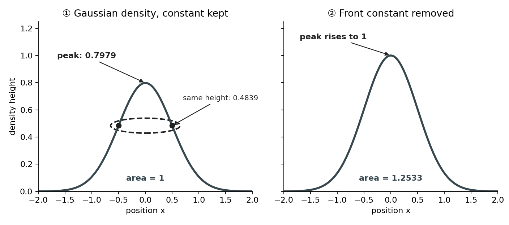
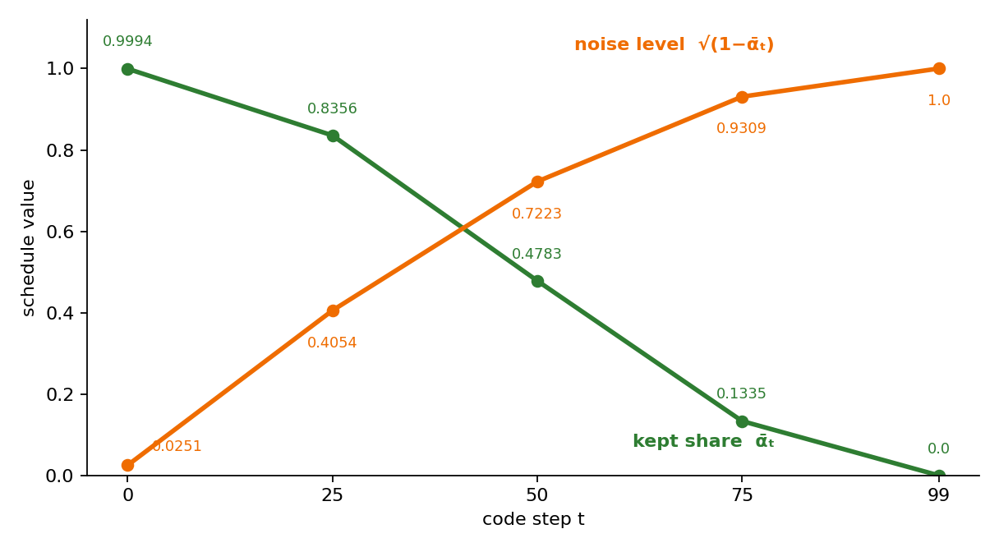
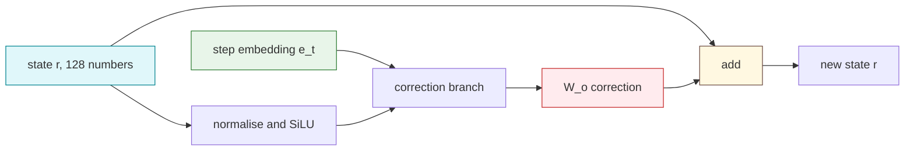
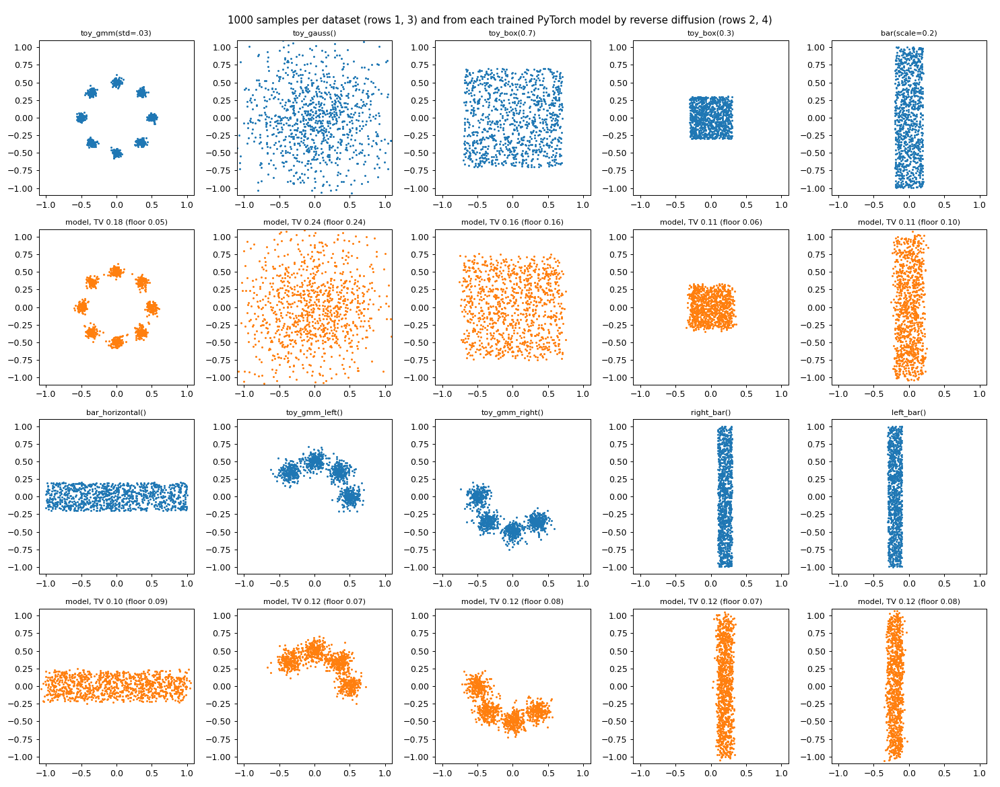
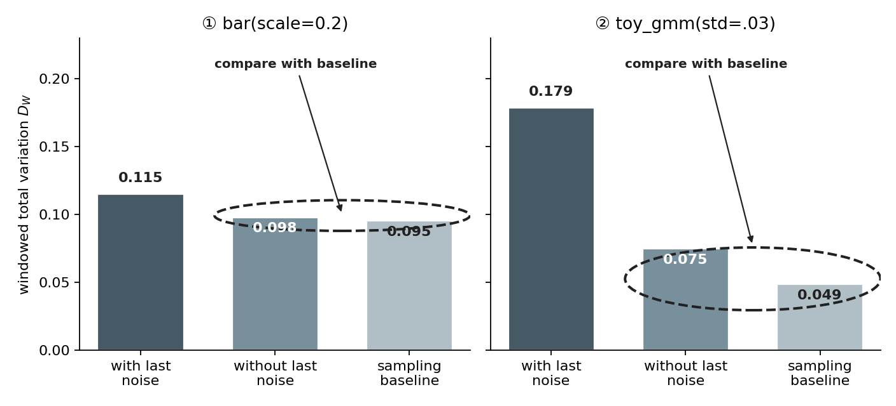

# 🔨 Phase 1: one diffusion expert, from a Gaussian to a trained energy model

You build, in PyTorch, everything the notebook needs to train one 2D diffusion expert: its ten toy datasets, the cosine noise schedule, the ResNet, the energy wrapper whose gradient is the noise prediction, the training loop with a moving average, and the reverse sampler. It ends when your trained model's samples match `datasets-1000-samples-each.png`. The reference is `rebuild/datasets.py`, `rebuild/model.py` and `rebuild/train.py` on branch `unbuild-walk`; open them only after your step runs.

**How to walk it.** `/drip-execute-plan artifacts/drips/simple-distributions-rebuild/01-one-expert-from-scratch.md`, one step per message, typing every block yourself. Each step gives the definition, its derivation, the toy with its numbers, then the code in small pieces. Run each piece before typing the next. The python blocks, typed in order into one file, are one runnable script.

**Where to type.** A fresh folder, `/home-mscluster/mmolefe/Playground/PhD/simple-distributions-walk/`, one file `walk01.py`. Run it with `/home-mscluster/mmolefe/miniforge3/envs/co3/bin/python walk01.py`.

**What teaches it elsewhere.** The forward process and the schedule: [the schedule and one reverse step](../../../../../goal-setting/learning/deep-learning/diffusion-models/01-poe-derivation-foundations/plans/10-schedule-and-reverse-step.md) and the textbook's [forward process by hand](../../../../../goal-setting/learning/deep-learning/diffusion-models/01-poe-derivation-foundations/textbook/09-the-forward-process-by-hand.md). Noise prediction as the score: [noise prediction is the score](../../../../../goal-setting/learning/deep-learning/diffusion-models/01-poe-derivation-foundations/plans/11-noise-prediction-is-the-score.md). The energy: [a scalar energy whose gradient is the noise prediction](../../../../../goal-setting/learning/deep-learning/diffusion-models/02-sampler-correctors-for-composition/plans/34-a-scalar-energy-whose-gradient-is-the-score.md) and the vault note [The Energy Parameterisation](../../../../../Obsidian/Artificial%20Intelligence/Generative%20Modeling/Diffusion%20Models/Composition/The%20Energy%20Parameterisation.md). The big picture: [Diffusion Models](../../../../../Obsidian/Artificial%20Intelligence/Generative%20Modeling/Diffusion%20Models/Diffusion%20Models.md) and [Multivariate Normal Distribution](../../../../../Obsidian/Mathematics/Statistics/Distributions/Multivariate%20Normal%20Distribution/Multivariate%20Normal%20Distribution.md).

**Where the numbers come from.** Every worked number below is printed by `python -m rebuild.walk_numbers` (saved to `rebuild/out/walk-numbers.json`), and every result number comes from `rebuild/out/phase1/phase1.json`.

## Steps

- [Step 0: the setup block](#step-0-the-setup-block)
- [Step 1: a Gaussian you can hold](#step-1-a-gaussian-you-can-hold)
- [Step 2: the ring of eight](#step-2-the-ring-of-eight)
- [Step 3: boxes and bars, and the ten panels](#step-3-boxes-and-bars-and-the-ten-panels)
- [Step 4: the forward process and the cosine schedule](#step-4-the-forward-process-and-the-cosine-schedule)
- [Step 5: the noise is the score, rescaled](#step-5-the-noise-is-the-score-rescaled)
- [Step 6: the ResNet that sees the step](#step-6-the-resnet-that-sees-the-step)
- [Step 7: the energy wrapper](#step-7-the-energy-wrapper)
- [Step 8: the denoising loss](#step-8-the-denoising-loss)
- [Step 9: training with a moving average](#step-9-training-with-a-moving-average)
- [Step 10: the reverse step](#step-10-the-reverse-step)
- [Step 11: the check against the datasets plot](#step-11-the-check-against-the-datasets-plot)

**Colours on this page.** <span style="color:#1565c0">**Blue is the clean point $x_0$**</span>, <span style="color:#00838f">**teal is the noisy point $x_t$**</span>, <span style="color:#6a1b9a">**purple is the noise $\varepsilon$**</span>, <span style="color:#2e7d32">**green is the kept signal share $\bar\alpha_t$**</span>, <span style="color:#ef6c00">**orange is the noise level $\sqrt{1-\bar\alpha_t}$**</span>, <span style="color:#ad1457">**pink is the score**</span>, <span style="color:#6d4c41">**brown is energy $E$**</span>, and <span style="color:#c62828">**red is the prediction $\hat\varepsilon$**</span>. The same colour means the same quantity in every table, chart, diagram and equation.

## Step 0: the setup block

Every later block uses these imports and this device choice. The device rule is the GPU guard in short form: a card with under 1 GB in use, else the CPU.

```python
import math, subprocess
import numpy as np
import matplotlib
matplotlib.use("Agg")
import matplotlib.pyplot as plt
import seaborn as sns
import torch, torch.nn as nn, torch.nn.functional as F
from scipy.stats import norm
from sklearn.mixture import GaussianMixture

def pick_device():
    if not torch.cuda.is_available():
        return torch.device("cpu")
    rows = subprocess.run(["nvidia-smi", "--query-gpu=index,memory.used", "--format=csv,noheader,nounits"],
                          capture_output=True, text=True).stdout.strip().splitlines()
    for r in rows:
        i, used = (int(v) for v in r.split(","))
        if used < 1024:
            return torch.device(f"cuda:{i}")
    return torch.device("cpu")

dev = pick_device()
print("device", dev)
rng = np.random.default_rng(0); torch.manual_seed(0)
```

Running it prints the device, for example `device cuda:0`.

## Step 1: a Gaussian you can hold

**Definition.** The normal density with mean μ and standard deviation σ is

$$\mathcal N(x;\mu,\sigma^2)=\frac{1}{\sigma\sqrt{2\pi}}\exp\!\Big(-\frac{(x-\mu)^2}{2\sigma^2}\Big).$$

**Derivation of the front factor.** Write the density as a constant $C$ times its exponential part. It must integrate to 1 over the whole real line. [Substituting](../../../../../goal-setting/learning/mathematics/textbooks/calculus/calculus-textbook.pdf#page=415) $u=(x-\mu)/\sigma$, so $dx=\sigma\,du$, and using [the Gaussian integral](../../../../../goal-setting/learning/mathematics/textbooks/machine-learning/probabilistic-machine-learning-an-introduction.pdf#page=99) $\int_{-\infty}^{\infty}e^{-u^2/2}du=\sqrt{2\pi}$:

$$
\begin{aligned}
1
&=C\int_{-\infty}^{\infty}
\exp\!\left(-\frac{(x-\mu)^2}{2\sigma^2}\right)dx \\
&=C\sigma\int_{-\infty}^{\infty}e^{-u^2/2}du \\
&=C\sigma\sqrt{2\pi}, \\
C&=\frac{1}{\sigma\sqrt{2\pi}}.
\end{aligned}
$$

$$
\begin{aligned}
\underbrace{1}_{\text{total probability}}
&=
\underbrace{C}_{\text{unknown front factor}}
\underbrace{\int_{-\infty}^{\infty}
\exp\!\left(-\frac{(\textcolor{#00838f}{x}-\mu)^2}{2\sigma^2}\right)dx}_{\text{area of the unscaled bell}} \\
&=
\underbrace{C\sigma}_{\text{constant after changing scale}}
\underbrace{\int_{-\infty}^{\infty}e^{-u^2/2}du}_{\text{standard Gaussian area}} \\
&=
\underbrace{C\sigma\sqrt{2\pi}}_{\text{total area}}, \\
\underbrace{C}_{\text{area-fixing constant}}
&=
\underbrace{\frac{1}{\sigma\sqrt{2\pi}}}_{\text{reciprocal of the unscaled area}}.
\end{aligned}
$$

**What the equation says.** The unscaled exponential has area $\sigma\sqrt{2\pi}$. The constant must be its reciprocal so that multiplying the curve by the constant makes the total area exactly 1.

**Why the integral is there.** A density is [normalised by its area](../../../../../goal-setting/learning/mathematics/textbooks/statistics/introduction-to-probability-for-data-science.pdf#page=190), not by its peak. At $\sigma=0.5$, removing the front factor makes the area 1.2533 instead of 1, even though the curve remains bell-shaped.

**Why the substitution is there.** Dividing displacement by $\sigma$ changes the bell to the standard width. The matching factor $dx=\sigma\,du$ records how a unit of distance stretches under that change.

**Why the exponential, square and ratio are there.** [The exponential](../../../../../goal-setting/learning/mathematics/textbooks/algebra/algebra-handbook.pdf#page=118) turns the negative scaled distance into a positive height. The square treats equal moves left and right alike, while division by $2\sigma^2$ measures distance against the chosen width. On the toy, one $\sigma$ move lowers 0.7979 to 0.4839.

**Why the reciprocal and square root are there.** The reciprocal cancels the unscaled area. The factor $\sqrt{2\pi}$ is the standard Gaussian integral, so omitting it would leave the curve with the wrong total area.

In two dimensions with the same standard deviation on both axes, the two factors multiply, so the front factor is

$$
\frac{1}{2\pi\sigma^2}.
$$

$$
\underbrace{
\frac{1}{\sigma\sqrt{2\pi}}
}_{\text{normalises the first coordinate}}
\underbrace{
\frac{1}{\sigma\sqrt{2\pi}}
}_{\text{normalises the second coordinate}}
=
\underbrace{
\frac{1}{2\pi\sigma^2}
}_{\text{normalises the two-dimensional density}}.
$$

**What the equation says.** An [independent](../../../../../goal-setting/learning/mathematics/textbooks/machine-learning/mathematics-for-machine-learning.pdf#page=200) two-dimensional Gaussian has one normalising factor for each coordinate. Multiplying them gives one factor for area in the plane.

**Why multiplication is there.** A point must receive the height from its first coordinate and the height from its second coordinate together. Removing either factor would normalise only one direction, so the complete surface would not integrate to 1.

**Why the power is there.** Each coordinate contributes one factor of $\sigma$ to the area scale. Two coordinates therefore contribute $\sigma^2$; without that square, changing the spread would scale the two-dimensional area incorrectly.

🧸 **Toy:** σ = 0.5, centred at 0. At x = 0 the density is $1/(0.5\sqrt{2\pi})$ = `0.7979`. At x = 0.5, one standard deviation out, it is that times $e^{-1/2}$ = `0.4839`.

🔤 **The name:** [Gaussian density](../../../../../goal-setting/learning/deep-learning/diffusion-models/01-poe-derivation-foundations/plans/03-densities-and-the-gaussian.md) ([normal density](../../../../../Obsidian/Mathematics/Statistics/Distributions/Multivariate%20Normal%20Distribution/Multivariate%20Normal%20Distribution.md))

---

#### The scene and its table

The toy is a bell-shaped curve centred at zero. Its height is largest at the centre, and equal moves left and right give equal heights.

<table>
<tr><th style="color:#00838f">position <i>x</i></th><th>distance from μ</th><th style="color:#ad1457">density</th></tr>
<tr><td>−0.5</td><td>one σ left</td><td style="border:2px dashed #212121">0.4839</td></tr>
<tr style="background:#fff8e1"><td style="border:2px solid #212121"><b>0</b></td><td>at μ</td><td style="border:2px solid #212121"><b>0.7979</b></td></tr>
<tr><td>0.5</td><td>one σ right</td><td style="border:2px dashed #212121">0.4839</td></tr>
</table>

**How to read this table.** Each row is one position on the horizontal axis. The last column is the curve's height there, not the probability of landing on that exact point.

**What to look for.** The solid boxes mark the peak. The dashed boxes match because the two positions are equally far from the centre. Step 3's bar has density 1.25, which is allowed because [density](../../../../../goal-setting/learning/deep-learning/diffusion-models/01-poe-derivation-foundations/textbook/02-densities-and-the-gaussian.md#21-a-density-can-exceed-1) is probability per unit length or area, not probability itself.

---

#### The base word first: density

**What the word means.** Density means amount per unit of space. A crowd can contain fewer than 100 people while still having more than one person per square metre.

On this toy, the density is the height in the last column. Probability comes from [area under the curve](../../../../../goal-setting/learning/mathematics/textbooks/statistics/introduction-to-probability-for-data-science.pdf#page=190), so a density height may exceed 1 while the whole area remains 1.

$$
\underbrace{P(a\leq X\leq b)}_{\text{probability in an interval}}
=
\underbrace{\int_a^b \textcolor{#ad1457}{\mathcal N(x;\mu,\sigma^2)}\,dx}_{\text{area under the density}}
$$

**What the equation says.** A probability is an area accumulated across an interval. One density value is only a height, so the rule that probabilities stay between 0 and 1 does not apply to that height by itself.

**What it means.** The bar's density 1.25 in Step 3 is not a probability of 1.25. Multiplying it by the bar's area gives total probability 1.

---

#### Then the qualifying word: Gaussian

**What the word means.** Gaussian points to Carl Friedrich Gauss, who used this bell-shaped law while studying measurement errors in astronomy. Equal positive and negative errors were part of the scene he was fitting.

The square makes equal distances on opposite sides of the centre produce the same height.

$$
\underbrace{\mathcal N(\mu-d;\mu,\sigma^2)}_{\text{the same distance left}}
=
\underbrace{\mathcal N(\mu+d;\mu,\sigma^2)}_{\text{the same distance right}}
$$

**What the equation says.** Replacing $d$ by $-d$ does not change $d^2$. On the toy, −0.5 and 0.5 therefore both have density 0.4839.

**What it means.** Gaussian names the particular symmetric bell shape. “Normal” is a historical name for the same density, not a claim that other distributions are abnormal.

---

#### The constant: make the whole area one

The front factor fixes the curve's total area. Remove it at $\sigma=0.5$, and the peak rises from 0.7979 to 1 while the area rises from 1 to 1.2533.

$$
\underbrace{\frac{1}{\sigma\sqrt{2\pi}}}_{\text{sets total area to one}}
\underbrace{\exp\!\left(-\frac{(x-\mu)^2}{2\sigma^2}\right)}_{\text{bell-shaped part}}
$$

**What the equation says.** The exponential supplies the shape. The constant scales every height together so the complete area is exactly one.

**What it means.** Dropping the constant leaves a bell-shaped curve, but it no longer represents a probability density.

---

#### The square: make both sides agree

The square turns signed displacement into nonnegative squared distance.

$$
\underbrace{(\textcolor{#00838f}{x}-\mu)^2}_{\text{same value at equal left and right moves}}
$$

**What the equation says.** At $x=-0.5$ and $x=0.5$, with $\mu=0$, the squared distance is the same. Their densities are therefore both 0.4839.

**What it means.** Remove the square and one side would grow while the other shrank. The curve would lose the paired heights shown in the table.

---

#### The divisor: set the width

The divisor compares squared distance with the scale $\sigma^2$. One standard deviation from the centre, the height is 0.607 of the peak.

$$
\underbrace{\exp\!\left(-\frac{\sigma^2}{2\sigma^2}\right)}_{\text{one standard deviation from the centre}}
=
\underbrace{e^{-1/2}}_{\text{0.607 of the peak}}
$$

**What the equation says.** At a move of one $\sigma$, the $\sigma^2$ terms cancel. The ratio to the peak is always about 0.607, whatever width was chosen.

**What it means.** On the toy, this move lowers the height from 0.7979 to 0.4839.

---

#### Both words together: the formula

A Gaussian density is probability per unit length, shaped as Gauss's symmetric bell and scaled to have area one.

$$
\underbrace{\mathcal N(x;\mu,\sigma^2)}_{\text{Gaussian density}}
=
\underbrace{\frac{1}{\sigma\sqrt{2\pi}}}_{\text{area-fixing constant}}
\underbrace{\exp\!\left(
-\frac{\underbrace{(\textcolor{#00838f}{x}-\mu)^2}_{\text{symmetric squared distance}}}
{\underbrace{2\sigma^2}_{\text{width scale}}}
\right)}_{\text{bell-shaped fall}}
$$

**What the equation says.** The constant fixes the total area, the square makes the two sides agree, and the divisor measures distance in units of the chosen spread.

**Check it on the toy.** At the centre the exponential is 1, so the density is 0.7979. One $\sigma$ away, multiplying by 0.607 gives 0.4839.

<a href="figures/step1-gaussian-density.png"></a>

**How to read this chart.** The x-axis is position and the y-axis is density height. Each point on a curve is one density value. The left panel keeps the constant, while the right panel removes only that constant.

**What to look for.** The entire curve rises when the constant is removed. Its bell shape stays, but the peak changes from 0.7979 to 1 and the area changes from 1 to 1.2533. The paired circles on the left show the square making equal moves share one height.

---

#### The consequence: change one piece

**Drop the constant.** The peak moves from 0.7979 to 1, but the more important change is the area from 1 to 1.2533. The curve stops being a probability density.

**Move one $\sigma$.** The height moves from 0.7979 to 0.4839. The ratio is 0.607 because the square and the divisor reduce the exponent to −1/2.

🎞️ **Moving picture:** the [Gaussian bell scrubber](https://claude.ai/artifact/RM96fos4RSjrCYak7pAqeZ) puts every piece of this formula under your finger. Drag μ, x, the σ in the front constant and the σ in the divisor, or switch the constant and the square off. The area turns amber the moment the curve stops being a density.

<!-- video-table: gaussian-density rev=1 -->
StatQuest, then 3Blue1Brown, on the Gaussian density and why its formula has the pieces it has, in the order to watch:

| Order | What it covers | Kind | Watch |
|---|---|---|---|
| 1 | A curve as a distribution: probability is the area under it over an interval, not its height at a point | Intuition | [StatQuest, Main Ideas behind Probability Distributions, 2:15 to 5:14](https://www.youtube.com/watch?v=oI3hZJqXJuc&t=135s) |
| 2 | The Gaussian formula unpacked one piece at a time | Intuition | [3Blue1Brown, But what is the Central Limit Theorem?, 15:54 to 20:47](https://www.youtube.com/watch?v=zeJD6dqJ5lo&t=954s) |
| 3 | Stripped of its constants the bell is e^(−x²), whose area is √π, so dividing by √π makes the area 1 | Intuition | [3Blue1Brown, Why π is in the normal distribution, 2:07 to 2:59](https://www.youtube.com/watch?v=cy8r7WSuT1I&t=127s) |
| 4 | Two demands on a density in the plane, that it depend only on distance from the centre and that x and y be independent, which make it the product g(x)·g(y) | Intuition | [3Blue1Brown, Why π is in the normal distribution, 13:15 to 15:18](https://www.youtube.com/watch?v=cy8r7WSuT1I&t=795s) |
| 5 | Those two demands force the shape e^(c·r²) with c negative, and a constant in front then rescales the volume to 1 | Proof | [3Blue1Brown, Why π is in the normal distribution, 15:18 to 21:34](https://www.youtube.com/watch?v=cy8r7WSuT1I&t=918s) |

No video found evaluates the density's height at a point, as the toy's 0.7979 and 0.4839 do, or shows a height above 1, as the bar's 1.25 is. Rows 3 to 5 are read from 3Blue1Brown's captions and good to about 30 seconds; rows 1 and 2 are chapter boundaries from each video's chapter list, so the sentence inside each is not checked.
<!-- /video-table -->

🔨 **Build:** type the formula yourself, then compare with SciPy's.

```python
def normal_pdf(x, mu, sd):
    return np.exp(-(x - mu) ** 2 / (2 * sd ** 2)) / (sd * np.sqrt(2 * np.pi))

print("N(0; 0, 0.5^2) =", round(normal_pdf(0.0, 0, 0.5), 4), "  scipy:", round(norm.pdf(0.0, 0, 0.5), 4))
print("N(0.5; 0, 0.5^2) =", round(normal_pdf(0.5, 0, 0.5), 4), "  scipy:", round(norm.pdf(0.5, 0, 0.5), 4))
```

It prints `0.7979` and `0.4839` twice each. Then draw it:

```python
xs = np.linspace(-2, 2, 401)
plt.figure(figsize=(4, 2.5)); plt.plot(xs, normal_pdf(xs, 0, 0.5)); plt.axvline(0.5, ls=":")
plt.title("N(x; 0, 0.5^2)"); plt.tight_layout(); plt.savefig("step01-gaussian.png"); plt.close()
```

## Step 2: the ring of eight

**Definition.** The notebook's `toy_gmm(std=.03)` is a mixture of eight 2D Gaussians with equal weights, their means evenly spaced on a circle of radius 0.5:

$$p(x)=\frac18\sum_{k=0}^{7}\mathcal N\big(x;\ m_k,\ 0.03^2 I\big),\qquad m_k=0.5\,(\cos\tfrac{2\pi k}{8},\ \sin\tfrac{2\pi k}{8}).$$

$$
\underbrace{p(\textcolor{#00838f}{x})}_{\text{ring mixture density}}
=
\underbrace{\frac18}_{\text{equal component weight}}
\underbrace{\sum_{k=0}^{7}}_{\text{add all eight alternatives}}
\underbrace{\mathcal N\!\left(
\textcolor{#00838f}{x};
\underbrace{m_k}_{\text{centre of component }k},
\underbrace{0.03^2 I}_{\text{same narrow variance in both directions}}
\right)}_{\text{density from component }k},
\qquad
\underbrace{m_k}_{\text{centre of component }k}
=
\underbrace{0.5}_{\text{ring radius}}
\underbrace{\left(
\cos\frac{2\pi k}{8},
\sin\frac{2\pi k}{8}
\right)}_{\text{direction of the }k\text{th centre}}.
$$

**What the equation says.** Each value of $k$ places one narrow Gaussian at one of eight equally spaced directions. The mixture density adds their heights and gives every component the same weight of 1/8.

**Why the sum is there.** Before the hidden component is known, the point could have come from any of eight bumps. At $(0.5,0)$ one contribution is 22.1 and the other seven are negligible, while at the centre all eight tiny contributions average to 8.49e-59.

**Why the factor 1/8 is there.** It records the equal chance of choosing each component and keeps the weights summing to 1. Removing it changes the centred component's contribution at the mode from 22.1 to 176.8.

**Why the ratios and trigonometric functions are there.** The fraction $k/8$ advances by one eighth of a full turn. Multiplication by $2\pi$ converts that share into [an angle](../../../../../goal-setting/learning/mathematics/textbooks/trigonometry/trigonometry-handbook.pdf#page=7), and [cosine with sine](../../../../../goal-setting/learning/mathematics/textbooks/trigonometry/trigonometry-handbook.pdf#page=10) converts the angle into two coordinates on the circle.

**Why the radius and square are there.** Multiplication by 0.5 places every mean at radius 0.5. The power in $0.03^2$ converts the [standard deviation](../../../../../goal-setting/learning/mathematics/textbooks/statistics/introduction-to-probability-for-data-science.pdf#page=150) 0.03 into a variance; replacing it by 0.03 would make each bump much wider.

**Derivation of how to sample it.** A mixture is sampled in two draws: pick a component k with probability 1/8, then draw $m_k+0.03\,z$ with $z\sim\mathcal N(0,I)$. The density of the result is the [weighted sum](../../../../../goal-setting/learning/mathematics/textbooks/machine-learning/mathematics-for-machine-learning.pdf#page=190) above, because the two draws are independent.

<!-- video-table: gaussian-mixture rev=1 -->
ritvikmath on the Gaussian mixture model, in the order to watch:

| Order | What it covers | Kind | Watch |
|---|---|---|---|
| 1 | Each class is its own Gaussian with a mean and a covariance, and π is the share of the data in each class | Intuition | [ritvikmath, Gaussian Mixture Model, 0:31 to 3:33](https://www.youtube.com/watch?v=EWd1xRkyEog&t=31s) |
| 2 | The density of one fish: π for tuna times the tuna Gaussian, plus π for salmon times the salmon Gaussian, because the fish came from one or the other | Worked example | [ritvikmath, Gaussian Mixture Model, 3:36 to 6:23](https://www.youtube.com/watch?v=EWd1xRkyEog&t=216s) |
| 3 | The same sum written for K components | Intuition | [ritvikmath, Gaussian Mixture Model, 7:58 to 8:43](https://www.youtube.com/watch?v=EWd1xRkyEog&t=478s) |

He goes on to fit the mixture with the EM algorithm, which composing experts does not need, and he never multiplies or noises a mixture. Times are read from automatic captions and good to about 30 seconds.
<!-- /video-table -->

🧸 **Toy:** at the mode $(0.5,0)$, the centred component contributes

$$
\frac18\cdot\frac{1}{2\pi(0.03)^2}=22.1.
$$

$$
\underbrace{\frac18}_{\text{chance of choosing this component}}
\cdot
\underbrace{\frac{1}{2\pi(0.03)^2}}_{\text{two-dimensional Gaussian peak}}
=
\underbrace{22.1}_{\text{weighted contribution at the mode}}.
$$

**What the equation says.** At its own centre, the component has no distance penalty. Its peak height is multiplied by the 1/8 chance that this component was selected.

**Why multiplication is there.** The component must both be selected and place density at the point. Removing the weight changes the contribution from 22.1 to 176.8 because the full peak would be counted instead of one eighth of it.

**Why the normalising ratio is there.** The denominator $2\pi(0.03)^2$ makes the two-dimensional Gaussian integrate to 1. The square is present because two coordinate widths contribute to area; removing that power would use the wrong area scale.

The other seven components are positive but negligible at the displayed precision, so the full mixture density is also `22.1`. At $(0.53,0)$, the dominant component is one standard deviation from its mean, so its contribution is

$$
22.1\,e^{-1/2}=13.41,
$$

$$
\underbrace{22.1}_{\text{weighted height at the mode}}
\underbrace{e^{-1/2}}_{\text{one-standard-deviation fall}}
=
\underbrace{13.41}_{\text{height at }(0.53,0)}.
$$

**What the equation says.** Moving 0.03 from the mean is one component standard deviation. The Gaussian multiplies its peak by $e^{-1/2}$, reducing the contribution from 22.1 to 13.41.

**Why the exponential is there.** It turns the negative squared-distance penalty into a positive [decay factor](../../../../../goal-setting/learning/mathematics/textbooks/algebra/algebra-handbook.pdf#page=118). Replacing the exponent by zero would make the factor 1, so the value would remain 22.1 instead of falling to 13.41.

**Why the power and the factor 1/2 are there.** One standard deviation makes the squared standardised distance equal 1. The Gaussian's divisor contributes the factor 1/2, producing the exponent $-1/2$ and the same relative fall at any standard deviation.

and again the other seven do not change the displayed value. At the centre, $(0,0)$, all eight modes are 0.5 away, which is 16.7 standard deviations, so their average equals any one component's density there: `8.49e-59`. The ring is effectively empty in the middle.

🔤 **The name:** [mixture](../../../../../goal-setting/learning/deep-learning/generative-models/03-sampling-from-a-graph/plans/28-mixture-as-a-marginal.md) (the ring of eight)

---

#### The scene and its table

Eight narrow bumps sit around a circle. Sampling first chooses a bump, then chooses a point near that bump.

<table>
<tr><th style="color:#00838f">point</th><th>place in the scene</th><th style="color:#ad1457">mixture density</th></tr>
<tr style="background:#fff8e1"><td style="border:2px solid #212121">(0.5, 0)</td><td>top of one bump</td><td style="border:2px solid #212121"><b>22.1</b></td></tr>
<tr><td>(0.53, 0)</td><td>one component sd away</td><td>13.41</td></tr>
<tr style="color:#9e9e9e"><td style="border:2px dashed #212121">(0, 0)</td><td>empty centre</td><td style="border:2px dashed #212121">8.49e-59</td></tr>
</table>

**How to read this table.** Each row evaluates the same eight-component density at one point. The final column adds the weighted heights of all eight bumps.

**What to look for.** The highlighted row is a mode. The grey row is the ring's centre, where every component is far away. Moving from the centre to the mode changes the density from 8.49e-59 to 22.1.

---

#### The smaller word: component

**What the word means.** A component is one piece of something assembled from pieces. On the toy, one component is one Gaussian bump centred at one of the eight ring positions.

$$
\underbrace{\mathcal N(x;m_k,0.03^2I)}_{\text{one component, one bump}}
$$

**What the equation says.** Fixing $k$ selects one centre $m_k$ and evaluates only its bump.

**What it means.** One component explains one local cluster. Eight components are needed to place all eight clusters around the ring.

---

#### The smaller word: weight

**What the word means.** A weight says how much say one piece gets in the whole. Each bump has weight 1/8, so the component chosen for a sample is fair among the eight.

$$
\underbrace{\frac18}_{\text{one component's weight}}
\underbrace{\mathcal N(x;m_k,0.03^2I)}_{\text{that component's density}}
$$

**What the equation says.** The component's height is multiplied by its chance of being chosen. At the mode this turns the single component's peak 176.8 into the mixture contribution 22.1.

**What it means.** Remove the 1/8 at the mode and 22.1 becomes 176.8. That would count one full bump without accounting for the choice among eight.

---

#### The smaller word: mode

**What the word means.** A mode is a bump's top, the place where its density is highest. The highlighted point $(0.5,0)$ is one mode.

$$
\underbrace{x=m_k}_{\text{at a component's centre}}
\quad\Longrightarrow\quad
\underbrace{(x-m_k)^2=0}_{\text{no distance penalty}}
$$

**What the equation says.** At the component centre, the exponential sees zero squared distance and reaches its largest value.

**What it means.** Moving from the centre of the ring to this mode changes the mixture density from 8.49e-59 to 22.1.

---

#### Then the whole word: mixture

**What the word means.** A mixture combines alternative sources. One sample comes from one component, but before the draw you do not know which component it will be.

$$
\underbrace{p(x)}_{\text{mixture density}}
=
\sum_{k=0}^{7}
\underbrace{\frac18}_{\text{chance of component }k}
\underbrace{\mathcal N(x;m_k,0.03^2I)}_{\text{height from component }k}
$$

**What the equation says.** Every possible component contributes its density multiplied by its selection chance. [The sum](../../../../../goal-setting/learning/mathematics/textbooks/machine-learning/mathematics-for-machine-learning.pdf#page=190) accounts for all eight ways the point could have been produced.

**What it means.** “Mixture” does not average sample coordinates. It averages the eight possible density contributions.

---

#### All the words together: the formula

The ring is an [equal-weight mixture](../../../../../Obsidian/Artificial%20Intelligence/Generative%20Modeling/Diffusion%20Models/Composition/Product,%20Mixture%20And%20Negation.md#words-the-three-operators-use) of eight Gaussian components, each with a mode at its own centre.

$$
\underbrace{p(x)}_{\text{eight-bump mixture}}
=
\underbrace{\frac18}_{\text{equal weight}}
\sum_{k=0}^{7}
\underbrace{\mathcal N\!\left(
\textcolor{#00838f}{x};
\underbrace{m_k}_{\text{component mode}},
0.03^2I
\right)}_{\text{component }k}
$$

**What the equation says.** Choose one of eight centres with weight 1/8, then use the Gaussian density around that centre. Summing those alternatives gives the density before the hidden choice is known.

**Check it on the toy.** At $(0.5,0)$ the centred component's weighted peak is 22.1 and the other seven are negligible at the displayed precision. At $(0,0)$ all eight distant contributions average to 8.49e-59.

---

#### The consequence: move or remove

**Remove the weight.** At the mode, the displayed height changes from 22.1 to 176.8.

**Move into the ring.** From $(0,0)$ to $(0.5,0)$, the density changes from 8.49e-59 to 22.1. The name “mixture” explains why one high component can dominate locally even though all eight remain in the sum.

<!-- video-table: mixture-components-and-weights rev=1 -->
Stanford CME296, then Luis Serrano, on a density built as a weighted sum of Gaussian bumps, in the order to watch:

| Order | What it covers | Kind | Watch |
|---|---|---|---|
| 1 | Noise every training point with the same Gaussian and the result is a mixture of Gaussians, one bump per point; a larger σ spreads every bump wider | Intuition | [CME296, lecture 2, 26:04 to 29:43](https://www.youtube.com/watch?v=_WaR2fjZpEQ&t=1564s) |
| 2 | The Gaussian mixture model itself, after the video's clustering set-up | Intuition | [Serrano, Gaussian Mixture Models, 10:33 to 17:27](https://www.youtube.com/watch?v=q71Niz856KE&t=633s) |

Neither evaluates a mixture at a point between its bumps, as the ring's centre gives 8.49e-59, and no proof was found; ritvikmath's fish in the Gaussian mixture table is the worked example. Row 1 is read from CME296's captions and good to about 30 seconds; row 2 is a chapter boundary from Serrano's chapter list, so the sentence inside it is not checked.
<!-- /video-table -->

🔨 **Build:** the sampler and the density.

```python
RING = 0.5 * np.c_[np.cos(2 * np.pi * np.arange(8) / 8), np.sin(2 * np.pi * np.arange(8) / 8)]

def toy_gmm(n, std=0.03, rng=rng):
    k = rng.integers(0, 8, n)
    return RING[k] + std * rng.standard_normal((n, 2))

def ring_density(x, std=0.03):
    d2 = ((x[:, None, :] - RING[None]) ** 2).sum(-1)
    return np.exp(-d2 / (2 * std ** 2)).mean(1) / (2 * np.pi * std ** 2)

print(np.round(ring_density(np.array([[0.5, 0.0], [0.53, 0.0], [0.0, 0.0]])), 2))
```

It prints `[22.1  13.41  0.  ]`. Now check the sampler with scikit-learn: a mixture fitted to 4000 samples should find eight means on the circle of radius 0.5.

```python
pts = toy_gmm(4000)
gm = GaussianMixture(8, random_state=0).fit(pts)
print("fitted mean radii:", np.round(np.sort(np.hypot(*gm.means_.T)), 3))
print("fitted sds:", np.round(np.sort(np.sqrt(gm.covariances_[:, 0, 0])), 3))
```

The radii come out at 0.5 and the standard deviations near 0.03, give or take 0.002.

🎞️ **Moving picture:** the density as a heatmap with the samples over it, drawn with seaborn:

```python
fig, ax = plt.subplots(figsize=(4, 4))
sns.kdeplot(x=pts[:, 0], y=pts[:, 1], fill=True, levels=20, bw_adjust=0.5, ax=ax)
ax.scatter(*pts[:400].T, s=2, c="k"); ax.set_aspect("equal"); ax.set_xlim(-1.1, 1.1); ax.set_ylim(-1.1, 1.1)
plt.tight_layout(); plt.savefig("step02-ring.png"); plt.close()
```

## Step 3: boxes and bars, and the ten panels

**Definition.** A [uniform density](../../../../../goal-setting/learning/mathematics/textbooks/machine-learning/deep-learning-textbook.pdf#page=74) on a rectangle of width w and height h is $1/(wh)$ inside and 0 outside. `toy_box(0.7)` is uniform on $[-0.7,0.7]^2$; `bar(0.2)` is uniform on $[-0.2,0.2]\times[-1,1]$; `right_bar()` and `left_bar()` are bars of half-width 0.1 centred at $x_1=\pm0.2$; `toy_gmm_left()` and `toy_gmm_right()` keep ring modes 0 to 3 and 4 to 7 with sd 0.075; `toy_gauss()` is $\mathcal N(0,0.5^2I)$.

**Derivation.** A density integrates to 1, and the rectangle's area is wh, so the constant must be $1/(wh)$.

$$
\underbrace{p(\textcolor{#00838f}{x})}_{\text{uniform rectangle density}}
=
\begin{cases}
\underbrace{\dfrac{1}{\underbrace{wh}_{\text{rectangle area}}}}_{\text{constant height inside}},
& \underbrace{\textcolor{#00838f}{x}\text{ inside the rectangle}}_{\text{allowed region}}, \\[4pt]
\underbrace{0}_{\text{no density outside}},
& \underbrace{\textcolor{#00838f}{x}\text{ outside the rectangle}}_{\text{excluded region}}.
\end{cases}
$$

**What the equation says.** Every point inside the rectangle receives the same density height. Points outside receive zero, and the inside height is the reciprocal of the rectangle's area.

**Why the product is there.** Width times height gives area, which is the amount of two-dimensional space carrying density. For `toy_box(0.7)`, the widths are 1.4 and 1.4, producing density 0.5102. For `bar(0.2)`, the widths are 0.4 and 2, producing density 1.25.

**Why the reciprocal is there.** Multiplying the constant height by the rectangle's area must give [total probability 1](../../../../../goal-setting/learning/mathematics/textbooks/statistics/introduction-to-probability-for-data-science.pdf#page=190). Replacing the reciprocal with the area would make large rectangles taller rather than shorter and would not normalise the density.

**Why the two cases are there.** Uniform means constant on the allowed rectangle, not constant across the whole plane. Removing the zero case would spread positive density over infinite area, so the total probability could not remain 1.

🧸 **Toy:** `toy_box(0.7)` has area $1.4^2$, so its density is `0.5102`. `bar(0.2)` has area $0.4\times2$, so its density is `1.25`.

🔤 **The name:** boxes, bars and panels

---

#### The scene and its table

Five of the ten datasets are flat rectangles: every point inside is equally likely and nothing lands outside. Each differs from the others only in its width and height.

<table>
<tr><th>dataset</th><th>width × height</th><th>area</th><th style="color:#ad1457">density inside, 1/area</th></tr>
<tr style="background:#fff8e1"><td><b>toy_box(0.7)</b></td><td>1.4 × 1.4</td><td style="border:2px solid #212121">1.96</td><td style="border:2px dashed #212121"><b>0.5102</b></td></tr>
<tr><td>toy_box(0.3)</td><td>0.6 × 0.6</td><td>0.36</td><td>2.778</td></tr>
<tr style="background:#fff8e1"><td><b>bar(0.2)</b></td><td>0.4 × 2</td><td style="border:2px solid #212121">0.8</td><td style="border:2px dashed #212121"><b>1.25</b></td></tr>
<tr><td>bar_horizontal()</td><td>2 × 0.4</td><td>0.8</td><td>1.25</td></tr>
<tr><td>right_bar(), left_bar()</td><td>0.2 × 2</td><td>0.4</td><td>2.5</td></tr>
</table>

**How to read this table.** Each row is one flat dataset. The solid boxes are the areas and the dashed boxes the densities they produce, and the two highlighted rows are this step's toy.

**What to look for.** The density column is always one over the area column. Halve the area and the height doubles, which is why the narrow side bars stand at 2.5 while the wide box stands at 0.5102.

---

#### The word: box

**What the word means.** A box is a container with straight sides. Here it is a square, the same width both ways, centred on the origin: `toy_box(s)` covers $[-s,s]^2$.

$$
\underbrace{p_{\text{box}}(\textcolor{#00838f}{x})}_{\text{box density inside}}
=
\frac{1}{\underbrace{(2s)^2}_{\text{side times side}}}
$$

**What the equation says.** A box of half-width $s$ has side $2s$, so its area is $(2s)^2$ and its height inside is one over that.

**What it means.** Shrink the box from $s=0.7$ to $s=0.3$ and the density rises from 0.5102 to 2.778. The same total probability packed into a smaller square stands taller.

---

#### The word: bar

**What the word means.** A bar is a long thin strip, like a bar of chocolate. Here `bar(scale)` is $2\cdot\text{scale}$ wide and the full 2 high, and `bar_horizontal()` is the same strip turned on its side.

$$
\underbrace{p_{\text{bar}}(\textcolor{#00838f}{x})}_{\text{bar density inside}}
=
\frac{1}{\underbrace{2\cdot\text{scale}}_{\text{width}}\ \cdot\ \underbrace{2}_{\text{height}}}
$$

**What the equation says.** The bar's area is its narrow width times its full height, and its density is one over that area.

**What it means.** Turn the bar on its side and the density stays 1.25, because the area is still 0.8. Halve its width to 0.2, as `right_bar()` and `left_bar()` do, and the density doubles from 1.25 to 2.5.

---

#### The word: panel

**What the word means.** A panel is one framed picture in a grid of pictures, like one square of a comic strip. Here it is one subplot of the 2 by 5 figure: 1000 samples of one dataset scattered over the square from −1.1 to 1.1.

$$
\underbrace{\text{panel }k}_{\text{one subplot}}
=
\underbrace{\{\textcolor{#00838f}{x}^{(1)},\ldots,\textcolor{#00838f}{x}^{(1000)}\}}_{\text{1000 draws}}
\sim
\underbrace{p_k}_{\text{dataset }k\text{'s density}}
$$

**What the equation says.** Each panel shows 1000 points drawn from one of the ten densities, all on the same axes.

**What it means.** A panel shows density as how tightly the dots pack. The `toy_box(0.3)` panel's 1000 dots crowd 2.778 / 0.5102 = 5.4 times as tightly as the `toy_box(0.7)` panel's.

---

#### All the words together: the formula

Every box and bar is the uniform rectangle density from the definition, with its own width and height.

$$
\underbrace{p(\textcolor{#00838f}{x})}_{\text{box or bar density}}
=
\underbrace{\frac{1}{wh}}_{\text{one over the area}}
\cdot
\underbrace{\mathbf 1\{\textcolor{#00838f}{x}\text{ inside}\}}_{\text{1 inside the rectangle, 0 outside}}
$$

**What the equation says.** Inside the rectangle the height is one over its area, and outside it is zero, so the total probability is exactly 1.

**Check it on the toy.** `toy_box(0.7)` has $w=h=1.4$ and density 0.5102. `bar(0.2)` has $w=0.4$, $h=2$ and density 1.25.

---

#### The consequence: swap the box for the bar

**From the box to the bar.** The area falls from 1.96 to 0.8, so the density rises from 0.5102 to 1.25. In the ten panels the bar's dots sit visibly closer together than the wide box's.

🔨 **Build:** all ten samplers, then the ten panels of `datasets-1000-samples-each.png`.

```python
def box(n, s, rng=rng): return rng.uniform(-s, s, (n, 2))
def bar(n, scale=0.2, rng=rng):
    d = rng.uniform(-1, 1, (n, 2)); d[:, 0] *= scale; return d
def bar_horizontal(n, scale=0.2, rng=rng):
    d = rng.uniform(-1, 1, (n, 2)); d[:, 1] *= scale; return d
def shifted_bar(n, c, rng=rng):
    d = rng.uniform(-1, 1, (n, 2)); d[:, 0] = d[:, 0] * 0.1 + c; return d
def half_ring(n, idx, rng=rng):
    k = rng.choice(idx, n); return RING[k] + 0.075 * rng.standard_normal((n, 2))

PANELS = {
    "toy_gmm(std=.03)": lambda n: toy_gmm(n), "toy_gauss()": lambda n: 0.5 * rng.standard_normal((n, 2)),
    "toy_box(0.7)": lambda n: box(n, 0.7), "toy_box(0.3)": lambda n: box(n, 0.3),
    "bar(scale=0.2)": lambda n: bar(n), "bar_horizontal()": lambda n: bar_horizontal(n),
    "toy_gmm_left()": lambda n: half_ring(n, [0, 1, 2, 3]), "toy_gmm_right()": lambda n: half_ring(n, [4, 5, 6, 7]),
    "right_bar()": lambda n: shifted_bar(n, 0.2), "left_bar()": lambda n: shifted_bar(n, -0.2),
}
fig, ax = plt.subplots(2, 5, figsize=(15, 6))
for a, (name, f) in zip(ax.ravel(), PANELS.items()):
    d = f(1000); a.scatter(*d.T, s=2); a.set_title(name, fontsize=9)
    a.set_xlim(-1.1, 1.1); a.set_ylim(-1.1, 1.1); a.set_aspect("equal")
plt.tight_layout(); plt.savefig("step03-ten-datasets.png"); plt.close()
print("bar density 1/(0.4*2) =", 1 / (0.4 * 2), "  box(0.7) density =", round(1 / 1.4 ** 2, 4))
```

Open `step03-ten-datasets.png` beside the repo's `datasets-1000-samples-each.png`: same ten shapes, different random points.

## Step 4: the forward process and the cosine schedule

**Definition.** The forward process adds Gaussian noise in T = 100 steps. With $\beta_t$ the noise added at step t and $\bar\alpha_t=\prod_{j=0}^{t}(1-\beta_j)$, the noisy point $x_t$ drawn from the clean point $x_0$ is

$$q(x_t\mid x_0)=\mathcal N\big(x_t;\ \sqrt{\bar\alpha_t}\,x_0,\ (1-\bar\alpha_t)I\big),\qquad x_t=\sqrt{\bar\alpha_t}\,x_0+\sqrt{1-\bar\alpha_t}\,\varepsilon .$$

$$
\underbrace{q(\textcolor{#00838f}{x_t}\mid\textcolor{#1565c0}{x_0})}_{\text{distribution of the noisy point given the clean point}}
=
\mathcal N\!\left(
\textcolor{#00838f}{x_t};
\underbrace{\sqrt{\textcolor{#2e7d32}{\bar\alpha_t}}\,
\textcolor{#1565c0}{x_0}}_{\text{conditional mean}},
\underbrace{(1-\textcolor{#2e7d32}{\bar\alpha_t})I}_{\text{noise covariance}}
\right),
\qquad
\underbrace{\textcolor{#00838f}{x_t}}_{\text{sampled noisy point}}
=
\underbrace{\sqrt{\textcolor{#2e7d32}{\bar\alpha_t}}\,
\textcolor{#1565c0}{x_0}}_{\text{kept clean signal}}
+
\underbrace{\textcolor{#ef6c00}{\sqrt{1-\bar\alpha_t}}\,
\textcolor{#6a1b9a}{\varepsilon}}_{\text{added Gaussian noise}}.
$$

**What the equation says.** Given the clean point, the noisy point is Gaussian. Its centre is a shrunken clean point, and its covariance is the complementary share of variance. The sampling formula produces exactly that Gaussian using one standard normal draw.

**Why conditioning is there.** The bar means that the clean point is held fixed while the noise is drawn. Removing [the condition](../../../../../goal-setting/learning/mathematics/textbooks/statistics/introduction-to-probability-for-data-science.pdf#page=287) would describe the whole noisy data distribution, which also [averages over all possible clean points](../../../../../goal-setting/learning/mathematics/textbooks/statistics/introduction-to-probability-for-data-science.pdf#page=266) ([video, 23:01](https://www.youtube.com/watch?v=Mi8wnYc1m04&t=1381s)).

**Why the complements are there.** The signal receives variance share $\bar\alpha_t$, while the noise receives the remaining share. At $t=50$, the signal share is 0.4783 and the noise standard deviation is 0.7223.

**Why the square roots are there.** The formula multiplies point coordinates, so it needs [standard-deviation scales](../../../../../goal-setting/learning/mathematics/textbooks/machine-learning/mathematics-for-machine-learning.pdf#page=200) rather than variance shares. At $t=50$, the clean point is multiplied by 0.6916, not by 0.4783. Removing the square root would give the clean term the wrong variance. The rule behind this, [scaling a draw scales its variance by the square](#step4-the-scaling-rule), is derived with the one-shot formula below.

<a href="../../results/how-the-forward-process-dissolves-an-image/why-the-noise-carries-a-square-root.png"></a>

**How to read this.** The x-axis runs from −4 to 4. The blue row is 300 draws of X with spread 1, and the orange row is the same 300 draws multiplied by c = 0.7223. The bar under each row spans one spread either side of the middle, and the spread and variance are printed beside it.

**What to look for.** Scale every dot by 0.7223 and the spread becomes 0.722 while the variance becomes 0.522, which is 1 − ᾱ₅₀. Variance is the square of the scale, so a variance share needs its square root before it multiplies anything. Live: [Derive 2](https://claude.ai/artifact/X7QGLTxssbz41G7iTiRxC9#derive-2).

**Why the identity matrix is there.** The same noise variance is used [independently on both coordinates](../../../../../goal-setting/learning/mathematics/textbooks/machine-learning/understanding-deep-learning.pdf#page=471). Removing $I$ would leave the scalar variance without saying how it acts on a two-dimensional point.

**Indexing convention.** The code's step index t runs from 0 to 99, and code index t = 0 is already the first noisy state, so $\bar\alpha_0=0.9994$ and not 1. The common paper notation shifts every index by one: code step t is paper step t + 1. This page keeps $x_0$ as the name of the clean point, as the other layers of the ladder do, so $x_0$ always means the clean point, and $x_t$ for t = 0 to 99 means the noisy point at code step t. Where the one-step formula below or Step 10's reverse step is evaluated at t = 0, its $x_{t-1}$ is the clean point $x_0$ and its $\bar\alpha_{t-1}$ is taken as 1.

**The cosine schedule.** Let the fixed offset be $\delta=0.008$ (the code's argument `s`). 100 steps have 101 boundaries, the way 100 gaps need 101 fence posts. [A boundary value](../../../../../Obsidian/Artificial%20Intelligence/Generative%20Modeling/Diffusion%20Models/The%20Cosine%20Noise%20Schedule.md#the-boundary-values-c_k) $C_k$ is the share of the clean signal's variance still kept at post k, for k = 0, …, 100. Steps live between the posts, and step t runs from post t to post t + 1. The formula for $C_k$ lives on a quarter circle, so build that circle by hand first, on paper, at 10 cm to 1 unit.

**Quick reference.** Keep the [trigonometry handbook](../../../../../Obsidian/Mathematics/references/textbooks/trigonometry/trigonometry-handbook.pdf) open beside this section: [radians and degrees, p. 7](../../../../../Obsidian/Mathematics/references/textbooks/trigonometry/trigonometry-handbook.pdf#page=7), [the unit circle, p. 10](../../../../../Obsidian/Mathematics/references/textbooks/trigonometry/trigonometry-handbook.pdf#page=10), [the squared cosine, p. 16](../../../../../Obsidian/Mathematics/references/textbooks/trigonometry/trigonometry-handbook.pdf#page=16).

**The names, one frame each.** The scene takes the formula's names apart: [boundary value](https://claude.ai/artifact/X7QGLTxssbz41G7iTiRxC9#timetable-name-boundary-value), [cosine](https://claude.ai/artifact/X7QGLTxssbz41G7iTiRxC9#timetable-name-cosine), [offset](https://claude.ai/artifact/X7QGLTxssbz41G7iTiRxC9#timetable-name-offset) and [normaliser](https://claude.ai/artifact/X7QGLTxssbz41G7iTiRxC9#timetable-name-normaliser), each with a switch that removes it.

<a id="step4-the-quarter-circle-by-hand"></a>**✏️ On paper 1: the plane and the quarter circle.**

1. Draw the x-axis to the right and the y-axis up, meeting at the origin O.
2. Mark 1 on each axis, 10 cm from O.
3. Draw [the quarter circle](../../../../../Obsidian/Artificial%20Intelligence/Generative%20Modeling/Diffusion%20Models/The%20Quarter%20Circle%20Under%20The%20Cosine%20Schedule.md#build-the-quarter-circle-by-hand) of radius 10 cm from (1, 0) round to (0, 1).

**Consequence.** Every point on that arc is exactly 1 from O. That exact 1 is what will keep the total variance at 1.

**On the scene.** [The point on the plane](https://claude.ai/artifact/X7QGLTxssbz41G7iTiRxC9#timetable-plane) draws the arc with one point on it.

**✏️ On paper 2: polar coordinates, one line from the origin.**

1. Pick a point on the arc and draw the line from O to it.
2. Describe the point by its angle θ from the x-axis and its length 1, instead of by (x, y).
3. Drop a vertical line from the point to the x-axis. That makes a [right triangle inside the unit circle](../../../../../Obsidian/Mathematics/Trigonometry/The%20Unit%20Circle.md).
4. Its horizontal leg is cos θ and its vertical leg is sin θ, as on [the unit circle](../../../../../goal-setting/learning/mathematics/textbooks/trigonometry/trigonometry-handbook.pdf#page=10).

**Consequence.** (x, y) = (cos θ, sin θ), and [Pythagoras](../../../../../goal-setting/learning/mathematics/textbooks/general/pre-algebra-handbook.pdf#page=72) on that triangle gives two shares that always add to one:

$$
\underbrace{\cos^2\theta}_{\text{horizontal leg, squared}}
+
\underbrace{\sin^2\theta}_{\text{vertical leg, squared}}
=
\underbrace{1}_{\text{radius squared}}.
$$

**On the scene.** [The legs and their shares](https://claude.ai/artifact/X7QGLTxssbz41G7iTiRxC9#timetable-polar) draws both legs and one bar that the two squared legs always fill. It asks you to predict the vertical leg first.

**✏️ On paper 3: measure the angle twice.**

1. Read the angle in degrees with a protractor.
2. Lay a string along the arc from (1, 0) to the point and measure it. On a 10 cm radius, centimetres ÷ 10 gives [radians](../../../../../goal-setting/learning/mathematics/textbooks/trigonometry/trigonometry-handbook.pdf#page=7).
3. At 46.25° the string measures 8.07 cm, which is 0.8072 rad. At 90° it measures 15.71 cm, which is π/2 = 1.5708.
4. The rule is [radians = degrees × π/180](../../../../../Obsidian/Mathematics/Trigonometry/Radians.md).

**Consequence.** The π/2 in the formula is the length of the whole quarter arc, which is 90°.

**On the scene.** [Radians as arc length](https://claude.ai/artifact/X7QGLTxssbz41G7iTiRxC9#timetable-radians) highlights the arc of 0.8072, then lays it flat beside π/2 = 1.5708.

<a id="step4-where-the-position-goes"></a>**✏️ On paper 4: where the position goes.**

**The three letters.** $k$ is the post number, 0 to 100, which the code's [schedule function](../../../toy/rebuild/model.py) (`cosine_beta_schedule`, lines 13 to 17) builds as `x = np.linspace(0, timesteps, steps)`. $T$ is the number of steps, 100, the code's `timesteps`. $\delta$ is the offset, 0.008, the code's `s`.

**Where the formula comes from.** Nichol and Dhariwal (2021) write the schedule as [equation 17, p. 4](https://arxiv.org/pdf/2102.09672#page=4). Their t is a post k, their s is δ, and their $\bar\alpha_t=f(t)/f(0)$ is this page's $C_k$:

$$
f(k)
=
\cos^2\!\Big(
\underbrace{\frac{k/T+\delta}{1+\delta}}_{\text{the position }p_k}
\cdot
\underbrace{\frac{\pi}{2}}_{\text{quarter turn}}
\Big).
$$

$p_k$ is this page's own name for the bracket: how far round the quarter turn post k sits. The paper gives it as a design choice with no derivation. Its straight-line form still follows from three requirements, so you can derive it on paper.

1. Turn the arc into a ruler: 0 at the x-axis and 1 at the y-axis, so position p sits at angle p × 90°.
2. Write $u=k/T$, the fraction of the schedule done, from 0 to 1. Without the offset, post k sits at $p=u=k/100$.
3. Space the posts evenly. The cos² curve already makes the noise uneven, so the posts themselves step evenly, and that makes p a [straight line](../../../../../Obsidian/Mathematics/references/textbooks/algebra/algebra-handbook.pdf#page=38) in u (the handbook's y = mx + b, with its slope m as a and its intercept b as b). A slope times u plus a start is an [affine function](../../../../../Obsidian/Mathematics/references/textbooks/machine-learning/understanding-deep-learning.pdf#page=53):

$$
p
=
\underbrace{b}_{\text{where post 0 sits}}
+
\underbrace{a}_{\text{run per unit of }u}
\,
\underbrace{u}_{k/T}.
$$

4. Land the last post exactly on the quarter turn, so that $C_{100}=0$ and no clean signal is left. The last post is u = 1:

$$
p(1)
=
\underbrace{b+a}_{\text{start plus the whole run}}
=
\underbrace{1}_{90^\circ}.
$$

5. Start the first post a little past 0, by the offset. Shift u forward by δ, then rescale so that move 4 still holds:

$$
p
=
\frac{u+\delta}{1+\delta}
=
\underbrace{\frac{\delta}{1+\delta}}_{b}
+
\underbrace{\frac{1}{1+\delta}}_{a}\,u,
\qquad
b+a=\frac{\delta+1}{1+\delta}=1\ \checkmark
$$

6. Put $u=k/T$ back in. Post k sits at

$$
\boxed{\;
p_k
=
\underbrace{\frac{k/T+\delta}{1+\delta}}_{\text{position on the arc}}
=
\frac{k/100+0.008}{1.008}
=
\frac{k+0.8}{100.8},
\qquad
\theta_k=p_k\cdot90^\circ
\;}
$$

where the last form multiplies the top and the bottom by 100.

7. Mark the posts from the straight line. With δ = 0.008, $a=1/1.008=0.99206$ and $b=0.008/1.008=0.0079365$, so each post adds $a/T=0.0099206$:

$$
\begin{aligned}
p_0&=0.0079365+0\times0.0099206=0.00794 &&\to\ 0.714^\circ\\
p_1&=0.0079365+1\times0.0099206=0.01786 &&\to\ 1.607^\circ\\
p_{51}&=0.0079365+51\times0.0099206=0.51389 &&\to\ 46.25^\circ\\
p_{100}&=0.0079365+100\times0.0099206=1 &&\to\ 90^\circ
\end{aligned}
$$

**Why the straight line is there.** Equal steps in u move every post the same distance round the arc, $a/T=0.0099206$ of the way, which is 0.8929°. Check it on two neighbours: $p_{51}-p_{50}=0.51389-0.50397=0.00992$, and 0.00992 × 90° = 0.893°. All the unevenness in the noise then comes from cos², which [On paper 5](#step4-the-quarter-circle-by-hand) measures. Without the offset a = 1, and each post moves exactly 0.9°.

<a id="step4-dropping-the-rescale"></a>**Why $b+a=1$ is there.** It keeps post 100 on the y-axis. Drop the ÷ (1 + δ), so that p = u + δ, and follow post 100:

1. $p_{100}=1+0.008=1.008$ of the way round.
2. $\theta_{100}=1.008\times90^\circ=90.72^\circ$, past the quarter turn.
3. $\cos^2 90.72^\circ=0.000158$, so $\textcolor{#2e7d32}{C_{100}}=0.000158$ instead of 0.

The last step then never removes all of the clean signal. Move 4's requirement is the one that broke.

**Why the offset enters as b.** $b=\delta/(1+\delta)=0.0079365$ is where post 0 sits, at 0.714° instead of 0°. What that buys, a first step with enough noise in it, is worked under "Why the offset is there" below.

**Consequence.** δ slides the first post just off the axis. Dividing by 1 + δ = 1.008 pulls the last post back onto 90°, and every post in between moves the same 0.8929°.

**The same line in the code.** Line 16 of the schedule function, with each piece's symbol under it:

```python
alphas_cumprod = np.cos(((x / timesteps) + s) / (1 + s) * np.pi * 0.5) ** 2
#                └────┘  └─────────────┘ └─┘  └───────┘ └───────────┘  └──┘
#                 cos        u = k/T     + δ  ÷ (1 + δ)  × π/2 (90°)    ²
```

**On the scene.** [The 101 posts](https://claude.ai/artifact/X7QGLTxssbz41G7iTiRxC9#timetable-posts) puts every post on the arc with a δ handle. Drag δ to 0 to see the broken run below; its equation then reads (k + 0.0)/100.0, the same fraction with δ = 0. [Where each post's position comes from](https://claude.ai/artifact/X7QGLTxssbz41G7iTiRxC9#timetable-position-derived) walks the three requirements and lets you move δ, T, a and b, or switch off the ÷ (1 + δ), while the posts, the C_k curve and C₁₀₀ respond.

**✏️ On paper 5: play with the quarter turn.**

1. Put the point at 0°, 15°, 30°, 45°, 60°, 75° and 90° and read x² each time: 1, 0.933, 0.75, 0.5, 0.25, 0.067, 0.
2. Subtract neighbours: 0.067, 0.183, 0.25, 0.25, 0.183, 0.067.
3. Put the point at 46.25° and measure both legs.

**Consequence.** x² [barely moves near 0° and 90°](../../../../../Obsidian/Mathematics/Trigonometry/The%20Cosine%20Wave.md) and falls fastest in the middle, so the kept share drops slowly at both ends of the schedule. The two legs at 46.25° are the multipliers of step 50:

$$
\big(\cos46.25^\circ,\ \sin46.25^\circ\big)
=
(0.6915,\ 0.7224)
\approx
\Big(
\underbrace{\sqrt{\textcolor{#2e7d32}{\bar\alpha_{50}}}}_{\text{clean-point multiplier }0.6916},\
\underbrace{\textcolor{#ef6c00}{\sqrt{1-\bar\alpha_{50}}}}_{\text{noise multiplier }0.7223}
\Big).
$$

The point at 46.25° is within 0.0001 of step 50's two multipliers, and its squared legs add as 0.4782 + 0.5218 = 1. Walking the point round the quarter turn is the forward process.

**On the scene.** [The quarter turn](https://claude.ai/artifact/X7QGLTxssbz41G7iTiRxC9#timetable-quarter-turn) steps the point every 15° and asks which turn drops most before it shows the drops.

With the circle built, define the 101 boundary values, for $k=0,\ldots,T$:

$$
C_k=
\frac{
\cos^2\!\left(\frac{k/T+\delta}{1+\delta}\frac{\pi}{2}\right)
}{
\cos^2\!\left(\frac{\delta}{1+\delta}\frac{\pi}{2}\right)
}.
$$

$$
\underbrace{C_k}_{\text{normalised cosine boundary}}
=
\frac{
\underbrace{
\cos^2\!\left(
\underbrace{\frac{k/T+\delta}{1+\delta}}_{\text{position}}
\underbrace{\frac{\pi}{2}}_{\text{quarter turn}}
\right)
}_{\text{squared cosine at boundary }k}
}{
\underbrace{
\cos^2\!\left(
\frac{\delta}{1+\delta}\frac{\pi}{2}
\right)
}_{\text{starting value used for normalisation}}
}.
$$

**What the equation says.** The numerator follows a [squared cosine](../../../../../goal-setting/learning/mathematics/textbooks/trigonometry/trigonometry-handbook.pdf#page=16) from the start toward zero. The denominator divides every boundary by the starting value, so the normalised schedule begins at exactly 1.

<a href="../../results/how-the-forward-process-dissolves-an-image/one-cosine-boundary-by-hand.png"></a>

**How to read this.** The left panel runs one boundary, k = 51, through the formula line by line. The middle panel is the quarter circle of radius 1: the teal point sits at post 51's angle, and the blue segment along the x-axis is its cosine. The green bar on the right, out of a full bar of 1, is cos², the share kept.

**What to look for.** At k = 51 the position is 0.5139, the angle is 46.25°, the cosine is 0.6915, cos² of it is 0.4782, and dividing by f(0) = 0.99984 gives C₅₁ = 0.4783. The green bar fills just under half, so a little past halfway round the turn, a little under half the clean signal's variance is left. Live: [Timetable 2](https://claude.ai/artifact/X7QGLTxssbz41G7iTiRxC9#timetable-2).

**Why the ratio $k/T$ is there.** It turns boundary numbers from 0 through 100 into positions from 0 through 1. Without division by $T$, the cosine would run through many turns instead of one scheduled interval.

**Why the offset is there.** The value $\delta=0.008$ shifts the cosine slightly before rescaling. The obvious alternative is to start post 0 at exactly 0°, but near 0° cos² is flat: [its slope](../../../../../goal-setting/learning/mathematics/textbooks/calculus/calculus-handbook.pdf#page=19) is

$$
\frac{d}{d\theta}\cos^2\theta
=
\underbrace{2\cos\theta}_{\text{outer square}}\cdot\underbrace{(-\sin\theta)}_{\text{inner cosine}}
=
-2\cos\theta\sin\theta,
$$

which is 0 at 0°. At post 0's angle, 0.714° or 0.0125 rad, the slope is only −0.0249 per radian, against −0.9990 at 46.25°. So with δ = 0 the first step would barely add noise: post 1 sits at 0.9° and $C_1=\cos^2 0.9^\circ=0.99975$, the first noise share is 0.000247 and its typical miss is 0.0157. With the offset, $\beta_0$ is 0.000631 and the first noise level is 0.0251. Nichol and Dhariwal give the reason in [section 3.2, p. 4](https://arxiv.org/pdf/2102.09672#page=4): they use the offset "to prevent βt from being too small near t = 0", because tiny amounts of noise at the start made it hard for the network to predict ε accurately. They chose s so that $\sqrt{\beta_0}$ is slightly smaller than the pixel bin size 1/127.5 = 0.0078, which gives s = 0.008. That choice was made for long schedules: at T = 1000 the formula gives $\sqrt{\beta_0}=0.0064$, just under one bin, while this page's T = 100 gives 0.0251, about 3.2 bins. Live: [Timetable 5](https://claude.ai/artifact/X7QGLTxssbz41G7iTiRxC9#timetable-5), presets δ = 0 and δ = 0.008, and [why the offset, by the chain rule](https://claude.ai/artifact/X7QGLTxssbz41G7iTiRxC9#timetable-why-offset), with both tangent lines drawn.

**Why division by $1+\delta$ is there.** After adding the offset, this denominator keeps the final boundary at the end of the quarter turn. Removing it would [shift the endpoint as well as the start](#step4-dropping-the-rescale).

**Why $\pi/2$ and the square are there.** Multiplication by $\pi/2$ maps the unit interval to a quarter of a cosine cycle. Squaring keeps the boundary nonnegative and makes it represent a variance share; without the square, the schedule would follow a different curve.

**Why the outer denominator is there: ✏️ On paper 6, the fraction.** Before this division, the offset makes the starting numerator 0.99984. Dividing by that same value changes the normalised result to $C_0=1$ exactly.

1. Draw [two bars side by side](../../../../../Obsidian/Artificial%20Intelligence/Generative%20Modeling/Diffusion%20Models/The%20Quarter%20Turn%20And%20The%20Fraction.md). The numerator bar is x² at post k; the denominator bar is x² at post 0, which is 0.99984.
2. $C_k$ asks how many denominators fit in the numerator. At post 0 it is 0.99984/0.99984 = 1, and the four posts below run the same division.
3. Write $\beta_t=1-C_{t+1}/C_t$ with both C's as fractions. $\cos^2\theta_0$ sits on top and on the bottom.

**Consequence.** The denominator is one fixed number for every post, so it stretches the whole curve by the same 1.00016 to make post 0 read exactly 1. It cancels in every β, so it never changes how much noise a step adds. At t = 50:

$$
\beta_{50}
=
1-\frac{C_{51}}{C_{50}}
=
1-\frac{\cos^2\theta_{51}\,/\,\overbrace{0.99984}^{\cos^2\theta_0}}{\cos^2\theta_{50}\,/\,\underbrace{0.99984}_{\cos^2\theta_0}}
=
1-\underbrace{\frac{0.47819}{0.49377}}_{\text{numerators only}}
=
1-0.96845
=
0.0315 .
$$

**On the scene.** [One boundary, term by term](https://claude.ai/artifact/X7QGLTxssbz41G7iTiRxC9#timetable-one-boundary) walks the formula in seven steps (k/T, + δ, ÷ (1 + δ), × π/2, cos, the square, ÷ cos²θ₀). It draws the numerator, denominator and ratio as three bars, with a switch that drops the denominator: switched off, $C_0$ reads 0.99984 and β₅₀ stays 0.031546. [The normaliser cancels](https://claude.ai/artifact/X7QGLTxssbz41G7iTiRxC9#timetable-normaliser-cancels) strikes the two 0.99984s out of β₅₀ one step at a time.

<a id="step4-four-posts-by-hand"></a>**Four posts by hand.** Each line runs the position, the angle, the cosine, its square and the division. In general, for post k:

$$
\underbrace{\theta_k}_{\text{angle of post }k}
=
\underbrace{\frac{k+0.8}{100.8}}_{\text{position }p_k}
\cdot
\underbrace{90^\circ}_{\text{quarter turn}},
\qquad
\underbrace{\textcolor{#2e7d32}{C_k}}_{\text{share kept at post }k}
=
\frac{\underbrace{\cos^2\theta_k}_{\text{squared cosine at post }k}}{\underbrace{\cos^2\theta_0}_{0.99984\text{, the same for every post}}}
$$

The four lines below put k = 0, 1, 51 and 100 into it:

$$
\begin{aligned}
\text{post 0: }&\theta_0=\tfrac{0.8}{100.8}\cdot90^\circ=0.714^\circ,&&\cos\theta_0=0.99992,&&\cos^2\theta_0=0.99984,&&C_0=\tfrac{0.99984}{0.99984}=1\\
\text{post 1: }&\theta_1=\tfrac{1.8}{100.8}\cdot90^\circ=1.607^\circ,&&\cos\theta_1=0.99961,&&\cos^2\theta_1=0.99921,&&C_1=\tfrac{0.99921}{0.99984}=0.99937\\
\text{post 51: }&\theta_{51}=\tfrac{51.8}{100.8}\cdot90^\circ=46.25^\circ,&&\cos\theta_{51}=0.6915,&&\cos^2\theta_{51}=0.47819,&&C_{51}=\tfrac{0.47819}{0.99984}=0.47826\\
\text{post 100: }&\theta_{100}=90^\circ,&&\cos\theta_{100}=0,&&\cos^2\theta_{100}=0,&&C_{100}=0
\end{aligned}
$$

$C_1=0.99937$ is $\bar\alpha_0=0.9994$, and $C_{51}=0.47826$ is $\bar\alpha_{50}=0.4783$, whose square root 0.6915 is the dog's multiplier at step 50; the telescoping below shows why the cumulative share at code step t lands on post t + 1. At post 100 nothing of the clean point is left.

Thus $C_0=1$. The code then defines, for $t=0,\ldots,T-1$,

$$
\beta_t=
\min\!\left(1-\frac{C_{t+1}}{C_t},\ 0.999\right),
\qquad
\bar\alpha_t=
\prod_{j=0}^{t}(1-\beta_j).
$$

$$
\underbrace{\beta_t}_{\text{new noise share at step }t}
=
\underbrace{\min\!\left(
\underbrace{1-\frac{C_{t+1}}{C_t}}_{\text{raw loss of retained share}},
\underbrace{0.999}_{\text{largest permitted noise share}}
\right)}_{\text{clip that keeps a nonzero share}},
\qquad
\underbrace{\textcolor{#2e7d32}{\bar\alpha_t}}_{\text{signal share kept through step }t}
=
\underbrace{\prod_{j=0}^{t}}_{\text{multiply every earlier step}}
\underbrace{(1-\beta_j)}_{\text{share kept at step }j}.
$$

**What the equation says.** The boundary ratio says what fraction survives one step, so subtracting it from 1 gives that step's noise share. The minimum caps the final noise share. The product then multiplies all retained shares to obtain the signal remaining after every step so far.

<a href="../../results/how-the-forward-process-dissolves-an-image/each-beta-read-off-the-curve.png"></a>

**How to read this.** The left panel works β at t = 50 from the two boundary values. The right panel has two bars, C₅₀ = 0.4938 and C₅₁ = 0.4783, both scaled so that C₅₀ fills the full height. On the second bar, green is the share kept and the thin orange top is the share lost.

**What to look for.** The orange top is β₅₀. At t = 50, 1 − β₅₀ = C₅₁/C₅₀ = 0.4783/0.4938 = 0.9685, so β₅₀ = 0.0315: step 50 loses only 3% of what it was handed. Live: [Timetable 3](https://claude.ai/artifact/X7QGLTxssbz41G7iTiRxC9#timetable-3).

**Why the ratio and subtraction are there.** The ratio $C_{t+1}/C_t$ compares consecutive retained-signal boundaries. Subtracting that ratio from 1 converts the share kept into the share replaced by noise.

**Why the minimum is there.** The raw final value reaches $\beta_{99}=1$. Without the cap, $\bar\alpha_{99}$ becomes exactly zero and the reverse estimate $\hat x_0$ divides by zero. The cap changes $\beta_{99}$ to 0.999, leaves $2.43\cdot10^{-7}$ of the signal variance, and makes the multiplier about 2029 instead of infinite.

**Why the product is there.** Each step keeps a share of what survived all earlier steps. At $t=50$, that one step keeps 0.9685, but multiplying all 51 kept shares gives 0.4783. Replacing the product by only the latest factor would forget the first 50 steps.

**Why the complement appears inside the product.** The schedule stores noise shares $\beta_j$, while the cumulative quantity needs retained shares. Changing $1-\beta_j$ to $\beta_j$ would multiply noise additions instead of the signal that remains.

Before clipping changes a ratio, the products telescope:

$$
\bar\alpha_t=C_{t+1}.
$$

$$
\underbrace{\textcolor{#2e7d32}{\bar\alpha_t}}_{\text{cumulative retained share}}
=
\underbrace{\prod_{j=0}^{t}
\frac{C_{j+1}}{C_j}}_{\text{consecutive boundary ratios}}
=
\underbrace{
\frac{C_1}{C_0}
\frac{C_2}{C_1}
\cdots
\frac{C_{t+1}}{C_t}
}_{\text{middle boundaries cancel}}
=
\underbrace{\frac{C_{t+1}}{C_0}}_{\text{first and last boundaries remain}}
=
\underbrace{C_{t+1}}_{\text{because }C_0=1}.
$$

**What the equation says.** Before clipping, every kept share is one cosine boundary divided by the previous boundary. Multiplying them cancels every interior boundary, leaving only the last boundary divided by the first.

**Why the product is there.** [Telescoping](../../../../../goal-setting/learning/mathematics/textbooks/calculus/calculus-textbook.pdf#page=644) works because consecutive ratios are multiplied. At $t=50$, the single kept share is 0.9685, while the complete product is $\bar\alpha_{50}=C_{51}=0.4783$.

**Why the shifted index is there.** Code step 0 uses the ratio from $C_0$ to $C_1$, so its cumulative result is $C_1$. Replacing $C_{t+1}$ with $C_t$ would incorrectly make the first noisy state equal to the clean boundary.

**Why division by $C_0$ disappears.** The cosine schedule was normalised so that $C_0=1$. Without the earlier denominator in the definition of $C_k$, the telescope would retain a starting scale instead of ending directly at $C_{t+1}$.

This is why the first printed cumulative value is $\bar\alpha_0=0.9994=C_1$, even though the first boundary value is $C_0=1$. The clip at 0.999 fires only once, at t = 99, so $\bar\alpha_t=C_{t+1}$ holds for every earlier step; at t = 50, for example, $\bar\alpha_{50}=C_{51}=0.4783$.

**Derivation of the one-shot formula.** The forward process adds noise in 100 small steps, but training jumps straight to step t with one draw. This derivation shows that the hundred steps and the one jump give the same thing. It needs two rules about variance, the scaling rule and the sum rule, then two steps, then an induction over every step.

**One name, to avoid a clash.** The indexing convention above keeps $x_0$ for the clean point, while code step 0 already produces a noisy state. Inside this derivation $s_t$ is the state after code step t, which the rest of the page calls $x_t$, and $x_0$ means only the clean point.

<a id="step4-the-scaling-rule"></a>**The first rule: scaling a draw scales its variance by $c^2$.** The one-shot draw multiplies the noise by $\sqrt{1-\bar\alpha_t}$ and not by $1-\bar\alpha_t$, and that square root comes entirely from this rule. [Variance](../../../../../Obsidian/Mathematics/Statistics/Variance.md#what-variance-measures) is the average squared miss:

$$
\operatorname{Var}(X)
=
\underbrace{\mathbb E}_{\text{average over all draws}}
\Big[
\underbrace{(X-\mu)^2}_{\text{squared miss}}
\Big].
$$

**What the equation says.** $X-\mu$ is the miss, how far one draw lands from the mean $\mu$. Squaring it makes left and right misses both count, and positive. $\mathbb E$ averages over all draws. Its square root, the standard deviation, is the typical miss, in the same units as $X$.

**The rule, derived.** The draw being scaled is $\varepsilon$, a standard normal draw with mean 0 and variance 1, so its typical miss is 1. Let $Y=c\,\varepsilon$ for a fixed number c. Its mean is $\mathbb E[Y]=c\cdot\mathbb E[\varepsilon]=c\cdot0=0$, so a miss of Y is just Y itself:

$$
\operatorname{Var}(c\,\textcolor{#6a1b9a}{\varepsilon})
=
\underbrace{\mathbb E\big[(c\,\textcolor{#6a1b9a}{\varepsilon}-0)^2\big]}_{\text{definition, with mean }0}
=
\underbrace{\mathbb E\big[c^2\,\textcolor{#6a1b9a}{\varepsilon}^2\big]}_{(ab)^2=a^2b^2}
=
\underbrace{c^2\,\mathbb E\big[\textcolor{#6a1b9a}{\varepsilon}^2\big]}_{\text{a constant factor comes out of an average}}
=
\underbrace{c^2\cdot 1}_{\mathbb E[\varepsilon^2]=\operatorname{Var}(\varepsilon)=1}.
$$

The third move is ordinary averaging: $(c^2a+c^2b)/2=c^2(a+b)/2$. The probability textbook states the same rule, $\operatorname{Var}[cX]=c^2\operatorname{Var}[X]$, as [Theorem 3.5 (ii)](../../../../../goal-setting/learning/mathematics/textbooks/statistics/introduction-to-probability-for-data-science.pdf#page=151), with a picture of it.

$$
\boxed{
\underbrace{\operatorname{Var}(c\,\textcolor{#6a1b9a}{\varepsilon})=c^2}_{\text{variance scales by the square}},
\qquad
\underbrace{\text{typical miss}=|c|}_{\text{spread scales by }|c|}
}
$$

**Multiplying a draw by c multiplies its variance by c².** So a given variance needs its square root as the multiplier.

**The rule on a coin, so the average is visible.** Take a draw that is +1 or −1, each half the time. Its mean is 0 and its variance is $(1^2+1^2)/2=1$, the same as $\varepsilon$, so the rule never used the Gaussian shape. With c = 0.7223 the draw becomes ±0.7223, each square is $0.7223^2=0.5217$, and the average square is $0.5217=c^2$.

**The rule on the schedule.** At t = 50 the schedule gives $\bar\alpha_{50}=0.4783$, so the noise share is $1-0.4783=0.5217$ and the multiplier is $c=\sqrt{0.5217}=0.7223$:

$$
\operatorname{Var}\big(\underbrace{\textcolor{#ef6c00}{0.7223}}_{\sqrt{1-\bar\alpha_{50}}}\,\textcolor{#6a1b9a}{\varepsilon}\big)
=
0.7223^2
=
0.5217
=
\underbrace{1-\textcolor{#2e7d32}{\bar\alpha_{50}}}_{\text{noise share}}.
$$

Multiplying by the share 0.5217 instead of its root gives variance $0.5217^2=0.2722$, the wrong noise share. At t = 25 the noise share is $1-0.8356=0.1644$, so $c=\sqrt{0.1644}=0.4054$ and $\operatorname{Var}(0.4054\,\varepsilon)=0.4054^2=0.1644$; multiplying by the share instead gives $0.1644^2=0.0270$, six times too little noise. At code step 0 one step adds noise share $\beta_0=0.000631$, its multiplier is $\sqrt{0.000631}=0.02512$, and the variance comes back as $0.02512^2=0.000631$.

**The rule at t = 75, with four values you can square by hand.** Take a draw that is $\pm\sqrt{1.5}=\pm1.2247$ or $\pm\sqrt{0.5}=\pm0.7071$, each a quarter of the time. Its mean is 0 and its mean square is $(1.5+0.5)/2=1$. Multiply it by the exact $c=\sqrt{1-0.1335}=\sqrt{0.8665}$, which is 0.9309 to four places:

$$
\pm1.2247\to\pm1.1401,
\qquad
\pm0.7071\to\pm0.6582,
\qquad
\underbrace{\frac{1.29976+0.43325}{2}}_{\text{mean square}}
=
0.8665
=
\underbrace{c^2}_{1-\bar\alpha_{75}}.
$$

Rounding c to 0.9309 before squaring gives 0.8666; the exact multiplier gives 0.8665.

**In two dimensions.** Each coordinate gets its own independent $\varepsilon$, scaled by the same c, so the covariance is $c^2I$. The toy's draw $\varepsilon=(0.3,-1.2)$ becomes $0.4054\,\varepsilon=(0.1216,-0.4865)$ at t = 25 with covariance $0.1644\,I$, $0.7223\,\varepsilon=(0.2167,-0.8668)$ at t = 50, and $\sqrt{0.8665}\,\varepsilon=(0.2793,-1.1170)$ at t = 75 with covariance $0.8665\,I$: the same direction each time, only longer. The t = 50 vector is the noise half of Step 5's $x_{50}$, rebuilt [with its density below](#step4-the-one-shot-density).

**The typical miss runs ahead of the variance.** One block is 0.05 in both columns.

```text
 t   typical miss c                variance c²
  0  ▏                     0.0251   ▏                     0.0006
 25  ████████              0.4054   ███                   0.1644
 50  ██████████████        0.7223   ██████████            0.5217
 75  ███████████████████   0.9309   █████████████████     0.8665
 99  ████████████████████  1.0000   ████████████████████  1.0000
```

**How to read this.** Each row is one step of the schedule. The left bar is the noise multiplier $c=\sqrt{1-\bar\alpha_t}$ and the right bar is its variance $c^2=1-\bar\alpha_t$. At step 25 the noise is already 0.4054 wide but holds only 0.1644 of the variance. For c below 1, c² is smaller than c, so the noise looks big long before it owns most of the variance, and the two columns meet only at step 99. Live: [Derive 2](https://claude.ai/artifact/X7QGLTxssbz41G7iTiRxC9#derive-2) scales 300 dots by 0.7223, and the chart Dog fades, noise grows on [the first page](https://claude.ai/artifact/X7QGLTxssbz41G7iTiRxC9#change) draws the variance shares dotted beside the multipliers.

<a id="step4-variances-add"></a>**The second rule: independent variances add.** Every forward step adds fresh noise on top of the noise already there, and merging all of it into one term needs [the variance of a sum](../../../../../Obsidian/Mathematics/Statistics/Distributions/Multivariate%20Normal%20Distribution/Sums%20Of%20Independent%20Gaussians.md). Two draws X and Y are [independent](../../../../../goal-setting/learning/deep-learning/diffusion-models/01-poe-derivation-foundations/plans/01-probability-you-can-compute.md#2--build-the-two-joint-tables-that-decide-independence) when knowing one tells you nothing about the other. Each has mean 0 here.

$$
\begin{aligned}
\operatorname{Var}(X+Y)
&=
\underbrace{\mathbb E\big[(X+Y)^2\big]}_{\text{the mean of }X+Y\text{ is }0}
=
\underbrace{\mathbb E\big[X^2+2XY+Y^2\big]}_{\text{multiply out }(a+b)^2} \\
&=
\underbrace{\mathbb E[X^2]+2\,\mathbb E[XY]+\mathbb E[Y^2]}_{\text{an average of a sum is the sum of averages}}
=
\underbrace{\operatorname{Var}(X)+2\cdot0+\operatorname{Var}(Y)}_{\text{independent: }\mathbb E[XY]=\mathbb E[X]\,\mathbb E[Y]=0\cdot0}.
\end{aligned}
$$

The last move uses [the product of independent draws](../../../../../goal-setting/learning/mathematics/textbooks/statistics/introduction-to-probability-for-data-science.pdf#page=280): when X and Y are independent, $\mathbb E[XY]=\mathbb E[X]\,\mathbb E[Y]$.

$$
\boxed{
\underbrace{\operatorname{Var}(X+Y)}_{\text{spread of the sum}}
=
\underbrace{\operatorname{Var}(X)+\operatorname{Var}(Y)}_{\text{spreads add as variances}}
\quad\text{for independent }X,Y
}
$$

**For independent draws the [cross term](../../../../../Obsidian/Mathematics/Statistics/Distributions/Multivariate%20Normal%20Distribution/Sums%20Of%20Independent%20Gaussians.md#why-independence-kills-the-cross-term) 2XY averages to zero, so the variances simply add**<sub>[1](../../../../../goal-setting/learning/mathematics/textbooks/machine-learning/mathematics-for-machine-learning.pdf#page=200 "mathematics for machine learning p. 200, section 6.4.5"), [2](../../../../../goal-setting/learning/mathematics/textbooks/linear-algebra/matrix-cookbook.pdf#page=41 "matrix cookbook p. 41, for Gaussian vectors")</sub>. Our [chapter 9, section 9.1](../../../../../goal-setting/learning/deep-learning/diffusion-models/01-poe-derivation-foundations/textbook/09-the-forward-process-by-hand.md#91-independent-gaussian-noises-add-their-variances) works the same rule on two forward steps.

**The rule on two coins.** Take two independent ±1 coins. The four outcomes are equally likely:

$$
\underbrace{X+Y\in\{2,\,0,\,0,\,-2\}}_{\text{the four sums}},
\qquad
\underbrace{(X+Y)^2\in\{4,\,0,\,0,\,4\}}_{\text{their squares}},
\qquad
\underbrace{\text{mean}=2=1+1}_{\operatorname{Var}(X)+\operatorname{Var}(Y)}.
$$

The cross products XY are 1, −1, −1 and 1, and their average is 0.

**What breaks without independence.** Let Y = X. Now X + Y = 2X, and the scaling rule gives Var(2X) = 4, not 2. The cross term XY = X² averages to 1 instead of 0, which supplies the missing 2. Live: [Derive 3](https://claude.ai/artifact/X7QGLTxssbz41G7iTiRxC9#derive-3), preset Noise copies the picture: with a = 0.6 and b = 0.8 the variance becomes (0.6 + 0.8)² = 1.96 instead of 1, and the cross term 0.96 is the gap.

**The rule on two noise terms from the schedule.**

$$
\operatorname{Var}\big(
\underbrace{\textcolor{#ef6c00}{0.4054}}_{\sqrt{1-\bar\alpha_{25}}}\,\textcolor{#6a1b9a}{\varepsilon_a}
+
\underbrace{\textcolor{#ef6c00}{0.7223}}_{\sqrt{1-\bar\alpha_{50}}}\,\textcolor{#6a1b9a}{\varepsilon_b}
\big)
=
0.1644+0.5217
=
0.6861.
$$

The typical miss is $\sqrt{0.6861}=0.8283$. Adding the typical misses directly would give 0.4054 + 0.7223 = 1.1277, which is wrong.

<a id="step4-two-steps-then-every-step"></a>**Two steps.** One step is

$$
\underbrace{\textcolor{#00838f}{s_t}}_{\text{state after step }t}
=
\underbrace{\sqrt{1-\beta_t}\,s_{t-1}}_{\text{everything already present, shrunk}}
+
\underbrace{\sqrt{\beta_t}\,\textcolor{#6a1b9a}{\varepsilon_t}}_{\text{fresh noise}}.
$$

The first term shrinks everything already present, signal and old noise alike. The second adds fresh noise with variance $\beta_t$, by the scaling rule. The draw $\varepsilon_t$ is new at this step, so it is independent of everything before it. Start from any state z and take steps j and j + 1:

$$
\begin{aligned}
s
&=
\sqrt{1-\beta_{j+1}}\Big[\sqrt{1-\beta_j}\,z+\sqrt{\beta_j}\,\textcolor{#6a1b9a}{\varepsilon_j}\Big]+\sqrt{\beta_{j+1}}\,\textcolor{#6a1b9a}{\varepsilon_{j+1}}
&&\text{substitute step }j \\
&=
\underbrace{\sqrt{(1-\beta_{j+1})(1-\beta_j)}}_{\text{signal multiplier: both kept shares combined}}\,z
+
\underbrace{\sqrt{1-\beta_{j+1}}\sqrt{\beta_j}\,\textcolor{#6a1b9a}{\varepsilon_j}}_{\text{old noise, shrunk by this step}}
+
\underbrace{\sqrt{\beta_{j+1}}\,\textcolor{#6a1b9a}{\varepsilon_{j+1}}}_{\text{fresh noise}}
&&\text{multiply out}
\end{aligned}
$$

The two noise pieces are independent, so their variances add by the sum rule, and each variance is its multiplier squared by the scaling rule:

$$
\begin{aligned}
\text{noise variance}
&=
\underbrace{(1-\beta_{j+1})\,\beta_j}_{\text{old noise kept through this step}}
+
\underbrace{\beta_{j+1}}_{\text{fresh noise}} \\
&=
\beta_j+\beta_{j+1}-\beta_j\beta_{j+1}
&&\text{multiply out} \\
&=
\underbrace{1-(1-\beta_j)(1-\beta_{j+1})}_{\text{one minus the two-step signal share}}
&&\text{since }(1-\beta_j)(1-\beta_{j+1})=1-\beta_j-\beta_{j+1}+\beta_j\beta_{j+1}.
\end{aligned}
$$

**What the equation says.** Each step scales everything already present, then adds fresh independent noise. Across two steps the kept signal shares multiply, while the two independent noise variances add to the complement of that product. The noise variance is one minus the signal share, and the signal share $(1-\beta_j)(1-\beta_{j+1})$ is the square of the signal multiplier. [Understanding deep learning, section 18.2.1, equations 18.4 to 18.6](../../../../../goal-setting/learning/mathematics/textbooks/machine-learning/understanding-deep-learning.pdf#page=366) works the same two steps, with its $z_t$ for our $s_t$, its $x$ for the clean point and its $\alpha_t$ for our $\bar\alpha_t$.

<a href="../../results/how-the-forward-process-dissolves-an-image/two-steps-the-variances-add.png"></a>

**How to read this.** The left panel is the two-step expansion, with each piece's variance under its brace. The bar at top right is one unit of variance laid from 0 to 1 and cut into three pieces: blue is the dog, purple the earlier step's noise, orange the fresh noise. The two photos below it are the dog before the two steps and after them. The step sizes are deliberately large, βₜ₋₁ = 0.3 and βₜ = 0.5, so every piece is wide enough to see.

**What to look for.** The unit splits into 0.35 dog, 0.15 earlier noise shrunk by the second step, and 0.50 fresh noise, and the three add to exactly 1. The purple piece is the one people forget: the earlier noise survives, scaled down by the second step. This is [Chan's equation 2.9, p. 23](../../../../../goal-setting/learning/papers/deep-learning/diffusion-models/tutorial-on-diffusion-models-for-imaging-and-vision.pdf#page=23) with Chan's α written as 1 − β. Live: [Derive 5](https://claude.ai/artifact/X7QGLTxssbz41G7iTiRxC9#derive-5).

**Why the square roots are there.** The coefficients multiply random variables, so by the scaling rule their squares determine variance. Using $\beta_t$ directly as the noise coefficient would give noise variance $\beta_t^2$ instead of $\beta_t$.

**Why the product is there.** The clean signal must survive both steps. The same repeated multiplication explains why one retained share of 0.9685 at $t=50$ sits inside a cumulative share of 0.4783.

**Why the sum is there.** Independent noise added at different steps contributes separate variance. Removing either term would ignore either the earlier noise that survives or the fresh noise introduced now.

**Why the complement is there.** Signal and noise variance shares must add to 1. Replacing the final complement with the retained product would assign the same share to signal and noise instead of balancing them.

**Two steps on the schedule: steps 0 and 1.** With $\beta_0=0.0006313$ and $\beta_1=0.0011169$:

$$
\text{noise}
=
\underbrace{(1-0.0011169)(0.0006313)}_{\text{step-0 noise, shrunk by step 1}}
+
\underbrace{0.0011169}_{\text{fresh}}
=
0.0006306+0.0011169
=
0.0017475,
$$

$$
\textcolor{#2e7d32}{\bar\alpha_1}
=
\underbrace{(1-0.0006313)(1-0.0011169)}_{\text{both kept shares}}
=
0.9982525,
\qquad
1-\textcolor{#2e7d32}{\bar\alpha_1}=0.0017475.
$$

The signal multiplier is $\sqrt{0.9982525}=0.9991$, so after two steps the point is still almost clean.

**Two steps on the schedule: step 50.** $\bar\alpha_{49}=0.4938$, so the old noise has variance 0.5062, and step 50 has $\beta_{50}=0.03155$:

$$
\underbrace{0.96845\times0.5062}_{\text{old noise, shrunk}}=0.4902,
\qquad
0.4902+\underbrace{0.0315}_{\text{fresh}}=0.5217=1-\textcolor{#2e7d32}{\bar\alpha_{50}},
\qquad
\underbrace{\sqrt{0.96845\times0.4938}}_{\text{signal multiplier}}=\sqrt{0.4783}=0.6916.
$$

The typical misses are 0.7001 for the old noise and 0.1776 for the fresh noise. Combined they give $\sqrt{0.5217}=0.7223$, while adding the misses directly would wrongly give 0.8777.

**Broken: forget to shrink the old noise.** Add step 50's fresh noise without shrinking the old: 0.5062 + 0.0315 = 0.5377. The total variance becomes 0.4783 + 0.5377 = 1.0160, above 1. Forgetting the shrink at every step makes the noise variance the plain sum of the βs, and the total climbs with every step: 1.2085 at step 50 and 7.879 at step 99. The $\sqrt{1-\beta_t}$ in front of $s_{t-1}$ is what keeps the total at 1.

**Every step, by induction.** The claim is that after code step t

$$
\underbrace{\textcolor{#00838f}{s_t}}_{\text{state after code step }t}
=
\underbrace{\sqrt{\textcolor{#2e7d32}{\bar\alpha_t}}\,\textcolor{#1565c0}{x_0}}_{\text{kept clean signal}}
+
\underbrace{\text{noise of variance }1-\textcolor{#2e7d32}{\bar\alpha_t}}_{\text{every step's noise, stacked}},
\qquad
\textcolor{#2e7d32}{\bar\alpha_t}=\prod_{j=0}^{t}(1-\beta_j).
$$

**First case.** At t = 0 there is one step from the clean point. The signal multiplier is $\sqrt{1-\beta_0}$, so $\bar\alpha_0=1-\beta_0$, and the noise variance is $\beta_0=1-\bar\alpha_0$. On the schedule that is $\bar\alpha_0=1-0.000631=0.9994$ with noise variance 0.000631.

**From t − 1 to t.** Assume the claim holds at t − 1, then apply one step:

$$
\begin{aligned}
\text{signal: }&
\underbrace{\sqrt{1-\beta_t}}_{\text{this step's shrink}}\cdot\underbrace{\sqrt{\textcolor{#2e7d32}{\bar\alpha_{t-1}}}}_{\text{signal so far}}
=\sqrt{(1-\beta_t)\,\textcolor{#2e7d32}{\bar\alpha_{t-1}}}
=\sqrt{\textcolor{#2e7d32}{\bar\alpha_t}} \\
\text{noise: }&
\underbrace{(1-\beta_t)(1-\textcolor{#2e7d32}{\bar\alpha_{t-1}})}_{\text{old noise, shrunk}}+\underbrace{\beta_t}_{\text{fresh}}
=1-(1-\beta_t)\,\textcolor{#2e7d32}{\bar\alpha_{t-1}}
=1-\textcolor{#2e7d32}{\bar\alpha_t}
\end{aligned}
$$

The noise line is the two-step algebra again, with $\bar\alpha_{t-1}$ in place of $1-\beta_j$. The steps 0 and 1 numbers above are this move at t = 1: $(1-0.0011169)\times0.9993687=0.9982525$.

$$
\boxed{
\underbrace{\textcolor{#00838f}{s_t}}_{\text{after }t+1\text{ small steps}}
=
\sqrt{\textcolor{#2e7d32}{\bar\alpha_t}}\,\textcolor{#1565c0}{x_0}
+
\text{noise of variance }1-\textcolor{#2e7d32}{\bar\alpha_t}
}
$$

Live: [Derive 6](https://claude.ai/artifact/X7QGLTxssbz41G7iTiRxC9#derive-6), where the step-by-step dog and the one-jump dog share one spread. The vault's [From Many Steps To One Jump](../../../../../Obsidian/Artificial%20Intelligence/Generative%20Modeling/Diffusion%20Models/From%20Many%20Steps%20To%20One%20Jump.md#how-two-steps-become-every-step) runs the recursion in code.

**The stack is one draw.** The induction leaves the noise as a stack of independent pieces whose variance totals $1-\bar\alpha_t$, and training draws it as one piece. [A sum of independent Gaussians is itself a Gaussian](../../../../../Obsidian/Mathematics/Statistics/Distributions/Multivariate%20Normal%20Distribution/Sums%20Of%20Independent%20Gaussians.md)<sub>[1](../../../../../goal-setting/learning/mathematics/textbooks/machine-learning/mathematics-for-machine-learning.pdf#page=207 "mathematics for machine learning p. 207, section 6.5.3, equations 6.78 and 6.79"), [2](../../../../../goal-setting/learning/mathematics/textbooks/statistics/introduction-to-probability-for-data-science.pdf#page=299 "introduction to probability for data science p. 299, Theorem 5.12")</sub>, so the whole stack is one Gaussian with mean 0 and variance $1-\bar\alpha_t$. The scaling rule, run backwards, writes it as one standard normal draw times its standard deviation:

$$
\boxed{
\underbrace{\textcolor{#00838f}{x_t}}_{\text{the one jump}}
=
\underbrace{\sqrt{\textcolor{#2e7d32}{\bar\alpha_t}}\,\textcolor{#1565c0}{x_0}}_{\text{kept clean signal}}
+
\underbrace{\textcolor{#ef6c00}{\sqrt{1-\bar\alpha_t}}\,\textcolor{#6a1b9a}{\varepsilon}}_{\text{the whole stack as one draw}}
}
$$

This is the Definition's sampling formula, and [the density heading below](#step4-the-one-shot-density) turns it into $q(x_t\mid x_0)$.

<!-- video-table: forward-process rev=1 -->
Stanford CS236, then Vizuara, on the forward process, in the order to watch:

| Order | What it covers | Kind | Watch |
|---|---|---|---|
| 1 | The noising process that turns data into noise | Intuition | [Stanford CS236, lecture 16, 12:22 to 16:23](https://www.youtube.com/watch?v=VsllsC2JMGY&t=742s) |
| 2 | Many small noising steps combined into one transition to any noise level | Proof | [Stanford CS236, lecture 16, 16:23 to 19:05](https://www.youtube.com/watch?v=VsllsC2JMGY&t=983s) |
| 3 | Why each step scales the mean down as well as adding noise | Intuition | [Vizuara, Principles of Diffusion Models, lecture 3, 33:51 to 42:46](https://www.youtube.com/watch?v=Dx-1agEjlJs&t=2031s) |

Vizuara is added for row 3, which no CS236 chapter covers; neither noises a two-dimensional Gaussian cloud and checks the closed form. Times are chapter boundaries read from each video's chapter list, not from captions, so each is good to the chapter and the sentence inside it is not checked.
<!-- /video-table -->

🧸 **Toy:** $\beta_0$ = `0.000631`, $\beta_{99}$ = `0.999`. $\bar\alpha$ at t = 0, 25, 50, 75, 99: `0.9994`, `0.8356`, `0.4783`, `0.1335`, `0.0`. The noise standard deviation $\sqrt{1-\bar\alpha_t}$ at the same steps: `0.0251`, `0.4054`, `0.7223`, `0.9309`, `1.0`.

🔤 **The name:** [forward process](../../../../../goal-setting/learning/deep-learning/diffusion-models/02-sampler-correctors-for-composition/plans/06-the-forward-process.md) and cosine schedule

---

#### The scene and its table

The same clean point is viewed at later steps. Green records the share of the clean point's variance that remains, while orange records the noise scale mixed into the point.

<table>
<tr><th>step <i>t</i></th><th>β<sub><i>t</i></sub></th><th style="color:#2e7d32">ᾱ<sub><i>t</i></sub></th><th style="color:#ef6c00">√(1 − ᾱ<sub><i>t</i></sub>)</th></tr>
<tr><td>0</td><td style="border:2px solid #212121">0.000631</td><td style="border:2px solid #212121">0.9994</td><td>0.0251</td></tr>
<tr><td>25</td><td>0.01345</td><td>0.8356</td><td>0.4054</td></tr>
<tr style="background:#fff8e1"><td><b>50</b></td><td>0.03155</td><td style="border:2px solid #212121"><b>0.4783</b></td><td style="border:2px dashed #212121"><b>0.7223</b></td></tr>
<tr><td>75</td><td>0.0747</td><td>0.1335</td><td>0.9309</td></tr>
<tr><td>99</td><td style="border:2px solid #212121">0.999</td><td>0.0</td><td>1.0</td></tr>
</table>

**How to read this table.** Each row is one time in the same 100-step timetable. The green column is the cumulative share of the clean point's variance that remains, while the orange column is the standard deviation of the added noise in the one-shot draw.

**What to look for.** The highlighted middle row is the Step 5 toy. Across the table, green falls from 0.9994 to 0 while orange rises from 0.0251 to 1.

<!-- links: step4/table rev=2 -->
🔗 **Where else this lives**

- 🎞️ Scene: [the first page of Dissolving the Dog](https://claude.ai/artifact/X7QGLTxssbz41G7iTiRxC9#change). Drag t to 0, 25, 50, 75 and 99; the readout under the page prints this table's ᾱ and noise scale at each.
- 🎬 Video: [Stanford CS236, lecture 16, 12:22](https://www.youtube.com/watch?v=VsllsC2JMGY&t=742s), the noising process that turns data into noise.
- 🗺️ Ours: [The Forward Process](../../../../../Obsidian/Artificial%20Intelligence/Generative%20Modeling/Diffusion%20Models/The%20Forward%20Process.md) in the vault, the same table on a 1D cloud.
<!-- /links -->

---

#### The base word: process

**What the word means.** A process is a collection of steps carried out in order. Here [each small step](../../../../../goal-setting/learning/papers/deep-learning/diffusion-models/tutorial-on-diffusion-models-for-imaging-and-vision.pdf#page=22) takes the previous point and adds a little fresh noise.

$$
\underbrace{\textcolor{#00838f}{x_t}}_{\text{point after this step}}
=
\underbrace{\sqrt{1-\beta_t}\,x_{t-1}}_{\text{scaled previous point}}
+
\underbrace{\sqrt{\beta_t}\,\textcolor{#6a1b9a}{\varepsilon_t}}_{\text{fresh noise}}
$$

**What the equation says.** One process step keeps a scaled version of the previous state and adds a new Gaussian draw.

**What it means.** The word “process” matters because $x_{50}$ is reached through an ordered family of noise levels, even though [the one-shot formula](../../../../../goal-setting/learning/deep-learning/diffusion-models/01-poe-derivation-foundations/textbook/09-the-forward-process-by-hand.md#92-reading-the-image-ladder-and-the-one-jump-form) can draw it directly.

<!-- links: step4/process rev=2 -->
🔗 **Where else this lives**

- 🎬 Video: [CME296 lecture 1, 35:19](https://www.youtube.com/watch?v=tr-CUpw--ck&t=2119s), one step and why it keeps the variance fixed; [Vizuara lecture 3, 33:51](https://www.youtube.com/watch?v=Dx-1agEjlJs&t=2031s), why each step shrinks the mean.
- 🗺️ Ours: [plan 06, the forward process derived](../../../../../goal-setting/learning/deep-learning/diffusion-models/02-sampler-correctors-for-composition/plans/06-the-forward-process.md), where you derive this by hand.
- 🎞️ Scene: [Derive 1](https://claude.ai/artifact/X7QGLTxssbz41G7iTiRxC9#derive-1) first: press Too much noise, then Too little, and watch the 100-step dog blow out, then fade. Then [Derive 4](https://claude.ai/artifact/X7QGLTxssbz41G7iTiRxC9#derive-4), where β is named as the dial.
<!-- /links -->

---

#### The base word: schedule

**What the word means.** A [schedule](../../../../../goal-setting/learning/deep-learning/diffusion-models/01-poe-derivation-foundations/textbook/09-the-forward-process-by-hand.md#93-abar-from-a-beta-schedule-including-the-log-sum-shortcut) is a timetable. The entry $\beta_t$ says how much new noise the process assigns to step $t$.

$$
\underbrace{\bar\alpha_t}_{\text{share of signal variance kept through step }t}
=
\prod_{j=0}^{t}
\underbrace{(1-\beta_j)}_{\text{share kept at step }j}
$$

**What the equation says.** The cumulative retained variance share multiplies the share kept at every earlier step. A late $\bar\alpha_t$ therefore remembers the whole timetable up to $t$.

**What it means.** Changing one $\beta_j$ changes [every later cumulative value](../../../../../goal-setting/learning/deep-learning/diffusion-models/01-poe-derivation-foundations/plans/10-schedule-and-reverse-step.md), not only row $j$.

<!-- links: step4/schedule rev=2 -->
🔗 **Where else this lives**

- 🎬 Video: [CME296 lecture 1, 38:00](https://www.youtube.com/watch?v=tr-CUpw--ck&t=2280s), why β starts small and grows; [CS236 lecture 16, 47:58](https://www.youtube.com/watch?v=VsllsC2JMGY&t=2878s), how the schedule is chosen.
- 🎞️ Scene: [Timetable 1](https://claude.ai/artifact/X7QGLTxssbz41G7iTiRxC9#timetable-1), the cosine curve against the dashed linear one.
<!-- /links -->

---

#### Then the direction word: forward

**What the word means.** Forward names the direction from data toward noise. This direction needs no learned network because [the schedule and a random draw determine it](../../../../../goal-setting/learning/papers/deep-learning/diffusion-models/tutorial-on-diffusion-models-for-imaging-and-vision.pdf#page=23).

$$
\underbrace{\textcolor{#00838f}{x_t}}_{\text{noisy point}}
=
\underbrace{\sqrt{\textcolor{#2e7d32}{\bar\alpha_t}}\,
\textcolor{#1565c0}{x_0}}_{\text{kept clean signal}}
+
\underbrace{\textcolor{#ef6c00}{\sqrt{1-\bar\alpha_t}}\,
\textcolor{#6a1b9a}{\varepsilon}}_{\text{added noise}}
$$

At $t=50$, the clean point is multiplied by about 0.6916, the square root of 0.4783, not by 0.4783.

**What the equation says.** The noisy point is the sum of a shrinking clean-point term and a growing noise term. The two coefficients come from the same schedule value.

**What it means.** Forward does not mean that the code predicts the future. It means the known corruption direction, from $x_0$ toward Gaussian noise.

<!-- links: step4/forward rev=2 -->
🔗 **Where else this lives**

- 🎬 Video: [CS236 lecture 16, 12:22](https://www.youtube.com/watch?v=VsllsC2JMGY&t=742s), the noising direction.
- 🎞️ Scene: [the first page](https://claude.ai/artifact/X7QGLTxssbz41G7iTiRxC9#change), preset Walk 0 → 99. Nothing is learned anywhere on that page; the dog dissolves from the schedule and one noise draw alone.
<!-- /links -->

---

#### Then the shape word: cosine

**What the word means.** Cosine names [the curve chosen to lay out the timetable](https://arxiv.org/pdf/2102.09672#page=4). The boundary values follow a [squared cosine](../../../../../goal-setting/learning/mathematics/textbooks/trigonometry/trigonometry-handbook.pdf#page=16) as the step moves from the beginning to the end.

$$
\underbrace{C_k}_{\text{cosine boundary value}}
=
\frac{
\underbrace{\cos^2\!\left(\frac{k/T+\delta}{1+\delta}\frac{\pi}{2}\right)}_{\text{squared cosine across time}}
}{
\underbrace{\cos^2\!\left(\frac{\delta}{1+\delta}\frac{\pi}{2}\right)}_{\text{makes }C_0=1}}
$$

**What the equation says.** The numerator moves along a squared cosine. The denominator rescales the starting boundary to 1.

**What it means.** “Cosine” describes the timetable's shape, not the distribution of the added noise. The noise itself is Gaussian.

**What the shape buys.** Measured on the circle in [On paper 5](#step4-the-quarter-circle-by-hand), cos² drops by 0.067 over the first 15° and the last 15° and by 0.25 over each 15° either side of 45°: slow at both ends and fastest in the middle. Nichol and Dhariwal designed the schedule for that shape, "a linear drop-off of ᾱt in the middle of the process, while changing very little near the extremes of t = 0 and t = T".

<!-- links: step4/cosine rev=2 -->
🔗 **Where else this lives**

- 🎞️ Scene: [Timetable 2](https://claude.ai/artifact/X7QGLTxssbz41G7iTiRxC9#timetable-2). Drag k and watch the angle sweep a quarter turn; drag δ to see where the angle starts.
- 🗺️ Ours: [The Cosine Noise Schedule](../../../../../Obsidian/Artificial%20Intelligence/Generative%20Modeling/Diffusion%20Models/The%20Cosine%20Noise%20Schedule.md) and [The Quarter Circle Under The Cosine Schedule](../../../../../Obsidian/Artificial%20Intelligence/Generative%20Modeling/Diffusion%20Models/The%20Quarter%20Circle%20Under%20The%20Cosine%20Schedule.md) in the vault, the boundary values and the circle build with code that prints them.
<!-- /links -->

---

#### All the words together: the formula

The cosine schedule supplies the ordered noise levels, and the [forward process](../../../../../Obsidian/Artificial%20Intelligence/Generative%20Modeling/Diffusion%20Models/The%20Forward%20Process.md "vault note: The Forward Process") uses them to move a clean point toward noise.

$$
\underbrace{\textcolor{#00838f}{x_t}}_{\text{forward-process state}}
=
\underbrace{\sqrt{\textcolor{#2e7d32}{\bar\alpha_t}}\,
\textcolor{#1565c0}{x_0}}_{\text{kept signal from the schedule}}
+
\underbrace{\textcolor{#ef6c00}{\sqrt{1-\bar\alpha_t}}\,
\textcolor{#6a1b9a}{\varepsilon}}_{\text{scheduled noise}}
$$

**What the equation says.** The schedule chooses [one pair of coefficients](../../../../../goal-setting/learning/deep-learning/diffusion-models/01-poe-derivation-foundations/textbook/09-the-forward-process-by-hand.md#92-reading-the-image-ladder-and-the-one-jump-form) at time $t$. The forward process applies those coefficients to the clean point and [one Gaussian noise draw](../../../../../goal-setting/learning/papers/deep-learning/diffusion-models/tutorial-on-diffusion-models-for-imaging-and-vision.pdf#page=23).

**Check it on the toy.** At $t=50$, the table supplies $\bar\alpha_{50}=0.4783$ and noise level 0.7223. Those are the values used to produce Step 5's $x_{50}$.

<a href="figures/step4-cosine-schedule.png"></a>

**How to read this chart.** The x-axis is code step $t$ and the y-axis runs from 0 to 1. Each mark is one row of the table. The green marks show the kept signal share $\bar\alpha_t$, while the orange marks show the noise standard deviation.

**What to look for.** Read left to right. The green quantity falls while the orange quantity rises. Near the middle row, less than half of the clean point's variance remains and the noise level is already 0.7223.

<!-- links: step4/formula rev=2 -->
🔗 **Where else this lives**

- 🎬 Video: [CME296 lecture 1, 39:07](https://www.youtube.com/watch?v=tr-CUpw--ck&t=2347s), unroll two steps and add the variances; [CS236 lecture 16, 16:23](https://www.youtube.com/watch?v=VsllsC2JMGY&t=983s), many steps into one.
- 🗺️ Ours: [plan 06](../../../../../goal-setting/learning/deep-learning/diffusion-models/02-sampler-correctors-for-composition/plans/06-the-forward-process.md), where you derive the jump by hand.
- 🎞️ Scene: [Derive 6](https://claude.ai/artifact/X7QGLTxssbz41G7iTiRxC9#derive-6): the step-by-step dog and the one-jump dog differ speck by speck but share one spread.
<!-- /links -->

---

#### The density: from the draw to $q(x_t\mid x_0)$

<a id="step4-the-one-shot-density"></a>**What the name means.** $q$ is the forward process's own distribution, fixed by the schedule and never learned; the learned model gets the letter $p$. $x_t$ is the noisy point, the bar reads "given", and $x_0$ is the clean point, held fixed. So $q(x_t\mid x_0)$ is how the noisy point is spread once the clean point is chosen.

$$
\underbrace{q}_{\text{every draw}}\big(\underbrace{\textcolor{#00838f}{x_t}}_{\text{one noisy draw}}\ \underbrace{\mid}_{\text{given}}\ \underbrace{\textcolor{#1565c0}{x_0}}_{\text{clean point, held fixed}}\big)
$$

**The centre.** With $x_0$ fixed, $\sqrt{\bar\alpha_t}\,x_0$ is a constant and $\varepsilon$ averages to zero, so the noise drops out of the mean.

$$
\mathbb E[\textcolor{#00838f}{x_t}]
=\sqrt{\textcolor{#2e7d32}{\bar\alpha_t}}\,\textcolor{#1565c0}{x_0}+\sqrt{1-\textcolor{#2e7d32}{\bar\alpha_t}}\,\underbrace{\mathbb E[\textcolor{#6a1b9a}{\varepsilon}]}_{0}
=\underbrace{\sqrt{\textcolor{#2e7d32}{\bar\alpha_t}}\,\textcolor{#1565c0}{x_0}}_{\mu}
$$

**The spread.** A constant adds no variance, and [scaling multiplies the variance by the square of the scale](../../../../../goal-setting/learning/mathematics/textbooks/machine-learning/mathematics-for-machine-learning.pdf#page=200).

$$
\operatorname{Cov}[\textcolor{#00838f}{x_t}]
=\big(\sqrt{1-\textcolor{#2e7d32}{\bar\alpha_t}}\big)^2\,\underbrace{\operatorname{Cov}[\textcolor{#6a1b9a}{\varepsilon}]}_{I}
=\underbrace{(1-\textcolor{#2e7d32}{\bar\alpha_t})}_{\sigma^2}\,I
$$

**The shape.** [A shifted and scaled Gaussian is still Gaussian](../../../../../goal-setting/learning/mathematics/textbooks/statistics/introduction-to-probability-for-data-science.pdf#page=315), so $q(x_t\mid x_0)=\mathcal N(x_t;\,\mu,\,\sigma^2 I)$. This is [Chan's Theorem 2.2](../../../../../goal-setting/learning/papers/deep-learning/diffusion-models/tutorial-on-diffusion-models-for-imaging-and-vision.pdf#page=23).

**Into the density.** With covariance $\sigma^2 I$ in $d$ dimensions, the [Gaussian density](#step-1-a-gaussian-you-can-hold) has front factor $(2\pi\sigma^2)^{-d/2}$, and the [multivariate normal](../../../../../Obsidian/Mathematics/Statistics/Distributions/Multivariate%20Normal%20Distribution/Multivariate%20Normal%20Distribution.md) note works the general case. The walk's toy point has $d=2$, so the front factor is $1/(2\pi\sigma^2)$.

$$
q(\textcolor{#00838f}{x_t}\mid\textcolor{#1565c0}{x_0})
=\underbrace{\frac{1}{2\pi(1-\textcolor{#2e7d32}{\bar\alpha_t})}}_{\text{height}}
\exp\Big(\underbrace{-\frac{|\textcolor{#00838f}{x_t}-\sqrt{\textcolor{#2e7d32}{\bar\alpha_t}}\,\textcolor{#1565c0}{x_0}|^2}{2(1-\textcolor{#2e7d32}{\bar\alpha_t})}}_{\text{exponent}}\Big)
$$

**What the equation says.** In general form, a 2D Gaussian with centre $\mu$ and the same variance $\sigma^2$ on both coordinates is

$$
\mathcal N(x;\mu,\sigma^2 I)
=
\underbrace{\frac{1}{2\pi\sigma^2}}_{\text{total volume }=1}
\exp\!\Big(-\underbrace{\frac{|x-\mu|^2}{2\sigma^2}}_{\text{squared distance, in widths}}\Big).
$$

$|x-\mu|^2$ is the squared distance from the centre, and dividing by $2\sigma^2$ measures that distance against the width. $\exp(-\cdot)$ makes the height fall as the point moves away from the centre. $1/(2\pi\sigma^2)$ scales the bump so it holds total probability 1; with independent coordinates it is [the product of two 1D fronts](../../../../../goal-setting/learning/mathematics/textbooks/statistics/introduction-to-probability-for-data-science.pdf#page=307), $1/\sqrt{2\pi\sigma^2}$ each. Put $\mu=\sqrt{\bar\alpha_t}\,x_0$ and $\sigma^2=1-\bar\alpha_t$ and it is the density above.

**In one dimension first.** A clean value 0.5 at t = 50 has centre $0.6916\times0.5=0.3458$ and standard deviation 0.7223, so its peak height is $1/(\sqrt{2\pi}\times0.7223)=0.5523$.

**Check it on the toy.** With $x_0=(0,\,0.5)$, $\varepsilon=(0.3,\,-1.2)$ and $t=50$: $\mu=(0,\,0.3458)$, $\sigma^2=0.5217$ and the noise is $0.7223\,\varepsilon=(0.2167,\,-0.8668)$, so $x_t=(0.2167,\,-0.5210)$, which is `p1.example_x_t` in `walk-numbers.json`. The density there:

$$
\begin{aligned}
|x_{50}-\mu|^2&=|0.7223\,\textcolor{#6a1b9a}{\varepsilon}|^2=\underbrace{0.5217}_{1-\bar\alpha_{50}}\times\underbrace{(0.09+1.44)}_{|\varepsilon|^2}=0.7983\\
\text{exponent}&=-\frac{0.7983}{2\times0.5217}=-0.7650\\
q&=\underbrace{\frac{1}{2\pi\times0.5217}}_{\text{height }0.3050}\,\underbrace{e^{-0.7650}}_{0.4653}=0.1419
\end{aligned}
$$

**The same draw at t = 25 and t = 75.** At t = 25, $\bar\alpha_{25}=0.8356$, so $x_{25}=(0.1216,\,-0.0295)$ and $|x_{25}-\mu|^2=0.2515$; the exponent is $-0.2515/(2\times0.1644)=-0.7650$ and $q=0.9682\times0.4653=0.4505$. At t = 75, $x_{75}=(0.2793,\,-0.9344)$, $|x_{75}-\mu|^2=1.3258$, the exponent is again $-0.7650$ and $q=0.1837\times0.4653=0.0855$. Only the height changes: the narrower the bump, the taller it stands.

**At the point it drew, [the exponent](../../../../../Obsidian/Artificial%20Intelligence/Generative%20Modeling/Diffusion%20Models/The%20Density%20Of%20The%20One%20Jump.md#the-exponent-at-the-drawn-point) is always $-|\varepsilon|^2/2=-0.765$, whatever the step.** The displacement is $\sqrt{1-\bar\alpha_t}\,\varepsilon$, so squaring it gives $(1-\bar\alpha_t)|\varepsilon|^2$, and that $1-\bar\alpha_t$ cancels the one in the denominator:

$$
-\frac{\big|\textcolor{#ef6c00}{\sqrt{1-\bar\alpha_t}}\,\textcolor{#6a1b9a}{\varepsilon}\big|^2}{2(1-\textcolor{#2e7d32}{\bar\alpha_t})}
=
-\frac{\underbrace{(1-\textcolor{#2e7d32}{\bar\alpha_t})}_{\text{from the squared displacement}}\,|\textcolor{#6a1b9a}{\varepsilon}|^2}{2\underbrace{(1-\textcolor{#2e7d32}{\bar\alpha_t})}_{\text{from the width}}}
=
-\frac{|\textcolor{#6a1b9a}{\varepsilon}|^2}{2}
=
-\frac{0.09+1.44}{2}
=
-0.765.
$$

**Broken: drop the root from the centre.** Use $\bar\alpha_t\,x_0=(0,\,0.2391)$ as the centre at t = 50. Then $x_{50}$ sits at $(0.2167,\,-0.7601)$ from it, which is no longer $0.7223\,\varepsilon$, so the cancellation fails: the exponent becomes $-0.5987$ and $q$ becomes $0.3050\,e^{-0.5987}=0.1676$.

<a href="../../results/how-the-forward-process-dissolves-an-image/the-one-shot-draw-and-its-density.png"></a>

**How to read this.** Each column is one setting of the same toy draw. The top row is the density with its numbers under the braces, the middle row is the plane, shaded by density, with the clean point in blue, the centre as a ring, the orange displacement d and the drawn point in teal, and the bottom row is the exponent at the drawn point (y-axis, from −1 to 0) against step t (x-axis, 0 to 99).

**What to look for.** In the first two columns the exponent sits at −0.7650 at t = 50 and t = 25 and only the height changes, 0.3050 against 0.9682. In the third, the centre has lost its square root, the displacement is longer than one spread, the exponent is −0.5987 at t = 50, and the dashed red exponent curve moves with t.

**Where it leads.** Take the log and then the slope. The height is a constant, so its slope is zero. Writing $x_t$ out shows where $x_0$ goes: the $\sqrt{\bar\alpha_t}\,x_0$ terms cancel, leaving only the noise, and one square root cancels against $1-\bar\alpha_t$.

$$
x_t-\sqrt{\bar\alpha_t}\,x_0=\big(\cancel{\sqrt{\bar\alpha_t}\,x_0}+\sqrt{1-\bar\alpha_t}\,\textcolor{#6a1b9a}{\varepsilon}\big)-\cancel{\sqrt{\bar\alpha_t}\,x_0}=\sqrt{1-\bar\alpha_t}\,\textcolor{#6a1b9a}{\varepsilon},
\qquad
\nabla_{x_t}\log q=-\frac{\sqrt{1-\bar\alpha_t}\,\textcolor{#6a1b9a}{\varepsilon}}{1-\bar\alpha_t}=-\frac{\textcolor{#6a1b9a}{\varepsilon}}{\sqrt{1-\bar\alpha_t}}
$$

$$
\underbrace{\textcolor{#00838f}{x_t}-\sqrt{\textcolor{#2e7d32}{\bar\alpha_t}}\,\textcolor{#1565c0}{x_0}}_{\text{drawn point minus the centre}}
=
\underbrace{\cancel{\sqrt{\textcolor{#2e7d32}{\bar\alpha_t}}\,\textcolor{#1565c0}{x_0}}}_{\text{the clean part of }x_t}
+
\underbrace{\textcolor{#ef6c00}{\sqrt{1-\bar\alpha_t}}\,\textcolor{#6a1b9a}{\varepsilon}}_{\text{the noise part of }x_t}
-
\underbrace{\cancel{\sqrt{\textcolor{#2e7d32}{\bar\alpha_t}}\,\textcolor{#1565c0}{x_0}}}_{\text{the centre subtracted}},
\qquad
\underbrace{\nabla_{x_t}\log q}_{\text{score at }x_t}
=
-\frac{\underbrace{\textcolor{#ef6c00}{\sqrt{1-\bar\alpha_t}}\,\textcolor{#6a1b9a}{\varepsilon}}_{\text{what survives the cancellation}}}{\underbrace{1-\textcolor{#2e7d32}{\bar\alpha_t}}_{\text{the variance}}}
=
\underbrace{-\frac{\textcolor{#6a1b9a}{\varepsilon}}{\textcolor{#ef6c00}{\sqrt{1-\bar\alpha_t}}}}_{\text{noise, reversed and rescaled}}
$$

**What the equation says.** The clean part of $x_t$ and the centre are the same vector, so subtracting one from the other leaves only the noise. Dividing that noise by the variance cancels one of its two square roots, and the score is the noise reversed and divided by the noise level.

At $t=50$ the score is $(-0.4153,\,1.6613)$. [Step 5](#step-5-the-noise-is-the-score-rescaled) builds on exactly this line.

<a href="../../results/how-the-forward-process-dissolves-an-image/from-the-draw-to-the-density-and-the-score.png"></a>

**How to read this.** Two stills from the scene, each a panel of formulas beside its plot. Left, Derive 7 at its seventh step: the plane shows many draws from the pinned clean point $x_0=(0,\,0.5)$, with the centre $\mu$ and the dashed circle one spread (0.7223) wide, and the histogram below has the second coordinate of the draws on the x-axis and their count on the y-axis, under the $\mathcal N(0.3458,\,0.5217)$ curve. Right, Derive 9 at its fourth step: the green rings are the density's contours around $\mu$, and the purple arrow runs from $\mu$ to the drawn point $x_t=(0.2167,\,-0.5210)$.

**What to look for.** On the left, the draws centre on $\mu$ and the histogram follows the bell, so holding $x_0$ fixed gives a Gaussian. On the right, $x_0$ fades as it cancels and the arrow left over is $\sigma\varepsilon=(0.2167,\,-0.8668)$, only the noise. That arrow is what the score below points back along.

<!-- links: step4/density rev=1 -->
🔗 **Where else this lives**

- 🎞️ Scene: [Derive 7](https://claude.ai/artifact/X7QGLTxssbz41G7iTiRxC9#derive-7), pressed through its eight steps: $x_0$ drops in, a ring pins it, one draw flies out, then every draw, the centre, the spread and the bell. [Derive 8](https://claude.ai/artifact/X7QGLTxssbz41G7iTiRxC9#derive-8) puts the draw into the density, and [Derive 9](https://claude.ai/artifact/X7QGLTxssbz41G7iTiRxC9#derive-9) takes the log and the slope and shows where $x_t$ and $x_0$ go.
- 🎬 Video: [Stanford CS236, lecture 16, 16:23](https://www.youtube.com/watch?v=VsllsC2JMGY&t=983s), many noising steps combined into one transition to any noise level.
<!-- /links -->

---

#### The consequence: walk along the timetable

**Move from $t=0$ to $t=99$.** The kept share falls from 0.9994 to 0, while the noise level rises from 0.0251 to 1. The point changes from almost clean to entirely noise.

**Reverse the direction later.** Step 10 cannot simply run this random formula backwards. It must use a learned prediction to estimate the clean point before taking each reverse step.

🎞️ **Moving picture:** [Dissolving the Dog](https://claude.ai/artifact/X7QGLTxssbz41G7iTiRxC9) runs this formula on a photo. Drag t, or switch off the square roots, the complement or the clip, and watch the total variance leave 1.

<a href="../../results/how-the-forward-process-dissolves-an-image/the-dog-at-five-steps.png"></a> <a href="../../results/how-the-forward-process-dissolves-an-image/what-each-piece-protects.png"></a>

**How to read this.** The left image is one row of five photos: the same dog and the same noise draw at t = 0, 25, 50, 75 and 99, with the kept share ᾱ and the dog's and the noise's multipliers printed under each. The right image is three columns, each a different version of the formula: every piece on at t = 50, the square roots removed at t = 50, and ᾱ written where 1 − ᾱ belongs at t = 75. Under each of those photos a chart has step t on the x-axis and the coefficient on the y-axis: blue is the dog's multiplier, orange the noise's, the dotted lines their variance shares, and the dashed line the total variance.

**What to look for.** The row is the table above on a photo: at t = 50 the dog is still visible at scale 0.6916, though only 0.4783 of its variance is left. In the three columns, follow the dashed total-variance line. With every piece on it stays at 1.0000. Without the square roots it dips to 0.4783² + 0.5217² = 0.5009 at t = 50, so the middle steps go grey. With ᾱ in place of 1 − ᾱ, both scales are 0.3654 at t = 75 and the total is 0.2670, so the dog fades to grey and never becomes noise.

<!-- links: step4/consequence rev=2 -->
🔗 **Where else this lives**

- 🎞️ Scene: [the first page](https://claude.ai/artifact/X7QGLTxssbz41G7iTiRxC9#change). Press Drop the square roots, Drop the complement, Offset δ = 0 and Remove the clip in turn; the status line turns red whenever the total variance leaves 1.
- 📄 Paper: [Nichol and Dhariwal (2021), p. 4](https://arxiv.org/pdf/2102.09672#page=4), why δ and the 0.999 clip are there, in their words.
- 🎬 Video: [CME296 lecture 1, 38:00](https://www.youtube.com/watch?v=tr-CUpw--ck&t=2280s), what small early βs and large late ones buy.
<!-- /links -->

<!-- video-table: forward-process-and-noise-schedule rev=1 -->
Stanford CME296, then Stanford CS236, on one forward step, the noise schedule and the jump straight to step t, in the order to watch:

| Order | What it covers | Kind | Watch |
|---|---|---|---|
| 1 | The noise schedule is the set of coefficients weighting the image and the noise; one step is x_t = √(1 − β_t)·x_{t−1} + √β_t·ε, and it keeps the variance fixed | Intuition | [CME296, lecture 1, 35:19 to 37:57](https://www.youtube.com/watch?v=tr-CUpw--ck&t=2119s) |
| 2 | Why β_t starts small and grows: little noise near the clean image teaches details, more noise near the end teaches overall shape | Intuition | [CME296, lecture 1, 38:00 to 39:06](https://www.youtube.com/watch?v=tr-CUpw--ck&t=2280s) |
| 3 | Unroll two steps and add the independent noise variances, and x_t comes straight from x_0, with ᾱ_t the product of the α's | Proof | [CME296, lecture 1, 39:07 to 45:40](https://www.youtube.com/watch?v=tr-CUpw--ck&t=2347s) |
| 4 | How the noise schedule is chosen | Intuition | [Stanford CS236, lecture 16, 47:58 to 51:46](https://www.youtube.com/watch?v=VsllsC2JMGY&t=2878s) |

No segment was confirmed to cover the cosine schedule by name, and none works the schedule table's numbers. Rows 1 to 3 are read from CME296's captions and good to about 30 seconds; row 4 is a chapter boundary from CS236's chapter list, so the sentence inside it is not checked.
<!-- /video-table -->

🔨 **Build:**

```python
T = 100
def cosine_beta_schedule(T, s=0.008):
    x = np.linspace(0, T, T + 1)
    ac = np.cos(((x / T) + s) / (1 + s) * np.pi * 0.5) ** 2
    ac = ac / ac[0]
    return np.clip(1 - ac[1:] / ac[:-1], 0, 0.999)

betas = cosine_beta_schedule(T); abar = np.cumprod(1 - betas)
print("beta_0", f"{betas[0]:.3g}", " abar at 0, 25, 50, 75, 99:", np.round(abar[[0, 25, 50, 75, 99]], 4))
print("noise sd:", np.round(np.sqrt(1 - abar[[0, 25, 50, 75, 99]]), 4))
```

🎞️ **Moving picture:** the ring noised at t = 0, 25, 50, 75 and 99, as five frames in a row. Read them left to right as the same 1000 points dissolving into $\mathcal N(0,I)$.

```python
x0 = toy_gmm(1000); eps = rng.standard_normal(x0.shape)
fig, ax = plt.subplots(1, 6, figsize=(18, 3))
ax[0].plot(abar); ax[0].set_title("abar_t"); ax[0].set_xlabel("t")
for a, t in zip(ax[1:], [0, 25, 50, 75, 99]):
    xt = np.sqrt(abar[t]) * x0 + np.sqrt(1 - abar[t]) * eps
    a.scatter(*xt.T, s=1); a.set_title(f"t = {t}"); a.set_xlim(-3, 3); a.set_ylim(-3, 3); a.set_aspect("equal")
plt.tight_layout(); plt.savefig("step04-forward-process.png"); plt.close()
```

## Step 5: the noise is the score, rescaled

**Definition.** The score of a density is [the gradient of its log](../../../../../goal-setting/learning/mathematics/textbooks/machine-learning/the-little-book-of-generative-ai-foundations.pdf#page=114), $\nabla_x\log p(x)$.

**Derivation.** By the [log rules](../../../../../goal-setting/learning/mathematics/textbooks/algebra/algebra-handbook.pdf#page=110), for one training point, $\log q(x_t\mid x_0)=-\frac{|x_t-\sqrt{\bar\alpha_t}x_0|^2}{2(1-\bar\alpha_t)}+\text{const}$.

**Conditional identity.** For a fixed clean point $x_0$ and a sampled noise vector $\varepsilon$,

$$
\begin{aligned}
\nabla_{x_t}\log q(x_t\mid x_0)
&=-\frac{x_t-\sqrt{\bar\alpha_t}\,x_0}{1-\bar\alpha_t} \\
&=-\frac{\sqrt{1-\bar\alpha_t}\,\varepsilon}{1-\bar\alpha_t} \\
&=-\frac{\varepsilon}{\sqrt{1-\bar\alpha_t}}.
\end{aligned}
$$

$$
\begin{aligned}
\underbrace{\textcolor{#ad1457}{\nabla_{x_t}\log q(x_t\mid x_0)}}_{\text{conditional score}}
&=
-\frac{
\underbrace{\textcolor{#00838f}{x_t}-\sqrt{\bar\alpha_t}\,\textcolor{#1565c0}{x_0}}_{\text{displacement from the conditional centre}}
}{
\underbrace{1-\bar\alpha_t}_{\text{conditional noise variance}}
} \\
&=
-\frac{
\underbrace{\textcolor{#ef6c00}{\sqrt{1-\bar\alpha_t}}\,\textcolor{#6a1b9a}{\varepsilon}}_{\text{sampled noisy displacement}}
}{
\underbrace{1-\bar\alpha_t}_{\text{conditional noise variance}}
} \\
&=
-\frac{
\underbrace{\textcolor{#6a1b9a}{\varepsilon}}_{\text{sampled noise}}
}{
\underbrace{\textcolor{#ef6c00}{\sqrt{1-\bar\alpha_t}}}_{\text{noise standard deviation}}
}.
\end{aligned}
$$

**What the equation says.** The gradient turns the conditional log-density into a vector. Substituting [the forward displacement](#step4-the-one-shot-density) cancels one copy of the noise standard deviation, leaving reversed noise divided by that standard deviation.

**Why the gradient and log are there.** The gradient supplies a direction and a rate of increase. Without it, the log-density is only a scalar height. The log exposes the Gaussian's squared-distance term; without the log, differentiating must also carry the Gaussian exponential.

**Why the subtraction, minus sign and ratio are there.** The subtraction measures displacement from the conditional centre. The minus sign reverses the outward displacement. At the toy point, the ratio changes $(0.3,-1.2)$ into $(0.4153,-1.6613)$, then the minus sign gives $(-0.4153,1.6613)$.

**Why the square root is there.** The schedule value is a variance share, but the sampled displacement uses a [standard deviation](../../../../../goal-setting/learning/mathematics/textbooks/statistics/introduction-to-probability-for-data-science.pdf#page=150). At $t=50$, subtracting 0.4783 from 1 gives 0.5217, and taking its square root gives 0.7223. Omitting the square root would use variance units where the displacement needs standard-deviation units.

Therefore the sampled noise obeys

$$
\varepsilon
=-\sqrt{1-\bar\alpha_t}\,
\nabla_{x_t}\log q(x_t\mid x_0).
$$

$$
\underbrace{\textcolor{#6a1b9a}{\varepsilon}}_{\text{sampled noise}}
=
\underbrace{-1}_{\text{reverse the score}}
\underbrace{\textcolor{#ef6c00}{\sqrt{1-\bar\alpha_t}}}_{\text{restore the noise scale}}
\underbrace{\textcolor{#ad1457}{\nabla_{x_t}\log q(x_t\mid x_0)}}_{\text{conditional score}}.
$$

**What the equation says.** Reverse the conditional score and multiply by the noise standard deviation. This undoes the sign and scale used to turn the sampled noise into a score.

**Why the product is there.** Multiplication restores the scale removed by the preceding ratio. On the toy, multiplying $(-0.4153,1.6613)$ by $-0.7223$ returns approximately $(0.3,-1.2)$. Without the factor 0.7223, the vector keeps the score's length instead of the sampled noise's length.

**Why the square root and minus sign are there.** The square root converts the noise variance share into its standard deviation. The minus sign reverses the score, which points toward greater density, back into the sampled outward displacement.

**Marginal identity.** A network cannot see the clean point. Under squared-error training, its population optimum is

$$
\hat\varepsilon^*(x_t,t)
=\mathbb E[\varepsilon\mid x_t]
=-\sqrt{1-\bar\alpha_t}\,
\nabla_{x_t}\log q_t(x_t),
$$

$$
\underbrace{\textcolor{#c62828}{\hat\varepsilon^*(x_t,t)}}_{\text{best population noise prediction}}
=
\underbrace{\mathbb E[\textcolor{#6a1b9a}{\varepsilon}\mid \textcolor{#00838f}{x_t}]}_{\text{average noise compatible with the noisy point}}
=
\underbrace{-1}_{\text{reverse the score}}
\underbrace{\textcolor{#ef6c00}{\sqrt{1-\bar\alpha_t}}}_{\text{noise standard deviation}}
\underbrace{\textcolor{#ad1457}{\nabla_{x_t}\log q_t(x_t)}}_{\text{marginal score}}.
$$

**What the equation says.** The [best squared-error prediction](../../../../../goal-setting/learning/mathematics/textbooks/machine-learning/the-little-book-of-generative-ai-foundations.pdf#page=126) is the average noise among clean points and noise draws that could have produced the observed noisy point. That average is the marginal score with its sign reversed and its scale restored.

**Why the conditional expectation is there.** Once only $x_t$ is visible, several hidden clean points and noise draws may fit it. The [expectation](../../../../../goal-setting/learning/mathematics/textbooks/statistics/introduction-to-probability-for-data-science.pdf#page=291) ([video, 1:14](https://www.youtube.com/watch?v=86m-cizvK14&t=74s)) averages those possibilities. Removing the condition on $x_t$ would produce one global average that could not respond to the observed point.

**Why the gradient and log are there.** Their combination gives the direction of fastest increase of the whole noisy density $q_t$. Replacing $q_t$ with the single-point conditional density would describe one known clean point, which the network does not receive.

**Why the product, square root and minus sign are there.** They convert the marginal score to the noise-prediction scale. At $t=50$, the scale is 0.7223. Without that factor, the target would remain a score; without the minus sign, it would point in the opposite direction.

where $q_t$ is the density of all noisy points at step t. So a trained network that predicts ε predicts the marginal score up to the factor $-1/\sqrt{1-\bar\alpha_t}$. That factor is the notebook's `_sqrt_recipm1_alphas_cumprod_custom`, and it is why the samplers use `-p_gradient` as the score. The worked numerical instance below verifies the conditional identity for one chosen clean point and one chosen noise draw. Step 8 derives the marginal identity used by the trained network.

<!-- video-table: noise-prediction-is-the-score rev=1 -->
Vizuara, then Deepia from the open web, on why a network that predicts the added noise is predicting the score, in the order to watch:

| Order | What it covers | Kind | Code it writes | Watch |
|---|---|---|---|---|
| 1 | Noise a clean point with a Gaussian of standard deviation σ, take the log of that Gaussian and its gradient: the score of the noised point given the clean one is −(x̃ − x)/σ² | Proof | | [Vizuara, Principles of Diffusion Models, lecture 6, 32:45 to 38:19](https://www.youtube.com/watch?v=6ELzfPXUqps&t=1965s) |
| 2 | That score points from the noised point back to the clean one, so it is the added noise, which is what a DDPM network is trained to predict | Intuition | | [Vizuara, Principles of Diffusion Models, lecture 6, 38:19 to 40:25](https://www.youtube.com/watch?v=6ELzfPXUqps&t=2299s) |
| 3 | The training loss in code, with the target score written as −(x − x̃)/σ² and reduced to −ε/σ | Code walk | the loss whose target is `-noise / sigma` | [Vizuara, Principles of Diffusion Models, lecture 6, 42:54 to 44:49](https://www.youtube.com/watch?v=6ELzfPXUqps&t=2574s) |
| 4 | The denoiser that minimises squared error returns the average clean point given the noisy one | Intuition, open web | | [Deepia, Unadjusted Langevin Algorithm, 1:34 to 5:43](https://www.youtube.com/watch?v=m0OTso2Dc2U&t=94s) |
| 5 | Tweedie's formula: that average gives the score of the whole noised distribution, the step from one point's score to the marginal score | Proof, open web | | [Deepia, Unadjusted Langevin Algorithm, 5:43 to 10:23](https://www.youtube.com/watch?v=m0OTso2Dc2U&t=343s) |

Vizuara noises with x̃ = x + σε and no shrinking of x, so the factor is 1/σ where a DDPM schedule has 1/√(1 − ᾱ_t); no listed creator covers the marginal step, so rows 4 and 5 come from Deepia on the open web. Rows 1 to 3 are read from automatic captions and good to about 30 seconds; rows 4 and 5 are chapter boundaries from the video's chapter list, so the sentence inside each is not checked.
<!-- /video-table -->

🧸 **Toy:** let $x_0=(0,0.5)$, let $\varepsilon=(0.3,-1.2)$, and use code step $t=50$. The schedule gives

$$
\sqrt{1-\bar\alpha_{50}}=0.7223.
$$

$$
\underbrace{\textcolor{#ef6c00}{\sqrt{1-\bar\alpha_{50}}}}_{\text{noise standard deviation at step 50}}
=
\underbrace{0.7223}_{\text{worked schedule value}}.
$$

**What the equation says.** At step 50, the standard deviation multiplying the sampled noise is 0.7223.

**Why the subtraction and square root are there.** Subtracting the kept variance share 0.4783 from 1 leaves the noise variance share 0.5217. The square root changes that variance share into the standard deviation 0.7223 used to scale a noise draw.

**Move on the toy.** If the square root were removed, the noise vector would be scaled by 0.5217 rather than 0.7223. That would confuse [a variance with the standard deviation](#step4-the-scaling-rule) required by the forward draw.

The forward draw is

$$
x_{50}=(0.2167,-0.521).
$$

$$
\underbrace{\textcolor{#00838f}{x_{50}}}_{\text{noisy point at step 50}}
=
\underbrace{(0.2167,-0.521)}_{\text{two worked coordinates}}.
$$

**What the equation says.** The forward draw places the toy at horizontal coordinate 0.2167 and vertical coordinate −0.521 at step 50.

**Why the equals sign is there.** This block reports the result of the forward formula rather than introducing a new operation. Replacing the pair would change the point where the following conditional score is evaluated.

For this fixed clean point, the conditional score is

$$
\begin{aligned}
\nabla_{x_{50}}\log q(x_{50}\mid x_0)
&=-\frac{\varepsilon}{0.7223} \\
&=\left(-\frac{0.3}{0.7223},\frac{1.2}{0.7223}\right) \\
&=(-0.4153,1.6613).
\end{aligned}
$$

$$
\begin{aligned}
\underbrace{\textcolor{#ad1457}{\nabla_{x_{50}}\log q(x_{50}\mid x_0)}}_{\text{conditional score at the toy point}}
&=
-\frac{
\underbrace{\textcolor{#6a1b9a}{\varepsilon}}_{(0.3,-1.2)}
}{
\underbrace{\textcolor{#ef6c00}{0.7223}}_{\text{noise standard deviation}}
} \\
&=
\underbrace{\left(-\frac{0.3}{0.7223},\frac{1.2}{0.7223}\right)}_{\text{coordinate-by-coordinate division}} \\
&=
\underbrace{\textcolor{#ad1457}{(-0.4153,1.6613)}}_{\text{toy score}}.
\end{aligned}
$$

**What the equation says.** Negate each coordinate of the sampled noise and divide it by 0.7223. The two quotients form the score vector at the noisy toy point.

**Why the ratio is there.** The same noise vector produces a steeper conditional log-density when the Gaussian is narrower. Removing the divisor gives $(-0.3,1.2)$ rather than $(-0.4153,1.6613)$.

**Why the minus sign is there.** The sampled noise points away from the conditional centre, while the score points toward increasing density. Removing the minus sign would give $(0.4153,-1.6613)$, the opposite direction.

🔤 **The name:** [score](../../../../../goal-setting/learning/deep-learning/diffusion-models/02-sampler-correctors-for-composition/plans/03-the-score-of-a-gaussian.md)

---

#### The scene and its table

A noisy point sits away from the clean point that produced it. The score is an arrow in the noisy plane, pointing toward greater log-density.

<table>
<tr><th>quantity</th><th>toy value</th><th>job</th></tr>
<tr><td style="color:#1565c0">clean point <i>x</i><sub>0</sub></td><td>(0, 0.5)</td><td>conditional centre before scaling</td></tr>
<tr><td style="color:#6a1b9a">noise ε</td><td style="border:2px solid #212121">(0.3, −1.2)</td><td>the sampled displacement</td></tr>
<tr><td style="color:#00838f">noisy point <i>x</i><sub>50</sub></td><td>(0.2167, −0.521)</td><td>where the gradient is evaluated</td></tr>
<tr><td style="color:#ef6c00">noise level</td><td style="border:2px dashed #212121">0.7223</td><td>rescales the noise</td></tr>
<tr style="background:#fff8e1"><td style="color:#ad1457"><b>score</b></td><td><b>(−0.4153, 1.6613)</b></td><td>fastest log-density increase</td></tr>
</table>

**How to read this table.** Each row is one object in the same conditional draw. The boxed noise vector is divided by the dashed noise level and has its sign reversed to produce the highlighted score.

**What to look for.** The score is a two-coordinate vector. It is not a single rating, and its length changes when the noise level changes.

---

#### The smaller word: log

**What the word means.** A [logarithm](../../../../../goal-setting/learning/mathematics/textbooks/algebra/algebra-handbook.pdf#page=110) turns multiplication into addition and an exponential into its exponent. Here it exposes the Gaussian's negative squared distance.

$$
\underbrace{\log q(x_t\mid x_0)}_{\text{log-density}}
=
\underbrace{-\frac{|\textcolor{#00838f}{x_t}-\sqrt{\bar\alpha_t}\,
\textcolor{#1565c0}{x_0}|^2}{2(1-\bar\alpha_t)}}_{\text{negative scaled squared distance}}
+
\underbrace{\mathrm{const}}_{\text{independent of }x_t}
$$

**What the equation says.** Taking the log removes the outer exponential. What remains varies with the squared distance from the conditional centre, plus a constant that has no gradient in $x_t$.

**What it means.** The log makes the slope easy to differentiate without changing which points have greater density.

---

#### The smaller word: gradient

**What the word means.** A [gradient](../../../../../goal-setting/learning/mathematics/textbooks/calculus/calculus-textbook.pdf#page=988) is the direction of fastest increase together with how fast the value rises. In two dimensions it has two coordinates.

$$
\underbrace{\nabla_{x_t}|x_t-\sqrt{\bar\alpha_t}x_0|^2}_{\text{gradient of squared distance alone}}
=
\underbrace{2(x_t-\sqrt{\bar\alpha_t}x_0)}_{\text{points away from the centre}}
$$

**What the equation says.** Squared distance increases fastest when moving farther from the centre. This gradient alone is not the score.

**What it means.** The minus sign and the divisor $2(1-\bar\alpha_t)$ in the log-density reverse and rescale this arrow to make the score.

---

#### Then the whole word: score

**What the word means.** In this subject, score means the [gradient of log-density](../../../../../goal-setting/learning/deep-learning/diffusion-models/01-poe-derivation-foundations/plans/07-the-score-function.md). The name is misleading if read as a scalar rating: the score here is a vector field.

$$
\underbrace{\textcolor{#ad1457}{\nabla_{x_t}\log q(x_t\mid x_0)}}_{\text{conditional score vector}}
=
\underbrace{-\frac{\textcolor{#6a1b9a}{\varepsilon}}
{\textcolor{#ef6c00}{\sqrt{1-\bar\alpha_t}}}}_{\text{reversed noise, rescaled}}
$$

**What the equation says.** Reverse the sampled noise vector, then divide it by the noise standard deviation. The result points toward greater conditional log-density.

**What it means.** Noise prediction contains the score direction, but it is not numerically equal to the score until the sign and scale are applied.

---

#### All the words together: the formula

The score is the gradient of the log-density, and for this conditional Gaussian it is [reversed noise divided by the noise level](../../../../../goal-setting/learning/deep-learning/diffusion-models/01-poe-derivation-foundations/textbook/09-the-forward-process-by-hand.md#95-eps---sigma_t-grad-log-q).

$$
\underbrace{\textcolor{#ad1457}{\nabla_{x_{50}}\log q(x_{50}\mid x_0)}}_{\text{score at the toy point}}
=
\underbrace{-\frac{(0.3,-1.2)}{0.7223}}_{\text{reversed and rescaled noise}}
=
\underbrace{(-0.4153,1.6613)}_{\text{toy score}}
$$

**What the equation says.** Each coordinate of the noise is negated and divided by 0.7223. The two resulting coordinates form one vector.

**Check it on the toy.** The result matches both `p1.example_score` and `p1.example_minus_eps_over_sigma`.

---

#### The consequence: forget the scale

**Remove the divisor.** Reversing the noise alone gives $(−0.3,1.2)$ instead of $(−0.4153,1.6613)$. The arrow points in the same direction, but its length is wrong.

**Use squared distance alone.** Its gradient points away from the centre. The score needs both the minus sign and the $2(1-\bar\alpha_t)$ divisor from the log-density.

<!-- video-table: score-as-gradient-of-log-density rev=1 -->
Stanford CME296 on the score, the gradient of the log-density, in the order to watch:

| Order | What it covers | Kind | Watch |
|---|---|---|---|
| 1 | From a point of low density, the gradient of p(x) points toward higher density | Intuition | [CME296, lecture 2, 6:20 to 8:17](https://www.youtube.com/watch?v=_WaR2fjZpEQ&t=380s) |
| 2 | Why the gradient of p itself is hard to use and the gradient of log p is not: the normalising constant's gradient is zero, ∇log p = ∇p / p points the same way as ∇p, and the ratio is numerically steadier | Proof | [CME296, lecture 2, 8:17 to 13:22](https://www.youtube.com/watch?v=_WaR2fjZpEQ&t=497s) |
| 3 | That gradient is the score, taken with respect to the point x and not a model's parameters; its arrows are longest far from the data | Intuition | [CME296, lecture 2, 13:22 to 14:30](https://www.youtube.com/watch?v=_WaR2fjZpEQ&t=802s) |
| 4 | The score of a one-dimensional Gaussian is −(x − μ)/σ², an arrow pointing at the mean | Intuition | [CME296, lecture 2, 21:28 to 24:12](https://www.youtube.com/watch?v=_WaR2fjZpEQ&t=1288s) |

The lecture states the Gaussian's score without deriving it and works no numbers; the step from added noise to the score of a noised point is in the noise-prediction table. Times are read from the lecture's captions and good to about 30 seconds.
<!-- /video-table -->

🔨 **Build:** compute the conditional score by autograd on the log-density of $q(x_t\mid x_0)$ and compare with $-\varepsilon/\sqrt{1-\bar\alpha_t}$. This checks the conditional identity only.

```python
t = 50
x0_ = torch.tensor([0.0, 0.5]); eps_ = torch.tensor([0.3, -1.2])
xt_ = (math.sqrt(abar[t]) * x0_ + math.sqrt(1 - abar[t]) * eps_).requires_grad_(True)
logq = -((xt_ - math.sqrt(abar[t]) * x0_) ** 2).sum() / (2 * (1 - abar[t]))
score, = torch.autograd.grad(logq, xt_)
print("x_t", np.round(xt_.detach().numpy(), 4), " score", np.round(score.numpy(), 4),
      " -eps/sd", np.round((-eps_ / math.sqrt(1 - abar[t])).numpy(), 4))
```

## Step 6: the ResNet that sees the step

**Definition.** The network takes a data point $x\in\mathbb R^2$ and a step index $t$. A learned table turns $t$ into a 32-number embedding $e_t$. The input layer creates a 128-number residual state

$$
r=W_{\mathrm{in}}x+b_{\mathrm{in}}.
$$

$$
\underbrace{r}_{\text{128-number residual state}}
=
\underbrace{W_{\mathrm{in}}\,x}_{\text{weighted map from 2 inputs to 128 outputs}}
+
\underbrace{b_{\mathrm{in}}}_{\text{one learned offset per output}}.
$$

**What the equation says.** The input layer forms 128 [weighted combinations](../../../../../goal-setting/learning/mathematics/textbooks/linear-algebra/matrix-vector-multiplication.pdf#page=1) of the point's two coordinates, then adds one learned offset to each result.

**Why the matrix product is there.** It lets every hidden coordinate use both input coordinates. On this network, the product carries $2\times128=256$ weights. Removing it leaves a constant state that cannot respond to the input point.

**Why the offset is there.** The addition lets each hidden coordinate shift independently. The 128 offsets join the 256 weights to make the input layer's 384 parameters. Removing the offset leaves 256 parameters and forces every input-layer output to be zero when $x$ is zero.

Each of the four residual blocks computes

$$
\begin{aligned}
u&=\operatorname{LayerNorm}(r) \\
u&=\operatorname{SiLU}(u) \\
u&=W_hu+W_ee_t \\
u&=\operatorname{SiLU}\!\left(W_i\operatorname{SiLU}(u)\right) \\
r&\leftarrow r+W_ou.
\end{aligned}
$$

$$
\begin{aligned}
\underbrace{u}_{\text{correction-branch state}}
&=
\underbrace{\operatorname{LayerNorm}(r)}_{\text{normalised residual state}} \\
\underbrace{u}_{\text{gated branch state}}
&=
\underbrace{\operatorname{SiLU}(u)}_{\text{smooth nonlinear gate}} \\
\underbrace{u}_{\text{data and time combined}}
&=
\underbrace{W_hu}_{\text{data-state contribution}}
+
\underbrace{W_e e_t}_{\text{step-embedding contribution}} \\
\underbrace{u}_{\text{processed correction}}
&=
\underbrace{\operatorname{SiLU}\!\left(W_i\operatorname{SiLU}(u)\right)}_{\text{two nonlinear transformations}} \\
\underbrace{r}_{\text{new residual state}}
&\leftarrow
\underbrace{r}_{\text{skip path}}
+
\underbrace{W_ou}_{\text{learned correction}}.
\end{aligned}
$$

**What the equation says.** Each block normalises and gates the current state, mixes in the step embedding, processes the result, maps it back to 128 numbers, and adds that correction to the state carried by the skip path.

**Why LayerNorm is there.** It puts the 128 current values on a learned common scale before the branch transforms them. Without it, the following layers must absorb changes in the state's mean and spread themselves.

**Why SiLU and its compositions are there.** SiLU makes the branch nonlinear, so stacking layers can represent more than one affine map. Replacing every SiLU by the identity would collapse the composed branch into affine transformations before the residual addition.

**Why the addition with $W_e e_t$ is there.** It lets the same block behave differently at different noise steps. Removing this term leaves the correction branch unable to distinguish step 0 from step 99 when given the same point.

**Why the final addition is there.** It preserves the old state while adding a correction. At initialisation $W_o u$ is zero, so the block maps $r$ to $r$. Removing the skip changes that same zero-correction block from the identity into a map that returns zero.

The branch widths are 128 to 256 to 256 to 128. After four blocks, the output layer maps $r$ back to two numbers. In the code, `x` plays the role of $r$ inside `Block.forward` and `h` plays the role of $u$. SiLU is $u\cdot\sigma(u)$. LayerNorm subtracts the mean of the 128 numbers, divides by their standard deviation, then applies a learned scale and offset ([layer norm, by hand](../../../../../goal-setting/learning/deep-learning/transformers/plans/40-normalise-a-vector-by-hand-with-layer.md)). The block's last layer and the output layer start at zero, so each block starts as the identity and the whole network starts by outputting 0.

$$
\underbrace{\operatorname{SiLU}(u)}_{\text{smooth nonlinear activation}}
=
\underbrace{u}_{\text{incoming value}}
\underbrace{\sigma(u)}_{\text{sigmoid gate between zero and one}}.
$$

**What the equation says.** SiLU multiplies each incoming value by a smooth gate determined by that same value.

**Why the product is there.** The gate changes how much of each value passes through while retaining its sign through the factor $u$. Removing the product and using only $\sigma(u)$ would discard the magnitude and sign carried by $u$.

**Why the sigmoid is there.** It makes the gate vary smoothly from almost zero to almost one. Replacing it by a constant would merely rescale every activation and would not provide the input-dependent nonlinearity used by the branch.

**Derivation of the parameter count.** A linear layer from a to b has $ab+b$ parameters. Embedding: $100\times32$ = `3200`. Input layer: $2\cdot128+128$ = `384`. One block: LayerNorm $2\cdot128$, plus $(128\cdot256+256)+(32\cdot256+256)+(256\cdot256+256)+(256\cdot128+128)$ = `140416`. Output layer: $128\cdot2+2$ = `258`. Total $3200+384+4\cdot140416+258$ = `565506`. The notebook prints 565,606: its extra 100 are `out_logvar`, one learned variance per step, which the `beta_forward` sampler never reads.

$$
\underbrace{N_{\mathrm{linear}}}_{\text{parameters in a linear layer from }a\text{ to }b}
=
\underbrace{ab}_{\text{one weight for every input-output pair}}
+
\underbrace{b}_{\text{one bias for every output}}.
$$

**What the equation says.** A linear layer stores a rectangular table of weights and one additional offset for each output.

**Why the product is there.** Each of the $a$ inputs connects to each of the $b$ outputs. For the input layer, $2\times128$ gives 256 weights. Replacing the product by a sum would not count all input-output connections.

**Why the final sum is there.** It adds the biases to the weight count. The input layer moves from 256 weights to 384 total parameters when its 128 biases are included.

$$
\begin{aligned}
\underbrace{N_{\mathrm{ResNet}}}_{\text{total trainable parameters}}
&=
\underbrace{3200}_{\text{step embedding}}
+
\underbrace{384}_{\text{input layer}}
+
\underbrace{4\cdot140416}_{\text{four residual blocks}}
+
\underbrace{258}_{\text{output layer}} \\
&=
\underbrace{565506}_{\text{total}}.
\end{aligned}
$$

**What the equation says.** Add the embedding, input and output parameters to four copies of the one-block count.

**Why the product by four is there.** The architecture contains four distinct blocks with separate parameters. Removing the factor would count only one block and omit three sets of 140,416 parameters.

**Why the sum is there.** All trainable parts coexist in the model, so their counts accumulate. The addition produces 565,506; the residual additions themselves contribute no parameters.

🔤 **The name:** residual ([ResNet](../../../../../goal-setting/learning/deep-learning/diffusion-models/latent-diffusion-architecture-rebuilt/plans/05-resnet-timestep.md))

---

#### The scene and its table

The network carries a 128-number state through four blocks. Each block computes a correction on one branch while a skip path carries the current state straight to the addition.

<table>
<tr><th>part</th><th>parameters</th><th>role</th></tr>
<tr><td>step embedding</td><td>3,200</td><td>tells the network the noise step</td></tr>
<tr><td>input linear</td><td>384</td><td>maps 2 numbers to 128</td></tr>
<tr style="background:#fff8e1"><td style="border:2px solid #212121"><b>one residual block</b></td><td style="border:2px solid #212121"><b>140,416</b></td><td>computes and adds one correction</td></tr>
<tr><td>four blocks</td><td>4 × 140,416</td><td>repeat the same structure</td></tr>
<tr><td>output linear</td><td>258</td><td>maps 128 numbers to 2</td></tr>
<tr><td><b>total</b></td><td style="border:2px dashed #212121"><b>565,506</b></td><td>all trainable parameters</td></tr>
</table>

**How to read this table.** Each row counts one structural part of the network. The highlighted row is repeated four times, and those four counts join the embedding, input and output counts in the total.

**What to look for.** The residual addition changes the data flow, not the number of parameters. Removing that addition leaves the total at 565,506.



**How to read this diagram.** Follow the upper arrow for the skip path and the lower route for the learned correction. Both paths meet at “add,” producing the next residual state.

**What to look for.** If the correction branch is zero, the upper path still reaches the output. That is the behaviour the word “residual” names.

---

#### The base word: network

**What the word means.** A network is a set of connected transformations. Here linear layers, normalisation and SiLU operations pass a vector from input to output.

$$
\underbrace{x\in\mathbb R^2}_{\text{two input coordinates}}
\longrightarrow
\underbrace{r\in\mathbb R^{128}}_{\text{hidden state}}
\longrightarrow
\underbrace{\hat\varepsilon\in\mathbb R^2}_{\text{two output coordinates}}
$$

**What the equation says.** The network expands a 2D point into a 128-number representation, transforms it, then returns two numbers.

**What it means.** “Net” in ResNet is the connected computation. The distinctive part of this network is how each block updates its hidden state.

---

#### Then the qualifying word: residual

**What the word means.** A residual is what is left over, or a correction to what is already present. Each block predicts a correction instead of replacing its input outright.

$$
\underbrace{r_{\mathrm{new}}}_{\text{block output}}
=
\underbrace{r_{\mathrm{old}}}_{\text{skip path}}
+
\underbrace{W_ou}_{\text{learned correction}}
$$

**What the equation says.** The old state passes through unchanged, then the correction branch is added to it.

**What it means.** If $W_ou$ is zero at initialisation, the block returns its input. This is why each block starts as the identity.

---

#### Both words together: the formula

A ResNet is a residual network: a connected stack whose blocks add learned corrections to the states they receive.

$$
\underbrace{r^{(4)}}_{\text{state after four blocks}}
=
\underbrace{r^{(0)}}_{\text{input state}}
+
\sum_{j=1}^{4}
\underbrace{W_o^{(j)}u^{(j)}}_{\text{block }j\text{ correction}}
$$

**What the equation says.** Across four blocks, the starting state survives through the skip paths while four learned corrections accumulate.

**Check it on the toy.** One block has 140,416 parameters, and four such blocks join the other layers to give 565,506. The addition itself introduces no parameter.

---

#### The consequence: remove the skip

**Keep the skip.** With the correction branch at zero, a block maps its input to the same input.

**Remove the skip.** The parameter count remains 565,506, but a zero correction branch now maps the input to zero. The name predicts the behavioural change even though the count does not move.

<!-- video-table: residual-network rev=1 -->
Stanford CS231N, then Stanford CS224N and Vizuara, on residual networks, in the order to watch:

| Order | What it covers | Kind | Code it writes | Watch |
|---|---|---|---|---|
| 1 | ResNet and residual learning | Intuition | | [Stanford CS231N, lecture 6, 29:03 to 37:07](https://www.youtube.com/watch?v=aVJy4O5TOk8&t=1743s) |
| 2 | How the residual blocks are stacked into the full ResNet | Intuition | | [Stanford CS231N, lecture 6, 37:07 to 42:00](https://www.youtube.com/watch?v=aVJy4O5TOk8&t=2227s) |
| 3 | A layer's output is added to its input, so the layer learns only the leftover correction, and the gradient through the skip path is 1 | Intuition | | [Stanford CS224N 2023, lecture 8, 58:51 to 59:58](https://www.youtube.com/watch?v=LWMzyfvuehA&t=3531s) |
| 4 | The shortcut connection written out as maths | Proof | | [Vizuara, shortcut connections, 9:59 to 14:50](https://www.youtube.com/watch?v=2r0QahNdwMw&t=599s) |
| 5 | A five-layer network's gradients printed layer by layer, without shortcuts and then with them | Code walk | the per-layer gradient printout, with and without shortcuts | [Vizuara, shortcut connections, 22:55 to 30:48](https://www.youtube.com/watch?v=2r0QahNdwMw&t=1375s) |

None counts parameters or zeroes a correction branch to show the block becomes the identity, which is this section's check, and CS224N and Vizuara add the shortcut inside a transformer, not a noise predictor. Rows 3 and 5 are read from automatic captions and good to about 30 seconds; rows 1, 2 and 4 are chapter boundaries from each video's chapter list, so the sentence inside each is not checked.
<!-- /video-table -->

🔨 **Build:**

```python
def linear(a, b, zero=False):
    lin = nn.Linear(a, b)
    if zero: nn.init.zeros_(lin.weight)
    else: nn.init.trunc_normal_(lin.weight, std=1 / math.sqrt(a), a=-2 / math.sqrt(a), b=2 / math.sqrt(a))
    nn.init.zeros_(lin.bias); return lin

class Block(nn.Module):
    def __init__(self, h=128, e=32, w=256):
        super().__init__()
        self.norm, self.lh, self.le = nn.LayerNorm(h), linear(h, w), linear(e, w)
        self.li, self.lo = linear(w, w), linear(w, h, zero=True)
    def forward(self, x, emb):
        h = self.lh(F.silu(self.norm(x))) + self.le(emb)
        return x + self.lo(F.silu(self.li(F.silu(h))))

class ResNet(nn.Module):
    def __init__(self, T=100, d=2, h=128, e=32, layers=4):
        super().__init__()
        self.emb = nn.Embedding(T, e); nn.init.trunc_normal_(self.emb.weight, std=1.0, a=-2.0, b=2.0)
        self.inp, self.blocks, self.out = linear(d, h), nn.ModuleList([Block(h, e) for _ in range(layers)]), linear(h, d, zero=True)
    def forward(self, x, t):
        e, x = self.emb(t), self.inp(x)
        for b in self.blocks: x = b(x, e)
        return self.out(x)

print("parameters:", sum(p.numel() for p in ResNet().parameters()))
```

It prints `parameters: 565506`.

## Step 7: the energy wrapper

**Definition.** The energy is $E(x,t)=|f(x,t)-x|^2$, with f the ResNet, and the noise prediction is its gradient, $\hat\varepsilon(x,t)=\nabla_x E(x,t)$.

**Derivation of why.** A noise prediction defined as a gradient is a [gradient field](../../../../../goal-setting/learning/mathematics/textbooks/calculus/calculus-textbook.pdf#page=1111) by construction. By Step 5's marginal identity, the score the trained prediction implies is

$$
-\frac{\nabla_xE(x,t)}{\sqrt{1-\bar\alpha_t}}
=
\nabla_x\!\left(
-\frac{E(x,t)}{\sqrt{1-\bar\alpha_t}}
\right).
$$

$$
\underbrace{-\frac{
\underbrace{\textcolor{#c62828}{\nabla_xE(x,t)}}_{\text{noise prediction}}
}{
\underbrace{\textcolor{#ef6c00}{\sqrt{1-\bar\alpha_t}}}_{\text{noise standard deviation}}
}}_{\text{score implied by the prediction}}
=
\underbrace{\nabla_x\!\left(
-\frac{
\underbrace{\textcolor{#6d4c41}{E(x,t)}}_{\text{energy height}}
}{
\underbrace{\textcolor{#ef6c00}{\sqrt{1-\bar\alpha_t}}}_{\text{noise standard deviation}}
}
\right)}_{\text{gradient of the scaled negative energy}}.
$$

**What the equation says.** Dividing the energy gradient by the negative noise scale gives the same vector as first scaling the negative energy and then taking its gradient. The schedule factor can [pass through the gradient](../../../../../goal-setting/learning/mathematics/textbooks/calculus/calculus-textbook.pdf#page=181) because $t$ is fixed while differentiating with respect to $x$.

**Why the gradient is there.** It turns the scalar energy surface into a vector field. Without it, the left side would be a height rather than the direction needed for a score.

**Why the ratio and square root are there.** Step 5 places noise prediction on a scale larger than the score by the noise standard deviation. At $t=50$, dividing by 0.7223 reverses that scaling. Removing the divisor would leave the vector on the prediction scale.

**Why the minus sign is there.** The energy gradient points uphill, while a density score for negative energy points toward greater density. Removing the minus sign makes the implied score point toward increasing energy instead.

Thus the scalar behind the score is

$$
-\frac{E(x,t)}{\sqrt{1-\bar\alpha_t}}.
$$

$$
\underbrace{-\frac{
\underbrace{\textcolor{#6d4c41}{E(x,t)}}_{\text{energy height}}
}{
\underbrace{\textcolor{#ef6c00}{\sqrt{1-\bar\alpha_t}}}_{\text{noise standard deviation}}
}}_{\text{unnormalised log-density candidate}}.
$$

**What the equation says.** Negate the energy and divide it by the current noise standard deviation. The result is the scalar whose gradient is the implied score.

**Why the ratio is there.** It makes the scalar's gradient use the score scale from Step 5. At the toy energy 0.1 and $t=50$, the value changes from −0.1 before division to about −0.1384 after division by 0.7223.

**Why the square root is there.** The score conversion uses the noise standard deviation, not its variance. Replacing the denominator by $1-\bar\alpha_t$ would apply a different scale and would no longer match the noise-to-score identity.

**Why the minus sign is there.** Lower energy must correspond to greater density. Without the minus sign, increasing energy would increase the candidate log-density.

If

$$
Z_t=
\int
\exp\!\left(
-\frac{E(x,t)}{\sqrt{1-\bar\alpha_t}}
\right)dx
$$

is finite, this scalar is the [unnormalised log-density](../../../../../goal-setting/learning/mathematics/textbooks/machine-learning/the-little-book-of-generative-ai-foundations.pdf#page=173) of

$$
\underbrace{Z_t}_{\text{total unnormalised mass at step }t}
=
\underbrace{\int}_{\text{add contributions over all points}}
\underbrace{\exp\!\left(
-\frac{
\underbrace{\textcolor{#6d4c41}{E(x,t)}}_{\text{energy height}}
}{
\underbrace{\textcolor{#ef6c00}{\sqrt{1-\bar\alpha_t}}}_{\text{noise standard deviation}}
}
\right)}_{\text{positive unnormalised density height}}
\,dx.
$$

**What the equation says.** Convert every scaled negative-energy value into a positive height, then integrate those heights over the whole data space. Their total is the normalising constant $Z_t$.

**Why the exponential is there.** Log-density is measured on a logarithmic scale, so [exponentiation](../../../../../goal-setting/learning/mathematics/textbooks/algebra/algebra-handbook.pdf#page=110) returns to an ordinary positive density scale. At the toy point and $t=50$, the exponent is about −0.1384 and its unnormalised height is about 0.8707.

**Why the ratio, square root and minus sign are there.** They are the same score-compatible scaling used in the preceding scalar. Removing them would make $Z_t$ normalise a different energy model.

**Why the integral is there.** A density must account for mass at every possible point, not only the toy point. Replacing the integral by the single height 0.8707 would ignore the rest of the plane and could not normalise the density.

$$
p_t(x)=
\frac{1}{Z_t}
\exp\!\left(
-\frac{E(x,t)}{\sqrt{1-\bar\alpha_t}}
\right).
$$

$$
\underbrace{p_t(x)}_{\text{normalised density at step }t}
=
\underbrace{\frac{1}{Z_t}}_{\text{normalising constant}}
\underbrace{\exp\!\left(
-\frac{
\underbrace{\textcolor{#6d4c41}{E(x,t)}}_{\text{energy height}}
}{
\underbrace{\textcolor{#ef6c00}{\sqrt{1-\bar\alpha_t}}}_{\text{noise standard deviation}}
}
\right)}_{\text{positive unnormalised density}}.
$$

**What the equation says.** Exponentiate scaled negative energy to obtain an unnormalised positive height, then divide every height by the same total mass $Z_t$.

**Why the exponential and minus sign are there.** The exponential converts log-density to density, and the minus sign makes lower energy produce greater density. On the toy at $t=50$, energy 0.1 gives the unnormalised height about 0.8707; energy 0 at the origin gives height 1.

**Why the ratio and square root are there.** They keep the density's log-gradient on the score scale. Removing that denominator would change how sharply density falls as energy rises.

**Why the normalising constant is there.** Dividing by $Z_t$ makes the density integrate to 1 when $Z_t$ is finite. Without it, the exponential supplies relative heights but not a probability density.

The architecture alone does not guarantee that $Z_t$ is finite. A Metropolis accept step needs this height as well as the slope ([the accept step needs the height](../../../../../goal-setting/learning/deep-learning/diffusion-models/02-sampler-correctors-for-composition/plans/36-the-accept-step-needs-the-height.md)), and its acceptance ratio uses differences of the scalar, so it does not require the value of $Z_t$. At initialisation f = 0, so $E=|x|^2$ and $\hat\varepsilon=2x$.

🧸 **Toy:** at x = (0.3, −0.1) before training, E = `0.1` and $\hat\varepsilon$ = `(0.6, -0.2)`.

🔤 **The name:** [energy](../../../../../goal-setting/learning/deep-learning/diffusion-models/02-sampler-correctors-for-composition/plans/04-energy-and-the-missing-normaliser.md)

---

#### The scene and its table

Picture a bowl. A ball rolls toward low physical energy, and the bottom is flat. The model borrows that picture for a scalar surface over data points.

<table>
<tr><th style="color:#00838f">point <i>x</i></th><th style="color:#6d4c41">energy <i>E</i> = |<i>x</i>|<sup>2</sup></th><th style="color:#c62828">prediction ε̂ = 2<i>x</i></th></tr>
<tr style="background:#fff8e1"><td style="border:2px solid #212121">(0.3, −0.1)</td><td style="border:2px solid #212121"><b>0.1</b></td><td style="border:2px dashed #212121"><b>(0.6, −0.2)</b></td></tr>
<tr><td>(0, 0)</td><td>0</td><td>(0, 0)</td></tr>
</table>

**How to read this table.** Each row evaluates the initial energy bowl and its gradient at one point. The middle column is a scalar height, while the final column is a two-coordinate slope.

**What to look for.** Moving to the origin lowers the height from 0.1 to 0 and shrinks the gradient from $(0.6,-0.2)$ to $(0,0)$.

---

#### The word: energy

**What the word means.** Energy is borrowed from physics, where a ball tends to roll toward lower potential energy. Here it is a [learned scalar landscape](../../../../../goal-setting/learning/deep-learning/diffusion-models/02-sampler-correctors-for-composition/plans/35-an-energy-from-an-ordinary-network.md), not literal physical energy.

$$
\underbrace{\textcolor{#6d4c41}{E(x,t)}}_{\text{scalar energy height}}
=
\underbrace{|f(x,t)-x|^2}_{\text{squared residual}}
$$

**What the equation says.** The network and the current point define one nonnegative height at each location and time.

**What it means.** A single energy number can be differentiated to create the two-coordinate prediction field.

---

#### The slope of the energy

At initialisation, the ResNet output is zero. The energy is therefore a quadratic bowl and its [gradient](../../../../../goal-setting/learning/mathematics/textbooks/linear-algebra/matrix-cookbook.pdf#page=11) is twice the point.

$$
\underbrace{\textcolor{#c62828}{\hat\varepsilon(x,t)}}_{\text{noise prediction}}
=
\underbrace{\nabla_x\textcolor{#6d4c41}{E(x,t)}}_{\text{energy slope}}
=
\underbrace{2x}_{\text{initial quadratic bowl}}
$$

**What the equation says.** The prediction is not the energy height. It is the direction and rate at which that height increases.

**What it means.** At $(0.3,-0.1)$, doubling the point gives $(0.6,-0.2)$. At the bottom, the slope is zero.

---

#### The name in the density formula

The model's density is proportional to the exponential of negative energy divided by the current noise level.

$$
\underbrace{p_t(x)}_{\text{density}}
=
\frac{1}{Z_t}
\exp\!\left(
-\frac{
\underbrace{\textcolor{#6d4c41}{E(x,t)}}_{\text{energy height}}
}{
\underbrace{\textcolor{#ef6c00}{\sqrt{1-\bar\alpha_t}}}_{\text{noise level}}
}
\right)
$$

**What the equation says.** Lower energy gives a larger exponential and therefore greater density, after the [normalising constant](../../../../../goal-setting/learning/mathematics/textbooks/machine-learning/the-little-book-of-generative-ai-foundations.pdf#page=173) $Z_t$ is applied.

**Check it on the toy.** The point $(0,0)$ has energy 0, below the value 0.1 at $(0.3,-0.1)$. The initial bowl therefore favours its centre.

---

#### The consequence: move to the bottom

**Move from $(0.3,-0.1)$ to $(0,0)$.** Energy falls from 0.1 to 0, and the prediction falls from $(0.6,-0.2)$ to $(0,0)$. The bottom of the bowl is flat.

**Remember the borrowed meaning.** The landscape behaves like a physical energy picture, but its coordinates are data coordinates and its shape is learned for diffusion.

<!-- video-table: energy-function rev=1 -->
Stanford CS236, then Vizuara, on the energy behind an energy-based model, in the order to watch:

| Order | What it covers | Kind | Watch |
|---|---|---|---|
| 1 | The partition function, the constant that turns an energy into a density | Intuition | [Stanford CS236, lecture 11, 15:31 to 23:01](https://www.youtube.com/watch?v=m61KiAMCJ5Q&t=931s) |
| 2 | How an energy function is defined | Intuition | [Stanford CS236, lecture 11, 29:14 to 34:29](https://www.youtube.com/watch?v=m61KiAMCJ5Q&t=1754s) |
| 3 | The model's energy and energy in physics | Intuition | [Stanford CS236, lecture 11, 34:29 to 40:20](https://www.youtube.com/watch?v=m61KiAMCJ5Q&t=2069s) |
| 4 | Why energy-based models are hard to train, and where the score comes in | Intuition | [Vizuara, Principles of Diffusion Models, lecture 5, 24:00 to 30:11](https://www.youtube.com/watch?v=zRyD7GQ9RHs&t=1440s) |

None takes the gradient of a learned energy to get a noise prediction, as this model does, and no proof or worked example was found. Times are chapter boundaries read from each video's chapter list, not from captions, so each is good to the chapter and the sentence inside it is not checked.
<!-- /video-table -->

🔨 **Build:**

```python
class Energy(nn.Module):
    def __init__(self, net): super().__init__(); self.net = net
    def energy(self, x, t): return ((self.net(x, t) - x) ** 2).sum(-1)
    def forward(self, x, t, create_graph=False):
        with torch.enable_grad():
            x = x.detach().requires_grad_(True)
            g, = torch.autograd.grad(self.energy(x, t).sum(), x, create_graph=create_graph)
        return g

model = Energy(ResNet())
x = torch.tensor([[0.3, -0.1]]); tt = torch.tensor([50])
print("E", round(float(model.energy(x, tt)), 4), " eps_hat", model(x, tt).numpy().round(4))
```

## Step 8: the denoising loss

**Definition.** Draw a training point $x_0$, a step t uniform on 0 to 99, and noise ε. The loss is the mean squared error between the prediction at $x_t$ and the noise:

$$\mathcal L=\mathbb E_{x_0,t,\varepsilon}\ \tfrac12\big|\hat\varepsilon(x_t,t)-\varepsilon\big|^2\quad(\text{mean over the 2 coordinates}).$$

$$
\underbrace{\mathcal L}_{\text{loss}}
=
\underbrace{\mathbb E_{x_0,t,\varepsilon}}_{\text{average over clean points, steps and noise}}
\underbrace{\frac12}_{\text{mean over two coordinates}}
\underbrace{\left|
\underbrace{\textcolor{#c62828}{\hat\varepsilon(x_t,t)}}_{\text{predicted noise}}
-
\underbrace{\textcolor{#6a1b9a}{\varepsilon}}_{\text{noise actually added}}
\right|^2}_{\text{squared prediction error}}
$$

**What the equation says.** For each training draw, compare the predicted noise with the noise that was added. Square the two coordinate errors, average those coordinates, then average over clean points, steps and noise draws.

**Why the subtraction and square are there.** Subtraction isolates the prediction error. Squaring makes errors in either direction positive and penalises larger misses more strongly. On the toy, training moves this squared-error average from 0.79 toward 0.2.

**Why the factor one half is there.** There are two coordinates, so one half turns their summed squared error into their mean. Removing it would double every reported loss without changing which prediction is best.

**Why the expectation is there.** One noisy point cannot represent all clean points, times and noise draws. The [expectation](../../../../../goal-setting/learning/mathematics/textbooks/machine-learning/mathematics-for-machine-learning.pdf#page=193) ([video, 11:33](https://www.youtube.com/watch?v=Mi8wnYc1m04&t=693s)) averages the charge across those draws. Replacing it with one draw would make the displayed loss depend on that draw rather than the training population.

<!-- video-table: epsilon-loss-as-code rev=1 -->
The epsilon loss written as code, in the order to watch:

| Order | What it covers | Kind | Code it writes | Watch |
|---|---|---|---|---|
| 1 | Adding noise to a batch and training the network to predict that noise | Code walk | the training step | [Vizuara, DDPM practical, 30:07 to 39:32](https://www.youtube.com/watch?v=6to_EG3SJgs&t=1807s) |
| 2 | A small DDPM end to end, training function first | Code walk | the training function and the sampling function | [Umar Jamil, 13:00 to 21:11](https://www.youtube.com/watch?v=I1sPXkm2NH4&t=780s) |

Start and end times are chapter boundaries from each video; what is said inside was judged from the chapter titles and not read from captions.
<!-- /video-table -->

**Derivation of why it learns the score.** For fixed $x_t$ and t, [the minimiser](../../../../../goal-setting/learning/mathematics/textbooks/machine-learning/the-little-book-of-generative-ai-foundations.pdf#page=126) of $\mathbb E|\hat\varepsilon-\varepsilon|^2$ is $\mathbb E[\varepsilon\mid x_t]$. By Step 5's conditional identity each training point's ε is $-\sqrt{1-\bar\alpha_t}$ times its conditional score. What remains is to show that averaging the conditional scores over the [posterior](../../../../../goal-setting/learning/mathematics/textbooks/statistics/introduction-to-probability-for-data-science.pdf#page=105) of the clean point gives the marginal score of $q_t$.

Let $u$ denote a possible value of the clean point $x_0$, a separate name so it can be integrated over. The noisy marginal is

$$
q_t(x)=\int q(x\mid u)p_{\mathrm{data}}(u)\,du.
$$

$$
\underbrace{q_t(x)}_{\text{density of all noisy points at step }t}
=
\underbrace{\int}_{\text{add over every possible clean point}}
\underbrace{q(x\mid u)}_{\text{noisy density given }u}
\underbrace{p_{\mathrm{data}}(u)}_{\text{clean-point density}}
\,du
$$

**What the equation says.** The noisy density at $x$ collects every possible clean point $u$. Each clean point contributes its chance under the data and its chance of producing $x$ after noising.

**Why the product is there.** The two factors describe consecutive events: draw $u$ from the data, then draw $x$ conditional on that $u$. Replacing the product with a sum would no longer describe the [joint contribution](../../../../../goal-setting/learning/mathematics/textbooks/machine-learning/mathematics-for-machine-learning.pdf#page=191) of one clean point and its noisy outcome.

**Why the integral is there.** The clean point is unknown, so every possible value must contribute. There are no worked density values for this integral; removing it would keep only one possible clean point instead of the full noisy distribution.

Rule: [marginalise](../../../../../goal-setting/learning/mathematics/textbooks/statistics/introduction-to-probability-for-data-science.pdf#page=266) ([video, 23:01](https://www.youtube.com/watch?v=Mi8wnYc1m04&t=1381s)) over the unknown clean point.

[Differentiate under the integral](../../../../../goal-setting/learning/mathematics/textbooks/machine-learning/deep-learning-textbook.pdf#page=623):

$$
\nabla_xq_t(x)
=
\int \nabla_xq(x\mid u)p_{\mathrm{data}}(u)\,du.
$$

$$
\underbrace{\nabla_x q_t(x)}_{\text{slope of the noisy marginal}}
=
\underbrace{\int}_{\text{add over clean points}}
\underbrace{\nabla_x q(x\mid u)}_{\text{slope contributed by }u}
\underbrace{p_{\mathrm{data}}(u)}_{\text{weight of }u}
\,du
$$

**What the equation says.** The slope of the complete noisy density is the weighted sum of the slopes supplied by each possible clean point.

**Why the gradient is there.** The score needs a direction of increase in the noisy coordinate $x$. Removing the gradient would return the density itself, not the direction later used by the reverse process.

**Why the integral stays.** Differentiation changes each conditional contribution but does not make the unknown clean point known. No worked component slopes are supplied, so the numerical move is stated in words: removing the integral would use one clean point's slope instead of the marginal slope.

Rule: differentiation is linear.

Use $\nabla q=q\nabla\log q$:

$$
\nabla_xq_t(x)
=
\int q(x\mid u)p_{\mathrm{data}}(u)
\nabla_x\log q(x\mid u)\,du.
$$

$$
\underbrace{\nabla_xq_t(x)}_{\text{marginal density slope}}
=
\int
\underbrace{q(x\mid u)p_{\mathrm{data}}(u)}_{\text{joint weight of }x\text{ and }u}
\underbrace{\nabla_x\log q(x\mid u)}_{\text{conditional score}}
\,du
$$

**What the equation says.** Each conditional score is weighted by how plausible its clean point and noisy outcome are. The integral then adds those weighted score contributions.

**Why the logarithm is there.** The gradient of log-density is the score. Replacing it with the gradient of density would leave an extra density scale in the direction field and would not produce the score identity used in Step 5.

**Why the product is there.** The identity rewrites a density derivative as density times score. There are no worked density values here; removing the density factor would give every possible clean point equal influence, even when its posterior plausibility is tiny.

Rule: rewrite each density derivative as [density times score](../../../../../goal-setting/learning/mathematics/textbooks/calculus/calculus-textbook.pdf#page=217).

Divide by $q_t(x)$:

$$
\begin{aligned}
\nabla_x\log q_t(x)
&=
\int
\frac{q(x\mid u)p_{\mathrm{data}}(u)}{q_t(x)}
\nabla_x\log q(x\mid u)\,du \\
&=
\mathbb E\!\left[
\nabla_x\log q(x\mid u)
\mid x
\right].
\end{aligned}
$$

$$
\begin{aligned}
\underbrace{\nabla_x\log q_t(x)}_{\text{marginal score}}
&=
\int
\underbrace{\frac{q(x\mid u)p_{\mathrm{data}}(u)}{q_t(x)}}_{\text{posterior weight of clean point }u}
\underbrace{\nabla_x\log q(x\mid u)}_{\text{conditional score}}
\,du \\
&=
\underbrace{\mathbb E\!\left[
\nabla_x\log q(x\mid u)\mid x
\right]}_{\text{posterior average of conditional scores}}.
\end{aligned}
$$

**What the equation says.** The marginal score is an average of conditional scores. After the noisy point $x$ is known, [Bayes' rule](../../../../../goal-setting/learning/mathematics/textbooks/statistics/introduction-to-probability-for-data-science.pdf#page=105) decides how much weight each possible clean point receives.

**Why the ratio is there.** The numerator is a joint density and the denominator turns it into a [conditional density](../../../../../goal-setting/learning/mathematics/textbooks/statistics/introduction-to-probability-for-data-science.pdf#page=287) over $u$. Without that denominator, the weights would not be normalised and the integral would remain the density slope rather than the log-density slope.

**Why the expectation is there.** Several clean points can plausibly produce the same noisy point. No posterior weights are supplied for a numerical move; replacing the expectation with one conditional score would ignore that ambiguity.

Rule: Bayes' rule identifies the fraction as the posterior density of the clean point given the noisy point.

Now use the conditional identity from Step 5:

$$
\begin{aligned}
\mathbb E[\varepsilon\mid x_t]
&=-\sqrt{1-\bar\alpha_t}\,
\mathbb E\!\left[
\nabla_{x_t}\log q(x_t\mid u)
\mid x_t
\right] \\
&=-\sqrt{1-\bar\alpha_t}\,
\nabla_{x_t}\log q_t(x_t).
\end{aligned}
$$

$$
\begin{aligned}
\underbrace{\mathbb E[\textcolor{#6a1b9a}{\varepsilon}\mid \textcolor{#00838f}{x_t}]}_{\text{best noise prediction at the noisy point}}
&=
-\underbrace{\textcolor{#ef6c00}{\sqrt{1-\bar\alpha_t}}}_{\text{noise level at step }t}
\underbrace{\mathbb E\!\left[
\nabla_{x_t}\log q(x_t\mid u)\mid x_t
\right]}_{\text{posterior mean conditional score}} \\
&=
-\underbrace{\textcolor{#ef6c00}{\sqrt{1-\bar\alpha_t}}}_{\text{noise level}}
\underbrace{\nabla_{x_t}\log q_t(x_t)}_{\text{marginal score}}.
\end{aligned}
$$

**What the equation says.** The best squared-error prediction is the average noise compatible with the observed noisy point. That average equals the marginal score with its direction reversed and its size multiplied by the schedule's noise level.

**Why the square root is there.** The schedule stores noise variance, while ε is scaled by noise standard deviation. At $t=50$, the multiplier is 0.7223. Removing it would confuse the standardised noise vector with the score itself.

**Why the conditional expectation is there.** The network sees $x_t$, not the clean point that produced it. Replacing the [expectation](../../../../../goal-setting/learning/mathematics/textbooks/statistics/introduction-to-probability-for-data-science.pdf#page=291) with one sampled ε would ask the same noisy point to map to whichever hidden draw happened to be used, rather than to the squared-error optimum.

Rule: the schedule factor is fixed once $t$ is fixed.

So the optimum is the marginal identity, $\hat\varepsilon^*(x_t,t)=\mathbb E[\varepsilon\mid x_t]=-\sqrt{1-\bar\alpha_t}\,\nabla_{x_t}\log q_t(x_t)$ (Vincent 2011, [denoising score matching](../../../../../Obsidian/Mathematics/references/videos/Video%20Lessons.md#denoising-score-matching)).

$$
\underbrace{\textcolor{#c62828}{\hat\varepsilon^*(x_t,t)}}_{\text{optimal network prediction}}
=
\underbrace{\mathbb E[\textcolor{#6a1b9a}{\varepsilon}\mid \textcolor{#00838f}{x_t}]}_{\text{mean compatible noise}}
=
-\underbrace{\textcolor{#ef6c00}{\sqrt{1-\bar\alpha_t}}}_{\text{noise level}}
\underbrace{\nabla_{x_t}\log q_t(x_t)}_{\text{marginal score}}
$$

**What the equation says.** Minimising the denoising loss makes the network predict conditional mean noise. After reversing the sign and dividing by the noise level, that prediction gives the marginal score.

**Why the equality chain is there.** The first equality identifies the squared-error optimum. The second translates that optimum into a score. At $t=50$, the translation uses 0.7223; omitting it keeps the direction but gives the wrong magnitude.

<!-- video-table: score-matching rev=1 -->
Stanford CS236, then Vizuara, on score matching, the loss that fits a model's score using only samples of the data, in the order to watch:

| Order | What it covers | Kind | Watch |
|---|---|---|---|
| 1 | The Fisher divergence, the squared distance between the model's score and the data's score | Intuition | [Stanford CS236, lecture 12, 34:37 to 38:02](https://www.youtube.com/watch?v=Nci1Bepcy0g&t=2077s) |
| 2 | Integration by parts removes the unknown data score from that loss | Proof | [Stanford CS236, lecture 12, 38:02 to 46:28](https://www.youtube.com/watch?v=Nci1Bepcy0g&t=2282s) |
| 3 | The score matching objective that results, which needs only samples | Intuition | [Stanford CS236, lecture 12, 46:28 to 50:36](https://www.youtube.com/watch?v=Nci1Bepcy0g&t=2788s) |
| 4 | What the two terms of that objective do: the trace pulls nearby points in toward the data, the norm makes the score zero on the data | Intuition | [Vizuara, Principles of Diffusion Models, lecture 6, 5:20 to 9:23](https://www.youtube.com/watch?v=6ELzfPXUqps&t=320s) |
| 5 | Why it is not used on images: the trace needs the whole D by D matrix, so its cost grows as D², 784² for a 28 by 28 image | Intuition | [Vizuara, Principles of Diffusion Models, lecture 6, 9:23 to 12:43](https://www.youtube.com/watch?v=6ELzfPXUqps&t=563s) |

Neither works score matching on numbers, and the denoising version that diffusion training uses is its own table. Rows 1 to 3 are chapter boundaries from CS236's chapter list, so the sentence inside each is not checked; rows 4 and 5 are read from Vizuara's automatic captions and good to about 30 seconds.
<!-- /video-table -->

<!-- video-table: denoising-score-matching rev=1 -->
Denoising score matching itself, in the order to watch:

| Order | What it covers | Kind | Watch |
|---|---|---|---|
| 1 | Denoising score matching, derived | Proof | [Stanford CS236, lecture 13, 29:16 to 44:39](https://www.youtube.com/watch?v=8G-OsDs1RLI&t=1756s) |

Start and end times are chapter boundaries from each video; what is said inside was judged from the chapter titles and not read from captions.
<!-- /video-table -->

🧸 **Toy:** the untrained network predicts $2x_t$. On `bar(0.2)` data its loss is `0.79` (200,000 draws); the trained models in `rebuild/out/phase1` end near 0.2.

🔤 **The name:** [denoising loss](../../../../../goal-setting/learning/deep-learning/diffusion-models/01-poe-derivation-foundations/plans/21-the-elbo-to-the-epsilon-loss.md)

---

#### The scene and its table

Training knows the noise that was added to each clean point. It compares that target with the network's prediction and turns their mismatch into one number.

<table>
<tr><th>model state</th><th style="color:#c62828">prediction quality</th><th>loss on <code>bar(0.2)</code></th></tr>
<tr style="background:#fff8e1"><td style="border:2px solid #212121">untrained</td><td>initial rule 2<i>x</i><sub><i>t</i></sub></td><td style="border:2px solid #212121"><b>0.79</b></td></tr>
<tr><td>trained</td><td>predicts added noise</td><td style="border:2px dashed #212121">near 0.2</td></tr>
</table>

**How to read this table.** Each row is the same task at a different training state. The final column is the average squared coordinate error.

**What to look for.** Training pushes the highlighted initial value 0.79 down toward 0.2. A smaller number means the predicted noise is closer to the noise that was actually added.

---

#### The base word first: loss

**What the word means.** A loss is the number training tries to push down. It measures how costly the current prediction error is.

$$
\underbrace{\mathcal L}_{\text{loss pushed down by training}}
=
\underbrace{\mathbb E\!\left[\frac12
|\textcolor{#c62828}{\hat\varepsilon}-
\textcolor{#6a1b9a}{\varepsilon}|^2\right]}_{\text{average squared prediction error}}
$$

**What the equation says.** Subtract the true noise from the predicted noise, square the coordinate errors, average them, and then average across training draws.

**What it means.** The loss is a scalar even though both the prediction and target are vectors.

---

#### Then the qualifying word: denoising

**What the word means.** [Denoising](../../../../../goal-setting/learning/deep-learning/diffusion-models/01-poe-derivation-foundations/textbook/13-the-training-loss-two-ways.md#132-denoising-score-matching-and-its-optimum) means identifying what noise was added so that its effect can be removed. The target is the purple vector used in the forward draw.

$$
\underbrace{\textcolor{#00838f}{x_t}}_{\text{noisy point}}
-
\underbrace{\textcolor{#ef6c00}{\sqrt{1-\bar\alpha_t}}
\textcolor{#6a1b9a}{\varepsilon}}_{\text{added-noise term}}
=
\underbrace{\sqrt{\bar\alpha_t}\,
\textcolor{#1565c0}{x_0}}_{\text{kept clean term}}
$$

**What the equation says.** If the added noise were known exactly, subtracting its scaled contribution would leave the scaled clean signal.

**What it means.** The network learns to predict noise because that prediction supplies the part a reverse step needs to remove.

---

#### Both words together: the formula

Denoising loss is the training number obtained by comparing predicted noise with the noise actually added.

$$
\underbrace{\mathcal L}_{\text{denoising loss}}
=
\mathbb E_{x_0,t,\varepsilon}
\underbrace{\frac12
\left|
\underbrace{\textcolor{#c62828}{\hat\varepsilon(x_t,t)}}_{\text{network prediction}}
-
\underbrace{\textcolor{#6a1b9a}{\varepsilon}}_{\text{added noise}}
\right|^2}_{\text{squared denoising error}}
$$

**What the equation says.** Every training example supplies a clean point, time and noise draw. The model is charged for the squared gap between its two-coordinate prediction and that draw.

**Check it on the toy.** The untrained prediction rule gives loss 0.79 on `bar(0.2)`. Trained models end near 0.2, so the measured mismatch becomes smaller.

---

#### The consequence: train the predictor

**Before training.** The loss is 0.79.

**After training.** The models end near 0.2. The move downward is the direct sign that the prediction became better at identifying the added noise.

<!-- video-table: denoising-loss-from-the-elbo rev=1 -->
Stanford CME296, then Stanford CS236, on where the denoising loss comes from, in the order to watch:

| Order | What it covers | Kind | Watch |
|---|---|---|---|
| 1 | The KL divergence between two Gaussians, the true reverse step and the learned one, reduces to the squared distance between the predicted noise and the noise that was added | Proof | [CME296, lecture 1, 1:18:03 to 1:21:03](https://www.youtube.com/watch?v=tr-CUpw--ck&t=4683s) |
| 2 | The loss read term by term: the sampled step t, the clean image x_0, the noise ε, and the network ε_θ given the noised image √ᾱ_t·x_0 + √(1 − ᾱ_t)·ε together with t | Intuition | [CME296, lecture 1, 1:21:12 to 1:24:04](https://www.youtube.com/watch?v=tr-CUpw--ck&t=4872s) |
| 3 | The exact KL puts a weight on each step's error, and DDPM sets every weight to 1 | Intuition | [CME296, lecture 1, 1:26:17 to 1:27:03](https://www.youtube.com/watch?v=tr-CUpw--ck&t=5177s) |
| 4 | Predicting the noise shown to be the same as denoising score matching | Proof | [Stanford CS236, lecture 16, 39:01 to 41:48](https://www.youtube.com/watch?v=VsllsC2JMGY&t=2341s) |

CME296 says the KL simplifies without writing the steps out, and neither trains on numbers, so the 0.79 before training has no video. Rows 1 to 3 are read from CME296's captions and good to about 30 seconds; row 4 is a chapter boundary from CS236's chapter list, so the sentence inside it is not checked.
<!-- /video-table -->

🔨 **Build:** the loss, then one gradient step.

```python
def loss_fn(model, x0):
    t = torch.randint(0, T, (x0.shape[0],), device=x0.device)
    eps = torch.randn_like(x0)
    a = torch.tensor(abar, dtype=torch.float32, device=x0.device)[t][:, None]
    xt = a.sqrt() * x0 + (1 - a).sqrt() * eps
    return ((model(xt, t, create_graph=True) - eps) ** 2).mean()

model = Energy(ResNet()).to(dev)
xb = torch.tensor(bar(1000), dtype=torch.float32, device=dev)
print("loss at init:", round(float(loss_fn(model, xb)), 3))
```

The prediction ε̂ is itself a gradient (Step 7), so training needs the gradient of a gradient. `create_graph=True` keeps the graph from ε̂ back to the weights; with it, every one of the 45 weight tensors receives a gradient.

```python
loss = loss_fn(model, xb); loss.backward()
print("parameters with a gradient:", sum(p.grad is not None for p in model.parameters()), "of", len(list(model.parameters())))
model.zero_grad(set_to_none=True)
```

It prints `parameters with a gradient: 45 of 45`.

💥 **Broken run:** set `create_graph=False` in `loss_fn`. Here the failure is loud: `loss.backward()` stops with `element 0 of tensors does not require grad and does not have a grad_fn`, because ε̂ no longer depends on the weights at all. The silent version of the same mistake is in Step 9.

## Step 9: training with a moving average

**Definition.** Adam at learning rate $10^{-3}$, batch 1000, fresh data every step. Alongside the trained weights θ the loop keeps a moving average $\bar\theta\leftarrow0.999\,\bar\theta+0.001\,\theta$, and the average is what gets sampled.

$$
\underbrace{\bar\theta_{\mathrm{new}}}_{\text{updated average weights}}
\leftarrow
\underbrace{0.999\,\bar\theta_{\mathrm{old}}}_{\text{keep 99.9 percent of the old average}}
+
\underbrace{0.001\,\theta_{\mathrm{new}}}_{\text{add 0.1 percent of the new weights}}
$$

**What the equation says.** After Adam changes the trained model, the moving-average model keeps almost all of its previous value and mixes in a small part of the new weights.

**Why the weighted sum is there.** The two coefficients add to 1, so the update remains an average. Removing the new term would freeze the average. Removing the old term would replace it with only 0.001 of the latest weights.

**Why the unequal coefficients are there.** The value 0.999 makes changes slow, while 0.001 lets new information enter. One new entry starts with share 0.001 and later falls to 0.0005 after 692.8 steps.

**Derivation of its memory.** After n steps an old weight's share is $0.999^n$. It halves when $n=\ln0.5/\ln0.999$ = `692.8` steps ([solving an exponential equation](../../../../../goal-setting/learning/mathematics/textbooks/algebra/algebra-handbook.pdf#page=125)), so the average remembers about the last thousand steps.

$$
\underbrace{w(n)}_{\text{old entry's remaining share}}
=
\underbrace{0.999^n}_{\text{multiply by 0.999 once per later step}}
$$

**What the equation says.** Every later update retains 0.999 of what remained from an old entry. Repeating that multiplication $n$ times gives its surviving share.

**Why the power is there.** A power records repeated multiplication by the same retention factor. Replacing $0.999^n$ with $0.999n$ would make the share grow with age instead of fade.

$$
\underbrace{n}_{\text{steps to halve the share}}
=
\underbrace{\frac{\ln 0.5}{\ln 0.999}}_{\text{solve }0.999^n=0.5}
=
\underbrace{692.8}_{\text{half-life in steps}}
$$

**What the equation says.** [Taking logarithms](../../../../../goal-setting/learning/mathematics/textbooks/algebra/algebra-handbook.pdf#page=110) turns the unknown exponent into a multiplier. Dividing the two logarithms isolates the number of steps needed for the retained share to reach one half.

**Why the logarithms are there.** The unknown $n$ is in an exponent, so ordinary subtraction cannot isolate it. Removing the logarithms leaves $n$ trapped in the power; with them, the toy gives 692.8 steps.

**Why the ratio is there.** After taking logs, the equation is $n\ln 0.999=\ln 0.5$. Division by $\ln 0.999$ leaves $n$ alone. Multiplying instead would not solve the equation.

🔤 **The name:** exponential moving average

---

#### The scene and its table

After every optimiser step, the average model blends its previous weights with the newly trained weights. One past entry fades but never disappears in a hard window cut.

<table>
<tr><th>age <i>k</i> in steps</th><th>entry's share</th><th>meaning</th></tr>
<tr style="background:#fff8e1"><td style="border:2px solid #212121"><b>0</b></td><td style="border:2px solid #212121"><b>0.001</b></td><td>newly entered weight</td></tr>
<tr><td style="border:2px dashed #212121">692.8</td><td style="border:2px dashed #212121">0.0005</td><td>the entry's share has halved</td></tr>
</table>

**How to read this table.** Each row follows one weight entry after it joined the average. Age zero is the update where it entered, and $k$ counts later updates.

**What to look for.** The share falls from 0.001 to 0.0005 after 692.8 steps. Newer entries therefore have larger shares than older entries.

---

#### The base word: average

**What the word means.** An average combines several values into one smoother value. Here the values are model weights from different training steps.

$$
\underbrace{\bar\theta_{\mathrm{new}}}_{\text{averaged weights}}
=
\underbrace{0.999\,\bar\theta_{\mathrm{old}}}_{\text{previous average}}
+
\underbrace{0.001\,\theta_{\mathrm{new}}}_{\text{new trained weights}}
$$

**What the equation says.** The update keeps most of the previous average and adds a small share of the latest trained model.

**What it means.** The averaged model is not trained separately. It is updated from the model that Adam trains.

---

#### Then the word: moving

**What the word means.** Moving means the average is refreshed as training advances. Its centre of attention slides toward recent steps.

$$
\underbrace{\bar\theta_{s+1}}_{\text{average after the next step}}
\leftarrow
0.999\underbrace{\bar\theta_s}_{\text{what the window remembered}}
+0.001\underbrace{\theta_{s+1}}_{\text{newest weights}}
$$

**What the equation says.** Every new optimiser step changes the average. The remembered history is carried forward in $\bar\theta_s$.

**What it means.** There is no fixed list that is averaged once at the end. The summary moves during training.

---

#### Then the word: exponential

**What the word means.** Exponential means repeated multiplication controls [the fading](../../../../../goal-setting/learning/mathematics/textbooks/algebra/algebra-handbook.pdf#page=118). Each later step multiplies an old entry's remaining share by 0.999.

$$
\underbrace{w(k)}_{\text{share after }k\text{ later steps}}
=
\underbrace{0.001}_{\text{entry share at }k=0}
\underbrace{0.999^k}_{\text{exponential fading}}
$$

**What the equation says.** Every weight enters with share 0.001. After $k$ later updates, repeated multiplication by 0.999 leaves the share shown by the formula.

**What it means.** At $k=692.8$, the share is 0.0005, half its starting value.

---

#### All the words together: the formula

An exponential moving average is a running average whose old contributions fade by the same multiplicative factor at every step.

$$
\underbrace{\bar\theta\leftarrow
0.999\,\bar\theta+0.001\,\theta}_{\text{exponential moving average update}}
\qquad
\underbrace{0.001\cdot0.999^k}_{\text{one entry's share }k\text{ steps later}}
$$

**What the equation says.** The first expression updates the whole averaged model. The second follows one particular entry through later updates.

**Check it on the toy.** The entry starts at 0.001 and reaches 0.0005 after 692.8 steps. That is the measured [half-life](../../../../../goal-setting/learning/mathematics/textbooks/calculus/calculus-textbook.pdf#page=597).

---

#### The consequence: let one entry age

**At entry.** The newest weights have share 0.001.

**After 692.8 steps.** That entry's share is 0.0005. At any moment the newest entry has the largest individual share, and each entry's share halves every 692.8 steps.

<!-- video-table: exponential-moving-average rev=1 -->
Andrew Ng (DeepLearning.AI, from the open web) on the exponentially weighted average, in the order to watch:

| Order | What it covers | Kind | Code it writes | Watch |
|---|---|---|---|---|
| 1 | London's daily temperatures smoothed with v = 0.9·v + 0.1·θ, one day at a time | Worked example, open web | | [Ng, Exponentially Weighted Averages, 0:21 to 2:36](https://www.youtube.com/watch?v=lAq96T8FkTw&t=21s) |
| 2 | The average covers roughly 1/(1 − β) recent values: β = 0.98 is smoother and lags, β = 0.5 is noisy and quick | Intuition, open web | | [Ng, Exponentially Weighted Averages, 2:36 to 5:21](https://www.youtube.com/watch?v=lAq96T8FkTw&t=156s) |
| 3 | Unrolling the update: the value k steps back carries weight 0.1 × 0.9^k, so the weights fall exponentially with age | Proof, open web | | [Ng, Understanding Exponentially Weighted Averages, 0:41 to 4:36](https://www.youtube.com/watch?v=NxTFlzBjS-4&t=41s) |
| 4 | 0.9 to the power 10 is about 1/e, so an entry's weight falls to about a third after 1/(1 − β) steps | Intuition, open web | | [Ng, Understanding Exponentially Weighted Averages, 4:36 to 6:50](https://www.youtube.com/watch?v=NxTFlzBjS-4&t=276s) |
| 5 | The update as one line inside a loop, keeping a single number in memory | Code walk, open web | `v = beta * v + (1 - beta) * theta` | [Ng, Understanding Exponentially Weighted Averages, 6:50 to 9:25](https://www.youtube.com/watch?v=NxTFlzBjS-4&t=410s) |

No listed creator has a video on it. Ng averages temperatures with β = 0.9, not model weights with 0.999, and he measures the fade by 1/e, not by the half-life of 692.8 steps. Times are read from automatic captions and good to about 30 seconds.
<!-- /video-table -->

🔨 **Build:** 2000 steps on the bar (the full run used 15,001 and takes about 5 minutes on a card).

```python
import copy
model = Energy(ResNet()).to(dev); ema = copy.deepcopy(model).requires_grad_(False)
opt = torch.optim.Adam(model.parameters(), lr=1e-3); losses = []
for it in range(2000):
    x0b = torch.tensor(bar(1000), dtype=torch.float32, device=dev)
    loss = loss_fn(model, x0b); opt.zero_grad(); loss.backward(); opt.step()
    with torch.no_grad():
        for pe, p in zip(ema.parameters(), model.parameters()): pe.mul_(0.999).add_(p, alpha=0.001)
    if it % 50 == 0: losses.append((it, float(loss)))
print("loss, first and last logged:", round(losses[0][1], 3), round(losses[-1][1], 3))
sns.lineplot(x=[a for a, _ in losses], y=[b for _, b in losses]); plt.xlabel("step"); plt.ylabel("loss")
plt.savefig("step09-loss.png"); plt.close()
```

The loss falls from about 0.8 to about 0.2 within the first few hundred steps, then flattens. The run behind this document logged `0.802` at step 0 and `0.221` at step 1950.

💥 **Broken run:** fine-tune the moving average itself, `copy.deepcopy(ema)`, without switching its gradients back on. Nothing errors: the loss prints every step. But after 10 Adam steps at learning rate $10^{-4}$ the weights have moved `0.0` (L2 distance from the start) and the loss sits at `0.783`. The same 10 steps on a copy with `requires_grad_(True)` move the weights `0.4642` and bring the loss to `0.545`. This is the mistake that made the first phase 5 fine-tune run report the same number at every checkpoint, and printing how far the weights moved is what caught it.

## Step 10: the reverse step

**Definition.** Starting from $x_{99}\sim\mathcal N(0,I)$, each step predicts the clean point and moves toward it:

$$\hat x_0=\frac{x_t-\sqrt{1-\bar\alpha_t}\,\hat\varepsilon}{\sqrt{\bar\alpha_t}},\qquad x_{t-1}=c_1\hat x_0+c_2x_t+\sqrt{\beta_t}\,z,$$

$$
\underbrace{\hat x_0}_{\text{predicted clean point}}
=
\frac{
\underbrace{\textcolor{#00838f}{x_t}}_{\text{current noisy point}}
-
\underbrace{\textcolor{#ef6c00}{\sqrt{1-\bar\alpha_t}}
\textcolor{#c62828}{\hat\varepsilon}}_{\text{predicted added-noise term}}
}{
\underbrace{\sqrt{\textcolor{#2e7d32}{\bar\alpha_t}}}_{\text{remaining clean-signal scale}}
},
\qquad
\underbrace{x_{t-1}}_{\text{next reverse state}}
=
\underbrace{c_1\hat x_0+c_2\textcolor{#00838f}{x_t}}_{\text{posterior mean}}
+
\underbrace{\sqrt{\beta_t}\,z}_{\text{fresh sampler noise}}
$$

**What the equation says.** First subtract the noise the model thinks was added, then undo the remaining clean-signal scale. Next combine that clean-point estimate with the current point and add fresh Gaussian noise.

**Why the subtraction is there.** The forward draw added the noise term, so the clean-point estimate removes it. Replacing subtraction with addition would push the estimate farther in the predicted noise direction.

**Why the square roots are there.** The schedule values are variance shares, while the point is multiplied by standard deviations. At $t=50$, the fresh-noise scale is 0.1776. Using $\beta_{50}$ itself would use 0.03155 instead.

**Why the division is there.** After noise removal, the clean signal is still scaled by the square root of the retained share. At $t=99$, the supplied schedule makes the reciprocal factor about 2029. Without the clip described in Step 4, the retained share would be zero and this division would fail.

**Why the sum is there.** The posterior mean uses both the predicted clean point and the observed current point, then the sampler adds a random draw. At $t=50$, their coefficients are 0.04249 and 0.95472. At $t=0$, they become 1 and 0.

with $c_1=\beta_t\sqrt{\bar\alpha_{t-1}}/(1-\bar\alpha_t)$ and $c_2=(1-\bar\alpha_{t-1})\sqrt{1-\beta_t}/(1-\bar\alpha_t)$. The noise scale $\sqrt{\beta_t}$ is the notebook's `beta_forward` choice, and it adds noise at t = 0 too.

$$
\underbrace{c_1}_{\text{weight on the predicted clean point}}
=
\frac{
\underbrace{\beta_t}_{\text{new-noise variance}}
\underbrace{\sqrt{\bar\alpha_{t-1}}}_{\text{previous retained-signal scale}}
}{
\underbrace{1-\bar\alpha_t}_{\text{total noise variance by step }t}
},
\qquad
\underbrace{c_2}_{\text{weight on the current point}}
=
\frac{
\underbrace{1-\bar\alpha_{t-1}}_{\text{previous accumulated noise variance}}
\underbrace{\sqrt{1-\beta_t}}_{\text{one-step retained-signal scale}}
}{
\underbrace{1-\bar\alpha_t}_{\text{total noise variance by step }t}
}
$$

**What the equation says.** The two coefficients divide the posterior's information between the predicted clean endpoint and the current noisy observation.

**Why the ratios are there.** Each numerator supplies one source's contribution, while the shared denominator scales it by the total noise accumulated by time $t$. At $t=50$, the resulting coefficients are 0.04249 and 0.95472.

**Why the square roots are there.** The Gaussian means [scale points by standard deviations](../../../../../goal-setting/learning/mathematics/textbooks/machine-learning/mathematics-for-machine-learning.pdf#page=200), not variances. Removing the roots would use variance shares as coordinate multipliers and would not reproduce the stated posterior coefficients.

**Why the complements are there.** The terms $1-\bar\alpha$ and $1-\beta$ convert retained-signal shares into noise shares, or vice versa. At $t=0$, the previous noise share is zero, making $c_2=0$, while $c_1=1$.

**Derivation.** $c_1$ and $c_2$ are the coefficients of the mean of $q(x_{t-1}\mid x_t,x_0)$: multiply the Gaussian $q(x_t\mid x_{t-1})$ by the Gaussian $q(x_{t-1}\mid x_0)$ and [complete the square](../../../../../goal-setting/learning/mathematics/textbooks/machine-learning/the-little-book-of-generative-ai-foundations.pdf#page=185) in $x_{t-1}$ ([products of Gaussians](../../../../../Obsidian/Mathematics/Statistics/Distributions/Multivariate%20Normal%20Distribution/Products%20And%20Quotients%20Of%20Diagonal%20Gaussians.md)). For one coordinate, set

$$
r_t=1-\beta_t,
\qquad
A=\bar\alpha_{t-1},
\qquad
\bar\alpha_t=r_tA.
$$

$$
\underbrace{r_t}_{\text{share kept in this step}}
=
\underbrace{1-\beta_t}_{\text{one minus the new-noise share}},
\qquad
\underbrace{A}_{\text{share kept before this step}}
=
\underbrace{\bar\alpha_{t-1}}_{\text{previous cumulative share}},
\qquad
\underbrace{\textcolor{#2e7d32}{\bar\alpha_t}}_{\text{share kept through this step}}
=
\underbrace{r_tA}_{\text{current kept share times previous kept share}}
$$

**What the equation says.** The short names separate the one-step retained share from the cumulative share before the step. Their product is the cumulative retained share after the step.

**Why the subtraction is there.** A step splits variance into retained signal and added noise, so the kept share is one minus $\beta_t$. At $t=50$, $\beta_{50}=0.03155$, so that step keeps 0.9685.

**Why the product is there.** Each step keeps a share of what earlier steps kept. At $t=50$, one step keeps 0.9685, while the product through all 51 steps is 0.4783. Replacing the product with only the last kept share would forget the earlier losses.

The two Gaussian factors are

$$
q(x_t\mid x_{t-1})
\propto
\exp\!\left(
-\frac{(x_t-\sqrt{r_t}\,x_{t-1})^2}{2\beta_t}
\right)
$$

$$
\underbrace{q(x_t\mid x_{t-1})}_{\text{likelihood of the current point}}
\propto
\underbrace{\exp\!\left(
-\frac{
\underbrace{(\textcolor{#00838f}{x_t}-\sqrt{r_t}\,x_{t-1})^2}_{\text{squared one-step prediction error}}
}{
\underbrace{2\beta_t}_{\text{one-step variance scale}}
}
\right)}_{\text{Gaussian fall away from the predicted current point}}
$$

**What the equation says.** Given an earlier point, the current point is most likely near its scaled value. Likelihood falls exponentially as the squared mismatch grows relative to the step variance.

**Why the square is there.** Equal positive and negative mismatches must receive equal likelihood. Removing the square would favour one sign and could make the exponent grow without bound in the other direction.

**Why the ratio is there.** Dividing by $2\beta_t$ measures the squared mismatch in units of the step variance. At $t=50$, using $\beta_{50}=0.03155$ sets the width of this one-step Gaussian; removing the divisor would discard that schedule width.

**Why the exponential is there.** [Exponentiation](../../../../../goal-setting/learning/mathematics/textbooks/algebra/algebra-handbook.pdf#page=118) turns the negative scaled distance into a positive bell-shaped factor. Replacing it with the exponent itself would produce negative values, which cannot be density weights.

and

$$
q(x_{t-1}\mid x_0)
\propto
\exp\!\left(
-\frac{(x_{t-1}-\sqrt A\,x_0)^2}{2(1-A)}
\right).
$$

$$
\underbrace{q(x_{t-1}\mid x_0)}_{\text{earlier-state prior from the clean point}}
\propto
\underbrace{\exp\!\left(
-\frac{
\underbrace{(x_{t-1}-\sqrt A\,\textcolor{#1565c0}{x_0})^2}_{\text{squared mismatch from the noised clean point}}
}{
\underbrace{2(1-A)}_{\text{accumulated variance before step }t}
}
\right)}_{\text{Gaussian prior factor}}
$$

**What the equation says.** Before using the current observation, the earlier state is centred on a scaled clean point. Its spread is the noise accumulated before step $t$.

**Why the square and exponential are there.** The square treats either side of the centre equally, and the exponential turns distance into a positive Gaussian weight. Removing either one would destroy the Gaussian prior used in the product.

**Why the square root is there.** The retained variance share $A$ becomes a coordinate scale through its square root. Replacing $\sqrt A$ with $A$ would shrink the clean-point contribution too much whenever $A$ lies between zero and one.

**Why the ratio is there.** The denominator measures mismatch against the accumulated variance $1-A$. At the limiting clean state used for $t=0$, $A=1$ and this prior collapses to the clean point instead of remaining spread out.

Rule: the posterior is [proportional to likelihood times prior](../../../../../goal-setting/learning/mathematics/textbooks/machine-learning/pattern-recognition-and-machine-learning.pdf#page=41).

Collecting the quadratic terms in $x_{t-1}$ gives the posterior [precision](../../../../../goal-setting/learning/mathematics/textbooks/machine-learning/pattern-recognition-and-machine-learning.pdf#page=43), the sum of the two precisions:

$$
\begin{aligned}
\lambda_t
&=\frac{r_t}{\beta_t}+\frac{1}{1-A} \\
&=\frac{r_t(1-A)+\beta_t}{\beta_t(1-A)} \\
&=\frac{1-r_tA}{\beta_t(1-A)} \\
&=\frac{1-\bar\alpha_t}{\beta_t(1-\bar\alpha_{t-1})}.
\end{aligned}
$$

$$
\begin{aligned}
\underbrace{\lambda_t}_{\text{posterior precision}}
&=
\underbrace{\frac{r_t}{\beta_t}}_{\text{likelihood precision contribution}}
+
\underbrace{\frac{1}{1-A}}_{\text{prior precision contribution}} \\
&=
\frac{\underbrace{r_t(1-A)+\beta_t}_{\text{combined numerator}}}
{\underbrace{\beta_t(1-A)}_{\text{common denominator}}} \\
&=
\frac{\underbrace{1-r_tA}_{\text{total noise share after the step}}}
{\beta_t(1-A)} \\
&=
\frac{\underbrace{1-\bar\alpha_t}_{\text{current cumulative noise share}}}
{\underbrace{\beta_t(1-\bar\alpha_{t-1})}_{\text{step variance times previous noise share}}}.
\end{aligned}
$$

**What the equation says.** [Multiplying the two Gaussians](../../../../../goal-setting/learning/mathematics/textbooks/computer-vision/computer-vision-textbook.pdf#page=76) adds their precision contributions. Algebra then rewrites that sum using the schedule's cumulative retained shares.

**Why the sum is there.** Independent Gaussian information adds in precision, which is inverse variance. Removing either term would ignore either the current observation or the prior from the clean point.

**Why the ratios are there.** Precision is inverse variance, so each contribution divides by its variance scale. At $t=50$, inverting the final precision gives posterior variance 0.0306.

**Why the common denominator is there.** It allows [the two fractions to be combined](../../../../../goal-setting/learning/mathematics/textbooks/algebra/algebra-handbook.pdf#page=145). Replacing the addition with direct addition of the denominators would not preserve the two precision contributions.

Rule: use $r_t+\beta_t=1$ and $r_tA=\bar\alpha_t$.

The linear coefficient in the exponent is

$$
\eta_t
=
\frac{\sqrt{r_t}}{\beta_t}x_t
+
\frac{\sqrt A}{1-A}x_0.
$$

$$
\underbrace{\eta_t}_{\text{posterior linear coefficient}}
=
\underbrace{\frac{\sqrt{r_t}}{\beta_t}\textcolor{#00838f}{x_t}}_{\text{current-point contribution}}
+
\underbrace{\frac{\sqrt A}{1-A}\textcolor{#1565c0}{x_0}}_{\text{clean-point contribution}}
$$

**What the equation says.** Expanding the two Gaussian exponents produces one term linear in the unknown earlier state. Its coefficient combines information from the observed current point and the clean endpoint.

**Why the sum is there.** Both Gaussian factors pull on the same earlier state, so both linear contributions must be retained. Removing one would make the posterior centre ignore one of its two sources.

**Why the ratios and square roots are there.** Each point is scaled by the mean coefficient of its Gaussian and divided by that Gaussian's variance. No values of $x_t$ or $x_0$ are supplied for a numerical evaluation; at $t=50$, the completed mean ultimately assigns coefficients 0.95472 and 0.04249.

Rule: [expand both squared terms](../../../../../goal-setting/learning/mathematics/textbooks/algebra/algebra-handbook.pdf#page=66) and collect the coefficients of $x_{t-1}$.

The posterior mean is $\eta_t/\lambda_t$:

$$
\begin{aligned}
\mu_t
&=
\frac{\beta_t\sqrt A}{1-r_tA}x_0
+
\frac{(1-A)\sqrt{r_t}}{1-r_tA}x_t \\
&=
\frac{\beta_t\sqrt{\bar\alpha_{t-1}}}{1-\bar\alpha_t}x_0
+
\frac{(1-\bar\alpha_{t-1})\sqrt{1-\beta_t}}{1-\bar\alpha_t}x_t.
\end{aligned}
$$

$$
\begin{aligned}
\underbrace{\mu_t}_{\text{posterior mean}}
&=
\underbrace{\frac{\beta_t\sqrt A}{1-r_tA}}_{\text{clean-point coefficient}}\textcolor{#1565c0}{x_0}
+
\underbrace{\frac{(1-A)\sqrt{r_t}}{1-r_tA}}_{\text{current-point coefficient}}\textcolor{#00838f}{x_t} \\
&=
\underbrace{\frac{\beta_t\sqrt{\bar\alpha_{t-1}}}{1-\bar\alpha_t}}_{c_1}\textcolor{#1565c0}{x_0}
+
\underbrace{\frac{(1-\bar\alpha_{t-1})\sqrt{1-\beta_t}}{1-\bar\alpha_t}}_{c_2}\textcolor{#00838f}{x_t}.
\end{aligned}
$$

**What the equation says.** Dividing the linear coefficient by the precision produces a weighted mean of the clean point and current point. The second line restores the schedule notation used by the sampler.

**Why the division by precision is there.** A Gaussian exponent written with precision $\lambda_t$ and linear term $\eta_t$ has centre $\eta_t/\lambda_t$. Omitting the division would leave an unnormalised linear coefficient, not a location.

**Why the square roots and ratios are there.** The roots convert variance shares to coordinate scales, and the shared denominator normalises both contributions. At $t=50$, the coefficients are 0.04249 and 0.95472. At $t=0$, they become 1 and 0.

Rule: a Gaussian written with precision $\lambda_t$ and linear coefficient $\eta_t$ has mean $\eta_t/\lambda_t$.

Its variance is

$$
\lambda_t^{-1}
=
\frac{\beta_t(1-\bar\alpha_{t-1})}{1-\bar\alpha_t}.
$$

$$
\underbrace{\lambda_t^{-1}}_{\text{posterior variance}}
=
\frac{
\underbrace{\beta_t}_{\text{one-step noise variance}}
\underbrace{(1-\bar\alpha_{t-1})}_{\text{previous cumulative noise share}}
}{
\underbrace{1-\bar\alpha_t}_{\text{current cumulative noise share}}
}
$$

**What the equation says.** Posterior variance combines the new step's noise with the uncertainty already accumulated, then scales by the total uncertainty at the current step.

**Why the inverse is there.** Variance is the reciprocal of precision. At $t=50$, this inversion gives 0.0306. Keeping $\lambda_t$ itself would report certainty rather than spread.

**Why the product and ratio are there.** The numerator requires both new noise and previous uncertainty. The denominator rescales them by current total noise. At $t=0$, the previous uncertainty is zero, so the posterior variance becomes 0.

The two coefficients of the posterior mean are $c_1$ and $c_2$, and the sampler puts $\hat x_0$ where the clean point $x_0$ stands. At code step $t=0$, take $\bar\alpha_{-1}=1$ as the limiting clean state (the `Ap` tensor in the build below). The variance $\lambda_t^{-1}$ is the `beta_reverse` choice the notebook did not take.

<!-- video-table: product-of-two-gaussians rev=1 -->
Michel van Biezen, then Robert Ghrist from the open web, on multiplying two Gaussians, in the order to watch:

| Order | What it covers | Kind | Watch |
|---|---|---|---|
| 1 | The gain is the estimate's error over the sum of both errors, and the new value moves toward the reading by that share, so the surer of the two pulls harder | Intuition | [Van Biezen, Kalman Filter 3 of 55, 0:28 to 3:51](https://www.youtube.com/watch?v=fpRb1sjFz_M&t=28s) |
| 2 | One update with numbers: an estimate of 68 with error 2 and a reading of 75 with error 4 give 70.33 with error 1.33 | Worked example | [Van Biezen, Kalman Filter 6 of 55, 0:13 to 2:14](https://www.youtube.com/watch?v=SIQJaqYVtuE&t=13s) |
| 3 | The product of two one-dimensional Gaussians is a scaled Gaussian, found by simplifying the quadratic in the exponent | Proof, open web | [Ghrist, CalcBLUE 3, 18.4, 0:26 to 4:10](https://www.youtube.com/watch?v=lUORBdNccHc&t=26s) |
| 4 | The same product in several dimensions | Proof, open web | [Ghrist, CalcBLUE 3, 18.4, 4:10 to 5:53](https://www.youtube.com/watch?v=lUORBdNccHc&t=250s) |

Van Biezen works the product as a Kalman filter update and calls the two variances errors: his old value plus the gain times the difference is the precision-weighted mean rearranged, and his new error of 1.33 from 2 and 4 is the two precisions added. No listed creator derives the product of two Gaussian densities, so rows 3 and 4 come from the open web, and no row was found that computes the overlap Z. Rows 1 and 2 are read from automatic captions and good to about 30 seconds; rows 3 and 4 are chapter boundaries, so the sentence inside each is not checked.
<!-- /video-table -->

🧸 **Toy:** at t = 50, $c_1$ = `0.04249`, $c_2$ = `0.95472`, the posterior variance is `0.0306`, and $\sqrt{\beta_{50}}$ = `0.1776`. At t = 0, $c_1$ = `1.0`, $c_2$ = `0.0` and the posterior variance is `0.0`, so the last step should return $\hat x_0$ itself, but `beta_forward` still adds noise of sd `0.0251`.

🔤 **The name:** [reverse step](../../../../../goal-setting/learning/deep-learning/diffusion-models/02-sampler-correctors-for-composition/plans/07-one-reverse-step-and-the-schedule.md) and [posterior](../../../../../goal-setting/learning/deep-learning/diffusion-models/01-poe-derivation-foundations/textbook/10-completing-the-square.md#104-the-reverse-posterior-qx_t-1--x_t-x_0)

---

#### The scene and its table

A reverse update has already seen the current noisy point. It combines that observation with a predicted clean point to decide where the previous state should be.

<table>
<tr><th>step <i>t</i></th><th><i>c</i><sub>1</sub> on <i>x̂</i><sub>0</sub></th><th><i>c</i><sub>2</sub> on <i>x</i><sub><i>t</i></sub></th><th>posterior variance</th><th>√β<sub><i>t</i></sub></th></tr>
<tr style="background:#fff8e1"><td><b>50</b></td><td style="border:2px solid #212121">0.04249</td><td style="border:2px dashed #212121">0.95472</td><td>0.0306</td><td>0.1776</td></tr>
<tr><td><b>0</b></td><td style="border:2px solid #212121">1.0</td><td style="border:2px dashed #212121">0.0</td><td>0.0</td><td>0.0251</td></tr>
</table>

**How to read this table.** Each row is one reverse time. The two boxed columns are coefficients in the posterior mean, while the last two columns compare posterior uncertainty with the sampler's chosen noise scale.

**What to look for.** At the final step, the clean-point coefficient becomes 1 and the current-point coefficient becomes 0. The posterior variance also becomes 0, although `beta_forward` still supplies noise 0.0251.

---

#### The smaller word: post

**What the word means.** “Post” means after. The posterior is what can be said about the earlier state after the current state has been observed.

$$
\underbrace{q(x_{t-1}\mid x_t,x_0)}_{\text{belief after seeing }x_t}
\propto
\underbrace{q(x_t\mid x_{t-1})}_{\text{likelihood of what was seen}}
\underbrace{q(x_{t-1}\mid x_0)}_{\text{prior from the clean point}}
$$

**What the equation says.** The information available after observing $x_t$ combines the [likelihood](../../../../../goal-setting/learning/mathematics/textbooks/machine-learning/pattern-recognition-and-machine-learning.pdf#page=41) of that observation with the earlier-state distribution implied by $x_0$.

**What it means.** “Post” marks the information order. The current noisy point has already been seen.

---

#### Then the whole word: posterior

**What the word means.** A posterior is the updated distribution after evidence is included. Here it is the distribution of $x_{t-1}$ after seeing $x_t$ and knowing the clean endpoint.

$$
\underbrace{\mu_t}_{\text{posterior mean}}
=
\underbrace{c_1\hat x_0}_{\text{clean-point prediction}}
+
\underbrace{c_2\textcolor{#00838f}{x_t}}_{\text{current noisy point}}
$$

**What the equation says.** The centre of the reverse distribution is a weighted combination of the predicted clean point and the current state.

**What it means.** At $t=50$, the current point has the larger coefficient. At $t=0$, the posterior mean trusts the clean-point prediction entirely.

---

#### The direction word: reverse

**What the word means.** Reverse means moving from noise toward data, one time step at a time. It does not mean solving the random forward equation exactly backwards.

$$
\underbrace{x_{t-1}}_{\text{one reverse state}}
=
\underbrace{c_1\hat x_0+c_2x_t}_{\text{posterior mean}}
+
\underbrace{\sqrt{\beta_t}z}_{\text{sampler noise}}
$$

**What the equation says.** A reverse step first forms a mean from a learned clean-point prediction and the current noisy point. It then adds a new random term under the notebook's `beta_forward` choice.

**What it means.** The forward noise draw was not saved. Reversal therefore uses learned information and fresh randomness rather than exact algebraic undoing.

---

#### All the words together: the formula

A reverse step samples an earlier state from a distribution updated after seeing the current state.

$$
\underbrace{x_{t-1}}_{\text{reverse step}}
=
\underbrace{
\underbrace{c_1\hat x_0}_{\text{predicted-clean contribution}}
+
\underbrace{c_2\textcolor{#00838f}{x_t}}_{\text{observed-current contribution}}
}_{\text{posterior mean}}
+
\underbrace{\sqrt{\beta_t}z}_{\text{chosen sampling noise}}
$$

**What the equation says.** The posterior mean combines what the model predicts with what the sampler currently observes. The final term makes this implementation's step random.

**Check it on the toy.** At $t=50$, the mean uses coefficients 0.04249 and 0.95472. At $t=0$, they become 1 and 0, and the posterior variance becomes 0.

---

#### The consequence: take the last step

**Move from $t=50$ to $t=0$.** The coefficient pair changes from $(0.04249,0.95472)$ to $(1,0)$, and posterior variance changes from 0.0306 to 0.

**Read the consequence.** The final posterior mean trusts $\hat x_0$ entirely. Adding noise with standard deviation 0.0251 at that point is a sampler choice, not a requirement of the posterior.

<!-- video-table: ddpm-posterior-and-reverse-step rev=1 -->
Stanford CME296 on the posterior a DDPM reverse step samples from, in the order to watch:

| Order | What it covers | Kind | Watch |
|---|---|---|---|
| 1 | What q(x_{t−1} given x_t and x_0) asks for: the less noisy image, given the noisy one and the clean one, which training can compute because it knows x_0 | Intuition | [CME296, lecture 1, 1:08:56 to 1:10:05](https://www.youtube.com/watch?v=tr-CUpw--ck&t=4136s) |
| 2 | Bayes' rule and the Markov property make it proportional to a product of two Gaussians, so it is a Gaussian; its mean is stated, not derived | Proof | [CME296, lecture 1, 1:10:09 to 1:16:33](https://www.youtube.com/watch?v=tr-CUpw--ck&t=4209s) |
| 3 | The posterior is exact but uses x_0, which only training has, and the learned reverse step is assumed Gaussian too | Intuition | [CME296, lecture 1, 1:16:33 to 1:18:03](https://www.youtube.com/watch?v=tr-CUpw--ck&t=4593s) |
| 4 | Sampling: start from noise and step from T down to 0, each step a mean built from the noisy image and the predicted noise, plus fresh noise | Intuition | [CME296, lecture 1, 1:28:10 to 1:29:19](https://www.youtube.com/watch?v=tr-CUpw--ck&t=5290s) |

The lecture states the posterior's mean and variance without deriving them (the product-of-two-Gaussians table derives a product's mean), and it does not show the coefficients reaching 1 and 0 at the last step. Times are read from the lecture's captions and good to about 30 seconds.
<!-- /video-table -->

🔨 **Build:**

```python
B = torch.tensor(betas, dtype=torch.float32, device=dev); A = torch.tensor(abar, dtype=torch.float32, device=dev)
Ap = torch.cat([torch.ones(1, device=dev), A[:-1]])
def sample(model, n, last_noise=True):
    x = torch.randn(n, 2, device=dev)
    for t in range(T - 1, -1, -1):
        tt = torch.full((n,), t, device=dev)
        eps = model(x, tt)
        x0h = (x - (1 - A[t]).sqrt() * eps) / A[t].sqrt()
        x = B[t] * Ap[t].sqrt() / (1 - A[t]) * x0h + (1 - Ap[t]) * (1 - B[t]).sqrt() / (1 - A[t]) * x
        if t > 0 or last_noise: x = x + B[t].sqrt() * torch.randn_like(x)
    return x.detach().cpu().numpy()

s = sample(ema, 2000)
plt.figure(figsize=(4, 4)); plt.scatter(*bar(2000).T, s=1, label="data"); plt.scatter(*s.T, s=1, label="model")
plt.legend(); plt.gca().set_aspect("equal"); plt.savefig("step10-bar-samples.png"); plt.close()
```

## Step 11: the check against the datasets plot

<a href="../../../toy/rebuild/out/phase1/datasets-against-trained-models.png"></a>

**How to read this.** This is the reference run's version of this step: four rows of five panels, each panel the square from −1.1 to 1.1 on both axes. Rows 1 and 3, in blue, are 1000 samples from each of the ten datasets. The orange panel directly below each blue one is 1000 samples from the model trained on that dataset, drawn by reverse diffusion. Each orange title prints the total variation $D_W$ this step computes (0 means identical histograms) and, in brackets as "floor", the sampling-noise baseline: the value two independent 1000-sample draws from the data itself would give.

**What to look for.** Your run worked when each orange panel has its blue panel's shape. Nine of the ten models sit within 0.05 of their baseline. The ring (top left, TV 0.18 against a baseline of 0.05) is the one that misses: its orange modes are visibly wider than the blue ones.

**Definition.** The check uses a fixed window

$$
W=[-1.5,1.5]^2
$$

$$
\underbrace{W}_{\text{comparison window}}
=
\underbrace{[-1.5,1.5]}_{\text{range on the first coordinate}}
\times
\underbrace{[-1.5,1.5]}_{\text{range on the second coordinate}}
=
\underbrace{[-1.5,1.5]^2}_{\text{the same range in two dimensions}}.
$$

**What the equation says.** The window keeps points whose two coordinates are each between −1.5 and 1.5. It is a square region in the two-dimensional sample plane.

**Why the power is there.** The power 2 says to use the interval once for each coordinate. Replacing it with one copy would leave a line with 40 bins instead of the toy's two-dimensional grid with 40 × 40, or 1600, bins.

split into $40\times40$ bins. For a sample set of size $n$, let

$$
P_b=\frac{\#\{\text{sample points in bin }b\}}{n}.
$$

$$
\underbrace{P_b}_{\text{probability mass assigned to bin }b}
=
\frac{
\underbrace{\#\{\text{sample points in bin }b\}}_{\text{number of sampled points in the bin}}
}{
\underbrace{n}_{\text{number of sampled points in the full set}}
}.
$$

**What the equation says.** Count the sample points that land in bin $b$, then divide by the size of the full sample set. The result is that bin's empirical probability mass.

**Why the count is there.** The count turns the geometric question “which points landed here?” into one number for the bin. A bin containing one of the toy's 5000 points has count 1.

**Why the ratio is there.** Dividing by $n$ normalises counts into shares that can be compared across sample sets. With 5000 points, a count of 1 becomes $1/5000=0.0002$; without the division it remains a raw count of 1.

The reported statistic, which the code calls `tv`, is

$$
D_W(P,Q)=\frac12\sum_{b\subset W}|P_b-Q_b|,
$$

$$
\underbrace{D_W(P,Q)}_{\text{windowed histogram discrepancy}}
=
\underbrace{\frac12}_{\text{counts moved mass once}}
\underbrace{\sum_{b\subset W}}_{\text{adds all 40 by 40 bins in the window}}
\underbrace{|P_b-Q_b|}_{\text{magnitude of one bin's mismatch}}.
$$

**What the equation says.** Compare the two empirical masses in every displayed bin, keep the size of each difference, add the 1600 mismatches, and halve the result.

**Why the absolute value is there.** It prevents bins where $P$ is larger from cancelling bins where $Q$ is larger. Without it, opposite signed differences could sum to zero even when the histograms disagree.

**Why the sum is there.** One bin cannot describe whether the two displayed shapes match. The sum gathers the mismatches from all 40 × 40 bins; replacing it with one term would check only one small square.

**Why one half is there.** Moving probability mass makes one bin lose what another gains, so the absolute differences count that moved mass twice. Without the half, the ring's reported 0.179 would become 0.358.

from 0 (same histogram) to 1 (no shared bin). Points outside $W$ are omitted from the sum but remain in the denominator $n$, because `np.histogram2d` drops them while the code divides by the full sample count. Thus $D_W$ is a windowed, TV-style histogram discrepancy. It is ordinary total variation on the displayed bins only when every point lies in $W$.

Two independent data draws usually have nonzero $D_W$ because their finite-sample bin counts differ. Their reported value is a sampling-noise baseline for this sample size and binning. It is not a strict lower bound, since another independent draw can fall above or below it. The code prints it under the label `floor`.

<!-- video-table: total-variation-distance rev=1 -->
Mary Wootters, from the open web, on the total variation distance between two distributions, in the order to watch:

| Order | What it covers | Kind | Watch |
|---|---|---|---|
| 1 | TV is half the sum of the absolute differences between the two probability tables, which equals the largest difference in probability the two give any one event | Intuition, open web | [Wootters, Total Variation Distance, 0:16 to 1:35](https://www.youtube.com/watch?v=aJP0Bj6jVkI&t=16s) |
| 2 | Two bar charts split where each is the higher: the two shaded areas are equal, and each one is the TV | Proof, open web | [Wootters, Total Variation Distance, 1:35 to 3:47](https://www.youtube.com/watch?v=aJP0Bj6jVkI&t=95s) |
| 3 | A fair coin against one that lands heads 0.6 of the time: TV = ½(0.1 + 0.1) = 0.1 | Worked example, open web | [Wootters, Total Variation Distance, 4:34 to 6:42](https://www.youtube.com/watch?v=aJP0Bj6jVkI&t=274s) |

No listed creator covers it. Wootters compares two known tables; she does not estimate TV from two sets of samples on a binning, so the sampling-noise baseline that two draws of the same data reach is not covered. Times are read from automatic captions and good to about 30 seconds.
<!-- /video-table -->

🧸 **Toy:** on 40 × 40 bins of $[-1.5,1.5]^2$ with 5000 points per side, the full run (`rebuild/out/phase1/phase1.json`) gives the bar a $D_W$ of `0.115` against a sampling-noise baseline of `0.095`. The ring gives `0.179` against a baseline of `0.049`.

🔤 **The name:** [total variation distance](../../../../../goal-setting/learning/deep-learning/diffusion-models/00-from-scratch-to-sdxl/textbook/l3-stochastic-processes/01-a-markov-chain-and-what-forgetting-means.md#definitions)

---

#### The scene and its table

Each sample set becomes a 40 by 40 probability table. The statistic compares corresponding bins, while the baseline compares two independent draws from the data itself.

<table>
<tr><th>dataset</th><th><i>D</i><sub><i>W</i></sub> with last noise</th><th><i>D</i><sub><i>W</i></sub> without last noise</th><th>sampling-noise baseline</th></tr>
<tr><td>bar</td><td>0.115</td><td>0.098</td><td>0.095</td></tr>
<tr style="background:#fff8e1"><td><b>ring</b></td><td style="border:2px solid #212121"><b>0.179</b></td><td style="border:2px dashed #212121"><b>0.075</b></td><td style="border:2px dashed #212121"><b>0.049</b></td></tr>
</table>

**How to read this table.** Each row is one dataset. Smaller values mean closer binned probability tables. The baseline shows the discrepancy caused by finite sampling even when both draws come from the same data distribution.

**What to look for.** On the ring, removing the last noise moves 0.179 down to 0.075, much closer to the 0.049 baseline. The bar moves only from 0.115 to 0.098, against baseline 0.095.

---

#### The base word: distance

**What the word means.** A distance measures how far apart two things are. This distance is zero only when the two displayed probability tables match bin by bin.

$$
\underbrace{D_W(P,Q)}_{\text{distance between two binned distributions}}
=0
\quad\Longleftrightarrow\quad
\underbrace{P_b=Q_b\text{ for every }b\subset W}_{\text{all displayed bin masses match}}
$$

**What the equation says.** Zero distance requires equality in every bin inside the window. A positive value records some mismatch.

**What it means.** The nonzero baseline does not mean the data distribution differs from itself. Finite draws produce different empirical bin counts.

---

#### Then the word: variation

**What the word means.** Variation is how the two tables differ from bin to bin. Taking an [absolute value](../../../../../goal-setting/learning/mathematics/textbooks/algebra/algebra-handbook.pdf#page=15) prevents positive and negative differences from cancelling.

$$
\underbrace{|P_b-Q_b|}_{\text{variation in one bin}}
$$

**What the equation says.** One bin contributes the magnitude of its probability-mass difference, regardless of which sample set has more mass there.

**What it means.** A model can put too much mass in one bin and too little in another. Both mismatches count.

---

#### Then the word: total

**What the word means.** Total means all 40 × 40 bins are included. Their absolute differences are summed and then halved.

$$
\underbrace{D_W(P,Q)}_{\text{total variation distance in }W}
=
\underbrace{\frac12}_{\text{avoids counting moved mass twice}}
\underbrace{\sum_{b\subset W}|P_b-Q_b|}_{\text{sum over all 40 by 40 bins}}
$$

**What the equation says.** Every displayed bin contributes its absolute mismatch. The factor one half converts the double-counted moved mass into one distance.

**What it means.** “Total” does not mean the whole infinite plane here. It means the full set of bins inside the fixed window $W$.

---

#### All the words together: the formula

Total variation distance adds the bin-by-bin variation across the whole displayed table and halves the result.

$$
\underbrace{D_W(P,Q)}_{\text{total variation distance}}
=
\frac12
\sum_{b\subset W}
\underbrace{\left|
\underbrace{P_b}_{\text{data mass in bin }b}
-
\underbrace{Q_b}_{\text{model mass in bin }b}
\right|}_{\text{variation in that bin}}
$$

**What the equation says.** Compare the data and model in each bin, discard the sign of the difference, add all mismatches, and divide by two.

**Check it on the toy.** With last-step noise, the ring gives 0.179 against baseline 0.049. Returning the last-step mean gives 0.075, which is closer to the baseline.

<a href="figures/step11-total-variation.png"></a>

**How to read this chart.** The y-axis is $D_W$, with zero meaning matching displayed histograms. The x-axis names the sampler choice or baseline. Each bar is one entry from the table, and its value is printed above it.

**What to look for.** Compare the no-last-noise bar with the baseline inside each panel. The ring's large 0.179 bar falls to 0.075, while the bar dataset changes only slightly and already sits near its 0.095 baseline.

---

#### The consequence: remove the last noise

**For the ring.** $D_W$ falls from 0.179 to 0.075, against a baseline of 0.049. This is the large visible improvement.

**For the bar.** $D_W$ changes from 0.115 to 0.098, against a baseline of 0.095. The small move shows why one sampler choice can matter greatly for narrow ring modes and barely matter for a broad bar.

💥 **Broken run:** the final step's noise is enough to broaden an otherwise exact ring mode. If the point entering that addition already has Gaussian mode standard deviation $0.03$, and the added noise is independent with variance $\beta_0$, then

$$
\begin{aligned}
\operatorname{Var}(x_{\mathrm{out}})
&=0.03^2+\beta_0 \\
\operatorname{SD}(x_{\mathrm{out}})
&=\sqrt{0.03^2+0.000631} \\
&=0.0391.
\end{aligned}
$$

$$
\begin{aligned}
\underbrace{\operatorname{Var}(x_{\mathrm{out}})}_{\text{variance after the last noise}}
&=
\underbrace{0.03^2}_{\text{incoming mode variance}}
+
\underbrace{\beta_0}_{\text{independent added-noise variance}} \\
\underbrace{\operatorname{SD}(x_{\mathrm{out}})}_{\text{resulting mode width}}
&=
\underbrace{\sqrt{
\underbrace{0.03^2}_{\text{0.0009 incoming variance}}
+
\underbrace{0.000631}_{\text{last-step noise variance}}
}}_{\text{square root converts variance back to width}} \\
&=
\underbrace{0.0391}_{\text{predicted output standard deviation}}.
\end{aligned}
$$

**What the equation says.** Convert the incoming width to variance, add the independent last-step noise variance, then take the square root to return to a standard deviation. The predicted mode width rises from 0.03 to 0.0391.

**Why the square is there.** The incoming 0.03 is a [standard deviation](../../../../../goal-setting/learning/mathematics/textbooks/statistics/introduction-to-probability-for-data-science.pdf#page=150), while $\beta_0$ is a variance. Squaring changes 0.03 into variance 0.0009, so the two quantities have the same units before they are added.

**Why the sum is there.** [Independent noise variances add](../../../../../goal-setting/learning/mathematics/textbooks/machine-learning/mathematics-for-machine-learning.pdf#page=200) ([video, 3:37](https://www.youtube.com/watch?v=d_qvLDhkg00&t=217s)). The variance therefore moves from 0.0009 before the final noise to 0.001531 after adding 0.000631; removing that term leaves the width at 0.03.

**Why the square root is there.** The sum 0.001531 is a variance, not the width shown in the plot. Its square root is 0.0391, which puts the result back in the same standard-deviation units as the incoming 0.03.

This is the width predicted from the last noise alone. The trained sampler's measured width is `0.0425`, so the remaining difference can also contain model and earlier reverse-step error. Empirically, returning the last-step mean with `last_noise=False` (Step 10) lowers the ring's $D_W$ from `0.179` to `0.075`, against the sampling-noise baseline `0.049`. The notebook's sampler also adds noise at code step $t=0$.

<!-- video-table: total-variation-distance-properties rev=1 -->
Philippe Rigollet (MIT 18.650, from the open web) on total variation distance as a true distance between distributions, in the order to watch:

| Order | What it covers | Kind | Watch |
|---|---|---|---|
| 1 | TV is the largest gap the two distributions give any one event; a TV of 0.01 puts every probability within 0.01 of the true one | Intuition, open web | [Rigollet, MIT 18.650 lecture 4, 35:35 to 40:18](https://www.youtube.com/watch?v=rLlZpnT02ZU&t=2135s) |
| 2 | For densities, TV is half the area between the two curves, drawn for two Gaussians | Intuition, open web | [Rigollet, MIT 18.650 lecture 4, 45:54 to 48:37](https://www.youtube.com/watch?v=rLlZpnT02ZU&t=2754s) |
| 3 | It is a distance: symmetric, never negative, zero only when the two distributions agree, and it obeys the triangle inequality | Proof, open web | [Rigollet, MIT 18.650 lecture 4, 48:41 to 51:37](https://www.youtube.com/watch?v=rLlZpnT02ZU&t=2921s) |
| 4 | Half the summed gap equals the largest event gap, which is reached on the set where one density is above the other | Proof, open web | [Rigollet, MIT 18.650 lecture 4, 51:49 to 1:00:17](https://www.youtube.com/watch?v=rLlZpnT02ZU&t=3109s) |
| 5 | Why TV is hard to estimate from samples: it is not an average of anything over the data, which is why maximum likelihood turns to KL instead | Intuition, open web | [Rigollet, MIT 18.650 lecture 4, 1:02:26 to 1:05:03](https://www.youtube.com/watch?v=rLlZpnT02ZU&t=3746s) |

No listed creator covers it. Rigollet never bins two sample sets, so the sampling-noise baseline still has no video, and his only number is the 0.01 bound; Wootters' coin in the earlier total variation table is the worked example. Times are read from automatic captions and good to about 30 seconds.
<!-- /video-table -->

🔨 **Build:**

```python
EDGES = np.linspace(-1.5, 1.5, 41)
def tv(a, b):
    ha = np.histogram2d(a[:, 0], a[:, 1], [EDGES, EDGES])[0] / len(a)
    hb = np.histogram2d(b[:, 0], b[:, 1], [EDGES, EDGES])[0] / len(b)
    return 0.5 * np.abs(ha - hb).sum()

print("bar: TV model", round(tv(sample(ema, 5000), bar(5000)), 3), " floor", round(tv(bar(5000), bar(5000)), 3))
```

After 2000 steps the bar is not there yet: the run behind this document printed a $D_W$ of `0.239` against a sampling-noise baseline of `0.098`. Part of the gap is the moving average, which at step 2000 still carries weights from the first few hundred steps (Step 9's half-life is 693). The 15,001-step model reaches `0.115` against `0.095`, within the 0.10 the check allows. To see all ten models at full length, run `python -m rebuild.train` per dataset (or `bash rebuild/launch_phase1.sh`) and then `python -m rebuild.phase1_check`, and open `rebuild/out/phase1/datasets-against-trained-models.png`.
