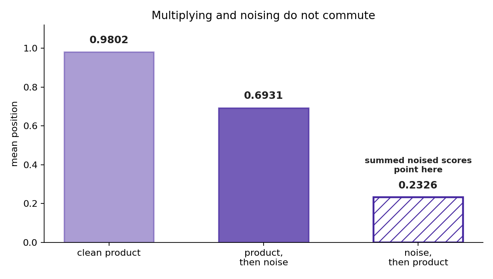
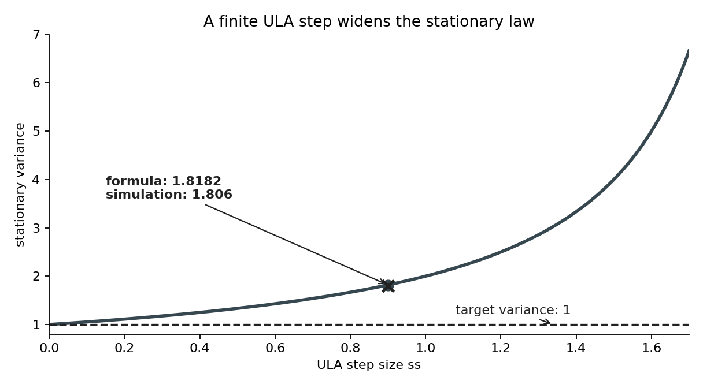
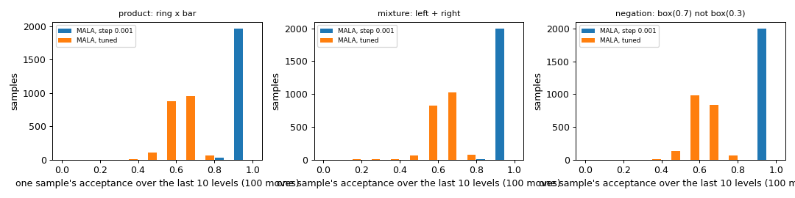
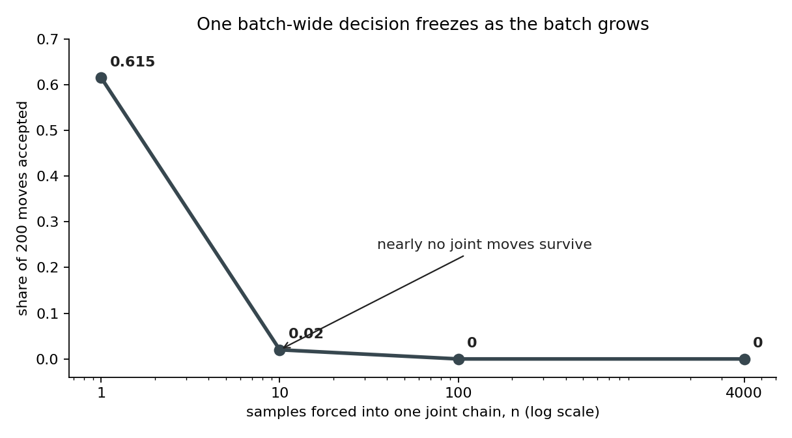
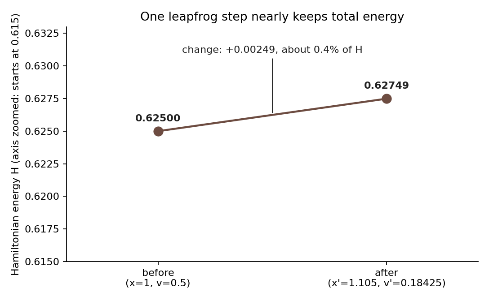
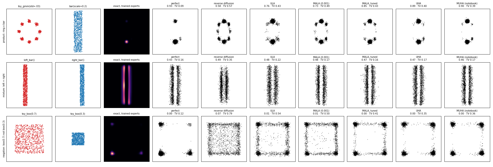

# 🔨 Phase 2: composing experts, and the samplers that reach the composition

You build the three ways the notebook composes two experts (product, mixture, negation) and the samplers it uses to draw from them: reverse diffusion with the composed score, annealed Langevin (ULA), Langevin with an accept step (MALA), and Hamiltonian moves with and without an accept step (UHA and the Metropolis-adjusted UHA). Along the way you derive the MALA bug and its fix. It ends when the notebook's ring-times-bar product comes out of your samplers, with each sample's acceptance on the screen. The reference is `rebuild/compose.py`, `rebuild/samplers.py` and the fixed `anneal_samplers.py` on branch `unbuild-walk`.

**How to walk it.** `/drip-execute-plan artifacts/drips/simple-distributions-rebuild/02-composing-and-sampling.md`, one step per message, typing every block yourself. Step 6's derivation is worth a `/drip --math` of its own. The python blocks, typed in order into `walk02.py` in `/home-mscluster/mmolefe/Playground/PhD/simple-distributions-walk/`, are one runnable script. Phase 1's pieces are imported from the reference from here on, so this file runs on its own.

**What teaches it elsewhere.** The product rule: [the PoE rule, assembled](../../../../../goal-setting/learning/deep-learning/diffusion-models/01-poe-derivation-foundations/plans/12-the-poe-rule-assembled.md), [PoE on two Gaussians](../../../../../goal-setting/learning/deep-learning/diffusion-models/01-poe-derivation-foundations/plans/13-poe-on-two-gaussians.md) (with its scenes), and the vault note [Product, Mixture And Negation](../../../../../Obsidian/Artificial%20Intelligence/Generative%20Modeling/Diffusion%20Models/Composition/Product%2C%20Mixture%20And%20Negation.md). Why summed scores miss the product: [The Order Of Multiplying And Noising](../../../../../Obsidian/Artificial%20Intelligence/Generative%20Modeling/Diffusion%20Models/Composition/The%20Order%20Of%20Multiplying%20And%20Noising.md). The samplers: [Langevin dynamics](../../../../../goal-setting/learning/deep-learning/diffusion-models/02-sampler-correctors-for-composition/plans/21-langevin-dynamics.md), [Metropolis-Hastings](../../../../../goal-setting/learning/deep-learning/diffusion-models/02-sampler-correctors-for-composition/plans/12-metropolis-hastings.md), [detailed balance](../../../../../goal-setting/learning/deep-learning/diffusion-models/02-sampler-correctors-for-composition/plans/11-stationary-and-detailed-balance.md), [the Hamiltonian corrector](../../../../../goal-setting/learning/deep-learning/diffusion-models/02-sampler-correctors-for-composition/plans/23-the-hamiltonian-corrector.md), [what is annealed](../../../../../goal-setting/learning/deep-learning/diffusion-models/02-sampler-correctors-for-composition/plans/24-what-is-annealed.md) and [the accept step needs the height](../../../../../goal-setting/learning/deep-learning/diffusion-models/02-sampler-correctors-for-composition/plans/36-the-accept-step-needs-the-height.md), whose scene is [the accept-step scene](https://claude.ai/artifact/LtVupoHgCdoyZgXtxB9817).

**Where the numbers come from.** Worked numbers: `python -m rebuild.walk_numbers`. Trained-model results: `rebuild/out/phase2/phase2.json`. Step 9's shares, with and without a clean final level: `rebuild/out/phase2/step9.json`, produced by `python -m rebuild.phase2_step9` (about a minute); `walk_numbers` reads that file for its `p2.step9_` keys and stops with a message naming the command when the file is missing. Sampler test numbers: `python -m pytest tests/test_anneal_samplers.py -s`.

## Steps

- [Step 0: the setup block](#step-0-the-setup-block)
- [Step 1: the product of two densities](#step-1-the-product-of-two-densities)
- [Step 2: why summed noised scores miss the product](#step-2-why-summed-noised-scores-miss-the-product)
- [Step 3: the mixture, and the notebook's temperature](#step-3-the-mixture-and-the-notebooks-temperature)
- [Step 4: negation](#step-4-negation)
- [Step 5: Langevin moves, and their bias](#step-5-langevin-moves-and-their-bias)
- [Step 6: the accept step, and the divisor that was wrong](#step-6-the-accept-step-and-the-divisor-that-was-wrong)
- [Step 7: one accept decision per sample](#step-7-one-accept-decision-per-sample)
- [Step 8: Hamiltonian moves](#step-8-hamiltonian-moves)
- [Step 9: annealing through the noise levels](#step-9-annealing-through-the-noise-levels)
- [Step 10: the check on the trained models](#step-10-the-check-on-the-trained-models)

**Colours on this page.** <span style="color:#1565c0">**Blue is the clean point $x_0$**</span>, <span style="color:#00838f">**teal is a point $x$ or the noisy point $x_t$**</span>, <span style="color:#6a1b9a">**purple is the noise $\varepsilon$**</span>, <span style="color:#2e7d32">**green is the kept signal share $\bar\alpha_t$**</span>, <span style="color:#ef6c00">**orange is the noise level $\sqrt{1-\bar\alpha_t}$**</span>, <span style="color:#ad1457">**pink is the score**</span>, <span style="color:#6d4c41">**brown is energy $E$**</span>, <span style="color:#c62828">**red is the prediction $\hat\varepsilon$**</span>, <span style="color:#827717">**olive is expert A**</span>, <span style="color:#546e7a">**blue-grey is expert B**</span>, and <span style="color:#4527a0">**indigo is the composed target**</span> (the product, mixture or negation being sampled). The same colour means the same quantity in every table, chart, diagram and equation.

## Step 0: the setup block

```python
import math, sys
import numpy as np
import matplotlib
matplotlib.use("Agg")
import matplotlib.pyplot as plt
import seaborn as sns
import torch
from scipy.stats import norm

from rebuild.model import cosine_beta_schedule        # built by hand in phase 1
from rebuild.device import pick_device
from anneal_samplers import AnnealedMALASampler, AnnealedULASampler, AnnealedUHASampler, AnnealedCHASampler, leapfrog_step_c

dev = pick_device(); print("device", dev)
rng = np.random.default_rng(0); torch.manual_seed(0)
T = 100; betas = cosine_beta_schedule(T); abar = np.cumprod(1 - betas)
```

## Step 1: the product of two densities

**Definition.** The product of experts $p_A$ and $p_B$ is $p(x)=p_A(x)\,p_B(x)/Z$, with $Z=\int p_A p_B\,dx$. In [logs](../../../../../goal-setting/learning/mathematics/textbooks/algebra/algebra-handbook.pdf#page=110), $\log p=\log p_A+\log p_B-\log Z$, and since Z [does not depend on x](../../../../../goal-setting/learning/mathematics/textbooks/machine-learning/the-little-book-of-generative-ai-foundations.pdf#page=179) the scores add: $\nabla\log p=\nabla\log p_A+\nabla\log p_B$.

**Two constructions.** The ladder composes two experts in two ways, so the densities need names that stay apart. Write $a(x)=p(x\mid A)$ and $b(x)=p(x\mid B)$ for the two experts and $r(x)$ for the background density of all the data. Construction (1) asks for $p(x\mid A,B)$. If $A$ and $B$ are [conditionally independent](../../../../../goal-setting/learning/deep-learning/generative-models/03-sampling-from-a-graph/plans/04-conditional-independence.md) given $x$, then

$$
\begin{aligned}
p(x\mid A,B)
&\propto p(A,B\mid x)\,r(x) \\
&= p(A\mid x)\,p(B\mid x)\,r(x) \\
&\propto \frac{a(x)}{r(x)}\cdot\frac{b(x)}{r(x)}\cdot r(x)
= \frac{a(x)\,b(x)}{r(x)}.
\end{aligned}
$$

**The same equation, with each part named.**

$$
\begin{aligned}
\underbrace{p(x\mid A,B)}_{\text{target after both facts are known}}
&\propto
\underbrace{p(A,B\mid x)}_{\text{joint evidence at }x}
\underbrace{r(x)}_{\text{background density}} \\
&=
\underbrace{p(A\mid x)}_{\textcolor{#827717}{\text{evidence from expert A}}}
\underbrace{p(B\mid x)}_{\textcolor{#546e7a}{\text{evidence from expert B}}}
\underbrace{r(x)}_{\text{background density}} \\
&\propto
\frac{\underbrace{\textcolor{#827717}{a(x)}}_{\text{expert A density}}}{\underbrace{r(x)}_{\text{background}}}
\frac{\underbrace{\textcolor{#546e7a}{b(x)}}_{\text{expert B density}}}{\underbrace{r(x)}_{\text{background}}}
\underbrace{r(x)}_{\text{one background factor restored}} \\
&=
\underbrace{\frac{\textcolor{#827717}{a(x)}\,\textcolor{#546e7a}{b(x)}}{r(x)}}_{\textcolor{#4527a0}{\text{conditional composition before normalising}}}.
\end{aligned}
$$

**What the equation says.** [Bayes' rule](../../../../../goal-setting/learning/mathematics/textbooks/statistics/introduction-to-probability-for-data-science.pdf#page=105) turns each conditional expert into evidence divided by the background. [Conditional independence](../../../../../goal-setting/learning/mathematics/textbooks/machine-learning/mathematics-for-machine-learning.pdf#page=201) lets the two evidence terms multiply. One background factor then cancels, leaving one copy in the denominator.

**Why the proportional signs are there.** They allow constants that do not depend on $x$ to be omitted. Keeping those constants would rescale every point equally, so normalising at the end would return the same density.

**Why multiplication is there.** Conditional independence replaces the joint evidence with one factor from each expert. Without that split, the joint term remains whole and the two experts cannot be composed separately.

**Why the ratio is there.** Both experts already contain one copy of the background. Multiplying them counts that background twice, so dividing by one copy leaves it counted once. Removing this ratio changes construction (1) into the direct product used in construction (2).

The first line is Bayes' rule. The second is the conditional independence. The third substitutes $p(A\mid x)=a(x)\,p(A)/r(x)$, and the same for $B$, and drops the constants $p(A)$ and $p(B)$. Construction (2) is the product defined above, $a(x)\,b(x)$. The two differ by the factor $1/r(x)$, so after normalising they agree only when $r(x)$ is constant (almost everywhere) on the region where $a(x)\,b(x)>0$. The idea maps write construction (1) as $p(x\mid A)\,p(x\mid B)/p(x)$, where $p(x)$ is the background; on this page $p(x)$ is the composed density.

<!-- video-table: product-of-experts rev=1 -->
Stanford CS236 on multiplying models into a product of experts, in the order to watch:

| Order | What it covers | Kind | Watch |
|---|---|---|---|
| 1 | Composing normalised models into one | Intuition | [Stanford CS236, lecture 11, 23:01 to 29:14](https://www.youtube.com/watch?v=m61KiAMCJ5Q&t=1381s) |
| 2 | The product of experts | Intuition | [Stanford CS236, lecture 11, 54:02 to 57:28](https://www.youtube.com/watch?v=m61KiAMCJ5Q&t=3242s) |

Neither segment composes diffusion models by adding their scores or divides out a background, and no listed creator does. Times are chapter boundaries read from each video's chapter list, not from captions, so each is good to the chapter and the sentence inside it is not checked.
<!-- /video-table -->

**How to read this table.** Read from row 1 to row 2. The second column says which part of the idea each segment supplies, and the last column opens that exact time range.

**Derivation for two 1D Gaussians.** $\mathcal N(x;\mu_A,\sigma_A^2)\,\mathcal N(x;\mu_B,\sigma_B^2)$ has exponent $-\frac{(x-\mu_A)^2}{2\sigma_A^2}-\frac{(x-\mu_B)^2}{2\sigma_B^2}$. Collecting the $x^2$ terms ([completing the square](../../../../../goal-setting/learning/mathematics/textbooks/algebra/algebra-handbook.pdf#page=74)) gives the [precision](../../../../../goal-setting/learning/mathematics/textbooks/machine-learning/pattern-recognition-and-machine-learning.pdf#page=43) $1/\sigma^2=1/\sigma_A^2+1/\sigma_B^2$; collecting the x terms gives the mean $\mu=\sigma^2(\mu_A/\sigma_A^2+\mu_B/\sigma_B^2)$. [The leftover constant](../../../../../goal-setting/learning/mathematics/textbooks/linear-algebra/matrix-cookbook.pdf#page=42) is $Z=\mathcal N(\mu_A;\mu_B,\sigma_A^2+\sigma_B^2)$. The tighter expert pulls harder, which is the whole of the mosaic in phase 4 ([products and quotients of diagonal Gaussians](../../../../../Obsidian/Mathematics/Statistics/Distributions/Multivariate%20Normal%20Distribution/Products%20And%20Quotients%20Of%20Diagonal%20Gaussians.md)).

<!-- video-table: product-of-two-gaussians rev=1 -->
Michel van Biezen, then Robert Ghrist from the open web, on multiplying two Gaussians, in the order to watch:

| Order | What it covers | Kind | Watch |
|---|---|---|---|
| 1 | The gain is the estimate's error over the sum of both errors, and the new value moves toward the reading by that share, so the surer of the two pulls harder | Intuition | [Van Biezen, Kalman Filter 3 of 55, 0:28 to 3:51](https://www.youtube.com/watch?v=fpRb1sjFz_M&t=28s) |
| 2 | One update with numbers: an estimate of 68 with error 2 and a reading of 75 with error 4 give 70.33 with error 1.33 | Worked example | [Van Biezen, Kalman Filter 6 of 55, 0:13 to 2:14](https://www.youtube.com/watch?v=SIQJaqYVtuE&t=13s) |
| 3 | The product of two one-dimensional Gaussians is a scaled Gaussian, found by simplifying the quadratic in the exponent | Proof, open web | [Ghrist, CalcBLUE 3, 18.4, 0:26 to 4:10](https://www.youtube.com/watch?v=lUORBdNccHc&t=26s) |
| 4 | The same product in several dimensions | Proof, open web | [Ghrist, CalcBLUE 3, 18.4, 4:10 to 5:53](https://www.youtube.com/watch?v=lUORBdNccHc&t=250s) |

Van Biezen works the product as a Kalman filter update and calls the two variances errors: his old value plus the gain times the difference is the precision-weighted mean rearranged, and his new error of 1.33 from 2 and 4 is the two precisions added. No listed creator derives the product of two Gaussian densities, so rows 3 and 4 come from the open web, and no row was found that computes the overlap Z. Rows 1 and 2 are read from automatic captions and good to about 30 seconds; rows 3 and 4 are chapter boundaries, so the sentence inside each is not checked.
<!-- /video-table -->

**How to read this table.** Rows 1 and 2 supply intuition and a numerical update. Rows 3 and 4 derive the density product in one and several dimensions. The order column is the intended viewing order.

🧸 **Toy:** $\mathcal N(0,1)\cdot\mathcal N(2,1)$ is $\mathcal N(1, 0.5)$ with $\log Z=\log\mathcal N(0;2,2)$ = `-2.2655`.

🔤 **The name:** [product of experts](../../../../../goal-setting/learning/deep-learning/diffusion-models/05-poe-composition-diffusion/plans/07-poe-factorisation-and-normaliser.md)

---

#### The scene and its table

Expert A favours points near 0. Expert B favours points near 2. Multiplication keeps points that receive support from both, so the composed Gaussian sits between them and becomes tighter.

<table>
<tr><th>density</th><th>mean</th><th>variance</th><th>part in the composition</th></tr>
<tr><td style="color:#827717">expert A</td><td style="border:2px solid #212121">0</td><td>1</td><td>first pointwise factor</td></tr>
<tr><td style="color:#546e7a">expert B</td><td style="border:2px dashed #212121">2</td><td>1</td><td>second pointwise factor</td></tr>
<tr style="background:#fff8e1"><td style="color:#4527a0"><b>product</b></td><td><b>1</b></td><td style="border:2px solid #212121"><b>0.5</b></td><td>agreement after normalising</td></tr>
</table>

**How to read this table.** Each row is one density. The first two rows are multiplied at every position. The highlighted row is the density that remains after the product is divided by its total area.

**What to look for.** The composed mean 1 lies between 0 and 2. Its variance 0.5 is smaller than either input variance 1, so agreement is narrower than either expert alone.

---

#### The base word first: product

**What the word means.** A product is the result of multiplication. Here multiplication happens point by point across the whole horizontal axis.

$$
\underbrace{\textcolor{#827717}{p_A(x)}}_{\text{expert A's height at }x}
\times
\underbrace{\textcolor{#546e7a}{p_B(x)}}_{\text{expert B's height at }x}
=
\underbrace{\text{unnormalised agreement at }x}_{\text{large only when both factors are large}}.
$$

**What the equation says.** At each point, the two density heights are multiplied. A point cannot receive a large product by pleasing only one expert.

**What it means.** “Product” does not average the two densities. The mean happens to be 1 because these experts have equal variance and means 0 and 2, but the variance falls from 1 to 0.5.

---

#### Then the qualifying word: experts

**What the word means.** An expert is a model that is sure about one thing. Each Gaussian supplies one opinion about where $x$ should be.

$$
\underbrace{\textcolor{#827717}{p_A(x)}}_{\text{expert centred at }0}
\qquad
\underbrace{\textcolor{#546e7a}{p_B(x)}}_{\text{expert centred at }2}.
$$

**What the equation says.** The two factors remain separate before composition. Each one assigns its own density to the same candidate point $x$.

**What it means.** Calling them experts emphasises specialised constraints. The product keeps their agreement rather than asking either expert to decide alone.

---

#### All the words together: the formula

A product of experts multiplies every expert's density at the same point, then divides by the total area.

$$
\underbrace{\textcolor{#4527a0}{p(x)}}_{\text{product-of-experts density}}
=
\frac{
\underbrace{\textcolor{#827717}{p_A(x)}}_{\text{expert A}}
\underbrace{\textcolor{#546e7a}{p_B(x)}}_{\text{expert B}}
}{
\underbrace{Z}_{\text{area of their raw product}}
}.
$$

**What the equation says.** The numerator demands pointwise agreement. The divisor changes the raw agreement curve into a density whose area is one.

**Check it on the toy.** [Multiplying the two unit-variance Gaussians](../../../../../goal-setting/learning/mathematics/textbooks/computer-vision/computer-vision-textbook.pdf#page=76) gives mean 1 and variance 0.5 after normalisation. This is agreement made narrower, not an average distribution with variance 1.

---

#### The consequence: require both opinions

**Use either expert alone.** The mean is 0 or 2 and the variance is 1.

**Require both experts.** The mean becomes 1 and the variance becomes 0.5. The centre lies between their preferred points, while the smaller variance records the stronger joint constraint.

🔤 **The name:** [normaliser](../../../../../Obsidian/Mathematics/Statistics/Distributions/Multivariate%20Normal%20Distribution/The%20Area%20A%20Product%20Loses.md) ([partition function](../../../../../goal-setting/learning/deep-learning/diffusion-models/06-diffusion-speciation-dynamics/plans/01-physics-of-a-transition/plans/01-boltzmann-density-partition-function.md) Z)

---

#### The scene and its table

The raw product has the right shape but not the required total area. The normaliser measures that area, and division by it rescales the whole curve at once.

<table>
<tr><th>stage</th><th>log area</th><th>status</th></tr>
<tr><td>raw product</td><td style="border:2px solid #212121">−2.2655</td><td>shape only</td></tr>
<tr style="background:#fff8e1"><td><b>after division by Z</b></td><td style="border:2px dashed #212121"><b>0</b></td><td>area is 1</td></tr>
</table>

**How to read this table.** Each row is the same product shape at a different scale. Log area 0 means area 1. The operation changes every height by one common factor.

**What to look for.** The log area moves from −2.2655 to 0. The mean and variance of the normalised shape are then meaningful as a probability density.

---

#### The base word: normal

**What the word means.** Here “normal” means scaled to [the probability rule that the whole area is one](../../../../../goal-setting/learning/mathematics/textbooks/statistics/introduction-to-probability-for-data-science.pdf#page=190). It does not mean Gaussian and it does not mean ordinary.

$$
\underbrace{\int \textcolor{#4527a0}{p(x)}\,dx}_{\text{area of the composed density}}
=
\underbrace{1}_{\text{required probability total}}.
$$

**What the equation says.** Adding the density across every possible point must account for all probability, exactly once.

**What it means.** A curve can have the desired shape and still fail to be a density when its total area is not one.

---

#### Then the action word: normaliser

**What the word means.** A normaliser is the quantity that makes normalisation happen. It is the raw curve's total area.

$$
\underbrace{Z}_{\text{normaliser}}
=
\underbrace{\int
\textcolor{#827717}{p_A(x)}
\textcolor{#546e7a}{p_B(x)}\,dx}_{\text{area under the raw product}}.
$$

**What the equation says.** Add the raw pointwise products over all $x$. The resulting single number is the amount that must be divided out.

**What it means.** On the toy, the raw product has log area −2.2655. Dividing by that area makes the new log area 0, which means area 1.

---

#### The alternate name: partition function

**What the words mean.** A [partition function](../../../../../goal-setting/learning/mathematics/textbooks/machine-learning/the-little-book-of-generative-ai-foundations.pdf#page=173) collects the total weight spread across all possible states. Here $Z$ collects the product's weight across all $x$.

$$
\underbrace{\textcolor{#4527a0}{p(x)}}_{\text{one state's probability density}}
=
\frac{
\underbrace{\textcolor{#827717}{p_A(x)}\textcolor{#546e7a}{p_B(x)}}_{\text{that state's raw weight}}
}{
\underbrace{Z}_{\text{total raw weight across all states}}
}.
$$

**What the equation says.** The numerator gives one point's unnormalised weight. The partition function supplies the total against which that weight is measured.

**What it means.** “Function” is historical language for a quantity that depends on the model's settings. For the fixed toy, $Z$ is one number.

---

#### All the words together: the formula

The normaliser, also called the partition function, is the total raw weight that turns the product into a density.

$$
\underbrace{Z}_{\text{partition function}}
=
\int \textcolor{#827717}{p_A(x)}\textcolor{#546e7a}{p_B(x)}\,dx,
\qquad
\underbrace{\textcolor{#4527a0}{p(x)}}_{\text{normalised product}}
=
\frac{\textcolor{#827717}{p_A(x)}\textcolor{#546e7a}{p_B(x)}}{Z}.
$$

**What the equation says.** First measure the raw product's area. Then divide every raw height by that same area.

**Check it on the toy.** The raw log area is −2.2655. After division, the area is 1 and its log is 0.

---

#### The consequence: divide out the area

**Before normalising.** The raw product's log area is −2.2655, so it is not a probability density.

**After normalising.** The log area is 0, which means the area is 1. The shape is retained while its scale becomes probabilistic.

<!-- video-table: normaliser rev=1 -->
Stanford CS236, then the Organic Chemistry Tutor, on why a density's total area must be 1, in the order to watch:

| Order | What it covers | Kind | Watch |
|---|---|---|---|
| 1 | Why a probability model must be non-negative and integrate to 1 | Intuition | [Stanford CS236, lecture 11, 6:45 to 15:31](https://www.youtube.com/watch?v=m61KiAMCJ5Q&t=405s) |
| 2 | Checking that a function is a density by integrating it and getting 1 | Worked example | [Organic Chemistry Tutor, Probability Density Functions, 0:52 to 3:39](https://www.youtube.com/watch?v=QKA4HNEw3aY&t=52s) |

Neither computes the area two multiplied Gaussians are left with, which is the toy's log Z of −2.2655. Times are chapter boundaries from each video's chapter list, so the sentence inside each is not checked.
<!-- /video-table -->

🔨 **Build:** multiply on a grid, normalise, and read off mean, variance and Z.

```python
xs = np.linspace(-6, 8, 14001); dx = xs[1] - xs[0]
prod = norm.pdf(xs, 0, 1) * norm.pdf(xs, 2, 1)
Z = prod.sum() * dx; p = prod / Z
mean = (xs * p).sum() * dx; var = ((xs - mean) ** 2 * p).sum() * dx
print("mean", round(mean, 4), " var", round(var, 4), " log Z", round(math.log(Z), 4), " closed form", round(norm.logpdf(0, 2, math.sqrt(2)), 4))
```

## Step 2: why summed noised scores miss the product

**Definition.** Reverse diffusion with the composed score uses, at noise level t, the sum of the two experts' noised scores, $\nabla\log q^A_t+\nabla\log q^B_t$. That is the score of the product of the noised experts, $q^A_t q^B_t$. The product we want, noised, is $q_t[p_Ap_B]$, the product first and then the noise.

**Derivation that they differ.** Noising is [a convolution](../../../../../goal-setting/learning/mathematics/textbooks/statistics/introduction-to-probability-for-data-science.pdf#page=298) with a Gaussian, and a convolution of a product is not the product of convolutions. Take A = $\mathcal N(1, 0.1^2)$ and B = $\mathcal N(-1, 1)$ at $\bar\alpha=0.5$, and work the two orders separately.

Multiply first. The precisions are 100 and 1, so Step 1's rule gives

$$
\begin{aligned}
\mu_{AB}
&=\frac{100(1)+1(-1)}{100+1} \\
&=\frac{99}{101} \\
&=0.9802,
\end{aligned}
$$

**The same equation, with each part named.**

$$
\begin{aligned}
\underbrace{\mu_{AB}}_{\textcolor{#4527a0}{\text{clean product mean}}}
&=
\frac{
\underbrace{100(1)}_{\textcolor{#827717}{\text{A's precision-weighted mean}}}
+
\underbrace{1(-1)}_{\textcolor{#546e7a}{\text{B's precision-weighted mean}}}
}{
\underbrace{100+1}_{\text{total precision}}
} \\
&=
\underbrace{\frac{99}{101}}_{\text{weighted total divided by total precision}} \\
&=
\underbrace{0.9802}_{\textcolor{#4527a0}{\text{clean product mean}}}.
\end{aligned}
$$

**What the equation says.** Each expert's mean is weighted by its [precision](../../../../../goal-setting/learning/mathematics/textbooks/machine-learning/pattern-recognition-and-machine-learning.pdf#page=43). Expert A has precision 100 while B has precision 1, so the product mean stays close to A's mean 1.

**Why the sum is there.** Independent Gaussian [precisions add when their densities are multiplied](../../../../../goal-setting/learning/mathematics/textbooks/computer-vision/computer-vision-textbook.pdf#page=76). Removing B's term leaves A alone at mean 1 instead of the composed mean 0.9802.

**Why the ratio is there.** The numerator is a precision-weighted total, not a mean until it is divided by total precision. Without the divisor, the intermediate value is 99 rather than 0.9802.

and noising that product scales its mean:

$$
\mu_{\mathrm{noise}(AB)}=\sqrt{0.5}\,\mu_{AB}=0.6931.
$$

**The same equation, with each part named.**

$$
\underbrace{\mu_{\mathrm{noise}(AB)}}_{\textcolor{#4527a0}{\text{mean after the clean product is noised}}}
=
\underbrace{\sqrt{\textcolor{#2e7d32}{0.5}}}_{\text{kept signal amplitude}}
\underbrace{\mu_{AB}}_{\textcolor{#4527a0}{\text{clean product mean }0.9802}}
=
\underbrace{0.6931}_{\textcolor{#4527a0}{\text{noised product mean}}}.
$$

**What the equation says.** Forward noising shrinks the clean product's mean by the square root of the kept signal share.

**Why the square root is there.** The kept share 0.5 is a variance share, so its amplitude multiplier is its square root. Replacing the square root with no shrink would leave the mean at 0.9802 instead of 0.6931.

Noise first. Each expert's mean is scaled by $\sqrt{\bar\alpha}$ and its variance becomes $\bar\alpha\sigma^2+1-\bar\alpha$:

$$
\begin{aligned}
\mu_{A,t}&=\sqrt{0.5}, & v_{A,t}&=0.5(0.01)+0.5=0.505, \\
\mu_{B,t}&=-\sqrt{0.5}, & v_{B,t}&=0.5(1)+0.5=1.
\end{aligned}
$$

**The same equation, with each part named.**

$$
\begin{aligned}
\underbrace{\mu_{A,t}}_{\textcolor{#827717}{\text{noised A mean}}}
&=
\underbrace{\sqrt{\textcolor{#2e7d32}{0.5}}}_{\text{kept signal amplitude}}(1),
&
\underbrace{v_{A,t}}_{\textcolor{#827717}{\text{noised A variance}}}
&=
\underbrace{0.5(0.01)}_{\text{kept A variance}}
+
\underbrace{0.5}_{\text{added noise variance}}
=0.505, \\
\underbrace{\mu_{B,t}}_{\textcolor{#546e7a}{\text{noised B mean}}}
&=
-\underbrace{\sqrt{\textcolor{#2e7d32}{0.5}}}_{\text{kept signal amplitude}}(1),
&
\underbrace{v_{B,t}}_{\textcolor{#546e7a}{\text{noised B variance}}}
&=
\underbrace{0.5(1)}_{\text{kept B variance}}
+
\underbrace{0.5}_{\text{added noise variance}}
=1.
\end{aligned}
$$

**What the equation says.** Both means shrink by the same amplitude factor. Each variance keeps half of its clean value and gains noise variance 0.5.

**Why addition is there.** The retained signal and the new Gaussian noise are independent, so [their variances add](../../../../../goal-setting/learning/mathematics/textbooks/machine-learning/mathematics-for-machine-learning.pdf#page=200). Removing the added-noise term would fail to blur either expert.

**Why the square root is there.** Means scale with amplitude, while [variances scale with squared amplitude](../../../../../goal-setting/learning/mathematics/textbooks/machine-learning/mathematics-for-machine-learning.pdf#page=200). Using 0.5 directly for the means would apply a variance share as though it were an amplitude.

Their product has mean

$$
\begin{aligned}
\mu_{A_tB_t}
&=\frac{\mu_{A,t}/v_{A,t}+\mu_{B,t}/v_{B,t}}{1/v_{A,t}+1/v_{B,t}} \\
&=\frac{\sqrt{0.5}/0.505-\sqrt{0.5}}{1/0.505+1} \\
&=0.2326.
\end{aligned}
$$

**The same equation, with each part named.**

$$
\begin{aligned}
\underbrace{\mu_{A_tB_t}}_{\textcolor{#4527a0}{\text{product-of-noised mean}}}
&=
\frac{
\underbrace{\mu_{A,t}/v_{A,t}}_{\textcolor{#827717}{\text{A's noised precision-weighted mean}}}
+
\underbrace{\mu_{B,t}/v_{B,t}}_{\textcolor{#546e7a}{\text{B's noised precision-weighted mean}}}
}{
\underbrace{1/v_{A,t}+1/v_{B,t}}_{\text{total noised precision}}
} \\
&=
\frac{
\underbrace{\sqrt{0.5}/0.505}_{\textcolor{#827717}{\text{A contribution}}}
-
\underbrace{\sqrt{0.5}}_{\textcolor{#546e7a}{\text{B contribution}}}
}{
\underbrace{1/0.505+1}_{\text{total precision}}
} \\
&=
\underbrace{0.2326}_{\textcolor{#4527a0}{\text{wrong-order mean}}}.
\end{aligned}
$$

**What the equation says.** After both experts are blurred, their means are combined using their new precisions. A's precision has fallen to 1.98, so B now pulls much harder than it did in the clean product.

**Why the reciprocal variances are there.** A reciprocal variance is a precision. Replacing A's noised precision 1.98 with its clean precision 100 moves the result back toward the clean product mean 0.9802 instead of 0.2326.

**Why the outer ratio is there.** The weighted contributions must be divided by total precision to become a mean. It performs the same job as the denominator in the clean calculation.

Noising first raised A's variance from 0.01 to `0.505` (`p2.noised_A_var_abar0.5`), so its precision fell from 100 to `1.98` (`p2.noised_A_precision_abar0.5`) against B's 1. The tight expert was blurred before it could win, and B pulls the product's mean back toward 0 (Du et al. 2023, p.4, eqs. 11 and 12).

🧸 **Toy:** clean product mean `0.9802`, noised product mean `0.6931`, product of the noised experts `0.2326`. The summed score points at 0.2326 where the target is 0.6931.

🔤 **The name:** [noised](../../../../../goal-setting/learning/deep-learning/diffusion-models/05-poe-composition-diffusion/plans/33-why-noised-marginals-break-it.md)

---

#### The scene and its table

Start with the clean product near expert A. One route multiplies first and then blurs the result. The other route blurs both experts first, weakening A's precision before multiplication.

<table>
<tr><th>stage</th><th style="color:#827717">expert A</th><th style="color:#546e7a">expert B</th><th style="color:#4527a0">composed mean</th></tr>
<tr><td>clean product</td><td>variance 0.01, precision 100</td><td>variance 1, precision 1</td><td style="border:2px solid #212121">0.9802</td></tr>
<tr style="background:#fff8e1"><td>product, then noise</td><td colspan="2">noise acts on the product</td><td style="border:2px solid #212121"><b>0.6931</b></td></tr>
<tr><td>noise, then product</td><td>variance 0.505, precision 1.98</td><td>variance 1, precision 1</td><td style="border:2px dashed #212121">0.2326</td></tr>
</table>

**How to read this table.** Each row is one order of operations. The last column is the mean reached by that route. The middle columns show why noising before multiplication changes the balance between the experts.

**What to look for.** The target row ends at 0.6931. The dashed wrong-order row ends at 0.2326 because A's precision fell from 100 to 1.98 before the product was formed.

---

#### The smaller word first: noise

**What the word means.** Noise is random variation added to a signal. The [forward process](01-one-expert-from-scratch.md#step-4-the-forward-process-and-the-cosine-schedule) keeps part of a clean point and adds a Gaussian displacement.

$$
\underbrace{\textcolor{#00838f}{x_t}}_{\text{noisy point}}
=
\underbrace{\sqrt{\textcolor{#2e7d32}{\bar\alpha_t}}\,
\textcolor{#1565c0}{x_0}}_{\text{kept clean signal}}
+
\underbrace{\textcolor{#ef6c00}{\sqrt{1-\bar\alpha_t}}\,
\textcolor{#6a1b9a}{\varepsilon}}_{\text{added noise}}.
$$

**What the equation says.** A noisy point contains a shrunken clean contribution plus a random contribution. At the toy level, the kept share is 0.5.

**What it means.** Noise does more than jiggle samples. It also broadens each expert, which changes the [precision weights](../../../../../goal-setting/learning/mathematics/textbooks/machine-learning/pattern-recognition-and-machine-learning.pdf#page=43) used by a later product.

---

#### Then the ending: noised

**What the word means.** The ending “-ed” says the operation has already happened. A noised expert is the distribution after the clean expert has passed through the forward process.

$$
\underbrace{q_t^A}_{\textcolor{#827717}{\text{noised expert A}}}
=
\underbrace{q_t[p_A]}_{\text{apply noise to A}},
\qquad
\underbrace{q_t^B}_{\textcolor{#546e7a}{\text{noised expert B}}}
=
\underbrace{q_t[p_B]}_{\text{apply noise to B}}.
$$

**What the equation says.** The operator $q_t[\cdot]$ acts on each clean density before the two resulting densities are multiplied.

**What it means.** For A, “noised” moves the variance from 0.01 to 0.505 and the precision from 100 to 1.98. The name points to a completed transformation, not a label attached to the clean expert.

---

#### All the words together: the two orders

The [noised product](../../../../../Obsidian/Artificial%20Intelligence/Generative%20Modeling/Diffusion%20Models/Composition/The%20Order%20Of%20Multiplying%20And%20Noising.md) and the product of noised experts place the same two operations in opposite orders.

$$
\underbrace{q_t[\textcolor{#827717}{p_A}\textcolor{#546e7a}{p_B}]}_{\textcolor{#4527a0}{\text{product first, then noised}}}
\neq
\underbrace{q_t[\textcolor{#827717}{p_A}]\,q_t[\textcolor{#546e7a}{p_B}]}_{\textcolor{#4527a0}{\text{each expert noised, then multiplied}}}.
$$

**What the equation says.** The left side [blurs](../../../../../goal-setting/learning/mathematics/textbooks/statistics/introduction-to-probability-for-data-science.pdf#page=298) one already-composed density. The right side blurs two densities separately and then multiplies them. The inequality says those operations do not commute.

**Check it on the toy.** The left route has mean 0.6931. The right route has mean 0.2326. Summing the noised scores follows the right route.

<a href="figures/walk02-step2-three-means.png"></a>

**How to read this chart.** The y-axis is the mean's position, from 0 to just above 1. The x-axis names the stage or order. Each bar is one mean read from the worked numbers file.

**What to look for.** The correct order moves the clean product from 0.9802 to 0.6931. Noising the experts separately before multiplying moves much farther, to 0.2326.

---

#### The consequence: swap the order

**Multiply first, then noise.** The mean moves from 0.9802 to the target 0.6931.

**Noise first, then multiply.** The mean moves to 0.2326. Better networks or more reverse steps cannot repair an objective that points at this different distribution.

<!-- video-table: summed-noised-scores-miss-the-product rev=1 -->
Yilun Du, from the open web, on why adding two diffusion models' noised scores does not sample their product:

| Order | What it covers | Kind | Watch |
|---|---|---|---|
| 1 | A diffusion model learns one energy for each noise level. Adding two models' denoiser outputs and running the usual reverse sampler does not draw from the composed distribution, while treating each level as an energy-based model and sampling it with MCMC does | Intuition, open web | [Yilun Du, thesis defense, 27:10 to 28:43](https://www.youtube.com/watch?v=7jvWDF6ZXPc&t=1630s) |

Du states the mismatch without working it, so the toy's three means (0.9802, 0.6931 and 0.2326) have no video, and no listed creator covers it. Du is the first author of the 2023 paper this step cites. The time is read from Du's captions and good to about 30 seconds.
<!-- /video-table -->

🔨 **Build:**

```python
def gprod(ma, va, mb, vb):
    v = 1 / (1 / va + 1 / vb); return v * (ma / va + mb / vb), v
a = 0.5
clean, _ = gprod(1.0, 0.01, -1.0, 1.0)
summed, _ = gprod(math.sqrt(a) * 1, a * 0.01 + 1 - a, -math.sqrt(a) * 1, a * 1 + 1 - a)
print("clean product", round(clean, 4), " noised product", round(math.sqrt(a) * clean, 4), " product of noised", round(summed, 4))
```

💥 **Broken run:** this is reverse diffusion's error, and it does not shrink with more steps or better networks. On the 16-pixel mosaic (phase 4) it leaves the head mean at `0.923` where the exact product has `0.980`, a projected TV of `0.732` against a finite-sample baseline of `0.013`.

<!-- video-table: total-variation-distance rev=1 -->
Mary Wootters, from the open web, on the total variation distance between two distributions, in the order to watch:

| Order | What it covers | Kind | Watch |
|---|---|---|---|
| 1 | TV is half the sum of the absolute differences between the two probability tables, which equals the largest difference in probability the two give any one event | Intuition, open web | [Wootters, Total Variation Distance, 0:16 to 1:35](https://www.youtube.com/watch?v=aJP0Bj6jVkI&t=16s) |
| 2 | Two bar charts split where each is the higher: the two shaded areas are equal, and each one is the TV | Proof, open web | [Wootters, Total Variation Distance, 1:35 to 3:47](https://www.youtube.com/watch?v=aJP0Bj6jVkI&t=95s) |
| 3 | A fair coin against one that lands heads 0.6 of the time: TV = ½(0.1 + 0.1) = 0.1 | Worked example, open web | [Wootters, Total Variation Distance, 4:34 to 6:42](https://www.youtube.com/watch?v=aJP0Bj6jVkI&t=274s) |

No listed creator covers it. Wootters compares two known tables; she does not estimate TV from two sets of samples on a binning, so the sampling-noise baseline that two draws of the same data reach is not covered. Times are read from automatic captions and good to about 30 seconds.
<!-- /video-table -->

**How to read this table.** Read the rows in order. The first gives the definition, the second gives the area picture, and the third computes one small example.

## Step 3: the mixture, and the notebook's temperature

**Definition.** A two-component mixture is $p=\tfrac12p_A+\tfrac12p_B$, so, since [exp undoes log](../../../../../goal-setting/learning/mathematics/textbooks/algebra/algebra-handbook.pdf#page=110), $\log p=\log\big(e^{\log p_A}+e^{\log p_B}\big)-\log2$, [a logsumexp](../../../../../goal-setting/learning/mathematics/textbooks/machine-learning/probabilistic-machine-learning-an-introduction.pdf#page=80). The notebook writes its mixture in energies, $E_{\text{mix}}=-\operatorname{logsumexp}(-3.5E_A,-3.5E_B)$.

**Derivation of what the 3.5 does.** Write $\widetilde p_A(x)=e^{-E_A(x)}$ and $\widetilde p_B(x)=e^{-E_B(x)}$ for the experts' unnormalised densities. Exponentiating the notebook's energy gives

$$
\begin{aligned}
e^{-E_{\text{mix}}(x)}
&=e^{\operatorname{logsumexp}(-3.5E_A(x),\,-3.5E_B(x))} \\
&=\widetilde p_A(x)^{3.5}+\widetilde p_B(x)^{3.5}.
\end{aligned}
$$

**The same equation, with each part named.**

$$
\begin{aligned}
\underbrace{e^{-\textcolor{#6d4c41}{E_{\mathrm{mix}}(x)}}}_{\textcolor{#4527a0}{\text{mixture's raw density}}}
&=
\underbrace{e^{\operatorname{logsumexp}(
-3.5\textcolor{#6d4c41}{E_A(x)},
-3.5\textcolor{#6d4c41}{E_B(x)})}}_{\text{undo the log of a sum of exponentials}} \\
&=
\underbrace{\textcolor{#827717}{\widetilde p_A(x)^{3.5}}}_{\text{sharpened expert A}}
+
\underbrace{\textcolor{#546e7a}{\widetilde p_B(x)^{3.5}}}_{\text{sharpened expert B}}.
\end{aligned}
$$

**What the equation says.** Negating the mixture energy produces an unnormalised density. Exponentiating logsumexp turns it into a sum of the two experts' raw densities, each raised to power 3.5.

**Why exp and logsumexp are there.** Energy lives in log space, while a mixture adds density contributions. Exponentiation returns from energy to density, and logsumexp performs the addition without leaving log space during the calculation.

**Why the sum is there.** A mixture keeps alternatives. A point can receive weight from expert A or expert B. Replacing the sum with a product would demand both experts and would create the product composition from Step 1.

**Why the power is there.** Multiplying energy by 3.5 raises raw density to power 3.5, sharpening each component. With toy energies 1 and 3, the resulting mixture energy is 3.4991 rather than simply selecting the scaled lower energy 3.5.

So the notebook's mixture is the sum of the two unnormalised densities [raised to the power 3.5](../../../../../goal-setting/learning/mathematics/textbooks/algebra/algebra-handbook.pdf#page=109), normalised once at the end. That is a sharpened mixture, which is why its bars come out narrower than the training bars. It is an equal-weight mixture of the two sharpened densities only when $\int\widetilde p_A^{3.5}\,dx=\int\widetilde p_B^{3.5}\,dx$. An energy is fixed only up to a constant, and replacing $E_A$ by $E_A+C$ multiplies A's term by $e^{-3.5C}$, so the offsets of the two energies set the component weights.

With $m=\min(E_A,E_B)$ and $\Delta=|E_A-E_B|$, the soft minimum is exactly

$$
E_{\text{mix}}=3.5m-\log\!\left(1+e^{-3.5\Delta}\right),
$$

**The same equation, with each part named.**

$$
\underbrace{\textcolor{#6d4c41}{E_{\mathrm{mix}}}}_{\textcolor{#4527a0}{\text{mixture energy}}}
=
\underbrace{3.5\underbrace{m}_{\min(\textcolor{#6d4c41}{E_A},\textcolor{#6d4c41}{E_B})}}_{\text{scaled hard minimum}}
-
\underbrace{\log\!\left(
1+e^{-3.5\underbrace{\Delta}_{|\textcolor{#6d4c41}{E_A}-\textcolor{#6d4c41}{E_B}|}}
\right)}_{\text{soft correction from the other expert}}.
$$

**What the equation says.** Begin with 3.5 times the lower energy. Then subtract a positive correction whose size depends on the gap between the experts.

**Why the minimum is there.** [Factoring out the larger exponential](../../../../../goal-setting/learning/mathematics/textbooks/machine-learning/deep-learning-textbook.pdf#page=97) is equivalent to choosing the lower energy as the stable reference. On the toy, the scaled hard minimum is 3.5.

**Why the absolute value is there.** Only the size of the energy gap matters after the lower energy has been chosen. Swapping A and B must leave the mixture unchanged.

**Why exp and log are there.** The exponential turns an energy gap into the other expert's relative density contribution. The logarithm returns that density sum to energy units. On the toy, this correction moves 3.5 to 3.4991.

so $E_{\text{mix}}\approx3.5\min(E_A,E_B)$ once $\Delta$ is large. The disjunction in phase 3 uses the plain logsumexp of log-densities.

🧸 **Toy:** with $E_A=1$, $E_B=3$, $E_{\text{mix}}$ = `3.4991`, against $3.5\cdot\min E$ = 3.5. The soft-minimum formula above gives the same value to five decimals, `3.49909` (`p2.mixture_softmin_formula_E1=1_E2=3`).

🔤 **The name:** [temperature](../../../../../Obsidian/Artificial%20Intelligence/Generative%20Modeling/Diffusion%20Models/Composition/Three%20Things%20Called%20Annealing.md#words-the-three-knobs-use)

---

#### The scene and its table

Expert A has lower energy than expert B at this point. The factor 3.5 magnifies their energy gap before logsumexp combines them.

<table>
<tr><th>quantity</th><th style="color:#6d4c41">energy</th><th>role</th></tr>
<tr><td style="color:#827717">expert A</td><td style="border:2px solid #212121">1</td><td>lower-energy alternative</td></tr>
<tr><td style="color:#546e7a">expert B</td><td style="border:2px dashed #212121">3</td><td>higher-energy alternative</td></tr>
<tr><td>notebook factor</td><td>3.5</td><td>sharpens the alternatives</td></tr>
<tr style="background:#fff8e1"><td style="color:#4527a0"><b>mixture</b></td><td><b>3.4991</b></td><td>soft choice after sharpening</td></tr>
</table>

**How to read this table.** The first two rows are energy heights at one point. The third row is the factor applied before combination. The last row is the resulting mixture energy.

**What to look for.** A's energy 1 is lower than B's 3, so the sharpened mixture sits very close to 3.5 times A's energy.

---

#### The borrowed word: temperature

**What the word means.** Physical [temperature](../../../../../goal-setting/learning/mathematics/textbooks/machine-learning/probabilistic-machine-learning-an-introduction.pdf#page=79) controls how strongly a system concentrates on low-energy states. In an energy density, a larger multiplier on energy produces a sharper preference.

$$
\underbrace{\widetilde p(x)}_{\text{raw density}}
=
\underbrace{e^{-\tau\textcolor{#6d4c41}{E(x)}}}_{\text{energy scaled by }\tau},
\qquad
\underbrace{\tau=3.5}_{\text{notebook's sharpening factor}}.
$$

**What the equation says.** The factor multiplies energy [inside a negative exponential](../../../../../goal-setting/learning/mathematics/textbooks/machine-learning/the-little-book-of-generative-ai-foundations.pdf#page=173). A larger factor suppresses high-energy locations more strongly.

**What it means.** The notebook calls 3.5 its temperature. Mathematically, because it multiplies energy, it acts like an [inverse temperature](../../../../../Obsidian/Artificial%20Intelligence/Generative%20Modeling/Diffusion%20Models/Composition/The%20Tempered%20Density%20And%20Its%20Score.md) or sharpening strength. The name is misleading if “higher temperature” is read as “flatter.”

---

#### The name in the mixture formula

$$
\underbrace{\textcolor{#6d4c41}{E_{\mathrm{mix}}}}_{\textcolor{#4527a0}{\text{temperature-scaled mixture energy}}}
=
-
\underbrace{\operatorname{logsumexp}(
-3.5\textcolor{#6d4c41}{E_A},
-3.5\textcolor{#6d4c41}{E_B})}_{\text{combine the two sharpened alternatives}}.
$$

**What the equation says.** Both expert energies receive the same factor 3.5 before logsumexp joins their alternatives.

**Check it on the toy.** Energies 1 and 3 produce mixture energy 3.4991, almost the scaled lower energy 3.5.

---

#### The consequence: sharpen the choice

**Use the hard lower-energy reference.** Scaling the minimum energy 1 by 3.5 gives 3.5.

**Let the other expert contribute.** The soft result becomes 3.4991. The small move shows that the factor 3.5 has made the lower-energy expert dominate at this gap.

<!-- video-table: temperature rev=1 -->
Yilun Du, Vizuara and MarbleScience on temperature, the factor that sharpens or flattens a distribution built from energies, in the order to watch:

| Order | What it covers | Kind | Watch |
|---|---|---|---|
| 1 | Scaling an energy's magnitude sets how strongly that factor shapes the composed result | Intuition, open web | [Yilun Du, thesis defense, 21:54 to 22:15](https://www.youtube.com/watch?v=7jvWDF6ZXPc&t=1314s) |
| 2 | Temperature scaling of the scores before the softmax, recapped | Intuition | [Vizuara, Top-k sampling in Large Language Models, 0:00 to 5:39](https://www.youtube.com/watch?v=EhU32O7DkA4&t=0s) |
| 3 | Where the word comes from: the Boltzmann distribution behind the softmax, then what changing the temperature does | Intuition, open web | [MarbleScience, What is the Temperature of an AI, 3:45 to 6:09](https://www.youtube.com/watch?v=YjVuJjmgclU&t=225s) |

None multiplies energies by a factor above 1 as the notebook's 3.5 does, which acts as an inverse temperature. Row 1 is read from Du's captions and good to about 30 seconds; rows 2 and 3 are chapter boundaries from each video's chapter list, so the sentence inside each is not checked.
<!-- /video-table -->

🔤 **The name:** [soft minimum](../../../../../goal-setting/learning/deep-learning/diffusion-models/00-from-scratch-to-sdxl/textbook/l0-simple-maths/01-log-sum-exp-and-the-softmax-gradient.md#the-equations-that-matter)

---

#### The scene and its table

A hard minimum keeps only the lower energy. A soft minimum keeps the lower one as the anchor while allowing the other expert a diminishing contribution.

<table>
<tr><th>operation</th><th style="color:#6d4c41">result</th><th>what survives</th></tr>
<tr><td>scaled hard minimum</td><td style="border:2px solid #212121">3.5</td><td>only the lower expert</td></tr>
<tr style="background:#fff8e1"><td><b>soft minimum</b></td><td style="border:2px dashed #212121"><b>3.4991</b></td><td>both experts</td></tr>
</table>

**How to read this table.** Each row combines the same energy values 1 and 3. The first discards the higher-energy alternative. The second retains it through logsumexp.

**What to look for.** The soft result is slightly below 3.5. That small difference is the contribution of the higher-energy expert.

---

#### The base word first: minimum

**What the word means.** A minimum is the smallest value in a set. Here expert A supplies the smaller energy, 1 rather than 3.

$$
\underbrace{m}_{\text{minimum energy}}
=
\underbrace{\min(
\textcolor{#6d4c41}{E_A},
\textcolor{#6d4c41}{E_B})}_{\text{choose the lower energy}}
=
\underbrace{1}_{\text{toy minimum}}.
$$

**What the equation says.** Compare the two expert energies and retain the smaller one.

**What it means.** After scaling, a hard minimum gives 3.5. It behaves as if the higher-energy expert did not exist at this point.

---

#### Then the qualifying word: soft

**What the word means.** Soft means the choice is not absolute. The winner matters most, but the other alternative still changes the result.

$$
\underbrace{\textcolor{#6d4c41}{E_{\mathrm{mix}}}}_{\text{soft minimum}}
=
\underbrace{3.5m}_{\text{hard minimum }3.5}
-
\underbrace{\log(1+e^{-3.5\Delta})}_{\text{other expert's correction}}.
$$

**What the equation says.** Begin at the hard minimum and subtract the correction carried by the energy gap.

**What it means.** On the toy, softness changes 3.5 to 3.4991. The higher energy matters, but only slightly.

---

#### Both words together: the formula

A soft minimum behaves like a minimum while retaining a smooth contribution from every alternative.

$$
\underbrace{\textcolor{#6d4c41}{E_{\mathrm{mix}}}}_{\text{soft minimum of two scaled energies}}
=
-
\underbrace{\operatorname{logsumexp}(
-3.5\textcolor{#6d4c41}{E_A},
-3.5\textcolor{#6d4c41}{E_B})}_{\text{smoothly combine both alternatives}}.
$$

**What the equation says.** Negating energies turns low energy into large exponential weight. [Logsumexp combines those weights](../../../../../goal-setting/learning/mathematics/textbooks/machine-learning/probabilistic-machine-learning-an-introduction.pdf#page=80), and the outer minus returns to energy.

**Check it on the toy.** With energies 1 and 3, the formula gives 3.4991, matching the equivalent gap formula's 3.49909.

---

#### The consequence: soften the hard choice

**Hard choice.** The scaled minimum is 3.5.

**Soft choice.** Keeping the second expert changes the result to 3.4991. As the gap grows, that correction becomes smaller and the soft minimum approaches the hard one.

<!-- video-table: soft-minimum rev=1 -->
Yilun Du, from the open web, on the soft minimum of two energies:

| Order | What it covers | Kind | Watch |
|---|---|---|---|
| 1 | Energies read as sets: adding two gives low energy only where both are low, and their soft minimum gives low energy wherever either one is | Intuition, open web | [Yilun Du, thesis defense, 22:42 to 23:21](https://www.youtube.com/watch?v=7jvWDF6ZXPc&t=1362s) |

Du names the soft minimum without its formula or the correction term log(1 + e^(−3.5Δ)), and no listed creator covers it. The time is read from Du's captions and good to about 30 seconds.
<!-- /video-table -->

🔨 **Build:**

```python
E = torch.tensor([1.0, 3.0])
print("mixture energy", round(float(-torch.logsumexp(-3.5 * E, 0)), 4), " 3.5 * min E =", 3.5 * float(E.min()))
```

## Step 4: negation

**Definition.** "A and not B" is $p\propto p_A^{1+w}/p_B^{\,w}$; the notebook uses $w=0.3$, energies $1.3E_A-0.3E_B$ (by the [log rules](../../../../../goal-setting/learning/mathematics/textbooks/algebra/algebra-handbook.pdf#page=110)). Dividing by $p_B$ lowers the density where B is likely, and the factor $p_A^{1+w}$ is zero wherever $p_A$ is. The unnormalised weight $\widetilde f(x)=p_A(x)^{1+w}/p_B(x)^{w}$ defines a density only if it is finite almost everywhere on A's support and

$$
0<Z=\int \widetilde f(x)\,dx<\infty.
$$

**The same equation, with each part named.**

$$
\underbrace{0<}_{\text{some positive total weight}}
\underbrace{Z}_{\text{normaliser}}
=
\underbrace{\int
\underbrace{\widetilde f(x)}_{\textcolor{#4527a0}{\text{raw negation weight}}}
\,dx}_{\text{add the raw weight over all points}}
\underbrace{<\infty}_{\text{finite total weight}}.
$$

**What the equation says.** A usable negation density needs a raw curve with positive but finite area. Only then can division by $Z$ make its total area one.

**Why the integral is there.** The normaliser must collect weight across every possible $x$, not at one chosen point. Checking only the toy point's value 0.3299 cannot reveal a divergent tail.

**Why both inequalities are there.** A zero total leaves no probability to distribute, while an infinite total cannot be divided into a finite density. For the Gaussian toy below, crossing the variance threshold 0.2308 changes the normaliser from finite to infinite.

That needs $p_B>0$ almost everywhere that $p_A>0$, and then a check that $Z$ is finite.

**Derivation of the catch.** Where $p_B\to0$ and $p_A$ does not, $p_B^{-w}\to\infty$, so negation pushes mass toward wherever B is least likely, and in the tails that factor can make $Z$ infinite. For $p_A=\mathcal N(0,1)$ and $p_B=\mathcal N(0,s^2)$ the quotient's exponent is

$$
-\frac{x^2}{2}\Big((1+w)-\frac{w}{s^2}\Big),
$$

**The same equation, with each part named.**

$$
-
\underbrace{\frac{\textcolor{#00838f}{x}^2}{2}}_{\text{squared distance from the shared centre}}
\underbrace{\left(
\underbrace{1+w}_{\textcolor{#827717}{\text{A's positive power}}}
-
\underbrace{\frac{w}{s^2}}_{\textcolor{#546e7a}{\text{B quotient's tail strength}}}
\right)}_{\text{net tail-decay coefficient}}.
$$

**What the equation says.** The exponent is a negative squared distance multiplied by the decay left after A's concentration and B's reciprocal contribution are combined.

**Why the square is there.** [Gaussian tails depend on squared distance](../../../../../goal-setting/learning/mathematics/textbooks/statistics/introduction-to-probability-for-data-science.pdf#page=227), so both positive and negative tails behave alike. Removing the square would no longer describe the two symmetric Gaussian tails.

**Why subtraction is there.** B is in the denominator, so its log-density contribution changes sign. The subtraction can cancel A's decay, which is the source of the infinite-normaliser failure.

**Why the ratio is there.** The variance $s^2$ controls how quickly B decays. When $s^2$ falls through 0.2308 at $w=0.3$, the net coefficient stops being positive and $Z$ stops being finite.

so $Z$ is finite only when $s^2>w/(1+w)$, which is `0.2308` at $w=0.3$ (`p2.negation_finite_Z_needs_s2_above_w0.3`). A narrower B sends the negation's mass off to infinity even though $p_B>0$ everywhere. That is why phase 3 finds negation working only near w = 0.05.

🧸 **Toy:** at a point where $p_A=0.5$ and $p_B=2$, $p_A^{1.3}p_B^{-0.3}$ = `0.3299`.

🔤 **The name:** [negation](../../../../../Obsidian/Artificial%20Intelligence/Generative%20Modeling/Diffusion%20Models/Composition/Product,%20Mixture%20And%20Negation.md#words-the-three-operators-use)

---

#### The scene and its table

Expert A says where density should remain. Expert B says what should be suppressed. Negation strengthens A and divides by B, but that division can also over-reward B's thin tails.

<table>
<tr><th>quantity</th><th>toy value</th><th>job</th></tr>
<tr><td style="color:#827717">expert A density</td><td style="border:2px solid #212121">0.5</td><td>what remains</td></tr>
<tr><td style="color:#546e7a">expert B density</td><td style="border:2px dashed #212121">2</td><td>what is suppressed</td></tr>
<tr><td>negation strength</td><td>0.3</td><td>sets both powers</td></tr>
<tr style="background:#fff8e1"><td style="color:#4527a0"><b>raw negation weight</b></td><td><b>0.3299</b></td><td>A and not B</td></tr>
<tr><td>finite-normaliser threshold</td><td>0.2308</td><td>B variance must be above it</td></tr>
</table>

**How to read this table.** The first three rows are inputs to the pointwise rule. The highlighted row is its output at one point. The last row is a separate whole-density condition that the pointwise calculation cannot check.

**What to look for.** Dividing by B lowers the toy point's weight from A's 0.5 to 0.3299. A finite value at one point still does not guarantee a finite normaliser.

---

#### The word: negation

**What the word means.** Negation means turning a statement into “not that.” Here it means retaining A while reducing weight where B is likely.

$$
\underbrace{\widetilde f(x)}_{\textcolor{#4527a0}{\text{raw negation weight}}}
=
\frac{
\underbrace{\textcolor{#827717}{p_A(x)^{1+w}}}_{\text{strengthened A}}
}{
\underbrace{\textcolor{#546e7a}{p_B(x)^w}}_{\text{B divided out}}
}.
$$

**What the equation says.** Raise A to power $1+w$ and divide by B to power $w$. The same strength $w$ controls both changes.

**What it means.** Negation is not setting B's density to zero. It is a [density ratio](../../../../../Obsidian/Mathematics/Statistics/Distributions/Multivariate%20Normal%20Distribution/Powers%20Of%20Gaussians.md), so small values of B can create very large weights.

---

#### The positive part: keep A

The exponent $1+w$ preserves A as the base requirement while strengthening it.

$$
\underbrace{\textcolor{#827717}{p_A(x)^{1+w}}}_{\text{A retained and strengthened}}
=
\underbrace{\textcolor{#827717}{p_A(x)}}_{\text{keep A}}
\underbrace{\textcolor{#827717}{p_A(x)^w}}_{\text{extra A strength}}.
$$

**What the equation says.** [The power splits](../../../../../goal-setting/learning/mathematics/textbooks/algebra/algebra-handbook.pdf#page=109) into one full copy of A and one additional copy controlled by $w$.

**What it means.** If A is zero, the whole numerator is zero. The rule cannot create support where A has none.

---

#### The negative part: divide out B

$$
\underbrace{\textcolor{#546e7a}{p_B(x)^{-w}}}_{\text{not-B factor}}
=
\underbrace{\frac{1}{\textcolor{#546e7a}{p_B(x)^w}}}_{\text{larger when B is smaller}}.
$$

**What the equation says.** A negative power is a reciprocal. Lower B density therefore produces a larger multiplier.

**What it means.** This is the dangerous part of the name. If B decays too quickly in the tails, the reciprocal can make the total area infinite.

---

#### All the words together: the formula

Negation keeps A, strengthens it by $w$, and removes B by the same strength.

$$
\underbrace{\textcolor{#4527a0}{p(x)}}_{\text{normalised negation target}}
\propto
\underbrace{\textcolor{#827717}{p_A(x)^{1+w}}}_{\text{A and extra A}}
\underbrace{\textcolor{#546e7a}{p_B(x)^{-w}}}_{\text{not B}}.
$$

**What the equation says.** The proportional sign postpones normalisation. The two powers create the raw target, provided its total area is finite.

**Check it on the toy.** With A density 0.5, B density 2 and $w=0.3$, the raw weight is 0.3299.

---

#### The consequence: turn on not-B

**With no negation strength.** At $w=0$, the point keeps A's value 0.5.

**With strength 0.3.** The point's raw weight becomes 0.3299 because B has density 2 there. Across the whole Gaussian toy, B's variance must stay above 0.2308 or the normaliser becomes infinite.

<!-- video-table: negation-by-dividing-densities rev=1 -->
Yilun Du, from the open web, on negation, keeping one distribution while dividing out another, in the order to watch:

| Order | What it covers | Kind | Watch |
|---|---|---|---|
| 1 | Subtracting one energy from another draws samples from p1(x) divided by p2(x) | Intuition, open web | [Yilun Du, thesis defense, 25:22 to 25:37](https://www.youtube.com/watch?v=7jvWDF6ZXPc&t=1522s) |
| 2 | Set operations nested on images: a gray cylinder behind a yellow cube and not a gray cylinder below a brown cube | Worked example, open web | [Yilun Du, thesis defense, 24:13 to 24:41](https://www.youtube.com/watch?v=7jvWDF6ZXPc&t=1453s) |

Du puts one weight on each energy, so the powers 1 + w and w, and the condition that keeps the normaliser finite, appear in no video. Times are read from Du's captions and good to about 30 seconds.
<!-- /video-table -->

🔨 **Build:**

```python
print("negation value", round(0.5 ** 1.3 * 2 ** -0.3, 4))
```

## Step 5: Langevin moves, and their bias

**Definition.** One unadjusted Langevin (ULA) move with step size ss is $x'=x+ss\,\nabla\log p(x)+\sqrt{2ss}\,z$, $z\sim\mathcal N(0,I)$. Continuous-time Langevin diffusion, the limit of these moves as ss → 0, has p as its [stationary law](../../../../../goal-setting/learning/mathematics/textbooks/machine-learning/pattern-recognition-and-machine-learning.pdf#page=556) under the usual smoothness and tail conditions. ULA is a discretisation of it: at a finite ss its stationary law, when one exists, differs from p, and under stability conditions it approaches p as ss → 0 ([Langevin dynamics](../../../../../goal-setting/learning/deep-learning/diffusion-models/02-sampler-correctors-for-composition/plans/21-langevin-dynamics.md)).

**Derivation of the bias on $\mathcal N(0,1)$.** Here $\nabla\log p=-x$, so

$$
x'=(1-ss)\,x+\sqrt{2ss}\,z.
$$

$$
\underbrace{\textcolor{#00838f}{x'}}_{\text{point after one move}}
=
\underbrace{(1-ss)\,\textcolor{#00838f}{x}}_{\text{old point after the inward drift}}
+
\underbrace{\sqrt{2ss}\,\textcolor{#6a1b9a}{z}}_{\text{random kick}}.
$$

**What the equation says.** One move keeps part of the current point and adds an independent Gaussian kick. On the toy, the kept multiplier is 0.1 and the kick scale is about 1.3416.

**Why the subtraction and product are there.** The [standard normal score](../../../../../goal-setting/learning/mathematics/textbooks/machine-learning/the-little-book-of-generative-ai-foundations.pdf#page=114) is $-x$, so multiplying it by the step size subtracts $ss$ copies of the current point. At `ss = 0.9`, the old-point multiplier moves from 1 before the drift to 0.1 after it.

**Why the square root and factor 2 are there.** The kick must have variance $2ss$, so its coordinate scale is [the square root of that variance](../../../../../goal-setting/learning/mathematics/textbooks/statistics/introduction-to-probability-for-data-science.pdf#page=150). At `ss = 0.9`, the kick variance is 1.8 and its standard deviation is about 1.3416. Removing the square root would confuse variance with coordinate scale.

**Why the sum is there.** Drift and random motion happen in the same update. Removing the kick leaves only contraction toward zero, while removing the drift leaves a random walk with no pull toward the target.

A finite stationary variance exists only when $|1-ss|<1$, that is $0<ss<2$; above that the variance grows without bound. Call it $\sigma_\infty^2$. Since $x$ and $z$ are independent, [their variances add](../../../../../goal-setting/learning/mathematics/textbooks/linear-algebra/matrix-cookbook.pdf#page=41):

$$
\begin{aligned}
\sigma_\infty^2&=(1-ss)^2\,\sigma_\infty^2+2ss \\
\sigma_\infty^2\big(1-(1-ss)^2\big)&=2ss \\
\sigma_\infty^2&=\frac{2ss}{2ss-ss^2} \\
&=\frac{2}{2-ss}.
\end{aligned}
$$

$$
\begin{aligned}
\underbrace{\sigma_\infty^2}_{\text{variance after a stationary move}}
&=
\underbrace{(1-ss)^2\sigma_\infty^2}_{\text{variance retained from the old point}}
+
\underbrace{2ss}_{\text{variance of the new kick}} \\
\underbrace{\sigma_\infty^2}_{\text{stationary variance}}
&=
\underbrace{\frac{2ss}{2ss-ss^2}}_{\text{kick variance divided by net variance loss}} \\
&=
\underbrace{\frac{2}{2-ss}}_{\text{ULA stationary variance}}.
\end{aligned}
$$

**What the equation says.** At stationarity, one move must end with the same variance it started with. The retained old variance and the new kick variance therefore add back to $\sigma_\infty^2$.

**Why the square is there.** [Variance scales by the square of a coordinate multiplier](../../../../../goal-setting/learning/mathematics/textbooks/machine-learning/mathematics-for-machine-learning.pdf#page=200). At `ss = 0.9`, the multiplier 0.1 retains only 0.01 of the old variance. Without the square, the calculation would retain 0.1 instead.

**Why the sum is there.** The old point and the new Gaussian kick are independent, so their variances add. On the toy, the kick contributes 1.8 before any retained variance is included.

**Why the ratio is there.** Solving the stationarity equation divides the incoming kick variance by the net share of old variance removed per move. At `ss = 0.9`, the final denominator is 1.1, so the target variance 1 becomes ULA stationary variance `1.8182`.

The first line is stationarity, the second collects the variance terms, and the last two expand $(1-ss)^2$ and cancel ss.

<!-- video-table: langevin-sampling rev=1 -->
Following the score uphill with noise added, in the order to watch:

| Order | What it covers | Kind | Watch |
|---|---|---|---|
| 1 | Following the score uphill with noise added: Langevin sampling | Definition | [Stanford CS236, lecture 16, 5:30 to 9:30](https://www.youtube.com/watch?v=VsllsC2JMGY&t=330s) |

Start and end times are chapter boundaries from each video; what is said inside was judged from the chapter titles and not read from captions.
<!-- /video-table -->

🧸 **Toy:** ss = 0.9 gives a stationary variance of `1.8182` where the target's is 1. A simulation of 200,000 chains for 300 moves gives `1.806`.

🔤 **The name:** [unadjusted Langevin algorithm](../../../../../goal-setting/learning/deep-learning/diffusion-models/02-sampler-correctors-for-composition/plans/21-langevin-dynamics.md) (ULA)

---

#### The scene and its table

A point is pulled toward the centre of a standard normal and then kicked randomly. Repeating that rule produces a sampler, but its long-run spread is too wide at a finite step size.

<table>
<tr><th>rule</th><th>step size</th><th>long-run variance</th><th>role</th></tr>
<tr><td>target</td><td>not applicable</td><td style="border:2px dashed #212121">1</td><td>spread the sampler should keep</td></tr>
<tr style="background:#fff8e1"><td><b>unadjusted update</b></td><td style="border:2px solid #212121"><b>0.9</b></td><td style="border:2px solid #212121"><b>1.8182</b></td><td>drift and kick only</td></tr>
<tr><td>simulation</td><td>0.9</td><td>1.806</td><td>200,000 chains after 300 moves</td></tr>
<tr><td>adjusted sampler in Step 6</td><td>0.9</td><td>0.989</td><td>adds an accept or reject correction</td></tr>
</table>

**How to read this table.** Each row gives a spread for the same standard-normal target. Variance 1 is the goal. The highlighted row is the exact long-run ULA formula at the toy step size.

**What to look for.** The unadjusted result is wider than the target: 1 becomes 1.8182. Step 6's adjusted sampler brings the measured variance back near 1.

---

#### The smaller word first: adjusted

**What the word means.** Adjusted means corrected after an initial action. Step 6 proposes the same Langevin move, then accepts or rejects it to correct the proposal's imbalance.

$$
\underbrace{\text{adjusted move}}_{\text{proposal followed by a correction}}
=
\underbrace{\text{Langevin proposal}}_{\text{drift plus random kick}}
+
\underbrace{\text{accept or reject test}}_{\text{stationary-law correction}}.
$$

**What the equation says.** The adjustment is a second decision after the proposal. It does not change how the candidate is drawn.

**What it means.** With the correction, Step 6 reports variance `0.989`. Without it, this step's finite-size rule has stationary variance `1.8182`.

---

#### Then the removing prefix: unadjusted

**What the word means.** The prefix “un” removes the adjustment. ULA always takes the candidate produced by its drift and random kick.

$$
\underbrace{\text{unadjusted move}}_{\text{no accept or reject correction}}
=
\underbrace{\textcolor{#00838f}{x}
+ss\,\textcolor{#ad1457}{\nabla\log p(x)}
+\sqrt{2ss}\,\textcolor{#6a1b9a}{z}}_{\text{candidate becomes the next point}}.
$$

**What the equation says.** The old point, score drift and random kick make one candidate. ULA takes that candidate without a second test.

**What it means.** “Unadjusted” does not mean the step size is untuned. It means the [accept or reject correction](../../../../../Obsidian/Mathematics/Statistics/Markov%20Chain%20Monte%20Carlo/Step%20Size%20And%20The%20Accept%20Step.md) is absent.

---

#### The person in the name: Langevin

**What the word means.** Paul Langevin was a physicist studying the irregular motion of a pollen grain in liquid. He described a steady drift together with random molecular kicks.

$$
\underbrace{ss\,\textcolor{#ad1457}{\nabla\log p(x)}}_{\text{directed drift}}
+
\underbrace{\sqrt{2ss}\,\textcolor{#6a1b9a}{z}}_{\text{random kick}}.
$$

**What the equation says.** The score supplies the systematic direction, while Gaussian noise supplies the unpredictable jostling.

**What it means.** The sampler borrows the pollen-grain picture. It is not claiming that the data point is a physical particle.

---

#### The base word: algorithm

**What the word means.** An algorithm is a repeatable set of instructions. Here the instruction is one drift-and-kick update applied again and again.

$$
\underbrace{x^{(k+1)}}_{\text{next point in the run}}
=
\underbrace{x^{(k)}+ss\,\nabla\log p(x^{(k)})+\sqrt{2ss}\,z_k}_{\text{one repeated instruction}}.
$$

**What the equation says.** Every move starts from the preceding point and uses a fresh Gaussian kick $z_k$.

**What it means.** One move is not the complete algorithm. The chain of repeated moves is what approaches [a stationary spread](../../../../../goal-setting/learning/mathematics/textbooks/machine-learning/pattern-recognition-and-machine-learning.pdf#page=556).

---

#### All the words together: the formula

An unadjusted Langevin algorithm repeatedly takes [Langevin drift-and-kick proposals](../../../../../goal-setting/learning/mathematics/textbooks/machine-learning/the-little-book-of-generative-ai-foundations.pdf#page=116) without an accept or reject correction.

$$
\underbrace{\textcolor{#00838f}{x'}}_{\text{next ULA point}}
=
\underbrace{\textcolor{#00838f}{x}}_{\text{current point}}
+
\underbrace{ss\,\textcolor{#ad1457}{\nabla\log p(x)}}_{\text{Langevin drift}}
+
\underbrace{\sqrt{2ss}\,\textcolor{#6a1b9a}{z}}_{\text{Langevin random kick}}.
$$

**What the equation says.** Start at the current point, move uphill in log-density, and add a Gaussian kick. The absence of a following acceptance factor is what makes the algorithm unadjusted.

**Check it on the toy.** At `ss = 0.9`, repeated moves have exact stationary variance `1.8182`. The simulation gives `1.806`, close to that formula and far from the target variance 1.

<a href="figures/walk02-step5-ula-variance.png"></a>

**How to read this chart.** The x-axis is ULA step size and the y-axis is long-run variance. The indigo curve is the formula, the horizontal dashed line is the target variance 1, and each marked point is one toy value.

**What to look for.** The curve agrees with the target only as the step approaches zero. At the marked step `0.9`, the formula and simulation sit together near 1.81, well above 1.

---

#### The consequence: add or remove the correction

**Leave the move unadjusted.** At step size 0.9, the target variance 1 becomes stationary variance `1.8182`.

**Add the Step 6 correction.** The measured variance moves from the old broken value `3.745` to `0.989` when the proposal divisor is also fixed. Adjustment is what permits large proposals without accepting every biased move.

🔨 **Build:**

```python
x = rng.standard_normal(200000) * 3
for _ in range(300):
    x = (1 - 0.9) * x + math.sqrt(2 * 0.9) * rng.standard_normal(len(x))
print("ULA, ss 0.9: variance", round(x.var(), 3), "  formula 2/(2-ss) =", round(2 / (2 - 0.9), 4))
```

💥 **Broken run:** the bias above is ULA's failure mode, and it grows with the step. In the kinds notebook's run 1, ULA at the step sizes tuned MALA chose sent samples off to infinity: on disjunction it kept `1` of 2,000.

## Step 6: the accept step, and the divisor that was wrong

**Definition.** MALA uses the Langevin move as a proposal and corrects it with a [Metropolis-Hastings test](../../../../../goal-setting/learning/mathematics/textbooks/machine-learning/pattern-recognition-and-machine-learning.pdf#page=557): accept $x'$ with probability $\min\big(1,\frac{p(x')\,q(x\mid x')}{p(x)\,q(x'\mid x)}\big)$, where $q(x'\mid x)=\mathcal N\big(x';\ x+ss\,\nabla\log p(x),\ 2ss\,I\big)$. For a fixed ss this test makes p a stationary law of the chain exactly, so ULA's step-size bias is gone; a finite run still has to forget its start and mix ([Metropolis-Hastings](../../../../../goal-setting/learning/deep-learning/diffusion-models/02-sampler-correctors-for-composition/plans/12-metropolis-hastings.md)).

**Why the accept step keeps p.** Write the acceptance probability as

$$
\alpha(x,x')=\min\!\left(1,\frac{p(x')\,q(x\mid x')}{p(x)\,q(x'\mid x)}\right).
$$

$$
\underbrace{\alpha(x,x')}_{\text{acceptance probability}}
=
\underbrace{\min\!\left(
\underbrace{1}_{\text{largest possible probability}},
\underbrace{\frac{
\textcolor{#4527a0}{p(x')}\,q(x\mid x')
}{
\textcolor{#4527a0}{p(x)}\,q(x'\mid x)
}}_{\text{reverse flow divided by forward flow}}
\right)}_{\text{cap the corrected ratio at one}}.
$$

**What the equation says.** Compare the target-weighted reverse move with the target-weighted forward move. Accept every proposal whose ratio reaches or exceeds 1, and otherwise accept with the ratio itself.

**Why the ratio is there.** The target-density ratio alone would ignore that a Langevin proposal can be easier in one direction than the other. On the toy, the correctly scored target and proposal terms give log ratio `0.045`, while the old divisor gives `-0.36`.

**Why the minimum is there.** A probability cannot exceed 1. The correct toy ratio has positive log value `0.045`, so it is capped at acceptance probability `1.0`; the old negative log value gives `0.6977`.

Then

$$
\begin{aligned}
p(x)\,q(x'\mid x)\,\alpha(x,x')
&=\min\!\big\{p(x)\,q(x'\mid x),\ p(x')\,q(x\mid x')\big\} \\
&=p(x')\,q(x\mid x')\,\alpha(x',x).
\end{aligned}
$$

$$
\begin{aligned}
\underbrace{p(x)q(x'\mid x)\alpha(x,x')}_{\text{accepted probability flow from }x\text{ to }x'}
&=
\underbrace{\min\!\big\{
\underbrace{p(x)q(x'\mid x)}_{\text{forward weighted proposal}},
\underbrace{p(x')q(x\mid x')}_{\text{backward weighted proposal}}
\big\}}_{\text{smaller flow in either direction}} \\
&=
\underbrace{p(x')q(x\mid x')\alpha(x',x)}_{\text{accepted probability flow from }x'\text{ to }x}.
\end{aligned}
$$

**What the equation says.** After the acceptance test, the probability flowing from $x$ to $x'$ equals the probability flowing back. Swapping the two points leaves the middle minimum unchanged.

**Why multiplication is there.** Reaching $x'$ requires being at $x$, proposing $x'$, and accepting it. All three events must occur, so [their factors multiply](../../../../../goal-setting/learning/mathematics/textbooks/machine-learning/mathematics-for-machine-learning.pdf#page=191).

**Why the minimum is there.** The larger directional flow is reduced to match the smaller one. On the toy, using the correct divisor changes acceptance from `0.6977` to `1.0`, which is the adjustment required by the proposal actually sampled.

The first line multiplies $p(x)\,q(x'\mid x)$ into the minimum. The second holds because the minimum is unchanged by swapping $x$ and $x'$. This is [detailed balance](../../../../../goal-setting/learning/mathematics/textbooks/machine-learning/pattern-recognition-and-machine-learning.pdf#page=556) for the accepted moves; a rejected move leaves the chain where it was, which satisfies it trivially. Integrating both sides over $x$ shows that one move of the fixed MALA kernel leaves p unchanged.

**Derivation of the divisor.** A [normal density](../../../../../goal-setting/learning/mathematics/textbooks/statistics/introduction-to-probability-for-data-science.pdf#page=227) with variance $2ss$ has log-density $-\frac{|x'-\mu|^2}{2\cdot2ss}+\text{const}=-\frac{|x'-\mu|^2}{4ss}$. The repository's code divided by $2ss^2$, which is the divisor a proposal of variance $ss^2$ would have, so it scored a different proposal from the one it sampled. The two divisors agree only at ss = 2. For ss < 2 the old divisor is too small, so both proposal terms are multiplied by $4ss/2ss^2=2/ss$, and the ratio no longer cancels the asymmetry of the proposal.

<!-- video-table: metropolis-hastings rev=1 -->
ritvikmath, then Stanford CS236, on the Metropolis-Hastings accept step, in the order to watch:

| Order | What it covers | Kind | Watch |
|---|---|---|---|
| 1 | Working out the acceptance probability for a candidate | Proof | [ritvikmath, Metropolis-Hastings, 7:50 to 12:04](https://www.youtube.com/watch?v=yCv2N7wGDCw&t=470s) |
| 2 | Accepting or rejecting the candidate with that probability | Intuition | [ritvikmath, Metropolis-Hastings, 12:04 to 13:31](https://www.youtube.com/watch?v=yCv2N7wGDCw&t=724s) |
| 3 | The Metropolis algorithm, the special case with a symmetric proposal | Intuition | [ritvikmath, Metropolis-Hastings, 13:31 to 18:15](https://www.youtube.com/watch?v=yCv2N7wGDCw&t=811s) |
| 4 | Sampling an energy-based model with MCMC, accepting or rejecting each move | Intuition | [Stanford CS236, lecture 12, 8:35 to 16:25](https://www.youtube.com/watch?v=Nci1Bepcy0g&t=515s) |

None of these uses a Langevin step as the proposal (MALA) or reads the share of proposals accepted. Times are chapter boundaries read from each video's chapter list, not from captions, so each is good to the chapter and the sentence inside it is not checked.
<!-- /video-table -->

🧸 **Toy:** one move on $\mathcal N(0,1)$ from x = 1 with ss = 0.5 and z = 0.3. The gradient is −1, so $x'=1-0.5+\sqrt{1}\cdot0.3$ = `0.8`, and $\log p(x')-\log p(x)$ = `0.18`. With the right divisor 4ss = 2: log forward `-0.045`, log backward `-0.18`, log α = `0.045`, accept with probability `1.0`. With the old divisor 2ss² = 0.5: `-0.18`, `-0.72`, log α = `-0.36`, accept with probability `0.6977`.

🔤 **The name:** [Metropolis-adjusted](../../../../../goal-setting/learning/deep-learning/diffusion-models/02-sampler-correctors-for-composition/plans/36-the-accept-step-needs-the-height.md)

---

#### The scene and its table

The same candidate, `0.8`, is scored twice. Only the proposal-density divisor changes.

<table>
<tr><th>proposal scoring</th><th>divisor</th><th>log forward</th><th>log backward</th><th>log α</th><th>acceptance</th></tr>
<tr style="background:#fff8e1"><td><b>fixed</b></td><td style="border:2px solid #212121"><b>2.0</b></td><td>−0.045</td><td>−0.18</td><td style="border:2px solid #212121"><b>0.045</b></td><td style="border:2px solid #212121"><b>1.0</b></td></tr>
<tr><td>old</td><td style="border:2px dashed #212121">0.5</td><td>−0.18</td><td>−0.72</td><td style="border:2px dashed #212121">−0.36</td><td style="border:2px dashed #212121">0.6977</td></tr>
</table>

**How to read this table.** Each row scores the same move from 1 to 0.8. The middle columns build the log acceptance ratio, and the last column turns that log value into a probability.

**What to look for.** Correcting the divisor from 0.5 to 2.0 moves log acceptance from `-0.36` to `0.045` and acceptance from `0.6977` to `1.0`.

---

#### The base word first: adjusted

**What the word means.** Adjusted means that the proposed move is corrected before it becomes the next state. The correction can keep the candidate or leave the chain where it was.

$$
\underbrace{x_{\mathrm{next}}}_{\text{state after adjustment}}
=
\begin{cases}
\underbrace{x'}_{\text{keep the proposal}},&\text{with probability }\alpha(x,x'),\\[4pt]
\underbrace{x}_{\text{stay at the old point}},&\text{otherwise}.
\end{cases}
$$

**What the equation says.** The proposal is provisional. The acceptance probability decides whether it replaces the old point.

**What it means.** Adjustment removes ULA's finite-step stationary-law bias when the proposal and ratio are scored consistently.

---

#### Then the person in the name: Metropolis

**What the word means.** Nicholas Metropolis worked at Los Alamos and was an author of the 1953 method for simulating particle systems by [proposing moves and accepting or rejecting them](../../../../../goal-setting/learning/mathematics/textbooks/machine-learning/pattern-recognition-and-machine-learning.pdf#page=554).

$$
\underbrace{\alpha(x,x')}_{\text{Metropolis-style correction}}
=
\underbrace{\min\!\left(1,
\frac{p(x')q(x\mid x')}{p(x)q(x'\mid x)}
\right)}_{\text{keep favourable moves and sometimes keep unfavourable ones}}.
$$

**What the equation says.** A move favoured by the corrected ratio is always accepted. A less favoured move still has a nonzero chance to pass.

**What it means.** Metropolis names the [accept or reject mechanism](../../../../../goal-setting/learning/deep-learning/diffusion-models/00-from-scratch-to-sdxl/textbook/l3-stochastic-processes/12-the-metropolis-corrector-by-hand.md), not the Langevin proposal that MALA uses to create the candidate.

---

#### Both words together: the formula

Metropolis-adjusted means that a proposed Langevin move is followed by a Metropolis accept or reject correction.

$$
\underbrace{\alpha(x,x')}_{\text{Metropolis adjustment}}
=
\min\!\left(
1,
\underbrace{\frac{
\textcolor{#4527a0}{p(x')}\,q(x\mid x')
}{
\textcolor{#4527a0}{p(x)}\,q(x'\mid x)
}}_{\text{target and proposal correction}}
\right).
$$

**What the equation says.** The ratio compares [the complete probability flow in the two directions](../../../../../goal-setting/learning/mathematics/textbooks/machine-learning/pattern-recognition-and-machine-learning.pdf#page=556), not only the two target heights.

**Check it on the toy.** With divisor `2.0`, log forward is `-0.045`, log backward is `-0.18`, and log acceptance is `0.045`. The probability is therefore capped at `1.0`.

---

#### The consequence: score the proposal you sampled

**Use the old divisor.** Divisor `0.5` gives log acceptance `-0.36` and probability `0.6977`.

**Use the fixed divisor.** Divisor `2.0` gives log acceptance `0.045` and probability `1.0`. The adjustment is valid only when its proposal density matches the proposal that generated the candidate.

🔤 **The name:** [acceptance probability](../../../../../goal-setting/learning/deep-learning/diffusion-models/00-from-scratch-to-sdxl/textbook/l3-stochastic-processes/03-metropolis-hastings-and-why-z-cancels.md#definitions)

---

#### The scene and its table

A candidate reaches a gate. The gate computes one number between zero and one, then compares it with a uniform random draw.

<table>
<tr><th>proposal scoring</th><th>log α</th><th>acceptance probability</th><th>meaning</th></tr>
<tr style="background:#fff8e1"><td><b>fixed divisor</b></td><td style="border:2px solid #212121"><b>0.045</b></td><td style="border:2px solid #212121"><b>1.0</b></td><td>this toy proposal always passes</td></tr>
<tr><td>old divisor</td><td style="border:2px dashed #212121">−0.36</td><td style="border:2px dashed #212121">0.6977</td><td>the same proposal can be rejected</td></tr>
</table>

**How to read this table.** Each row starts with a log acceptance value and ends with the chance that the candidate passes. Positive log ratios are capped at probability 1.

**What to look for.** A wrong proposal divisor changes the gate, even though the candidate itself remains `0.8`.

---

#### The base word first: probability

**What the word means.** A probability is a share between zero and one. Here it is the long-run share of repeated identical accept tests that would pass.

$$
\underbrace{P(\text{accept}\mid x,x')}_{\text{chance the candidate passes}}
=
\underbrace{\alpha(x,x')}_{\text{a number from zero to one}}.
$$

**What the equation says.** Once the current point and proposal are fixed, $\alpha$ is the probability assigned to the accept outcome.

**What it means.** Probability `0.6977` does not mean that 69.77 percent of the candidate is kept. The complete candidate is either kept or rejected.

---

#### Then the action word: acceptance

**What the word means.** Acceptance means letting the proposed point become the next point. Rejection means staying at the current point.

$$
\underbrace{\log u<\log\alpha}_{\text{accept the whole candidate}},
\qquad
\underbrace{u\sim\operatorname{Uniform}(0,1)}_{\text{fresh gate draw}}.
$$

**What the equation says.** [Draw one uniform number and accept when it falls below the acceptance probability](../../../../../goal-setting/learning/mathematics/textbooks/machine-learning/pattern-recognition-and-machine-learning.pdf#page=554). Taking logs gives the equivalent comparison used by the code.

**What it means.** On the fixed toy, acceptance probability `1.0` lets every possible uniform draw pass. Under the old calculation, only probability `0.6977` passes.

---

#### Both words together: the formula

Acceptance probability is the chance that the complete proposal replaces the current point.

$$
\underbrace{P(\text{accept }x')}_{\text{acceptance probability}}
=
\underbrace{\min\!\left(
1,
\frac{p(x')q(x\mid x')}{p(x)q(x'\mid x)}
\right)}_{\text{corrected probability assigned to the proposal}}.
$$

**What the equation says.** Target heights and both proposal directions determine the probability. The minimum keeps the result within the probability range.

**Check it on the toy.** The fixed calculation gives `1.0`; the old divisor gives `0.6977` for the same move from 1 to 0.8.

---

#### The consequence: change the divisor

**Before the fix.** The divisor is `0.5`, log acceptance is `-0.36`, and acceptance probability is `0.6977`.

**After the fix.** The divisor is `2.0`, log acceptance is `0.045`, and acceptance probability is `1.0`.

🔨 **Build:** a per-sample MALA move in PyTorch, then the same move from the fixed repository class.

```python
def logp(x): return -0.5 * (x ** 2).sum(1)
def grad(x): return -x

def mala_move(x, ss, divisor):
    g = grad(x); xp = x + ss * g + math.sqrt(2 * ss) * torch.randn_like(x)
    fwd = -((xp - x - ss * g) ** 2).sum(1) / divisor(ss)
    bwd = -((x - xp - ss * grad(xp)) ** 2).sum(1) / divisor(ss)
    accept = torch.log(torch.rand(len(x))) < logp(xp) - logp(x) + bwd - fwd
    return torch.where(accept[:, None], xp, x), accept

for name, div in [("fixed, 4 ss", lambda s: 4 * s), ("old, 2 ss^2", lambda s: 2 * s ** 2)]:
    x = 3 * torch.randn(4000, 1)
    for _ in range(300): x, _ = mala_move(x, 0.9, div)
    print(name, " stationary variance", round(float(x.var()), 3))
```

💥 **Broken run:** the fixed divisor gives a variance near 1, and the old one gives roughly four times that. The run behind this document printed `0.989` and `3.745`; the test file's seed gives `0.989` and `4.026`.

Now the repository's class, which takes a gradient function returning (log-density, gradient):

```python
s = AnnealedMALASampler(1, 300, [0.9], lambda x, t: (logp(x), grad(x)))
x = s.sample_step(3 * torch.randn(4000, 1), 0, None, {})
print("anneal_samplers MALA: variance", round(float(x.var()), 3), " mean acceptance", round(float(s.last_accept.mean()), 2))
```

## Step 7: one accept decision per sample

<a href="../../../toy/rebuild/out/phase2/mala-acceptance-per-sample.png"></a>

What per-sample acceptance looks like once each sample decides for itself: one histogram per composition, samples on y, one sample's acceptance over its last 100 moves on x. At step 0.001 (blue) almost every sample accepts almost every move, and tuned MALA (orange) spreads around 0.6. A batch-wide decision would show one bar, not a spread.

**Definition.** A batch of n samples is n [independent chains](../../../../../goal-setting/learning/mathematics/textbooks/machine-learning/pattern-recognition-and-machine-learning.pdf#page=555) when the log-density has one entry per sample. Each chain needs its own uniform draw: accept sample i when $\log u_i<\log\alpha_i$, with $u_i\overset{\mathrm{iid}}{\sim}\operatorname{Uniform}(0,1)$.

**Derivation of why one decision for the batch is wrong.** The old class made one decision per move for the whole batch. It summed the proposal terms over every sample, compared one $\log u$ with that single $\log\alpha$, and moved every sample or none. Sharing $u$ is not what forces this: one $u$ compared with each sample's own $\alpha_i$ lets the samples decide differently, which couples the chains but leaves each sample accepting with its right probability. One scalar decision is a valid Metropolis-Hastings step for the batch taken as one joint state, whose target is [the product of the n samples' densities](../../../../../goal-setting/learning/mathematics/textbooks/machine-learning/mathematics-for-machine-learning.pdf#page=200), and that joint chain does satisfy [detailed balance](../../../../../goal-setting/learning/mathematics/textbooks/machine-learning/pattern-recognition-and-machine-learning.pdf#page=556). Its cost is that its $\log\alpha$ is a sum of n samples' terms, so the batch's acceptance falls toward 0 as n grows: on $\mathcal N(0,1)$, started at the target with ss = 1.5 for 200 moves, the joint chain accepts `0.615` of its moves at n = 1, `0.02` at n = 10 and `0.0` at n = 100 and at n = 4000 (`p2.batch_mala_joint_accept_n1` to `p2.batch_mala_joint_accept_n4000`). One acceptance history is shared by every sample. The fixed class draws one uniform per sample when the energy has shape (n,), and keeps one draw per move when the energy is a scalar. That scalar case is `inf_sample.py`'s `gradient_cha`, whose energy is a sum over a batch of copies of one image, so the batch there really is one joint chain.

🧸 **Toy:** 4000 chains on $\mathcal N(0, 1)$ at ss = 1.5 for 10 moves. Each sample's acceptance fraction has mean `0.656` and sd `0.153` across samples, histogram over 0.0, 0.1, …, 1.0 `[0, 2, 18, 80, 279, 557, 947, 1001, 732, 312, 72]`. One decision for the whole batch would make all 4000 entries equal; one $u$ shared across samples but compared with each sample's own $\alpha_i$ would not.

🔤 **The name:** [chain](../../../../../goal-setting/learning/deep-learning/diffusion-models/02-sampler-correctors-for-composition/plans/10-a-markov-chain-and-forgetting.md)

---

#### The scene and its table

A chain is one sample followed through successive sampler moves. Treating a whole batch as one joint chain makes every sample share one accept decision.

<table>
<tr><th>samples in one joint chain</th><th>joint acceptance</th><th>what moves together</th></tr>
<tr style="background:#fff8e1"><td style="border:2px solid #212121"><b>1</b></td><td style="border:2px solid #212121"><b>0.615</b></td><td>one sample</td></tr>
<tr><td style="border:2px dashed #212121">10</td><td style="border:2px dashed #212121">0.02</td><td>all 10 samples or none</td></tr>
<tr style="color:#9e9e9e"><td>100</td><td>0.0</td><td>all 100 samples or none</td></tr>
<tr style="color:#9e9e9e"><td>4000</td><td>0.0</td><td>all 4000 samples or none</td></tr>
</table>

**How to read this table.** Each row treats the stated number of samples as one joint state. The middle column is the share of 200 proposed joint moves that were accepted.

**What to look for.** Growing the joint state from one sample to ten drops acceptance from `0.615` to `0.02`. At 100 and 4000 samples, none of the 200 joint proposals passes.

---

#### The word: chain

**What the word means.** [A chain is a linked sequence](../../../../../goal-setting/learning/mathematics/textbooks/machine-learning/pattern-recognition-and-machine-learning.pdf#page=555). In sampling, each new state starts from the state produced by the preceding move.

$$
\underbrace{x_i^{(0)}\to x_i^{(1)}\to\cdots\to x_i^{(10)}}_{\text{chain }i\text{ across ten moves}}.
$$

**What the equation says.** The superscript orders the states in time, while the subscript identifies which sample's history is being followed.

**What it means.** Four thousand samples normally mean four thousand chains. They share code and a target, but each needs its own accept decision.

---

#### One accept decision per chain

For independent sample chains, each row of the batch receives its own uniform draw and its own acceptance value.

$$
\underbrace{A_i}_{\text{accept decision for chain }i}
=
\underbrace{\mathbf 1\!\left\{\log u_i<\log\alpha_i\right\}}_{\text{one gate for that sample}},
\qquad
\underbrace{u_i\overset{\mathrm{iid}}{\sim}\operatorname{Uniform}(0,1)}_{\text{independent gate draws}}.
$$

**What the equation says.** Chain $i$ moves when its own uniform draw falls below its own acceptance probability. Another chain can make the opposite decision on the same sampler move.

**What it means.** The fixed toy's 4000 entries need not match. Their acceptance fractions have mean `0.656` and standard deviation `0.153`.

---

#### All the words together: the formula

One chain is one linked sample history, so its acceptance decision must be attached to that history rather than to the entire batch.

$$
\underbrace{x_i^{(k+1)}}_{\text{next state of chain }i}
=
\begin{cases}
\underbrace{x_i'}_{\text{its proposal}},&A_i=1,\\[4pt]
\underbrace{x_i^{(k)}}_{\text{its current state}},&A_i=0.
\end{cases}
$$

**What the equation says.** Each chain either takes its own proposal or keeps its own current state. No other sample's decision appears in the formula.

**Check it on the toy.** The 4000 per-sample histories spread across acceptance fractions from 0 to 1, with mean `0.656`. One batch-wide decision would make all 4000 histories report the same fraction.

<a href="figures/walk02-step7-joint-chain-acceptance.png"></a>

**How to read this chart.** The x-axis is the number of samples forced into one joint chain and uses a logarithmic scale. The y-axis is the accepted share of 200 moves. Each mark is one row of the table.

**What to look for.** The fall happens quickly. Acceptance is already only `0.02` at ten samples and reaches `0.0` by 100, so a batch-wide chain barely moves.

---

#### The consequence: split one joint chain into sample chains

**Keep one joint decision.** Increasing the joint state from `n = 1` to `n = 10` moves acceptance from `0.615` to `0.02`; at `n = 100` it becomes `0.0`.

**Give each sample its own decision.** The 4000-chain toy has mean per-sample acceptance `0.656` instead of one frozen batch history. The name “chain” tells you where the decision belongs.

<!-- video-table: markov-chain rev=1 -->
ritvikmath on what a chain is and how a sampler runs one, in the order to watch:

| Order | What it covers | Kind | Code it writes | Watch |
|---|---|---|---|---|
| 1 | A Markov chain by example: its state space, and the assumption that the next state depends only on the current one | Intuition | | [ritvikmath, Markov Chains, 0:37 to 2:50](https://www.youtube.com/watch?v=prZMpThbU3E&t=37s) |
| 2 | Drawing samples by running a Markov chain whose long-run distribution is the target | Intuition | | [ritvikmath, Markov Chain Monte Carlo, 4:07 to 8:24](https://www.youtube.com/watch?v=yApmR-c_hKU&t=247s) |
| 3 | One chain in Python, at its accept or reject step | Code walk | the accept-reject step of one chain | [ritvikmath, Coding MCMC, 2:21 to 5:50](https://www.youtube.com/watch?v=KmqTrm-bn8k&t=141s) |

ritvikmath runs one chain at a time, so many chains side by side, each with its own accept decision, and a joint chain whose acceptance falls to 0 have no video. Times are chapter boundaries from each video's chapter list, so the sentence inside each is not checked.
<!-- /video-table -->

🔨 **Build:**

```python
torch.manual_seed(0)
s = AnnealedMALASampler(1, 10, [1.5], lambda x, t: (logp(x), grad(x)))
s.sample_step(3 * torch.randn(4000, 1), 0, None, {})
acc = s.last_accept.numpy()
print("acceptance per sample: mean", round(acc.mean(), 3), " sd", round(acc.std(), 3))
sns.histplot(acc, bins=11); plt.xlabel("one sample's acceptance over 10 moves"); plt.savefig("step07-acceptance.png"); plt.close()
```

## Step 8: Hamiltonian moves

**Definition.** Give each sample a [momentum](../../../../../goal-setting/learning/mathematics/textbooks/machine-learning/pattern-recognition-and-machine-learning.pdf#page=565) v and treat $H(x,v)=-\log p(x)+\tfrac12|v|^2$ as its energy. [One leapfrog step](../../../../../goal-setting/learning/mathematics/textbooks/machine-learning/pattern-recognition-and-machine-learning.pdf#page=567) of size h is a half step in v, a full step in x, a half step in v:

$$v_{1/2}=v+\tfrac h2\nabla\log p(x),\quad x'=x+h\,v_{1/2},\quad v'=v_{1/2}+\tfrac h2\nabla\log p(x').$$

$$
\begin{aligned}
\underbrace{v_{1/2}}_{\text{momentum after the first half kick}}
&=
\underbrace{v}_{\text{starting momentum}}
+
\underbrace{\frac h2\nabla\log p(x)}_{\text{half score kick at the old position}},\\[4pt]
\underbrace{\textcolor{#00838f}{x'}}_{\text{new position}}
&=
\underbrace{\textcolor{#00838f}{x}}_{\text{old position}}
+
\underbrace{h\,v_{1/2}}_{\text{full drift using the middle momentum}},\\[4pt]
\underbrace{v'}_{\text{final momentum}}
&=
\underbrace{v_{1/2}}_{\text{middle momentum}}
+
\underbrace{\frac h2\nabla\log p(\textcolor{#00838f}{x'})}_{\text{half score kick at the new position}}.
\end{aligned}
$$

**What the equation says.** Momentum changes halfway, position then moves for one full step, and momentum receives its remaining half change at the new position.

**Why the halves are there.** Splitting the momentum update symmetrically makes the same structure appear before and after the position move. On the toy, the first half kick changes momentum from `0.5` to `0.35`, and the second changes it to `0.18425`.

**Why the products by h are there.** Step size converts a rate into a finite move. With `h = 0.3`, the middle momentum `0.35` moves position from `1` to `1.105`.

**Why the sums are there.** Each update adds a finite change to the current position or momentum. Removing the first kick would make the drift use the old momentum; removing the second would leave the momentum inconsistent with the new position.

UHA runs leapfrog steps and partly refreshes the momentum between them, $v\leftarrow0.5v+\sqrt{1-0.5^2}\,z$, with no accept step. The [Metropolis-adjusted version](../../../../../goal-setting/learning/mathematics/textbooks/machine-learning/pattern-recognition-and-machine-learning.pdf#page=568) (the repository's `AnnealedCHASampler`) accepts with probability $\min(1,e^{-\Delta H})$ ([the Hamiltonian corrector](../../../../../goal-setting/learning/deep-learning/diffusion-models/02-sampler-correctors-for-composition/plans/23-the-hamiltonian-corrector.md)).

$$
\underbrace{v_{\mathrm{refreshed}}}_{\text{momentum used by the next move}}
=
\underbrace{0.5v}_{\text{half of the old momentum}}
+
\underbrace{\sqrt{1-0.5^2}\,\textcolor{#6a1b9a}{z}}_{\text{fresh Gaussian momentum}},
\qquad
\underbrace{\alpha_H}_{\text{Hamiltonian acceptance probability}}
=
\underbrace{\min\!\left(1,
\exp\!\left[-\left(
\textcolor{#6d4c41}{H_{\mathrm{after}}}-
\textcolor{#6d4c41}{H_{\mathrm{before}}}
\right)\right]
\right)}_{\text{correction for the energy change}}.
$$

**What the equation says.** UHA carries some old momentum and adds fresh noise. The adjusted version also converts the leapfrog energy error into an acceptance probability.

**Why the square, subtraction and square root are there.** Squaring 0.5 gives the retained momentum variance share. Subtracting it from 1 gives the fresh-noise variance share, and the square root converts that share into a coordinate scale.

**Why the exponential and minimum are there.** The exponential converts negative energy change into a positive ratio. The minimum caps that ratio at one. On the toy, energy moves from `0.625` to `0.62749`, so the adjusted method sees a small positive energy error and an acceptance probability close to one.

**Derivation of why H is nearly kept.** One leapfrog step is a half kick $K_{h/2}$ in v, a drift $D_h$ in x and another half kick:

$$
F_h=K_{h/2}\circ D_h\circ K_{h/2}.
$$

$$
\underbrace{F_h}_{\text{one complete leapfrog map}}
=
\underbrace{K_{h/2}}_{\text{final half momentum kick}}
\circ
\underbrace{D_h}_{\text{full position drift}}
\circ
\underbrace{K_{h/2}}_{\text{first half momentum kick}}.
$$

**What the equation says.** [Function composition](../../../../../goal-setting/learning/mathematics/textbooks/algebra/algebra-handbook.pdf#page=27) is read from right to left: first kick, then drift, then kick again.

**Why composition is there.** The output of each stage becomes the input to the next. Replacing composition with addition would combine three maps without specifying their order.

**Why the half-step offsets are there.** Two half kicks surround one full drift. On the toy, the sequence `0.5 → 0.35`, `1 → 1.105`, then `0.35 → 0.18425` produces the stated final state.

Each piece is [a shear](../../../../../goal-setting/learning/mathematics/textbooks/machine-learning/pattern-recognition-and-machine-learning.pdf#page=569), with [a triangular Jacobian](../../../../../goal-setting/learning/mathematics/textbooks/linear-algebra/linear-algebra-textbook.pdf#page=124) whose diagonal entries are all one, so $\det J_{K_{h/2}}=\det J_{D_h}=1$ and $\det J_{F_h}=1$: leapfrog preserves volume. With the momentum flip $R(x,v)=(x,-v)$, leapfrog is reversible in the sense

$$
F_h^{-1}=R\circ F_h\circ R:
$$

$$
\underbrace{F_h^{-1}}_{\text{map that undoes one leapfrog step}}
=
\underbrace{R}_{\text{flip momentum at the end}}
\circ
\underbrace{F_h}_{\text{take the same leapfrog step}}
\circ
\underbrace{R}_{\text{flip momentum before the step}}.
$$

**What the equation says.** Flip momentum, apply the same leapfrog rule, and flip again. The result undoes the original map.

**Why the inverse is there.** Reversibility requires a concrete route back to the starting state. On the toy, starting from `(1.105, −0.18425)` returns position to `1` and momentum to `−0.5`.

**Why the two flips are there.** The first makes the trajectory run backward, while the second restores the inverse map's momentum convention. Removing either flip does not reproduce the stated reversed endpoint.

flip the momentum, take the same step, flip again, and you are back at the start. Its error in H is of order $h^3$ per step, and over a fixed time of order $h^2$. Small ΔH means acceptance near 1 even with long moves.

🧸 **Toy:** $\mathcal N(0,1)$, x = 1, v = 0.5, h = 0.3. Then $v_{1/2}$ = `0.35`, $x'$ = `1.105`, $v'$ = `0.18425`, and H goes from `0.625` to `0.62749`. Flip $v'$ to −0.18425 and take the same step: it lands on x = 1, v = −0.5 (`p2.leapfrog_step_from_flipped_end`), the start with its momentum flipped.

🔤 **The name:** [Hamiltonian](../../../../../goal-setting/learning/deep-learning/diffusion-models/00-from-scratch-to-sdxl/textbook/l3-stochastic-processes/09-hamiltonian-dynamics-and-what-momentum-buys.md)

---

#### The scene and its table

A sample carries a position and a momentum. Their two energy contributions trade during the move, while their total changes only slightly.

<table>
<tr><th>state</th><th style="color:#00838f">position <i>x</i></th><th>momentum <i>v</i></th><th style="color:#6d4c41">total energy <i>H</i></th></tr>
<tr style="background:#fff8e1"><td><b>before</b></td><td style="border:2px solid #212121"><b>1</b></td><td style="border:2px dashed #212121"><b>0.5</b></td><td style="border:2px solid #212121"><b>0.625</b></td></tr>
<tr><td>after one leapfrog step</td><td>1.105</td><td>0.18425</td><td style="border:2px dashed #212121">0.62749</td></tr>
</table>

**How to read this table.** Each row is the same sample at one end of a leapfrog step. Position and momentum determine the brown total-energy value.

**What to look for.** Position and momentum both move visibly, but total energy moves only from `0.625` to `0.62749`.

---

#### The smaller word first: momentum

**What the word means.** Momentum describes ongoing motion and its direction. In this sampler it is an auxiliary variable that lets the position keep moving across the target instead of taking only local random steps.

$$
\underbrace{\frac12|v|^2}_{\text{momentum's kinetic-energy contribution}}.
$$

**What the equation says.** Momentum contributes through its squared size, so positive and negative momentum with the same magnitude carry the same energy.

**What it means.** At the start, `v = 0.5` contributes `0.125` to the total energy. Flipping it to `-0.5` changes direction but not energy.

---

#### Then the person in the name: Hamiltonian

**What the word means.** William Rowan Hamilton described mechanics using [one function that adds energy from position and momentum](../../../../../goal-setting/learning/mathematics/textbooks/machine-learning/pattern-recognition-and-machine-learning.pdf#page=565). The sampler borrows that combined-energy view.

$$
\underbrace{\textcolor{#6d4c41}{H(x,v)}}_{\text{Hamiltonian total energy}}
=
\underbrace{-\log\textcolor{#4527a0}{p(x)}}_{\text{position energy}}
+
\underbrace{\frac12|v|^2}_{\text{momentum energy}}.
$$

**What the equation says.** Low target density gives high position energy, and large momentum gives high kinetic energy. Their sum is the quantity the leapfrog move nearly preserves.

**What it means.** Hamiltonian is a person's name attached to the combined energy, not a new probability distribution.

---

#### All the words together: the formula

A Hamiltonian move follows a position-plus-momentum energy instead of moving position alone.

$$
\underbrace{\textcolor{#6d4c41}{H(x,v)}}_{\text{energy guiding the move}}
=
\underbrace{-\log\textcolor{#4527a0}{p(x)}}_{\text{energy of the position}}
+
\underbrace{\frac12|v|^2}_{\text{energy of the momentum}}.
$$

**What the equation says.** The sampler trades energy between position and momentum while trying to keep their total fixed.

**Check it on the toy.** The total is `0.625` before the leapfrog step and `0.62749` after it. The small gap is the numerical integration error.

---

#### The consequence: compare energy before and after

**Before the step.** Position `1` and momentum `0.5` give total energy `0.625`.

**After the step.** Position `1.105` and momentum `0.18425` give total energy `0.62749`. The state moves, while the total changes by only `0.00249`.

<!-- video-table: hamiltonian-monte-carlo rev=1 -->
Meerkat Statistics, then Ben Lambert, both from the open web, on the Hamiltonian that gives each sample a momentum, in the order to watch:

| Order | What it covers | Kind | Watch |
|---|---|---|---|
| 1 | The Hamiltonian physics mapped onto sampling | Intuition, open web | [Meerkat Statistics, Hamiltonian Monte Carlo, 1:26 to 2:22](https://www.youtube.com/watch?v=2zr7cMjltAI&t=86s) |
| 2 | Sampling a momentum for the sample | Intuition, open web | [Meerkat Statistics, Hamiltonian Monte Carlo, 2:22 to 3:08](https://www.youtube.com/watch?v=2zr7cMjltAI&t=142s) |
| 3 | The joint distribution over position and momentum | Intuition, open web | [Ben Lambert, The intuition behind Hamiltonian Monte Carlo, 10:17 to 16:58](https://www.youtube.com/watch?v=a-wydhEuAm0&t=617s) |

No listed creator has a Hamiltonian Monte Carlo video, and neither works a step with numbers, as the toy's energy moving from 0.625 to 0.62749 does. Times are chapter boundaries from each video's chapter list, so the sentence inside each is not checked.
<!-- /video-table -->

🔤 **The name:** [leapfrog](../../../../../goal-setting/learning/deep-learning/diffusion-models/02-sampler-correctors-for-composition/plans/23-the-hamiltonian-corrector.md)

---

#### The scene and its table

Position and momentum cannot both be updated continuously in code. [Leapfrog alternates them](../../../../../goal-setting/learning/mathematics/textbooks/machine-learning/pattern-recognition-and-machine-learning.pdf#page=567) so that momentum updates sit on either side of the position update.

<table>
<tr><th>stage</th><th style="color:#00838f">position <i>x</i></th><th>momentum <i>v</i></th><th>change made</th></tr>
<tr><td>start</td><td style="border:2px solid #212121">1</td><td style="border:2px solid #212121">0.5</td><td>starting state</td></tr>
<tr style="background:#fff8e1"><td><b>half kick</b></td><td>1</td><td style="border:2px dashed #212121"><b>0.35</b></td><td>momentum moves halfway</td></tr>
<tr><td>full drift</td><td style="border:2px dashed #212121">1.105</td><td>0.35</td><td>position moves fully</td></tr>
<tr><td>half kick</td><td>1.105</td><td>0.18425</td><td>momentum finishes</td></tr>
</table>

**How to read this table.** Read downward through one numerical step. Only momentum changes on a kick row, and only position changes on the drift row.

**What to look for.** The position update jumps over the boundary between two half momentum updates. That alternating pattern is what the name describes.

---

#### The first word: leap

**What the word means.** To leap is to jump over something. The full position drift jumps between the two half momentum updates.

$$
\underbrace{\textcolor{#00838f}{x'}}_{\text{position after the leap}}
=
\underbrace{\textcolor{#00838f}{x}}_{\text{position before the leap}}
+
\underbrace{h\,v_{1/2}}_{\text{full drift across the middle}}.
$$

**What the equation says.** Position uses the momentum already moved to its half-step value. On the toy it moves from `1` to `1.105`.

**What it means.** Position does not receive two half updates. It makes one full move between the two momentum kicks.

---

#### The second word: frog

**What the word means.** The frog image describes one sequence jumping past another. Momentum lands at a half step, position jumps to its next full step, then momentum catches up.

$$
\underbrace{v}_{\text{full-step momentum}}
\longrightarrow
\underbrace{v_{1/2}}_{\text{half-step momentum}}
\longrightarrow
\underbrace{\textcolor{#00838f}{x'}}_{\text{next full-step position}}
\longrightarrow
\underbrace{v'}_{\text{next full-step momentum}}.
$$

**What the equation says.** The variables occupy alternating positions in the update order. Each one advances past the other.

**What it means.** “Leapfrog” names the staggered timing, not a random jump in the sample space.

---

#### Both words together: the formula

A leapfrog step gives momentum half a turn, lets position leap across it, then completes momentum's turn.

$$
\underbrace{v_{1/2}=v+\frac h2\nabla\log p(x)}_{\text{first half kick}},
\qquad
\underbrace{\textcolor{#00838f}{x'}=\textcolor{#00838f}{x}+h\,v_{1/2}}_{\text{full position leap}},
\qquad
\underbrace{v'=v_{1/2}+\frac h2\nabla\log p(x')}_{\text{second half kick}}.
$$

**What the equation says.** The two half kicks use scores at opposite ends of the position move. Their symmetric placement is the complete leapfrog rule.

**Check it on the toy.** The stages give `0.5 → 0.35` for momentum, `1 → 1.105` for position, and `0.35 → 0.18425` for momentum. Energy moves only from `0.625` to `0.62749`.

<a href="figures/walk02-step8-leapfrog-energy.png"></a>

**How to read this chart.** The x-axis separates the state before and after one leapfrog step. The y-axis is Hamiltonian energy, zoomed to start at 0.615. Each point is the total energy of one endpoint state.

**What to look for.** The state changes from `(1, 0.5)` to `(1.105, 0.18425)`, yet the two energy points are almost level. The annotation marks the small change `0.00249`.

---

#### The consequence: take the staggered step and reverse it

**Take one forward step.** Energy moves from `0.625` to `0.62749` while position moves from `1` to `1.105`.

**Flip and repeat.** Flipping the final momentum and taking the same step returns position from `1.105` to `1` and momentum from `-0.18425` to `-0.5`. The staggered rule supplies a numerical route back.

<!-- video-table: leapfrog rev=1 -->
Meerkat Statistics, from the open web, on simulating the motion in discrete steps, in the order to watch:

| Order | What it covers | Kind | Watch |
|---|---|---|---|
| 1 | Simulating the system's dynamics, position and momentum moving together | Intuition, open web | [Meerkat Statistics, Hamiltonian Monte Carlo, 3:08 to 6:38](https://www.youtube.com/watch?v=2zr7cMjltAI&t=188s) |
| 2 | Numerical integration of that motion | Intuition, open web | [Meerkat Statistics, Hamiltonian Monte Carlo, 6:38 to 7:16](https://www.youtube.com/watch?v=2zr7cMjltAI&t=398s) |
| 3 | The numerical error a finite step leaves, and the accept step that corrects it | Intuition, open web | [Meerkat Statistics, Hamiltonian Monte Carlo, 8:49 to 10:33](https://www.youtube.com/watch?v=2zr7cMjltAI&t=529s) |

The chapter titles do not name the leapfrog scheme, so which integrator Meerkat uses is not checked, and no video reverses a step by flipping the momentum as the toy does. Times are chapter boundaries from the video's chapter list, so the sentence inside each is not checked.
<!-- /video-table -->

🔨 **Build:**

```python
x, v, h = 1.0, 0.5, 0.3
H0 = 0.5 * x ** 2 + 0.5 * v ** 2
v = v + 0.5 * h * (-x); x = x + h * v; v = v + 0.5 * h * (-x)
print("x'", round(x, 4), " v'", round(v, 5), " H", H0, "->", round(0.5 * x ** 2 + 0.5 * v ** 2, 5))
```

💥 **Broken run:** the repository's `leapfrog_step_c` updates its inputs in place and returns the same tensor it was given. In the old CHA the refreshed momentum $v'$ was passed in, so after the leapfrog "$v'$" and "$v_{\text{new}}$" were one tensor, the kinetic terms cancelled exactly, and the accept test read the change in $\log p$ alone. The fixed class passes copies.

```python
vp = torch.tensor([[0.5]]); xx = torch.tensor([[1.0]])
_, vn = leapfrog_step_c(xx, vp, lambda q: (None, -q), 0.3, 1.0, 1, -xx.clone())
print("leapfrog returned the tensor it was given:", vn is vp)
s = AnnealedCHASampler(1, 200, [0.6], 0.5, [1.0], 3, lambda x, t: (logp(x), grad(x)))
x = s.sample_step(3 * torch.randn(4000, 1), 0, None, {})
print("fixed CHA on N(0,1): variance", round(float(x.var()), 3))
```

## Step 9: annealing through the noise levels

**Definition.** An annealed sampler targets a sequence $\pi_{99},\dots,\pi_0$, with $\pi_t(x)\propto q^A_t(x)\,q^B_t(x)$ the composition of the experts' noised densities at step t. It starts from $\mathcal N(0,I)$, makes 10 moves per level, and starts each level from the last level's samples ([what is annealed](../../../../../goal-setting/learning/deep-learning/diffusion-models/02-sampler-correctors-for-composition/plans/24-what-is-annealed.md)).

**The first target.** At t = 99, $\bar\alpha_{99}=2.4\times10^{-7}$ (`p2.abar_99`), so each noised expert is standard normal to within that, and their product is

$$
\begin{aligned}
q_{99}^A(x)\,q_{99}^B(x)
&\propto e^{-\lVert x\rVert^2/2}\,e^{-\lVert x\rVert^2/2} \\
&=e^{-\lVert x\rVert^2} \\
&\propto\mathcal N\!\left(0,\tfrac12 I\right).
\end{aligned}
$$

$$
\begin{aligned}
\underbrace{\textcolor{#827717}{q_{99}^A(\textcolor{#00838f}{x})}}_{\text{expert A at the noisiest level}}
\underbrace{\textcolor{#546e7a}{q_{99}^B(\textcolor{#00838f}{x})}}_{\text{expert B at the noisiest level}}
&\propto
\underbrace{e^{-\lVert\textcolor{#00838f}{x}\rVert^2/2}}_{\text{standard-normal shape from A}}
\underbrace{e^{-\lVert\textcolor{#00838f}{x}\rVert^2/2}}_{\text{standard-normal shape from B}} \\
&=
\underbrace{e^{-\lVert\textcolor{#00838f}{x}\rVert^2}}_{\text{both quadratic penalties added}} \\
&\propto
\underbrace{\textcolor{#4527a0}{\mathcal N\!\left(0,\frac12 I\right)}}_{\text{first composed target}}.
\end{aligned}
$$

**What the equation says.** At the noisiest level, each expert supplies the same standard-normal shape. [Multiplying those shapes](../../../../../goal-setting/learning/mathematics/textbooks/computer-vision/computer-vision-textbook.pdf#page=76) doubles the quadratic penalty, so the composed target is centred at zero with variance one half in each coordinate.

**Why multiplication is there.** A product requires both experts to approve the same point. With one standard-normal expert, the variance is 1. Multiplying by the second identical expert tightens it to 1/2.

**Why the exponentials and squared norm are there.** Each exponential converts a negative squared distance into a positive Gaussian height. [The two exponents add](../../../../../goal-setting/learning/mathematics/textbooks/algebra/algebra-handbook.pdf#page=109) from one copy of $-\lVert x\rVert^2/2$ to $-\lVert x\rVert^2$, which is the tightening from variance 1 to variance 1/2.

**Why proportionality is there.** The displayed exponentials omit their front constants. Proportionality says that one shared [normalising constant](../../../../../goal-setting/learning/mathematics/textbooks/machine-learning/the-little-book-of-generative-ai-foundations.pdf#page=173) still has to scale the product into the indigo density $\mathcal N(0,\frac12 I)$.

The first target is easy because it is Gaussian, and the first moves still have to shrink the start's variance from 1 to 1/2.

**The last target.** The schedule ends at $\bar\alpha_0=0.9994$ (`p1.abar_0`), short of 1. A component of clean variance $\sigma^2=0.05^2=0.0025$ has, at t = 0,

$$
\begin{aligned}
\nu_0
&=1-\bar\alpha_0+\bar\alpha_0\sigma^2 \\
&=0.00313,
\end{aligned}
$$

$$
\begin{aligned}
\underbrace{\nu_0}_{\text{component variance at the last scheduled level}}
&=
\underbrace{1-\textcolor{#2e7d32}{\bar\alpha_0}}_{\text{fresh noise variance still present}}
+
\underbrace{\textcolor{#2e7d32}{\bar\alpha_0}\sigma^2}_{\text{retained clean component variance}} \\
&=
\underbrace{0.00313}_{\text{slightly smoothed final variance}}.
\end{aligned}
$$

**What the equation says.** The last scheduled component keeps almost all of its clean variance, but it also retains a small complementary noise variance. [Adding those two parts](../../../../../goal-setting/learning/mathematics/textbooks/machine-learning/mathematics-for-machine-learning.pdf#page=200) gives 0.00313 rather than the clean value 0.0025.

**Why subtraction is there.** The green quantity is the variance share kept from the signal. Subtracting it from 1 gives the share assigned to diffusion noise. At an explicit clean level, $\bar\alpha=1$, so this added part becomes zero.

**Why the product and sum are there.** Multiplication scales the clean component variance by the retained share. Addition combines that retained variance with the remaining diffusion noise. Moving from the scheduled endpoint to the clean level changes $\nu$ from 0.00313 to 0.0025.

**Why the square is there.** The component width is $\sigma=0.05$, while this equation combines variances. Squaring the width gives the clean variance 0.0025 used by the formula.

which is `p3.noised_ideal_var_t0_sig0.05`, and its mean is scaled by $\sqrt{\bar\alpha_0}=0.9997$ (`p2.sqrt_abar_0`). So the anneal ends at $\pi_0$, the composition smoothed a little further, and never at the clean composition that `logq0` below scores against. On this step's data the share within 0.1 of the two in-bar modes is `0.636` under $\pi_0$ (`p2.step9_exact_share_pi0`) and `0.713` under the clean composition (`p2.step9_exact_share_clean`). 0.636 is what a perfect sampler of the last annealing target would score, so read your `walk02.py` shares for ULA, MALA and UHA against 0.636; the `exact` line the build prints is the clean composition's 0.713.

Reaching the clean composition takes an explicit clean level or a final denoising step. The reference adds the first: `python -m rebuild.phase2_step9` reruns this step with the same seeds and, after the anneal, gives each sampler one more level of the same 10 moves on the clean composition, with the step size the rule below gives at $\bar\alpha=1$, where $\nu=\sigma^2$: ss = 0.05·σ² for ULA and MALA, h = 0.3·σ for UHA. It reports the shares both ways, and the shares after the clean level are read against 0.713.

<!-- video-table: annealed-langevin rev=1 -->
Stanford CS236 on why Langevin sampling is annealed across noise levels, in the order to watch:

| Order | What it covers | Kind | Watch |
|---|---|---|---|
| 1 | Where plain Langevin sampling fails | Intuition | [Stanford CS236, lecture 14, 5:44 to 9:13](https://www.youtube.com/watch?v=E69Lp_T9nVg&t=344s) |
| 2 | What adding noise does for the score and for sampling | Intuition | [Stanford CS236, lecture 14, 9:13 to 19:08](https://www.youtube.com/watch?v=E69Lp_T9nVg&t=553s) |
| 3 | Sampling across many noise scales, noisiest first | Intuition | [Stanford CS236, lecture 14, 23:54 to 28:43](https://www.youtube.com/watch?v=E69Lp_T9nVg&t=1434s) |

CS236 anneals one model's score; it does not anneal a sum of two models' scores, which is what composition samples. Times are chapter boundaries read from each video's chapter list, not from captions, so each is good to the chapter and the sentence inside it is not checked.
<!-- /video-table -->

**How to read this table.** Read from row 1 to row 3. The first row shows the failure that motivates the method, the second shows what noise changes, and the third follows samples from the noisiest scale toward the least noisy scale.

**What to look for.** The third row supplies the ordering used here. This page applies that order to the indigo product target, whose score comes from two experts rather than one.

**Derivation of the step sizes.** At level t a smoothed expert's variance is

$$
\nu_t=1-\bar\alpha_t+\bar\alpha_t\sigma^2,
$$

$$
\underbrace{\nu_t}_{\text{local component variance at level }t}
=
\underbrace{1-\textcolor{#2e7d32}{\bar\alpha_t}}_{\text{diffusion-noise variance}}
+
\underbrace{\textcolor{#2e7d32}{\bar\alpha_t}\sigma^2}_{\text{retained clean variance}}.
$$

**What the equation says.** Every noise level blends two variance sources. Early in the anneal almost all the width comes from diffusion noise, while near the end almost all of it comes from the clean component.

**Why subtraction is there.** Signal and diffusion noise divide a total variance share of 1. When the retained green share rises, its complement falls. Across the toy schedule, the component variance moves from 1.0 at $t=99$ to 0.00313 at $t=0$.

**Why multiplication and addition are there.** Multiplication applies the retained share to the clean variance. Addition combines that result with the diffusion-noise variance. Adding an explicit clean level moves the variance once more, from 0.00313 to 0.0025.

**Why the square is there.** The clean width is 0.05, but variances are being added. The square converts that width to 0.0025 before it enters the blend.

written $\nu_t$ so it stays apart from Step 8's momentum $v$; the code's array `V` holds these values, and `logq` calls the same quantity `v`. [A Langevin move's noise](../../../../../goal-setting/learning/mathematics/textbooks/machine-learning/the-little-book-of-generative-ai-foundations.pdf#page=116) is $\sqrt{2ss}$, so a move that is a fixed fraction of the local width $\sqrt{\nu_t}$ needs ss proportional to $\nu_t$: `0.05·ν_t` for ULA and MALA. A leapfrog step moves x by $h\,v$ with v of size about 1, so UHA uses h = `0.3·√ν_t`. Tuned MALA starts there and multiplies its step by $e^{(\text{acceptance}-0.6)}$ after every move, so it settles near 0.6 acceptance.

🧸 **Toy:** the notebook's ring × bar, as exact ideal experts (400 points each, smoothed by σ = 0.05), so the target is known exactly. The centres (0, 0.5) and (0, −0.5) are the only ring-mode centres inside the bar, and the composition puts `0.933` of its mass within 0.2 of them (`p2.step9_clean_mass_within_0.2_of_in_bar_centres`). Both experts are Gaussian smoothed, so the product keeps nonzero tails everywhere: `0.065` of its mass lies within 0.2 of the other six ring modes (`p2.step9_clean_mass_within_0.2_of_other_six`), and `0.003` lies farther than 0.2 from every ring-mode centre (`p2.step9_clean_mass_beyond_0.2_of_every_centre`). Within 0.1 of the two in-bar centres, the radius this step scores with, the share is `0.713` (`p2.step9_exact_share_clean`), because that radius also cuts off part of each in-bar mode's own spread: within 0.15 it is already `0.900` (`p2.step9_clean_mass_within_0.15_of_in_bar_centres`).

🔤 **The name:** [annealing](../../../../../goal-setting/learning/deep-learning/diffusion-models/00-from-scratch-to-sdxl/textbook/l3-stochastic-processes/10-annealing-on-three-axes-and-annealed-importance-sampling.md)

---

#### The scene and its table

A metalworker does not force hot metal straight into its final structure. The metal is cooled through a sequence of temperatures, giving its structure time to settle at each one. This sampler makes the same kind of staged move through noise levels.

<table>
<tr><th>stage</th><th style="color:#2e7d32">kept share ᾱ<sub><i>t</i></sub></th><th>component variance ν</th><th style="color:#4527a0">target or exact share</th></tr>
<tr><td>start, <i>t</i> = 99</td><td>2.4e−7</td><td style="border:2px solid #212121">1.0</td><td>N(0, 1/2 I)</td></tr>
<tr style="background:#fff8e1"><td><b>last scheduled level, <i>t</i> = 0</b></td><td style="color:#2e7d32; border:2px solid #212121"><b>0.9994</b></td><td style="border:2px dashed #212121"><b>0.00313</b></td><td style="color:#4527a0; border:2px solid #212121"><b>0.636 within radius 0.1</b></td></tr>
<tr style="color:#757575"><td>optional clean level</td><td>1</td><td>0.0025</td><td>0.713 within radius 0.1</td></tr>
</table>

**How to read this table.** Each row is a later stage of the same ring-times-bar target. The green column says how much clean signal remains, the variance column gives one smoothed component's width in variance units, and the last column identifies the composed target or its exact in-bar share.

**What to look for.** The sampler begins on an easy Gaussian target with component variance 1.0. It passes its samples through every level until the highlighted endpoint, whose variance is 0.00313 and whose exact scored share is 0.636. The grey clean row is not part of the standard schedule.

---

#### The base word: anneal

**What the word means.** To anneal comes from metalwork. It means heating a material and then cooling it gradually so its structure can settle instead of being trapped by an abrupt change.

On this toy, “cooling” means [lowering the noise level one stage at a time](../../../../../goal-setting/learning/mathematics/textbooks/machine-learning/the-little-book-of-generative-ai-foundations.pdf#page=130). The target begins as an easy, broad Gaussian and ends as the narrow ring-times-bar composition at the last scheduled noise level.

$$
\underbrace{\textcolor{#4527a0}{\pi_{99}}}_{\text{broad target at the highest noise}}
\longrightarrow
\underbrace{\textcolor{#4527a0}{\pi_{98}}\longrightarrow\cdots\longrightarrow\textcolor{#4527a0}{\pi_1}}_{\text{intermediate targets}}
\longrightarrow
\underbrace{\textcolor{#4527a0}{\pi_0}}_{\text{narrow last scheduled target}}.
$$

**What the equation says.** The arrows are the cooling path. Each indigo target is only a little less noisy than the preceding target, so samples settled at one level provide the starting point for the next.

**What it means.** [Anneal](../../../../../Obsidian/Artificial%20Intelligence/Generative%20Modeling/Diffusion%20Models/Composition/Three%20Things%20Called%20Annealing.md) does not mean adding more copies of one unchanged move. It means changing the target in an ordered path from high noise to low noise.

---

#### Then the ending: ing

**What the ending means.** The ending “ing” makes anneal an activity in progress. Settling happens repeatedly, once at every level, rather than in one jump.

The last sample at one level becomes the first sample at the next level.

$$
\underbrace{\textcolor{#00838f}{x^{[t]}_{10}}}_{\text{point after 10 moves targeting }\textcolor{#4527a0}{\pi_t}}
=
\underbrace{\textcolor{#00838f}{x^{[t-1]}_{0}}}_{\text{starting point at the next lower noise level}},
\qquad t=99,\ldots,1.
$$

**What the equation says.** The subscript counts moves within one level, while the bracketed superscript names the level. After move 10, the same teal point is handed to the next target instead of being restarted from fresh noise.

**What it means.** The sampler makes 10 settling moves per level. Removing the handoff would turn the sequence into 100 unrelated short runs rather than one annealing path.

---

#### The target at each level

Each stage composes the two experts after both have been noised to that stage.

$$
\underbrace{\textcolor{#4527a0}{\pi_t(\textcolor{#00838f}{x})}}_{\text{composed target at level }t}
\propto
\underbrace{\textcolor{#827717}{q_t^A(\textcolor{#00838f}{x})}}_{\text{noised expert A}}
\underbrace{\textcolor{#546e7a}{q_t^B(\textcolor{#00838f}{x})}}_{\text{noised expert B}}.
$$

**What the equation says.** At a fixed level, multiply the two experts' density heights point by point and normalise the result. The level changes both experts together before their product is sampled.

**What it means.** The sequence anneals the indigo composition itself. It does not anneal expert A to completion and then begin expert B.

---

#### All the word together: the formula

Annealing is the repeated handoff of samples through a gradually changing sequence of composed targets.

$$
\underbrace{\textcolor{#00838f}{x^{[99]}_0}\sim\mathcal N(0,I)}_{\text{initial random point}}
\xrightarrow[
\text{10 moves at each level}
]{
\textcolor{#4527a0}{\pi_{99}},\ldots,\textcolor{#4527a0}{\pi_0}
}
\underbrace{\textcolor{#00838f}{x^{[0]}_{10}}}_{\text{sample after the last scheduled target}},
\qquad
\underbrace{\textcolor{#4527a0}{\pi_t(x)}}_{\text{target used at level }t}
\propto
\underbrace{\textcolor{#827717}{q_t^A(x)}}_{\text{expert A}}
\underbrace{\textcolor{#546e7a}{q_t^B(x)}}_{\text{expert B}}.
$$

**What the equation says.** Begin with a standard-normal point. At every level, make 10 moves toward the product of the two noised experts, then pass the result onward until level zero is complete.

**Check it on the toy.** The first composed target is $\mathcal N(0,\frac12 I)$. The final scheduled target has component variance 0.00313 and exact in-bar share 0.636. The clean composition beyond the schedule has variance 0.0025 and exact share 0.713.

---

#### The consequence: add one colder level

**Stop at the scheduled endpoint.** UHA gives an in-bar share of 0.563 while its final target's exact share is 0.636.

**Add the clean level.** Ten more UHA moves raise the sampled share from 0.563 to 0.620. The target also changes from the scheduled composition's 0.636 to the clean composition's 0.713.

**Read the move.** Annealing names the sequence of targets, not merely the number of moves. Adding a genuinely cleaner target changes both what is being sampled and the score used to judge the result.

🔨 **Build:** the exact target, then four samplers on it, scored by the share of samples within 0.1 of the two in-bar modes.

```python
SIG = 0.05; V = np.array([1 - abar[t] + abar[t] * SIG ** 2 for t in range(T - 1, -1, -1)])
RING = 0.5 * np.c_[np.cos(2 * np.pi * np.arange(8) / 8), np.sin(2 * np.pi * np.arange(8) / 8)]
ring = torch.tensor(RING[rng.integers(0, 8, 400)] + 0.03 * rng.standard_normal((400, 2)), dtype=torch.float32)
barpts = torch.tensor(np.c_[rng.uniform(-0.2, 0.2, 400), rng.uniform(-1, 1, 400)], dtype=torch.float32)

def logq(x, data, t):
    a = abar[t]; v = 1 - a + a * SIG ** 2
    return torch.logsumexp(-torch.cdist(x, math.sqrt(a) * data) ** 2 / (2 * v), 1)
def both(x, t):
    with torch.enable_grad():
        x = x.detach().requires_grad_(True); lp = logq(x, ring, t) + logq(x, barpts, t)
        return lp.detach(), torch.autograd.grad(lp.sum(), x)[0]
in_bar = lambda s: float((np.minimum(np.hypot(s[:, 0], s[:, 1] - 0.5), np.hypot(s[:, 0], s[:, 1] + 0.5)) < 0.1).mean())

def run(sampler, n=1000):
    x = torch.randn(n, 2)
    for i, t in enumerate(range(T - 1, -1, -1)): x = sampler.sample_step(x, i, t, {})
    return x.numpy()

out = {"ULA": run(AnnealedULASampler(T, 10, list(0.05 * V), lambda x, t: both(x, t)[1])),
       "MALA": run(AnnealedMALASampler(T, 10, list(0.05 * V), both)),
       "UHA": run(AnnealedUHASampler(T, 10, list(0.3 * np.sqrt(V)), 0.5, [torch.ones(1)] * T, 3, lambda x, t: both(x, t)[1]))}
x = torch.randn(1000, 2)
for t in range(T - 1, -1, -1):
    s_ = both(x, t)[1]; var = betas[t] * (1 - (abar[t - 1] if t > 0 else 1.0)) / (1 - abar[t])
    x = (x + betas[t] * s_) / math.sqrt(1 - betas[t]) + (math.sqrt(var) * torch.randn_like(x) if t > 0 else 0)
out["reverse diffusion"] = x.numpy()
G = 241; gx = np.linspace(-1.1, 1.1, G); X1, X2 = np.meshgrid(gx, gx)
g = torch.tensor(np.c_[X1.ravel(), X2.ravel()], dtype=torch.float32)
def logq0(x, data):   # the experts with no diffusion noise: the target itself
    return torch.logsumexp(-torch.cdist(x, data) ** 2 / (2 * SIG ** 2), 1)
lp = (logq0(g, ring) + logq0(g, barpts)).numpy(); w = np.exp(lp - lp.max()); w /= w.sum()
pts = np.c_[X1.ravel(), X2.ravel()]
near_modes = np.minimum(np.hypot(pts[:, 0], pts[:, 1] - 0.5), np.hypot(pts[:, 0], pts[:, 1] + 0.5)) < 0.1
print(f"{'exact':>18}: share on the two in-bar modes {float((w * near_modes).sum()):.3f}")
perfect = pts[rng.choice(len(w), 1000, p=w)]
print(f"{'perfect, 1000':>18}: share on the two in-bar modes {in_bar(perfect):.3f}")
for k, s_ in out.items(): print(f"{k:>18}: share on the two in-bar modes {in_bar(s_):.3f}")
fig, ax = plt.subplots(1, 4, figsize=(14, 3.5))
for a, (k, s_) in zip(ax, out.items()):
    a.scatter(*s_.T, s=2); a.set_title(k); a.set_xlim(-1.1, 1.1); a.set_ylim(-1.1, 1.1); a.set_aspect("equal")
plt.tight_layout(); plt.savefig("step09-ring-times-bar.png"); plt.close()
```

The run behind this document printed: exact `0.713` (the clean composition), 1000 perfect draws `0.718`, ULA `0.356`, MALA `0.370`, UHA `0.563`, reverse diffusion `0.468` (`p2.step9_share_perfect_1000`, `p2.step9_share_ULA_annealed_to_pi0` and so on). The three annealed samplers end at $\pi_0$, so their shares are read against its `0.636`. With the clean final level the reference gives ULA `0.407`, MALA `0.411` and UHA `0.620` (`p2.step9_share_ULA_plus_clean_level` and so on, and `rebuild/out/phase2/step9.json`), read against `0.713`. The clean level lifts each sampler by 0.04 to 0.06, and all three stay below both targets. ULA and MALA at `0.05·ν_t` leave stragglers on the six outer modes, because MALA at that step accepts nearly every move and so behaves like ULA. UHA's longer moves get further. The kinds notebook's Figure 1 found the same order on this kind with 800 points and 2000 samples: exact 0.71, UHA 0.66, reverse diffusion 0.62, ULA 0.51, MALA 0.50.

💥 **Broken run:** tuned MALA, which raises its step until acceptance falls to 0.6, reaches the perfect-sample baseline on this kind (TV 0.11 against a baseline of 0.11 in the kinds notebook's run 1), while ULA at the same tuned steps sends samples off to infinity. The accept step is what makes the large steps safe.

🎞️ **Moving picture:** `step09-ring-times-bar.png`, the four samplers side by side, read against the notebook's own [product picture](../../../toy/rebuild/out/phase2/reference/product-0.png), where green is the Metropolis-adjusted UHA and blue is reverse diffusion.

<a href="../../../toy/rebuild/out/phase2/product-mixture-negation-every-sampler.png"></a>

**How to read this picture.** Each column is one composition. Within a column, compare the two expert shapes, the exact composed target and the point cloud produced by each sampler. In the top ring-times-bar column, a successful sampler concentrates near the two ring modes that lie inside the bar.

**What to look for.** In the top row, compare the two in-bar modes with the six outer ring modes. Samplers that follow the product move mass into the two shared regions. Reverse diffusion leaves visible mass near the six outer modes, even though the bar expert disagrees there.

The reference run of the same check on the trained experts, with the mixture and negation rows added. The top row is this step's ring × bar: the samplers that reach the two in-bar modes are the ones that worked, and reverse diffusion keeps the six outer modes, pulled inward.

## Step 10: the check on the trained models

The same composition with the networks you trained in phase 1 runs with `python -m rebuild.phase2_compose` (needs the phase 1 checkpoints in `rebuild/out/phase1/ckpt/`). It draws 2000 samples per sampler and scores them against the trained experts' own composition, computed on the grid. From `rebuild/out/phase2/phase2.json`:

| Composition | Measure | Trained composition | Reverse diffusion | Tuned MALA | UHA | Metropolis-adjusted UHA |
|---|---|---|---|---|---|---|
| ring × bar | share on the two in-bar modes | 0.928 | 0.580 | 0.850 | 0.887 | 0.903 |
| left + right | right bar's share | 0.422 | 0.487 | 0.472 | 0.470 | 0.465 |
| box(0.7) not box(0.3) | share inside the small box | 0.000 | 0.070 | 0.001 | 0.000 | 0.000 |

**How to read this table.** Each row uses the measure named in its second column. The trained-composition column is the grid target, and every later column reports the same measure on 2000 samples from one sampler.

**What to look for.** Compare across one row, not down one column, because the three rows measure different events. Metropolis-adjusted UHA is closest on ring × bar, while UHA and its adjusted version both reach 0.000 inside the small box on negation.

MALA at the notebook's step 0.001 accepts `0.957` to `0.982` of its moves, with sd 0.014 to 0.024 across samples; tuned MALA settles at `0.588` to `0.597`, sd 0.058 to 0.065.

💥 **Broken run:** the trained composition, read off the summed t = 0 energies on the grid, puts the in-bar mass `0.10` on the top mode and `0.90` on the bottom. The data's own product splits it `0.54`/`0.46`, and every annealed sampler gives 0.46 to 0.54. The trained t = 0 energy has the shape of each mode right and the relative heights of the two modes wrong. Ground truth for 2D therefore comes from ideal experts (phase 3), never from a trained energy at t = 0.
