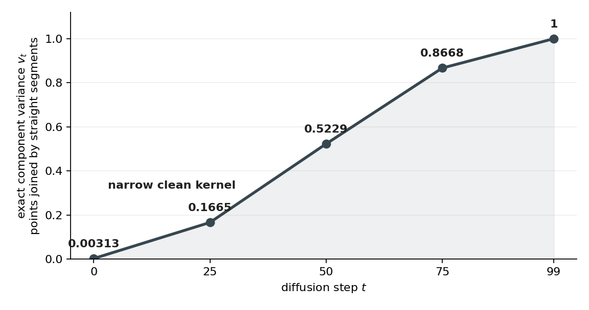
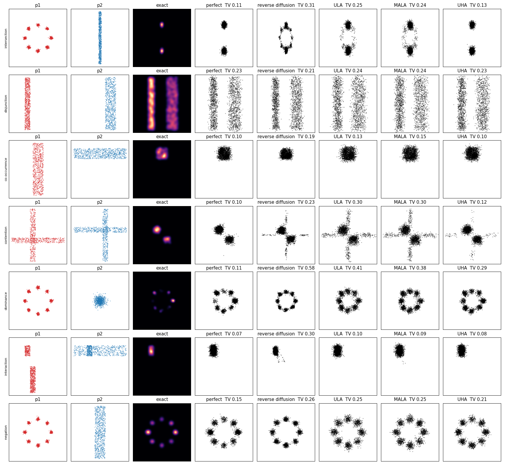

# 🔨 Phase 3: ideal experts, exact targets, and the seven kinds of composition

You replace trained networks with ideal experts, each one its training points smoothed by a small [Gaussian](../../../../../Obsidian/Mathematics/Statistics/Distributions/Multivariate%20Normal%20Distribution/Multivariate%20Normal%20Distribution.md#where-to-learn-this)<sub>[1](../../../../../Obsidian/Mathematics/references/textbooks/statistics/introduction-to-probability-for-data-science.pdf#page=227 "Introduction to probability for data science, section 4.6, The one-dimensional Gaussian random variable: its density with plots of μ and σ moving and widenin..."), [2](../../../../../Obsidian/Mathematics/references/textbooks/statistics/introduction-to-probability-for-data-science.pdf#page=306 "Introduction to probability for data science, section 5.6, The d-dimensional Gaussian density with Σ⁻¹, its mean vector and covariance, and the diagonal cova..."), [3](../../../../../Obsidian/Mathematics/references/textbooks/machine-learning/mathematics-for-machine-learning.pdf#page=203 "Mathematics for machine learning, section 6.5, The univariate and multivariate densities (equations 6.62 and 6.63, page 204) drawn with 100 samples, then mar..."), [▶1](https://www.youtube.com/watch?v=rzFX5NWojp0&t=0s "StatQuest, The Normal Distribution, Clearly Explained, 0:00 to 3:27, The bell-shaped curve and what its mean and standard deviation set, in the video's openi..."), [▶2](https://www.youtube.com/watch?v=oI3hZJqXJuc&t=135s "StatQuest, The Main Ideas behind Probability Distributions, 2:15 to 5:14, A curve as a distribution, where probability is the area under it over an interval ..."), [◆](../../../../../goal-setting/learning/deep-learning/diffusion-models/01-poe-derivation-foundations/textbook/02-densities-and-the-gaussian.md "Chapter 2: Read a density as area and draw a Gaussian from its covariance, deep-learning/diffusion-models/01-poe-derivation-foundations, chapter 02. The Gaus...")</sub>. Their noised densities are then exact at every diffusion step, so the composition can be computed exactly on a grid and every sampler's error measured against it. On that footing you build the seven kinds of composition on the paper's toy data, one dial each. It ends when your exact numbers match the kinds notebook's Figure 1 and Figure 2. The reference is `rebuild/ideal.py`, `rebuild/kinds.py` and `rebuild/phase3_kinds.py` on branch `unbuild-walk`.

**How to walk it.** `/drip-execute-plan artifacts/drips/simple-distributions-rebuild/03-ideal-experts-and-the-seven-kinds.md`, one step per message, typing every block yourself. The python blocks, typed in order into `walk03.py` in `/home-mscluster/mmolefe/Playground/PhD/simple-distributions-walk/`, are one runnable script.

**What teaches it elsewhere.** The kinds and their words: [Kinds Of Composition](../../../../../Obsidian/Artificial%20Intelligence/Generative%20Modeling/Diffusion%20Models/Composition/Kinds%20Of%20Composition.md), [The Product As An Intersection](../../../../../Obsidian/Artificial%20Intelligence/Generative%20Modeling/Diffusion%20Models/Composition/The%20Product%20As%20An%20Intersection.md), [What An Expert Learns From Its Training Set](../../../../../Obsidian/Artificial%20Intelligence/Generative%20Modeling/Diffusion%20Models/Composition/What%20An%20Expert%20Learns%20From%20Its%20Training%20Set.md), and [the composition terms](../../ideas/poe-overlap-dial/composition-terms.md). The exact noised mixture: [the exact score of a Gaussian mixture](../../../../../goal-setting/learning/deep-learning/diffusion-models/06-diffusion-speciation-dynamics/plans/02-speciation/plans/02-exact-mixture-score.md). Why a product of noised experts differs from the noised product: [score additivity and the product density](../../../../../goal-setting/learning/deep-learning/diffusion-models/06-diffusion-speciation-dynamics/plans/05-composition-and-the-experiment/plans/01-score-additivity-product-density.md).

**Where the numbers come from.** Worked numbers: `python -m rebuild.walk_numbers`. The kinds notebook's printed numbers: `artifacts/ideas/poe-overlap-dial/kinds-of-composition-on-the-papers-toys.ipynb`. The rebuilt run beside them: `rebuild/out/phase3/phase3.json`.

## Steps

- [Step 0: the setup block](#step-0-the-setup-block)
- [Step 1: an ideal expert is a kernel density estimate](#step-1-an-ideal-expert-is-a-kernel-density-estimate)
- [Step 2: its noised density is exact](#step-2-its-noised-density-is-exact)
- [Step 3: the exact composition on a grid](#step-3-the-exact-composition-on-a-grid)
- [Step 4: the perfect sampler and the floor](#step-4-the-perfect-sampler-and-the-floor)
- [Step 5: intersection](#step-5-intersection)
- [Step 6: disjunction](#step-6-disjunction)
- [Step 7: co-occurrence](#step-7-co-occurrence)
- [Step 8: contention](#step-8-contention)
- [Step 9: dominance](#step-9-dominance)
- [Step 10: interaction](#step-10-interaction)
- [Step 11: negation](#step-11-negation)
- [Step 12: the dials](#step-12-the-dials)
- [Step 13: the samplers on every kind](#step-13-the-samplers-on-every-kind)

**Colours on this page.** <span style="color:#1565c0">**Blue is the clean point $x_0$**</span>, <span style="color:#00838f">**teal is a point $x$ or the noisy point $x_t$**</span>, <span style="color:#6a1b9a">**purple is the noise $\varepsilon$**</span>, <span style="color:#2e7d32">**green is the kept signal share $\bar\alpha_t$**</span>, <span style="color:#ef6c00">**orange is the noise level $\sqrt{1-\bar\alpha_t}$**</span>, <span style="color:#ad1457">**pink is the score**</span>, <span style="color:#6d4c41">**brown is energy $E$**</span>, <span style="color:#c62828">**red is the prediction $\hat\varepsilon$**</span>, <span style="color:#827717">**olive is expert A**</span>, <span style="color:#546e7a">**blue-grey is expert B**</span>, and <span style="color:#4527a0">**indigo is the composed target**</span> (the product, mixture or negation being sampled). The same colour means the same quantity in every table, chart, diagram and equation.

## Step 0: the setup block

`rng` draws the training data, in exactly the kinds notebook's order, so your data equals the notebook's. Everything else random uses `rng2`, so it cannot shift that order.

```python
import math
import numpy as np
import matplotlib
matplotlib.use("Agg")
import matplotlib.pyplot as plt
import seaborn as sns
import torch
from sklearn.neighbors import KernelDensity

from rebuild.model import cosine_beta_schedule
from rebuild.device import pick_device

dev = pick_device(); print("device", dev)
rng = np.random.default_rng(0); torch.manual_seed(0); rng2 = np.random.default_rng(1)
T = 100; betas = cosine_beta_schedule(T); abar = np.cumprod(1 - betas)
SIG, N = 0.05, 800
```

## Step 1: an ideal expert is a kernel density estimate

**Definition.** The ideal expert of a training set $x_1,\dots,x_N$ at smoothing σ is

$$p^{\text{ideal}}_\sigma(x)=\frac1N\sum_{i=1}^N\mathcal N(x;\ x_i,\ \sigma^2I),$$

$$
\underbrace{p^{\mathrm{ideal}}_\sigma(\textcolor{#00838f}{x})}_{\text{ideal expert density at the query point}}
=
\underbrace{\frac{1}{N}}_{\text{equal share for each training point}}
\underbrace{\sum_{i=1}^{N}}_{\text{add every training-point contribution}}
\underbrace{\mathcal N(\textcolor{#00838f}{x};x_i,\sigma^2I)}_{\text{small Gaussian centred on point }i}.
$$

**What the equation says.** Put one [Gaussian](../../../../../Obsidian/Mathematics/Statistics/Distributions/Multivariate%20Normal%20Distribution/Multivariate%20Normal%20Distribution.md#where-to-learn-this)<sub>[1](../../../../../Obsidian/Mathematics/references/textbooks/statistics/introduction-to-probability-for-data-science.pdf#page=227 "Introduction to probability for data science, section 4.6, The one-dimensional Gaussian random variable: its density with plots of μ and σ moving and widenin..."), [2](../../../../../Obsidian/Mathematics/references/textbooks/statistics/introduction-to-probability-for-data-science.pdf#page=306 "Introduction to probability for data science, section 5.6, The d-dimensional Gaussian density with Σ⁻¹, its mean vector and covariance, and the diagonal cova..."), [3](../../../../../Obsidian/Mathematics/references/textbooks/machine-learning/mathematics-for-machine-learning.pdf#page=203 "Mathematics for machine learning, section 6.5, The univariate and multivariate densities (equations 6.62 and 6.63, page 204) drawn with 100 samples, then mar..."), [▶1](https://www.youtube.com/watch?v=rzFX5NWojp0&t=0s "StatQuest, The Normal Distribution, Clearly Explained, 0:00 to 3:27, The bell-shaped curve and what its mean and standard deviation set, in the video's openi..."), [▶2](https://www.youtube.com/watch?v=oI3hZJqXJuc&t=135s "StatQuest, The Main Ideas behind Probability Distributions, 2:15 to 5:14, A curve as a distribution, where probability is the area under it over an interval ..."), [◆](../../../../../goal-setting/learning/deep-learning/diffusion-models/01-poe-derivation-foundations/textbook/02-densities-and-the-gaussian.md "Chapter 2: Read a density as area and draw a Gaussian from its covariance, deep-learning/diffusion-models/01-poe-derivation-foundations, chapter 02. The Gaus...")</sub> of width σ on every training point, add their heights at <span style="color:#00838f">the query point</span>, and average the result. Nothing is fitted after the training points and σ are fixed.

**Why the sum is there.** The query point can receive [density](../../../../../Obsidian/Mathematics/Statistics/Distributions/Probability%20Density%20Function.md#where-to-learn-this)<sub>[1](../../../../../Obsidian/Mathematics/references/textbooks/statistics/introduction-to-probability-for-data-science.pdf#page=188 "Introduction to probability for data science, section 4.1, Builds the intuition of probability per unit length, defines the PDF and its properties (Definitio..."), [2](../../../../../Obsidian/Mathematics/references/textbooks/machine-learning/mathematics-for-machine-learning.pdf#page=186 "Mathematics for machine learning, section 6.2.2, The density and the CDF (Definitions 6.1 and 6.2), a uniform example (Example 6.3), and discrete against con..."), [3](../../../../../Obsidian/Mathematics/references/textbooks/machine-learning/pattern-recognition-and-machine-learning.pdf#page=36 "Pattern recognition and machine learning, section 1.2.1, The density's two conditions (equations 1.25 and 1.26), its link to the CDF, and why a density picks..."), [▶1](https://www.youtube.com/watch?v=QKA4HNEw3aY&t=52s "The Organic Chemistry Tutor, Probability Density Functions, 0:52 to 3:39, Verifies that a given function is a density by checking that its integral equals 1...."), [▶2](https://www.youtube.com/watch?v=oI3hZJqXJuc&t=135s "StatQuest, The Main Ideas behind Probability Distributions, 2:15 to 5:14, A curve as a distribution, with probability read as area under it, not its height. ..."), [◆](../../../../../goal-setting/learning/deep-learning/diffusion-models/01-poe-derivation-foundations/textbook/02-densities-and-the-gaussian.md#21-a-density-can-exceed-1 "Chapter 2: Read a density as area and draw a Gaussian from its covariance, deep-learning/diffusion-models/01-poe-derivation-foundations, chapter 02, section ..."), [◈](https://claude.ai/artifact/DBmJtn6xy75sPtQwPEvQZU#nb-sec1 "Kinds of composition notebook, Setup: the ideal expert, The ideal expert's log-density on a grid, in four steps from the 2D Gaussian to its logsumexp form, t...")</sub> from every training point. Keeping only one term would describe one bump instead of the three-bump toy.

**Why the factor $1/N$ is there.** It gives the $N$ kernels equal weights that sum to one. On the toy, removing $1/3$ raises the log-density from −2.6288 to −1.5302, so the surface no longer has [total mass one](../../../../../goal-setting/learning/mathematics/textbooks/statistics/introduction-to-probability-for-data-science.pdf#page=190).

which is exactly a [Gaussian kernel density estimate](../../../../../goal-setting/learning/mathematics/textbooks/machine-learning/pattern-recognition-and-machine-learning.pdf#page=142) with bandwidth σ.

<!-- video-table: kernel-density-estimate rev=1 -->
ritvikmath on the kernel density estimate, a normal curve centred on every data point and averaged, in the order to watch:

| Order | What it covers | Kind | Watch |
|---|---|---|---|
| 1 | Six fish weights and three candidate estimates: under-smoothed, over-smoothed and just right | Intuition | [ritvikmath, Kernel Density Estimation, 2:38 to 5:17](https://www.youtube.com/watch?v=t1PEhjyzxLA&t=158s) |
| 2 | A normal curve centred on each of three fish, averaged, and read off at 9.5 lb and at 14 lb | Worked example | [ritvikmath, Kernel Density Estimation, 5:32 to 10:13](https://www.youtube.com/watch?v=t1PEhjyzxLA&t=332s) |
| 3 | The formula, one over n times the sum of a kernel at x minus each data point, matched to the picture | Intuition | [ritvikmath, Kernel Density Estimation, 10:28 to 13:08](https://www.youtube.com/watch?v=t1PEhjyzxLA&t=628s) |
| 4 | The bandwidth h is each kernel's standard deviation, and it decides between too many peaks and too few | Intuition | [ritvikmath, Kernel Density Estimation, 14:10 to 15:44](https://www.youtube.com/watch?v=t1PEhjyzxLA&t=850s) |

ritvikmath works in one dimension and does not point out that a Gaussian kernel density estimate is a Gaussian mixture with one equal-weight component per data point. Times are read from automatic captions and good to about 30 seconds.
<!-- /video-table -->

**Derivation of why it is the ideal, and under which assumptions.** Write the training set as a distribution, [one point mass per training point](../../../../../goal-setting/learning/mathematics/textbooks/machine-learning/deep-learning-textbook.pdf#page=81):

$$\widehat p_0(x)=\frac1N\sum_{i=1}^N\delta_{x_i}(x).$$

$$
\underbrace{\widehat p_0(\textcolor{#00838f}{x})}_{\text{training-set distribution}}
=
\underbrace{\frac{1}{N}}_{\text{equal mass per point}}
\underbrace{\sum_{i=1}^{N}}_{\text{collect all training points}}
\underbrace{\delta_{x_i}(\textcolor{#00838f}{x})}_{\text{one point mass at }x_i}.
$$

**What the equation says.** Before smoothing, the whole distribution consists of $N$ spikes. Each spike carries exactly one $N$th of the total mass.

**Why the sum and normalising factor are there.** The sum includes every observed point, while $1/N$ makes their masses add to one. On the toy, there are three spikes of mass $1/3$ rather than one spike of mass 1.

Corrupting a draw by $Y=X+\sigma Z$, with $Z\sim\mathcal N(0,I)$, [convolves it with a Gaussian](../../../../../goal-setting/learning/mathematics/textbooks/statistics/introduction-to-probability-for-data-science.pdf#page=298):

$$p_\sigma(y)=\big(\widehat p_0*\mathcal N(0,\sigma^2I)\big)(y)=\frac1N\sum_{i=1}^N\mathcal N(y;\ x_i,\ \sigma^2I),$$

$$
\underbrace{p_\sigma(\textcolor{#00838f}{y})}_{\text{smoothed training distribution}}
=
\underbrace{\big(\widehat p_0*\mathcal N(0,\sigma^2I)\big)(\textcolor{#00838f}{y})}_{\text{add Gaussian displacement to a training draw}}
=
\underbrace{\frac1N\sum_{i=1}^{N}\mathcal N(\textcolor{#00838f}{y};x_i,\sigma^2I)}_{\text{one Gaussian kernel per point}}.
$$

**What the equation says.** Convolution replaces every point-mass spike by a Gaussian bump of the same width. The final equality writes that operation as the explicit average used in code.

**Why convolution is there.** Convolution is the density operation for adding an independent random displacement. Removing it leaves point masses, so the density at an ordinary point between training observations is not the smooth value −2.6288 used by the toy.

**Why the equality chain is there.** The middle expression describes the random operation, while the last expression makes every resulting bump visible. Both routes produce the same density.

which is the sum above. The denoising objective at that noise level, taken as a population [expectation](../../../../../Obsidian/Mathematics/Statistics/Probability/Expected%20Value.md#where-to-learn-this)<sub>[1](../../../../../Obsidian/Mathematics/references/textbooks/statistics/introduction-to-probability-for-data-science.pdf#page=141 "Introduction to probability for data science, section 3.4, Works with numbers: E[X] = Σ x p(x) and why it equals a dataset's average once repeated values are..."), [2](../../../../../Obsidian/Mathematics/references/textbooks/statistics/introduction-to-statistics.pdf#page=81 "Introduction to statistics (Wits lecture notes), section 4.2.3, The expected value of a discrete random variable as the mean over many trials, with E[X] and ..."), [3](../../../../../Obsidian/Mathematics/references/textbooks/statistics/introduction-to-probability-for-data-science.pdf#page=196 "Introduction to probability for data science, section 4.2, The integral definition for a continuous variable, with uniform and exponential worked examples (p..."), [▶1](https://www.youtube.com/watch?v=KLs_7b7SKi4&t=309s "StatQuest, Expected Values, Main Ideas, 5:09 to 8:02, Calculating an expected value: each outcome times its probability, added up. Chapter-timed, from the vi..."), [▶2](https://www.youtube.com/watch?v=OSPr6G6Ka-U&t=738s "StatQuest, Expected Values for Continuous Variables, 12:18 to 18:17, Calculating the expected value of an exponential distribution, after deriving the formul..."), [◆](../../../../../goal-setting/learning/mathematics/statistics/conditional-expectation/textbook/01-expectation-and-the-best-constant-guess.md "1. Expectation, and the best constant guess, mathematics/statistics/conditional-expectation, section 1. A fair die's best constant guess under squared error ...")</sub> and minimised over every possible score field (unlimited capacity, global optimum), has $\nabla_y\log p_\sigma(y)$ as its [minimiser](../../../../../goal-setting/learning/mathematics/textbooks/machine-learning/the-little-book-of-generative-ai-foundations.pdf#page=126) (phase 1, Step 8). That is the precise sense in which this kernel density estimate is ideal. A real network can do worse, by underfitting or by stopping short of the optimum, or differently, by extrapolating. In 2D the networks in run 2 of the idea map matched it within 0.04 [nats](../../../../../goal-setting/learning/mathematics/textbooks/machine-learning/deep-learning-textbook.pdf#page=89), which is evidence from that run and not part of the argument.

**What the rebuild assumes on top.** σ = 0.05 is a chosen smoothing, and it is not the schedule's smallest noise: at t = 0 the cosine schedule's noise [standard deviation](../../../../../Obsidian/Mathematics/Statistics/Variance.md#where-to-learn-this)<sub>[1](../../../../../Obsidian/Mathematics/references/textbooks/statistics/introduction-to-probability-for-data-science.pdf#page=150 "Introduction to probability for data science, section 3.4.4, Defines variance as E[(X − µ)²] and the standard deviation as its root (Definition 3.7), proves ..."), [2](../../../../../Obsidian/Mathematics/references/textbooks/machine-learning/mathematics-for-machine-learning.pdf#page=196 "Mathematics for machine learning, section 6.4.1, Variance as the covariance of a variable with itself (Definition 6.7), then the empirical mean and variance ..."), [3](../../../../../Obsidian/Mathematics/references/textbooks/machine-learning/deep-learning-textbook.pdf#page=76 "Deep learning textbook, section 3.8, A short definition of variance and standard deviation beside expectation and covariance."), [▶1](https://www.youtube.com/watch?v=4-FysvtxQEU&t=1551s "Professor Leonard, Statistics 3.3, A standard deviation calculated by hand, 25:51 to 36:43, Works a standard deviation on a small data set by hand. Chapter-t..."), [▶2](https://www.youtube.com/watch?v=SzZ6GpcfoQY&t=236s "StatQuest, Calculating the Mean, Variance and Standard Deviation, Calculating population variance, 3:56 to 5:54, The population variance as the average squar..."), [◆](../../../../../goal-setting/learning/deep-learning/transformers/textbook/06-show-that-variances-of-independent-terms-add.md "Show that variances of independent terms add, deep-learning/transformers, chapter 06. Predicts the spread of a dot product of random vectors by adding the va...")</sub> $\sqrt{1-\bar\alpha_0}$ is `0.0251` (`p1.sqrt_1m_abar_0`). The rebuild takes $p_\sigma$ itself as the clean expert and runs the forward process on it, which is where Step 2's extra term $\bar\alpha_t\sigma^2$ comes from. A model trained directly on the bare training points would instead have component variance $1-\bar\alpha_t$ at step t. With those assumptions stated, the ideal expert is a trained expert with training error removed, and every failure measured on it belongs to the data or the composition.

🧸 **Toy:** three training points, (−0.5, −0.5), (−0.6, −0.4), (−0.5, 0.5), with σ = 0.15. At (−0.5, 0) the log-density is `-2.6288` by the formula, and `-2.6288` from scikit-learn's `KernelDensity`.

🔤 **The name:** [ideal expert](../../../../../Obsidian/Artificial%20Intelligence/Generative%20Modeling/Diffusion%20Models/Composition/What%20An%20Expert%20Learns%20From%20Its%20Training%20Set.md)

---

#### The scene and its table

The three training points are the expert's entire experience. The expert places one Gaussian on each point and answers a query by averaging the three heights.

<table>
<tr><th>object</th><th>toy value</th><th>job</th></tr>
<tr><td>training points</td><td>3</td><td>everything the expert knows</td></tr>
<tr><td>Gaussian width σ</td><td style="border:2px dashed #212121">0.15</td><td>smooths each remembered point</td></tr>
<tr style="background:#fff8e1"><td style="color:#00838f"><b>query point</b></td><td style="border:2px solid #212121"><b>(−0.5, 0)</b></td><td>where the density is read</td></tr>
<tr><td>log-density</td><td style="border:2px solid #212121">−2.6288</td><td>exact answer from the training set</td></tr>
</table>

**How to read this table.** Each row supplies one part of the same density query. The highlighted point is where the answer is requested, the dashed cell is the smoothing choice, and the final boxed cell is the answer.

**What to look for.** There is no learned parameter or approximation error in the table. Once the three points and σ are fixed, −2.6288 is determined.

---

#### The base word: expert

**What the word means.** An expert is a source consulted for how well a case fits what it knows. Here its knowledge is exactly the training set.

$$
\underbrace{p_\sigma(\textcolor{#00838f}{x})}_{\text{expert's answer at }x}
=
\underbrace{\frac1N\sum_{i=1}^{N}\mathcal N(\textcolor{#00838f}{x};x_i,\sigma^2I)}_{\text{all remembered training points, smoothed}}.
$$

**What the equation says.** The expert answers by collecting the smoothed contribution of every point it saw.

**What it means.** “Expert” does not mean a person or a neural network architecture. It means one density representing one training set.

---

#### Then the qualifying word: ideal

**What the word means.** Ideal means the error of learning the density has been removed. The object is the exact target that a [perfectly trained, unlimited model](../../../../../goal-setting/learning/deep-learning/diffusion-models/01-poe-derivation-foundations/textbook/13-the-training-loss-two-ways.md#132-denoising-score-matching-and-its-optimum) would represent under the stated assumptions.

$$
\underbrace{\log p^{\mathrm{ideal}}_\sigma(-0.5,0)}_{\text{formula}}
=
\underbrace{-2.6288}_{\text{exact toy answer}}
=
\underbrace{\log p^{\mathrm{KDE}}_\sigma(-0.5,0)}_{\text{library check}}.
$$

**What the equation says.** The direct formula and scikit-learn give the same log-density at the toy query.

**What it means.** “Ideal” removes training error, not smoothing and not finite-data effects. The expert still reflects only its three points and the chosen σ.

---

#### Both words together: the formula

An ideal expert is the density obtained when the training set itself, after the chosen Gaussian smoothing, is treated as the perfectly learned model.

$$
\underbrace{p^{\mathrm{ideal}}_\sigma(\textcolor{#00838f}{x})}_{\text{ideal expert}}
=
\underbrace{\frac1N}_{\text{equal memory}}
\sum_{i=1}^{N}
\underbrace{\mathcal N(\textcolor{#00838f}{x};x_i,\sigma^2I)}_{\text{smoothed training point }i}.
$$

**What the equation says.** Every observed point becomes one equally weighted Gaussian memory, and their total is the expert.

**Check it on the toy.** The three-point formula gives log-density −2.6288 at $(−0.5,0)$, exactly matching `KernelDensity`.

---

#### The consequence: remove learning error

**Use the ideal expert.** The formula and library value are both −2.6288, so their difference is 0 at the toy query.

**Return to a trained network.** The page's earlier run found differences within 0.04 [nats](../../../../../goal-setting/learning/mathematics/textbooks/machine-learning/deep-learning-textbook.pdf#page=89). That move from 0 to as much as 0.04 is learning error, which the ideal expert deliberately removes.

🔤 **The name:** [kernel density estimate](../../../../../goal-setting/learning/mathematics/statistics/conditional-expectation/textbook/02-joint-and-marginal-summing-out.md#why-this-matters)

---

#### The scene and its table

The same toy can be read as three repeated actions: place a kernel on each point, add the density heights, and use the result as an estimate between observed points.

<table>
<tr><th>word</th><th>part of the toy</th><th>value</th></tr>
<tr><td>estimate</td><td style="border:2px solid #212121">answer at the unobserved query</td><td style="border:2px solid #212121">−2.6288</td></tr>
<tr><td>density</td><td>Gaussian height per unit area</td><td>log scale</td></tr>
<tr style="background:#fff8e1"><td><b>kernel</b></td><td>one small Gaussian on each point</td><td style="border:2px dashed #212121">σ = 0.15</td></tr>
</table>

**How to read this table.** Read upward from the highlighted kernel row. Kernels supply density heights, and their average estimates the density at the query.

**What to look for.** The name describes the construction in reverse grammatical order: it is an estimate of a density, made from kernels.

---

#### The base word first: estimate

**What the word means.** An estimate fills in a quantity that was not observed directly. No training point sits at $(−0.5,0)$, but the smoothed points determine a density there.

$$
\underbrace{\widehat p_\sigma(\textcolor{#00838f}{x})}_{\text{estimated density at a new point}}
=
\underbrace{\frac1N\sum_{i=1}^{N}K_\sigma(\textcolor{#00838f}{x}-x_i)}_{\text{average of nearby kernel heights}}.
$$

**What the equation says.** The hat marks a quantity constructed from data. The estimate at the query is an average of how strongly each training point's kernel reaches it.

**What it means.** “Estimate” does not mean numerically inexact once the data and bandwidth are fixed. It means the unknown population density is being represented from a finite [sample](../../../../../Obsidian/Mathematics/Statistics/Sampling%20From%20A%20Distribution.md#where-to-learn-this)<sub>[1](../../../../../Obsidian/Mathematics/references/textbooks/machine-learning/pattern-recognition-and-machine-learning.pdf#page=539 "Pattern recognition and machine learning, chapter 11, Why expectations need samples, ancestral sampling of a directed graph (page 541), standard distribution..."), [2](../../../../../Obsidian/Mathematics/references/textbooks/statistics/introduction-to-probability-for-data-science.pdf#page=245 "Introduction to probability for data science, section 4.8, Generates random numbers for any PDF by running a uniform through the inverse CDF, in Python, with..."), [3](../../../../../Obsidian/Mathematics/references/textbooks/machine-learning/deep-learning-textbook.pdf#page=606 "Deep learning textbook, section 17.1, Why machine learning samples at all (Monte Carlo estimates of sums and integrals, and sampling as the goal of a generat..."), [▶1](https://www.youtube.com/watch?v=9ixzzPQWuAY&t=474s "ritvikmath, Inverse Transform Sampling, 7:54 to 10:04, Inverts the exponential CDF and turns a uniform draw into an exponential one. Chapter-timed, from the ..."), [▶2](https://www.youtube.com/watch?v=OXDqjdVVePY&t=232s "ritvikmath, Accept-Reject Sampling, 3:52 to 7:45, An easy proposal g scaled by M into an envelope above f, then each draw accepted with probability f/(M g). ..."), [◆](../../../../../goal-setting/learning/deep-learning/diffusion-models/00-from-scratch-to-sdxl/textbook/l3-stochastic-processes/13-drawing-samples-by-hand.md "Drawing samples by hand: Monte Carlo, inverse transform and accept-reject, deep-learning/diffusion-models/00-from-scratch-to-sdxl, volume L3, section 13. Thr...")</sub>.

---

#### Then the word: density

**What the word means.** [Density is probability per unit area](../../../../../goal-setting/learning/mathematics/textbooks/statistics/introduction-to-probability-for-data-science.pdf#page=190). A point receives a height, while probability comes from accumulating heights over a region.

$$
\underbrace{P(\textcolor{#00838f}{x}\in R)}_{\text{probability in region }R}
=
\underbrace{\int_R \widehat p_\sigma(\textcolor{#00838f}{x})\,d\textcolor{#00838f}{x}}_{\text{area under the estimated density}}.
$$

**What the equation says.** The value −2.6288 is a log-density at one query, not a [probability](../../../../../Obsidian/Mathematics/Statistics/Probability/Probability.md#where-to-learn-this)<sub>[1](../../../../../Obsidian/Mathematics/references/textbooks/machine-learning/pattern-recognition-and-machine-learning.pdf#page=31 "Pattern recognition and machine learning, section 1.2, Works with numbers: a red box picked 40% of the time and a blue box 60%, holding apples and oranges, f..."), [2](../../../../../Obsidian/Mathematics/references/textbooks/statistics/introduction-to-probability-for-data-science.pdf#page=74 "Introduction to probability for data science, sections 2.2 and 2.3, Probability as a measure of the size of a set, built from a sample space, an event space ..."), [3](../../../../../Obsidian/Mathematics/references/textbooks/statistics/introduction-to-statistics.pdf#page=64 "Introduction to statistics (Wits lecture notes), sections 3.5 to 3.7.2, The axioms, the subjective, relative-frequency and classical approaches, the addition..."), [▶1](https://www.youtube.com/watch?v=_EpXHuPnaK0&t=360s "Professor Leonard, Statistics lecture 4.2, Introduction to Probability, 6:00 to 9:00, The sample space, in the chapter of that name, before simple events. Ch..."), [▶2](https://www.youtube.com/watch?v=_EpXHuPnaK0&t=2085s "Professor Leonard, Statistics lecture 4.2, Introduction to Probability, 34:45 to 37:07, Observed against classical probability. Chapter-timed."), [◆](../../../../../goal-setting/learning/deep-learning/diffusion-models/01-poe-derivation-foundations/plans/01-probability-you-can-compute.md "Probability as a thing you can compute, deep-learning/diffusion-models/01-poe-derivation-foundations, plan 01. Events and P(A), with a sample space built and...")</sub>. Probabilities appear only after the density is exponentiated and accumulated over an area.

**What it means.** Density lets the expert compare locations even where no training point was observed exactly.

---

#### Then the word: kernel

**What the word means.** A kernel is the small reusable shape placed on every observation. Here that shape is a Gaussian with bandwidth σ.

$$
\underbrace{K_\sigma(\textcolor{#00838f}{x}-x_i)}_{\text{kernel from point }i}
=
\underbrace{\mathcal N(\textcolor{#00838f}{x};x_i,\sigma^2I)}_{\text{Gaussian centred at }x_i}.
$$

**What the equation says.** The same bell shape is translated to each training point. Its width is σ in every direction.

**What it means.** “Kernel” names the local smoothing shape. It is not the operating-system meaning of kernel.

---

#### All the words together: the formula

[A kernel density estimate](../../../../../goal-setting/learning/mathematics/textbooks/machine-learning/pattern-recognition-and-machine-learning.pdf#page=142) is a density estimate made by averaging one kernel centred on every observed point.

$$
\underbrace{\widehat p_\sigma(\textcolor{#00838f}{x})}_{\text{kernel density estimate}}
=
\underbrace{\frac1N}_{\text{average}}
\sum_{i=1}^{N}
\underbrace{K_\sigma(\textcolor{#00838f}{x}-x_i)}_{\text{kernel on observation }i}.
$$

**What the equation says.** The kernel supplies the local shape, density says what the resulting height represents, and estimate says it was constructed from observed data.

**Check it on the toy.** Three Gaussian kernels with σ = 0.15 give log-density −2.6288 at $(−0.5,0)$ by both implementations.

---

#### The consequence: remove the average

**Keep the factor $1/3$.** The toy's log-density is −2.6288 and the three kernel weights sum to one.

**Remove the factor $1/3$.** The log-density rises to −1.5302 because all heights are multiplied by three. The shape remains, but the total mass becomes three, so it is no longer a probability density.

🔨 **Build:**

```python
A3 = np.array([[-0.5, -0.5], [-0.6, -0.4], [-0.5, 0.5]]); q = np.array([[-0.5, 0.0]])
d2 = ((q[:, None] - A3[None]) ** 2).sum(-1)
ours = np.log(np.exp(-d2 / (2 * 0.15 ** 2)).mean(1)) - np.log(2 * np.pi * 0.15 ** 2)
kde = KernelDensity(kernel="gaussian", bandwidth=0.15).fit(A3)
print("log-density, formula", np.round(ours, 4), " sklearn", np.round(kde.score_samples(q), 4))
```

## Step 2: its noised density is exact

**Definition.** Noising to step t maps $x_0\mapsto\sqrt{\bar\alpha_t}x_0+\sqrt{1-\bar\alpha_t}\,\varepsilon$.

**Derivation.** Each kernel $\mathcal N(x_i,\sigma^2I)$ is [scaled](../../../../../goal-setting/learning/mathematics/textbooks/statistics/introduction-to-probability-for-data-science.pdf#page=242) by $\sqrt{\bar\alpha_t}$, giving $\mathcal N(\sqrt{\bar\alpha_t}x_i,\bar\alpha_t\sigma^2I)$, and the added noise convolves it with $\mathcal N(0,(1-\bar\alpha_t)I)$. [Convolving two Gaussians adds their variances](../../../../../goal-setting/learning/mathematics/textbooks/statistics/introduction-to-probability-for-data-science.pdf#page=299). So

$$q_t(x)=\frac1N\sum_i\mathcal N\big(x;\ \sqrt{\bar\alpha_t}\,x_i,\ v_tI\big),\qquad v_t=1-\bar\alpha_t+\bar\alpha_t\sigma^2 .$$

$$
\underbrace{q_t(\textcolor{#00838f}{x})}_{\text{exact noised density}}
=
\underbrace{\frac1N\sum_i}_{\text{equal mixture over training points}}
\mathcal N\!\left(
\textcolor{#00838f}{x};
\underbrace{\sqrt{\textcolor{#2e7d32}{\bar\alpha_t}}\,x_i}_{\text{scaled component centre}},
\underbrace{v_tI}_{\text{component covariance}}
\right),
\qquad
\underbrace{v_t}_{\text{component variance}}
=
\underbrace{1-\textcolor{#2e7d32}{\bar\alpha_t}}_{\text{added forward-noise variance}}
+
\underbrace{\textcolor{#2e7d32}{\bar\alpha_t}\sigma^2}_{\text{scaled clean-kernel variance}}.
$$

**What the equation says.** Noising preserves the equal [Gaussian](../../../../../Obsidian/Mathematics/Statistics/Distributions/Multivariate%20Normal%20Distribution/Multivariate%20Normal%20Distribution.md#where-to-learn-this)<sub>[1](../../../../../Obsidian/Mathematics/references/textbooks/statistics/introduction-to-probability-for-data-science.pdf#page=227 "Introduction to probability for data science, section 4.6, The one-dimensional Gaussian random variable: its density with plots of μ and σ moving and widenin..."), [2](../../../../../Obsidian/Mathematics/references/textbooks/statistics/introduction-to-probability-for-data-science.pdf#page=306 "Introduction to probability for data science, section 5.6, The d-dimensional Gaussian density with Σ⁻¹, its mean vector and covariance, and the diagonal cova..."), [3](../../../../../Obsidian/Mathematics/references/textbooks/machine-learning/mathematics-for-machine-learning.pdf#page=203 "Mathematics for machine learning, section 6.5, The univariate and multivariate densities (equations 6.62 and 6.63, page 204) drawn with 100 samples, then mar..."), [▶1](https://www.youtube.com/watch?v=rzFX5NWojp0&t=0s "StatQuest, The Normal Distribution, Clearly Explained, 0:00 to 3:27, The bell-shaped curve and what its mean and standard deviation set, in the video's openi..."), [▶2](https://www.youtube.com/watch?v=oI3hZJqXJuc&t=135s "StatQuest, The Main Ideas behind Probability Distributions, 2:15 to 5:14, A curve as a distribution, where probability is the area under it over an interval ..."), [◆](../../../../../goal-setting/learning/deep-learning/diffusion-models/01-poe-derivation-foundations/textbook/02-densities-and-the-gaussian.md "Chapter 2: Read a density as area and draw a Gaussian from its covariance, deep-learning/diffusion-models/01-poe-derivation-foundations, chapter 02. The Gaus...")</sub> mixture. It moves every centre toward zero and gives every component the same [variance](../../../../../Obsidian/Mathematics/Statistics/Variance.md#where-to-learn-this)<sub>[1](../../../../../Obsidian/Mathematics/references/textbooks/statistics/introduction-to-probability-for-data-science.pdf#page=150 "Introduction to probability for data science, section 3.4.4, Defines variance as E[(X − µ)²] and the standard deviation as its root (Definition 3.7), proves ..."), [2](../../../../../Obsidian/Mathematics/references/textbooks/machine-learning/mathematics-for-machine-learning.pdf#page=196 "Mathematics for machine learning, section 6.4.1, Variance as the covariance of a variable with itself (Definition 6.7), then the empirical mean and variance ..."), [3](../../../../../Obsidian/Mathematics/references/textbooks/machine-learning/deep-learning-textbook.pdf#page=76 "Deep learning textbook, section 3.8, A short definition of variance and standard deviation beside expectation and covariance."), [▶1](https://www.youtube.com/watch?v=4-FysvtxQEU&t=1551s "Professor Leonard, Statistics 3.3, A standard deviation calculated by hand, 25:51 to 36:43, Works a standard deviation on a small data set by hand. Chapter-t..."), [▶2](https://www.youtube.com/watch?v=SzZ6GpcfoQY&t=236s "StatQuest, Calculating the Mean, Variance and Standard Deviation, Calculating population variance, 3:56 to 5:54, The population variance as the average squar..."), [◆](../../../../../goal-setting/learning/deep-learning/transformers/textbook/06-show-that-variances-of-independent-terms-add.md "Show that variances of independent terms add, deep-learning/transformers, chapter 06. Predicts the spread of a dot product of random vectors by adding the va...")</sub> $v_t$.

**Why the sum is there.** Every original training point remains a possible mixture component after noising. Removing the sum would keep only one training point.

**Why the square root is there.** Coordinates are scaled by a standard-deviation factor, while $\bar\alpha_t$ records a variance share. At step 50 the retained share is 0.4783, so the centre scale is its square root.

**Why the variance sum is there.** The scaled clean-kernel variation and the independent forward noise both contribute. At step 50, omitting the clean-kernel term changes 0.5229 to 0.5217.

**The variance, one move at a time.** For component i, write the clean draw $x_0$ and then apply the forward process, with $Z_0$ and $Z_1$ independent standard Gaussians:

$$
\begin{aligned}
x_0\mid i &= x_i+\sigma Z_0, \\
x_t\mid i &= \sqrt{\bar\alpha_t}\,x_i+\sqrt{\bar\alpha_t}\,\sigma Z_0+\sqrt{1-\bar\alpha_t}\,Z_1, \\
\operatorname{Var}(x_t\mid i) &= \bar\alpha_t\sigma^2I+(1-\bar\alpha_t)I=v_tI.
\end{aligned}
$$

$$
\begin{aligned}
\underbrace{\textcolor{#1565c0}{x_0}\mid i}_{\text{clean draw from component }i}
&=
\underbrace{x_i}_{\text{component centre}}
+
\underbrace{\sigma Z_0}_{\text{clean-kernel variation}}, \\
\underbrace{\textcolor{#00838f}{x_t}\mid i}_{\text{noisy draw}}
&=
\underbrace{\sqrt{\textcolor{#2e7d32}{\bar\alpha_t}}\,x_i}_{\text{kept centre}}
+
\underbrace{\sqrt{\textcolor{#2e7d32}{\bar\alpha_t}}\,\sigma Z_0}_{\text{kept clean variation}}
+
\underbrace{\textcolor{#ef6c00}{\sqrt{1-\bar\alpha_t}}\,\textcolor{#6a1b9a}{Z_1}}_{\text{fresh noise}}, \\
\underbrace{\operatorname{Var}(\textcolor{#00838f}{x_t}\mid i)}_{\text{variance after noising}}
&=
\underbrace{\textcolor{#2e7d32}{\bar\alpha_t}\sigma^2I}_{\text{clean contribution}}
+
\underbrace{(1-\textcolor{#2e7d32}{\bar\alpha_t})I}_{\text{noise contribution}}
=
\underbrace{v_tI}_{\text{total}}.
\end{aligned}
$$

**What the equation says.** A clean component already has Gaussian variation. The forward process scales that variation and adds a second independent Gaussian, so their variances add.

**Why the additions are there.** The noisy point contains a centre term, a retained clean-kernel term and a fresh-noise term. Dropping the clean-kernel term changes the step-50 variance from 0.5229 to 0.5217.

**Why the squares are implicit in the variance line.** [Scaling a random variable by a square root scales its variance](../../../../../goal-setting/learning/mathematics/textbooks/machine-learning/mathematics-for-machine-learning.pdf#page=200) by the unsquared share. Thus $\sqrt{\bar\alpha_t}$ becomes $\bar\alpha_t$ in the final line.

The second line substitutes the clean draw. The third adds the two variances, which is allowed because $Z_0$ and $Z_1$ are independent. At step 50, $\bar\alpha_{50}$ = `0.4783`, so $v_{50}=1-0.4783+0.4783\times0.05^2$ = `0.5229`.

**The exact score.** Put $\mu_{i,t}=\sqrt{\bar\alpha_t}\,x_i$ and $\phi_i(x)=\mathcal N(x;\ \mu_{i,t},\ v_tI)$, and define the [softmax responsibility](../../../../../goal-setting/learning/mathematics/textbooks/machine-learning/pattern-recognition-and-machine-learning.pdf#page=449) $r_i(x)=\phi_i(x)/\sum_j\phi_j(x)$. Then

$$
\begin{aligned}
\nabla_x\log q_t(x)
&=\frac{\sum_i\nabla_x\phi_i(x)}{\sum_j\phi_j(x)} \\
&=\sum_i r_i(x)\,\nabla_x\log\phi_i(x) \\
&=\sum_i r_i(x)\,\frac{\sqrt{\bar\alpha_t}\,x_i-x}{v_t}.
\end{aligned}
$$

$$
\begin{aligned}
\underbrace{\textcolor{#ad1457}{\nabla_x\log q_t(\textcolor{#00838f}{x})}}_{\text{exact mixture score}}
&=
\underbrace{\frac{\sum_i\nabla_x\phi_i(\textcolor{#00838f}{x})}{\sum_j\phi_j(\textcolor{#00838f}{x})}}_{\text{density slope divided by density}} \\
&=
\underbrace{\sum_i r_i(\textcolor{#00838f}{x})}_{\text{responsibility-weighted sum}}
\underbrace{\nabla_x\log\phi_i(\textcolor{#00838f}{x})}_{\text{component score}} \\
&=
\sum_i
\underbrace{r_i(\textcolor{#00838f}{x})}_{\text{component }i\text{ responsibility}}
\underbrace{\frac{\sqrt{\textcolor{#2e7d32}{\bar\alpha_t}}\,x_i-\textcolor{#00838f}{x}}{v_t}}_{\text{score of component }i}.
\end{aligned}
$$

**What the equation says.** The mixture score is not a plain sum of component scores. Each component's arrow is multiplied by its share of the [density](../../../../../Obsidian/Mathematics/Statistics/Distributions/Probability%20Density%20Function.md#where-to-learn-this)<sub>[1](../../../../../Obsidian/Mathematics/references/textbooks/statistics/introduction-to-probability-for-data-science.pdf#page=188 "Introduction to probability for data science, section 4.1, Builds the intuition of probability per unit length, defines the PDF and its properties (Definitio..."), [2](../../../../../Obsidian/Mathematics/references/textbooks/machine-learning/mathematics-for-machine-learning.pdf#page=186 "Mathematics for machine learning, section 6.2.2, The density and the CDF (Definitions 6.1 and 6.2), a uniform example (Example 6.3), and discrete against con..."), [3](../../../../../Obsidian/Mathematics/references/textbooks/machine-learning/pattern-recognition-and-machine-learning.pdf#page=36 "Pattern recognition and machine learning, section 1.2.1, The density's two conditions (equations 1.25 and 1.26), its link to the CDF, and why a density picks..."), [▶1](https://www.youtube.com/watch?v=QKA4HNEw3aY&t=52s "The Organic Chemistry Tutor, Probability Density Functions, 0:52 to 3:39, Verifies that a given function is a density by checking that its integral equals 1...."), [▶2](https://www.youtube.com/watch?v=oI3hZJqXJuc&t=135s "StatQuest, The Main Ideas behind Probability Distributions, 2:15 to 5:14, A curve as a distribution, with probability read as area under it, not its height. ..."), [◆](../../../../../goal-setting/learning/deep-learning/diffusion-models/01-poe-derivation-foundations/textbook/02-densities-and-the-gaussian.md#21-a-density-can-exceed-1 "Chapter 2: Read a density as area and draw a Gaussian from its covariance, deep-learning/diffusion-models/01-poe-derivation-foundations, chapter 02, section ..."), [◈](https://claude.ai/artifact/DBmJtn6xy75sPtQwPEvQZU#nb-sec1 "Kinds of composition notebook, Setup: the ideal expert, The ideal expert's log-density on a grid, in four steps from the 2D Gaussian to its logsumexp form, t...")</sub> at the query.

**Why the logarithm and ratio are there.** [A log-density gradient equals the density gradient divided by the density](../../../../../goal-setting/learning/mathematics/textbooks/calculus/calculus-textbook.pdf#page=217). Removing the denominator leaves a density slope whose magnitude changes with the density's absolute height.

**Why the weighted sum is there.** Several components can explain the same query. The responsibilities make their weights add to one. At the worked point, the weighted formula and autograd both give $(−0.4644,−0.3559)$.

**Why the variance divisor is there.** A narrow Gaussian has a steeper score for the same displacement. Removing $v_t$ would give the displacement rather than [the Gaussian score](../../../../../goal-setting/learning/mathematics/textbooks/machine-learning/the-little-book-of-generative-ai-foundations.pdf#page=114).

The first line differentiates the logarithm (the $1/N$ cancels). The second writes each $\nabla_x\phi_i$ as $\phi_i\nabla_x\log\phi_i$, which brings out the responsibilities. The third uses the score of an isotropic Gaussian, $(\mu-x)/v$. `logq` below never codes this formula: autograd through its `logsumexp` produces exactly it. At one point, with five training points at t = 50, both give `[-0.4644, -0.3559]` (`p3.mixture_score_autograd` and `p3.mixture_score_formula`).

Every annealing target $\pi_t$ and every score the samplers use is therefore exact.

<!-- video-table: sum-of-independent-gaussians rev=1 -->
3Blue1Brown on why adding two independent Gaussians gives a Gaussian, in the order to watch:

| Order | What it covers | Kind | Watch |
|---|---|---|---|
| 1 | What computing the sum of two random variables directly would look like | Intuition | [3Blue1Brown, Gaussian + Gaussian = Gaussian, 2:10 to 3:38](https://www.youtube.com/watch?v=d_qvLDhkg00&t=130s) |
| 2 | A visual argument that the sum of two independent Gaussians is again a Gaussian | Proof | [3Blue1Brown, Gaussian + Gaussian = Gaussian, 3:38 to 8:27](https://www.youtube.com/watch?v=d_qvLDhkg00&t=218s) |

No listed creator works the variance rule Var(aX + bY) = a²Var(X) + b²Var(Y) for independent X and Y, which gives the forward process its square roots. Times are chapter boundaries read from each video's chapter list, not from captions, so each is good to the chapter and the sentence inside it is not checked.
<!-- /video-table -->

🧸 **Toy:** with σ = 0.05, $v_t$ at t = 99, 50, 0 is `1.0`, `0.5229`, `0.00313`.

🔤 **The name:** [exact](../../../../../goal-setting/learning/deep-learning/diffusion-models/06-diffusion-speciation-dynamics/plans/02-speciation/plans/02-exact-mixture-score.md)

---

#### The scene and its table

The same smoothed component is viewed at three noise steps. Its variance is computed directly from the schedule and σ, with no trained approximation.

<table>
<tr><th>step <i>t</i></th><th style="color:#2e7d32">kept signal share</th><th>component variance <i>v</i><sub><i>t</i></sub></th></tr>
<tr><td>99</td><td>0.0</td><td style="border:2px solid #212121">1.0</td></tr>
<tr style="background:#fff8e1"><td><b>50</b></td><td>0.4783</td><td style="border:2px dashed #212121"><b>0.5229</b></td></tr>
<tr><td>0</td><td>0.9994</td><td style="border:2px solid #212121">0.00313</td></tr>
</table>

**How to read this table.** Each row is one time for the same ideal expert. The final column is the variance of one noised Gaussian component.

**What to look for.** Read from step 99 toward step 0. As the fresh noise is removed, the variance falls from 1.0 to 0.00313 and approaches the clean smoothing variance.

---

#### The word: exact

**What the word means.** Exact means obtained from the stated distribution without approximation by a trained network. [Floating-point evaluation](../../../../../goal-setting/learning/mathematics/textbooks/machine-learning/deep-learning-textbook.pdf#page=96) and the later spatial grid remain numerical representations.

$$
\underbrace{v_t}_{\text{exact noised component variance}}
=
\underbrace{1-\textcolor{#2e7d32}{\bar\alpha_t}}_{\text{fresh-noise variance}}
+
\underbrace{\textcolor{#2e7d32}{\bar\alpha_t}\sigma^2}_{\text{retained clean variance}}.
$$

**What the equation says.** Once the schedule value and σ are known, the component variance follows by [Gaussian variance addition](../../../../../goal-setting/learning/mathematics/textbooks/statistics/introduction-to-probability-for-data-science.pdf#page=299).

**What it means.** No learned score is being trusted. Autograd differentiates the known mixture density itself.

---

#### All the meaning together: the formula

The noised density is exact because every Gaussian component stays Gaussian and both its new centre and new variance are known.

$$
\underbrace{q_t(\textcolor{#00838f}{x})}_{\text{exact noised density}}
=
\frac1N\sum_i
\mathcal N\!\left(
\textcolor{#00838f}{x};
\underbrace{\sqrt{\textcolor{#2e7d32}{\bar\alpha_t}}x_i}_{\text{known centre}},
\underbrace{(1-\bar\alpha_t+\bar\alpha_t\sigma^2)I}_{\text{known variance}}
\right).
$$

**What the equation says.** Every term in the noised mixture is available in closed form, so its density and score can be evaluated at any query point.

**Check it on the toy.** The formula gives variances 1.0, 0.5229 and 0.00313 at steps 99, 50 and 0.

<a href="figures/walk03-step2-noised-variance.png"></a>

**How to read this chart.** The x-axis is diffusion step $t$, and the y-axis is the exact component variance $v_t$ from 0 to 1. Each marked point is one row of the table.

**What to look for.** Follow the arrow from step 0 to step 99. The component changes from a narrow bump with variance 0.00313 to unit Gaussian noise with variance 1.0.

---

#### The consequence: walk through noise levels

**At step 99.** The variance is 1.0, so the original narrow kernel is overwhelmed by forward noise.

**At step 0.** The variance is 0.00313. The move from 1.0 to 0.00313 is fully predicted by the formula, which is the practical meaning of exact here.

🔨 **Build:** the noised log-density, checked against `KernelDensity` fitted to the scaled points with bandwidth $\sqrt{v_t}$.

```python
def logq(x, data, t, sig=SIG):
    a = 1.0 if t < 0 else abar[t]; v = 1 - a + a * sig ** 2
    d2 = torch.cdist(x, math.sqrt(a) * data) ** 2
    return torch.logsumexp(-d2 / (2 * v), 1) - math.log(len(data)) - math.log(2 * math.pi * v)

pts3 = torch.tensor(A3, dtype=torch.float32); qq = torch.tensor(q, dtype=torch.float32); t = 50
v = 1 - abar[t] + abar[t] * SIG ** 2
kde_t = KernelDensity(bandwidth=math.sqrt(v)).fit(math.sqrt(abar[t]) * A3)
print("v_t at 99, 50, 0:", [float(f"{1 - abar[s] + abar[s] * SIG ** 2:.4g}") for s in (99, 50, 0)])
print("noised log-density at t=50, ours", round(float(logq(qq, pts3, t)), 4), " sklearn", round(float(kde_t.score_samples(q)[0]), 4))
```

## Step 3: the exact composition on a grid

**Definition.** On a $241\times241$ grid over $[-1.1,1.1]^2$, the composition's [density](../../../../../Obsidian/Mathematics/Statistics/Distributions/Probability%20Density%20Function.md#where-to-learn-this)<sub>[1](../../../../../Obsidian/Mathematics/references/textbooks/statistics/introduction-to-probability-for-data-science.pdf#page=188 "Introduction to probability for data science, section 4.1, Builds the intuition of probability per unit length, defines the PDF and its properties (Definitio..."), [2](../../../../../Obsidian/Mathematics/references/textbooks/machine-learning/mathematics-for-machine-learning.pdf#page=186 "Mathematics for machine learning, section 6.2.2, The density and the CDF (Definitions 6.1 and 6.2), a uniform example (Example 6.3), and discrete against con..."), [3](../../../../../Obsidian/Mathematics/references/textbooks/machine-learning/pattern-recognition-and-machine-learning.pdf#page=36 "Pattern recognition and machine learning, section 1.2.1, The density's two conditions (equations 1.25 and 1.26), its link to the CDF, and why a density picks..."), [▶1](https://www.youtube.com/watch?v=QKA4HNEw3aY&t=52s "The Organic Chemistry Tutor, Probability Density Functions, 0:52 to 3:39, Verifies that a given function is a density by checking that its integral equals 1...."), [▶2](https://www.youtube.com/watch?v=oI3hZJqXJuc&t=135s "StatQuest, The Main Ideas behind Probability Distributions, 2:15 to 5:14, A curve as a distribution, with probability read as area under it, not its height. ..."), [◆](../../../../../goal-setting/learning/deep-learning/diffusion-models/01-poe-derivation-foundations/textbook/02-densities-and-the-gaussian.md#21-a-density-can-exceed-1 "Chapter 2: Read a density as area and draw a Gaussian from its covariance, deep-learning/diffusion-models/01-poe-derivation-foundations, chapter 02, section ..."), [◈](https://claude.ai/artifact/DBmJtn6xy75sPtQwPEvQZU#nb-sec1 "Kinds of composition notebook, Setup: the ideal expert, The ideal expert's log-density on a grid, in four steps from the 2D Gaussian to its logsumexp form, t...")</sub> is $\exp(\text{compose}(\log p_A,\log p_B))$ at every grid point, normalised so that [the sum times the cell area](../../../../../goal-setting/learning/mathematics/textbooks/calculus/calculus-textbook.pdf#page=1026) is 1. A kind's success measure is then a weighted sum over grid points with weights $p\cdot$cell.

**Derivation of the cell.** The spacing is $2.2/240$, so the cell area is $(2.2/240)^2$ = `8.403e-05`, over `58081` points. In 2D this is cheap and exact up to the grid; in 16 dimensions it is impossible, which is why phase 4 keeps exactness by staying with [Gaussian](../../../../../Obsidian/Mathematics/Statistics/Distributions/Multivariate%20Normal%20Distribution/Multivariate%20Normal%20Distribution.md#where-to-learn-this)<sub>[1](../../../../../Obsidian/Mathematics/references/textbooks/statistics/introduction-to-probability-for-data-science.pdf#page=227 "Introduction to probability for data science, section 4.6, The one-dimensional Gaussian random variable: its density with plots of μ and σ moving and widenin..."), [2](../../../../../Obsidian/Mathematics/references/textbooks/statistics/introduction-to-probability-for-data-science.pdf#page=306 "Introduction to probability for data science, section 5.6, The d-dimensional Gaussian density with Σ⁻¹, its mean vector and covariance, and the diagonal cova..."), [3](../../../../../Obsidian/Mathematics/references/textbooks/machine-learning/mathematics-for-machine-learning.pdf#page=203 "Mathematics for machine learning, section 6.5, The univariate and multivariate densities (equations 6.62 and 6.63, page 204) drawn with 100 samples, then mar..."), [▶1](https://www.youtube.com/watch?v=rzFX5NWojp0&t=0s "StatQuest, The Normal Distribution, Clearly Explained, 0:00 to 3:27, The bell-shaped curve and what its mean and standard deviation set, in the video's openi..."), [▶2](https://www.youtube.com/watch?v=oI3hZJqXJuc&t=135s "StatQuest, The Main Ideas behind Probability Distributions, 2:15 to 5:14, A curve as a distribution, where probability is the area under it over an interval ..."), [◆](../../../../../goal-setting/learning/deep-learning/diffusion-models/01-poe-derivation-foundations/textbook/02-densities-and-the-gaussian.md "Chapter 2: Read a density as area and draw a Gaussian from its covariance, deep-learning/diffusion-models/01-poe-derivation-foundations, chapter 02. The Gaus...")</sub> mixtures instead.

🧸 **Toy:** the square contains `58081` query points, each representing cell area `8.403e-05`. At the worked score query, autograd and the mixture formula both give `[-0.4644, -0.3559]`. For a mixture composition, responsibility weighting gives `[0.3609, -0.4392]`, while a plain score sum gives `[1.3192, -0.1786]`.

🔤 **The name:** grid

---

#### The scene and its table

Cover the square canvas with evenly spaced query points. Each query stands for one small square cell whose [probability mass is density times cell area](../../../../../goal-setting/learning/mathematics/textbooks/calculus/calculus-textbook.pdf#page=1026).

<table>
<tr><th>canvas quantity</th><th>toy value</th><th>job</th></tr>
<tr><td>points per side</td><td style="border:2px solid #212121">241</td><td>locations on each axis</td></tr>
<tr><td>total points</td><td style="border:2px solid #212121">58,081</td><td>all density queries</td></tr>
<tr style="background:#fff8e1"><td><b>cell area</b></td><td style="border:2px dashed #212121"><b>8.403e-05</b></td><td>area represented by one query</td></tr>
</table>

**How to read this table.** The first two rows count query locations. The highlighted row converts a density height at one location into [probability](../../../../../Obsidian/Mathematics/Statistics/Probability/Probability.md#where-to-learn-this)<sub>[1](../../../../../Obsidian/Mathematics/references/textbooks/machine-learning/pattern-recognition-and-machine-learning.pdf#page=31 "Pattern recognition and machine learning, section 1.2, Works with numbers: a red box picked 40% of the time and a blue box 60%, holding apples and oranges, f..."), [2](../../../../../Obsidian/Mathematics/references/textbooks/statistics/introduction-to-probability-for-data-science.pdf#page=74 "Introduction to probability for data science, sections 2.2 and 2.3, Probability as a measure of the size of a set, built from a sample space, an event space ..."), [3](../../../../../Obsidian/Mathematics/references/textbooks/statistics/introduction-to-statistics.pdf#page=64 "Introduction to statistics (Wits lecture notes), sections 3.5 to 3.7.2, The axioms, the subjective, relative-frequency and classical approaches, the addition..."), [▶1](https://www.youtube.com/watch?v=_EpXHuPnaK0&t=360s "Professor Leonard, Statistics lecture 4.2, Introduction to Probability, 6:00 to 9:00, The sample space, in the chapter of that name, before simple events. Ch..."), [▶2](https://www.youtube.com/watch?v=_EpXHuPnaK0&t=2085s "Professor Leonard, Statistics lecture 4.2, Introduction to Probability, 34:45 to 37:07, Observed against classical probability. Chapter-timed."), [◆](../../../../../goal-setting/learning/deep-learning/diffusion-models/01-poe-derivation-foundations/plans/01-probability-you-can-compute.md "Probability as a thing you can compute, deep-learning/diffusion-models/01-poe-derivation-foundations, plan 01. Events and P(A), with a sample space built and...")</sub> mass for its cell.

**What to look for.** A grid point is not a [sample](../../../../../Obsidian/Mathematics/Statistics/Sampling%20From%20A%20Distribution.md#where-to-learn-this)<sub>[1](../../../../../Obsidian/Mathematics/references/textbooks/machine-learning/pattern-recognition-and-machine-learning.pdf#page=539 "Pattern recognition and machine learning, chapter 11, Why expectations need samples, ancestral sampling of a directed graph (page 541), standard distribution..."), [2](../../../../../Obsidian/Mathematics/references/textbooks/statistics/introduction-to-probability-for-data-science.pdf#page=245 "Introduction to probability for data science, section 4.8, Generates random numbers for any PDF by running a uniform through the inverse CDF, in Python, with..."), [3](../../../../../Obsidian/Mathematics/references/textbooks/machine-learning/deep-learning-textbook.pdf#page=606 "Deep learning textbook, section 17.1, Why machine learning samples at all (Monte Carlo estimates of sums and integrals, and sampling as the goal of a generat..."), [▶1](https://www.youtube.com/watch?v=9ixzzPQWuAY&t=474s "ritvikmath, Inverse Transform Sampling, 7:54 to 10:04, Inverts the exponential CDF and turns a uniform draw into an exponential one. Chapter-timed, from the ..."), [▶2](https://www.youtube.com/watch?v=OXDqjdVVePY&t=232s "ritvikmath, Accept-Reject Sampling, 3:52 to 7:45, An easy proposal g scaled by M into an envelope above f, then each draw accepted with probability f/(M g). ..."), [◆](../../../../../goal-setting/learning/deep-learning/diffusion-models/00-from-scratch-to-sdxl/textbook/l3-stochastic-processes/13-drawing-samples-by-hand.md "Drawing samples by hand: Monte Carlo, inverse transform and accept-reject, deep-learning/diffusion-models/00-from-scratch-to-sdxl, volume L3, section 13. Thr...")</sub> from the target. It is a fixed location where the exact density is evaluated.

---

#### The word: grid

**What the word means.** A grid is a regular set of crossing rows and columns. Here 241 positions on one axis cross 241 positions on the other.

$$
\underbrace{G^2}_{\text{points in a square grid}}
=
\underbrace{241^2}_{\text{241 choices on each axis}}
=
\underbrace{58{,}081}_{\text{density queries}}.
$$

**What the equation says.** Every first-coordinate position is paired with every second-coordinate position.

**What it means.** The grid turns a continuous two-dimensional target into a finely tabulated target whose mass can be summed.

---

#### All the meaning together: the formula

The grid approximation assigns one probability mass to each cell and normalises all cells together.

$$
\underbrace{P_g}_{\text{mass of grid cell }g}
=
\underbrace{p(\textcolor{#00838f}{x_g})}_{\text{density at its query point}}
\underbrace{\Delta^2}_{\text{cell area}},
\qquad
\underbrace{\sum_g P_g}_{\text{mass across the grid}}
=
\underbrace{1}_{\text{normalised target}}.
$$

**What the equation says.** Multiply each density height by its cell area, then scale the table so all 58,081 cell masses sum to one.

**Check it on the toy.** The spacing is $2.2/240$, so one cell has area 8.403e-05 and the complete grid has 58,081 query points.

---

#### The consequence: replace one cell with the whole grid

**Use one query point.** You know one local density height but cannot total the target or measure a region.

**Use the grid.** The count moves from 1 query to 58,081 queries, each with area 8.403e-05. That is enough to normalise and measure every two-dimensional composition in this page.

<!-- video-table: grid-of-cells rev=1 -->
Professor Leonard on adding up a function over a grid of small rectangles, in the order to watch:

| Order | What it covers | Kind | Watch |
|---|---|---|---|
| 1 | What a double integral measures, and why it is the limit of sums over small rectangles | Intuition | [Calculus 3, 14.1, 10:43 to 30:15](https://www.youtube.com/watch?v=lv_awaaT6gY&t=643s) |
| 2 | A double integral approximated numerically by a sum over rectangles | Worked example | [Calculus 3, 14.1, 35:35 to 47:03](https://www.youtube.com/watch?v=lv_awaaT6gY&t=2135s) |

Leonard sums a height times a rectangle's area to approximate a volume; he does not divide by the total to make a density, as this section's grid does with 58,081 cells of area 8.403e-05. Times are chapter boundaries from the video's chapter list, so the sentence inside each is not checked.
<!-- /video-table -->

🔤 **The name:** [responsibility](../../../../../goal-setting/learning/deep-learning/diffusion-models/01-poe-derivation-foundations/textbook/05-predicting-a-score-field.md#52-a-mixtures-score-is-a-weighted-pull)

---

#### The scene and its table

At one query, several mixture components compete to explain the point. Responsibility is the share of the total density contributed by one component.

<table>
<tr><th>calculation</th><th style="color:#ad1457">resulting score</th><th>meaning</th></tr>
<tr style="background:#fff8e1"><td style="border:2px solid #212121"><b>responsibility-weighted</b></td><td style="border:2px solid #212121"><b>(0.3609, −0.4392)</b></td><td>mixture gradient</td></tr>
<tr><td>autograd through logaddexp</td><td style="border:2px dashed #212121">(0.3609, −0.4392)</td><td>same mixture gradient</td></tr>
<tr style="color:#9e9e9e"><td>plain sum</td><td>(1.3192, −0.1786)</td><td>treats both experts as fully responsible</td></tr>
</table>

**How to read this table.** Each row combines the same two component scores in a different way. The highlighted formula agrees with autograd, while the grey row removes the responsibility weights.

**What to look for.** The weighted result and autograd match coordinate by coordinate. The plain sum points in a substantially different direction.

---

#### The word: responsibility

**What the word means.** Responsibility is how much of an outcome belongs to one contributor. In a mixture, it is [the component's density divided by the total density at that point](../../../../../goal-setting/learning/mathematics/textbooks/machine-learning/pattern-recognition-and-machine-learning.pdf#page=449).

$$
\underbrace{r_i(\textcolor{#00838f}{x})}_{\text{responsibility of component }i}
=
\underbrace{\frac{\phi_i(\textcolor{#00838f}{x})}{\sum_j\phi_j(\textcolor{#00838f}{x})}}_{\text{component's share of total density}},
\qquad
\underbrace{\sum_i r_i(\textcolor{#00838f}{x})}_{\text{all shares}}
=
1.
$$

**What the equation says.** A component receives a large responsibility where it contributes much of the mixture height. All component shares add to one.

**What it means.** Responsibility is local. The same component can be responsible near its centre and almost irrelevant far away.

---

#### All the meaning together: the formula

A [mixture score](../../../../../goal-setting/learning/deep-learning/diffusion-models/05-poe-composition-diffusion/plans/35-mixture-score-field.md) assigns each component score the responsibility that component has for the query.

$$
\underbrace{\textcolor{#ad1457}{\nabla_x\log q(\textcolor{#00838f}{x})}}_{\text{mixture score}}
=
\sum_i
\underbrace{r_i(\textcolor{#00838f}{x})}_{\text{component responsibility}}
\underbrace{\textcolor{#ad1457}{\nabla_x\log\phi_i(\textcolor{#00838f}{x})}}_{\text{component score}}.
$$

**What the equation says.** Each component votes with its score arrow, but the size of its vote is its share of the density at the query.

**Check it on the toy.** Responsibility weighting gives $(0.3609,−0.4392)$, exactly the [gradient](../../../../../Obsidian/Mathematics/Calculus/Gradient.md#where-to-learn-this)<sub>[1](../../../../../Obsidian/Mathematics/references/textbooks/machine-learning/mathematics-for-machine-learning.pdf#page=152 "Mathematics for machine learning, section 5.2, Varies one input at a time to get partial derivatives, stacks them into the gradient, and computes one (Exampl..."), [2](../../../../../Obsidian/Mathematics/references/textbooks/calculus/calculus-textbook.pdf#page=984 "Calculus textbook, section 13.6, Directional derivatives, then the gradient (Definition 13.6.4, page 987) and why it points the way of fastest increase."), [3](../../../../../Obsidian/Mathematics/references/textbooks/machine-learning/deep-learning-textbook.pdf#page=99 "Deep learning textbook, section 4.3, The gradient as the vector of partial derivatives, the directional derivative, and steepest descent."), [▶1](https://www.youtube.com/watch?v=CnVes9TdnPo&t=754s "The Organic Chemistry Tutor, 12:34 to 28:29, Worked gradient problems. Chapter-timed, from the video lessons index."), [▶2](https://www.youtube.com/watch?v=tDPp5uWSIiU&t=3506s "Leonard, Calculus 3, 13.6, 58:26 to 1:15:15, The gradient defined, its properties, and why it points the way of fastest increase. Chapter-timed, from the vid..."), [◆](../../../../../goal-setting/learning/deep-learning/transformers/textbook/08-take-a-slope-and-the-gradient.md "Take a slope and the gradient of a function of two numbers, deep-learning/transformers, chapter 08. The gradient of a squared loss in two numbers a and b, st..."), [◈](https://claude.ai/artifact/DBmJtn6xy75sPtQwPEvQZU#nb-sec2 "Kinds of composition notebook, Same points, two labellings, The denoising loss and one gradient step, showing the gradient is identical under two labellings ...")</sub> returned by autograd through `logaddexp`.

---

#### The consequence: remove the shares

**Keep responsibilities.** The score is $(0.3609,−0.4392)$.

**Replace them with a plain sum.** The score moves to $(1.3192,−0.1786)$. That is a product score, not the score of a mixture.

<!-- video-table: responsibility rev=1 -->
Luis Serrano, then ritvikmath, on a mixture component's share of one point, in the order to watch:

| Order | What it covers | Kind | Watch |
|---|---|---|---|
| 1 | Hard against soft clustering: a point can belong partly to each cluster | Intuition | [Serrano, Gaussian Mixture Models, 1:56 to 3:36](https://www.youtube.com/watch?v=q71Niz856KE&t=116s) |
| 2 | Colouring each point by its shares in the clusters | Intuition | [Serrano, Gaussian Mixture Models, 3:36 to 6:10](https://www.youtube.com/watch?v=q71Niz856KE&t=216s) |
| 3 | γ, the probability that one fish came from class k given its measurements, written with Bayes' theorem as π_k times the class-k normal, divided by the same sum over every class | Proof | [ritvikmath, Gaussian Mixture Model, 8:47 to 10:13](https://www.youtube.com/watch?v=EWd1xRkyEog&t=527s) |

Neither uses the shares to weight score arrows, as the mixture score here does, so the toy's (0.3609, −0.4392) against the plain sum's (1.3192, −0.1786) has no video. Rows 1 and 2 are chapter boundaries from Serrano's chapter list, so the sentence inside each is not checked; row 3 is read from ritvikmath's automatic captions and good to about 30 seconds.
<!-- /video-table -->

🔨 **Build:**

```python
L, G = 1.1, 241
xs = np.linspace(-L, L, G); X1, X2 = np.meshgrid(xs, xs); CELL = (xs[1] - xs[0]) ** 2
GRID = torch.tensor(np.c_[X1.ravel(), X2.ravel()], dtype=torch.float32, device=dev)
tt = lambda a: torch.tensor(a, dtype=torch.float32, device=dev)

def exact_grid(A, B, compose):
    with torch.no_grad():
        lp = compose(logq(GRID, tt(A), -1), logq(GRID, tt(B), -1)).reshape(G, G).cpu().numpy().astype(np.float64)
    p = np.exp(lp - lp.max()); return p / (p.sum() * CELL)

def measure_grid(measure, p): return float(measure(X1, X2, p * CELL))
print("cell area", f"{CELL:.4g}", " grid points", G * G)
```

## Step 4: the perfect sampler and the floor

**Definition.** The perfect sampler draws n points straight from the grid [density](../../../../../Obsidian/Mathematics/Statistics/Distributions/Probability%20Density%20Function.md#where-to-learn-this)<sub>[1](../../../../../Obsidian/Mathematics/references/textbooks/statistics/introduction-to-probability-for-data-science.pdf#page=188 "Introduction to probability for data science, section 4.1, Builds the intuition of probability per unit length, defines the PDF and its properties (Definitio..."), [2](../../../../../Obsidian/Mathematics/references/textbooks/machine-learning/mathematics-for-machine-learning.pdf#page=186 "Mathematics for machine learning, section 6.2.2, The density and the CDF (Definitions 6.1 and 6.2), a uniform example (Example 6.3), and discrete against con..."), [3](../../../../../Obsidian/Mathematics/references/textbooks/machine-learning/pattern-recognition-and-machine-learning.pdf#page=36 "Pattern recognition and machine learning, section 1.2.1, The density's two conditions (equations 1.25 and 1.26), its link to the CDF, and why a density picks..."), [▶1](https://www.youtube.com/watch?v=QKA4HNEw3aY&t=52s "The Organic Chemistry Tutor, Probability Density Functions, 0:52 to 3:39, Verifies that a given function is a density by checking that its integral equals 1...."), [▶2](https://www.youtube.com/watch?v=oI3hZJqXJuc&t=135s "StatQuest, The Main Ideas behind Probability Distributions, 2:15 to 5:14, A curve as a distribution, with probability read as area under it, not its height. ..."), [◆](../../../../../goal-setting/learning/deep-learning/diffusion-models/01-poe-derivation-foundations/textbook/02-densities-and-the-gaussian.md#21-a-density-can-exceed-1 "Chapter 2: Read a density as area and draw a Gaussian from its covariance, deep-learning/diffusion-models/01-poe-derivation-foundations, chapter 02, section ..."), [◈](https://claude.ai/artifact/DBmJtn6xy75sPtQwPEvQZU#nb-sec1 "Kinds of composition notebook, Setup: the ideal expert, The ideal expert's log-density on a grid, in four steps from the 2D Gaussian to its logsumexp form, t...")</sub>, each jittered uniformly inside its cell. Its total variation to the exact density, on 40 × 40 bins of the $[-1.1,1.1]^2$ canvas, is the perfect-sample baseline: the TV that n samples carry with no sampler error, from finite [sampling](../../../../../Obsidian/Mathematics/Statistics/Sampling%20From%20A%20Distribution.md#where-to-learn-this)<sub>[1](../../../../../Obsidian/Mathematics/references/textbooks/machine-learning/pattern-recognition-and-machine-learning.pdf#page=539 "Pattern recognition and machine learning, chapter 11, Why expectations need samples, ancestral sampling of a directed graph (page 541), standard distribution..."), [2](../../../../../Obsidian/Mathematics/references/textbooks/statistics/introduction-to-probability-for-data-science.pdf#page=245 "Introduction to probability for data science, section 4.8, Generates random numbers for any PDF by running a uniform through the inverse CDF, in Python, with..."), [3](../../../../../Obsidian/Mathematics/references/textbooks/machine-learning/deep-learning-textbook.pdf#page=606 "Deep learning textbook, section 17.1, Why machine learning samples at all (Monte Carlo estimates of sums and integrals, and sampling as the goal of a generat..."), [▶1](https://www.youtube.com/watch?v=9ixzzPQWuAY&t=474s "ritvikmath, Inverse Transform Sampling, 7:54 to 10:04, Inverts the exponential CDF and turns a uniform draw into an exponential one. Chapter-timed, from the ..."), [▶2](https://www.youtube.com/watch?v=OXDqjdVVePY&t=232s "ritvikmath, Accept-Reject Sampling, 3:52 to 7:45, An easy proposal g scaled by M into an envelope above f, then each draw accepted with probability f/(M g). ..."), [◆](../../../../../goal-setting/learning/deep-learning/diffusion-models/00-from-scratch-to-sdxl/textbook/l3-stochastic-processes/13-drawing-samples-by-hand.md "Drawing samples by hand: Monte Carlo, inverse transform and accept-reject, deep-learning/diffusion-models/00-from-scratch-to-sdxl, volume L3, section 13. Thr...")</sub> alone. The heading and the code's `floor TV` printout call it the floor. It compares one draw with the known target table, not two draws with each other. A sampler's TV is read against this baseline, never against 0.

**Why it is a baseline and not a lower bound.** The baseline is itself random, so a sampler can score below one perfect draw by chance. In `rebuild/out/phase3/phase3.json`, UHA on co-occurrence has TV `0.0977` against the perfect draw's `0.0990`, and reverse diffusion on disjunction `0.214` against `0.231`. Repeating the perfect draw 200 times with `rebuild.ideal.perfect_samples` gives a [standard deviation](../../../../../Obsidian/Mathematics/Statistics/Variance.md#where-to-learn-this)<sub>[1](../../../../../Obsidian/Mathematics/references/textbooks/statistics/introduction-to-probability-for-data-science.pdf#page=150 "Introduction to probability for data science, section 3.4.4, Defines variance as E[(X − µ)²] and the standard deviation as its root (Definition 3.7), proves ..."), [2](../../../../../Obsidian/Mathematics/references/textbooks/machine-learning/mathematics-for-machine-learning.pdf#page=196 "Mathematics for machine learning, section 6.4.1, Variance as the covariance of a variable with itself (Definition 6.7), then the empirical mean and variance ..."), [3](../../../../../Obsidian/Mathematics/references/textbooks/machine-learning/deep-learning-textbook.pdf#page=76 "Deep learning textbook, section 3.8, A short definition of variance and standard deviation beside expectation and covariance."), [▶1](https://www.youtube.com/watch?v=4-FysvtxQEU&t=1551s "Professor Leonard, Statistics 3.3, A standard deviation calculated by hand, 25:51 to 36:43, Works a standard deviation on a small data set by hand. Chapter-t..."), [▶2](https://www.youtube.com/watch?v=SzZ6GpcfoQY&t=236s "StatQuest, Calculating the Mean, Variance and Standard Deviation, Calculating population variance, 3:56 to 5:54, The population variance as the average squar..."), [◆](../../../../../goal-setting/learning/deep-learning/transformers/textbook/06-show-that-variances-of-independent-terms-add.md "Show that variances of independent terms add, deep-learning/transformers, chapter 06. Predicts the spread of a dot product of random vectors by adding the va...")</sub> of `0.0062` to `0.0095` per kind at n = 2000 (`p3.perfect_tv_200_redraws_sd_range`); intersection, for example, ranges from `0.0768` to `0.1285` around a mean of `0.1040` (`p3.perfect_tv_200_redraws`). So a sampler within about 0.02 of one perfect draw cannot be told apart from it.

**What the TV leaves out.** `np.histogram2d` drops any sample outside the canvas, so `sb` then sums to less than 1 and the TV comes out low by half the off-canvas share. In Figure 1's samplers at most `0.0025` of the samples leave the canvas (ULA on disjunction), which moves the TV by about `0.001`, below the two decimals printed (`figure1_off_canvas` in `rebuild/out/phase3/phase3.json`, from `python -m rebuild.phase3_kinds --off-canvas`).

<!-- video-table: total-variation-distance rev=1 -->
Mary Wootters, from the open web, on the total variation distance between two distributions, in the order to watch:

| Order | What it covers | Kind | Watch |
|---|---|---|---|
| 1 | TV is half the sum of the absolute differences between the two probability tables, which equals the largest difference in probability the two give any one event | Intuition, open web | [Wootters, Total Variation Distance, 0:16 to 1:35](https://www.youtube.com/watch?v=aJP0Bj6jVkI&t=16s) |
| 2 | Two bar charts split where each is the higher: the two shaded areas are equal, and each one is the TV | Proof, open web | [Wootters, Total Variation Distance, 1:35 to 3:47](https://www.youtube.com/watch?v=aJP0Bj6jVkI&t=95s) |
| 3 | A fair coin against one that lands heads 0.6 of the time: TV = ½(0.1 + 0.1) = 0.1 | Worked example, open web | [Wootters, Total Variation Distance, 4:34 to 6:42](https://www.youtube.com/watch?v=aJP0Bj6jVkI&t=274s) |

No listed creator covers it. Wootters compares two known tables; she does not estimate TV from two sets of samples on a binning, so the sampling-noise baseline that two draws of the same data reach is not covered. Times are read from automatic captions and good to about 30 seconds.
<!-- /video-table -->

🧸 **Toy:** for intersection at n = 2000, 200 perfect redraws have TV mean `0.1040`, standard deviation `0.0095`, minimum `0.0768` and maximum `0.1285`.

🔤 **The name:** perfect sampler

---

#### The scene and its table

A known grid table holds the target [probability](../../../../../Obsidian/Mathematics/Statistics/Probability/Probability.md#where-to-learn-this)<sub>[1](../../../../../Obsidian/Mathematics/references/textbooks/machine-learning/pattern-recognition-and-machine-learning.pdf#page=31 "Pattern recognition and machine learning, section 1.2, Works with numbers: a red box picked 40% of the time and a blue box 60%, holding apples and oranges, f..."), [2](../../../../../Obsidian/Mathematics/references/textbooks/statistics/introduction-to-probability-for-data-science.pdf#page=74 "Introduction to probability for data science, sections 2.2 and 2.3, Probability as a measure of the size of a set, built from a sample space, an event space ..."), [3](../../../../../Obsidian/Mathematics/references/textbooks/statistics/introduction-to-statistics.pdf#page=64 "Introduction to statistics (Wits lecture notes), sections 3.5 to 3.7.2, The axioms, the subjective, relative-frequency and classical approaches, the addition..."), [▶1](https://www.youtube.com/watch?v=_EpXHuPnaK0&t=360s "Professor Leonard, Statistics lecture 4.2, Introduction to Probability, 6:00 to 9:00, The sample space, in the chapter of that name, before simple events. Ch..."), [▶2](https://www.youtube.com/watch?v=_EpXHuPnaK0&t=2085s "Professor Leonard, Statistics lecture 4.2, Introduction to Probability, 34:45 to 37:07, Observed against classical probability. Chapter-timed."), [◆](../../../../../goal-setting/learning/deep-learning/diffusion-models/01-poe-derivation-foundations/plans/01-probability-you-can-compute.md "Probability as a thing you can compute, deep-learning/diffusion-models/01-poe-derivation-foundations, plan 01. Events and P(A), with a sample space built and...")</sub> mass. The sampler selects cells directly according to that table, then jitters each selected point inside its cell.

<table>
<tr><th>intersection result</th><th>TV</th><th>meaning</th></tr>
<tr style="background:#fff8e1"><td style="border:2px solid #212121"><b>mean of 200 perfect draws</b></td><td style="border:2px solid #212121"><b>0.1040</b></td><td>typical finite-sample discrepancy</td></tr>
<tr><td>smallest perfect draw</td><td style="border:2px dashed #212121">0.0768</td><td>lucky redraw</td></tr>
<tr><td>largest perfect draw</td><td style="border:2px dashed #212121">0.1285</td><td>unlucky redraw</td></tr>
</table>

**How to read this table.** Every row uses the exact same target and the exact same sample count. Only the random draw changes.

**What to look for.** Even perfect draws do not have TV zero. Their empirical bin counts fluctuate around the target table.

---

#### The base word: sampler

**What the word means.** A sampler is a procedure that produces individual [random draws from a distribution](../../../../../goal-setting/learning/deep-learning/diffusion-models/00-from-scratch-to-sdxl/textbook/l3-stochastic-processes/13-drawing-samples-by-hand.md#definitions). Repeating it produces a cloud rather than a copy of the density table.

$$
\underbrace{g\sim\operatorname{Categorical}(P_1,\ldots,P_{58{,}081})}_{\text{choose one grid cell}}
\quad\Longrightarrow\quad
\underbrace{\textcolor{#00838f}{x}\in\text{cell }g}_{\text{jitter one point inside it}}.
$$

**What the equation says.** First choose a cell using its target mass, then choose a location within that cell.

**What it means.** Sampling introduces randomness even when the target probabilities are known exactly.

---

#### Then the qualifying word: perfect

**What the word means.** Perfect means the procedure draws from the target itself. It does not mean that a finite cloud reproduces every target bin exactly.

$$
\underbrace{\Pr(g=k)}_{\text{sampler's cell probability}}
=
\underbrace{P_k}_{\text{exact target mass of cell }k}.
$$

**What the equation says.** There is no transition error, discretised dynamics or learned score between the target table and the chosen cell.

**What it means.** Any remaining TV comes from finite sampling and the [histogram](../../../../../Obsidian/Mathematics/Statistics/Histogram.md#where-to-learn-this)<sub>[1](../../../../../Obsidian/Mathematics/references/textbooks/statistics/introduction-to-probability-for-data-science.pdf#page=129 "Introduction to probability for data science, sections 3.2.4 to 3.2.5, Works a histogram of English letter frequencies and of N die throws approaching the PM..."), [2](../../../../../Obsidian/Mathematics/references/textbooks/machine-learning/pattern-recognition-and-machine-learning.pdf#page=139 "Pattern recognition and machine learning, section 2.5, The histogram as a density estimate, p_i = n_i / (N Δ_i), drawn for three bin widths on 50 points from..."), [▶1](https://www.youtube.com/watch?v=qBigTkBLU6g&t=34s "StatQuest, Histograms, Clearly Explained, 0:34 to 3:42, Builds a histogram by stacking measurements into bins. Chapter-timed."), [▶2](https://www.youtube.com/watch?v=AbHn39y8eUo&t=3170s "Professor Leonard, Statistics Lecture 2.2, Data visualization, 52:50 to 1:02:41, Draws the frequency distribution built earlier in the lecture as graphs. Cha..."), [◆](../../../../../goal-setting/learning/deep-learning/generative-models/03-sampling-from-a-graph/plans/06-inverse-cdf-in-code.md "Write the inverse-CDF draw as a function and check its histogram, deep-learning/generative-models/03-sampling-from-a-graph, plan 06. Checks draws from the ex...")</sub> comparison, not from the sampler targeting the wrong distribution.

---

#### Both words together: the formula

A perfect sampler draws cells with exactly the target's cell probabilities.

$$
\underbrace{\textcolor{#00838f}{x}^{(m)}}_{\text{perfect sample }m}
\sim
\underbrace{\textcolor{#4527a0}{P}_{\mathrm{grid}}}_{\text{exact composed target}},
\qquad m=1,\ldots,2000.
$$

**What the equation says.** Each of the 2000 points is an independent draw from the indigo target table.

**Check it on the toy.** Across 200 such clouds, intersection TV averages 0.1040 and ranges from 0.0768 to 0.1285.

---

#### The consequence: redraw the same target

**One perfect draw.** Its TV can be 0.0768.

**Another perfect draw.** Its TV can be 0.1285. The move of 0.0517 happens without any sampler error, which is why one observed floor cannot be a strict lower bound.

<!-- video-table: inverse-transform-sampling rev=1 -->
ritvikmath on inverse transform sampling, in the order to watch:

| Order | What it covers | Kind | Watch |
|---|---|---|---|
| 1 | Inverse transform sampling, the idea | Intuition | [ritvikmath, Inverse Transform Sampling, 0:07 to 1:39](https://www.youtube.com/watch?v=9ixzzPQWuAY&t=7s) |
| 2 | The uniform and the exponential distributions the example uses | Definition | [ritvikmath, Inverse Transform Sampling, 1:39 to 2:36](https://www.youtube.com/watch?v=9ixzzPQWuAY&t=99s) |
| 3 | The cumulative distribution function | Definition | [ritvikmath, Inverse Transform Sampling, 2:36 to 7:54](https://www.youtube.com/watch?v=9ixzzPQWuAY&t=156s) |
| 4 | Inverting the exponential CDF, and turning a uniform draw into an exponential one | Worked example | [ritvikmath, Inverse Transform Sampling, 7:54 to 10:04](https://www.youtube.com/watch?v=9ixzzPQWuAY&t=474s) |

The creator's own description says the exponential density on the board is missing its λ in front. Times are chapter boundaries read from the video's chapter list, because YouTube refused its captions on 2026-10-17; what is said inside was judged from the chapter titles and not read.
<!-- /video-table -->

🔤 **The name:** sampling-noise baseline

---

#### The scene and its table

The target stays fixed while the empirical counts change from draw to draw. The baseline records the size of that unavoidable finite-sample variation.

<table>
<tr><th>quantity</th><th>intersection value</th><th>role</th></tr>
<tr><td>number of points</td><td>2,000</td><td>finite cloud size</td></tr>
<tr style="background:#fff8e1"><td style="border:2px solid #212121"><b>baseline mean</b></td><td style="border:2px solid #212121"><b>0.1040</b></td><td>typical perfect-draw TV</td></tr>
<tr><td>baseline sd</td><td style="border:2px dashed #212121">0.0095</td><td>redraw-to-redraw spread</td></tr>
</table>

**How to read this table.** The highlighted mean says where perfect draws typically land. The dashed [standard deviation](../../../../../goal-setting/learning/mathematics/textbooks/statistics/introduction-to-probability-for-data-science.pdf#page=150) says how much that benchmark itself moves.

**What to look for.** A sampler within about 0.02 of one perfect draw lies within only a few baseline standard deviations, so one run cannot cleanly distinguish them.

---

#### The base word first: baseline

**What the word means.** A baseline is the reference used to judge another result. It is a comparison point, not a guaranteed boundary.

$$
\underbrace{\operatorname{TV}_{\mathrm{sampler}}-\operatorname{TV}_{\mathrm{perfect}}}_{\text{excess above one baseline draw}}.
$$

**What the equation says.** A sampler's TV becomes meaningful by comparison with a perfect draw made at the same sample size and binning.

**What it means.** A negative difference can occur by chance because the baseline draw is random.

---

#### Then the word: noise

**What the word means.** Noise is random variation that changes the measurement without changing the target. Here the variation is in finite bin counts.

$$
\underbrace{\operatorname{SD}(\operatorname{TV}_{\mathrm{perfect}})}_{\text{baseline's sampling noise}}
=
\underbrace{0.0095}_{\text{intersection, 200 redraws}}.
$$

**What the equation says.** Repeating the same correct sampling operation produces a distribution of TV values with standard deviation 0.0095.

**What it means.** This noise belongs to the evaluation procedure, not to diffusion noise or the sampler's update rule.

---

#### Then the word: sampling

**What the word means.** Sampling is the repeated act of drawing a finite set from a distribution. Different sets contain [different counts](../../../../../goal-setting/learning/mathematics/statistics/sampling/textbook/01-the-binomial-count.md) even when their source is identical.

$$
\underbrace{\widehat P_b}_{\text{sampled mass in bin }b}
=
\underbrace{\frac{n_b}{2000}}_{\text{finite count divided by sample size}}.
$$

**What the equation says.** The empirical mass changes in jumps of one point out of 2000 as bin counts change.

**What it means.** [Infinite samples would remove this count fluctuation](../../../../../goal-setting/learning/mathematics/textbooks/statistics/introduction-to-probability-for-data-science.pdf#page=368). A cloud of 2000 points does not.

---

#### All the words together: the formula

The sampling-noise baseline is the TV produced by finite perfect samples when no sampler error is present.

$$
\underbrace{B_{2000}}_{\text{sampling-noise baseline}}
=
\underbrace{\operatorname{TV}(\widehat P_{2000},\textcolor{#4527a0}{P})}_{\text{finite perfect draw against exact target}}.
$$

**What the equation says.** The exact target remains on one side of the comparison. The other side is an empirical table made from 2000 direct draws.

**Check it on the toy.** For intersection, 200 redraws give mean 0.1040 and standard deviation 0.0095.

---

#### The consequence: stop comparing with zero

**Compare with zero.** A correct intersection draw appears to have error near 0.1040.

**Compare with the sampling-noise baseline.** The same 0.1040 is typical of a perfect 2000-point draw. The interpretation changes from sampler failure to expected finite-sample variation.

🔨 **Build:**

```python
EDGES = np.linspace(-L, L, 41)
def perfect(p, n=2000):
    w = (p * CELL).ravel(); idx = rng2.choice(len(w), n, p=w / w.sum())
    return np.c_[X1.ravel()[idx], X2.ravel()[idx]] + rng2.uniform(-0.5, 0.5, (n, 2)) * (xs[1] - xs[0])
def tv(s, p):
    pb = np.histogram2d(X2.ravel(), X1.ravel(), [EDGES, EDGES], weights=(p * CELL).ravel())[0]
    sb = np.histogram2d(s[:, 1], s[:, 0], [EDGES, EDGES])[0] / len(s)
    return 0.5 * np.abs(pb / pb.sum() - sb).sum()
```

The training-set builders come next. Type them exactly as written: each draws from `rng` in the notebook's order.

```python
RING = 0.5 * np.c_[np.cos(2 * np.pi * np.arange(8) / 8), np.sin(2 * np.pi * np.arange(8) / 8)]
def toy_gmm(n, std=0.03):
    ang = 2 * np.pi * rng.integers(0, 8, n) / 8
    return 0.5 * np.c_[np.cos(ang), np.sin(ang)] + std * rng.standard_normal((n, 2))
def vbar(n, c=0.0, h=0.2, lo=-1.0, hi=1.0): return np.c_[c + rng.uniform(-h, h, n), rng.uniform(lo, hi, n)]
def hbar(n, c=0.0, h=0.2, lo=-1.0, hi=1.0): return np.c_[rng.uniform(lo, hi, n), c + rng.uniform(-h, h, n)]
def near(a, b, pts, r): return np.any(np.hypot(a[..., None] - pts[:, 0], b[..., None] - pts[:, 1]) < r, -1)
results = {}
def show_kind(name, A, B, compose, measure):
    p = exact_grid(A, B, compose); results[name] = (A, B, compose, measure, p)
    fl = tv(perfect(p), p)
    print(f"{name}: exact measure {measure_grid(measure, p):.2f}, floor TV {fl:.2f}")
    return p
```

**Reading the lambdas.** The same letters mean different things in the two kinds of lambda. In a composition, `lambda a, b` takes the two experts' log densities, $\log p_A$ and $\log p_B$, from datasets `A` and `B`. In a measure, `lambda a, b, w` takes coordinates, `a` = $x_1$ and `b` = $x_2$, and `w` is the probability mass at each point: $p\cdot$cell on the grid, $1/n$ per sample. Step 11's negation weight is a third thing, written $w$ in the formula and the constant `0.05` in the code.

## Step 5: intersection

**Definition.** One object must satisfy both experts on the same coordinates: the ring times a narrow vertical bar (half-width 0.05). Composition: product. Measure: mass within 0.08 of a ring mode.

<!-- video-table: product-of-experts rev=1 -->
Stanford CS236 on multiplying models into a product of experts, in the order to watch:

| Order | What it covers | Kind | Watch |
|---|---|---|---|
| 1 | Composing normalised models into one | Intuition | [Stanford CS236, lecture 11, 23:01 to 29:14](https://www.youtube.com/watch?v=m61KiAMCJ5Q&t=1381s) |
| 2 | The product of experts | Intuition | [Stanford CS236, lecture 11, 54:02 to 57:28](https://www.youtube.com/watch?v=m61KiAMCJ5Q&t=3242s) |

Neither segment composes diffusion models by adding their scores or divides out a background, and no listed creator does. Times are chapter boundaries read from each video's chapter list, not from captions, so each is good to the chapter and the sentence inside it is not checked.
<!-- /video-table -->

**Derivation of what success looks like.** The product is large only where both experts are dense, so it concentrates on the two ring modes at (0, ±0.5) that the bar passes through. Each is a [Gaussian](../../../../../Obsidian/Mathematics/Statistics/Distributions/Multivariate%20Normal%20Distribution/Multivariate%20Normal%20Distribution.md#where-to-learn-this)<sub>[1](../../../../../Obsidian/Mathematics/references/textbooks/statistics/introduction-to-probability-for-data-science.pdf#page=227 "Introduction to probability for data science, section 4.6, The one-dimensional Gaussian random variable: its density with plots of μ and σ moving and widenin..."), [2](../../../../../Obsidian/Mathematics/references/textbooks/statistics/introduction-to-probability-for-data-science.pdf#page=306 "Introduction to probability for data science, section 5.6, The d-dimensional Gaussian density with Σ⁻¹, its mean vector and covariance, and the diagonal cova..."), [3](../../../../../Obsidian/Mathematics/references/textbooks/machine-learning/mathematics-for-machine-learning.pdf#page=203 "Mathematics for machine learning, section 6.5, The univariate and multivariate densities (equations 6.62 and 6.63, page 204) drawn with 100 samples, then mar..."), [▶1](https://www.youtube.com/watch?v=rzFX5NWojp0&t=0s "StatQuest, The Normal Distribution, Clearly Explained, 0:00 to 3:27, The bell-shaped curve and what its mean and standard deviation set, in the video's openi..."), [▶2](https://www.youtube.com/watch?v=oI3hZJqXJuc&t=135s "StatQuest, The Main Ideas behind Probability Distributions, 2:15 to 5:14, A curve as a distribution, where probability is the area under it over an interval ..."), [◆](../../../../../goal-setting/learning/deep-learning/diffusion-models/01-poe-derivation-foundations/textbook/02-densities-and-the-gaussian.md "Chapter 2: Read a density as area and draw a Gaussian from its covariance, deep-learning/diffusion-models/01-poe-derivation-foundations, chapter 02. The Gaus...")</sub> bump with its own width ([standard deviation](../../../../../Obsidian/Mathematics/Statistics/Variance.md#where-to-learn-this)<sub>[1](../../../../../Obsidian/Mathematics/references/textbooks/statistics/introduction-to-probability-for-data-science.pdf#page=150 "Introduction to probability for data science, section 3.4.4, Defines variance as E[(X − µ)²] and the standard deviation as its root (Definition 3.7), proves ..."), [2](../../../../../Obsidian/Mathematics/references/textbooks/machine-learning/mathematics-for-machine-learning.pdf#page=196 "Mathematics for machine learning, section 6.4.1, Variance as the covariance of a variable with itself (Definition 6.7), then the empirical mean and variance ..."), [3](../../../../../Obsidian/Mathematics/references/textbooks/machine-learning/deep-learning-textbook.pdf#page=76 "Deep learning textbook, section 3.8, A short definition of variance and standard deviation beside expectation and covariance."), [▶1](https://www.youtube.com/watch?v=4-FysvtxQEU&t=1551s "Professor Leonard, Statistics 3.3, A standard deviation calculated by hand, 25:51 to 36:43, Works a standard deviation on a small data set by hand. Chapter-t..."), [▶2](https://www.youtube.com/watch?v=SzZ6GpcfoQY&t=236s "StatQuest, Calculating the Mean, Variance and Standard Deviation, Calculating population variance, 3:56 to 5:54, The population variance as the average squar..."), [◆](../../../../../goal-setting/learning/deep-learning/transformers/textbook/06-show-that-variances-of-independent-terms-add.md "Show that variances of independent terms add, deep-learning/transformers, chapter 06. Predicts the spread of a dot product of random vectors by adding the va...")</sub> about 0.058 along the bar, `p3.intersection_upper_mode_sd_along_bar`), so a ball of radius 0.08 holds `0.71` of the mass (`p3.intersection_mass_within_0.08`), radius 0.12 holds `0.93` (`p3.intersection_mass_within_0.12`) and radius 0.25 holds `0.9999` (`p3.intersection_mass_within_0.25`). The measure records the 0.08 ball. The other `0.29` is the spread of these same two modes, and Gaussian tails elsewhere carry almost nothing.

🧸 **Toy:** exact `0.71` (the notebook's printed value). The perfect-sample TV is about 0.10 for 2000 points; it was `0.11` in the notebook's draw and `0.10` in the run behind this document, because the perfect [samples](../../../../../Obsidian/Mathematics/Statistics/Sampling%20From%20A%20Distribution.md#where-to-learn-this)<sub>[1](../../../../../Obsidian/Mathematics/references/textbooks/machine-learning/pattern-recognition-and-machine-learning.pdf#page=539 "Pattern recognition and machine learning, chapter 11, Why expectations need samples, ancestral sampling of a directed graph (page 541), standard distribution..."), [2](../../../../../Obsidian/Mathematics/references/textbooks/statistics/introduction-to-probability-for-data-science.pdf#page=245 "Introduction to probability for data science, section 4.8, Generates random numbers for any PDF by running a uniform through the inverse CDF, in Python, with..."), [3](../../../../../Obsidian/Mathematics/references/textbooks/machine-learning/deep-learning-textbook.pdf#page=606 "Deep learning textbook, section 17.1, Why machine learning samples at all (Monte Carlo estimates of sums and integrals, and sampling as the goal of a generat..."), [▶1](https://www.youtube.com/watch?v=9ixzzPQWuAY&t=474s "ritvikmath, Inverse Transform Sampling, 7:54 to 10:04, Inverts the exponential CDF and turns a uniform draw into an exponential one. Chapter-timed, from the ..."), [▶2](https://www.youtube.com/watch?v=OXDqjdVVePY&t=232s "ritvikmath, Accept-Reject Sampling, 3:52 to 7:45, An easy proposal g scaled by M into an envelope above f, then each draw accepted with probability f/(M g). ..."), [◆](../../../../../goal-setting/learning/deep-learning/diffusion-models/00-from-scratch-to-sdxl/textbook/l3-stochastic-processes/13-drawing-samples-by-hand.md "Drawing samples by hand: Monte Carlo, inverse transform and accept-reject, deep-learning/diffusion-models/00-from-scratch-to-sdxl, volume L3, section 13. Thr...")</sub> come from a different stream.

🔤 **The name:** [intersection](../../../../../Obsidian/Artificial%20Intelligence/Generative%20Modeling/Diffusion%20Models/Composition/The%20Product%20As%20An%20Intersection.md)

---

#### The scene and its table

Expert A supports eight ring modes. Expert B supports a narrow vertical bar. Their product keeps the two places supported by both.

<table>
<tr><th>region around the two shared modes</th><th style="color:#4527a0">composed mass</th><th>reading</th></tr>
<tr style="background:#fff8e1"><td style="border:2px solid #212121"><b>within radius 0.08</b></td><td style="border:2px solid #212121"><b>0.71</b></td><td>measure used by the step</td></tr>
<tr><td>within radius 0.12</td><td style="border:2px dashed #212121">0.93</td><td>wider part of the same modes</td></tr>
<tr><td>within radius 0.25</td><td>0.9999</td><td>almost all composed mass</td></tr>
<tr style="color:#9e9e9e"><td>outside radius 0.08</td><td>0.29</td><td>mostly tails of the same two modes</td></tr>
</table>

**How to read this table.** Each row widens a circle around the same two shared ring modes. The mass rises because a wider circle includes more of each Gaussian bump.

**What to look for.** The grey 0.29 is not evidence of six surviving ring modes. Increasing the radius to 0.25 captures 0.9999, so almost all of it is spread around the same two shared modes.

---

#### The word: intersection

**What the word means.** An intersection is [the part shared by two sets](../../../../../goal-setting/learning/mathematics/textbooks/statistics/introduction-to-statistics.pdf#page=57). On this toy, it is where the ring and the vertical bar support the same coordinates.

$$
\underbrace{\textcolor{#4527a0}{p_{\cap}(x)}}_{\text{intersection target}}
=
\underbrace{\frac{1}{Z}}_{\text{normalises the product}}
\underbrace{\textcolor{#827717}{p_A(x)}}_{\text{ring support}}
\underbrace{\textcolor{#546e7a}{p_B(x)}}_{\text{bar support}}.
$$

**What the equation says.** A point receives a large indigo [density](../../../../../Obsidian/Mathematics/Statistics/Distributions/Probability%20Density%20Function.md#where-to-learn-this)<sub>[1](../../../../../Obsidian/Mathematics/references/textbooks/statistics/introduction-to-probability-for-data-science.pdf#page=188 "Introduction to probability for data science, section 4.1, Builds the intuition of probability per unit length, defines the PDF and its properties (Definitio..."), [2](../../../../../Obsidian/Mathematics/references/textbooks/machine-learning/mathematics-for-machine-learning.pdf#page=186 "Mathematics for machine learning, section 6.2.2, The density and the CDF (Definitions 6.1 and 6.2), a uniform example (Example 6.3), and discrete against con..."), [3](../../../../../Obsidian/Mathematics/references/textbooks/machine-learning/pattern-recognition-and-machine-learning.pdf#page=36 "Pattern recognition and machine learning, section 1.2.1, The density's two conditions (equations 1.25 and 1.26), its link to the CDF, and why a density picks..."), [▶1](https://www.youtube.com/watch?v=QKA4HNEw3aY&t=52s "The Organic Chemistry Tutor, Probability Density Functions, 0:52 to 3:39, Verifies that a given function is a density by checking that its integral equals 1...."), [▶2](https://www.youtube.com/watch?v=oI3hZJqXJuc&t=135s "StatQuest, The Main Ideas behind Probability Distributions, 2:15 to 5:14, A curve as a distribution, with probability read as area under it, not its height. ..."), [◆](../../../../../goal-setting/learning/deep-learning/diffusion-models/01-poe-derivation-foundations/textbook/02-densities-and-the-gaussian.md#21-a-density-can-exceed-1 "Chapter 2: Read a density as area and draw a Gaussian from its covariance, deep-learning/diffusion-models/01-poe-derivation-foundations, chapter 02, section ..."), [◈](https://claude.ai/artifact/DBmJtn6xy75sPtQwPEvQZU#nb-sec1 "Kinds of composition notebook, Setup: the ideal expert, The ideal expert's log-density on a grid, in four steps from the 2D Gaussian to its logsumexp form, t...")</sub> only when both the olive ring density and blue-grey bar density are large there. The constant $Z$ makes the product [integrate to one](../../../../../goal-setting/learning/mathematics/textbooks/statistics/introduction-to-probability-for-data-science.pdf#page=190).

**What it means.** Intersection is not a new shape pasted onto the inputs. It is the [shared high-density part](../../../../../Obsidian/Artificial%20Intelligence/Generative%20Modeling/Diffusion%20Models/Composition/When%20Neither%20Training%20Set%20Holds%20A%20And%20B.md) selected by multiplication.

---

#### All the meaning together: the formula

In log space, [multiplying the experts becomes adding their log densities](../../../../../goal-setting/learning/mathematics/textbooks/algebra/algebra-handbook.pdf#page=110).

$$
\underbrace{\log \textcolor{#4527a0}{p_{\cap}(x)}}_{\text{intersection log-density}}
=
\underbrace{\log\textcolor{#827717}{p_A(x)}}_{\text{expert A}}
+
\underbrace{\log\textcolor{#546e7a}{p_B(x)}}_{\text{expert B}}
-
\underbrace{\log Z}_{\text{normalising offset}}.
$$

**What the equation says.** The two experts' log heights add at every point. Grid normalisation supplies the constant offset, which does not change which locations are favoured.

**Check it on the toy.** The product concentrates on the two ring modes crossed by the bar. Radius 0.08 around those modes contains 0.71 of the mass.

---

#### The consequence: widen the measuring circle

**Use radius 0.08.** The measured shared-mode mass is 0.71.

**Widen to radius 0.12.** The mass rises to 0.93. Widen again to 0.25 and it reaches 0.9999, showing that the apparent missing 0.29 was mainly the width of the selected modes.

```python
p = show_kind("intersection", toy_gmm(N), vbar(N, 0.0, 0.05), lambda a, b: a + b,
              lambda a, b, w: (w * near(a, b, RING, 0.08)).sum())
```

## Step 6: disjunction

**Definition.** Either expert: two vertical bars at $x_1=-0.4$ (half-width 0.1) and $x_1=0.4$ (half-width 0.2). Composition: mixture, $\log(e^{\log p_A}+e^{\log p_B})$. Measure: B's share, the mass with $x_1>0$.

**Derivation of the exception.** For an equal mixture, a mixture of noised densities is the noised mixture,

$$q_t(x)=\tfrac12q_t^A(x)+\tfrac12q_t^B(x),$$

$$
\underbrace{\textcolor{#4527a0}{q_t(x)}}_{\text{composed noised density}}
=
\underbrace{\frac12\textcolor{#827717}{q_t^A(x)}}_{\text{half from expert A}}
+
\underbrace{\frac12\textcolor{#546e7a}{q_t^B(x)}}_{\text{half from expert B}}.
$$

**What the equation says.** At each point, the composed target adds half of expert A's noised [density](../../../../../Obsidian/Mathematics/Statistics/Distributions/Probability%20Density%20Function.md#where-to-learn-this)<sub>[1](../../../../../Obsidian/Mathematics/references/textbooks/statistics/introduction-to-probability-for-data-science.pdf#page=188 "Introduction to probability for data science, section 4.1, Builds the intuition of probability per unit length, defines the PDF and its properties (Definitio..."), [2](../../../../../Obsidian/Mathematics/references/textbooks/machine-learning/mathematics-for-machine-learning.pdf#page=186 "Mathematics for machine learning, section 6.2.2, The density and the CDF (Definitions 6.1 and 6.2), a uniform example (Example 6.3), and discrete against con..."), [3](../../../../../Obsidian/Mathematics/references/textbooks/machine-learning/pattern-recognition-and-machine-learning.pdf#page=36 "Pattern recognition and machine learning, section 1.2.1, The density's two conditions (equations 1.25 and 1.26), its link to the CDF, and why a density picks..."), [▶1](https://www.youtube.com/watch?v=QKA4HNEw3aY&t=52s "The Organic Chemistry Tutor, Probability Density Functions, 0:52 to 3:39, Verifies that a given function is a density by checking that its integral equals 1...."), [▶2](https://www.youtube.com/watch?v=oI3hZJqXJuc&t=135s "StatQuest, The Main Ideas behind Probability Distributions, 2:15 to 5:14, A curve as a distribution, with probability read as area under it, not its height. ..."), [◆](../../../../../goal-setting/learning/deep-learning/diffusion-models/01-poe-derivation-foundations/textbook/02-densities-and-the-gaussian.md#21-a-density-can-exceed-1 "Chapter 2: Read a density as area and draw a Gaussian from its covariance, deep-learning/diffusion-models/01-poe-derivation-foundations, chapter 02, section ..."), [◈](https://claude.ai/artifact/DBmJtn6xy75sPtQwPEvQZU#nb-sec1 "Kinds of composition notebook, Setup: the ideal expert, The ideal expert's log-density on a grid, in four steps from the 2D Gaussian to its logsumexp form, t...")</sub> to half of expert B's noised density. The two halves give the experts equal [prior](../../../../../Obsidian/Mathematics/Statistics/Bayesian%20Inference/Prior%20Distribution.md#where-to-learn-this)<sub>[1](../../../../../Obsidian/Mathematics/references/textbooks/machine-learning/probabilistic-machine-learning-an-introduction.pdf#page=150 "Probabilistic machine learning: an introduction, sections 4.6.1 and 4.6.2, Works with numbers: a conjugate prior keeps the posterior in the prior's own famil..."), [2](../../../../../Obsidian/Mathematics/references/textbooks/statistics/introduction-to-probability-for-data-science.pdf#page=519 "Introduction to probability for data science, sections 8.3.1 and 8.3.2, The trio of likelihood, prior and posterior, the prior that ML lacks and MAP adds (pa..."), [3](../../../../../Obsidian/Mathematics/references/textbooks/machine-learning/mathematics-for-machine-learning.pdf#page=191 "Mathematics for machine learning, section 6.3, The prior p(x) as what is known about an unobserved variable before observing y, inside Bayes' theorem."), [▶1](https://www.youtube.com/watch?v=5Vawq2b5F7c&t=560s "TileStats, Bayesian statistics, the basics, 9:20 to 12:47, The prior distribution, in the chapter of that name, between Bayes' theorem and computing the post..."), [▶2](https://www.youtube.com/watch?v=-1dYY43DRMA&t=786s "ritvikmath, What the Heck is Bayesian Stats ??, 13:06 to 16:07, Updating prior beliefs with the data. Chapter-timed."), [◆](../../../../../goal-setting/learning/deep-learning/generative-models/03-sampling-from-a-graph/plans/25-map-derived.md "Derive MAP, and draw the prior as a parent of θ, deep-learning/generative-models/03-sampling-from-a-graph, plan 25. A Beta(2, 2) prior on a coin's θ, drawn a...")</sub> weight.

**Why the addition is there.** A disjunction keeps either source as an alternative, so their density contributions add. On the toy, this produces B's exact share of `0.50`; removing B would remove its right-hand bar rather than form an either-or target.

**Why the factors of one half are there.** They make the mixture equal. A shared constant does not change the normalised grid density, but the equal factors state that neither expert is preferred before the point is seen.

because noising is linear in the density ([noising is a convolution](../../../../../goal-setting/learning/mathematics/textbooks/statistics/introduction-to-probability-for-data-science.pdf#page=298)). The mixture's score is a density-weighted average of the two experts' scores:

$$
\begin{aligned}
\nabla_x\log q_t(x)
&=\frac{q_t^A(x)\,\nabla_x\log q_t^A(x)+q_t^B(x)\,\nabla_x\log q_t^B(x)}{q_t^A(x)+q_t^B(x)} \\
&=r_A(x)\,s_A(x)+r_B(x)\,s_B(x),
\end{aligned}
$$

$$
\begin{aligned}
\underbrace{\textcolor{#ad1457}{\nabla_x\log q_t(x)}}_{\text{mixture score}}
&=
\frac{
\underbrace{\textcolor{#827717}{q_t^A(x)}\,\textcolor{#ad1457}{\nabla_x\log q_t^A(x)}}_{\text{A density times A score}}
+
\underbrace{\textcolor{#546e7a}{q_t^B(x)}\,\textcolor{#ad1457}{\nabla_x\log q_t^B(x)}}_{\text{B density times B score}}
}{
\underbrace{\textcolor{#827717}{q_t^A(x)}+\textcolor{#546e7a}{q_t^B(x)}}_{\text{total density at the point}}
} \\
&=
\underbrace{r_A(x)\,\textcolor{#ad1457}{s_A(x)}}_{\text{A's responsibility-weighted score}}
+
\underbrace{r_B(x)\,\textcolor{#ad1457}{s_B(x)}}_{\text{B's responsibility-weighted score}}.
\end{aligned}
$$

**What the equation says.** Each expert's score receives the share of influence earned by its density at the current point. The denominator turns the two local densities into [responsibilities](../../../../../goal-setting/learning/mathematics/textbooks/machine-learning/pattern-recognition-and-machine-learning.pdf#page=449) that add to one.

**Why the logarithm and [gradient](../../../../../Obsidian/Mathematics/Calculus/Gradient.md#where-to-learn-this)<sub>[1](../../../../../Obsidian/Mathematics/references/textbooks/machine-learning/mathematics-for-machine-learning.pdf#page=152 "Mathematics for machine learning, section 5.2, Varies one input at a time to get partial derivatives, stacks them into the gradient, and computes one (Exampl..."), [2](../../../../../Obsidian/Mathematics/references/textbooks/calculus/calculus-textbook.pdf#page=984 "Calculus textbook, section 13.6, Directional derivatives, then the gradient (Definition 13.6.4, page 987) and why it points the way of fastest increase."), [3](../../../../../Obsidian/Mathematics/references/textbooks/machine-learning/deep-learning-textbook.pdf#page=99 "Deep learning textbook, section 4.3, The gradient as the vector of partial derivatives, the directional derivative, and steepest descent."), [▶1](https://www.youtube.com/watch?v=CnVes9TdnPo&t=754s "The Organic Chemistry Tutor, 12:34 to 28:29, Worked gradient problems. Chapter-timed, from the video lessons index."), [▶2](https://www.youtube.com/watch?v=tDPp5uWSIiU&t=3506s "Leonard, Calculus 3, 13.6, 58:26 to 1:15:15, The gradient defined, its properties, and why it points the way of fastest increase. Chapter-timed, from the vid..."), [◆](../../../../../goal-setting/learning/deep-learning/transformers/textbook/08-take-a-slope-and-the-gradient.md "Take a slope and the gradient of a function of two numbers, deep-learning/transformers, chapter 08. The gradient of a squared loss in two numbers a and b, st..."), [◈](https://claude.ai/artifact/DBmJtn6xy75sPtQwPEvQZU#nb-sec2 "Kinds of composition notebook, Same points, two labellings, The denoising loss and one gradient step, showing the gradient is identical under two labellings ...")</sub> are there.** [The logarithm turns density products into sums](../../../../../goal-setting/learning/mathematics/textbooks/algebra/algebra-handbook.pdf#page=110) and the gradient turns a scalar log-density into a direction. At the worked point, this direction is `[0.3609, -0.4392]`.

**Why the numerator is a sum.** Either expert may explain the point, so both density-weighted directions contribute. Replacing this weighted combination with the plain score sum changes `[0.3609, -0.4392]` to `[1.3192, -0.1786]`.

**Why the denominator is there.** It normalises the two density weights into shares of the local total. Removing it leaves an unnormalised density slope rather than the score of the mixture.

with $s_A,s_B$ the experts' scores and $r_A,r_B$ the responsibilities, each expert's share of the density at x. This is exactly the gradient of `torch.logaddexp(a, b)`: at one point both give `[0.3609, -0.4392]` (`p3.logaddexp_grad` and `p3.logaddexp_responsibility_weighted`), where the plain sum of the two scores gives `[1.3192, -0.1786]` (`p3.logaddexp_plain_sum`); the factor $\tfrac12$ only shifts the log density by a constant, which the grid normalisation removes. So disjunction has no gap between composing noised experts and noising the composition. Reverse diffusion can still carry the error of its finite steps and its [Gaussian](../../../../../Obsidian/Mathematics/Statistics/Distributions/Multivariate%20Normal%20Distribution/Multivariate%20Normal%20Distribution.md#where-to-learn-this)<sub>[1](../../../../../Obsidian/Mathematics/references/textbooks/statistics/introduction-to-probability-for-data-science.pdf#page=227 "Introduction to probability for data science, section 4.6, The one-dimensional Gaussian random variable: its density with plots of μ and σ moving and widenin..."), [2](../../../../../Obsidian/Mathematics/references/textbooks/statistics/introduction-to-probability-for-data-science.pdf#page=306 "Introduction to probability for data science, section 5.6, The d-dimensional Gaussian density with Σ⁻¹, its mean vector and covariance, and the diagonal cova..."), [3](../../../../../Obsidian/Mathematics/references/textbooks/machine-learning/mathematics-for-machine-learning.pdf#page=203 "Mathematics for machine learning, section 6.5, The univariate and multivariate densities (equations 6.62 and 6.63, page 204) drawn with 100 samples, then mar..."), [▶1](https://www.youtube.com/watch?v=rzFX5NWojp0&t=0s "StatQuest, The Normal Distribution, Clearly Explained, 0:00 to 3:27, The bell-shaped curve and what its mean and standard deviation set, in the video's openi..."), [▶2](https://www.youtube.com/watch?v=oI3hZJqXJuc&t=135s "StatQuest, The Main Ideas behind Probability Distributions, 2:15 to 5:14, A curve as a distribution, where probability is the area under it over an interval ..."), [◆](../../../../../goal-setting/learning/deep-learning/diffusion-models/01-poe-derivation-foundations/textbook/02-densities-and-the-gaussian.md "Chapter 2: Read a density as area and draw a Gaussian from its covariance, deep-learning/diffusion-models/01-poe-derivation-foundations, chapter 02. The Gaus...")</sub> reverse kernel. Every other kind is a product, where Phase 2, Step 2 says the gap is there.

🧸 **Toy:** exact `0.50`.

🔤 **The name:** [disjunction](../../../../../Obsidian/Artificial%20Intelligence/Generative%20Modeling/Diffusion%20Models/Composition/Product,%20Mixture%20And%20Negation.md#words-the-three-operators-use)

---

#### The scene and its table

Figure 1's disjunction row shows expert A's narrow left bar, expert B's wider right bar, then the exact composition panel containing both. The measure asks what share of the composed mass belongs to B's side.

<table>
<tr><th>part</th><th>region</th><th>role in the exact panel</th><th>B-side mass</th></tr>
<tr><td style="color:#827717">expert A</td><td><i>x</i><sub>1</sub> near −0.4</td><td>left alternative</td><td>not counted</td></tr>
<tr><td style="color:#546e7a">expert B</td><td><i>x</i><sub>1</sub> near 0.4</td><td>right alternative</td><td>counted</td></tr>
<tr style="background:#fff8e1"><td style="color:#4527a0"><b>composed target</b></td><td>both bars</td><td style="border:2px solid #212121">either alternative remains</td><td style="border:2px dashed #212121"><b>0.50</b></td></tr>
</table>

**How to read this table.** Each expert supplies one spatial alternative. The highlighted row is the exact composition panel, and the dashed cell is the measure printed by the toy.

**What to look for.** Neither bar has to satisfy the other expert. Both remain visible, and half of the normalised mass lies on expert B's side.

---

#### The base word first: junction

**What the word means.** A junction is a place where separate routes meet. Here the routes are the two experts' density contributions at the same point.

$$
\underbrace{\textcolor{#4527a0}{q_t(x)}}_{\text{joined density}}
\propto
\underbrace{\textcolor{#827717}{q_t^A(x)}}_{\text{route from A}}
+
\underbrace{\textcolor{#546e7a}{q_t^B(x)}}_{\text{route from B}}.
$$

**What the equation says.** The composed density receives a contribution from each expert. A point may be supported by A, by B, or by both.

**What it means.** The junction is in density space. The two bars are not averaged into a bar at the middle.

---

#### Then the separating prefix: dis

**What the word means.** The prefix “dis” marks separation or alternatives. In logic, a disjunction means [one statement or the other may hold](../../../../../goal-setting/learning/mathematics/textbooks/statistics/introduction-to-statistics.pdf#page=57).

$$
\underbrace{\log\textcolor{#4527a0}{q_t(x)}}_{\text{log-density of either expert}}
=
\underbrace{\log\!\left(
 e^{\log\textcolor{#827717}{q_t^A(x)}}
+
 e^{\log\textcolor{#546e7a}{q_t^B(x)}}
\right)}_{\text{log of the two alternative densities added}}.
$$

**What the equation says.** [Exponentiation returns each log-density to density scale](../../../../../goal-setting/learning/mathematics/textbooks/algebra/algebra-handbook.pdf#page=110), addition keeps both alternatives, and the outer logarithm returns the result to log scale.

**What it means.** “Dis” does not mean subtract expert B. It means the joined target accepts A or B.

---

#### All the words together: the formula

A disjunction joins separated alternatives by [adding their densities](../../../../../goal-setting/learning/deep-learning/generative-models/03-sampling-from-a-graph/plans/28-mixture-as-a-marginal.md).

$$
\underbrace{\textcolor{#4527a0}{q_t(x)}}_{\text{disjunction target}}
=
\underbrace{\frac12\textcolor{#827717}{q_t^A(x)}}_{\text{A alternative}}
+
\underbrace{\frac12\textcolor{#546e7a}{q_t^B(x)}}_{\text{B alternative}}.
$$

**What the equation says.** The two alternatives enter with equal weight. Normalisation turns their added density into one target.

**Check it on the toy.** The right-hand region belongs to expert B, and its exact mass is `0.50`.

---

#### The consequence: use the mixture score

**Keep the responsibilities.** At the worked point, the mixture score is `[0.3609, -0.4392]`.

**Replace them with a plain sum.** The [vector](../../../../../Obsidian/Mathematics/Linear%20Algebra/Vector.md#where-to-learn-this)<sub>[1](../../../../../Obsidian/Mathematics/references/textbooks/linear-algebra/linear-algebra-textbook.pdf#page=145 "Linear algebra textbook, section 3.1, Vectors drawn as arrows in 2-space and 3-space, then written as ordered n-tuples in Rⁿ (Definition 1, page 150)."), [2](../../../../../Obsidian/Mathematics/references/textbooks/machine-learning/mathematics-for-machine-learning.pdf#page=23 "Mathematics for machine learning, chapter 2 opening, What counts as a vector: anything that adds and scales, with geometric arrows and polynomials as the fir..."), [3](../../../../../Obsidian/Mathematics/references/textbooks/machine-learning/deep-learning-textbook.pdf#page=47 "Deep learning textbook, section 2.1, Scalars, vectors, matrices and tensors in the notation the rest of deep learning uses."), [▶1](https://www.youtube.com/watch?v=tr-CUpw--ck&t=1684s "Stanford CME296, lecture 1, 28:04 to 28:52, An image as one vector whose length is the number of pixels times 3, which is what x_0 and x_t are in diffusion. ..."), [▶2](https://www.youtube.com/watch?v=fNk_zzaMoSs&t=0s "3Blue1Brown, Vectors (Essence of linear algebra, chapter 1), Three perspectives on vectors, 0:00 to 2:52, The physics arrow, the computer-science list of num..."), [◆](../../../../../goal-setting/learning/ai-engineering/string-similarity-measures/foundations/plans/06-vectors-dot-product-and-length.md "Compute vectors, the dot product, length and the angle between them, ai-engineering/string-similarity-measures/foundations, plan 06. A text turned into a vec...")</sub> changes to `[1.3192, -0.1786]`. The new vector treats both experts as fully responsible at once, which is a product-style move rather than a disjunction.

<!-- video-table: disjunction-as-a-mixture rev=1 -->
Yilun Du, from the open web, on composing two energies with the log-sum-exp:

| Order | What it covers | Kind | Watch |
|---|---|---|---|
| 1 | Taking the log-sum-exp of two energies draws samples from p1(x) plus p2(x), a mixture | Intuition, open web | [Yilun Du, thesis defense, 25:11 to 25:22](https://www.youtube.com/watch?v=7jvWDF6ZXPc&t=1511s) |

Du does not show that a mixture of noised experts is the noised mixture, which is why this kind alone has no gap between the two orders, and no listed creator covers it. The time is read from Du's captions and good to about 30 seconds.
<!-- /video-table -->

```python
p = show_kind("disjunction", vbar(N, -0.4, 0.1), vbar(N, 0.4, 0.2), lambda a, b: torch.logaddexp(a, b),
              lambda a, b, w: (w * (a > 0)).sum())
```

## Step 7: co-occurrence

**Definition.** Two objects in separate regions, each expert constraining one coordinate: A is a vertical bar (constrains $x_1$), B a horizontal band at $x_2=0.6$ (constrains $x_2$). Composition: product, which over a partition of the coordinates places each object where its expert wants it. Measure: mass in the crossing, $|x_1|<0.2$ and $0.4<x_2<0.8$.

**Derivation.** When each expert is broad along the other's coordinate, $p_A(x)p_B(x)\approx f(x_1)\,g(x_2)$, so the product is the crossing.

🧸 **Toy:** exact `0.81`.

🔤 **The name:** [co-occurrence](../../../../../Obsidian/Artificial%20Intelligence/Generative%20Modeling/Diffusion%20Models/Composition/Composing%20Models%20With%20A%20Background.md#words-this-uses)

---

#### The scene and its table

Figure 1's co-occurrence row shows a vertical bar for expert A and a horizontal band for expert B. In the exact composition panel, their crossing is the region that satisfies both coordinate constraints.

<table>
<tr><th>part</th><th>constraint</th><th>place in the exact panel</th><th>mass in crossing</th></tr>
<tr><td style="color:#827717">expert A</td><td>|<i>x</i><sub>1</sub>| &lt; 0.2</td><td>vertical bar</td><td>one required condition</td></tr>
<tr><td style="color:#546e7a">expert B</td><td>0.4 &lt; <i>x</i><sub>2</sub> &lt; 0.8</td><td>horizontal band</td><td>one required condition</td></tr>
<tr style="background:#fff8e1"><td style="color:#4527a0"><b>composed target</b></td><td style="border:2px solid #212121">both conditions</td><td>the crossing</td><td style="border:2px dashed #212121"><b>0.81</b></td></tr>
</table>

**How to read this table.** The first two rows name the coordinate restriction supplied by each expert. The highlighted row applies both restrictions, and the dashed cell gives the resulting exact mass.

**What to look for.** The experts do not compete for one coordinate. Each constrains a different coordinate, so their product forms a crossing instead of erasing either object.

---

#### The base word first: occurrence

**What the word means.** An occurrence is something happening or appearing. On the toy, one occurrence is a point landing inside the crossing.

$$
\underbrace{\mathbf 1\!\left\{
 |\textcolor{#00838f}{x_1}|<0.2,
\ 0.4<\textcolor{#00838f}{x_2}<0.8
\right\}}_{\text{one point counts when it lies in the crossing}}.
$$

**What the equation says.** The indicator is one for a point inside both coordinate ranges and zero otherwise.

**What it means.** The measure counts [probability](../../../../../Obsidian/Mathematics/Statistics/Probability/Probability.md#where-to-learn-this)<sub>[1](../../../../../Obsidian/Mathematics/references/textbooks/machine-learning/pattern-recognition-and-machine-learning.pdf#page=31 "Pattern recognition and machine learning, section 1.2, Works with numbers: a red box picked 40% of the time and a blue box 60%, holding apples and oranges, f..."), [2](../../../../../Obsidian/Mathematics/references/textbooks/statistics/introduction-to-probability-for-data-science.pdf#page=74 "Introduction to probability for data science, sections 2.2 and 2.3, Probability as a measure of the size of a set, built from a sample space, an event space ..."), [3](../../../../../Obsidian/Mathematics/references/textbooks/statistics/introduction-to-statistics.pdf#page=64 "Introduction to statistics (Wits lecture notes), sections 3.5 to 3.7.2, The axioms, the subjective, relative-frequency and classical approaches, the addition..."), [▶1](https://www.youtube.com/watch?v=_EpXHuPnaK0&t=360s "Professor Leonard, Statistics lecture 4.2, Introduction to Probability, 6:00 to 9:00, The sample space, in the chapter of that name, before simple events. Ch..."), [▶2](https://www.youtube.com/watch?v=_EpXHuPnaK0&t=2085s "Professor Leonard, Statistics lecture 4.2, Introduction to Probability, 34:45 to 37:07, Observed against classical probability. Chapter-timed."), [◆](../../../../../goal-setting/learning/deep-learning/diffusion-models/01-poe-derivation-foundations/plans/01-probability-you-can-compute.md "Probability as a thing you can compute, deep-learning/diffusion-models/01-poe-derivation-foundations, plan 01. Events and P(A), with a sample space built and...")</sub> mass in a region, not just whether the two drawn lines visibly cross.

---

#### Then the joining prefix: co

**What the word means.** “Co” means together. The two occurrences must be present in the same composed point.

$$
\underbrace{\textcolor{#4527a0}{p_{\mathrm{co}}(x)}}_{\text{co-occurrence target}}
\propto
\underbrace{\textcolor{#827717}{p_A(x)}}_{\text{A present}}
\underbrace{\textcolor{#546e7a}{p_B(x)}}_{\text{B present}}.
$$

**What the equation says.** Multiplication keeps points where both experts have [density](../../../../../Obsidian/Mathematics/Statistics/Distributions/Probability%20Density%20Function.md#where-to-learn-this)<sub>[1](../../../../../Obsidian/Mathematics/references/textbooks/statistics/introduction-to-probability-for-data-science.pdf#page=188 "Introduction to probability for data science, section 4.1, Builds the intuition of probability per unit length, defines the PDF and its properties (Definitio..."), [2](../../../../../Obsidian/Mathematics/references/textbooks/machine-learning/mathematics-for-machine-learning.pdf#page=186 "Mathematics for machine learning, section 6.2.2, The density and the CDF (Definitions 6.1 and 6.2), a uniform example (Example 6.3), and discrete against con..."), [3](../../../../../Obsidian/Mathematics/references/textbooks/machine-learning/pattern-recognition-and-machine-learning.pdf#page=36 "Pattern recognition and machine learning, section 1.2.1, The density's two conditions (equations 1.25 and 1.26), its link to the CDF, and why a density picks..."), [▶1](https://www.youtube.com/watch?v=QKA4HNEw3aY&t=52s "The Organic Chemistry Tutor, Probability Density Functions, 0:52 to 3:39, Verifies that a given function is a density by checking that its integral equals 1...."), [▶2](https://www.youtube.com/watch?v=oI3hZJqXJuc&t=135s "StatQuest, The Main Ideas behind Probability Distributions, 2:15 to 5:14, A curve as a distribution, with probability read as area under it, not its height. ..."), [◆](../../../../../goal-setting/learning/deep-learning/diffusion-models/01-poe-derivation-foundations/textbook/02-densities-and-the-gaussian.md#21-a-density-can-exceed-1 "Chapter 2: Read a density as area and draw a Gaussian from its covariance, deep-learning/diffusion-models/01-poe-derivation-foundations, chapter 02, section ..."), [◈](https://claude.ai/artifact/DBmJtn6xy75sPtQwPEvQZU#nb-sec1 "Kinds of composition notebook, Setup: the ideal expert, The ideal expert's log-density on a grid, in four steps from the 2D Gaussian to its logsumexp form, t...")</sub>. Because the experts constrain different coordinates, the shared support is the crossing.

**What it means.** “Co” is the demand for togetherness. It does not mean averaging the two object locations.

---

#### All the words together: the formula

Co-occurrence means both coordinate-specific appearances occur together.

$$
\underbrace{P_{\textcolor{#4527a0}{p_{\mathrm{co}}}\!}\left(
 |\textcolor{#00838f}{x_1}|<0.2,
\ 0.4<\textcolor{#00838f}{x_2}<0.8
\right)}_{\text{mass where both objects occur}}
=
\underbrace{0.81}_{\text{exact toy measure}}.
$$

**What the equation says.** After multiplying and normalising the experts, 0.81 of the target lies in the crossing that satisfies both conditions.

**Check it on the toy.** The code's weighted indicator returns the exact value `0.81`.

---

#### The consequence: shorten A's reach

**Let A reach through B's band.** In the dial experiment, a top edge of `0.6` gives crossing mass `0.847`.

**Pull A below the band.** Moving the top edge to `0.3` lowers the mass to `0.116`. The word “co” fails geometrically because the two appearances rarely occupy the same point.

```python
p = show_kind("co-occurrence", vbar(N, 0.0, 0.2), hbar(N, 0.6), lambda a, b: a + b,
              lambda a, b, w: (w * ((np.abs(a) < 0.2) & (b > 0.4) & (b < 0.8))).sum())
```

## Step 8: contention

**Definition.** Both experts saw their object in a slot, sometimes rotated into the other slot: A sits at $x_1=-0.2$ and B at $x_1=0.2$, each a vertical bar or, with [probability](../../../../../Obsidian/Mathematics/Statistics/Probability/Probability.md#where-to-learn-this)<sub>[1](../../../../../Obsidian/Mathematics/references/textbooks/machine-learning/pattern-recognition-and-machine-learning.pdf#page=31 "Pattern recognition and machine learning, section 1.2, Works with numbers: a red box picked 40% of the time and a blue box 60%, holding apples and oranges, f..."), [2](../../../../../Obsidian/Mathematics/references/textbooks/statistics/introduction-to-probability-for-data-science.pdf#page=74 "Introduction to probability for data science, sections 2.2 and 2.3, Probability as a measure of the size of a set, built from a sample space, an event space ..."), [3](../../../../../Obsidian/Mathematics/references/textbooks/statistics/introduction-to-statistics.pdf#page=64 "Introduction to statistics (Wits lecture notes), sections 3.5 to 3.7.2, The axioms, the subjective, relative-frequency and classical approaches, the addition..."), [▶1](https://www.youtube.com/watch?v=_EpXHuPnaK0&t=360s "Professor Leonard, Statistics lecture 4.2, Introduction to Probability, 6:00 to 9:00, The sample space, in the chapter of that name, before simple events. Ch..."), [▶2](https://www.youtube.com/watch?v=_EpXHuPnaK0&t=2085s "Professor Leonard, Statistics lecture 4.2, Introduction to Probability, 34:45 to 37:07, Observed against classical probability. Chapter-timed."), [◆](../../../../../goal-setting/learning/deep-learning/diffusion-models/01-poe-derivation-foundations/plans/01-probability-you-can-compute.md "Probability as a thing you can compute, deep-learning/diffusion-models/01-poe-derivation-foundations, plan 01. Events and P(A), with a sample space built and...")</sub> 0.5, a horizontal one. Composition: product. Measure: co-occurrence mass, within 0.12 of (−0.2, 0.2) or (0.2, −0.2), where the two objects sit apart.

**Derivation of the chimera.** If neither set ever has its object rotated, both experts are vertical bars in overlapping columns, and the product is a single column between them: one thing that is half A and half B, a chimera. Rotation gives each expert support where the other's object can sit apart from it.

🧸 **Toy:** exact `0.67`.

🔤 **The name:** [contention](../../../../../Obsidian/Artificial%20Intelligence/Generative%20Modeling/Diffusion%20Models/Composition/Kinds%20Of%20Composition.md)

---

#### The scene and its table

Figure 1's contention row shows two experts whose objects want nearby slots. The exact composition panel succeeds when rotation has taught each expert that the other object can occupy the other slot.

<table>
<tr><th>rotation share</th><th>what the experts can support</th><th>result</th><th>co-occurrence mass</th></tr>
<tr style="background:#fff8e1"><td style="border:2px solid #212121"><b>0.5</b></td><td>separate horizontal and vertical placements</td><td>two objects can sit apart</td><td style="border:2px dashed #212121"><b>0.67</b></td></tr>
<tr><td>0.05</td><td>rare separate placements</td><td>the crossing support still exists</td><td>0.657</td></tr>
<tr style="color:#9e9e9e"><td>0</td><td>only overlapping vertical columns</td><td>one chimera column</td><td>0.002</td></tr>
</table>

**How to read this table.** Each row changes only the share of rotated examples. The last column measures mass near the two arrangements where A and B sit apart.

**What to look for.** The grey row removes rotation. Its measure collapses even though both experts still have high [density](../../../../../Obsidian/Mathematics/Statistics/Distributions/Probability%20Density%20Function.md#where-to-learn-this)<sub>[1](../../../../../Obsidian/Mathematics/references/textbooks/statistics/introduction-to-probability-for-data-science.pdf#page=188 "Introduction to probability for data science, section 4.1, Builds the intuition of probability per unit length, defines the PDF and its properties (Definitio..."), [2](../../../../../Obsidian/Mathematics/references/textbooks/machine-learning/mathematics-for-machine-learning.pdf#page=186 "Mathematics for machine learning, section 6.2.2, The density and the CDF (Definitions 6.1 and 6.2), a uniform example (Example 6.3), and discrete against con..."), [3](../../../../../Obsidian/Mathematics/references/textbooks/machine-learning/pattern-recognition-and-machine-learning.pdf#page=36 "Pattern recognition and machine learning, section 1.2.1, The density's two conditions (equations 1.25 and 1.26), its link to the CDF, and why a density picks..."), [▶1](https://www.youtube.com/watch?v=QKA4HNEw3aY&t=52s "The Organic Chemistry Tutor, Probability Density Functions, 0:52 to 3:39, Verifies that a given function is a density by checking that its integral equals 1...."), [▶2](https://www.youtube.com/watch?v=oI3hZJqXJuc&t=135s "StatQuest, The Main Ideas behind Probability Distributions, 2:15 to 5:14, A curve as a distribution, with probability read as area under it, not its height. ..."), [◆](../../../../../goal-setting/learning/deep-learning/diffusion-models/01-poe-derivation-foundations/textbook/02-densities-and-the-gaussian.md#21-a-density-can-exceed-1 "Chapter 2: Read a density as area and draw a Gaussian from its covariance, deep-learning/diffusion-models/01-poe-derivation-foundations, chapter 02, section ..."), [◈](https://claude.ai/artifact/DBmJtn6xy75sPtQwPEvQZU#nb-sec1 "Kinds of composition notebook, Setup: the ideal expert, The ideal expert's log-density on a grid, in four steps from the 2D Gaussian to its logsumexp form, t...")</sub> in the central column.

---

#### The base word first: contend

**What the word means.** To contend is to compete for a place or outcome. On the toy, A and B both try to explain nearby spatial slots.

$$
\underbrace{\textcolor{#4527a0}{p_{\mathrm{contend}}(x)}}_{\text{target where both claims meet}}
\propto
\underbrace{\textcolor{#827717}{p_A(x)}}_{\text{A's claim on the scene}}
\underbrace{\textcolor{#546e7a}{p_B(x)}}_{\text{B's claim on the scene}}.
$$

**What the equation says.** The product rewards locations supported by both experts. When both only know vertical columns, their strongest agreement is the central chimera.

**What it means.** The competition is not a subtraction. It appears because both experts constrain the same spatial resource.

---

#### Then the event word: contention

**What the word means.** Contention is the state produced by contending claims. Here it names the composition kind where the data must show how competing objects can be placed apart.

$$
\underbrace{P_{\textcolor{#4527a0}{p_{\mathrm{contend}}}\!}\left(
\textcolor{#00838f}{x}\text{ lies within }0.12
\text{ of either separate arrangement}
\right)}_{\text{mass where contention is resolved}}
=
\underbrace{0.67}_{\text{exact toy measure}}.
$$

**What the equation says.** Success is the probability mass near either of the two arrangements with separate object positions.

**What it means.** A high product density alone is not enough. It must be high at a resolved two-object arrangement rather than at the chimera.

---

#### All the words together: the formula

Contention multiplies two competing experts and measures whether their shared support resolves the competition.

$$
\underbrace{\textcolor{#4527a0}{p_{\mathrm{contention}}(x)}}_{\text{contention target}}
\propto
\underbrace{\textcolor{#827717}{p_A(x)}}_{\text{expert A}}
\underbrace{\textcolor{#546e7a}{p_B(x)}}_{\text{expert B}},
\qquad
\underbrace{M_{\mathrm{separate}}}_{\text{mass at the two separate placements}}
=
\underbrace{0.67}_{\text{toy result}}.
$$

**What the equation says.** The product defines the target, while the measure checks whether the target resolved the shared-slot conflict in either valid orientation.

**Check it on the toy.** With rotation probability `0.5`, the exact separate-placement mass is `0.67`.

---

#### The consequence: remove rotation

**Keep five percent rotated.** The notebook's co-occurrence mass is `0.657`.

**Remove rotation.** The mass falls to `0.002`, and the product becomes the chimera column. The prefix is not what breaks here. The missing evidence about separate placements is what makes the contention unresolved.

```python
def rotated(c, n, prob):
    rot = rng.random(n) < prob
    return np.where(rot[:, None], hbar(n, c, 0.1), vbar(n, c, 0.1))
p = show_kind("contention", rotated(-0.2, N, 0.5), rotated(0.2, N, 0.5), lambda a, b: a + b,
              lambda a, b, w: (w * near(a, b, np.array([[-0.2, 0.2], [0.2, -0.2]]), 0.12)).sum())
```

## Step 9: dominance

**Definition.** One expert is much broader and pulls the other's modes inward: the ring times a [Gaussian](../../../../../Obsidian/Mathematics/Statistics/Distributions/Multivariate%20Normal%20Distribution/Multivariate%20Normal%20Distribution.md#where-to-learn-this)<sub>[1](../../../../../Obsidian/Mathematics/references/textbooks/statistics/introduction-to-probability-for-data-science.pdf#page=227 "Introduction to probability for data science, section 4.6, The one-dimensional Gaussian random variable: its density with plots of μ and σ moving and widenin..."), [2](../../../../../Obsidian/Mathematics/references/textbooks/statistics/introduction-to-probability-for-data-science.pdf#page=306 "Introduction to probability for data science, section 5.6, The d-dimensional Gaussian density with Σ⁻¹, its mean vector and covariance, and the diagonal cova..."), [3](../../../../../Obsidian/Mathematics/references/textbooks/machine-learning/mathematics-for-machine-learning.pdf#page=203 "Mathematics for machine learning, section 6.5, The univariate and multivariate densities (equations 6.62 and 6.63, page 204) drawn with 100 samples, then mar..."), [▶1](https://www.youtube.com/watch?v=rzFX5NWojp0&t=0s "StatQuest, The Normal Distribution, Clearly Explained, 0:00 to 3:27, The bell-shaped curve and what its mean and standard deviation set, in the video's openi..."), [▶2](https://www.youtube.com/watch?v=oI3hZJqXJuc&t=135s "StatQuest, The Main Ideas behind Probability Distributions, 2:15 to 5:14, A curve as a distribution, where probability is the area under it over an interval ..."), [◆](../../../../../goal-setting/learning/deep-learning/diffusion-models/01-poe-derivation-foundations/textbook/02-densities-and-the-gaussian.md "Chapter 2: Read a density as area and draw a Gaussian from its covariance, deep-learning/diffusion-models/01-poe-derivation-foundations, chapter 02. The Gaus...")</sub> blob of sd 0.1 at the origin. Composition: product. Measure: mean radius.

**Derivation of the inward pull.** Approximate one ring mode by $\mathcal N(x;\ \mu,\ s_R^2I)$ and the blob by $\mathcal N(x;\ 0,\ s_B^2I)$. [Completing the square](../../../../../goal-setting/learning/mathematics/textbooks/machine-learning/the-little-book-of-generative-ai-foundations.pdf#page=185) in their product gives

$$\mathcal N(x;\ \mu,\ s_R^2I)\,\mathcal N(x;\ 0,\ s_B^2I)\ \propto\ \mathcal N\!\Big(x;\ \frac{s_B^2}{s_R^2+s_B^2}\,\mu,\ \frac{s_R^2s_B^2}{s_R^2+s_B^2}I\Big).$$

$$
\underbrace{
\mathcal N(\textcolor{#00838f}{x};\mu,s_R^2I)
}_{\text{one ring mode}}
\underbrace{
\mathcal N(\textcolor{#00838f}{x};0,s_B^2I)
}_{\text{central blob}}
\propto
\underbrace{
\mathcal N\!\left(
\textcolor{#00838f}{x};
\underbrace{\frac{s_B^2}{s_R^2+s_B^2}\mu}_{\text{inward-shifted mode}},
\underbrace{\frac{s_R^2s_B^2}{s_R^2+s_B^2}I}_{\text{product variance}}
\right)
}_{\textcolor{#4527a0}{\text{one mode of the product target}}}.
$$

**What the equation says.** Multiplying the ring mode by the central blob [produces another Gaussian](../../../../../goal-setting/learning/mathematics/textbooks/computer-vision/computer-vision-textbook.pdf#page=76). Its centre is the old ring centre multiplied by a shrink factor, and its [variance](../../../../../Obsidian/Mathematics/Statistics/Variance.md#where-to-learn-this)<sub>[1](../../../../../Obsidian/Mathematics/references/textbooks/statistics/introduction-to-probability-for-data-science.pdf#page=150 "Introduction to probability for data science, section 3.4.4, Defines variance as E[(X − µ)²] and the standard deviation as its root (Definition 3.7), proves ..."), [2](../../../../../Obsidian/Mathematics/references/textbooks/machine-learning/mathematics-for-machine-learning.pdf#page=196 "Mathematics for machine learning, section 6.4.1, Variance as the covariance of a variable with itself (Definition 6.7), then the empirical mean and variance ..."), [3](../../../../../Obsidian/Mathematics/references/textbooks/machine-learning/deep-learning-textbook.pdf#page=76 "Deep learning textbook, section 3.8, A short definition of variance and standard deviation beside expectation and covariance."), [▶1](https://www.youtube.com/watch?v=4-FysvtxQEU&t=1551s "Professor Leonard, Statistics 3.3, A standard deviation calculated by hand, 25:51 to 36:43, Works a standard deviation on a small data set by hand. Chapter-t..."), [▶2](https://www.youtube.com/watch?v=SzZ6GpcfoQY&t=236s "StatQuest, Calculating the Mean, Variance and Standard Deviation, Calculating population variance, 3:56 to 5:54, The population variance as the average squar..."), [◆](../../../../../goal-setting/learning/deep-learning/transformers/textbook/06-show-that-variances-of-independent-terms-add.md "Show that variances of independent terms add, deep-learning/transformers, chapter 06. Predicts the spread of a dot product of random vectors by adding the va...")</sub> is smaller than either input variance.

**Why the products are there.** Both expert densities must be high, so their Gaussian factors multiply. Removing the blob factor leaves the ring mode at radius `0.5` instead of pulling it inward.

**Why the sums of variances are there.** The two Gaussian [precisions](../../../../../goal-setting/learning/mathematics/textbooks/machine-learning/pattern-recognition-and-machine-learning.pdf#page=43) combine when the square is completed. Here the denominator is `0.0034 + 0.0125 = 0.0159`, as already used by the stated shrink calculation.

**Why the ratios are there.** A product centre is precision weighted. The ratio gives shrink factor `0.786`, which moves radius `0.5` to `0.393`; replacing it by one would leave the radius at `0.5`.

**Why the squares are there.** The symbols $s_R^2$ and $s_B^2$ are variances, while $s_R$ and $s_B$ are widths. Using unsquared widths would combine quantities on the wrong scale.

**Why proportionality is there.** [The product of two normalised Gaussians is not itself normalised](../../../../../goal-setting/learning/mathematics/textbooks/linear-algebra/matrix-cookbook.pdf#page=42). A constant must still be supplied so the composed target integrates to one.

The coefficient of $\mu$ is below one, so the product moves the mode inward. Each width is the data's spread plus the smoothing σ = 0.05: $s_R^2=0.03^2+0.05^2=0.0034$ and $s_B^2=0.1^2+0.05^2=0.0125$. The shrink factor is $0.0125/0.0159$ = `0.786` (`p3.dominance_shrink_factor`), which moves radius 0.5 to `0.393` (`p3.dominance_shrunk_radius`). That is why the exact mean radius is near `0.40` (`0.4042`, `p3.dominance_exact_mean_radius`).

**Derivation of the unequal weights.** The blob's value at a mode sets that mode's weight but cannot move it. For a perfectly round blob every mode at radius 0.5 would get the same factor. The blob here is 800 points of standard deviation 0.1, so radius 0.5 is five standard deviations out, where only a handful of blob points sit, and its smoothed [density](../../../../../Obsidian/Mathematics/Statistics/Distributions/Probability%20Density%20Function.md#where-to-learn-this)<sub>[1](../../../../../Obsidian/Mathematics/references/textbooks/statistics/introduction-to-probability-for-data-science.pdf#page=188 "Introduction to probability for data science, section 4.1, Builds the intuition of probability per unit length, defines the PDF and its properties (Definitio..."), [2](../../../../../Obsidian/Mathematics/references/textbooks/machine-learning/mathematics-for-machine-learning.pdf#page=186 "Mathematics for machine learning, section 6.2.2, The density and the CDF (Definitions 6.1 and 6.2), a uniform example (Example 6.3), and discrete against con..."), [3](../../../../../Obsidian/Mathematics/references/textbooks/machine-learning/pattern-recognition-and-machine-learning.pdf#page=36 "Pattern recognition and machine learning, section 1.2.1, The density's two conditions (equations 1.25 and 1.26), its link to the CDF, and why a density picks..."), [▶1](https://www.youtube.com/watch?v=QKA4HNEw3aY&t=52s "The Organic Chemistry Tutor, Probability Density Functions, 0:52 to 3:39, Verifies that a given function is a density by checking that its integral equals 1...."), [▶2](https://www.youtube.com/watch?v=oI3hZJqXJuc&t=135s "StatQuest, The Main Ideas behind Probability Distributions, 2:15 to 5:14, A curve as a distribution, with probability read as area under it, not its height. ..."), [◆](../../../../../goal-setting/learning/deep-learning/diffusion-models/01-poe-derivation-foundations/textbook/02-densities-and-the-gaussian.md#21-a-density-can-exceed-1 "Chapter 2: Read a density as area and draw a Gaussian from its covariance, deep-learning/diffusion-models/01-poe-derivation-foundations, chapter 02, section ..."), [◈](https://claude.ai/artifact/DBmJtn6xy75sPtQwPEvQZU#nb-sec1 "Kinds of composition notebook, Setup: the ideal expert, The ideal expert's log-density on a grid, in four steps from the 2D Gaussian to its logsumexp form, t...")</sub> there is far from round: its log density at the eight modes ranges from `-4.96` to `-13.03` (`p3.dominance_blob_logdensity_at_modes`). The ring's own counts per mode (`81` to `116` of 800, `p3.dominance_ring_points_per_mode`) matter much less. Each mode's count times its overlap with the blob's smoothed density predicts mode weights from `0.024` to `0.358` (`p3.dominance_predicted_mode_weights`), against the exact product's `0.029` to `0.352` within 0.25 of each mode (`p3.dominance_exact_mode_mass_within_0.25`). The weights are unequal, and that is what defeats every sampler later.

🧸 **Toy:** exact mean radius `0.40` (the ring's own radius is 0.5).

🔤 **The name:** dominance

---

#### The scene and its table

Figure 1's dominance row shows a ring for expert A, a central blob for expert B, and an exact panel whose modes have moved inward and received unequal weights. The right-hand mode carries the most exact mass.

<table>
<tr><th>ring mode</th><th>ring points</th><th>blob log-density</th><th>predicted weight</th><th>exact mass within radius 0.25</th></tr>
<tr style="background:#fff8e1"><td>0</td><td>100</td><td style="border:2px solid #212121">−4.96</td><td>0.358</td><td style="border:2px dashed #212121"><b>0.352</b></td></tr>
<tr><td>1</td><td>82</td><td>−7.45</td><td>0.125</td><td>0.134</td></tr>
<tr><td>2</td><td>108</td><td>−11.39</td><td>0.044</td><td>0.044</td></tr>
<tr><td>3</td><td>102</td><td>−6.50</td><td>0.181</td><td>0.199</td></tr>
<tr style="color:#9e9e9e"><td>4</td><td>116</td><td style="border:2px solid #212121">−13.03</td><td>0.024</td><td style="border:2px dashed #212121">0.029</td></tr>
<tr><td>5</td><td>98</td><td>−9.74</td><td>0.108</td><td>0.102</td></tr>
<tr><td>6</td><td>81</td><td>−8.21</td><td>0.095</td><td>0.095</td></tr>
<tr><td>7</td><td>113</td><td>−10.48</td><td>0.065</td><td>0.065</td></tr>
</table>

**How to read this table.** Each row is one of the eight ring modes. The third column evaluates the same central-blob expert at that mode, and the last two columns compare its predicted influence with the exact product mass.

**What to look for.** Compare the boxed cells in modes 0 and 4. Mode 4 has more ring points, but its much lower blob density leaves only `0.029` exact mass, while mode 0 receives `0.352`.

The radius move is shared by all eight rows: the ring starts at `0.5`, the [Gaussian approximation](../../../../../Obsidian/Mathematics/Statistics/Distributions/Multivariate%20Normal%20Distribution/Products%20And%20Quotients%20Of%20Diagonal%20Gaussians.md) predicts `0.393`, and the exact mean radius is `0.4042`.

---

#### The base word first: dominant

**What the word means.** Dominant means having the stronger influence on what happens. The blob dominates the radial location because multiplying by it penalises ring points farther from the origin.

$$
\underbrace{\mu}_{\text{ring-mode centre at radius }0.5}
\longmapsto
\underbrace{\frac{s_B^2}{s_R^2+s_B^2}\mu}_{\text{blob-influenced centre at radius }0.393}.
$$

**What the equation says.** The blob changes where the ring mode sits by multiplying its centre by `0.786`.

**What it means.** Dominant does not mean that expert B simply replaces expert A. The result still has ring modes, but B strongly changes their radii and weights.

---

#### Then the state word: dominance

**What the word means.** Dominance is the condition in which one influence controls an important part of the result. Here B controls both the inward pull and much of the imbalance among modes.

$$
\underbrace{\textcolor{#4527a0}{p_{\mathrm{dominance}}(x)}}_{\text{dominance target}}
=
\underbrace{\frac{1}{Z}}_{\text{normalises the product}}
\underbrace{\textcolor{#827717}{p_A(x)}}_{\text{ring expert}}
\underbrace{\textcolor{#546e7a}{p_B(x)}}_{\text{blob expert}}.
$$

**What the equation says.** The target keeps points supported by both experts, then normalises their product. The blob's uneven density at the ring modes changes their relative mass.

**What it means.** The name refers to influence, not to a larger training set. Both experts have 800 points.

---

#### All the words together: the formula

Dominance is the product composition in which one expert has the stronger effect on a measured feature.

$$
\underbrace{\mathbb E_{\textcolor{#4527a0}{p_{\mathrm{dominance}}}}
\!\left[\|\textcolor{#00838f}{x}\|\right]}_{\text{mean radius after composition}}
=
\underbrace{0.4042}_{\text{exact mean radius}},
\qquad
\underbrace{\|\mu\|}_{\text{ring radius before composition}}
=
\underbrace{0.5}_{\text{starting radius}}.
$$

**What the equation says.** The measured radius falls after the ring is multiplied by the central blob.

**Check it on the toy.** The displayed result rounds from `0.4042` to exact mean radius `0.40`.

---

#### The consequence: let the blob dominate

**Before composition.** The ring modes sit at radius `0.5`.

**After composition.** The Gaussian calculation moves them to predicted radius `0.393`, and the exact target has mean radius `0.4042`. At the same time, exact per-mode masses spread from `0.029` to `0.352`, which is the imbalance every sampler misses later.

```python
p = show_kind("dominance", toy_gmm(N), rng.standard_normal((N, 2)) * 0.1, lambda a, b: a + b,
              lambda a, b, w: (w * np.hypot(a, b)).sum() / w.sum())
```

## Step 10: interaction

**Definition.** A looks different when B is present (a wet dog): A sits at $x_1=-0.2$ below the band and at $x_1=-0.4$ inside it, but only in the share f of its set that overlaps B. Composition: product. Measure: mean $x_1$ inside the band $0.3<x_2<0.9$; −0.4 means the interaction was produced, −0.2 means a dry dog in the rain.

**Derivation.** The product can only use appearances the data shows. With f = 0.3, both sets hold A-as-it-looks-under-B, so the product lands there.

🧸 **Toy:** exact `-0.41`.

🔤 **The name:** [interaction](../../../../../Obsidian/Artificial%20Intelligence/Generative%20Modeling/Diffusion%20Models/Composition/Kinds%20Of%20Composition.md)

---

#### The scene and its table

Figure 1's interaction row shows expert A in two appearances and expert B as the rain band. The exact composition panel selects A's wet appearance inside B's band.

<table>
<tr><th>setting</th><th>A's horizontal position</th><th>overlap share</th><th>mean position inside B's band</th></tr>
<tr><td>A below B</td><td>−0.2</td><td>outside the overlap</td><td>dry appearance</td></tr>
<tr style="background:#fff8e1"><td>A together with B</td><td style="border:2px solid #212121"><b>−0.4</b></td><td>0.3</td><td style="border:2px dashed #212121"><b>−0.41</b></td></tr>
<tr style="color:#9e9e9e"><td>no shared examples</td><td>−0.2</td><td>0</td><td>−0.215</td></tr>
</table>

**How to read this table.** Each row says which appearance of A is available when B is present. The last column measures the composed target only inside B's band.

**What to look for.** The highlighted row contains shared wet examples, so the result lies near `−0.4`. Removing those examples moves the dial result toward the dry position `−0.2`.

---

#### The base word first: action

**What the word means.** An action is something one thing does or a change it undergoes. On the toy, A's visible action is its shift from horizontal position `−0.2` to `−0.4`.

$$
\underbrace{\textcolor{#00838f}{x_1}=-0.2}_{\text{A without B}}
\longmapsto
\underbrace{\textcolor{#00838f}{x_1}=-0.4}_{\text{A as it appears with B}}.
$$

**What the equation says.** A's appearance changes when it occupies the band associated with B.

**What it means.** The measured action is not B merely appearing beside an unchanged A. A itself looks different.

---

#### Then the between prefix: inter

**What the word means.** “Inter” means between. The change is tied to the relationship between A and B, so both training sets must contain evidence of it.

$$
\underbrace{\textcolor{#4527a0}{p_{\mathrm{inter}}(x)}}_{\text{target built from their relationship}}
\propto
\underbrace{\textcolor{#827717}{p_A(x)}}_{\text{A's appearances}}
\underbrace{\textcolor{#546e7a}{p_B(x)}}_{\text{B's band and shared examples}}.
$$

**What the equation says.** The product retains appearances supported by both experts. With shared wet examples, both experts support A near `−0.4` inside the band.

**What it means.** The prefix points to the shared evidence between the datasets. Without it, the product has no reason to invent the wet appearance.

---

#### All the words together: the formula

Interaction means that A's measured appearance changes in the region where A and B occur together.

$$
\underbrace{
\frac{
\sum_x
\underbrace{\textcolor{#00838f}{x_1}}_{\text{A's horizontal position}}
\underbrace{\mathbf 1\{0.3<x_2<0.9\}}_{\text{inside B's band}}
\textcolor{#4527a0}{p(x)}
}{
\sum_x
\mathbf 1\{0.3<x_2<0.9\}
\textcolor{#4527a0}{p(x)}
}
}_{\text{mean position of A while B is present}}
=
\underbrace{-0.41}_{\text{exact toy result}}.
$$

**What the equation says.** The numerator adds horizontal positions weighted by composed mass inside the band. The denominator is the total mass inside that band, so their ratio is the [conditional mean](../../../../../goal-setting/learning/mathematics/textbooks/statistics/introduction-to-probability-for-data-science.pdf#page=291) position.

**Check it on the toy.** The result `−0.41` is near the wet appearance at `−0.4`, not the dry appearance at `−0.2`.

---

#### The consequence: remove shared appearances

**Keep overlap at `0.3`.** The notebook's dial measure is `−0.396`, close to the wet position.

**Set overlap to `0`.** The measure moves to `−0.215`, close to the dry position. The product cannot create an interaction that neither expert's shared data shows.

```python
def wet_dog(f):
    k = int(f * N)
    A = np.vstack([vbar(N - k, -0.2, 0.1, -1.0, 0.0), vbar(k, -0.4, 0.1, 0.4, 0.8)])
    B = np.vstack([hbar(N - k, 0.6), np.c_[-0.4 + rng.uniform(-0.1, 0.1, k), rng.uniform(0.4, 0.8, k)]])
    return A, B
p = show_kind("interaction", *wet_dog(0.3), lambda a, b: a + b,
              lambda a, b, w: (w * ((b > 0.3) & (b < 0.9)) * a).sum() / (w * ((b > 0.3) & (b < 0.9))).sum())
```

## Step 11: negation

**Definition.** The ring, not the bar: $p_A^{1+w}/p_B^{\,w}$ with w = 0.05. Measure: mass left on the two ring modes inside the bar.

**Derivation of the small w.** Phase 2, Step 4: where $p_B$ is tiny, $p_B^{-w}$ is huge, so a large w sends mass away from every mode. At the paper's w = 0.3, Step 12 shows almost all of it leaves the ring.

🧸 **Toy:** exact `0.10`.

🔤 **The name:** [negation](../../../../../Obsidian/Artificial%20Intelligence/Generative%20Modeling/Diffusion%20Models/Composition/Product,%20Mixture%20And%20Negation.md#words-the-three-operators-use)

---

#### The scene and its table

Figure 1's negation row starts from expert A's ring and uses expert B's bar as the concept to suppress. The exact composition panel keeps little mass on the two ring modes that lie inside the bar.

<table>
<tr><th>negation weight</th><th>in-bar ring mass</th><th>mass away from every ring mode</th><th>reading</th></tr>
<tr><td>0</td><td>0.146</td><td>0.387</td><td>no subtraction pressure</td></tr>
<tr style="background:#fff8e1"><td style="border:2px solid #212121"><b>0.05</b></td><td style="border:2px dashed #212121"><b>0.085</b></td><td>0.391</td><td>small negation in the dial draw</td></tr>
<tr><td>0.3</td><td>0.0</td><td>0.863</td><td>most mass leaves the ring</td></tr>
<tr style="color:#9e9e9e"><td>1</td><td>0.0</td><td>1.0</td><td>all mass is away from every mode</td></tr>
</table>

**How to read this table.** Each row changes only the weight attached to expert B. The second column measures the two ring modes inside B's bar, while the third detects mass that has left every ring mode.

**What to look for.** A larger weight removes the in-bar modes, but it also creates a second effect. At `0.3`, away mass has risen to `0.863`, so the target is no longer simply “the ring without the bar.”

The name step's default exact grid uses a separate draw and reports `0.10`; the dial row at the same weight reports `0.085`.

---

#### The base word first: negate

**What the word means.** To negate is to say “not this” or to cancel a claim. On the toy, expert B names the vertical-bar region to be discouraged.

$$
\underbrace{\textcolor{#546e7a}{p_B(x)^{-w}}}_{\text{downweight what B supports}}
=
\underbrace{\frac{1}{\textcolor{#546e7a}{p_B(x)^w}}}_{\text{B placed in the denominator}}.
$$

**What the equation says.** A point with high B [density](../../../../../Obsidian/Mathematics/Statistics/Distributions/Probability%20Density%20Function.md#where-to-learn-this)<sub>[1](../../../../../Obsidian/Mathematics/references/textbooks/statistics/introduction-to-probability-for-data-science.pdf#page=188 "Introduction to probability for data science, section 4.1, Builds the intuition of probability per unit length, defines the PDF and its properties (Definitio..."), [2](../../../../../Obsidian/Mathematics/references/textbooks/machine-learning/mathematics-for-machine-learning.pdf#page=186 "Mathematics for machine learning, section 6.2.2, The density and the CDF (Definitions 6.1 and 6.2), a uniform example (Example 6.3), and discrete against con..."), [3](../../../../../Obsidian/Mathematics/references/textbooks/machine-learning/pattern-recognition-and-machine-learning.pdf#page=36 "Pattern recognition and machine learning, section 1.2.1, The density's two conditions (equations 1.25 and 1.26), its link to the CDF, and why a density picks..."), [▶1](https://www.youtube.com/watch?v=QKA4HNEw3aY&t=52s "The Organic Chemistry Tutor, Probability Density Functions, 0:52 to 3:39, Verifies that a given function is a density by checking that its integral equals 1...."), [▶2](https://www.youtube.com/watch?v=oI3hZJqXJuc&t=135s "StatQuest, The Main Ideas behind Probability Distributions, 2:15 to 5:14, A curve as a distribution, with probability read as area under it, not its height. ..."), [◆](../../../../../goal-setting/learning/deep-learning/diffusion-models/01-poe-derivation-foundations/textbook/02-densities-and-the-gaussian.md#21-a-density-can-exceed-1 "Chapter 2: Read a density as area and draw a Gaussian from its covariance, deep-learning/diffusion-models/01-poe-derivation-foundations, chapter 02, section ..."), [◈](https://claude.ai/artifact/DBmJtn6xy75sPtQwPEvQZU#nb-sec1 "Kinds of composition notebook, Setup: the ideal expert, The ideal expert's log-density on a grid, in four steps from the 2D Gaussian to its logsumexp form, t...")</sub> receives a smaller [reciprocal factor](../../../../../goal-setting/learning/mathematics/textbooks/algebra/algebra-handbook.pdf#page=109) than a point with low B density.

**What it means.** Negating B is [division by a powered density](../../../../../Obsidian/Mathematics/Statistics/Distributions/Multivariate%20Normal%20Distribution/Powers%20Of%20Gaussians.md). It is not deleting every grid cell touched by the bar.

---

#### Then the result word: negation

**What the word means.** Negation is the result of applying “not” to something. Here it is the complete target after A is kept and B is discouraged.

$$
\underbrace{\textcolor{#4527a0}{p_{\mathrm{neg}}(x)}}_{\text{negation target}}
\propto
\underbrace{\textcolor{#827717}{p_A(x)^{1+w}}}_{\text{ring retained and strengthened}}
\underbrace{\textcolor{#546e7a}{p_B(x)^{-w}}}_{\text{bar discouraged}}.
$$

**What the equation says.** The same weight strengthens A and divides by B. The two powers keep the guidance form used by the experiment.

**What it means.** The name can mislead if read as clean set subtraction. Where B is extremely small, the reciprocal can dominate and send mass away from A as well.

---

#### All the words together: the formula

Negation keeps A while applying a weighted “not B.”

$$
\underbrace{\textcolor{#4527a0}{p_{\mathrm{neg}}(x)}}_{\text{ring, not the bar}}
=
\underbrace{\frac{1}{Z}}_{\text{normalises the target}}
\frac{
\underbrace{\textcolor{#827717}{p_A(x)^{1+w}}}_{\text{keep expert A}}
}{
\underbrace{\textcolor{#546e7a}{p_B(x)^w}}_{\text{remove expert B with strength }w}
}.
$$

**What the equation says.** Raise A slightly above power one, divide by a powered B density, then normalise the result.

**Check it on the toy.** With `w = 0.05`, the exact mass remaining on the two in-bar ring modes is `0.10`.

---

#### The consequence: turn the negation weight up

**At `w = 0.05`.** In the dial draw, in-bar mass is `0.085` and away mass is `0.391`.

**At `w = 0.3`.** In-bar mass reaches `0.0`, but away mass rises to `0.863`. The bar is removed, yet most [probability](../../../../../Obsidian/Mathematics/Statistics/Probability/Probability.md#where-to-learn-this)<sub>[1](../../../../../Obsidian/Mathematics/references/textbooks/machine-learning/pattern-recognition-and-machine-learning.pdf#page=31 "Pattern recognition and machine learning, section 1.2, Works with numbers: a red box picked 40% of the time and a blue box 60%, holding apples and oranges, f..."), [2](../../../../../Obsidian/Mathematics/references/textbooks/statistics/introduction-to-probability-for-data-science.pdf#page=74 "Introduction to probability for data science, sections 2.2 and 2.3, Probability as a measure of the size of a set, built from a sample space, an event space ..."), [3](../../../../../Obsidian/Mathematics/references/textbooks/statistics/introduction-to-statistics.pdf#page=64 "Introduction to statistics (Wits lecture notes), sections 3.5 to 3.7.2, The axioms, the subjective, relative-frequency and classical approaches, the addition..."), [▶1](https://www.youtube.com/watch?v=_EpXHuPnaK0&t=360s "Professor Leonard, Statistics lecture 4.2, Introduction to Probability, 6:00 to 9:00, The sample space, in the chapter of that name, before simple events. Ch..."), [▶2](https://www.youtube.com/watch?v=_EpXHuPnaK0&t=2085s "Professor Leonard, Statistics lecture 4.2, Introduction to Probability, 34:45 to 37:07, Observed against classical probability. Chapter-timed."), [◆](../../../../../goal-setting/learning/deep-learning/diffusion-models/01-poe-derivation-foundations/plans/01-probability-you-can-compute.md "Probability as a thing you can compute, deep-learning/diffusion-models/01-poe-derivation-foundations, plan 01. Events and P(A), with a sample space built and...")</sub> also leaves the ring, which is why a small weight is necessary.

<!-- video-table: negation-as-set-difference rev=1 -->
Yilun Du, from the open web, on subtracting one energy from another:

| Order | What it covers | Kind | Watch |
|---|---|---|---|
| 1 | Subtracting the second energy from the first leaves low energy on the first set and high energy everywhere else | Intuition, open web | [Yilun Du, thesis defense, 23:21 to 23:36](https://www.youtube.com/watch?v=7jvWDF6ZXPc&t=1401s) |

Du does not show the mass that leaves every mode as the weight grows (0.391 at w = 0.05, 0.863 at w = 0.3), so the reason this step keeps w small has no video. The time is read from Du's captions and good to about 30 seconds.
<!-- /video-table -->

```python
p = show_kind("negation", toy_gmm(N), vbar(N, 0.0, 0.2), lambda a, b: 1.05 * a - 0.05 * b,
              lambda a, b, w: (w * near(a, b, RING[[2, 6]], 0.08)).sum())
fig, ax = plt.subplots(1, 7, figsize=(21, 3))
for a, (name, (A, B, c, m, p)) in zip(ax, results.items()):
    a.imshow(p, origin="lower", extent=[-L, L, -L, L], cmap="magma"); a.set_title(name); a.set_xticks([]); a.set_yticks([])
plt.tight_layout(); plt.savefig("step11-seven-kinds-exact.png"); plt.close()
```

🎞️ **Moving picture:** `step11-seven-kinds-exact.png`, the seven exact compositions in a row. Each is the default state its dial in Step 12 moves away from.

## Step 12: the dials

**Definition.** Four of the seven kinds have a dial in this experiment: co-occurrence, how far A's bar reaches into B's band; contention, the share rotated; interaction, the overlap f; negation, the weight w. Each dial value draws new training data and recomputes the exact measure. No sampler is involved.

🧸 **Toy:** the notebook's printed curves. Co-occurrence at top edges 1.0, 0.8, 0.6, 0.5, 0.4, 0.3: `0.796, 0.818, 0.847, 0.718, 0.481, 0.116`. Contention at 0.5 to 0 rotated: `0.694, 0.664, 0.685, 0.684, 0.657, 0.002`. Interaction at f = 0.3 to 0: `-0.396, -0.394, -0.4, -0.39, -0.394, -0.215`. Negation in-bar mass at w = 0, 0.02, 0.05, 0.1, 0.3, 1: `0.146, 0.121, 0.085, 0.037, 0.0, 0.0`, and mass away from every mode `0.387, 0.384, 0.391, 0.439, 0.863, 1.0`. Your dials draw fresh data, so they move by up to about 0.08 from these where a curve is steep. The run behind this document printed co-occurrence `0.827, 0.833, 0.768, 0.746, 0.425, 0.097`, contention `0.647, 0.722, 0.688, 0.657, 0.687, 0.002` and interaction `-0.399, -0.401, -0.405, -0.391, -0.401, -0.17`. The shapes are the notebook's: a plateau, then a drop at the same dial value. `python -m rebuild.phase3_kinds` draws the notebook's own data and matches every printed value.

🔤 **The name:** dial

---

#### The scene and its table

Each of the four kinds keeps the experts, the composition rule and the measure it had in Steps 7, 8, 10 and 11. One number in how the training data is drawn is turned, the data is drawn again, and the exact measure is read again on the grid.

<table>
<tr><th>kind</th><th>the number turned</th><th>what is read</th><th>reading at the first setting</th><th>reading at the last setting</th></tr>
<tr style="background:#fff8e1"><td><b>co-occurrence</b></td><td>top edge of A's bar, 1.0 down to 0.3</td><td>mass in the crossing</td><td style="border:2px solid #212121"><b>0.796</b></td><td style="border:2px dashed #212121"><b>0.116</b></td></tr>
<tr><td>contention</td><td>share of examples rotated, 0.5 down to 0</td><td>mass with the two objects apart</td><td>0.694</td><td>0.002</td></tr>
<tr><td>interaction</td><td>overlap share f, 0.3 down to 0</td><td>mean x<sub>1</sub> inside the band</td><td>−0.396</td><td>−0.215</td></tr>
<tr><td>negation</td><td>weight w on B, 0 up to 1</td><td>ring mass inside the bar</td><td>0.146</td><td>0.0</td></tr>
</table>

**How to read this table.** Each row is one kind. The second column is the single number the dial turns, with the range it is turned over, and the last two columns are the exact measure at the two ends of that range, from the notebook's printed curves.

**What to look for.** Every dial ends far from where it started. The highlighted row holds between 0.718 and 0.847 while A's bar reaches 0.5 or higher, then falls to 0.116 once the bar stops short of B's band.

---

#### The word: dial

**What the word means.** A dial is a knob you turn to set one number while everything else stays as it was, like the volume on a radio. The plural in the step's name is the four knobs, one per kind.

$$
\underbrace{v}_{\text{dial setting}}
\;\longmapsto\;
\underbrace{\textcolor{#827717}{\mathcal D_A(v)},\ \textcolor{#546e7a}{\mathcal D_B(v)}}_{\text{training sets drawn at that setting}}
\;\longmapsto\;
\underbrace{\textcolor{#4527a0}{p_v}}_{\text{exact composition on the grid}}
$$

**What the equation says.** A setting fixes how the two training sets are drawn, and the two sets fix the exact composition, with nothing else changed between settings.

**What it means.** On the co-occurrence row the knob is the top edge of A's vertical bar. B's band covers $0.4<x_2<0.8$, so the top edge decides how far A's training points reach into it.

---

#### All the words together: the formula

A dial's reading is the kind's own measure, applied to the exact composition drawn at that setting.

$$
\underbrace{m(v)}_{\text{reading at setting }v}
=
\underbrace{\operatorname{measure}}_{\text{the kind's measure from Steps 7 to 11}}
\Big(
\underbrace{\textcolor{#4527a0}{p_v(g)}\,\Delta}_{\text{mass of each grid cell at setting }v}
\Big)
$$

**What the equation says.** Turn the dial, redraw the data, recompute the exact grid, and apply the same measure as before. This is `measure_grid(measure, exact_grid(*make(v), compose))` in the code below.

**Check it on the toy.** At top edge 1.0 the co-occurrence reading is 0.796, and at 0.3 it is 0.116.

---

#### The consequence: turn the co-occurrence dial past the band's edge

**At top edge 0.5.** A's bar reaches 0.1 into B's band and the crossing holds 0.718 of the product.

**At top edge 0.3.** The bar ends 0.1 below the band's lower edge at 0.4, so A's training data has no point in the crossing, and the reading falls to 0.116. The product cannot place an object where one expert's data never went.

```python
for name, vals, make in [
        ("co-occurrence", [1.0, 0.8, 0.6, 0.5, 0.4, 0.3], lambda v: (vbar(N, 0.0, 0.2, -1.0, v), hbar(N, 0.6))),
        ("contention", [0.5, 0.3, 0.2, 0.1, 0.05, 0.0], lambda v: (rotated(-0.2, N, v), rotated(0.2, N, v))),
        ("interaction", [0.3, 0.2, 0.1, 0.05, 0.02, 0.0], lambda v: wet_dog(v))]:
    _, _, compose, measure, _ = results[name]
    print(name, [round(measure_grid(measure, exact_grid(*make(v), compose)), 3) for v in vals])
```

💥 **Broken run:** contention with nothing rotated. The co-occurrence mass falls from `0.657` at 5% rotated to `0.002` at 0% (the notebook's draw), and the product is the chimera column of Step 8.

- **Predict:** when the last rotated examples are removed, does the separate-object mass stay near `0.657` or collapse?
- **Wrong:** `0.002`, with almost all of the intended separate-object mass gone.
- **Right**, with 5% rotated: `0.657`.

## Step 13: the samplers on every kind

<a href="../../../toy/rebuild/out/phase3/figure1-every-sampler-on-every-kind.png"></a>

<a href="../../../toy/rebuild/out/phase3/figure1-every-sampler-on-every-kind.png"></a>

**How to read this chart.** Rows are composition kinds. Within a row, read from the two input experts to the exact target, then compare each [sample](../../../../../Obsidian/Mathematics/Statistics/Sampling%20From%20A%20Distribution.md#where-to-learn-this)<sub>[1](../../../../../Obsidian/Mathematics/references/textbooks/machine-learning/pattern-recognition-and-machine-learning.pdf#page=539 "Pattern recognition and machine learning, chapter 11, Why expectations need samples, ancestral sampling of a directed graph (page 541), standard distribution..."), [2](../../../../../Obsidian/Mathematics/references/textbooks/statistics/introduction-to-probability-for-data-science.pdf#page=245 "Introduction to probability for data science, section 4.8, Generates random numbers for any PDF by running a uniform through the inverse CDF, in Python, with..."), [3](../../../../../Obsidian/Mathematics/references/textbooks/machine-learning/deep-learning-textbook.pdf#page=606 "Deep learning textbook, section 17.1, Why machine learning samples at all (Monte Carlo estimates of sums and integrals, and sampling as the goal of a generat..."), [▶1](https://www.youtube.com/watch?v=9ixzzPQWuAY&t=474s "ritvikmath, Inverse Transform Sampling, 7:54 to 10:04, Inverts the exponential CDF and turns a uniform draw into an exponential one. Chapter-timed, from the ..."), [▶2](https://www.youtube.com/watch?v=OXDqjdVVePY&t=232s "ritvikmath, Accept-Reject Sampling, 3:52 to 7:45, An easy proposal g scaled by M into an envelope above f, then each draw accepted with probability f/(M g). ..."), [◆](../../../../../goal-setting/learning/deep-learning/diffusion-models/00-from-scratch-to-sdxl/textbook/l3-stochastic-processes/13-drawing-samples-by-hand.md "Drawing samples by hand: Monte Carlo, inverse transform and accept-reject, deep-learning/diffusion-models/00-from-scratch-to-sdxl, volume L3, section 13. Thr...")</sub> panel with that exact panel. A panel title's TV is the binned distance from the exact target, so smaller is closer.

**What to look for.** Scan down the exact and sampler columns. Disjunction and interaction keep the main shape across samplers. Dominance does not: its exact panel has strongly unequal ring-mode weights, while every sampler spreads mass much more evenly.

The table below, as pictures: one row per kind, and each sampler's panel is titled with its TV. Your contention line matches when its UHA panel holds the two blobs with few points left on the arms. The dominance row is where every sampler fails: the exact panel puts most mass on the right-hand mode, while the samplers spread evenly round the ring.

The samplers you built in phase 2 now run on exact targets: the annealing target at level t is compose(log q^A_t, log q^B_t) from Step 2. Here is one kind, contention, with UHA and tuned MALA, scored by TV against the perfect-sample baseline.

```python
from rebuild.samplers import Target, uha, tuned_mala, reverse_diffusion
A, B, compose, measure, p = results["contention"]
tgt = Target(lambda x, t: compose(logq(x, tt(A), t), logq(x, tt(B), t)))
V = np.array([1 - abar[t] + abar[t] * SIG ** 2 for t in range(T - 1, -1, -1)])
for name, s in [("UHA", uha(tgt, 1000, 2, 0.3 * np.sqrt(V), device=dev)),
                ("tuned MALA", tuned_mala(tgt, 1000, 2, V, device=dev)[0]),
                ("reverse diffusion", reverse_diffusion(tgt, 1000, 2, betas, device=dev))]:
    s = s.cpu().numpy()
    print(f"contention, {name}: measure {measure(s[:, 0], s[:, 1], np.full(len(s), 1 / len(s))):.2f}  TV {tv(s, p):.2f}")
print(f"contention, perfect 1000: TV {tv(perfect(p, 1000), p):.2f}")
```

The run behind this document printed, against exact `0.67`: UHA `0.62` with TV `0.14`, tuned MALA `0.58` with TV `0.18`, reverse diffusion `0.60` with TV `0.24`, and 1000 perfect draws at TV `0.13`.

The whole of Figure 1, every sampler on every kind with 2000 samples, runs with `python -m rebuild.phase3_kinds` and prints each number beside the notebook's. From `rebuild/out/phase3/phase3.json`, measure and TV:

| Kind | Exact | Perfect | Reverse diffusion | ULA | MALA | UHA |
|---|---|---|---|---|---|---|
| intersection | 0.71 | 0.71 / 0.11 | 0.62 / 0.31 | 0.51 / 0.25 | 0.50 / 0.24 | 0.66 / 0.13 |
| disjunction | 0.50 | 0.51 / 0.23 | 0.50 / 0.21 | 0.52 / 0.24 | 0.50 / 0.24 | 0.49 / 0.23 |
| co-occurrence | 0.81 | 0.81 / 0.10 | 0.92 / 0.19 | 0.72 / 0.13 | 0.71 / 0.15 | 0.80 / 0.10 |
| contention | 0.67 | 0.67 / 0.10 | 0.57 / 0.23 | 0.41 / 0.30 | 0.42 / 0.30 | 0.62 / 0.12 |
| dominance | 0.40 | 0.40 / 0.11 | 0.34 / 0.58 | 0.37 / 0.41 | 0.37 / 0.38 | 0.39 / 0.29 |
| interaction | −0.41 | −0.41 / 0.07 | −0.40 / 0.30 | −0.40 / 0.10 | −0.40 / 0.09 | −0.40 / 0.08 |
| negation | 0.10 | 0.09 / 0.15 | 0.20 / 0.26 | 0.13 / 0.25 | 0.11 / 0.25 | 0.12 / 0.21 |

**How to read this table.** Each row is one composition kind. The Exact column gives the target measure. Every later cell gives the sampler's measure first and its TV second, separated by a slash.

**What to look for.** Compare each sampler's TV with the Perfect TV in the same row. UHA is near the perfect baseline on intersection, co-occurrence, contention and interaction, but its dominance TV is `0.29` against `0.11`. Every other dominance sampler is farther away.

💥 **Broken run:** dominance is the row every sampler fails, UHA included (TV `0.29`, against a perfect-draw TV of `0.11` in that run; 200 repeated perfect draws range from `0.107` to `0.150`, `p3.perfect_tv_200_redraws`). The exact product gives the right-hand ring mode `0.35` of its mass and the others between `0.03` and `0.20`. Reverse diffusion, ULA and MALA give every mode close to an even eighth. Moving mass between separated modes needs moves that local samplers do not make, and phase 5's low-overlap lag is the same failure.

- **Predict:** if a sampler gets intersection right, will its dominance TV stay near the perfect-draw value `0.11`?
- **Wrong:** UHA reaches TV `0.29`, and the other samplers reach `0.38` to `0.58` after rounding.
- **Right:** perfect draws give TV `0.11` in this run, with repeated perfect draws ranging from `0.107` to `0.150`.
