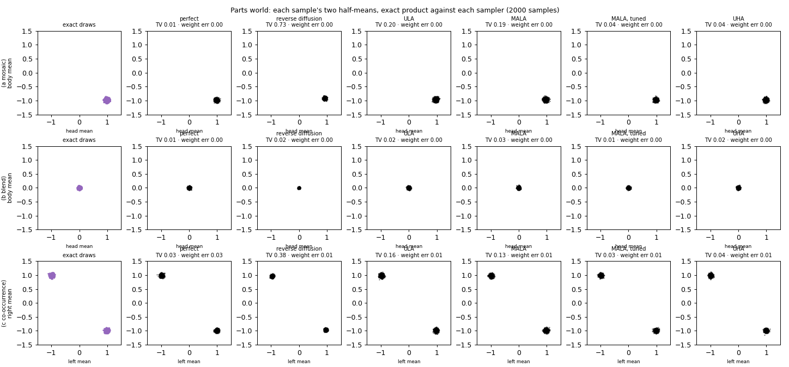

# 🔨 Phase 4: the parts world, where cat × dog is exact in 16 dimensions

**Why a new world.** A 2D slot holds one number, so the only chimera it can show is a midpoint. Image chimeras are mostly mosaics: some parts follow the cat, others the dog.

**What you build.** You build a world of 4 × 4 images whose experts are mixtures of diagonal [Gaussians](../../../../../Obsidian/Mathematics/Statistics/Distributions/Multivariate%20Normal%20Distribution/Multivariate%20Normal%20Distribution.md#where-to-learn-this)<sub>[1](../../../../../Obsidian/Mathematics/references/textbooks/statistics/introduction-to-probability-for-data-science.pdf#page=227 "Introduction to probability for data science, section 4.6, The one-dimensional Gaussian random variable: its density with plots of μ and σ moving and widenin..."), [2](../../../../../Obsidian/Mathematics/references/textbooks/statistics/introduction-to-probability-for-data-science.pdf#page=306 "Introduction to probability for data science, section 5.6, The d-dimensional Gaussian density with Σ⁻¹, its mean vector and covariance, and the diagonal cova..."), [3](../../../../../Obsidian/Mathematics/references/textbooks/machine-learning/mathematics-for-machine-learning.pdf#page=203 "Mathematics for machine learning, section 6.5, The univariate and multivariate densities (equations 6.62 and 6.63, page 204) drawn with 100 samples, then mar..."), [▶1](https://www.youtube.com/watch?v=rzFX5NWojp0&t=0s "StatQuest, The Normal Distribution, Clearly Explained, 0:00 to 3:27, The bell-shaped curve and what its mean and standard deviation set, in the video's openi..."), [▶2](https://www.youtube.com/watch?v=oI3hZJqXJuc&t=135s "StatQuest, The Main Ideas behind Probability Distributions, 2:15 to 5:14, A curve as a distribution, where probability is the area under it over an interval ..."), [◆](../../../../../goal-setting/learning/deep-learning/diffusion-models/01-poe-derivation-foundations/textbook/02-densities-and-the-gaussian.md "Chapter 2: Read a density as area and draw a Gaussian from its covariance, deep-learning/diffusion-models/01-poe-derivation-foundations, chapter 02. The Gaus...")</sub>, so their products, their noised versions and the noised products are all closed form, with no grid. In it you produce a mosaic, a blend and two animals in one picture, then run the phase 2 samplers against exact draws.

**When it ends.** It ends when your numbers equal example 9's `numbers.json`. The reference is `rebuild/parts_world.py` and `rebuild/phase4_parts_world.py` on branch `unbuild-walk`.

**How to walk it.** `/drip-execute-plan artifacts/drips/simple-distributions-rebuild/04-the-parts-world.md`, one step per message, typing every block yourself. The python blocks, typed in order into `walk04.py` in `/home-mscluster/mmolefe/Playground/PhD/simple-distributions-walk/`, are one runnable script.

**What teaches it elsewhere.** The product of diagonal Gaussians: [Products And Quotients Of Diagonal Gaussians](../../../../../Obsidian/Mathematics/Statistics/Distributions/Multivariate%20Normal%20Distribution/Products%20And%20Quotients%20Of%20Diagonal%20Gaussians.md) and [Multivariate Normal Distribution](../../../../../Obsidian/Mathematics/Statistics/Distributions/Multivariate%20Normal%20Distribution/Multivariate%20Normal%20Distribution.md). The normaliser of a product: [the PoE factorisation and normaliser](../../../../../goal-setting/learning/deep-learning/diffusion-models/05-poe-composition-diffusion/plans/07-poe-factorisation-and-normaliser.md) and [Why The Normaliser Has No Slope In X](../../../../../Obsidian/Artificial%20Intelligence/Generative%20Modeling/Diffusion%20Models/Composition/Why%20The%20Normaliser%20Has%20No%20Slope%20In%20X.md). The mosaic, blend and two animals: [Kinds Of Composition, mosaic, blend or two animals](../../../../../Obsidian/Artificial%20Intelligence/Generative%20Modeling/Diffusion%20Models/Composition/Kinds%20Of%20Composition.md#mosaic-blend-or-two-animals-from-one-product), the [parts-world write-up](../../ideas/poe-overlap-dial/example-9-parts-world/example-9-parts-world.tex) and [the parts-world scene](https://claude.ai/artifact/6XzsUMYdEb2eopRyGkpYkh).

**Where the numbers come from.** `artifacts/ideas/poe-overlap-dial/example-9-parts-world/numbers.json` for the four example results; `rebuild/out/phase4/phase4.json` for the samplers; the `p4.` keys of `python -m rebuild.walk_numbers` for the closed-form checks in steps 2 and 5.

## Steps

- [Step 0: the setup block](#step-0-the-setup-block)
- [Step 1: an image is 16 numbers](#step-1-an-image-is-16-numbers)
- [Step 2: a diagonal Gaussian expert](#step-2-a-diagonal-gaussian-expert)
- [Step 3: the product, pixel by pixel: the mosaic](#step-3-the-product-pixel-by-pixel-the-mosaic)
- [Step 4: both tight everywhere: the blend](#step-4-both-tight-everywhere-the-blend)
- [Step 5: mixtures, and two animals in one picture](#step-5-mixtures-and-two-animals-in-one-picture)
- [Step 6: noising a mixture, and the summed-score error](#step-6-noising-a-mixture-and-the-summed-score-error)
- [Step 7: the samplers against exact draws](#step-7-the-samplers-against-exact-draws)
- [Step 8: the check against numbers.json](#step-8-the-check-against-numbersjson)

**Colours on this page.** <span style="color:#1565c0">**Blue is the clean point $x_0$**</span>, <span style="color:#00838f">**teal is a point $x$ or the noisy point $x_t$**</span>, <span style="color:#6a1b9a">**purple is the noise $\varepsilon$**</span>, <span style="color:#2e7d32">**green is the kept signal share $\bar\alpha_t$**</span>, <span style="color:#ef6c00">**orange is the noise level $\sqrt{1-\bar\alpha_t}$**</span>, <span style="color:#ad1457">**pink is the score**</span>, <span style="color:#6d4c41">**brown is energy $E$**</span>, <span style="color:#c62828">**red is the prediction $\hat\varepsilon$**</span>, <span style="color:#827717">**olive is expert A**</span>, <span style="color:#546e7a">**blue-grey is expert B**</span>, and <span style="color:#4527a0">**indigo is the composed target**</span> (the product, mixture or negation being sampled). The same colour means the same quantity in every table, chart, diagram and equation.

## Step 0: the setup block

```python
import json, math
import numpy as np
import matplotlib
matplotlib.use("Agg")
import matplotlib.pyplot as plt
import seaborn as sns
import torch
from scipy.stats import multivariate_normal as mvn

from rebuild.model import cosine_beta_schedule
from rebuild.device import pick_device

dev = pick_device(); print("device", dev)
rng = np.random.default_rng(0); torch.manual_seed(0)
T = 100; betas = cosine_beta_schedule(T); abar = np.cumprod(1 - betas)
D = 16
```

Here `cosine_beta_schedule(100)` is the cosine schedule with offset $s=0.008$, its default. The schedule and its cumulative product `abar` are computed in float64, and these 100 values of $\bar\alpha$ are the annealing levels Step 7 uses.

## Step 1: an image is 16 numbers

**Definition.** A [sample](../../../../../Obsidian/Mathematics/Statistics/Sampling%20From%20A%20Distribution.md#where-to-learn-this)<sub>[1](../../../../../Obsidian/Mathematics/references/textbooks/machine-learning/pattern-recognition-and-machine-learning.pdf#page=539 "Pattern recognition and machine learning, chapter 11, Why expectations need samples, ancestral sampling of a directed graph (page 541), standard distribution..."), [2](../../../../../Obsidian/Mathematics/references/textbooks/statistics/introduction-to-probability-for-data-science.pdf#page=245 "Introduction to probability for data science, section 4.8, Generates random numbers for any PDF by running a uniform through the inverse CDF, in Python, with..."), [3](../../../../../Obsidian/Mathematics/references/textbooks/machine-learning/deep-learning-textbook.pdf#page=606 "Deep learning textbook, section 17.1, Why machine learning samples at all (Monte Carlo estimates of sums and integrals, and sampling as the goal of a generat..."), [▶1](https://www.youtube.com/watch?v=9ixzzPQWuAY&t=474s "ritvikmath, Inverse Transform Sampling, 7:54 to 10:04, Inverts the exponential CDF and turns a uniform draw into an exponential one. Chapter-timed, from the ..."), [▶2](https://www.youtube.com/watch?v=OXDqjdVVePY&t=232s "ritvikmath, Accept-Reject Sampling, 3:52 to 7:45, An easy proposal g scaled by M into an envelope above f, then each draw accepted with probability f/(M g). ..."), [◆](../../../../../goal-setting/learning/deep-learning/diffusion-models/00-from-scratch-to-sdxl/textbook/l3-stochastic-processes/13-drawing-samples-by-hand.md "Drawing samples by hand: Monte Carlo, inverse transform and accept-reject, deep-learning/diffusion-models/00-from-scratch-to-sdxl, volume L3, section 13. Thr...")</sub> is $x\in\mathbb R^{16}$ drawn as a 4 × 4 image, row by row. Pixels 0 to 7 are the top two rows, the head; 8 to 15 are the body. LEFT is the left two columns, RIGHT the right two.

**Cat and dog values.** A cat is +1 on its pixels and a dog −1, so the two colours of a diverging colour map tell them apart.

🧸 **Toy:** one 4 × 4 image contains 16 numbers. The first 8 numbers form the head and the last 8 form the body.

🔤 **The name:** pixel

---

#### The scene and its table

The image is a small grid. Each square holds one number, and its colour is only a way to show that number.

<table>
<tr><th>part</th><th>pixel indices</th><th>count</th></tr>
<tr style="background:#fff8e1"><td style="border:2px solid #212121"><b>head</b></td><td style="border:2px solid #212121">0, 1, 2, 3, 4, 5, 6, 7</td><td><b>8</b></td></tr>
<tr><td>body</td><td style="border:2px dashed #212121">8, 9, 10, 11, 12, 13, 14, 15</td><td><b>8</b></td></tr>
<tr><td><b>whole image</b></td><td>0 through 15</td><td style="border:2px solid #212121"><b>16</b></td></tr>
</table>

**How to read this table.** Each row names a region, lists the numbered squares in it and counts them. The two halves contain 8 pixels each, giving 16 pixels altogether.

**What to look for.** The solid box marks the first half of the stored numbers. The dashed box marks the second half. A pixel is one numbered square, not the whole head or body.

---

#### The word: pixel

**What the word means.** Pixel contracts “picture element”: one smallest addressable piece of a digital picture. On this toy, one pixel is one entry such as entry 0 or entry 8.

$$
\underbrace{\textcolor{#00838f}{x_d}}_{\text{value in pixel }d},
\qquad
\underbrace{d\in\{0,\ldots,15\}}_{\text{sixteen pixel addresses}}
$$

**What the equation says.** The subscript selects one square from the image. The allowed addresses run from 0 through 15, so there are 16 choices.

**What it means.** A pixel has a location and a number. The colour map shows the number, while the index records the location.

---

#### All the words together: the formula

This name has one word. A pixel is one coordinate of the 16-number image.

$$
\underbrace{\textcolor{#00838f}{x}}_{\text{whole image}}
=
\underbrace{(x_0,x_1,\ldots,x_{15})}_{\text{sixteen pixel values}}
$$

**What the equation says.** The image is written as an ordered list. Each position in that list is one pixel.

**Check it on the toy.** Pixels 0 through 7 give 8 head values, and pixels 8 through 15 give 8 body values. Together they give 16.

---

#### The consequence: change the size of one piece

**Point at one pixel.** One selected square accounts for 1 of the 16 stored numbers.

**Point at the head.** The selection grows from 1 pixel to 8 pixels. Calling the whole head one pixel would collapse 8 separately stored values into one and lose their locations.

<!-- links: pixel rev=2 -->
🔗 **Where else this lives**

- 🎬 Video: [Stanford CME296, lecture 1, 27:09 to 27:59](https://www.youtube.com/watch?v=tr-CUpw--ck&t=1629s), an image as a grid of pixels, each holding its amounts of red, green and blue.
- 🎬 Video: [Stanford CME296, lecture 1, 32:58 to 33:23](https://www.youtube.com/watch?v=tr-CUpw--ck&t=1978s), pixel values from 0 to 255 rescaled to between −1 and 1 and treated as continuous.

<details><summary>How these videos differ from this step</summary>

**Three colours against one number.** CME296's pixels carry three colour values each; this walk's carry one number, +1 for a cat and −1 for a dog. Times are read from CME296's captions and good to about 30 seconds.

</details>
<!-- /links -->

🔤 **The name:** image as a [vector](../../../../../Obsidian/Mathematics/Linear%20Algebra/Vector.md#where-to-learn-this)<sub>[1](../../../../../Obsidian/Mathematics/references/textbooks/linear-algebra/linear-algebra-textbook.pdf#page=145 "Linear algebra textbook, section 3.1, Vectors drawn as arrows in 2-space and 3-space, then written as ordered n-tuples in Rⁿ (Definition 1, page 150)."), [2](../../../../../Obsidian/Mathematics/references/textbooks/machine-learning/mathematics-for-machine-learning.pdf#page=23 "Mathematics for machine learning, chapter 2 opening, What counts as a vector: anything that adds and scales, with geometric arrows and polynomials as the fir..."), [3](../../../../../Obsidian/Mathematics/references/textbooks/machine-learning/deep-learning-textbook.pdf#page=47 "Deep learning textbook, section 2.1, Scalars, vectors, matrices and tensors in the notation the rest of deep learning uses."), [▶1](https://www.youtube.com/watch?v=tr-CUpw--ck&t=1684s "Stanford CME296, lecture 1, 28:04 to 28:52, An image as one vector whose length is the number of pixels times 3, which is what x_0 and x_t are in diffusion. ..."), [▶2](https://www.youtube.com/watch?v=fNk_zzaMoSs&t=0s "3Blue1Brown, Vectors (Essence of linear algebra, chapter 1), Three perspectives on vectors, 0:00 to 2:52, The physics arrow, the computer-science list of num..."), [◆](../../../../../goal-setting/learning/ai-engineering/string-similarity-measures/foundations/plans/06-vectors-dot-product-and-length.md "Compute vectors, the dot product, length and the angle between them, ai-engineering/string-similarity-measures/foundations, plan 06. A text turned into a vec...")</sub>

---

#### The scene and its table

Read the grid from left to right across each row, then move to the next row. That reading order turns the square picture into one ordered list.

<table>
<tr><th>image row</th><th>grid positions</th><th>vector positions</th></tr>
<tr style="background:#fff8e1"><td><b>top row</b></td><td style="border:2px solid #212121">four squares</td><td style="border:2px solid #212121">0, 1, 2, 3</td></tr>
<tr><td>second row</td><td>four squares</td><td>4, 5, 6, 7</td></tr>
<tr><td>third row</td><td>four squares</td><td>8, 9, 10, 11</td></tr>
<tr><td>bottom row</td><td style="border:2px dashed #212121">four squares</td><td style="border:2px dashed #212121">12, 13, 14, 15</td></tr>
</table>

**How to read this table.** Each row shows where four adjacent grid squares land in the ordered list. The first image row supplies the first four vector entries.

**What to look for.** Nothing is averaged. The layout changes from a 4 × 4 grid to a length-16 list, but all 16 values remain.

---

#### The base word first: vector

**What the word means.** [A vector is an ordered list of numbers](../../../../../goal-setting/learning/mathematics/textbooks/linear-algebra/linear-algebra-textbook.pdf#page=150). “Ordered” matters because swapping two entries moves their values to different pixels.

$$
\underbrace{\textcolor{#00838f}{x}\in\mathbb R^{16}}_{\text{a vector of sixteen real numbers}}
$$

**What the equation says.** The symbol $\mathbb R^{16}$ says that the list has 16 slots and that every slot contains a real number.

**What it means.** The code can use ordinary vector operations because the grid has been stored as a list with a fixed order.

---

#### Then the qualifying word: image

**What the word means.** Image tells you how to interpret the list. Four consecutive entries make a row, and four rows make the visible 4 × 4 tile.

$$
\underbrace{\operatorname{reshape}_{4\times4}(\textcolor{#00838f}{x})}_{\text{the vector shown as an image}}
$$

**What the equation says.** Reshaping changes the arrangement used for display. It does not create, remove or average any value.

**What it means.** The same object can be calculated with as a vector and looked at as an image.

---

#### All the words together: the formula

An image as a vector is the grid read in row order and stored as 16 coordinates.

$$
\underbrace{\begin{bmatrix}
 x_0&x_1&x_2&x_3\\
 x_4&x_5&x_6&x_7\\
 x_8&x_9&x_{10}&x_{11}\\
 x_{12}&x_{13}&x_{14}&x_{15}
\end{bmatrix}}_{\text{four by four image}}
\longleftrightarrow
\underbrace{\textcolor{#00838f}{(x_0,x_1,\ldots,x_{15})}}_{\text{length-sixteen vector}}
$$

**What the equation says.** The arrow joins two views of the same 16 values. The left view preserves the grid for seeing, and the right view exposes coordinates for calculation.

**Check it on the toy.** The first two rows become entries 0 through 7, the 8-number head. The last two rows become entries 8 through 15, the 8-number body.

---

#### The consequence: add one square

**Keep the 4 × 4 image.** Its vector has 16 entries.

**Add one stored square.** The vector length moves from 16 to 17, so it can no longer be reshaped into the same 4 × 4 grid. The dimension records exactly how many pixel values the image carries.

<!-- links: image-as-a-vector rev=2 -->
🔗 **Where else this lives**

- 🎬 Video: [Stanford CME296, lecture 1, 28:04 to 28:52](https://www.youtube.com/watch?v=tr-CUpw--ck&t=1684s), the whole image as one vector whose length is the number of pixels times 3, which is what x_0 and x_t are in diffusion.

<details><summary>How this video differs from this step</summary>

**The reading order.** CME296 does not fix the order in which the grid is read into the vector, the row-by-row order that puts this walk's head in entries 0 to 7. The time is read from CME296's captions and good to about 30 seconds.

</details>
<!-- /links -->

🔨 **Build:**

```python
HEAD, BODY = np.arange(0, 8), np.arange(8, 16)
LEFT = np.array([r * 4 + c for r in range(4) for c in (0, 1)]); RIGHT = np.setdiff1d(np.arange(D), LEFT)
def tile(ax, x, title):
    ax.imshow(np.asarray(x).reshape(4, 4), cmap="coolwarm_r", vmin=-1, vmax=1); ax.set_title(title, fontsize=8)
    ax.set_xticks([]); ax.set_yticks([])
print("head", HEAD.tolist(), " left", LEFT.tolist())
```

It prints `head [0, 1, 2, 3, 4, 5, 6, 7]  left [0, 1, 4, 5, 8, 9, 12, 13]`.

## Step 2: a diagonal Gaussian expert

**Definition.** An expert is $\mathcal N(m,\operatorname{diag}v)$: [each pixel independent](../../../../../goal-setting/learning/mathematics/textbooks/statistics/introduction-to-probability-for-data-science.pdf#page=307) with its own mean and [variance](../../../../../Obsidian/Mathematics/Statistics/Variance.md#where-to-learn-this)<sub>[1](../../../../../Obsidian/Mathematics/references/textbooks/statistics/introduction-to-probability-for-data-science.pdf#page=150 "Introduction to probability for data science, section 3.4.4, Defines variance as E[(X − µ)²] and the standard deviation as its root (Definition 3.7), proves ..."), [2](../../../../../Obsidian/Mathematics/references/textbooks/machine-learning/mathematics-for-machine-learning.pdf#page=196 "Mathematics for machine learning, section 6.4.1, Variance as the covariance of a variable with itself (Definition 6.7), then the empirical mean and variance ..."), [3](../../../../../Obsidian/Mathematics/references/textbooks/machine-learning/deep-learning-textbook.pdf#page=76 "Deep learning textbook, section 3.8, A short definition of variance and standard deviation beside expectation and covariance."), [▶1](https://www.youtube.com/watch?v=4-FysvtxQEU&t=1551s "Professor Leonard, Statistics 3.3, A standard deviation calculated by hand, 25:51 to 36:43, Works a standard deviation on a small data set by hand. Chapter-t..."), [▶2](https://www.youtube.com/watch?v=SzZ6GpcfoQY&t=236s "StatQuest, Calculating the Mean, Variance and Standard Deviation, Calculating population variance, 3:56 to 5:54, The population variance as the average squar..."), [◆](../../../../../goal-setting/learning/deep-learning/transformers/textbook/06-show-that-variances-of-independent-terms-add.md "Show that variances of independent terms add, deep-learning/transformers, chapter 06. Predicts the spread of a dot product of random vectors by adding the va...")</sub>. Its log-density is [a sum over pixels](../../../../../goal-setting/learning/mathematics/textbooks/algebra/algebra-handbook.pdf#page=110):

$$\log\mathcal N(x;m,\operatorname{diag}v)=-\tfrac12\sum_{d=1}^{16}\Big(\frac{(x_d-m_d)^2}{v_d}+\log(2\pi v_d)\Big).$$

$$
\underbrace{\log\mathcal N(\textcolor{#00838f}{x};m,\operatorname{diag}v)}_{\text{log-density of the whole image}}
=
\underbrace{-\frac12}_{\text{Gaussian scale}}
\underbrace{\sum_{d=1}^{16}}_{\text{add the sixteen pixel charges}}
\left(
\underbrace{\frac{(\textcolor{#00838f}{x_d}-m_d)^2}{v_d}}_{\text{squared mismatch in variance units}}
+
\underbrace{\log(2\pi v_d)}_{\text{normalising charge for pixel }d}
\right).
$$

**What the equation says.** Each pixel contributes a squared mismatch and a width-dependent normalising term. Adding all 16 contributions and multiplying by negative one half gives the image's log-density.

**Why the logarithm is there.** A product of 16 independent pixel densities becomes a sum of 16 log-densities. Removing the log would require multiplying the pixel densities directly instead of adding their charges.

**Why the sum is there.** Every pixel must vote on the whole image. On the toy, the head contributes 1600 [nats](../../../../../goal-setting/learning/mathematics/textbooks/machine-learning/deep-learning-textbook.pdf#page=89) and the body contributes 16 nats, so the sum gives 1616 nats.

**Why the square and ratio are there.** The square treats a mismatch of +2 and −2 alike. Division by $v_d$ makes the same mismatch cost more for a tight pixel: eight pixels at variance 0.01 contribute 1600, while eight at variance 1 contribute 16.

**Why the normalising term is there.** [Wider Gaussians spread their mass across more values](../../../../../goal-setting/learning/mathematics/textbooks/statistics/introduction-to-probability-for-data-science.pdf#page=228), so their peak must be lower. In the cat-versus-dog comparison the term is the same for both images at each pixel and cancels, leaving the gap at 1616.

**Why negative one half is there.** The minus sign makes [density](../../../../../Obsidian/Mathematics/Statistics/Distributions/Probability%20Density%20Function.md#where-to-learn-this)<sub>[1](../../../../../Obsidian/Mathematics/references/textbooks/statistics/introduction-to-probability-for-data-science.pdf#page=188 "Introduction to probability for data science, section 4.1, Builds the intuition of probability per unit length, defines the PDF and its properties (Definitio..."), [2](../../../../../Obsidian/Mathematics/references/textbooks/machine-learning/mathematics-for-machine-learning.pdf#page=186 "Mathematics for machine learning, section 6.2.2, The density and the CDF (Definitions 6.1 and 6.2), a uniform example (Example 6.3), and discrete against con..."), [3](../../../../../Obsidian/Mathematics/references/textbooks/machine-learning/pattern-recognition-and-machine-learning.pdf#page=36 "Pattern recognition and machine learning, section 1.2.1, The density's two conditions (equations 1.25 and 1.26), its link to the CDF, and why a density picks..."), [▶1](https://www.youtube.com/watch?v=QKA4HNEw3aY&t=52s "The Organic Chemistry Tutor, Probability Density Functions, 0:52 to 3:39, Verifies that a given function is a density by checking that its integral equals 1...."), [▶2](https://www.youtube.com/watch?v=oI3hZJqXJuc&t=135s "StatQuest, The Main Ideas behind Probability Distributions, 2:15 to 5:14, A curve as a distribution, with probability read as area under it, not its height. ..."), [◆](../../../../../goal-setting/learning/deep-learning/diffusion-models/01-poe-derivation-foundations/textbook/02-densities-and-the-gaussian.md#21-a-density-can-exceed-1 "Chapter 2: Read a density as area and draw a Gaussian from its covariance, deep-learning/diffusion-models/01-poe-derivation-foundations, chapter 02, section ..."), [◈](https://claude.ai/artifact/DBmJtn6xy75sPtQwPEvQZU#nb-sec1 "Kinds of composition notebook, Setup: the ideal expert, The ideal expert's log-density on a grid, in four steps from the 2D Gaussian to its logsumexp form, t...")</sub> fall as mismatch grows, and the half is the [Gaussian](../../../../../Obsidian/Mathematics/Statistics/Distributions/Multivariate%20Normal%20Distribution/Multivariate%20Normal%20Distribution.md#where-to-learn-this)<sub>[1](../../../../../Obsidian/Mathematics/references/textbooks/statistics/introduction-to-probability-for-data-science.pdf#page=227 "Introduction to probability for data science, section 4.6, The one-dimensional Gaussian random variable: its density with plots of μ and σ moving and widenin..."), [2](../../../../../Obsidian/Mathematics/references/textbooks/statistics/introduction-to-probability-for-data-science.pdf#page=306 "Introduction to probability for data science, section 5.6, The d-dimensional Gaussian density with Σ⁻¹, its mean vector and covariance, and the diagonal cova..."), [3](../../../../../Obsidian/Mathematics/references/textbooks/machine-learning/mathematics-for-machine-learning.pdf#page=203 "Mathematics for machine learning, section 6.5, The univariate and multivariate densities (equations 6.62 and 6.63, page 204) drawn with 100 samples, then mar..."), [▶1](https://www.youtube.com/watch?v=rzFX5NWojp0&t=0s "StatQuest, The Normal Distribution, Clearly Explained, 0:00 to 3:27, The bell-shaped curve and what its mean and standard deviation set, in the video's openi..."), [▶2](https://www.youtube.com/watch?v=oI3hZJqXJuc&t=135s "StatQuest, The Main Ideas behind Probability Distributions, 2:15 to 5:14, A curve as a distribution, where probability is the area under it over an interval ..."), [◆](../../../../../goal-setting/learning/deep-learning/diffusion-models/01-poe-derivation-foundations/textbook/02-densities-and-the-gaussian.md "Chapter 2: Read a density as area and draw a Gaussian from its covariance, deep-learning/diffusion-models/01-poe-derivation-foundations, chapter 02. The Gaus...")</sub> convention paired with variance. Removing the half would double the toy's log-density gap from 1616 to 3232.

**Derivation of what a variance means here.** A small $v_d$ means the expert is consistent on pixel d: its training images all have the same value there. A large $v_d$ means it is loose there.

**How hard a loose pixel pulls.** In this example variance 1 is 100 times less precise than variance 0.01, so it pulls on a product much less, but it still pulls. Its [per-pixel score](../../../../../goal-setting/learning/mathematics/textbooks/machine-learning/the-little-book-of-generative-ai-foundations.pdf#page=114) is

$$\nabla_{x_d}\log\mathcal N(x_d;m_d,v_d)=-\frac{x_d-m_d}{v_d},$$

$$
\underbrace{\textcolor{#ad1457}{\nabla_{x_d}\log\mathcal N(x_d;m_d,v_d)}}_{\text{score on pixel }d}
=
\underbrace{-1}_{\text{point back toward the mean}}
\underbrace{\frac{\textcolor{#00838f}{x_d}-m_d}{v_d}}_{\text{mismatch divided by variance}}.
$$

**What the equation says.** Subtract the mean from the current pixel value, divide by the variance and reverse the sign. The result points toward greater log-density.

**Why the subtraction is there.** It measures the pixel's displacement from the expert's preferred value. At the mean the displacement is 0, so the score is 0.

**Why the ratio is there.** A tight expert reacts more strongly to the same displacement than a loose expert. Changing variance from 1 to 0.01 multiplies the score magnitude by 100.

**Why the minus sign is there.** The displacement points away from the mean, while the score points back toward it. Removing the sign would direct the pixel toward lower density.

which is nonzero whenever $x_d\neq m_d$. Only the limit $v_d\to\infty$ is an expert that does not care about pixel d. The cat expert of example 9(a) is tight on the head ($v=0.01$) and loose on the body ($v=1$).

🧸 **Toy:** the cat expert prefers the all-cat image (all +1) to the all-dog image (all −1) on both halves. Every pixel differs by 2 and the $\log(2\pi v_d)$ terms cancel. The eight tight head pixels give

$$8\cdot\frac{2^2}{2\cdot0.01}=1600$$

$$
\underbrace{8}_{\text{tight head pixels}}
\cdot
\underbrace{\frac{\underbrace{2^2}_{\text{squared cat-to-dog mismatch}}}{\underbrace{2\cdot0.01}_{\text{twice the tight variance}}}}_{\text{charge from one tight pixel}}
=
\underbrace{1600}_{\text{head log-density gap}}.
$$

**What the equation says.** One head pixel differs by 2 and is judged at variance 0.01. Its mismatch charge is repeated across all 8 head pixels, producing 1600 nats.

**Why multiplication by 8 is there.** The eight independent head pixels each contribute the same charge. Keeping only one pixel would change the head contribution from 1600 to 200.

**Why the square is there.** It turns the signed difference into a nonnegative mismatch and makes opposite directions cost the same. Replacing $2^2$ with 2 on this positive toy would change 1600 to 800.

**Why the denominator is there.** The factor 2 belongs to the Gaussian exponent, and 0.01 is the tight variance. Dividing by the small variance makes one tight pixel contribute 200 instead of the 2 contributed by one variance-1 pixel.

nats, and the eight looser body pixels give

$$8\cdot\frac{2^2}{2\cdot1}=16,$$

$$
\underbrace{8}_{\text{loose body pixels}}
\cdot
\underbrace{\frac{\underbrace{2^2}_{\text{squared cat-to-dog mismatch}}}{\underbrace{2\cdot1}_{\text{twice the loose variance}}}}_{\text{charge from one loose pixel}}
=
\underbrace{16}_{\text{body log-density gap}}.
$$

**What the equation says.** The body has the same number of pixels and the same mismatch as the head. Its larger variance reduces the eight-pixel contribution from 1600 to 16.

**Why multiplication by 8 is there.** All eight body pixels contribute. One loose pixel contributes 2, and adding eight equal charges gives 16.

**Why the ratio is there.** Dividing by variance 1 leaves the body much less forceful than the head at variance 0.01. Replacing 1 by 0.01 would move the body contribution from 16 to 1600.

so $\log p(\text{cat image})-\log p(\text{dog image})=1600+16=1616$ nats (`p4.cat_expert_cat_minus_dog_image_nats`, with the two parts in `p4.cat_expert_gap_head_part` and `p4.cat_expert_gap_body_part`).

🔤 **The name:** [diagonal Gaussian](../../../../../Obsidian/Mathematics/Statistics/Distributions/Multivariate%20Normal%20Distribution/Diagonal%20Covariance.md#diagonal-gaussian)

---

#### The scene and its table

The cat expert judges every pixel with its own one-dimensional bell. It is tight on the head and loose on the body, with no [covariance](../../../../../Obsidian/Mathematics/Statistics/Covariance.md#where-to-learn-this)<sub>[1](../../../../../Obsidian/Mathematics/references/textbooks/statistics/introduction-to-probability-for-data-science.pdf#page=277 "Introduction to probability for data science, section 5.2.2, Defines Cov(X, Y) = E[(X − µ_X)(Y − µ_Y)] (Definition 5.12), proves Cov(X, Y) = E[XY] − E[X]E[Y]..."), [2](../../../../../Obsidian/Mathematics/references/textbooks/statistics/introduction-to-probability-for-data-science.pdf#page=305 "Introduction to probability for data science, section 5.6.3, The covariance matrix of a random vector (Definition 5.20) and its properties (Theorem 5.13), le..."), [3](../../../../../Obsidian/Mathematics/references/textbooks/machine-learning/mathematics-for-machine-learning.pdf#page=196 "Mathematics for machine learning, sections 6.4.1 to 6.4.2, Univariate and multivariate covariance (Definitions 6.5 and 6.6), the covariance matrix with the v..."), [▶1](https://www.youtube.com/watch?v=qtaqvPAeEJY&t=452s "StatQuest, Covariance, Clearly Explained, How to calculate covariance, 7:32 to 17:00, Works the covariance of two measured variables step by step. Chapter-ti..."), [▶2](https://www.youtube.com/watch?v=qtaqvPAeEJY&t=1020s "StatQuest, Covariance, Clearly Explained, Why covariance is hard to interpret, 17:00 to 20:31, Why the size of a covariance depends on the units, which motiv..."), [◆](../../../../../goal-setting/learning/deep-learning/generative-models/03-sampling-from-a-graph/plans/27-two-d-gaussian.md "Read a covariance as an ellipse, deep-learning/generative-models/03-sampling-from-a-graph, plan 27. Reads a covariance matrix as the ellipse of a 2D Gaussian...")</sub> connecting different pixels.

<table>
<tr><th>region</th><th>pixels</th><th>variance</th><th>cat-over-dog gap</th></tr>
<tr style="background:#fff8e1"><td><b>head</b></td><td>8</td><td style="border:2px solid #212121"><b>0.01</b></td><td style="border:2px solid #212121"><b>1600 nats</b></td></tr>
<tr><td>body</td><td>8</td><td style="border:2px dashed #212121">1</td><td style="border:2px dashed #212121">16 nats</td></tr>
<tr><td><b>whole image</b></td><td>16</td><td>one value per pixel</td><td><b>1616 nats</b></td></tr>
</table>

**How to read this table.** Each region contains 8 independently judged pixels. The variance column controls how strongly their equal mismatch is charged.

**What to look for.** The head's variance is 100 times smaller, and its 1600-nat contribution is 100 times the body's 16-nat contribution.

---

#### The base word first: Gaussian

**What the word means.** Gaussian names [the bell-shaped law](../../../../../goal-setting/learning/mathematics/textbooks/statistics/introduction-to-probability-for-data-science.pdf#page=227) associated with Carl Friedrich Gauss, who studied measurement errors. Here each pixel receives its own symmetric bell around the expert's mean.

$$
\underbrace{\mathcal N(\textcolor{#00838f}{x_d};m_d,v_d)}_{\text{Gaussian density for pixel }d}
$$

**What the equation says.** Pixel $d$ is judged by a bell centred at $m_d$ with variance $v_d$.

**What it means.** Equal positive and negative mismatches receive equal density because the Gaussian uses squared distance.

---

#### Then the qualifying word: diagonal

**What the word means.** Diagonal means that [the covariance matrix has entries only down its main diagonal](../../../../../goal-setting/learning/mathematics/textbooks/statistics/introduction-to-probability-for-data-science.pdf#page=307). Every off-diagonal entry is zero.

$$
\underbrace{\operatorname{diag}v}_{\text{diagonal covariance}}
=
\underbrace{\begin{bmatrix}
v_1&0&\cdots&0\\
0&v_2&\cdots&0\\
\vdots&\vdots&\ddots&\vdots\\
0&0&\cdots&v_{16}
\end{bmatrix}}_{\text{pixel variances on the diagonal, no cross-pixel covariance}}
$$

**What the equation says.** Each diagonal position stores one pixel's variance. Every off-diagonal zero says that one pixel's deviation does not predict another's inside this Gaussian component.

**What it means.** “Diagonal” describes the covariance structure, not a diagonal stripe in the image.

---

#### Both words together: the formula

A diagonal Gaussian is a Gaussian over the 16-number image with one independent variance per pixel.

$$
\underbrace{\mathcal N(\textcolor{#00838f}{x};m,\operatorname{diag}v)}_{\text{diagonal Gaussian over an image}}
=
\underbrace{\prod_{d=1}^{16}}_{\text{combine independent pixels}}
\underbrace{\mathcal N(\textcolor{#00838f}{x_d};m_d,v_d)}_{\text{one pixel Gaussian}}.
$$

**What the equation says.** The whole-image density multiplies 16 one-pixel densities because the covariance contains no cross-pixel terms.

**Check it on the toy.** [Taking logs](../../../../../goal-setting/learning/mathematics/textbooks/algebra/algebra-handbook.pdf#page=110) turns the product into the head contribution 1600 plus the body contribution 16. The complete preference is 1616 nats.

---

#### The consequence: remove the diagonal restriction

**Keep the covariance diagonal.** Sixteen pixel charges add independently, giving 1600 from the head and 16 from the body.

**Add an off-diagonal covariance.** A pair of pixels can then move together, so the charge is no longer determined by 16 separate one-pixel terms. The independent sum used to obtain 1616 no longer applies.

<!-- links: diagonal-gaussian rev=2 -->
🔗 **Where else this lives**

- 🎬 Video: [ritvikmath, The Covariance Matrix, 2:40 to 5:23](https://www.youtube.com/watch?v=152tSYtiQbw&t=160s), each coordinate's variance on the diagonal and each pair's covariance off it.
- 🎬 Video: [Stanford CME296, lecture 1, 29:30 to 30:46](https://www.youtube.com/watch?v=tr-CUpw--ck&t=1770s), a Gaussian over vectors whose covariance is simplified to a variance times the identity, a diagonal matrix.

<details><summary>How these videos differ from this step</summary>

**One variance against one per pixel.** CME296's simplification gives every coordinate the same variance, where this expert gives each pixel its own (0.01 on the head, 1 on the body). No video splits the log-density into one term per pixel.

**How the times were read.** The ritvikmath time is a chapter boundary from the video's chapter list, so the sentence inside it is not checked. The CME296 time is read from its captions and good to about 30 seconds.

</details>
<!-- /links -->

🔤 **The name:** [precision](../../../../../Obsidian/Mathematics/Statistics/Distributions/Multivariate%20Normal%20Distribution/Products%20And%20Quotients%20Of%20Diagonal%20Gaussians.md)

---

#### The scene and its table

[Precision turns variance upside down](../../../../../goal-setting/learning/mathematics/textbooks/machine-learning/pattern-recognition-and-machine-learning.pdf#page=43). A small variance becomes a large precision and gives that expert more pull in a product.

<table>
<tr><th>region</th><th>variance</th><th>precision</th><th>gap contribution</th></tr>
<tr style="background:#fff8e1"><td><b>head</b></td><td style="border:2px solid #212121">0.01</td><td style="border:2px solid #212121"><b>100</b></td><td><b>1600 nats</b></td></tr>
<tr><td>body</td><td style="border:2px dashed #212121">1</td><td style="border:2px dashed #212121">1</td><td>16 nats</td></tr>
</table>

**How to read this table.** Each row describes one variance used across 8 pixels. Precision is the reciprocal of variance.

**What to look for.** Moving from variance 1 to 0.01 raises precision from 1 to 100. The matching log-density contribution rises from 16 to 1600.

---

#### The word: precision

**What the word means.** Precision means how narrowly or consistently something is specified. A precise expert allows little variation around its preferred value.

$$
\underbrace{\lambda_d}_{\text{precision on pixel }d}
=
\underbrace{\frac{1}{v_d}}_{\text{one divided by variance}}.
$$

**What the equation says.** Precision is inverse variance. Large variance becomes small precision, and small variance becomes large precision.

**What it means.** Precision measures how sure the expert is in the units used by Gaussian products.

---

#### All the words together: the formula

This name has one word. Its formula says to invert the variance.

$$
\underbrace{\lambda_{\mathrm{head}}}_{\text{head precision}}
=
\underbrace{\frac{1}{0.01}}_{\text{inverse head variance}}
=
\underbrace{100}_{\text{tight expert}},
\qquad
\underbrace{\lambda_{\mathrm{body}}}_{\text{body precision}}
=
\underbrace{\frac{1}{1}}_{\text{inverse body variance}}
=
\underbrace{1}_{\text{loose expert}}.
$$

**What the equation says.** The head precision is 100 and the body precision is 1. The head therefore has 100 times as much pull for the same mismatch.

**Check it on the toy.** The 100-to-1 precision ratio matches the 1600-to-16 ratio between the two eight-pixel contributions.

---

#### The consequence: loosen the head

**Before the move.** Head variance 0.01 gives precision 100 and contributes 1600 nats.

**After the move.** Changing that variance to 1 gives precision 1 and changes the same eight-pixel contribution from 1600 to 16 nats. Greater variance means less certainty and less pull.

<!-- links: precision rev=2 -->
🔗 **Where else this lives**

- 🎬 Video: [Machine Learning & Simulation, Precision vs Variance, 1:15 to 2:04](https://www.youtube.com/watch?v=2M9VO_52NpQ&t=75s), the normal written with a precision in place of the variance, and the precision defined.
- 🎬 Video: [Machine Learning & Simulation, Precision vs Variance, 2:47 to 4:37](https://www.youtube.com/watch?v=2M9VO_52NpQ&t=167s), three Gaussians compared: high variance gives a wide bell, high precision a narrow one, and neither moves the mean.

<details><summary>How this video differs from this step</summary>

**What it leaves out.** No listed creator has a video on precision, so this one is from the open web. It does not multiply two Gaussians, where precisions add and weight the mean, which is what the 100-to-1 pull does here. Times are chapter boundaries from the video's chapter list, so the sentence inside each is not checked.

</details>
<!-- /links -->

🔤 **The name:** [nat](../../../../../goal-setting/learning/deep-learning/diffusion-models/01-poe-derivation-foundations/textbook/11-kl-cross-entropy-and-cmi.md#114-cmi-from-a-table-in-bits-and-in-nats)

---

#### The scene and its table

The expert assigns a log-density to each image. Subtracting two log-densities gives a log-ratio, whose unit is [the nat](../../../../../goal-setting/learning/mathematics/textbooks/machine-learning/deep-learning-textbook.pdf#page=89) when the logarithm is natural.

<table>
<tr><th>comparison</th><th>head</th><th>body</th><th>whole image</th></tr>
<tr style="background:#fff8e1"><td><b>cat image over dog image</b></td><td style="border:2px solid #212121">1600</td><td style="border:2px dashed #212121">16</td><td><b>1616 nats</b></td></tr>
</table>

**How to read this table.** The row splits one log-density difference into two regional contributions. Adding the head and body entries gives the whole-image value.

**What to look for.** A nat measures a logarithmic comparison. The number 1616 is not a [probability](../../../../../Obsidian/Mathematics/Statistics/Probability/Probability.md#where-to-learn-this)<sub>[1](../../../../../Obsidian/Mathematics/references/textbooks/machine-learning/pattern-recognition-and-machine-learning.pdf#page=31 "Pattern recognition and machine learning, section 1.2, Works with numbers: a red box picked 40% of the time and a blue box 60%, holding apples and oranges, f..."), [2](../../../../../Obsidian/Mathematics/references/textbooks/statistics/introduction-to-probability-for-data-science.pdf#page=74 "Introduction to probability for data science, sections 2.2 and 2.3, Probability as a measure of the size of a set, built from a sample space, an event space ..."), [3](../../../../../Obsidian/Mathematics/references/textbooks/statistics/introduction-to-statistics.pdf#page=64 "Introduction to statistics (Wits lecture notes), sections 3.5 to 3.7.2, The axioms, the subjective, relative-frequency and classical approaches, the addition..."), [▶1](https://www.youtube.com/watch?v=_EpXHuPnaK0&t=360s "Professor Leonard, Statistics lecture 4.2, Introduction to Probability, 6:00 to 9:00, The sample space, in the chapter of that name, before simple events. Ch..."), [▶2](https://www.youtube.com/watch?v=_EpXHuPnaK0&t=2085s "Professor Leonard, Statistics lecture 4.2, Introduction to Probability, 34:45 to 37:07, Observed against classical probability. Chapter-timed."), [◆](../../../../../goal-setting/learning/deep-learning/diffusion-models/01-poe-derivation-foundations/plans/01-probability-you-can-compute.md "Probability as a thing you can compute, deep-learning/diffusion-models/01-poe-derivation-foundations, plan 01. Events and P(A), with a sample space built and...")</sub> and is not a count of pixels.

---

#### The word: nat

**What the word means.** A nat is the unit obtained when a logarithm uses base $e$, [the natural logarithm](../../../../../goal-setting/learning/mathematics/textbooks/algebra/algebra-handbook.pdf#page=111). It measures a log-ratio between two positive quantities.

$$
\underbrace{\log\frac{p(\text{cat image})}{p(\text{dog image})}}_{\text{natural-log density ratio}}
=
\underbrace{1616}_{\text{number of nats}}.
$$

**What the equation says.** Dividing the two densities forms a preference ratio. Taking the natural logarithm reports that ratio on an additive scale.

**What it means.** Positive 1616 nats means the expert strongly prefers the cat image. It does not mean that the probability equals 1616.

---

#### All the words together: the formula

This one-word name is the unit attached to a natural-log ratio.

$$
\underbrace{\log p(\text{cat image})-\log p(\text{dog image})}_{\text{difference of natural log-densities}}
=
\underbrace{1600}_{\text{head}}
+
\underbrace{16}_{\text{body}}
=
\underbrace{1616\ \text{nats}}_{\text{whole-image preference}}.
$$

**What the equation says.** [Subtracting log-densities is the same as taking the logarithm of their ratio](../../../../../goal-setting/learning/mathematics/textbooks/algebra/algebra-handbook.pdf#page=110). The regional log-ratios add because the pixel densities multiply.

**Check it on the toy.** The two supplied parts, 1600 and 16, add to the reported 1616 nats.

---

#### The consequence: change the logarithm's base

**Use the natural logarithm.** The gap is reported as 1616 nats.

**Use another logarithm base.** The underlying density ratio stays the same, but the numerical unit changes. The name “nat” applies only to the natural-log version.

🔨 **Build:**

```python
def diag_logpdf(x, m, v): return float(-0.5 * (((x - m) ** 2) / v + np.log(2 * np.pi * v)).sum())
vcat = np.full(D, 1.0); vcat[HEAD] = 0.01
vdog = np.full(D, 1.0); vdog[BODY] = 0.01
cat_img, dog_img = np.ones(D), -np.ones(D)
gap = diag_logpdf(cat_img, np.ones(D), vcat) - diag_logpdf(dog_img, np.ones(D), vcat)
print("cat expert: log p(cat image) - log p(dog image) =", round(gap, 1),
      " scipy:", round(mvn.logpdf(cat_img, np.ones(D), np.diag(vcat)) - mvn.logpdf(dog_img, np.ones(D), np.diag(vcat)), 1))
```

## Step 3: the product, pixel by pixel: the mosaic

**Definition.** Write the two input experts as $\mathcal N(m_1,\operatorname{diag}v_1)$ and $\mathcal N(m_2,\operatorname{diag}v_2)$. Their product is a diagonal [Gaussian](../../../../../Obsidian/Mathematics/Statistics/Distributions/Multivariate%20Normal%20Distribution/Multivariate%20Normal%20Distribution.md#where-to-learn-this)<sub>[1](../../../../../Obsidian/Mathematics/references/textbooks/statistics/introduction-to-probability-for-data-science.pdf#page=227 "Introduction to probability for data science, section 4.6, The one-dimensional Gaussian random variable: its density with plots of μ and σ moving and widenin..."), [2](../../../../../Obsidian/Mathematics/references/textbooks/statistics/introduction-to-probability-for-data-science.pdf#page=306 "Introduction to probability for data science, section 5.6, The d-dimensional Gaussian density with Σ⁻¹, its mean vector and covariance, and the diagonal cova..."), [3](../../../../../Obsidian/Mathematics/references/textbooks/machine-learning/mathematics-for-machine-learning.pdf#page=203 "Mathematics for machine learning, section 6.5, The univariate and multivariate densities (equations 6.62 and 6.63, page 204) drawn with 100 samples, then mar..."), [▶1](https://www.youtube.com/watch?v=rzFX5NWojp0&t=0s "StatQuest, The Normal Distribution, Clearly Explained, 0:00 to 3:27, The bell-shaped curve and what its mean and standard deviation set, in the video's openi..."), [▶2](https://www.youtube.com/watch?v=oI3hZJqXJuc&t=135s "StatQuest, The Main Ideas behind Probability Distributions, 2:15 to 5:14, A curve as a distribution, where probability is the area under it over an interval ..."), [◆](../../../../../goal-setting/learning/deep-learning/diffusion-models/01-poe-derivation-foundations/textbook/02-densities-and-the-gaussian.md "Chapter 2: Read a density as area and draw a Gaussian from its covariance, deep-learning/diffusion-models/01-poe-derivation-foundations, chapter 02. The Gaus...")</sub> times a constant,

$$\mathcal N(x;m_1,\operatorname{diag}v_1)\,\mathcal N(x;m_2,\operatorname{diag}v_2)=Z\,\mathcal N(x;m,\operatorname{diag}v),$$

$$
\underbrace{\mathcal N(\textcolor{#00838f}{x};m_1,\operatorname{diag}v_1)}_{\textcolor{#827717}{\text{expert A}}}
\underbrace{\mathcal N(\textcolor{#00838f}{x};m_2,\operatorname{diag}v_2)}_{\textcolor{#546e7a}{\text{expert B}}}
=
\underbrace{Z}_{\text{overlap constant}}
\underbrace{\mathcal N(\textcolor{#00838f}{x};m,\operatorname{diag}v)}_{\textcolor{#4527a0}{\text{normalised product Gaussian}}}.
$$

**What the equation says.** Multiplying the two expert densities produces another diagonal Gaussian shape. The constant $Z$ records how much the original experts overlap.

**Why multiplication is there.** A point receives high product [density](../../../../../Obsidian/Mathematics/Statistics/Distributions/Probability%20Density%20Function.md#where-to-learn-this)<sub>[1](../../../../../Obsidian/Mathematics/references/textbooks/statistics/introduction-to-probability-for-data-science.pdf#page=188 "Introduction to probability for data science, section 4.1, Builds the intuition of probability per unit length, defines the PDF and its properties (Definitio..."), [2](../../../../../Obsidian/Mathematics/references/textbooks/machine-learning/mathematics-for-machine-learning.pdf#page=186 "Mathematics for machine learning, section 6.2.2, The density and the CDF (Definitions 6.1 and 6.2), a uniform example (Example 6.3), and discrete against con..."), [3](../../../../../Obsidian/Mathematics/references/textbooks/machine-learning/pattern-recognition-and-machine-learning.pdf#page=36 "Pattern recognition and machine learning, section 1.2.1, The density's two conditions (equations 1.25 and 1.26), its link to the CDF, and why a density picks..."), [▶1](https://www.youtube.com/watch?v=QKA4HNEw3aY&t=52s "The Organic Chemistry Tutor, Probability Density Functions, 0:52 to 3:39, Verifies that a given function is a density by checking that its integral equals 1...."), [▶2](https://www.youtube.com/watch?v=oI3hZJqXJuc&t=135s "StatQuest, The Main Ideas behind Probability Distributions, 2:15 to 5:14, A curve as a distribution, with probability read as area under it, not its height. ..."), [◆](../../../../../goal-setting/learning/deep-learning/diffusion-models/01-poe-derivation-foundations/textbook/02-densities-and-the-gaussian.md#21-a-density-can-exceed-1 "Chapter 2: Read a density as area and draw a Gaussian from its covariance, deep-learning/diffusion-models/01-poe-derivation-foundations, chapter 02, section ..."), [◈](https://claude.ai/artifact/DBmJtn6xy75sPtQwPEvQZU#nb-sec1 "Kinds of composition notebook, Setup: the ideal expert, The ideal expert's log-density on a grid, in four steps from the 2D Gaussian to its logsumexp form, t...")</sub> only when both experts give it density. Replacing multiplication with addition would reward a point accepted by either expert instead of enforcing both.

**Why the normalising constant is there.** The raw product generally [does not integrate to 1](../../../../../goal-setting/learning/mathematics/textbooks/statistics/introduction-to-probability-for-data-science.pdf#page=190). The Gaussian on the right does integrate to 1, so $Z$ carries the raw product's total mass. On the mosaic toy its log is −46.47.

with every operation per pixel. The build's `gauss_product(ma, va, mb, vb)` takes the two inputs in that order, and stores its result for example (a) as `m_a` and `v_a`.

**Derivation.** This is Phase 2, Step 1, done per pixel. For one pixel, collect every term that does not depend on $x$ into a constant $C$:

$$
\begin{aligned}
\log\!\left[\mathcal N(x;m_1,v_1)\,\mathcal N(x;m_2,v_2)\right]
&=-\frac12\left(\frac{(x-m_1)^2}{v_1}+\frac{(x-m_2)^2}{v_2}\right)+C \\[4pt]
&=-\frac12\left[\left(\frac1{v_1}+\frac1{v_2}\right)x^2-2\left(\frac{m_1}{v_1}+\frac{m_2}{v_2}\right)x\right]+C.
\end{aligned}
$$

$$
\begin{aligned}
\underbrace{\log\!\left[
\mathcal N(\textcolor{#00838f}{x};m_1,v_1)
\mathcal N(\textcolor{#00838f}{x};m_2,v_2)
\right]}_{\text{log of the two-expert product}}
&=
-\frac12\left(
\underbrace{\frac{(\textcolor{#00838f}{x}-m_1)^2}{v_1}}_{\textcolor{#827717}{\text{expert A mismatch charge}}}
+
\underbrace{\frac{(\textcolor{#00838f}{x}-m_2)^2}{v_2}}_{\textcolor{#546e7a}{\text{expert B mismatch charge}}}
\right)
+
\underbrace{C}_{\text{terms independent of }x} \\[4pt]
&=
-\frac12\left[
\underbrace{\left(\frac1{v_1}+\frac1{v_2}\right)\textcolor{#00838f}{x}^{2}}_{\text{combined quadratic term}}
-
\underbrace{2\left(\frac{m_1}{v_1}+\frac{m_2}{v_2}\right)\textcolor{#00838f}{x}}_{\text{combined linear term}}
\right]
+C.
\end{aligned}
$$

**What the equation says.** [Taking the log changes the product into two added mismatch charges](../../../../../goal-setting/learning/mathematics/textbooks/algebra/algebra-handbook.pdf#page=110). [Expanding their squares](../../../../../goal-setting/learning/mathematics/textbooks/algebra/algebra-handbook.pdf#page=66) lets the terms in $x^2$ and $x$ be collected separately.

**Why the logarithm is there.** It turns multiplication into addition. Without it, the two Gaussian exponentials would remain multiplied and their shared quadratic shape would be harder to expose.

**Why the squares are expanded.** The product is Gaussian because its exponent is still a quadratic in $x$. Collecting $x^2$ identifies the new precision, while collecting $x$ identifies the new mean.

**Why the ratios are there.** Dividing by [variance](../../../../../Obsidian/Mathematics/Statistics/Variance.md#where-to-learn-this)<sub>[1](../../../../../Obsidian/Mathematics/references/textbooks/statistics/introduction-to-probability-for-data-science.pdf#page=150 "Introduction to probability for data science, section 3.4.4, Defines variance as E[(X − µ)²] and the standard deviation as its root (Definition 3.7), proves ..."), [2](../../../../../Obsidian/Mathematics/references/textbooks/machine-learning/mathematics-for-machine-learning.pdf#page=196 "Mathematics for machine learning, section 6.4.1, Variance as the covariance of a variable with itself (Definition 6.7), then the empirical mean and variance ..."), [3](../../../../../Obsidian/Mathematics/references/textbooks/machine-learning/deep-learning-textbook.pdf#page=76 "Deep learning textbook, section 3.8, A short definition of variance and standard deviation beside expectation and covariance."), [▶1](https://www.youtube.com/watch?v=4-FysvtxQEU&t=1551s "Professor Leonard, Statistics 3.3, A standard deviation calculated by hand, 25:51 to 36:43, Works a standard deviation on a small data set by hand. Chapter-t..."), [▶2](https://www.youtube.com/watch?v=SzZ6GpcfoQY&t=236s "StatQuest, Calculating the Mean, Variance and Standard Deviation, Calculating population variance, 3:56 to 5:54, The population variance as the average squar..."), [◆](../../../../../goal-setting/learning/deep-learning/transformers/textbook/06-show-that-variances-of-independent-terms-add.md "Show that variances of independent terms add, deep-learning/transformers, chapter 06. Predicts the spread of a dot product of random vectors by adding the va...")</sub> weights each expert by its precision. On the head pixel, the supplied precisions are 100 and 1, so the tighter expert contributes 100 times as strongly.

**Why the constant is there.** Terms containing only means and variances affect the product's overall height but not its centre as $x$ moves. Collecting them into $C$ preserves them without mixing them into the mean calculation.

The first line multiplies the densities by adding their log-densities. The second expands the two squares and collects powers of $x$. [Precisions](../../../../../goal-setting/learning/mathematics/textbooks/machine-learning/pattern-recognition-and-machine-learning.pdf#page=43) add and the mean is precision-weighted:

$$
\begin{aligned}
\frac1v&=\frac1{v_1}+\frac1{v_2}, \\[4pt]
m&=v\left(\frac{m_1}{v_1}+\frac{m_2}{v_2}\right).
\end{aligned}
$$

$$
\begin{aligned}
\underbrace{\frac1v}_{\textcolor{#4527a0}{\text{product precision}}}
&=
\underbrace{\frac1{v_1}}_{\textcolor{#827717}{\text{expert A precision}}}
+
\underbrace{\frac1{v_2}}_{\textcolor{#546e7a}{\text{expert B precision}}}, \\[4pt]
\underbrace{m}_{\textcolor{#4527a0}{\text{product mean}}}
&=
\underbrace{v}_{\text{inverse of the added precision}}
\left(
\underbrace{\frac{m_1}{v_1}}_{\textcolor{#827717}{\text{expert A precision-weighted mean}}}
+
\underbrace{\frac{m_2}{v_2}}_{\textcolor{#546e7a}{\text{expert B precision-weighted mean}}}
\right).
\end{aligned}
$$

**What the equation says.** The two precisions add. The product mean then averages the two expert means according to those precisions.

**Why the reciprocals are there.** Precision is inverse variance, so smaller variance produces more pull. On a head pixel, variance 0.01 becomes precision 100, while variance 1 becomes precision 1.

**Why the sums are there.** Both experts constrain the same pixel, so their information accumulates. Removing either term would make the product ignore one expert entirely.

**Why multiplication by $v$ is there.** The bracket is a precision-weighted total, not yet a location. Multiplication by the product variance divides by total precision and returns to pixel-value units.

With these, [completing the square](../../../../../goal-setting/learning/mathematics/textbooks/algebra/algebra-handbook.pdf#page=74) gives

$$\log\!\left[\mathcal N(x;m_1,v_1)\,\mathcal N(x;m_2,v_2)\right]=-\frac{(x-m)^2}{2v}+C'.$$

$$
\underbrace{\log\!\left[
\mathcal N(\textcolor{#00838f}{x};m_1,v_1)
\mathcal N(\textcolor{#00838f}{x};m_2,v_2)
\right]}_{\text{log of the raw product}}
=
\underbrace{-\frac{(\textcolor{#00838f}{x}-m)^2}{2v}}_{\textcolor{#4527a0}{\text{product Gaussian shape}}}
+
\underbrace{C'}_{\text{new constant independent of }x}.
$$

**What the equation says.** After completing the square, every $x$-dependent term has the form of one Gaussian centred at $m$ with variance $v$. Everything else is stored in $C'$.

**Why the square is there.** It shows that equal moves on either side of the product mean have equal log-density. Removing the square would not describe a Gaussian bell.

**Why the ratio is there.** Dividing by $2v$ sets the width of the product. The added precision makes $v$ smaller than either loose contribution alone.

**Why the new constant is there.** Completing the square adds and subtracts terms that do not depend on $x$. They change the product's total overlap but not the location of its peak.

Integrating both sides over $x$ identifies the constant, since $\mathcal N(x;m,v)$ integrates to 1: $Z=\int\mathcal N(x;m_1,v_1)\,\mathcal N(x;m_2,v_2)\,dx$. That [integral](../../../../../Obsidian/Mathematics/Calculus/Integration/Integration.md#where-to-learn-this)<sub>[1](../../../../../Obsidian/Mathematics/references/textbooks/calculus/calculus-textbook.pdf#page=377 "Calculus textbook, section 5.5, Defines the definite integral as a limit of Riemann sums (Definition 5.5.1) and when a function is integrable."), [2](../../../../../Obsidian/Mathematics/references/textbooks/calculus/calculus-textbook.pdf#page=346 "Calculus textbook, section 5.2, Antiderivatives (Definition 5.2.1), the indefinite integral, its notation and the constant of integration."), [3](../../../../../Obsidian/Mathematics/references/textbooks/calculus/calculus-textbook.pdf#page=386 "Calculus textbook, section 5.6, The fundamental theorem of calculus, which evaluates a definite integral with an antiderivative and makes integration undo di..."), [▶1](https://www.youtube.com/watch?v=F0uuW-I6icY&t=3950s "Leonard, Calculus 1, 4.3, 1:05:50 to 1:22:30, Works the area under x² on [0, 1] as a limit of rectangle sums, which comes to 1/3. Caption-read, from the vide..."), [▶2](https://www.youtube.com/watch?v=F0uuW-I6icY&t=1371s "Leonard, Calculus 1, 4.3, 22:51 to 53:00, Area under a curve as a limit of rectangles, and why the sum becomes an integral. Caption-read, from the video less..."), [◆](../../../../../goal-setting/learning/mathematics/statistics/conditional-expectation/textbook/02-joint-and-marginal-summing-out.md "2. Joint and marginal: summing out and integrating out, mathematics/statistics/conditional-expectation, section 2. An integral that removes a variable from a...")</sub> is the density at $m_1$ of a draw from $\mathcal N(m_2,v_2)$ [plus independent noise](../../../../../goal-setting/learning/mathematics/textbooks/statistics/introduction-to-probability-for-data-science.pdf#page=299) of variance $v_1$, so $Z=\mathcal N(m_1;m_2,v_1+v_2)$. Over all 16 pixels the per-pixel constants multiply, and [the constant](../../../../../goal-setting/learning/mathematics/textbooks/linear-algebra/matrix-cookbook.pdf#page=42) is

$$Z=\mathcal N\!\left(m_1;\,m_2,\,\operatorname{diag}(v_1+v_2)\right).$$

$$
\underbrace{Z}_{\text{total overlap of the two experts}}
=
\underbrace{\mathcal N\!\left(
\underbrace{m_1}_{\textcolor{#827717}{\text{expert A mean}}};
\underbrace{m_2}_{\textcolor{#546e7a}{\text{expert B mean}}},
\underbrace{\operatorname{diag}(v_1+v_2)}_{\text{sum of their variances}}
\right)}_{\text{density of one mean under the combined spread}}.
$$

**What the equation says.** The overlap is large when the two means are close compared with their combined variance and small when they disagree sharply.

**Why the variance sum is there.** Comparing two independent uncertain locations adds their variances. On each mosaic pixel the relevant sum is 1.01.

**Why the Gaussian density is there.** It converts the disagreement between the two means into an overlap height. On the toy, each pixel costs 2.904 nats and all 16 pixels give $\log Z=-46.47$.

On every pixel the tighter expert dominates the precision-weighted average: the cat sets the head and the dog sets the body. The looser expert still pulls the result slightly toward its own mean, which is why the head lands at $0.9802$ rather than exactly 1.

<!-- links: product-of-two-gaussians rev=2 -->
🔗 **Where else this lives**

- 🎬 Video: [Van Biezen, Kalman Filter 6 of 55, 0:13 to 2:14](https://www.youtube.com/watch?v=SIQJaqYVtuE&t=13s), one update with numbers: an estimate of 68 with error 2 and a reading of 75 with error 4 give 70.33 with error 1.33.
- 🎬 Video: [Ghrist, CalcBLUE 3, 18.4, 0:26 to 4:10](https://www.youtube.com/watch?v=lUORBdNccHc&t=26s), the product of two one-dimensional Gaussians is a scaled Gaussian, found by simplifying the quadratic in the exponent.

<details><summary>How these videos differ from this step</summary>

**Van Biezen's words for the same thing.** Van Biezen works the product as a Kalman filter update and calls the two variances errors. His old value plus the gain times the difference is the precision-weighted mean rearranged, and his new error of 1.33 from 2 and 4 is the two precisions added.

**What no video covers.** No listed creator derives the product of two Gaussian densities, so the Ghrist segment comes from the open web. No segment was found that computes the overlap Z.

**How the times were read.** The Van Biezen time is read from automatic captions and good to about 30 seconds. The Ghrist time is a chapter boundary, so the sentence inside it is not checked.

</details>
<!-- /links -->

🧸 **Toy:** example 9(a). On a head pixel the cat has precision 100 and the dog 1, so the mean is $(100-1)/101$ = `0.9802`; the body mirrors it at `-0.9802`. $\log Z$ = `-46.47`: each pixel has a disagreement of 2 over a variance of 1.01, costing $\tfrac12(4/1.01+\log(2\pi\cdot1.01))=2.904$ nats, times 16.

🔤 **The name:** [mosaic](../../../../../Obsidian/Artificial%20Intelligence/Generative%20Modeling/Diffusion%20Models/Composition/Kinds%20Of%20Composition.md#mosaic-blend-or-two-animals-from-one-product)

---

#### The scene and its table

The cat expert is surer on the head and the dog expert is surer on the body. The product takes each region mostly from the expert that is more precise there.

<table>
<tr><th>region</th><th style="color:#827717">expert A precision and mean</th><th style="color:#546e7a">expert B precision and mean</th><th style="color:#4527a0">product mean</th></tr>
<tr style="background:#fff8e1"><td><b>head</b></td><td style="border:2px solid #212121"><b>100 at +1</b></td><td style="border:2px dashed #212121">1 at −1</td><td style="border:2px solid #212121"><b>0.9802</b></td></tr>
<tr><td><b>body</b></td><td style="border:2px dashed #212121">1 at +1</td><td style="border:2px solid #212121"><b>100 at −1</b></td><td style="border:2px solid #212121"><b>−0.9802</b></td></tr>
</table>

**How to read this table.** Each row is one image part. The two middle cells show how strongly each expert pulls and toward which value. The final cell is their precision-weighted result.

**What to look for.** The solid precision box changes sides between the two rows. The product follows that switch, producing a cat-like head and dog-like body.

---

#### The word: mosaic

**What the word means.** A mosaic is one picture assembled from distinct pieces. Each piece keeps its own local character instead of every piece becoming the same average.

$$
\underbrace{m_d}_{\textcolor{#4527a0}{\text{mosaic value at pixel }d}}
=
\underbrace{\frac{
\lambda_{1d}\,\underbrace{m_{1d}}_{\textcolor{#827717}{\text{expert A piece}}}
+
\lambda_{2d}\,\underbrace{m_{2d}}_{\textcolor{#546e7a}{\text{expert B piece}}}
}{\lambda_{1d}+\lambda_{2d}}}_{\text{local precision-weighted choice}}.
$$

**What the equation says.** Every pixel makes its own weighted compromise. The expert with greater precision at that pixel supplies most of the result.

**What it means.** “Mosaic” does not mean random patchwork. The precision pattern decides which expert controls each part.

---

#### All the words together: the formula

This one-word name describes the spatial pattern created by the per-pixel product.

$$
\underbrace{m_{\mathrm{head}}}_{\textcolor{#4527a0}{\text{product head}}}
=
\underbrace{\frac{
\underbrace{100(+1)}_{\textcolor{#827717}{\text{tight cat head}}}
+
\underbrace{1(-1)}_{\textcolor{#546e7a}{\text{loose dog head}}}
}{100+1}}_{\text{precision-weighted head pixel}}
=
\underbrace{\frac{100-1}{101}}_{\text{local combination}}
=
\underbrace{0.9802}_{\text{cat-like head}}.
$$

**What the equation says.** The cat's +1 receives weight 100 and the dog's −1 receives weight 1. [Dividing their weighted total by total precision](../../../../../goal-setting/learning/mathematics/textbooks/computer-vision/computer-vision-textbook.pdf#page=76) places the product near +1.

**Check it on the toy.** Swapping the precisions on the body mirrors the result at −0.9802. The two halves therefore come from different experts.

---

#### The consequence: equalise the local pull

**Unequal precisions.** Weights 100 and 1 put the head mean at 0.9802, close to the tighter cat expert.

**Equal precisions.** Giving both experts the same local precision moves that mean from 0.9802 to the midpoint 0. The distinct cat-head piece disappears into a blend.

🔨 **Build:**

```python
def gauss_product(ma, va, mb, vb):
    v = 1 / (1 / va + 1 / vb); m = v * (ma / va + mb / vb)
    logZ = mvn.logpdf(ma, mb, np.diag(va + vb))
    return m, v, logZ
m_a, v_a, logZ_a = gauss_product(np.ones(D), vcat, -np.ones(D), vdog)
print("mosaic: head mean", round(m_a[HEAD].mean(), 4), " body mean", round(m_a[BODY].mean(), 4), " log Z", round(logZ_a, 2))
```

🎞️ **Moving picture:** cat, dog and the mosaic as tiles. The [parts-world scene](https://claude.ai/artifact/6XzsUMYdEb2eopRyGkpYkh) animates the same three with a slider on each expert's variance.

```python
fig, ax = plt.subplots(1, 3, figsize=(6, 2.2))
tile(ax[0], cat_img, "cat"); tile(ax[1], dog_img, "dog"); tile(ax[2], m_a, "(a) mosaic")
plt.tight_layout(); plt.savefig("step03-mosaic.png"); plt.close()
```

## Step 4: both tight everywhere: the blend

**Definition.** Example 9(b): both experts consistent on every pixel, [variance](../../../../../Obsidian/Mathematics/Statistics/Variance.md#where-to-learn-this)<sub>[1](../../../../../Obsidian/Mathematics/references/textbooks/statistics/introduction-to-probability-for-data-science.pdf#page=150 "Introduction to probability for data science, section 3.4.4, Defines variance as E[(X − µ)²] and the standard deviation as its root (Definition 3.7), proves ..."), [2](../../../../../Obsidian/Mathematics/references/textbooks/machine-learning/mathematics-for-machine-learning.pdf#page=196 "Mathematics for machine learning, section 6.4.1, Variance as the covariance of a variable with itself (Definition 6.7), then the empirical mean and variance ..."), [3](../../../../../Obsidian/Mathematics/references/textbooks/machine-learning/deep-learning-textbook.pdf#page=76 "Deep learning textbook, section 3.8, A short definition of variance and standard deviation beside expectation and covariance."), [▶1](https://www.youtube.com/watch?v=4-FysvtxQEU&t=1551s "Professor Leonard, Statistics 3.3, A standard deviation calculated by hand, 25:51 to 36:43, Works a standard deviation on a small data set by hand. Chapter-t..."), [▶2](https://www.youtube.com/watch?v=SzZ6GpcfoQY&t=236s "StatQuest, Calculating the Mean, Variance and Standard Deviation, Calculating population variance, 3:56 to 5:54, The population variance as the average squar..."), [◆](../../../../../goal-setting/learning/deep-learning/transformers/textbook/06-show-that-variances-of-independent-terms-add.md "Show that variances of independent terms add, deep-learning/transformers, chapter 06. Predicts the spread of a dot product of random vectors by adding the va...")</sub> 0.01 each, the cat at +1 and the dog at −1.

**Derivation.** Equal precisions give the midpoint, 0 on every pixel, with variance 0.005 (sd 0.0707). That mean is $1/0.1=10$ [standard deviations](../../../../../goal-setting/learning/mathematics/textbooks/statistics/introduction-to-probability-for-data-science.pdf#page=150) from each expert's mean, so each expert finds it nearly impossible, and $Z$ is tiny: the product exists, but it is a thing neither expert would make.

🧸 **Toy:** mean `0`, product sd `0.0707`, `10` sds from each expert, $\log Z$ = `-1583.4`.

🔤 **The name:** [blend](../../../../../Obsidian/Artificial%20Intelligence/Generative%20Modeling/Diffusion%20Models/Composition/The%20Product%20As%20An%20Intersection.md)

---

#### The scene and its table

Both experts are equally tight on every pixel, but they demand opposite values. Neither expert wins a region, so every pixel lands at the same midpoint.

<table>
<tr><th>quantity</th><th style="color:#827717">expert A</th><th style="color:#546e7a">expert B</th><th style="color:#4527a0">product</th></tr>
<tr style="background:#fff8e1"><td><b>mean on every pixel</b></td><td style="border:2px solid #212121">+1</td><td style="border:2px dashed #212121">−1</td><td style="border:2px solid #212121"><b>0</b></td></tr>
<tr><td>variance</td><td>0.01</td><td>0.01</td><td><b>0.005</b></td></tr>
<tr><td>standard deviation</td><td>0.1</td><td>0.1</td><td><b>0.0707</b></td></tr>
<tr><td>distance from product mean</td><td>10 expert sds</td><td>10 expert sds</td><td><b>log Z = −1583.4</b></td></tr>
</table>

**How to read this table.** Each row compares the same per-pixel quantity for the two inputs and their product. The first row shows the opposing preferred values, while the next rows show how narrow the [distributions](../../../../../Obsidian/Mathematics/Statistics/Distributions/Distributions.md#where-to-learn-this)<sub>[1](../../../../../Obsidian/Mathematics/references/textbooks/statistics/introduction-to-probability-for-data-science.pdf#page=126 "Introduction to probability for data science, section 3.2, Works the PMF of the number of heads in two coin flips (Example 3.5), defines the PMF (Definition ..."), [2](../../../../../Obsidian/Mathematics/references/textbooks/machine-learning/mathematics-for-machine-learning.pdf#page=184 "Mathematics for machine learning, section 6.2, Discrete probabilities from a table of counts (Example 6.2), continuous probabilities with the density and the..."), [3](../../../../../Obsidian/Mathematics/references/textbooks/machine-learning/deep-learning-textbook.pdf#page=72 "Deep learning textbook, section 3.3, A probability distribution as a description of how likely each state is, with probability mass functions for discrete va..."), [▶1](https://www.youtube.com/watch?v=oI3hZJqXJuc&t=41s "StatQuest, The Main Ideas behind Probability Distributions, Statistical Distribution, 0:41 to 2:15, A distribution as the shape of how often each value turns..."), [▶2](https://www.youtube.com/watch?v=oI3hZJqXJuc&t=135s "StatQuest, The Main Ideas behind Probability Distributions, 2:15 to 5:14, A curve as a distribution, with probability read as area. Chapter-timed, from the v...")</sub> are.

**What to look for.** Equal tightness forces the mean to 0 everywhere. The product is narrower than either expert, yet its centre lies 10 expert standard deviations from both preferred values.

---

#### The word: blend

**What the word means.** A blend mixes inputs throughout the same material. Unlike a mosaic, it does not assign one region to one source and another region to the other source.

$$
\underbrace{m_d}_{\textcolor{#4527a0}{\text{blended product mean}}}
=
\underbrace{\frac{
\underbrace{100(+1)}_{\textcolor{#827717}{\text{cat pull}}}
+
\underbrace{100(-1)}_{\textcolor{#546e7a}{\text{dog pull}}}
}{100+100}}_{\text{equal precision at the same pixel}}
=
\underbrace{0}_{\text{midpoint on every pixel}}.
$$

**What the equation says.** Equal precisions give the two opposite means equal weight. Their weighted contributions cancel, so every product pixel has mean 0.

**What it means.** The product does not choose cat pixels and dog pixels. It makes the same compromise at all 16 positions.

---

#### The product's spread

The two tight constraints [combine as added precision](../../../../../goal-setting/learning/mathematics/textbooks/computer-vision/computer-vision-textbook.pdf#page=76), making the product narrower than either input.

$$
\underbrace{v}_{\textcolor{#4527a0}{\text{product variance}}}
=
\underbrace{\frac{1}{\frac1{0.01}+\frac1{0.01}}}_{\text{inverse of added precisions}}
=
\underbrace{0.005}_{\text{product variance}},
\qquad
\underbrace{\sqrt v}_{\textcolor{#4527a0}{\text{product standard deviation}}}
=
\underbrace{0.0707}_{\text{product width}}.
$$

**What the equation says.** The expert precisions add, their reciprocal gives variance 0.005, and [the square root gives standard deviation](../../../../../goal-setting/learning/mathematics/textbooks/statistics/introduction-to-probability-for-data-science.pdf#page=150) 0.0707.

**What it means.** Agreement about being precise does not create agreement about the preferred value. The result is a narrow distribution centred where neither expert places its own mean.

---

#### All the words together: the formula

This one-word name describes equal local mixing across the whole image.

$$
\underbrace{\textcolor{#4527a0}{\mathcal N(0,0.005I)}}_{\text{blend over all sixteen pixels}}
\propto
\underbrace{\mathcal N(+\mathbf 1,0.01I)}_{\textcolor{#827717}{\text{tight cat expert}}}
\underbrace{\mathcal N(-\mathbf 1,0.01I)}_{\textcolor{#546e7a}{\text{tight dog expert}}}.
$$

**What the equation says.** Multiplying the two equally tight whole-image experts gives a whole-image [Gaussian](../../../../../Obsidian/Mathematics/Statistics/Distributions/Multivariate%20Normal%20Distribution/Multivariate%20Normal%20Distribution.md#where-to-learn-this)<sub>[1](../../../../../Obsidian/Mathematics/references/textbooks/statistics/introduction-to-probability-for-data-science.pdf#page=227 "Introduction to probability for data science, section 4.6, The one-dimensional Gaussian random variable: its density with plots of μ and σ moving and widenin..."), [2](../../../../../Obsidian/Mathematics/references/textbooks/statistics/introduction-to-probability-for-data-science.pdf#page=306 "Introduction to probability for data science, section 5.6, The d-dimensional Gaussian density with Σ⁻¹, its mean vector and covariance, and the diagonal cova..."), [3](../../../../../Obsidian/Mathematics/references/textbooks/machine-learning/mathematics-for-machine-learning.pdf#page=203 "Mathematics for machine learning, section 6.5, The univariate and multivariate densities (equations 6.62 and 6.63, page 204) drawn with 100 samples, then mar..."), [▶1](https://www.youtube.com/watch?v=rzFX5NWojp0&t=0s "StatQuest, The Normal Distribution, Clearly Explained, 0:00 to 3:27, The bell-shaped curve and what its mean and standard deviation set, in the video's openi..."), [▶2](https://www.youtube.com/watch?v=oI3hZJqXJuc&t=135s "StatQuest, The Main Ideas behind Probability Distributions, 2:15 to 5:14, A curve as a distribution, where probability is the area under it over an interval ..."), [◆](../../../../../goal-setting/learning/deep-learning/diffusion-models/01-poe-derivation-foundations/textbook/02-densities-and-the-gaussian.md "Chapter 2: Read a density as area and draw a Gaussian from its covariance, deep-learning/diffusion-models/01-poe-derivation-foundations, chapter 02. The Gaus...")</sub> centred at zero with variance 0.005 per pixel.

**Check it on the toy.** The mean is 0, the product standard deviation is 0.0707 and the overlap has $\log Z=-1583.4$.

---

#### The consequence: replace parts with equal pull

**Mosaic case.** Unequal regional precisions put the head at 0.9802 and the body at −0.9802.

**Blend case.** Making both experts tight everywhere moves every pixel mean to 0. The product centre is then 10 expert standard deviations from +1 and 10 from −1, which accompanies the much smaller $\log Z$ of −1583.4.

```python
m_b, v_b, logZ_b = gauss_product(np.ones(D), np.full(D, 0.01), -np.ones(D), np.full(D, 0.01))
print("blend: mean", round(m_b.mean(), 4), " sd", round(math.sqrt(v_b[0]), 4), " sds from each", round((1 - m_b[0]) / 0.1, 1), " log Z", round(logZ_b, 1))
```

## Step 5: mixtures, and two animals in one picture

**Definition.** Example 9(c): each expert is [a mixture](../../../../../goal-setting/learning/mathematics/textbooks/machine-learning/pattern-recognition-and-machine-learning.pdf#page=447) over where its animal sits. The cat is on the left half or the right half (weight 0.5 each), tight ([variance](../../../../../Obsidian/Mathematics/Statistics/Variance.md#where-to-learn-this)<sub>[1](../../../../../Obsidian/Mathematics/references/textbooks/statistics/introduction-to-probability-for-data-science.pdf#page=150 "Introduction to probability for data science, section 3.4.4, Defines variance as E[(X − µ)²] and the standard deviation as its root (Definition 3.7), proves ..."), [2](../../../../../Obsidian/Mathematics/references/textbooks/machine-learning/mathematics-for-machine-learning.pdf#page=196 "Mathematics for machine learning, section 6.4.1, Variance as the covariance of a variable with itself (Definition 6.7), then the empirical mean and variance ..."), [3](../../../../../Obsidian/Mathematics/references/textbooks/machine-learning/deep-learning-textbook.pdf#page=76 "Deep learning textbook, section 3.8, A short definition of variance and standard deviation beside expectation and covariance."), [▶1](https://www.youtube.com/watch?v=4-FysvtxQEU&t=1551s "Professor Leonard, Statistics 3.3, A standard deviation calculated by hand, 25:51 to 36:43, Works a standard deviation on a small data set by hand. Chapter-t..."), [▶2](https://www.youtube.com/watch?v=SzZ6GpcfoQY&t=236s "StatQuest, Calculating the Mean, Variance and Standard Deviation, Calculating population variance, 3:56 to 5:54, The population variance as the average squar..."), [◆](../../../../../goal-setting/learning/deep-learning/transformers/textbook/06-show-that-variances-of-independent-terms-add.md "Show that variances of independent terms add, deep-learning/transformers, chapter 06. Predicts the spread of a dot product of random vectors by adding the va...")</sub> 0.01) on its half and loose (variance 1, mean 0) on the other; the dog likewise at −1. The product of two mixtures is a mixture over every pair of components.

**Derivation.** Write expert A as $\sum_iw_i\,\mathcal N(x;m_i,\operatorname{diag}v_i)$ and expert B as $\sum_jw'_j\,\mathcal N(x;m'_j,\operatorname{diag}v'_j)$. [Multiplying out gives one term per pair](../../../../../goal-setting/learning/mathematics/textbooks/algebra/algebra-handbook.pdf#page=62) $(i,j)$, and Step 3 turns each pair's product into a constant times a [Gaussian](../../../../../Obsidian/Mathematics/Statistics/Distributions/Multivariate%20Normal%20Distribution/Multivariate%20Normal%20Distribution.md#where-to-learn-this)<sub>[1](../../../../../Obsidian/Mathematics/references/textbooks/statistics/introduction-to-probability-for-data-science.pdf#page=227 "Introduction to probability for data science, section 4.6, The one-dimensional Gaussian random variable: its density with plots of μ and σ moving and widenin..."), [2](../../../../../Obsidian/Mathematics/references/textbooks/statistics/introduction-to-probability-for-data-science.pdf#page=306 "Introduction to probability for data science, section 5.6, The d-dimensional Gaussian density with Σ⁻¹, its mean vector and covariance, and the diagonal cova..."), [3](../../../../../Obsidian/Mathematics/references/textbooks/machine-learning/mathematics-for-machine-learning.pdf#page=203 "Mathematics for machine learning, section 6.5, The univariate and multivariate densities (equations 6.62 and 6.63, page 204) drawn with 100 samples, then mar..."), [▶1](https://www.youtube.com/watch?v=rzFX5NWojp0&t=0s "StatQuest, The Normal Distribution, Clearly Explained, 0:00 to 3:27, The bell-shaped curve and what its mean and standard deviation set, in the video's openi..."), [▶2](https://www.youtube.com/watch?v=oI3hZJqXJuc&t=135s "StatQuest, The Main Ideas behind Probability Distributions, 2:15 to 5:14, A curve as a distribution, where probability is the area under it over an interval ..."), [◆](../../../../../goal-setting/learning/deep-learning/diffusion-models/01-poe-derivation-foundations/textbook/02-densities-and-the-gaussian.md "Chapter 2: Read a density as area and draw a Gaussian from its covariance, deep-learning/diffusion-models/01-poe-derivation-foundations, chapter 02. The Gaus...")</sub> $\mathcal N(x;m_{ij},\operatorname{diag}v_{ij})$. Give each pair its unnormalised weight

$$\widetilde w_{ij}=w_iw'_jZ_{ij},\qquad Z_{ij}=\mathcal N\!\left(m_i;\,m'_j,\,\operatorname{diag}(v_i+v'_j)\right).$$

$$
\underbrace{\widetilde w_{ij}}_{\text{unnormalised weight of pair }(i,j)}
=
\underbrace{w_i}_{\textcolor{#827717}{\text{expert A component weight}}}
\underbrace{w'_j}_{\textcolor{#546e7a}{\text{expert B component weight}}}
\underbrace{Z_{ij}}_{\text{overlap of this pair}},
\qquad
\underbrace{Z_{ij}}_{\text{pair overlap}}
=
\underbrace{\mathcal N\!\left(
 m_i;\,m'_j,\,\operatorname{diag}
 \underbrace{(v_i+v'_j)}_{\text{both component variances}}
\right)}_{\text{how well the two component demands agree}}.
$$

**What the equation says.** Pick one component from each expert. Their two selection weights and their Gaussian overlap multiply to give that pair's unnormalised weight.

**Why multiplication is there.** The pair must pass three tests together: expert A chooses component $i$, expert B chooses component $j$, and their Gaussian demands overlap. Removing either 0.5 component weight would count that component as certain rather than one of two alternatives.

**Why the variance sum is there.** The difference between two independent Gaussian values [has the sum of their variances](../../../../../goal-setting/learning/mathematics/textbooks/statistics/introduction-to-probability-for-data-science.pdf#page=299). A side-by-side pixel uses variance $0.01+1=1.01$, while a same-half tight-against-tight pixel uses $0.01+0.01=0.02$.

**Why the Gaussian [density](../../../../../Obsidian/Mathematics/Statistics/Distributions/Probability%20Density%20Function.md#where-to-learn-this)<sub>[1](../../../../../Obsidian/Mathematics/references/textbooks/statistics/introduction-to-probability-for-data-science.pdf#page=188 "Introduction to probability for data science, section 4.1, Builds the intuition of probability per unit length, defines the PDF and its properties (Definitio..."), [2](../../../../../Obsidian/Mathematics/references/textbooks/machine-learning/mathematics-for-machine-learning.pdf#page=186 "Mathematics for machine learning, section 6.2.2, The density and the CDF (Definitions 6.1 and 6.2), a uniform example (Example 6.3), and discrete against con..."), [3](../../../../../Obsidian/Mathematics/references/textbooks/machine-learning/pattern-recognition-and-machine-learning.pdf#page=36 "Pattern recognition and machine learning, section 1.2.1, The density's two conditions (equations 1.25 and 1.26), its link to the CDF, and why a density picks..."), [▶1](https://www.youtube.com/watch?v=QKA4HNEw3aY&t=52s "The Organic Chemistry Tutor, Probability Density Functions, 0:52 to 3:39, Verifies that a given function is a density by checking that its integral equals 1...."), [▶2](https://www.youtube.com/watch?v=oI3hZJqXJuc&t=135s "StatQuest, The Main Ideas behind Probability Distributions, 2:15 to 5:14, A curve as a distribution, with probability read as area under it, not its height. ..."), [◆](../../../../../goal-setting/learning/deep-learning/diffusion-models/01-poe-derivation-foundations/textbook/02-densities-and-the-gaussian.md#21-a-density-can-exceed-1 "Chapter 2: Read a density as area and draw a Gaussian from its covariance, deep-learning/diffusion-models/01-poe-derivation-foundations, chapter 02, section ..."), [◈](https://claude.ai/artifact/DBmJtn6xy75sPtQwPEvQZU#nb-sec1 "Kinds of composition notebook, Setup: the ideal expert, The ideal expert's log-density on a grid, in four steps from the 2D Gaussian to its logsumexp form, t...")</sub> is there.** It converts the difference between the two means into an overlap. The side-by-side arrangement finishes at log-weight −24.0897, while the same-half disagreement finishes at −803.2138.

The normaliser of the whole product is $Z_{\mathrm{mix}}=\sum_{i,j}\widetilde w_{ij}$, the normalised pair weights are $w^*_{ij}=\widetilde w_{ij}/Z_{\mathrm{mix}}$, and the complete factorisation is

$$A(x)\,B(x)=Z_{\mathrm{mix}}\sum_{i,j}w^*_{ij}\,\mathcal N\!\left(x;m_{ij},\operatorname{diag}v_{ij}\right).$$

$$
\underbrace{\textcolor{#827717}{A(x)}\,\textcolor{#546e7a}{B(x)}}_{\text{two experts multiplied}}
=
\underbrace{Z_{\mathrm{mix}}}_{\text{total overlap}}
\underbrace{\sum_{i,j}}_{\text{all component pairs}}
\underbrace{w^*_{ij}}_{\text{normalised pair weight}}
\underbrace{\mathcal N\!\left(x;m_{ij},\operatorname{diag}v_{ij}\right)}_{\text{Gaussian produced by that pair}}.
$$

**What the equation says.** The product has one Gaussian component for every pairing of an A component with a B component. The pair weights sum to one, while $Z_{\mathrm{mix}}$ carries the overall scale removed during normalisation.

**Why the sum is there.** The animal can occupy either half, so all four component pairings remain possible until their weights are evaluated. Removing the sum would keep only one placement and lose the second side-by-side picture.

**Why the normaliser is there.** The weighted Gaussian sum is a [probability](../../../../../Obsidian/Mathematics/Statistics/Probability/Probability.md#where-to-learn-this)<sub>[1](../../../../../Obsidian/Mathematics/references/textbooks/machine-learning/pattern-recognition-and-machine-learning.pdf#page=31 "Pattern recognition and machine learning, section 1.2, Works with numbers: a red box picked 40% of the time and a blue box 60%, holding apples and oranges, f..."), [2](../../../../../Obsidian/Mathematics/references/textbooks/statistics/introduction-to-probability-for-data-science.pdf#page=74 "Introduction to probability for data science, sections 2.2 and 2.3, Probability as a measure of the size of a set, built from a sample space, an event space ..."), [3](../../../../../Obsidian/Mathematics/references/textbooks/statistics/introduction-to-statistics.pdf#page=64 "Introduction to statistics (Wits lecture notes), sections 3.5 to 3.7.2, The axioms, the subjective, relative-frequency and classical approaches, the addition..."), [▶1](https://www.youtube.com/watch?v=_EpXHuPnaK0&t=360s "Professor Leonard, Statistics lecture 4.2, Introduction to Probability, 6:00 to 9:00, The sample space, in the chapter of that name, before simple events. Ch..."), [▶2](https://www.youtube.com/watch?v=_EpXHuPnaK0&t=2085s "Professor Leonard, Statistics lecture 4.2, Introduction to Probability, 34:45 to 37:07, Observed against classical probability. Chapter-timed."), [◆](../../../../../goal-setting/learning/deep-learning/diffusion-models/01-poe-derivation-foundations/plans/01-probability-you-can-compute.md "Probability as a thing you can compute, deep-learning/diffusion-models/01-poe-derivation-foundations, plan 01. Events and P(A), with a sample space built and...")</sub> mixture only after its pair weights sum to one. In float64 the two surviving side-by-side pairs each receive 0.5, while the same-half pairs are stored as 0.

So the product of two mixtures is a constant times a normalised mixture over every pair. The vault notes write the same rule with $\pi_i,\rho_j$ for the weights, $\mu_i,\nu_j$ for the means and $\Sigma_i,\Lambda_j$ for the [covariances](../../../../../Obsidian/Mathematics/Statistics/Covariance.md#where-to-learn-this)<sub>[1](../../../../../Obsidian/Mathematics/references/textbooks/statistics/introduction-to-probability-for-data-science.pdf#page=277 "Introduction to probability for data science, section 5.2.2, Defines Cov(X, Y) = E[(X − µ_X)(Y − µ_Y)] (Definition 5.12), proves Cov(X, Y) = E[XY] − E[X]E[Y]..."), [2](../../../../../Obsidian/Mathematics/references/textbooks/statistics/introduction-to-probability-for-data-science.pdf#page=305 "Introduction to probability for data science, section 5.6.3, The covariance matrix of a random vector (Definition 5.20) and its properties (Theorem 5.13), le..."), [3](../../../../../Obsidian/Mathematics/references/textbooks/machine-learning/mathematics-for-machine-learning.pdf#page=196 "Mathematics for machine learning, sections 6.4.1 to 6.4.2, Univariate and multivariate covariance (Definitions 6.5 and 6.6), the covariance matrix with the v..."), [▶1](https://www.youtube.com/watch?v=qtaqvPAeEJY&t=452s "StatQuest, Covariance, Clearly Explained, How to calculate covariance, 7:32 to 17:00, Works the covariance of two measured variables step by step. Chapter-ti..."), [▶2](https://www.youtube.com/watch?v=qtaqvPAeEJY&t=1020s "StatQuest, Covariance, Clearly Explained, Why covariance is hard to interpret, 17:00 to 20:31, Why the size of a covariance depends on the units, which motiv..."), [◆](../../../../../goal-setting/learning/deep-learning/generative-models/03-sampling-from-a-graph/plans/27-two-d-gaussian.md "Read a covariance as an ellipse, deep-learning/generative-models/03-sampling-from-a-graph, plan 27. Reads a covariance matrix as the ellipse of a 2D Gaussian...")</sub>:

$$w^*_{ij}\propto\pi_i\rho_j\,\mathcal N(\mu_i;\nu_j,\Sigma_i+\Lambda_j).$$

$$
\underbrace{w^*_{ij}}_{\text{normalised pair weight}}
\propto
\underbrace{\pi_i}_{\textcolor{#827717}{\text{expert A weight}}}
\underbrace{\rho_j}_{\textcolor{#546e7a}{\text{expert B weight}}}
\underbrace{\mathcal N\!\left(
 \mu_i;\nu_j,
 \underbrace{\Sigma_i+\Lambda_j}_{\text{variance of the disagreement}}
\right)}_{\text{overlap of the two components}}.
$$

**What the equation says.** Before the final division by the sum of all pair weights, a pair is favoured when both experts select it and its two Gaussian components agree.

**Why proportionality is there.** The right side gives relative weights. Dividing every pair by their common total turns the two surviving equal side-by-side values into weights 0.5 and 0.5.

**Why multiplication and addition are there.** Multiplication joins the two [prior](../../../../../Obsidian/Mathematics/Statistics/Bayesian%20Inference/Prior%20Distribution.md#where-to-learn-this)<sub>[1](../../../../../Obsidian/Mathematics/references/textbooks/machine-learning/probabilistic-machine-learning-an-introduction.pdf#page=150 "Probabilistic machine learning: an introduction, sections 4.6.1 and 4.6.2, Works with numbers: a conjugate prior keeps the posterior in the prior's own famil..."), [2](../../../../../Obsidian/Mathematics/references/textbooks/statistics/introduction-to-probability-for-data-science.pdf#page=519 "Introduction to probability for data science, sections 8.3.1 and 8.3.2, The trio of likelihood, prior and posterior, the prior that ML lacks and MAP adds (pa..."), [3](../../../../../Obsidian/Mathematics/references/textbooks/machine-learning/mathematics-for-machine-learning.pdf#page=191 "Mathematics for machine learning, section 6.3, The prior p(x) as what is known about an unobserved variable before observing y, inside Bayes' theorem."), [▶1](https://www.youtube.com/watch?v=5Vawq2b5F7c&t=560s "TileStats, Bayesian statistics, the basics, 9:20 to 12:47, The prior distribution, in the chapter of that name, between Bayes' theorem and computing the post..."), [▶2](https://www.youtube.com/watch?v=-1dYY43DRMA&t=786s "ritvikmath, What the Heck is Bayesian Stats ??, 13:06 to 16:07, Updating prior beliefs with the data. Chapter-timed."), [◆](../../../../../goal-setting/learning/deep-learning/generative-models/03-sampling-from-a-graph/plans/25-map-derived.md "Derive MAP, and draw the prior as a parent of θ, deep-learning/generative-models/03-sampling-from-a-graph, plan 25. A Beta(2, 2) prior on a coin's θ, drawn a...")</sub> choices with their overlap. Addition combines the two covariance contributions to the difference. Changing the variance sum from 1.01 to 0.02 while changing the mean disagreement from 1 to 2 moves the toy from the side-by-side log-weight −24.0897 to the same-half log-weight −803.2138.

A pair that puts both animals on the same half disagrees by 2 on 8 tight-against-tight pixels, and pays for it in $Z_{ij}$.

<!-- links: product-of-two-mixtures rev=2 -->
🔗 **Where else this lives**

- 🎬 Video: [Chalmers, Gaussian Sum Filtering: Prediction and Update, 2:38 to 3:38](https://www.youtube.com/watch?v=G_X_dMZUkdI&t=158s), every pair of an old component and a measurement hypothesis becomes one new component, weighted by the old weight times an integral and normalised over all pairs.
- 🎬 Video: [Chalmers, Gaussian Sum Filtering: Prediction and Update, 4:20 to 5:15](https://www.youtube.com/watch?v=G_X_dMZUkdI&t=260s), with Gaussian factors that integral is the pair's overlap, and each new component's mean and covariance come from a Kalman update.

<details><summary>How this lecture maps onto this step</summary>

**What to look for.** The lecture's measurement hypotheses play the role of the second expert's components. The shared move is that every old component pairs with every alternative, then the resulting weights are normalised together.

**Where the lecture differs.** No listed creator multiplies two mixtures, so this lecture is from the open web. Its second factor is a measurement model with a detection probability and clutter rather than a second expert, so read each measurement hypothesis as one component of the second mixture; the Kalman update is the product of the pair's two Gaussians. Times are read from automatic captions and good to about 30 seconds.

</details>
<!-- /links -->

🧸 **Toy:** example 9(c) has four pairs. In a side-by-side pair (cat-left × dog-right, or cat-right × dog-left) every pixel puts one tight object value against a loose background at 0, so each of the 16 pixels disagrees by 1 over a variance of $0.01+1=1.01$:

$$
\begin{aligned}
\log\widetilde w_{\mathrm{side}}
&=\log(0.5\cdot0.5)+16\left[-\frac12\left(\frac{1^2}{1.01}+\log(2\pi\cdot1.01)\right)\right] \\[4pt]
&=-24.0897.
\end{aligned}
$$

$$
\begin{aligned}
\underbrace{\log\widetilde w_{\mathrm{side}}}_{\text{side-by-side pair log-weight}}
&=
\underbrace{\log(0.5\cdot0.5)}_{\text{log of the two component weights}}
+
\underbrace{16}_{\text{all pixels}}
\underbrace{\left[-\frac12\left(
 \underbrace{\frac{1^2}{1.01}}_{\text{one squared disagreement over its variance}}
 +
 \underbrace{\log(2\pi\cdot1.01)}_{\text{Gaussian width term}}
\right)\right]}_{\text{one tight-against-loose pixel}} \\[4pt]
&=
\underbrace{-24.0897}_{\text{side-by-side result}}.
\end{aligned}
$$

**What the equation says.** Start with the chance of choosing this pair, then add the same Gaussian log-overlap contribution from all 16 pixels.

**Why the logarithm is there.** [Products of many tiny density contributions become sums on the log scale](../../../../../goal-setting/learning/mathematics/textbooks/algebra/algebra-handbook.pdf#page=110). Without the log, the calculation would multiply 16 small overlaps and become much harder to store safely.

**Why the product inside the first logarithm is there.** Both 0.5 component choices must occur. Removing one factor would treat one expert's placement as certain.

**Why the square and ratio are there.** The square makes either sign of a one-unit disagreement cost the same. Division by 1.01 measures that disagreement against the combined variance; replacing 1.01 with the tight-against-tight variance 0.02 makes disagreement far more expensive.

**Why the factor 16 and the sum are there.** Independent pixel log-densities add. Removing the factor would charge for one pixel instead of all 16, so it would no longer describe a 4 × 4 image.

The first term is the pair's prior weight and the second is the overlap of its 16 tight-against-loose pixels. In a same-half pair (cat-left × dog-left, or cat-right × dog-right) eight pixels are tight against tight with means 2 apart, variance $0.02$, and the other eight are loose backgrounds that agree at 0, variance 2:

$$
\begin{aligned}
\log\widetilde w_{\mathrm{same}}
&=\log(0.5\cdot0.5) \\
&\quad+8\left[-\frac12\left(\frac{2^2}{0.02}+\log(2\pi\cdot0.02)\right)\right] \\
&\quad+8\left[-\frac12\log(4\pi)\right] \\[4pt]
&=-803.2138.
\end{aligned}
$$

$$
\begin{aligned}
\underbrace{\log\widetilde w_{\mathrm{same}}}_{\text{same-half pair log-weight}}
&=
\underbrace{\log(0.5\cdot0.5)}_{\text{log of the two component weights}} \\
&\quad+
\underbrace{8\left[-\frac12\left(
 \underbrace{\frac{2^2}{0.02}}_{\text{opposite tight demands}}
 +
 \underbrace{\log(2\pi\cdot0.02)}_{\text{tight width term}}
\right)\right]}_{\text{eight tight-against-tight pixels}} \\
&\quad+
\underbrace{8\left[-\frac12\log(4\pi)\right]}_{\text{eight agreeing loose backgrounds}} \\[4pt]
&=
\underbrace{-803.2138}_{\text{same-half result}}.
\end{aligned}
$$

**What the equation says.** The same-half pair pays one contribution for eight opposite tight demands and another for eight loose backgrounds that agree.

**Why the two sums are there.** The image contains two kinds of pixel in this pairing. Removing either term would ignore half of the image.

**Why the square and ratio are there.** A disagreement of 2 becomes squared disagreement 4, then division by the tiny variance 0.02 makes it severe. The corresponding side-by-side pixels disagree by only 1 over variance 1.01, which is why their final log-weight is −24.0897 rather than −803.2138.

**Why the factors of eight are there.** Each half contains eight pixels. Replacing eight by one would charge for one pixel rather than the complete half.

Almost all of that penalty comes from the eight pixels where two tight components demand opposite values. The gap is

$$\Delta=-24.0897-(-803.2138)=779.1241,$$

$$
\underbrace{\Delta}_{\text{side-by-side advantage in log-weight}}
=
\underbrace{-24.0897}_{\text{side-by-side log-weight}}
-
\underbrace{(-803.2138)}_{\text{same-half log-weight}}
=
\underbrace{779.1241}_{\text{gap in nats}}.
$$

**What the equation says.** Subtract the same-half log-weight from the side-by-side log-weight. The positive result says the side-by-side pairing has vastly more weight.

**Why subtraction is there.** A difference of log-weights [becomes a ratio after exponentiation](../../../../../goal-setting/learning/mathematics/textbooks/algebra/algebra-handbook.pdf#page=109). Reversing the subtraction would give −779.1241 and describe the tiny same-half weight relative to the side-by-side one.

with the two log-weights in `p4.logw_side_by_side` and `p4.logw_same_half` and the gap in `p4.delta_side_minus_same`. So each same-half pair is $e^{-\Delta}$ times its side-by-side counterpart, and the exact normalised weights are

$$
w_{\mathrm{side}}=\frac{1}{2(1+e^{-\Delta})},\qquad
w_{\mathrm{same}}=\frac{e^{-\Delta}}{2(1+e^{-\Delta})}.
$$

$$
\underbrace{w_{\mathrm{side}}}_{\text{weight of one side-by-side pair}}
=
\underbrace{\frac{1}{
 \underbrace{2}_{\text{two side-by-side pairs}}
 \underbrace{(1+e^{-\Delta})}_{\text{one large weight plus one relative tiny weight}}
}}_{\text{normalise all four pairs}},
\qquad
\underbrace{w_{\mathrm{same}}}_{\text{weight of one same-half pair}}
=
\underbrace{\frac{
 \underbrace{e^{-\Delta}}_{\text{same-half weight relative to side-by-side}}
}{2(1+e^{-\Delta})}}_{\text{normalise all four pairs}}.
$$

**What the equation says.** Use a side-by-side pair as the reference weight 1. Each same-half pair has relative weight $e^{-\Delta}$, and the denominator adds two copies of each kind.

**Why the exponential is there.** Exponentiation converts the log-weight gap back into an ordinary weight ratio. The gap 779.1241 becomes `4.27e-339`, which float64 stores as 0.

**Why the sum and factor two are there.** The sum includes one relative weight of each kind, while the factor two records the two mirror placements. Omitting the factor would make the displayed pair weights sum to two instead of one.

**Why the ratio is there.** Dividing by the total makes the weights add to one. It turns the two surviving equal pairs into 0.5 each and the stored same-half pairs into 0 each.

**How small the same-half weight is.** $e^{-779.12}$ is about $4\times10^{-339}$ (`4.27e-339`, `p4.exp_minus_delta`), so the exact same-half weight is `2.14e-339` (`p4.w_same_half_exact`). Both are below the smallest positive float64, about $5\times10^{-324}$ (`p4.float64_smallest_positive`), so $e^{-\Delta}$ [underflows to zero](../../../../../goal-setting/learning/mathematics/textbooks/machine-learning/deep-learning-textbook.pdf#page=96) (`p4.exp_minus_delta_float64`).

**What the build prints.** The build therefore prints the side-by-side weights as `0.500` and the same-half weights as `0.000`, and `numbers.json` stores `0.5` and `0.0`. Keep the log-weights when the tiny positive weights matter.

**What the product is.** The product is two animals in one picture, side by side.

🔤 **The name:** [chimera](../../../../../Obsidian/Artificial%20Intelligence/Generative%20Modeling/Diffusion%20Models/Composition/Kinds%20Of%20Composition.md#mosaic-blend-or-two-animals-from-one-product)

---

#### The scene and its table

The product does not average the cat and dog into one grey animal. Its two surviving components put one animal on each half of the 4 × 4 image.

<table>
<tr><th>component pair</th><th>arrangement</th><th>log-weight</th><th style="color:#4527a0">stored product weight</th></tr>
<tr style="background:#fff8e1"><td style="border:2px solid #212121"><b>cat-left × dog-right</b></td><td>side by side</td><td style="border:2px solid #212121">−24.0897</td><td style="border:2px dashed #212121"><b>0.500</b></td></tr>
<tr><td>cat-left × dog-left</td><td>same half</td><td>−803.2138</td><td>0.000</td></tr>
<tr style="background:#fff8e1"><td><b>cat-right × dog-left</b></td><td>side by side</td><td>−24.0897</td><td style="border:2px dashed #212121"><b>0.500</b></td></tr>
<tr><td>cat-right × dog-right</td><td>same half</td><td>−803.2138</td><td>0.000</td></tr>
</table>

**How to read this table.** Each row is one pairing of a cat placement with a dog placement. A less negative log-weight means more overlap. The final column shows the normalised float64 weight used by the build.

**What to look for.** The highlighted rows place the two animals on different halves. Their equal boxed log-weights become the two equal dashed weights, so the product keeps both mirror-image arrangements.

---

#### The everyday picture first: a creature made from parts

**What the words mean.** A creature can be recognised by its parts. On this toy, one half carries cat-valued pixels and the other carries dog-valued pixels.

$$
\underbrace{m_{ij}}_{\text{one product component's image}}
=
\underbrace{\textcolor{#827717}{\text{cat part on one half}}}_{\text{pixels set by expert A}}
+
\underbrace{\textcolor{#546e7a}{\text{dog part on the other half}}}_{\text{pixels set by expert B}}.
$$

**What the equation says.** The plus sign describes different image parts occupying different coordinates. It does not add cat and dog values on the same pixel.

**What it means.** The side-by-side rows are mosaics of parts, even though each complete [sample](../../../../../Obsidian/Mathematics/Statistics/Sampling%20From%20A%20Distribution.md#where-to-learn-this)<sub>[1](../../../../../Obsidian/Mathematics/references/textbooks/machine-learning/pattern-recognition-and-machine-learning.pdf#page=539 "Pattern recognition and machine learning, chapter 11, Why expectations need samples, ancestral sampling of a directed graph (page 541), standard distribution..."), [2](../../../../../Obsidian/Mathematics/references/textbooks/statistics/introduction-to-probability-for-data-science.pdf#page=245 "Introduction to probability for data science, section 4.8, Generates random numbers for any PDF by running a uniform through the inverse CDF, in Python, with..."), [3](../../../../../Obsidian/Mathematics/references/textbooks/machine-learning/deep-learning-textbook.pdf#page=606 "Deep learning textbook, section 17.1, Why machine learning samples at all (Monte Carlo estimates of sums and integrals, and sampling as the goal of a generat..."), [▶1](https://www.youtube.com/watch?v=9ixzzPQWuAY&t=474s "ritvikmath, Inverse Transform Sampling, 7:54 to 10:04, Inverts the exponential CDF and turns a uniform draw into an exponential one. Chapter-timed, from the ..."), [▶2](https://www.youtube.com/watch?v=OXDqjdVVePY&t=232s "ritvikmath, Accept-Reject Sampling, 3:52 to 7:45, An easy proposal g scaled by M into an envelope above f, then each draw accepted with probability f/(M g). ..."), [◆](../../../../../goal-setting/learning/deep-learning/diffusion-models/00-from-scratch-to-sdxl/textbook/l3-stochastic-processes/13-drawing-samples-by-hand.md "Drawing samples by hand: Monte Carlo, inverse transform and accept-reject, deep-learning/diffusion-models/00-from-scratch-to-sdxl, volume L3, section 13. Thr...")</sub> comes from one Gaussian component.

---

#### Then the borrowed word: chimera

**What the word means.** In mythology, a chimera is one creature assembled from parts of different animals. Here the word is borrowed for an image that visibly contains cat and dog parts.

$$
\underbrace{\textcolor{#4527a0}{p_{\mathrm{chimera}}(x)}}_{\text{two-animal product}}
=
\underbrace{w_{\mathrm{left,right}}}_{\text{cat left, dog right}}
\underbrace{\mathcal N(x;m_{\mathrm{left,right}},v_{\mathrm{left,right}})}_{\text{first side-by-side image}}
+
\underbrace{w_{\mathrm{right,left}}}_{\text{cat right, dog left}}
\underbrace{\mathcal N(x;m_{\mathrm{right,left}},v_{\mathrm{right,left}})}_{\text{mirror image}}.
$$

**What the equation says.** The composed target is [a mixture](../../../../../goal-setting/learning/mathematics/textbooks/machine-learning/pattern-recognition-and-machine-learning.pdf#page=447) of the two side-by-side placements. Each draw selects one complete placement rather than averaging their coordinates.

**What it means.** “Chimera” names the visible result, two animal identities preserved in different image parts. It does not mean a midpoint blend.

---

#### All the words together: the formula

The product [expands every component pair](../../../../../Obsidian/Mathematics/Statistics/Distributions/Multivariate%20Normal%20Distribution/Products%20And%20Quotients%20Of%20Diagonal%20Gaussians.md#products-of-gaussian-mixtures), then overlap selects the two pairings that can place different animals in different halves.

$$
\underbrace{\textcolor{#4527a0}{A(x)B(x)}}_{\text{chimera-producing product}}
=
\underbrace{Z_{\mathrm{mix}}}_{\text{overall overlap}}
\sum_{i,j}
\underbrace{w^*_{ij}}_{\text{placement-pair weight}}
\underbrace{\mathcal N(x;m_{ij},\operatorname{diag}v_{ij})}_{\text{image made by that pair}}.
$$

**What the equation says.** Every cat placement is paired with every dog placement. The overlap-derived weight decides which assembled images remain visible in the normalised mixture.

**Check it on the toy.** The two side-by-side rows each have stored weight 0.500. The two same-half rows each have stored weight 0.000, so a draw shows cat and dog on opposite halves.

---

#### The consequence: move one animal

**Move the dog from the cat's half to the other half.** The pair's log-weight moves from −803.2138 to −24.0897, and its stored normalised weight moves from 0.000 to 0.500.

**Read the name from the move.** Separating the parts turns an impossible same-half conflict into a visible two-animal image. That assembled image is the chimera.

🔤 **The name:** [underflow](../../../../../goal-setting/learning/deep-learning/diffusion-models/01-poe-derivation-foundations/textbook/03-moving-into-logs.md#34-the-float32-floor)

---

#### The scene and its table

The same-half weight is mathematically positive. The failure happens only when that tiny ordinary number is represented in float64.

<table>
<tr><th>quantity</th><th>mathematical value</th><th>float64 value</th></tr>
<tr><td>smallest positive float64</td><td>about 5e-324</td><td style="border:2px solid #212121">5e-324</td></tr>
<tr style="background:#fff8e1"><td><b>same-to-side ratio</b></td><td style="border:2px solid #212121"><b>4.27e-339</b></td><td style="border:2px dashed #212121"><b>0</b></td></tr>
<tr><td>one exact same-half weight</td><td>2.14e-339</td><td>0</td></tr>
</table>

**How to read this table.** The middle column describes the mathematical real number. The final column shows what float64 can store. A value below the first row's threshold becomes zero.

**What to look for.** The highlighted ratio is positive but smaller than the smallest positive float64. The solid mathematical value therefore crosses to the dashed stored value 0.

---

#### The base word first: flow

**What the word means.** Flow suggests a quantity moving through a range. In [floating-point arithmetic](../../../../../goal-setting/learning/mathematics/textbooks/machine-learning/deep-learning-textbook.pdf#page=96), positive magnitudes occupy a finite ladder from the smallest stored value upward.

$$
\underbrace{5\times10^{-324}}_{\text{smallest positive float64}}
<
\underbrace{1}_{\text{ordinary unit scale}}.
$$

**What the equation says.** Float64 can represent positive values across a vast range, but that range still has a bottom rung.

**What it means.** A calculation can remain mathematically valid while leaving the part of the number line the data type can represent.

---

#### Then the prefix: under

**What the word means.** Under means below. The ratio `4.27e-339` lies below float64's smallest positive value, about `5e-324`.

$$
\underbrace{\exp(-\underbrace{779.1241}_{\text{log-weight gap}})}_{\text{positive same-to-side ratio}}
=
\underbrace{4.27\times10^{-339}}_{\text{below the float64 range}}
\longrightarrow
\underbrace{0}_{\text{stored float64 value}}.
$$

**What the equation says.** Exponentiation converts the log gap into a positive ratio, but float64 cannot store a positive number that small and rounds it to zero.

**What it means.** Underflow does not prove the mathematical weight is zero. It says the chosen number format cannot distinguish that weight from zero.

---

#### The smaller operation: log-sum-exp

**What the words mean.** “Log” keeps weights on the log scale. “Sum” combines alternatives. “Exp” briefly converts only shifted values back to positive relative weights.

$$
\underbrace{\log\sum_k e^{\ell_k}}_{\text{log of the total weight}}
=
\underbrace{m}_{\text{largest log-weight}}
+
\underbrace{\log\sum_k e^{\ell_k-m}}_{\text{sum after shifting the largest exponent to zero}},
\qquad
\underbrace{m}_{\text{shift}}
=
\underbrace{\max_k\ell_k}_{\text{largest log-weight}}.
$$

**What the equation says.** [Subtract the largest log-weight before exponentiating, then add it back after taking the logarithm](../../../../../goal-setting/learning/mathematics/textbooks/machine-learning/probabilistic-machine-learning-an-introduction.pdf#page=80). The shift changes the numerical scale but not the final mathematical total.

**What it means.** On the toy, the largest log-weight is −24.0897. The shifted side-by-side log-weights are 0, while the same-half log-weights are −779.1241. The large components therefore exponentiate to 1 instead of an already tiny absolute density.

---

#### All the words together: the formula

Underflow occurs when exponentiation produces a positive result below the number format's representable range. [Log-sum-exp](../../../../../goal-setting/learning/deep-learning/diffusion-models/06-diffusion-speciation-dynamics/plans/00-foundation/plans/01-logsumexp-softmax-gradient.md) delays that conversion and keeps the relative calculation stable.

$$
\underbrace{w_k}_{\text{normalised component weight}}
=
\frac{
 \underbrace{\exp(\ell_k-m)}_{\text{shifted relative weight}}
}{
 \underbrace{\sum_r\exp(\ell_r-m)}_{\text{sum of shifted relative weights}}
},
\qquad
\underbrace{m}_{\text{stabilising shift}}
=
\max_r\ell_r.
$$

**What the equation says.** Every log-weight is measured relative to the largest one before exponentiation. The common shift cancels between numerator and denominator.

**Check it on the toy.** The side-by-side pairs remain equal and normalise to 0.500 each. The exact same-half weight is `2.14e-339`, although its final float64 representation is 0.

---

#### The consequence: change the representation

**Exponentiate the raw gap.** The value moves from the mathematical `4.27e-339` to stored float64 `0`.

**Keep the log-weight.** The same component remains distinguishable at −803.2138 beside −24.0897. The log-scale difference 779.1241 survives even when the ordinary-scale ratio cannot.

<!-- links: underflow-and-log-sum-exp rev=2 -->
🔗 **Where else this lives**

- 🎬 Video: [Bert Huang, Log Sum Exp Trick, 6:55 to 9:16](https://www.youtube.com/watch?v=pZbkVup7fYE&t=415s), the numerical stability problem when very large or very negative numbers are exponentiated.
- 🎬 Video: [Bert Huang, Log Sum Exp Trick, 9:16 to 12:06](https://www.youtube.com/watch?v=pZbkVup7fYE&t=556s), the log-sum-exp trick itself.

<details><summary>How this video differs from this step</summary>

**What it leaves out.** No listed creator covers the trick, so this video is from the open web, and Huang's numbers are not this section's log-weights of −803.2138 against −24.0897. Times are chapter boundaries from the video's chapter list, so the sentence inside each is not checked.

</details>
<!-- /links -->

🔨 **Build:**

```python
def placed(value, half):
    m = np.zeros(D); m[half] = value; v = np.full(D, 1.0); v[half] = 0.01; return m, v
cat = [(0.5, *placed(1.0, LEFT)), (0.5, *placed(1.0, RIGHT))]
dog = [(0.5, *placed(-1.0, LEFT)), (0.5, *placed(-1.0, RIGHT))]
pairs = []
for name_a, (wa, ma, va) in zip(["cat-left", "cat-right"], cat):
    for name_b, (wb, mb, vb) in zip(["dog-left", "dog-right"], dog):
        m, v, lz = gauss_product(ma, va, mb, vb)
        pairs.append((f"{name_a} x {name_b}", math.log(wa) + math.log(wb) + lz, m, v))
lw = np.array([p[1] for p in pairs]); w = np.exp(lw - lw.max()); w /= w.sum()
for (name, l, m, v), wi in zip(pairs, w): print(f"{name}: log w {l:.2f}  weight {wi:.3f}")
```

## Step 6: noising a mixture, and the summed-score error

**Definition.** Noising a diagonal [Gaussian](../../../../../Obsidian/Mathematics/Statistics/Distributions/Multivariate%20Normal%20Distribution/Multivariate%20Normal%20Distribution.md#where-to-learn-this)<sub>[1](../../../../../Obsidian/Mathematics/references/textbooks/statistics/introduction-to-probability-for-data-science.pdf#page=227 "Introduction to probability for data science, section 4.6, The one-dimensional Gaussian random variable: its density with plots of μ and σ moving and widenin..."), [2](../../../../../Obsidian/Mathematics/references/textbooks/statistics/introduction-to-probability-for-data-science.pdf#page=306 "Introduction to probability for data science, section 5.6, The d-dimensional Gaussian density with Σ⁻¹, its mean vector and covariance, and the diagonal cova..."), [3](../../../../../Obsidian/Mathematics/references/textbooks/machine-learning/mathematics-for-machine-learning.pdf#page=203 "Mathematics for machine learning, section 6.5, The univariate and multivariate densities (equations 6.62 and 6.63, page 204) drawn with 100 samples, then mar..."), [▶1](https://www.youtube.com/watch?v=rzFX5NWojp0&t=0s "StatQuest, The Normal Distribution, Clearly Explained, 0:00 to 3:27, The bell-shaped curve and what its mean and standard deviation set, in the video's openi..."), [▶2](https://www.youtube.com/watch?v=oI3hZJqXJuc&t=135s "StatQuest, The Main Ideas behind Probability Distributions, 2:15 to 5:14, A curve as a distribution, where probability is the area under it over an interval ..."), [◆](../../../../../goal-setting/learning/deep-learning/diffusion-models/01-poe-derivation-foundations/textbook/02-densities-and-the-gaussian.md "Chapter 2: Read a density as area and draw a Gaussian from its covariance, deep-learning/diffusion-models/01-poe-derivation-foundations, chapter 02. The Gaus...")</sub> to $\bar\alpha$ gives $\mathcal N(\sqrt{\bar\alpha}\,m,\ \bar\alpha v+1-\bar\alpha)$, and noising a mixture noises each component with the weights unchanged.

**Derivation.** The forward process is

$$q(x_t\mid x_0)=\mathcal N\!\left(\sqrt{\bar\alpha_t}\,x_0,\ (1-\bar\alpha_t)I\right),\qquad\text{equivalently}\qquad x_t=\sqrt{\bar\alpha_t}\,x_0+\sqrt{1-\bar\alpha_t}\,\varepsilon,\quad\varepsilon\sim\mathcal N(0,I).$$

$$
\underbrace{q(\textcolor{#00838f}{x_t}\mid\textcolor{#1565c0}{x_0})}_{\text{noisy-point distribution given the clean point}}
=
\mathcal N\!\left(
 \underbrace{\sqrt{\textcolor{#2e7d32}{\bar\alpha_t}}\,\textcolor{#1565c0}{x_0}}_{\text{kept clean signal}},
 \underbrace{(1-\textcolor{#2e7d32}{\bar\alpha_t})I}_{\text{added-noise covariance}}
\right),
\qquad
\underbrace{\textcolor{#00838f}{x_t}}_{\text{noisy point}}
=
\underbrace{\sqrt{\textcolor{#2e7d32}{\bar\alpha_t}}\,\textcolor{#1565c0}{x_0}}_{\text{kept clean term}}
+
\underbrace{\textcolor{#ef6c00}{\sqrt{1-\bar\alpha_t}}\,\textcolor{#6a1b9a}{\varepsilon}}_{\text{added noise term}},
\quad
\underbrace{\textcolor{#6a1b9a}{\varepsilon}\sim\mathcal N(0,I)}_{\text{standard Gaussian noise}}.
$$

**What the equation says.** Given a clean point, the noisy point is centred on a scaled copy of it. The remaining [variance](../../../../../Obsidian/Mathematics/Statistics/Variance.md#where-to-learn-this)<sub>[1](../../../../../Obsidian/Mathematics/references/textbooks/statistics/introduction-to-probability-for-data-science.pdf#page=150 "Introduction to probability for data science, section 3.4.4, Defines variance as E[(X − µ)²] and the standard deviation as its root (Definition 3.7), proves ..."), [2](../../../../../Obsidian/Mathematics/references/textbooks/machine-learning/mathematics-for-machine-learning.pdf#page=196 "Mathematics for machine learning, section 6.4.1, Variance as the covariance of a variable with itself (Definition 6.7), then the empirical mean and variance ..."), [3](../../../../../Obsidian/Mathematics/references/textbooks/machine-learning/deep-learning-textbook.pdf#page=76 "Deep learning textbook, section 3.8, A short definition of variance and standard deviation beside expectation and covariance."), [▶1](https://www.youtube.com/watch?v=4-FysvtxQEU&t=1551s "Professor Leonard, Statistics 3.3, A standard deviation calculated by hand, 25:51 to 36:43, Works a standard deviation on a small data set by hand. Chapter-t..."), [▶2](https://www.youtube.com/watch?v=SzZ6GpcfoQY&t=236s "StatQuest, Calculating the Mean, Variance and Standard Deviation, Calculating population variance, 3:56 to 5:54, The population variance as the average squar..."), [◆](../../../../../goal-setting/learning/deep-learning/transformers/textbook/06-show-that-variances-of-independent-terms-add.md "Show that variances of independent terms add, deep-learning/transformers, chapter 06. Predicts the spread of a dot product of random vectors by adding the va...")</sub> is supplied by an independent standard Gaussian draw.

**Why conditioning is there.** The bar holds $x_0$ fixed while noise is drawn. Removing the condition would also average over all possible clean images.

**Why the complements are there.** Signal and noise use complementary variance shares. At $\bar\alpha=0.5$, each receives variance share 0.5.

**Why the square roots are there.** Coordinates are multiplied by standard-deviation scales, whose squares produce variance shares. At the toy level, the clean means become $\sqrt{0.5}$ and $-\sqrt{0.5}$ rather than 0.5 and −0.5.

**Why the addition is there.** The noisy point contains both retained signal and fresh noise. Removing the second term would shrink the clean image without blurring it.

If $x_0\sim\mathcal N(m,\operatorname{diag}v)$, then $x_t$ is an [affine map](../../../../../Obsidian/Mathematics/Linear%20Algebra/Affine%20Map.md#where-to-learn-this)<sub>[1](../../../../../Obsidian/Mathematics/references/textbooks/machine-learning/mathematics-for-machine-learning.pdf#page=68 "Mathematics for machine learning, section 2.8, Definition 2.26, The affine mapping φ(x) = a + Φ(x), the translation vector a, and that every affine mapping i..."), [2](../../../../../Obsidian/Mathematics/references/textbooks/machine-learning/mathematics-for-machine-learning.pdf#page=67 "Mathematics for machine learning, section 2.8.1, Definition 2.25, The affine subspace L = x₀ + U with its support point x₀ and direction space U; lines, plan..."), [3](../../../../../Obsidian/Mathematics/references/textbooks/linear-algebra/linear-algebra-textbook.pdf#page=464 "Linear algebra textbook, section 8.1, Example 8, Translation is not linear, because a linear transformation sends 0 to 0 and T(x) = x + x₀ does not."), [◆](../../../../../goal-setting/learning/deep-learning/diffusion-models/00-from-scratch-to-sdxl/textbook/l3-stochastic-processes/10-annealing-on-three-axes-and-annealed-importance-sampling.md "10. Annealing on three axes, and annealed importance sampling, deep-learning/diffusion-models/00-from-scratch-to-sdxl, volume L3, chapter 10. Guidance's scor...")</sub> of a Gaussian plus independent Gaussian noise, so

$$x_t\sim\mathcal N\!\left(\sqrt{\bar\alpha_t}\,m,\ \operatorname{diag}(\bar\alpha_tv+1-\bar\alpha_t)\right).$$

$$
\underbrace{\textcolor{#00838f}{x_t}}_{\text{noisy Gaussian component}}
\sim
\mathcal N\!\left(
 \underbrace{\sqrt{\textcolor{#2e7d32}{\bar\alpha_t}}\,m}_{\text{scaled component mean}},
 \operatorname{diag}\underbrace{\left(
  \textcolor{#2e7d32}{\bar\alpha_t}v
  +
  1-\textcolor{#2e7d32}{\bar\alpha_t}
 \right)}_{\text{scaled component variance plus noise variance}}
\right).
$$

**What the equation says.** Noising one Gaussian scales its mean, scales its original variance, and adds the new independent noise variance.

**Why multiplication is there.** Scaling a [random variable](../../../../../Obsidian/Mathematics/Statistics/Probability/Random%20Variable.md#where-to-learn-this)<sub>[1](../../../../../Obsidian/Mathematics/references/textbooks/statistics/introduction-to-probability-for-data-science.pdf#page=121 "Introduction to probability for data science, section 3.1, Works it on four outcomes ♣, ♢, ♡, ♠ mapped to the numbers 1 to 4, explains why a function is call..."), [2](../../../../../Obsidian/Mathematics/references/textbooks/statistics/introduction-to-statistics.pdf#page=80 "Introduction to statistics (Wits lecture notes), section 4.2, A discrete random variable and its probability distribution, with a worked example (Example 4.1..."), [3](../../../../../Obsidian/Mathematics/references/textbooks/machine-learning/mathematics-for-machine-learning.pdf#page=180 "Mathematics for machine learning, section 6.1.2, A random variable as a function from outcomes to a target space of states, discrete or continuous."), [▶1](https://www.youtube.com/watch?v=OSPr6G6Ka-U&t=90s "StatQuest, Expected Values for Continuous Variables, 1:30 to 3:42, Discrete and continuous variables defined, before the exponential distribution. Chapter-ti..."), [▶2](https://www.youtube.com/watch?v=shrTfDUB9Hk&t=0s "Professor Leonard, Statistics lecture 6.2, Introduction to the Normal Distribution and Continuous Random Variables, 0:00 to 41:13, Continuous distributions, ...")</sub> by $\sqrt{\bar\alpha_t}$ scales its variance by $\bar\alpha_t$. At the toy level, the cat's tight variance moves from 0.01 to the contribution $0.5(0.01)$.

**Why the sum is there.** Independent variances add. The tight cat pixel therefore has variance $0.5(0.01)+0.5=0.505$, rather than retaining variance 0.01.

**Why the complement is there.** The schedule assigns the variance not kept from the clean component to fresh noise. Removing $1-\bar\alpha_t$ would scale the component down without filling in the missing variance.

A mixture stays a mixture because this applies to each component without changing its weight. This is Phase 3, Step 2 per pixel: [scaling multiplies the variance](../../../../../goal-setting/learning/mathematics/textbooks/statistics/introduction-to-probability-for-data-science.pdf#page=242) by $\bar\alpha$, and [the added noise adds](../../../../../goal-setting/learning/mathematics/textbooks/statistics/introduction-to-probability-for-data-science.pdf#page=299) $1-\bar\alpha$. So every annealing target in the parts world is closed form, and so is the summed-score error of phase 2, Step 2: summing the noised experts' scores targets the product of the noised experts, whose tight variances have been blurred toward 1 before the product could use them.

🧸 **Toy:** example 9(d) at $\bar\alpha=0.5$ on the mosaic. On a head pixel the noised cat has mean $\sqrt{0.5}$ and variance $0.5(0.01)+0.5=0.505$, and the noised dog has mean $-\sqrt{0.5}$ and variance $0.5(1)+0.5=1$. Their precision-weighted mean is

$$
\begin{aligned}
m_{\text{product of noised}}
&=\frac{\dfrac{\sqrt{0.5}}{0.505}-\dfrac{\sqrt{0.5}}{1}}{\dfrac{1}{0.505}+\dfrac{1}{1}} \\[6pt]
&=0.2326.
\end{aligned}
$$

$$
\begin{aligned}
\underbrace{m_{\text{product of noised}}}_{\text{centre targeted by the summed score}}
&=
\frac{
 \underbrace{\dfrac{\sqrt{0.5}}{0.505}}_{\textcolor{#827717}{\text{noised cat mean times its precision}}}
 -
 \underbrace{\dfrac{\sqrt{0.5}}{1}}_{\textcolor{#546e7a}{\text{noised dog pull}}}
}{
 \underbrace{\dfrac{1}{0.505}}_{\textcolor{#827717}{\text{noised cat precision}}}
 +
 \underbrace{\dfrac{1}{1}}_{\textcolor{#546e7a}{\text{noised dog precision}}}
} \\[6pt]
&=
\underbrace{0.2326}_{\text{product-of-noised head mean}}.
\end{aligned}
$$

**What the equation says.** Multiply each noised mean by its precision, add the signed pulls, then divide by total precision. The result is the centre of the product of the two noised experts.

**Why the reciprocals are there.** [One over variance is precision](../../../../../goal-setting/learning/mathematics/textbooks/machine-learning/pattern-recognition-and-machine-learning.pdf#page=43), the amount of pull an expert has. Noising changes the cat variance from 0.01 to 0.505, so its precision is much weaker before the product is formed.

**Why the subtraction is there.** The cat mean is positive and the dog mean is negative. Their pulls therefore oppose each other on the head pixel.

**Why the sums and outer ratio are there.** [Gaussian products add precision-weighted pulls](../../../../../goal-setting/learning/mathematics/textbooks/computer-vision/computer-vision-textbook.pdf#page=76) and divide by their total precision. Removing the denominator would leave a pull measured in precision units rather than a mean. With the denominator, the toy lands at 0.2326.

Forming the clean product first and then noising it gives

$$m_{\text{noised product}}=\sqrt{0.5}\cdot\frac{99}{101}=0.6931.$$

$$
\underbrace{m_{\text{noised product}}}_{\text{correct noised clean-product centre}}
=
\underbrace{\sqrt{\textcolor{#2e7d32}{0.5}}}_{\text{kept signal scale}}
\cdot
\underbrace{\frac{99}{101}}_{\textcolor{#4527a0}{\text{clean product head mean}}}
=
\underbrace{0.6931}_{\text{noised-product head mean}}.
$$

**What the equation says.** First let the clean product use the original precisions to reach $99/101$. Then shrink that clean centre by the forward process's signal scale.

**Why multiplication is there.** Noising scales the already formed product mean. Reversing the order changes the result because noising altered both experts' precisions before they were multiplied.

**Why the ratio is there.** The clean head uses cat precision 100 against dog precision 1, giving the signed precision-weighted mean $99/101$. Replacing it with the noised-expert calculation moves the centre from 0.6931 to 0.2326.

**Why the square root is there.** The mean is scaled by the signal standard deviation, not the signal variance. Removing the square root would multiply the clean centre by 0.5 instead of $\sqrt{0.5}$.

So multiplying then noising differs from noising then multiplying, and the summed score points the head at a third of where it should be.

🔤 **The name:** [summed-score error](../../../../../Obsidian/Artificial%20Intelligence/Generative%20Modeling/Diffusion%20Models/Composition/The%20Order%20Of%20Multiplying%20And%20Noising.md)

---

#### The scene and its table

At the same noise level, there are two possible orders. One multiplies the clean experts before noising. The other noises each expert before adding their scores.

<table>
<tr><th>order</th><th>head centre</th><th>what the sampler targets</th></tr>
<tr style="background:#fff8e1"><td style="border:2px solid #212121"><b>multiply clean experts, then noise</b></td><td style="border:2px solid #212121"><b>0.6931</b></td><td style="color:#4527a0">noised clean product</td></tr>
<tr><td>noise each expert, then multiply</td><td style="border:2px dashed #212121">0.2326</td><td style="color:#ad1457">sum of noised scores</td></tr>
</table>

**How to read this table.** Each row applies the same two operations in a different order. The centre is where the resulting score field points on a head pixel at kept share 0.5.

**What to look for.** The solid row is the desired noised product. The dashed row is the target obtained by summing the separately noised expert scores. Their centres do not match.

---

#### The base word first: error

**What the word means.** An error is a difference between the result produced and the result required. Here both results are valid Gaussian centres, but they belong to different [distributions](../../../../../Obsidian/Mathematics/Statistics/Distributions/Distributions.md#where-to-learn-this)<sub>[1](../../../../../Obsidian/Mathematics/references/textbooks/statistics/introduction-to-probability-for-data-science.pdf#page=126 "Introduction to probability for data science, section 3.2, Works the PMF of the number of heads in two coin flips (Example 3.5), defines the PMF (Definition ..."), [2](../../../../../Obsidian/Mathematics/references/textbooks/machine-learning/mathematics-for-machine-learning.pdf#page=184 "Mathematics for machine learning, section 6.2, Discrete probabilities from a table of counts (Example 6.2), continuous probabilities with the density and the..."), [3](../../../../../Obsidian/Mathematics/references/textbooks/machine-learning/deep-learning-textbook.pdf#page=72 "Deep learning textbook, section 3.3, A probability distribution as a description of how likely each state is, with probability mass functions for discrete va..."), [▶1](https://www.youtube.com/watch?v=oI3hZJqXJuc&t=41s "StatQuest, The Main Ideas behind Probability Distributions, Statistical Distribution, 0:41 to 2:15, A distribution as the shape of how often each value turns..."), [▶2](https://www.youtube.com/watch?v=oI3hZJqXJuc&t=135s "StatQuest, The Main Ideas behind Probability Distributions, 2:15 to 5:14, A curve as a distribution, with probability read as area. Chapter-timed, from the v...")</sub>.

$$
\underbrace{0.2326}_{\text{centre produced by the summed score}}
\ne
\underbrace{0.6931}_{\text{centre required by the noised clean product}}.
$$

**What the equation says.** The two operation orders do not commute. Their unequal centres expose the error directly.

**What it means.** “Error” does not mean numerical rounding here. It is a target mismatch created by performing noising and multiplication in the wrong order.

---

#### The smaller word: score

**What the word means.** [A score is the gradient of log-density](../../../../../goal-setting/learning/mathematics/textbooks/machine-learning/the-little-book-of-generative-ai-foundations.pdf#page=114). It points toward increasing [density](../../../../../Obsidian/Mathematics/Statistics/Distributions/Probability%20Density%20Function.md#where-to-learn-this)<sub>[1](../../../../../Obsidian/Mathematics/references/textbooks/statistics/introduction-to-probability-for-data-science.pdf#page=188 "Introduction to probability for data science, section 4.1, Builds the intuition of probability per unit length, defines the PDF and its properties (Definitio..."), [2](../../../../../Obsidian/Mathematics/references/textbooks/machine-learning/mathematics-for-machine-learning.pdf#page=186 "Mathematics for machine learning, section 6.2.2, The density and the CDF (Definitions 6.1 and 6.2), a uniform example (Example 6.3), and discrete against con..."), [3](../../../../../Obsidian/Mathematics/references/textbooks/machine-learning/pattern-recognition-and-machine-learning.pdf#page=36 "Pattern recognition and machine learning, section 1.2.1, The density's two conditions (equations 1.25 and 1.26), its link to the CDF, and why a density picks..."), [▶1](https://www.youtube.com/watch?v=QKA4HNEw3aY&t=52s "The Organic Chemistry Tutor, Probability Density Functions, 0:52 to 3:39, Verifies that a given function is a density by checking that its integral equals 1...."), [▶2](https://www.youtube.com/watch?v=oI3hZJqXJuc&t=135s "StatQuest, The Main Ideas behind Probability Distributions, 2:15 to 5:14, A curve as a distribution, with probability read as area under it, not its height. ..."), [◆](../../../../../goal-setting/learning/deep-learning/diffusion-models/01-poe-derivation-foundations/textbook/02-densities-and-the-gaussian.md#21-a-density-can-exceed-1 "Chapter 2: Read a density as area and draw a Gaussian from its covariance, deep-learning/diffusion-models/01-poe-derivation-foundations, chapter 02, section ..."), [◈](https://claude.ai/artifact/DBmJtn6xy75sPtQwPEvQZU#nb-sec1 "Kinds of composition notebook, Setup: the ideal expert, The ideal expert's log-density on a grid, in four steps from the 2D Gaussian to its logsumexp form, t...")</sub>, so each Gaussian score points toward that Gaussian's centre.

$$
\underbrace{\textcolor{#ad1457}{s_A(x,t)}}_{\textcolor{#827717}{\text{noised expert A score}}}
+
\underbrace{\textcolor{#ad1457}{s_B(x,t)}}_{\textcolor{#546e7a}{\text{noised expert B score}}}
=
\underbrace{\nabla_x\log\!\left(A_t(x)B_t(x)\right)}_{\textcolor{#4527a0}{\text{score of the product of noised experts}}}.
$$

**What the equation says.** Adding log-density [gradients](../../../../../Obsidian/Mathematics/Calculus/Gradient.md#where-to-learn-this)<sub>[1](../../../../../Obsidian/Mathematics/references/textbooks/machine-learning/mathematics-for-machine-learning.pdf#page=152 "Mathematics for machine learning, section 5.2, Varies one input at a time to get partial derivatives, stacks them into the gradient, and computes one (Exampl..."), [2](../../../../../Obsidian/Mathematics/references/textbooks/calculus/calculus-textbook.pdf#page=984 "Calculus textbook, section 13.6, Directional derivatives, then the gradient (Definition 13.6.4, page 987) and why it points the way of fastest increase."), [3](../../../../../Obsidian/Mathematics/references/textbooks/machine-learning/deep-learning-textbook.pdf#page=99 "Deep learning textbook, section 4.3, The gradient as the vector of partial derivatives, the directional derivative, and steepest descent."), [▶1](https://www.youtube.com/watch?v=CnVes9TdnPo&t=754s "The Organic Chemistry Tutor, 12:34 to 28:29, Worked gradient problems. Chapter-timed, from the video lessons index."), [▶2](https://www.youtube.com/watch?v=tDPp5uWSIiU&t=3506s "Leonard, Calculus 3, 13.6, 58:26 to 1:15:15, The gradient defined, its properties, and why it points the way of fastest increase. Chapter-timed, from the vid..."), [◆](../../../../../goal-setting/learning/deep-learning/transformers/textbook/08-take-a-slope-and-the-gradient.md "Take a slope and the gradient of a function of two numbers, deep-learning/transformers, chapter 08. The gradient of a squared loss in two numbers a and b, st..."), [◈](https://claude.ai/artifact/DBmJtn6xy75sPtQwPEvQZU#nb-sec2 "Kinds of composition notebook, Same points, two labellings, The denoising loss and one gradient step, showing the gradient is identical under two labellings ...")</sub> is exactly the score of the product of those same two densities.

**What it means.** Score addition itself is correct. The problem is that $A_tB_t$ is not the same distribution as the clean product noised to time $t$.

---

#### Then the qualifying word: summed

**What the word means.** Summed means the two expert score [vectors](../../../../../Obsidian/Mathematics/Linear%20Algebra/Vector.md#where-to-learn-this)<sub>[1](../../../../../Obsidian/Mathematics/references/textbooks/linear-algebra/linear-algebra-textbook.pdf#page=145 "Linear algebra textbook, section 3.1, Vectors drawn as arrows in 2-space and 3-space, then written as ordered n-tuples in Rⁿ (Definition 1, page 150)."), [2](../../../../../Obsidian/Mathematics/references/textbooks/machine-learning/mathematics-for-machine-learning.pdf#page=23 "Mathematics for machine learning, chapter 2 opening, What counts as a vector: anything that adds and scales, with geometric arrows and polynomials as the fir..."), [3](../../../../../Obsidian/Mathematics/references/textbooks/machine-learning/deep-learning-textbook.pdf#page=47 "Deep learning textbook, section 2.1, Scalars, vectors, matrices and tensors in the notation the rest of deep learning uses."), [▶1](https://www.youtube.com/watch?v=tr-CUpw--ck&t=1684s "Stanford CME296, lecture 1, 28:04 to 28:52, An image as one vector whose length is the number of pixels times 3, which is what x_0 and x_t are in diffusion. ..."), [▶2](https://www.youtube.com/watch?v=fNk_zzaMoSs&t=0s "3Blue1Brown, Vectors (Essence of linear algebra, chapter 1), Three perspectives on vectors, 0:00 to 2:52, The physics arrow, the computer-science list of num..."), [◆](../../../../../goal-setting/learning/ai-engineering/string-similarity-measures/foundations/plans/06-vectors-dot-product-and-length.md "Compute vectors, the dot product, length and the angle between them, ai-engineering/string-similarity-measures/foundations, plan 06. A text turned into a vec...")</sub> are added at the same noisy point and noise level.

$$
\underbrace{\textcolor{#ad1457}{s_A+s_B}}_{\text{summed noisy-expert score}}
=
\underbrace{\nabla_x\log(A_tB_t)}_{\text{product after separate noising}}
\ne
\underbrace{\nabla_x\log(AB)_t}_{\textcolor{#4527a0}{\text{clean product after noising}}}.
$$

**What the equation says.** The equality on the left is [the log-product rule](../../../../../goal-setting/learning/mathematics/textbooks/algebra/algebra-handbook.pdf#page=110). The inequality on the right says separate noising does not pass through multiplication.

**What it means.** The word “summed” identifies the operation that targets the wrong annealing family, not an arithmetic mistake in adding the vectors.

---

#### All the words together: the formula

A summed-score error is the mismatch produced when correct score addition is applied to [separately noised experts](../../../../../goal-setting/learning/deep-learning/diffusion-models/05-poe-composition-diffusion/plans/33-why-noised-marginals-break-it.md) instead of the noised clean product.

$$
\underbrace{m(A_tB_t)}_{\text{centre from summed scores}}
=
\underbrace{0.2326}_{\text{product of noised experts}}
\ne
\underbrace{0.6931}_{\text{noised clean product}}
=
\underbrace{m((AB)_t)}_{\text{centre required by the forward process}}.
$$

**What the equation says.** The summed score points to the centre of $A_tB_t$. The correct forward [marginal](../../../../../Obsidian/Mathematics/Statistics/Distributions/Marginal%20Distribution.md#where-to-learn-this)<sub>[1](../../../../../Obsidian/Mathematics/references/textbooks/statistics/introduction-to-probability-for-data-science.pdf#page=266 "Introduction to probability for data science, section 5.1.5, Defines the marginal PMF and the marginal PDF (Definition 5.3) and works the marginals of a unif..."), [2](../../../../../Obsidian/Mathematics/references/textbooks/machine-learning/pattern-recognition-and-machine-learning.pdf#page=32 "Pattern recognition and machine learning, section 1.2, The sum rule derived from counts in a grid of cells (Figure 1.10), with p(X) named the marginal probab..."), [3](../../../../../Obsidian/Mathematics/references/textbooks/machine-learning/deep-learning-textbook.pdf#page=74 "Deep learning textbook, section 3.4, The marginal probability by the sum rule for discrete variables and by an integral for continuous ones, and where the na..."), [▶1](https://www.youtube.com/watch?v=Mi8wnYc1m04&t=1381s "CS229 lecture 3, 23:01 to 26:37, Joint and marginal densities, integrating one variable out. Chapter-timed, from the video lessons index."), [▶2](https://www.youtube.com/watch?v=tr-CUpw--ck&t=2793s "CME296 lecture 1, 46:33 to 56:16, Reviews marginalisation over T variables while setting up diffusion training, and shows that summing over every noise traje..."), [◆](../../../../../goal-setting/learning/deep-learning/generative-models/03-sampling-from-a-graph/plans/01-joint-marginal-conditional.md "Read a joint, a marginal and a conditional off one table, deep-learning/generative-models/03-sampling-from-a-graph, plan 01. Works marginals on the fuel gaug...")</sub> of the clean composition has a different centre.

**Check it on the toy.** At kept share 0.5, separate noising changes the tight cat variance to 0.505 before multiplication. The resulting centre is 0.2326 rather than 0.6931.

---

#### The consequence: change the order

**Noise first, then multiply.** The head centre is 0.2326.

**Multiply first, then noise.** The head centre is 0.6931. Changing only the order removes this target error, even though both calculations use kept share 0.5.

```python
a = 0.5
nm, _, _ = gauss_product(math.sqrt(a) * np.ones(D), a * vcat + 1 - a, -math.sqrt(a) * np.ones(D), a * vdog + 1 - a)
print("abar 0.5: head mean, product of noised", round(nm[HEAD].mean(), 4), " noised product", round(math.sqrt(a) * m_a[HEAD].mean(), 4))
```

## Step 7: the samplers against exact draws

<a href="../../../toy/rebuild/out/phase4/parts-world-samplers-against-exact.png"></a>

<a href="../../../toy/rebuild/out/phase4/parts-world-samplers-against-exact.png"></a>

**How to read this chart.** The horizontal and vertical axes are the two half-image means. Each point is one 16-pixel [sample](../../../../../Obsidian/Mathematics/Statistics/Sampling%20From%20A%20Distribution.md#where-to-learn-this)<sub>[1](../../../../../Obsidian/Mathematics/references/textbooks/machine-learning/pattern-recognition-and-machine-learning.pdf#page=539 "Pattern recognition and machine learning, chapter 11, Why expectations need samples, ancestral sampling of a directed graph (page 541), standard distribution..."), [2](../../../../../Obsidian/Mathematics/references/textbooks/statistics/introduction-to-probability-for-data-science.pdf#page=245 "Introduction to probability for data science, section 4.8, Generates random numbers for any PDF by running a uniform through the inverse CDF, in Python, with..."), [3](../../../../../Obsidian/Mathematics/references/textbooks/machine-learning/deep-learning-textbook.pdf#page=606 "Deep learning textbook, section 17.1, Why machine learning samples at all (Monte Carlo estimates of sums and integrals, and sampling as the goal of a generat..."), [▶1](https://www.youtube.com/watch?v=9ixzzPQWuAY&t=474s "ritvikmath, Inverse Transform Sampling, 7:54 to 10:04, Inverts the exponential CDF and turns a uniform draw into an exponential one. Chapter-timed, from the ..."), [▶2](https://www.youtube.com/watch?v=OXDqjdVVePY&t=232s "ritvikmath, Accept-Reject Sampling, 3:52 to 7:45, An easy proposal g scaled by M into an envelope above f, then each draw accepted with probability f/(M g). ..."), [◆](../../../../../goal-setting/learning/deep-learning/diffusion-models/00-from-scratch-to-sdxl/textbook/l3-stochastic-processes/13-drawing-samples-by-hand.md "Drawing samples by hand: Monte Carlo, inverse transform and accept-reject, deep-learning/diffusion-models/00-from-scratch-to-sdxl, volume L3, section 13. Thr...")</sub> collapsed to those two numbers. Purple points are exact draws, while black points come from the named sampler.

**What to look for.** Compare the black and purple clouds within each panel. On the mosaic, reverse diffusion stops short of the exact head mean and reports TV near 0.73. Tuned MALA and UHA overlap the exact cloud much more closely, with projected TV near 0.036.

The projection this step defines, drawn: each sample becomes one point (head mean, body mean), with exact draws in purple and each sampler in black. Reverse diffusion on the mosaic is the visible miss (TV 0.73): its cloud sits short of (1, −1) at a head mean near 0.92.

**Definition.** 16 dimensions cannot be gridded, so each sampler is scored against exact draws from the product mixture (100,000 of them) by two numbers:

- **Projected TV.** Each image is projected to two half-means (head and body for the mosaic and the blend, left and right for co-occurrence). Both sample sets are counted on 40 × 40 bins of $[-1.5,1.5]^2$, each count divided by its set's total size, giving tables $h$ and $h_{\mathrm{ref}}$, and the statistic is $\operatorname{TV}_{\mathrm{bin}}=\tfrac12\sum_b\lvert h_b-h_{\mathrm{ref},b}\rvert$. `np.histogram2d` drops points outside the square, so this is a TV between [probability](../../../../../Obsidian/Mathematics/Statistics/Probability/Probability.md#where-to-learn-this)<sub>[1](../../../../../Obsidian/Mathematics/references/textbooks/machine-learning/pattern-recognition-and-machine-learning.pdf#page=31 "Pattern recognition and machine learning, section 1.2, Works with numbers: a red box picked 40% of the time and a blue box 60%, holding apples and oranges, f..."), [2](../../../../../Obsidian/Mathematics/references/textbooks/statistics/introduction-to-probability-for-data-science.pdf#page=74 "Introduction to probability for data science, sections 2.2 and 2.3, Probability as a measure of the size of a set, built from a sample space, an event space ..."), [3](../../../../../Obsidian/Mathematics/references/textbooks/statistics/introduction-to-statistics.pdf#page=64 "Introduction to statistics (Wits lecture notes), sections 3.5 to 3.7.2, The axioms, the subjective, relative-frequency and classical approaches, the addition..."), [▶1](https://www.youtube.com/watch?v=_EpXHuPnaK0&t=360s "Professor Leonard, Statistics lecture 4.2, Introduction to Probability, 6:00 to 9:00, The sample space, in the chapter of that name, before simple events. Ch..."), [▶2](https://www.youtube.com/watch?v=_EpXHuPnaK0&t=2085s "Professor Leonard, Statistics lecture 4.2, Introduction to Probability, 34:45 to 37:07, Observed against classical probability. Chapter-timed."), [◆](../../../../../goal-setting/learning/deep-learning/diffusion-models/01-poe-derivation-foundations/plans/01-probability-you-can-compute.md "Probability as a thing you can compute, deep-learning/diffusion-models/01-poe-derivation-foundations, plan 01. Events and P(A), with a sample space built and...")</sub> tables only when no projected point falls outside. In every run behind this page (the 1,000-sample lines and `phase4.json`) none does: `outside_projection_square` in `rebuild/out/phase4/phase4.json`, from `python -m rebuild.phase4_parts_world --outside`, counts `0` points outside in all of them.
- **Component-weight error.** Each sample is assigned to the product component with the largest [responsibility](../../../../../goal-setting/learning/mathematics/textbooks/machine-learning/pattern-recognition-and-machine-learning.pdf#page=449), and the TV between those shares and the exact weights is taken. It is 0 when the mixture weights are right.

A separate 2,000 exact draws, scored the same way, give the finite-sample baseline for both: the discrepancy that comes from having only 2,000 samples. It is not a lower bound, and another random sample can score below it by chance. The co-occurrence row below shows this: every sampler's weight error (0.009 to 0.014) sits below the exact draws' 0.026.

<!-- links: total-variation-distance rev=2 -->
🔗 **Where else this lives**

- 🎬 Video: [Wootters, Total Variation Distance, 0:16 to 1:35](https://www.youtube.com/watch?v=aJP0Bj6jVkI&t=16s), TV as half the sum of the absolute differences between two probability tables, equal to the largest gap the two give any one event.
- 🎬 Video: [Wootters, Total Variation Distance, 4:34 to 6:42](https://www.youtube.com/watch?v=aJP0Bj6jVkI&t=274s), a fair coin against one that lands heads 0.6 of the time: TV = ½(0.1 + 0.1) = 0.1.

<details><summary>How this video differs from this step</summary>

**What to look for.** Wootters compares complete probability tables. This step first creates such tables by projecting samples and binning them, so its finite-sample baseline is an additional issue beyond the video.

**What it leaves out.** No listed creator covers it, so this video is from the open web. Wootters compares two known tables; she does not estimate TV from two sets of samples on a binning, so the sampling-noise baseline that two draws of the same data reach is not covered. Times are read from automatic captions and good to about 30 seconds.

</details>
<!-- /links -->

🔤 **The name:** [projected total variation](../../../../../goal-setting/learning/deep-learning/diffusion-models/00-from-scratch-to-sdxl/textbook/l3-stochastic-processes/01-a-markov-chain-and-what-forgetting-means.md#definitions)

---

#### The scene and its table

Each 16-pixel image is reduced to two averages before the distance is computed. The mosaic row shows which samplers reproduce the resulting two-dimensional probability table.

<table>
<tr><th>mosaic sampler</th><th style="color:#4527a0">projected TV</th><th>head mean</th></tr>
<tr style="background:#fff8e1"><td><b>perfect exact draws</b></td><td style="border:2px solid #212121"><b>0.013</b></td><td>0.981</td></tr>
<tr><td>reverse diffusion</td><td style="border:2px dashed #212121">0.732</td><td>0.923</td></tr>
<tr><td>ULA</td><td>0.200</td><td>0.966</td></tr>
<tr><td>MALA</td><td>0.191</td><td>0.964</td></tr>
<tr style="background:#fff8e1"><td><b>tuned MALA</b></td><td style="border:2px solid #212121"><b>0.036</b></td><td>0.979</td></tr>
<tr style="background:#fff8e1"><td><b>UHA</b></td><td style="border:2px solid #212121"><b>0.036</b></td><td>0.981</td></tr>
</table>

**How to read this table.** Each row compares 2,000 sampler points with the exact reference after both sets have been collapsed to head and body means. Smaller projected TV means closer binned tables.

**What to look for.** Tuned MALA and UHA are closest to the 0.013 exact-draw baseline at 0.036. Reverse diffusion is the clear miss at 0.732.

---

#### The base word first: variation

**What the word means.** Variation is the bin-by-bin difference between two probability tables. [Absolute values](../../../../../goal-setting/learning/mathematics/textbooks/algebra/algebra-handbook.pdf#page=15) make too much and too little mass both count.

$$
\underbrace{|h_b-h_{\mathrm{ref},b}|}_{\text{variation in one projected bin}}
$$

**What the equation says.** One bin contributes the magnitude of the difference between sampler mass and reference mass.

**What it means.** A positive excess in one bin cannot cancel a shortage in another bin.

---

#### Then the word: total

**What the word means.** Total means the variations from all 40 × 40 projected bins are added, then halved because moved mass is counted once where it leaves and once where it arrives.

$$
\underbrace{\operatorname{TV}_{\mathrm{bin}}}_{\text{total variation of the projected tables}}
=
\underbrace{\frac12}_{\text{count moved mass once}}
\underbrace{\sum_b}_{\text{all 40 by 40 bins}}
\underbrace{|h_b-h_{\mathrm{ref},b}|}_{\text{one bin's variation}}.
$$

**What the equation says.** Add every absolute bin mismatch and divide by two. Zero means the two empirical projected tables match exactly.

**What it means.** The value 0.732 for reverse diffusion gathers its mismatch across the whole projected grid, not only at the mean.

---

#### Then the qualifying word: projected

**What the word means.** Projected means a larger object is collapsed onto a smaller view. Here 16 pixel values become two half-image means.

$$
\underbrace{x\in\mathbb R^{16}}_{\text{one complete image}}
\longmapsto
\underbrace{\left(
 \frac18\sum_{d\in\mathrm{HEAD}}x_d,
 \frac18\sum_{d\in\mathrm{BODY}}x_d
\right)}_{\text{two-number head-and-body projection}}.
$$

**What the equation says.** Average the eight head pixels and the eight body pixels separately. The resulting pair determines one point in the chart and one bin in the TV calculation.

**What it means.** A low projected TV proves that these two averages have the right joint distribution. It does not by itself prove that every one of the 16 pixel relationships is right.

---

#### All the words together: the formula

Projected total variation first reduces each image to two coordinates, then compares the complete binned probability tables in that reduced space.

$$
\underbrace{\operatorname{TV}_{\mathrm{proj}}}_{\text{projected total variation}}
=
\frac12\sum_b
\underbrace{\left|
 \underbrace{h_b(\operatorname{proj}(x))}_{\text{sampler share in projected bin }b}
 -
 \underbrace{h_{\mathrm{ref},b}}_{\text{exact-draw share in the same bin}}
\right|}_{\text{projected bin variation}}.
$$

**What the equation says.** Projection chooses what each image contributes to the table. Total variation then measures the difference between the sampler and exact tables.

**Check it on the toy.** Exact draws compared with exact draws give 0.013. Tuned MALA and UHA give 0.036 each, while reverse diffusion gives 0.732.

---

#### The consequence: change the sampler

**Replace reverse diffusion with tuned MALA.** Projected TV moves from 0.732 to 0.036, toward the exact-draw baseline 0.013. The head mean moves from 0.923 to 0.979, close to the exact 0.980.

**Keep the scope honest.** This move shows the two half-means improve. Inspecting only this projection cannot certify every 16-pixel feature that the projection discarded.

🔤 **The name:** component-weight error

---

#### The scene and its table

The co-occurrence product has four labelled component pairs, but only the two side-by-side components carry target weight. Samples are assigned to the component with greatest responsibility before their shares are compared.

<table>
<tr><th>co-occurrence draw</th><th>target middle-pair weights</th><th>observed middle-pair shares</th><th style="color:#4527a0">component-weight error</th></tr>
<tr style="background:#fff8e1"><td><b>perfect exact draws</b></td><td style="border:2px solid #212121">0.5, 0.5</td><td style="border:2px dashed #212121">0.4735, 0.5265</td><td><b>0.026</b></td></tr>
<tr><td>reverse diffusion</td><td>0.5, 0.5</td><td>0.490, 0.510</td><td>0.010</td></tr>
<tr><td>ULA</td><td>0.5, 0.5</td><td>0.4905, 0.5095</td><td>0.009</td></tr>
<tr><td>MALA</td><td>0.5, 0.5</td><td>0.514, 0.486</td><td>0.014</td></tr>
<tr><td>tuned MALA</td><td>0.5, 0.5</td><td>0.509, 0.491</td><td>0.009</td></tr>
<tr><td>UHA</td><td>0.5, 0.5</td><td>0.5105, 0.4895</td><td>0.010</td></tr>
</table>

**How to read this table.** Each row compares the target component weights with the shares assigned from 2,000 draws. The last column applies total variation to those short component tables.

**What to look for.** Even perfect finite draws do not land at exactly 0.5 and 0.5. Their error is 0.026, while this run's sampler errors happen to range from 0.009 to 0.014.

---

#### The base word first: error

**What the word means.** Error is the discrepancy between an observed component share and its target weight. It is zero only when every component share matches.

$$
\underbrace{e_{\mathrm{weight}}}_{\text{component-weight error}}
=0
\quad\Longleftrightarrow\quad
\underbrace{\hat w_k=w_k\text{ for every component }k}_{\text{all observed shares match their targets}}.
$$

**What the equation says.** Zero error requires agreement for the complete component-weight table, not only for its largest entry.

**What it means.** A nonzero value can come from sampler bias or ordinary finite-sample fluctuation.

---

#### The smaller word: weight

**What the word means.** A weight is [one component's share of the mixture](../../../../../goal-setting/learning/mathematics/textbooks/machine-learning/pattern-recognition-and-machine-learning.pdf#page=447) before a sample is drawn. The co-occurrence target gives the two side-by-side components weight 0.5 each.

$$
\underbrace{\textcolor{#4527a0}{w}}_{\text{target component weights}}
=
\underbrace{(0,\,0.5,\,0.5,\,0)}_{\text{same-half, side-by-side, side-by-side, same-half}}.
$$

**What the equation says.** Only the two middle component pairs carry target probability mass in the stored float64 mixture.

**What it means.** Weight describes [how often a component should be selected](../../../../../goal-setting/learning/deep-learning/generative-models/03-sampling-from-a-graph/plans/28-mixture-as-a-marginal.md) across many exact draws.

---

#### Then the word: component

**What the word means.** A component is one [Gaussian](../../../../../Obsidian/Mathematics/Statistics/Distributions/Multivariate%20Normal%20Distribution/Multivariate%20Normal%20Distribution.md#where-to-learn-this)<sub>[1](../../../../../Obsidian/Mathematics/references/textbooks/statistics/introduction-to-probability-for-data-science.pdf#page=227 "Introduction to probability for data science, section 4.6, The one-dimensional Gaussian random variable: its density with plots of μ and σ moving and widenin..."), [2](../../../../../Obsidian/Mathematics/references/textbooks/statistics/introduction-to-probability-for-data-science.pdf#page=306 "Introduction to probability for data science, section 5.6, The d-dimensional Gaussian density with Σ⁻¹, its mean vector and covariance, and the diagonal cova..."), [3](../../../../../Obsidian/Mathematics/references/textbooks/machine-learning/mathematics-for-machine-learning.pdf#page=203 "Mathematics for machine learning, section 6.5, The univariate and multivariate densities (equations 6.62 and 6.63, page 204) drawn with 100 samples, then mar..."), [▶1](https://www.youtube.com/watch?v=rzFX5NWojp0&t=0s "StatQuest, The Normal Distribution, Clearly Explained, 0:00 to 3:27, The bell-shaped curve and what its mean and standard deviation set, in the video's openi..."), [▶2](https://www.youtube.com/watch?v=oI3hZJqXJuc&t=135s "StatQuest, The Main Ideas behind Probability Distributions, 2:15 to 5:14, A curve as a distribution, where probability is the area under it over an interval ..."), [◆](../../../../../goal-setting/learning/deep-learning/diffusion-models/01-poe-derivation-foundations/textbook/02-densities-and-the-gaussian.md "Chapter 2: Read a density as area and draw a Gaussian from its covariance, deep-learning/diffusion-models/01-poe-derivation-foundations, chapter 02. The Gaus...")</sub> piece of the mixture. [Responsibility](../../../../../goal-setting/learning/mathematics/textbooks/machine-learning/pattern-recognition-and-machine-learning.pdf#page=449) assigns each sample to the component that explains it most strongly.

$$
\underbrace{\hat k(x)}_{\text{component assigned to sample }x}
=
\underbrace{\operatorname*{arg\,max}_k r_k(x)}_{\text{component with greatest responsibility}}.
$$

**What the equation says.** Evaluate every component's responsibility for the sample and keep the index of the largest one.

**What it means.** Counting these assignments across the sample set produces the observed component shares $\hat w_k$.

---

#### All the words together: the formula

Component-weight error is total variation between the observed assignment shares and the target mixture weights.

$$
\underbrace{e_{\mathrm{weight}}}_{\text{component-weight error}}
=
\underbrace{\frac12}_{\text{count shifted share once}}
\sum_k
\underbrace{\left|
 \underbrace{\hat w_k}_{\text{observed assigned share}}
 -
 \underbrace{\textcolor{#4527a0}{w_k}}_{\text{target mixture weight}}
\right|}_{\text{error for component }k}.
$$

**What the equation says.** Compare every observed component share with its target, add the absolute differences, and halve the total.

**Check it on the toy.** The perfect draw has middle shares 0.4735 and 0.5265 instead of 0.5 and 0.5, producing the displayed finite-sample error 0.026.

---

#### The consequence: separate weights from shape

**Change from perfect draws to reverse diffusion.** The component-weight error moves from 0.026 to 0.010 in this finite run, even though projected TV worsens from 0.033 to 0.378.

**Read both numbers.** Reverse diffusion chooses the two mirror components in nearly the right proportions, but its samples have the wrong shape within those components. A small component-weight error cannot replace projected TV.

🔨 **Build:** the annealing target from the reference module, the phase 2 samplers on it, and the projected TV.

```python
from rebuild import parts_world as P, samplers as S
A_ = P.Mixture([1.0], np.ones(D), vcat); B_ = P.Mixture([1.0], -np.ones(D), vdog)
tgt = P.composed_target(A_, B_, abar, dev)
V = np.array([1 - abar[t] + abar[t] * 0.005 for t in range(T - 1, -1, -1)])
exact = P.mixture_product(A_, B_).sample(100000, np.random.default_rng(7))[0]
for name, s in [("UHA", S.uha(tgt, 1000, D, 0.3 * np.sqrt(V), device=dev)),
                ("tuned MALA", S.tuned_mala(tgt, 1000, D, V, device=dev)[0]),
                ("reverse diffusion", S.reverse_diffusion(tgt, 1000, D, betas, device=dev))]:
    s = s.cpu().numpy()
    print(f"mosaic, {name}: head mean {s[:, HEAD].mean():.3f}  projected TV {P.tv_projected(s, exact, (HEAD, BODY)):.3f}")
print(f"mosaic, perfect 1000: projected TV {P.tv_projected(exact[:1000], exact[1000:], (HEAD, BODY)):.3f}")
```

With 1000 samples, the run behind this document printed: UHA head mean `0.980`, projected TV `0.048`; tuned MALA `0.977`, `0.059`; reverse diffusion `0.922`, `0.746`; and 1000 exact draws against the rest at `0.027`.

The full table, with 2000 samples per sampler, runs with `python -m rebuild.phase4_parts_world`. From `rebuild/out/phase4/phase4.json`:

| Setting | Perfect | Reverse diffusion | ULA | MALA | Tuned MALA | UHA |
|---|---|---|---|---|---|---|
| (a) mosaic: projected TV, head mean (exact 0.980) | 0.013, 0.981 | 0.732, 0.923 | 0.200, 0.966 | 0.191, 0.964 | 0.036, 0.979 | 0.036, 0.981 |
| (b) blend: projected TV | 0.007 | 0.016 | 0.024 | 0.034 | 0.008 | 0.017 |
| (c) co-occurrence: weight error, projected TV | 0.026, 0.033 | 0.010, 0.378 | 0.009, 0.156 | 0.014, 0.129 | 0.009, 0.030 | 0.010, 0.040 |

**How to read this table.** Each row is one composed target, and each sampler column reports the measure named at the start of that row. Smaller values are closer to exact draws. In the mosaic row, each cell also reports the head mean after the TV value.

**What to look for.** On the mosaic, tuned MALA and UHA are nearest the 0.013 exact-draw baseline at 0.036. On co-occurrence, weight error stays small for every sampler while projected TV ranges from 0.030 to 0.378, so the two measures detect different failures.

💥 **Broken run:** reverse diffusion on the mosaic. Step 6's summed-score error, accumulated over 100 steps, leaves the head mean at `0.923` where the product has `0.980`. Its projected TV is `0.732`, against the exact-draw baseline of `0.013`. Tuned MALA and UHA reach `0.036` each. All three use the same summed score, which belongs to the product of the two noised experts at each annealing level. Tuned MALA (with an accept-reject step) and UHA (Hamiltonian moves without one) make ten moves at every level aimed at that product, so by the last level they sample close to the clean product. Reverse diffusion takes one step per level and treats the sequence of products as if it were the clean product noised level by level, which Step 6 shows it is not.

## Step 8: the check against numbers.json

```python
ref = json.load(open("/home-mscluster/mmolefe/Playground/PhD/poe_repair_min-dog-and-rain/artifacts/ideas/poe-overlap-dial/example-9-parts-world/numbers.json"))
mine = {"a.head_mean": m_a[HEAD].mean(), "a.logZ": logZ_a, "b.logZ": logZ_b, "b.product_sd": math.sqrt(v_b[0]),
        "c.cat-left x dog-right.weight": w[1], "c.cat-left x dog-left.logw_unnorm": lw[0],
        "d.head_mean_product_of_noised": nm[HEAD].mean()}
for k, v in mine.items():
    a_, b_ = k.split(".", 1)
    r = ref[a_][b_] if a_ != "c" else ref[a_][b_.rsplit(".", 1)[0]][b_.rsplit(".", 1)[1]]
    print(f"{k:>36}: yours {v:.10g}  numbers.json {r:.10g}")
```

Every line should agree to at least 9 significant figures. `python -m rebuild.phase4_parts_world` compares all 18 values in the file, and its largest relative difference is `2.87e-16`.
