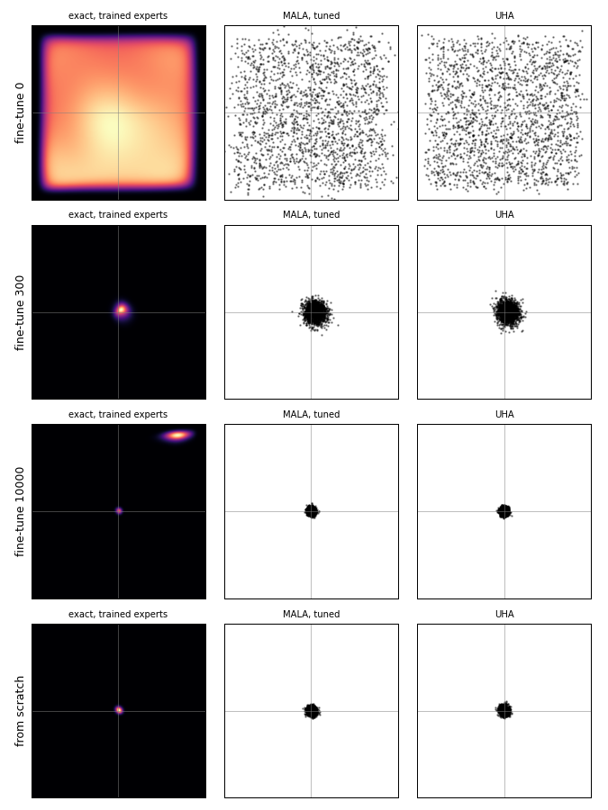
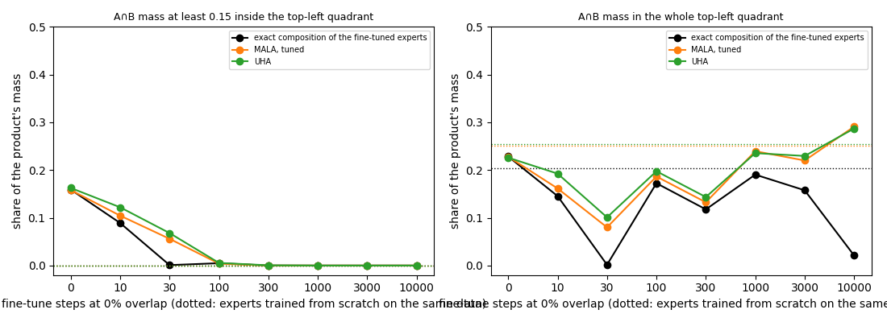
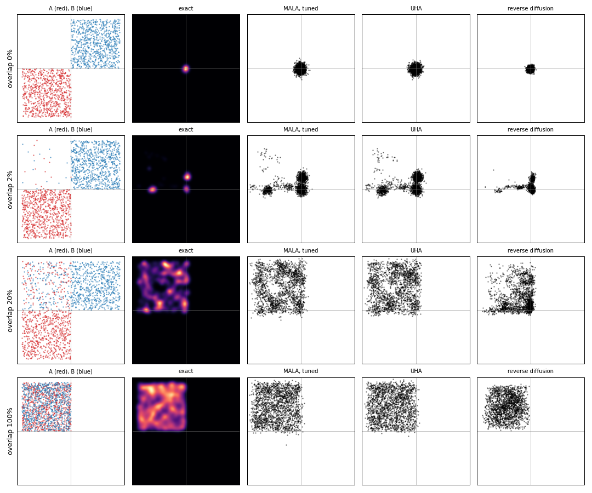

# 🔨 Phase 5: the overlap dial, and whether a product reaches A-and-B its experts never saw

**What you do.** You turn one dial, the share of A-and-B examples in each expert's training set, from 0% to 100%, and measure how much of the product's mass lands in A∩B. You do it on the quadrant toy with ideal experts (exact, with samplers beside it), on the parts world (exact in 16 pixels), and with trained experts pretrained on every placement and then fine-tuned at 0% overlap.

**Why it is run.** This is the check claim 2 of the [overlap-dial idea map](../../ideas/poe-overlap-dial/IDEA_MAP.md) was waiting for.

**What it ends with.** It ends with the curves in `rebuild/out/phase5/overlap-dial-curves.png` and `finetune-curves.png`. The reference is `rebuild/phase5_dial.py` and `rebuild/phase5_finetune.py` in `toy/` (`toy/rebuild/` for the package).

**How to walk it.** `/drip-execute-plan artifacts/drips/simple-distributions-rebuild/05-the-overlap-dial.md`, one step per message, typing every block yourself. The python blocks, typed in order into `walk05.py` in `/home-mscluster/mmolefe/Playground/PhD/simple-distributions-walk/`, are one runnable script. Phases 1 to 4 are imported from the reference from here on.

**What teaches it elsewhere.** The question itself: [When Neither Training Set Holds A And B](../../../../../Obsidian/Artificial%20Intelligence/Generative%20Modeling/Diffusion%20Models/Composition/When%20Neither%20Training%20Set%20Holds%20A%20And%20B.md) and [What An Expert Learns From Its Training Set](../../../../../Obsidian/Artificial%20Intelligence/Generative%20Modeling/Diffusion%20Models/Composition/What%20An%20Expert%20Learns%20From%20Its%20Training%20Set.md). Why a background matters: [Composing Models With A Background](../../../../../Obsidian/Artificial%20Intelligence/Generative%20Modeling/Diffusion%20Models/Composition/Composing%20Models%20With%20A%20Background.md). Why samplers cannot reweight separated modes: [the MCMC correction](../../../../../goal-setting/learning/deep-learning/diffusion-models/06-diffusion-speciation-dynamics/plans/05-composition-and-the-experiment/plans/03-mcmc-correction.md) and [a mixture needs heights](../../../../../goal-setting/learning/deep-learning/diffusion-models/02-sampler-correctors-for-composition/plans/33-a-mixture-needs-heights.md).

**Where the numbers come from.** Worked numbers: `python -m rebuild.walk_numbers`. Results: `rebuild/out/phase5/overlap-dial.json` and `finetune.json`, printed as tables by `python -m rebuild.phase5_tables`.

## Steps

- [Step 0: the setup block](#step-0-the-setup-block)
- [Step 1: two experts and an overlap share](#step-1-two-experts-and-an-overlap-share)
- [Step 2: at 0%, the product sits on the corner](#step-2-at-0-the-product-sits-on-the-corner)
- [Step 3: two ways to count A∩B](#step-3-two-ways-to-count-ab)
- [Step 4: the exact curve](#step-4-the-exact-curve)
- [Step 5: the samplers on the dial](#step-5-the-samplers-on-the-dial)
- [Step 6: the parts-world dial, and the 386 nats](#step-6-the-parts-world-dial-and-the-386-nats)
- [Step 7: pretrain on everything, fine-tune at 0%](#step-7-pretrain-on-everything-fine-tune-at-0)
- [Step 8: the curves](#step-8-the-curves)

**Colours on this page.** <span style="color:#1565c0">**Blue is the clean point $x_0$**</span>, <span style="color:#00838f">**teal is a point $x$ or the noisy point $x_t$**</span>, <span style="color:#6a1b9a">**purple is the noise $\varepsilon$**</span>, <span style="color:#2e7d32">**green is the kept signal share $\bar\alpha_t$**</span>, <span style="color:#ef6c00">**orange is the noise level $\sqrt{1-\bar\alpha_t}$**</span>, <span style="color:#ad1457">**pink is the score**</span>, <span style="color:#6d4c41">**brown is energy $E$**</span>, <span style="color:#c62828">**red is the prediction $\hat\varepsilon$**</span>, <span style="color:#827717">**olive is expert A**</span>, <span style="color:#546e7a">**blue-grey is expert B**</span>, and <span style="color:#4527a0">**indigo is the composed target**</span> (the product, mixture or negation being sampled). The same colour means the same quantity in every table, chart, diagram and equation.

## Step 0: the setup block

```python
import copy, math
import numpy as np
import matplotlib
matplotlib.use("Agg")
import matplotlib.pyplot as plt
import seaborn as sns
import torch
from scipy.stats import norm

from rebuild import ideal, samplers as S, parts_world as P
from rebuild.device import pick_device

dev = pick_device(); print("device", dev)
rng = np.random.default_rng(100); torch.manual_seed(100)
tt = lambda a: torch.tensor(a, dtype=torch.float32, device=dev)
N, NS, MARGIN = 800, 1000, 0.15
```

## Step 1: two experts and an overlap share

**Definition.** A is "left half" and B is "top half"; A∩B is the top-left quadrant. Expert A trains on 800 points with $x_1\sim U(-1,0)$, of which a share f have $x_2\sim U(0,1)$ (A and B) and the rest $x_2\sim U(-1,0)$ (A only). Expert B mirrors it: $x_2\sim U(0,1)$, a share f with $x_1\sim U(-1,0)$, the rest $x_1\sim U(0,1)$.

**What the experts are.** The experts are ideal (phase 3), smoothed by σ = 0.05. The labels never enter (claim 1): to expert A, the overlap points are just part of its set.

🧸 **Toy:** each of A's 800 points [lands in A∩B independently with probability f](../../../../../goal-setting/learning/mathematics/textbooks/statistics/introduction-to-probability-for-data-science.pdf#page=159), so the count K of A's points in A∩B is random. [Its expectation](../../../../../goal-setting/learning/mathematics/textbooks/statistics/introduction-to-probability-for-data-science.pdf#page=162) is

$$
\begin{aligned}
\mathbb{E}[K] &= 800f, \\
\mathbb{E}[K]\big|_{f=0.01} &= 8, \\
\mathbb{E}[K]\big|_{f=0.05} &= 40,
\end{aligned}
$$

$$
\begin{aligned}
\underbrace{\mathbb{E}[K]}_{\text{long-run average overlap count}}
&=
\underbrace{800}_{\text{points in expert A's set}}
\underbrace{f}_{\text{share allowed into }A\cap B}, \\
\underbrace{\mathbb{E}[K]\big|_{f=0.01}}_{\text{average count at one percent}}
&=
\underbrace{8}_{\text{points}}, \\
\underbrace{\mathbb{E}[K]\big|_{f=0.05}}_{\text{average count at five percent}}
&=
\underbrace{40}_{\text{points}}.
\end{aligned}
$$

**What the equation says.** Each of 800 opportunities contributes [probability](../../../../../Obsidian/Mathematics/Statistics/Probability/Probability.md#where-to-learn-this)<sub>[1](../../../../../Obsidian/Mathematics/references/textbooks/machine-learning/pattern-recognition-and-machine-learning.pdf#page=31 "Pattern recognition and machine learning, section 1.2, Works with numbers: a red box picked 40% of the time and a blue box 60%, holding apples and oranges, f..."), [2](../../../../../Obsidian/Mathematics/references/textbooks/statistics/introduction-to-probability-for-data-science.pdf#page=74 "Introduction to probability for data science, sections 2.2 and 2.3, Probability as a measure of the size of a set, built from a sample space, an event space ..."), [3](../../../../../Obsidian/Mathematics/references/textbooks/statistics/introduction-to-statistics.pdf#page=64 "Introduction to statistics (Wits lecture notes), sections 3.5 to 3.7.2, The axioms, the subjective, relative-frequency and classical approaches, the addition..."), [▶1](https://www.youtube.com/watch?v=_EpXHuPnaK0&t=360s "Professor Leonard, Statistics lecture 4.2, Introduction to Probability, 6:00 to 9:00, The sample space, in the chapter of that name, before simple events. Ch..."), [▶2](https://www.youtube.com/watch?v=_EpXHuPnaK0&t=2085s "Professor Leonard, Statistics lecture 4.2, Introduction to Probability, 34:45 to 37:07, Observed against classical probability. Chapter-timed."), [◆](../../../../../goal-setting/learning/deep-learning/diffusion-models/01-poe-derivation-foundations/plans/01-probability-you-can-compute.md "Probability as a thing you can compute, deep-learning/diffusion-models/01-poe-derivation-foundations, plan 01. Events and P(A), with a sample space built and...")</sub> $f$ to the count. [Adding those equal contributions](../../../../../goal-setting/learning/mathematics/textbooks/machine-learning/probabilistic-machine-learning-an-introduction.pdf#page=66) gives the long-run average count.

**Why multiplication is there.** There are 800 independent opportunities, each contributing $f$ on average. Changing $f$ from 0.01 to 0.05 moves the [expectation](../../../../../Obsidian/Mathematics/Statistics/Probability/Expected%20Value.md#where-to-learn-this)<sub>[1](../../../../../Obsidian/Mathematics/references/textbooks/statistics/introduction-to-probability-for-data-science.pdf#page=141 "Introduction to probability for data science, section 3.4, Works with numbers: E[X] = Σ x p(x) and why it equals a dataset's average once repeated values are..."), [2](../../../../../Obsidian/Mathematics/references/textbooks/statistics/introduction-to-statistics.pdf#page=81 "Introduction to statistics (Wits lecture notes), section 4.2.3, The expected value of a discrete random variable as the mean over many trials, with E[X] and ..."), [3](../../../../../Obsidian/Mathematics/references/textbooks/statistics/introduction-to-probability-for-data-science.pdf#page=196 "Introduction to probability for data science, section 4.2, The integral definition for a continuous variable, with uniform and exponential worked examples (p..."), [▶1](https://www.youtube.com/watch?v=KLs_7b7SKi4&t=309s "StatQuest, Expected Values, Main Ideas, 5:09 to 8:02, Calculating an expected value: each outcome times its probability, added up. Chapter-timed, from the vi..."), [▶2](https://www.youtube.com/watch?v=OSPr6G6Ka-U&t=738s "StatQuest, Expected Values for Continuous Variables, 12:18 to 18:17, Calculating the expected value of an exponential distribution, after deriving the formul..."), [◆](../../../../../goal-setting/learning/mathematics/statistics/conditional-expectation/textbook/01-expectation-and-the-best-constant-guess.md "1. Expectation, and the best constant guess, mathematics/statistics/conditional-expectation, section 1. A fair die's best constant guess under squared error ...")</sub> from 8 points to 40 points.

**Why the expectation is not the printed count.** The equation averages over repeated data draws. Removing that averaging would confuse one random count with its centre, although repeated counts fluctuate around 8 or 40.

and the count printed for one data draw fluctuates around these values. At 0%, A's set is the bottom-left square and B's the top-right square, and the two squares touch only at the origin.

🔤 **The name:** [overlap share](../../../../../Obsidian/Artificial%20Intelligence/Generative%20Modeling/Diffusion%20Models/Composition/What%20An%20Expert%20Learns%20From%20Its%20Training%20Set.md)

<!-- links: step1/overlap-share rev=2 -->
🔗 **Where else this lives**

- 🎬 Video: [ritvikmath, Kernel Density Estimation, 5:32](https://www.youtube.com/watch?v=t1PEhjyzxLA&t=332s), a normal curve centred on each of three fish and averaged, which is how each ideal expert smooths its 800 points; [same video, 14:10](https://www.youtube.com/watch?v=t1PEhjyzxLA&t=850s), the bandwidth as each kernel's standard deviation, this step's σ. Both work in one dimension, and neither says that a Gaussian kernel density estimate is a Gaussian mixture with one equal-weight component per data point.
<!-- /links -->

---

#### The scene and its table

Expert A owns 800 points. Some lie in A only, while the overlap points also lie in B.

<table>
<tr><th>setting</th><th style="color:#827717">points in expert A</th><th>share in A∩B</th><th>expected points in A∩B</th></tr>
<tr><td>one percent</td><td>800</td><td style="border:2px solid #212121">0.01</td><td style="border:2px dashed #212121">8</td></tr>
<tr style="background:#fff8e1"><td><b>five percent</b></td><td>800</td><td style="border:2px solid #212121"><b>0.05</b></td><td style="border:2px dashed #212121"><b>40</b></td></tr>
</table>

**How to read this table.** Each row turns one dial setting into an average count. The solid box is the fraction of the set, and the dashed box is the number of points that fraction represents.

**What to look for.** The set size stays at 800. Only the share moves, so the expected overlap count moves from 8 to 40.

---

#### The base word first: share

**What the word means.** A share is a part of a whole. Here the whole is expert A's 800 training points.

$$
\underbrace{f}_{\text{overlap share}}
=
\frac{\underbrace{\mathbb{E}[K]}_{\text{average overlap count}}}
{\underbrace{800}_{\text{whole training set}}}
$$

**What the equation says.** Divide the average number in the selected part by the total number of points.

**What it means.** A share is dimensionless. At five percent, 40 of the 800 points belong to the overlap on average.

---

#### Then the qualifying word: overlap

**What the word means.** Overlap is [the region two descriptions cover together](../../../../../goal-setting/learning/mathematics/textbooks/statistics/introduction-to-statistics.pdf#page=57). On this toy it is the top-left quadrant, A∩B.

$$
\underbrace{K}_{\text{overlap count}}
=
\underbrace{\#\{\text{expert A points in }A\cap B\}}_{\text{points satisfying both descriptions}}
$$

**What the equation says.** Count only points that belong to A and B together.

**What it means.** The overlap is not the union of both sets. A-only and B-only points do not enter $K$.

---

#### All the words together: the formula

An overlap share is the fraction of one expert's set that lies in the joint region.

$$
\underbrace{\mathbb{E}[K]}_{\text{expected overlap count}}
=
\underbrace{800}_{\text{whole set}}
\underbrace{f}_{\text{overlap share}}
$$

**What the equation says.** Multiply the size of the whole set by the selected share to obtain the average number in the overlap.

**Check it on the toy.** One percent gives 8 of 800 points. Five percent gives 40 of 800 points.

---

#### The consequence: turn the dial

**Raise the overlap share.** Moving the dial from 0.01 to 0.05 moves the expected overlap count from 8 to 40. Nothing about the total set size changes.

🔤 **The name:** [expectation](../../../../../goal-setting/learning/mathematics/statistics/conditional-expectation/plans/01-expectation-and-the-best-constant-guess.md)

---

#### The scene and its table

Repeat the random construction many times at one fixed setting. [Individual counts](../../../../../goal-setting/learning/mathematics/statistics/sampling/textbook/01-the-binomial-count.md) move, while their long-run average settles near the expectation.

<table>
<tr><th>overlap probability</th><th>one draw</th><th>quantity that stays fixed across repeated draws</th></tr>
<tr><td>0.01</td><td>random count near 8</td><td style="border:2px solid #212121">8</td></tr>
<tr style="background:#fff8e1"><td><b>0.05</b></td><td>random count near 40</td><td style="border:2px dashed #212121"><b>40</b></td></tr>
</table>

**How to read this table.** The middle column describes one random dataset. The last column is the centre approached by averaging many such datasets.

**What to look for.** Expectation belongs to the repeated experiment, not to a promise that every one-percent draw contains exactly 8 points.

---

#### The word: expectation

**What the word means.** [An expectation is the long-run average of a random quantity](../../../../../goal-setting/learning/mathematics/textbooks/statistics/introduction-to-probability-for-data-science.pdf#page=141). It is what repeated draws balance around.

$$
\underbrace{\mathbb{E}[K]}_{\text{expectation of the count}}
=
\sum_{i=1}^{800}
\underbrace{\mathbb{E}[I_i]}_{\text{average contribution of point }i}
=
\underbrace{800f}_{\text{long-run average count}}
$$

**What the equation says.** Let [each indicator](../../../../../goal-setting/learning/mathematics/textbooks/statistics/introduction-to-probability-for-data-science.pdf#page=154) $I_i$ be 1 when point $i$ enters A∩B and 0 otherwise. Each has average $f$, so [their 800 contributions add](../../../../../goal-setting/learning/mathematics/textbooks/machine-learning/probabilistic-machine-learning-an-introduction.pdf#page=66) to $800f$.

**What it means.** Expectation predicts the centre of repeated counts. It does not remove their randomness.

---

#### All the words together: the formula

For this count, expectation means adding the average contribution from every point.

$$
\underbrace{\mathbb{E}[K]}_{\text{expected count}}
=
\underbrace{800}_{\text{opportunities}}
\times
\underbrace{f}_{\text{average contribution per opportunity}}
$$

**What the equation says.** Each of 800 points contributes $f$ of a point on average.

**Check it on the toy.** The formula gives 8 at one percent and 40 at five percent, matching the two worked values.

---

#### The consequence: repeat instead of memorising one draw

**Change the probability.** Raising $f$ from 0.01 to 0.05 raises the long-run average from 8 to 40. A particular printed count may sit on either side of its average.

🔨 **Build:**

```python
def make_sets(f, n=N):
    a = np.c_[rng.uniform(-1, 0, n), np.where(rng.random(n) < f, rng.uniform(0, 1, n), rng.uniform(-1, 0, n))]
    b = np.c_[np.where(rng.random(n) < f, rng.uniform(-1, 0, n), rng.uniform(0, 1, n)), rng.uniform(0, 1, n)]
    return a, b
A, B = make_sets(0.05)
print("points of A in A∩B at 5%:", int(((A[:, 0] < 0) & (A[:, 1] > 0)).sum()), "(expected about 40)")
```

<!-- links: step1/expectation-repeat rev=2 -->
🔗 **Where else this lives**

- 🎬 Video: [StatQuest, Expected Values, Main Ideas, 5:09](https://www.youtube.com/watch?v=KLs_7b7SKi4&t=309s), each outcome times its probability, added up; [same video, 8:02](https://www.youtube.com/watch?v=KLs_7b7SKi4&t=482s), the notation for an expected value. Neither works the expected count of a binomial, n times p, which is this step's 800f (8 at f = 0.01, 40 at f = 0.05).
<!-- /links -->

## Step 2: at 0%, the product sits on the corner

**Definition.** The composition is the product $p_Ap_B$, computed exactly on the grid as in phase 3.

**Derivation.** Near the corner, each expert is a square smoothed by σ, so along $x_1$ expert A's [density](../../../../../Obsidian/Mathematics/Statistics/Distributions/Probability%20Density%20Function.md#where-to-learn-this)<sub>[1](../../../../../Obsidian/Mathematics/references/textbooks/statistics/introduction-to-probability-for-data-science.pdf#page=188 "Introduction to probability for data science, section 4.1, Builds the intuition of probability per unit length, defines the PDF and its properties (Definitio..."), [2](../../../../../Obsidian/Mathematics/references/textbooks/machine-learning/mathematics-for-machine-learning.pdf#page=186 "Mathematics for machine learning, section 6.2.2, The density and the CDF (Definitions 6.1 and 6.2), a uniform example (Example 6.3), and discrete against con..."), [3](../../../../../Obsidian/Mathematics/references/textbooks/machine-learning/pattern-recognition-and-machine-learning.pdf#page=36 "Pattern recognition and machine learning, section 1.2.1, The density's two conditions (equations 1.25 and 1.26), its link to the CDF, and why a density picks..."), [▶1](https://www.youtube.com/watch?v=QKA4HNEw3aY&t=52s "The Organic Chemistry Tutor, Probability Density Functions, 0:52 to 3:39, Verifies that a given function is a density by checking that its integral equals 1...."), [▶2](https://www.youtube.com/watch?v=oI3hZJqXJuc&t=135s "StatQuest, The Main Ideas behind Probability Distributions, 2:15 to 5:14, A curve as a distribution, with probability read as area under it, not its height. ..."), [◆](../../../../../goal-setting/learning/deep-learning/diffusion-models/01-poe-derivation-foundations/textbook/02-densities-and-the-gaussian.md#21-a-density-can-exceed-1 "Chapter 2: Read a density as area and draw a Gaussian from its covariance, deep-learning/diffusion-models/01-poe-derivation-foundations, chapter 02, section ..."), [◈](https://claude.ai/artifact/DBmJtn6xy75sPtQwPEvQZU#nb-sec1 "Kinds of composition notebook, Setup: the ideal expert, The ideal expert's log-density on a grid, in four steps from the 2D Gaussian to its logsumexp form, t...")</sub> falls off as $\Phi(-x_1/\sigma)$ and expert B's rises as $\Phi(x_1/\sigma)$, with Φ [the normal CDF](../../../../../goal-setting/learning/mathematics/textbooks/statistics/introduction-to-probability-for-data-science.pdf#page=230), and the same holds along $x_2$. Their product along each axis is $\Phi(-x/\sigma)\,\Phi(x/\sigma)$.

**Where it peaks.** To see where it peaks, put $u=\Phi(x/\sigma)$. [The normal curve is symmetric](../../../../../goal-setting/learning/mathematics/textbooks/statistics/introduction-to-probability-for-data-science.pdf#page=232), so $\Phi(-x/\sigma)=1-u$, and [completing the square](../../../../../goal-setting/learning/mathematics/textbooks/algebra/algebra-handbook.pdf#page=74) gives

$$
\begin{aligned}
\Phi(-x/\sigma)\,\Phi(x/\sigma)
  &= u(1-u) \\
  &= \tfrac14-\left(u-\tfrac12\right)^2 \\
  &\leq \tfrac14.
\end{aligned}
$$

$$
\begin{aligned}
\underbrace{\Phi(-\textcolor{#00838f}{x}/\sigma)}_{\text{expert A's one-axis allowance}}
\underbrace{\Phi(\textcolor{#00838f}{x}/\sigma)}_{\text{expert B's one-axis allowance}}
&=
\underbrace{u(1-u)}_{\text{two complementary allowances multiplied}} \\
&=
\underbrace{\frac14}_{\text{largest possible product}}
-
\underbrace{\left(u-\frac12\right)^2}_{\text{penalty for leaving the boundary}} \\
&\leq
\underbrace{\frac14}_{\text{peak at the corner}}.
\end{aligned}
$$

**What the equation says.** The two experts trade allowance across the boundary. Their product is one quarter minus a nonnegative squared penalty, so it is largest when both allowances equal one half.

**Why multiplication is there.** A product accepts a point only to the extent that both experts allow it. At the boundary the two factors are 0.5 and 0.5, giving 0.25.

**Why the square is there.** Completing the square measures departure from the balanced value 0.5 on either side. Removing the squared penalty would erase the fall away from the corner and leave the profile at 0.25 everywhere.

**Why the inequality is there.** A square cannot be negative, so subtracting it cannot exceed one quarter. The toy reaches 0.25 only at the boundary.

**Where equality holds.** Equality needs $u=\tfrac12$, which happens only at $x=0$. So the profile is largest at 0 (where it equals $\tfrac12\cdot\tfrac12$ = `0.25`) and symmetric about 0, and the product's mass is a blob on the corner, split evenly across the boundary lines.

**How narrow the blob is.** Half of its mass along one axis lies within `0.0302` of the boundary, less than one σ. That distance comes from integrating the profile numerically (`p5.corner_profile_half_mass_within`), not from the algebra above.

🧸 **Toy:** at 0% overlap the exact composition puts `0.20 ± 0.02` (3 data seeds) in the whole top-left quadrant, all of it in that sliver around the corner. Almost none of it is more than 3σ inside: the deep mass is below `1.1e-6` in each of the 3 seeds (`overlap-dial.json`) and rounds to `0.00`. The run behind this document printed `0.145` and `0.0`. That seed's whole-quadrant share is below the three seeds' 0.20 ± 0.02, because the sliver's split depends on how the few training points nearest the corner happen to fall. The interior number does not move.

🔤 **The name:** corner

---

#### The scene and its table

The two training squares touch at one point. The one-axis product is highest exactly there.

<table>
<tr><th style="color:#00838f">position</th><th>expert A allowance</th><th>expert B allowance</th><th style="color:#4527a0">product profile</th></tr>
<tr style="background:#fff8e1"><td style="border:2px solid #212121"><b>boundary at 0</b></td><td>0.5</td><td>0.5</td><td style="border:2px dashed #212121"><b>0.25</b></td></tr>
<tr><td>away from 0</td><td>one rises</td><td>the other falls</td><td>below 0.25</td></tr>
</table>

**How to read this table.** Each row describes one position along an axis through the meeting point. The last column multiplies the two experts' allowances.

**What to look for.** The highlighted boundary is the only place where both factors equal one half, so the product reaches its peak there.

---

#### The word: corner

**What the word means.** A corner is the point where two boundary edges meet. Here the vertical and horizontal inner boundaries meet at the origin.

$$
\underbrace{\textcolor{#00838f}{x_1}=0,\quad \textcolor{#00838f}{x_2}=0}_{\text{the shared corner}}
$$

**What the equation says.** Both coordinates sit on their inner boundary at once.

**What it means.** Corner names a location, not a broad region. The product's peak is pinned to that single meeting point.

---

#### All the words together: the formula

The corner is where each one-axis profile reaches its balanced product.

$$
\underbrace{\Phi(0)\Phi(0)}_{\text{profile at the corner}}
=
\underbrace{\frac12\cdot\frac12}_{\text{both experts half open}}
=
\underbrace{0.25}_{\text{peak}}
$$

**What the equation says.** At zero, each smoothed boundary contributes one half. Their product is 0.25.

**Check it on the toy.** The numerical profile reports 0.25 at the origin.

---

#### The consequence: move away from the meeting point

**Leave the corner.** The profile moves from its peak of 0.25 to a value below 0.25 because one expert's allowance falls as the other's rises.

🔤 **The name:** sliver

---

#### The scene and its table

The whole quadrant count includes a very thin band beside the two boundaries. At zero overlap, that band contains the apparent A∩B mass.

<table>
<tr><th>region</th><th>distance from inner boundary</th><th style="color:#4527a0">mass at zero overlap</th></tr>
<tr style="background:#fff8e1"><td style="border:2px solid #212121"><b>corner sliver</b></td><td>half of one-axis profile within 0.0302</td><td style="border:2px dashed #212121"><b>0.20 ± 0.02 in the whole quadrant</b></td></tr>
<tr style="color:#9e9e9e"><td>deep interior</td><td>more than 0.15 past both boundaries</td><td>below 1.1e-6</td></tr>
</table>

**How to read this table.** The first row stays close to the boundaries. The grey row applies the margin that removes that narrow boundary region.

**What to look for.** The whole-quadrant number is not evidence of deep A∩B support. The deep row rounds to 0.00.

---

#### The word: sliver

**What the word means.** A sliver is a thin piece cut from a larger shape. Here it is the narrow part of the quadrant hugging the corner boundaries.

$$
\underbrace{|\textcolor{#00838f}{x}|\leq 0.0302}_{\text{central band containing half the one-axis profile mass}}
$$

**What the equation says.** Stay within 0.0302 of the boundary along one axis to capture half of that profile's mass.

**What it means.** The name warns that a region can have visible [probability](../../../../../Obsidian/Mathematics/Statistics/Probability/Probability.md#where-to-learn-this)<sub>[1](../../../../../Obsidian/Mathematics/references/textbooks/machine-learning/pattern-recognition-and-machine-learning.pdf#page=31 "Pattern recognition and machine learning, section 1.2, Works with numbers: a red box picked 40% of the time and a blue box 60%, holding apples and oranges, f..."), [2](../../../../../Obsidian/Mathematics/references/textbooks/statistics/introduction-to-probability-for-data-science.pdf#page=74 "Introduction to probability for data science, sections 2.2 and 2.3, Probability as a measure of the size of a set, built from a sample space, an event space ..."), [3](../../../../../Obsidian/Mathematics/references/textbooks/statistics/introduction-to-statistics.pdf#page=64 "Introduction to statistics (Wits lecture notes), sections 3.5 to 3.7.2, The axioms, the subjective, relative-frequency and classical approaches, the addition..."), [▶1](https://www.youtube.com/watch?v=_EpXHuPnaK0&t=360s "Professor Leonard, Statistics lecture 4.2, Introduction to Probability, 6:00 to 9:00, The sample space, in the chapter of that name, before simple events. Ch..."), [▶2](https://www.youtube.com/watch?v=_EpXHuPnaK0&t=2085s "Professor Leonard, Statistics lecture 4.2, Introduction to Probability, 34:45 to 37:07, Observed against classical probability. Chapter-timed."), [◆](../../../../../goal-setting/learning/deep-learning/diffusion-models/01-poe-derivation-foundations/plans/01-probability-you-can-compute.md "Probability as a thing you can compute, deep-learning/diffusion-models/01-poe-derivation-foundations, plan 01. Events and P(A), with a sample space built and...")</sub> while having almost no depth.

---

#### All the words together: the formula

The sliver is what remains near the boundary before the 0.15 interior margin removes it.

$$
\underbrace{0.0302}_{\text{half-mass boundary width}}
<
\underbrace{0.15}_{\text{deep-interior margin}}
$$

**What the equation says.** The diagnostic margin reaches much farther into the quadrant than the characteristic boundary width.

**Check it on the toy.** The whole quadrant reports 0.20 ± 0.02, while the deep region reports less than 1.1e-6 and rounds to 0.00.

---

#### The consequence: apply the margin

**Remove the sliver.** The reported mass moves from 0.20 in the whole quadrant to 0.00 in the deep interior at zero overlap. The change reveals that the first number came from the boundary.

🔨 **Build:**

```python
xs_ = np.linspace(-0.3, 0.3, 2001); prof = norm.cdf(-xs_ / 0.05) * norm.cdf(xs_ / 0.05)
print("corner profile at 0:", round(prof[1000], 4))
A0, B0 = make_sets(0.0)
p0 = ideal.exact_grid(tt(A0), tt(B0), lambda a, b: a + b, dev); w0 = p0 * ideal.CELL
print("0% overlap: mass in the whole quadrant", round(float((w0 * ((ideal.X1 < 0) & (ideal.X2 > 0))).sum()), 3),
      " at least 0.15 inside", round(float((w0 * ((ideal.X1 < -MARGIN) & (ideal.X2 > MARGIN))).sum()), 3))
```

## Step 3: two ways to count A∩B

**Definition.** The whole-quadrant mass counts everything with $x_1<0,x_2>0$. The interior mass counts only

$$
x_1<-0.15,\qquad x_2>0.15,
$$

$$
\underbrace{\textcolor{#00838f}{x_1}<-0.15}_{\text{at least 0.15 inside from the vertical boundary}},
\qquad
\underbrace{\textcolor{#00838f}{x_2}>0.15}_{\text{at least 0.15 inside from the horizontal boundary}}.
$$

**What the equation says.** A point counts as interior only when both coordinates clear their boundary by the chosen margin.

**Why the inequalities are there.** The signs select the top-left quadrant, while the offsets remove the boundary strip. Replacing 0.15 by 0 would restore the whole-quadrant count and its 0.20 corner sliver at zero overlap.

**Why both conditions are there.** A point must be deep along both axes. Removing either condition would admit an edge strip that remains close to one boundary.

which is at least 3σ beyond both inner boundaries. A [Gaussian](../../../../../Obsidian/Mathematics/Statistics/Distributions/Multivariate%20Normal%20Distribution/Multivariate%20Normal%20Distribution.md#where-to-learn-this)<sub>[1](../../../../../Obsidian/Mathematics/references/textbooks/statistics/introduction-to-probability-for-data-science.pdf#page=227 "Introduction to probability for data science, section 4.6, The one-dimensional Gaussian random variable: its density with plots of μ and σ moving and widenin..."), [2](../../../../../Obsidian/Mathematics/references/textbooks/statistics/introduction-to-probability-for-data-science.pdf#page=306 "Introduction to probability for data science, section 5.6, The d-dimensional Gaussian density with Σ⁻¹, its mean vector and covariance, and the diagonal cova..."), [3](../../../../../Obsidian/Mathematics/references/textbooks/machine-learning/mathematics-for-machine-learning.pdf#page=203 "Mathematics for machine learning, section 6.5, The univariate and multivariate densities (equations 6.62 and 6.63, page 204) drawn with 100 samples, then mar..."), [▶1](https://www.youtube.com/watch?v=rzFX5NWojp0&t=0s "StatQuest, The Normal Distribution, Clearly Explained, 0:00 to 3:27, The bell-shaped curve and what its mean and standard deviation set, in the video's openi..."), [▶2](https://www.youtube.com/watch?v=oI3hZJqXJuc&t=135s "StatQuest, The Main Ideas behind Probability Distributions, 2:15 to 5:14, A curve as a distribution, where probability is the area under it over an interval ..."), [◆](../../../../../goal-setting/learning/deep-learning/diffusion-models/01-poe-derivation-foundations/textbook/02-densities-and-the-gaussian.md "Chapter 2: Read a density as area and draw a Gaussian from its covariance, deep-learning/diffusion-models/01-poe-derivation-foundations, chapter 02. The Gaus...")</sub> kernel is positive everywhere, so points from outside A∩B still put a small tail there, but the margin cuts that spill down far enough that the 0% value rounds to `0.00`.

**The uniform-area benchmark.** At 100% overlap both experts are the top-left square, so the product is that square (sharpened where both sets are dense). Removing a strip of width 0.15 beside each inner boundary leaves sides of 0.85, so a uniform [density](../../../../../Obsidian/Mathematics/Statistics/Distributions/Probability%20Density%20Function.md#where-to-learn-this)<sub>[1](../../../../../Obsidian/Mathematics/references/textbooks/statistics/introduction-to-probability-for-data-science.pdf#page=188 "Introduction to probability for data science, section 4.1, Builds the intuition of probability per unit length, defines the PDF and its properties (Definitio..."), [2](../../../../../Obsidian/Mathematics/references/textbooks/machine-learning/mathematics-for-machine-learning.pdf#page=186 "Mathematics for machine learning, section 6.2.2, The density and the CDF (Definitions 6.1 and 6.2), a uniform example (Example 6.3), and discrete against con..."), [3](../../../../../Obsidian/Mathematics/references/textbooks/machine-learning/pattern-recognition-and-machine-learning.pdf#page=36 "Pattern recognition and machine learning, section 1.2.1, The density's two conditions (equations 1.25 and 1.26), its link to the CDF, and why a density picks..."), [▶1](https://www.youtube.com/watch?v=QKA4HNEw3aY&t=52s "The Organic Chemistry Tutor, Probability Density Functions, 0:52 to 3:39, Verifies that a given function is a density by checking that its integral equals 1...."), [▶2](https://www.youtube.com/watch?v=oI3hZJqXJuc&t=135s "StatQuest, The Main Ideas behind Probability Distributions, 2:15 to 5:14, A curve as a distribution, with probability read as area under it, not its height. ..."), [◆](../../../../../goal-setting/learning/deep-learning/diffusion-models/01-poe-derivation-foundations/textbook/02-densities-and-the-gaussian.md#21-a-density-can-exceed-1 "Chapter 2: Read a density as area and draw a Gaussian from its covariance, deep-learning/diffusion-models/01-poe-derivation-foundations, chapter 02, section ..."), [◈](https://claude.ai/artifact/DBmJtn6xy75sPtQwPEvQZU#nb-sec1 "Kinds of composition notebook, Setup: the ideal expert, The ideal expert's log-density on a grid, in four steps from the 2D Gaussian to its logsumexp form, t...")</sub> would put this share of its mass in the interior:

$$
\begin{aligned}
\text{uniform interior share} &= 0.85\times0.85 \\
                              &= 0.7225.
\end{aligned}
$$

$$
\begin{aligned}
\underbrace{\text{uniform interior share}}_{\text{area left after both strips are removed}}
&=
\underbrace{0.85}_{\text{remaining horizontal side}}
\times
\underbrace{0.85}_{\text{remaining vertical side}} \\
&=
\underbrace{0.7225}_{\text{remaining area share}}.
\end{aligned}
$$

**What the equation says.** [A uniform square assigns mass in proportion to area](../../../../../goal-setting/learning/mathematics/textbooks/machine-learning/deep-learning-textbook.pdf#page=74). Keeping 0.85 of each side keeps 0.7225 of the square's area.

**Why multiplication is there.** A point must survive the horizontal cut and the vertical cut. Keeping only one factor would report 0.85 and ignore the strip removed on the other axis.

**Why the offset matters.** Each original side has length 1. Removing 0.15 leaves 0.85. Replacing the margin by zero would keep side length 1 and area share 1 instead of 0.7225.

This is a benchmark and the product can exceed it. The exact interior mass at 100% comes out a little above it, `0.76`, because multiplying the two smoothed densities lowers the square's edges, where each density has dropped toward half its inside value, more than its middle.

💥 **Broken run:** reading the whole quadrant alone. At 0% overlap it reports `0.20` of the product in A∩B, which reads as "composition reaches A∩B a fifth of the time with no data". It is the corner sliver of Step 2. The interior reports `0.00`.

🔤 **The name:** interior mass

---

#### The scene and its table

The margin divides the top-left quadrant into a deep rectangle and the boundary region it excludes.

<table>
<tr><th>region</th><th>rule</th><th>area share under a uniform square</th><th style="color:#4527a0">zero-overlap product mass</th></tr>
<tr style="background:#fff8e1"><td style="border:2px solid #212121"><b>interior</b></td><td>first coordinate below −0.15 and second above 0.15</td><td style="border:2px dashed #212121">0.7225</td><td><b>0.00 rounded</b></td></tr>
<tr style="color:#9e9e9e"><td>removed boundary region</td><td>fails at least one margin</td><td>0.2775</td><td>contains the corner sliver</td></tr>
</table>

**How to read this table.** Each row is a part of the top-left square after applying the margin. The highlighted row is the region used by the diagnostic.

**What to look for.** The interior occupies most of a uniform square, yet its zero-overlap product mass rounds to zero. The boundary sliver caused the whole-quadrant signal.

---

#### The base word first: mass

**What the word means.** [Probability mass is the share of total probability assigned to a region](../../../../../goal-setting/learning/mathematics/textbooks/statistics/introduction-to-probability-for-data-science.pdf#page=190). It adds density across every point in that region.

$$
\underbrace{M(D)}_{\text{mass of region }D}
=
\underbrace{\int_D \textcolor{#4527a0}{p_A(x)p_B(x)}\,dx}_{\text{composed density accumulated over }D}
$$

**What the equation says.** Add the product's density throughout the chosen region.

**What it means.** Mass is a regional share, not the height at one point.

---

#### Then the qualifying word: interior

**What the word means.** Interior means safely inside rather than on an edge. Here “safely” is fixed at 0.15, which equals three smoothing [standard deviations](../../../../../Obsidian/Mathematics/Statistics/Variance.md#where-to-learn-this)<sub>[1](../../../../../Obsidian/Mathematics/references/textbooks/statistics/introduction-to-probability-for-data-science.pdf#page=150 "Introduction to probability for data science, section 3.4.4, Defines variance as E[(X − µ)²] and the standard deviation as its root (Definition 3.7), proves ..."), [2](../../../../../Obsidian/Mathematics/references/textbooks/machine-learning/mathematics-for-machine-learning.pdf#page=196 "Mathematics for machine learning, section 6.4.1, Variance as the covariance of a variable with itself (Definition 6.7), then the empirical mean and variance ..."), [3](../../../../../Obsidian/Mathematics/references/textbooks/machine-learning/deep-learning-textbook.pdf#page=76 "Deep learning textbook, section 3.8, A short definition of variance and standard deviation beside expectation and covariance."), [▶1](https://www.youtube.com/watch?v=4-FysvtxQEU&t=1551s "Professor Leonard, Statistics 3.3, A standard deviation calculated by hand, 25:51 to 36:43, Works a standard deviation on a small data set by hand. Chapter-t..."), [▶2](https://www.youtube.com/watch?v=SzZ6GpcfoQY&t=236s "StatQuest, Calculating the Mean, Variance and Standard Deviation, Calculating population variance, 3:56 to 5:54, The population variance as the average squar..."), [◆](../../../../../goal-setting/learning/deep-learning/transformers/textbook/06-show-that-variances-of-independent-terms-add.md "Show that variances of independent terms add, deep-learning/transformers, chapter 06. Predicts the spread of a dot product of random vectors by adding the va...")</sub>.

$$
\underbrace{D}_{\text{deep interior}}
=
\underbrace{\{x:x_1<-0.15,\ x_2>0.15\}}_{\text{both margins passed}}
$$

**What the equation says.** Region $D$ keeps only points that pass both coordinate tests.

**What it means.** The condition removes the corner profile whose one-axis half-mass width is 0.0302.

---

#### All the words together: the formula

Interior mass is the composed [probability](../../../../../Obsidian/Mathematics/Statistics/Probability/Probability.md#where-to-learn-this)<sub>[1](../../../../../Obsidian/Mathematics/references/textbooks/machine-learning/pattern-recognition-and-machine-learning.pdf#page=31 "Pattern recognition and machine learning, section 1.2, Works with numbers: a red box picked 40% of the time and a blue box 60%, holding apples and oranges, f..."), [2](../../../../../Obsidian/Mathematics/references/textbooks/statistics/introduction-to-probability-for-data-science.pdf#page=74 "Introduction to probability for data science, sections 2.2 and 2.3, Probability as a measure of the size of a set, built from a sample space, an event space ..."), [3](../../../../../Obsidian/Mathematics/references/textbooks/statistics/introduction-to-statistics.pdf#page=64 "Introduction to statistics (Wits lecture notes), sections 3.5 to 3.7.2, The axioms, the subjective, relative-frequency and classical approaches, the addition..."), [▶1](https://www.youtube.com/watch?v=_EpXHuPnaK0&t=360s "Professor Leonard, Statistics lecture 4.2, Introduction to Probability, 6:00 to 9:00, The sample space, in the chapter of that name, before simple events. Ch..."), [▶2](https://www.youtube.com/watch?v=_EpXHuPnaK0&t=2085s "Professor Leonard, Statistics lecture 4.2, Introduction to Probability, 34:45 to 37:07, Observed against classical probability. Chapter-timed."), [◆](../../../../../goal-setting/learning/deep-learning/diffusion-models/01-poe-derivation-foundations/plans/01-probability-you-can-compute.md "Probability as a thing you can compute, deep-learning/diffusion-models/01-poe-derivation-foundations, plan 01. Events and P(A), with a sample space built and...")</sub> accumulated only in the deep region.

$$
\underbrace{M_D}_{\text{interior mass}}
=
\int
\underbrace{\mathbf 1\{x_1<-0.15,\ x_2>0.15\}}_{\text{keep only deep points}}
\underbrace{\textcolor{#4527a0}{p_A(x)p_B(x)}}_{\text{product before normalisation}}
\,dx
$$

**What the equation says.** The indicator keeps the deep rectangle and rejects every other location before the product's mass is added.

**Check it on the toy.** At zero overlap the result is below 1.1e-6 in every seed and rounds to 0.00. At full overlap it is about 0.76.

---

#### The consequence: move the boundary inward

**Apply the 0.15 margin.** The zero-overlap reading falls from 0.20 for the whole quadrant to 0.00 for the interior. The move removes a misleading corner effect.

🔤 **The name:** whole-quadrant mass

---

#### The scene and its table

This count keeps every point in the top-left quadrant, including points arbitrarily close to its boundaries.

<table>
<tr><th>count</th><th>coordinate rule</th><th style="color:#4527a0">mass at zero overlap</th></tr>
<tr style="background:#fff8e1"><td style="border:2px solid #212121"><b>whole quadrant</b></td><td>first coordinate below 0 and second above 0</td><td style="border:2px dashed #212121"><b>0.20 ± 0.02</b></td></tr>
<tr><td>interior</td><td>first coordinate below −0.15 and second above 0.15</td><td>0.00 rounded</td></tr>
</table>

**How to read this table.** The two rows count nested regions. The whole quadrant contains the interior plus the boundary strips.

**What to look for.** Only the offsets differ, but the zero-overlap answer changes from 0.20 to 0.00.

---

#### The base word first: mass

**What the word means.** Mass is [the probability collected by a region](../../../../../goal-setting/learning/mathematics/textbooks/statistics/introduction-to-probability-for-data-science.pdf#page=190) after the product has been normalised.

$$
\underbrace{M(Q)}_{\text{mass of quadrant }Q}
=
\underbrace{\int_Q \textcolor{#4527a0}{p(x)}\,dx}_{\text{all normalised product probability in }Q}
$$

**What the equation says.** Add the composed target's probability across the selected quadrant.

**What it means.** A mass of 0.20 means one fifth of the normalised product lies somewhere in that region. It does not say where inside the region.

---

#### Then the shape word: quadrant

**What the word means.** A quadrant is one of four regions made by two crossing axes. The top-left quadrant has a negative first coordinate and a positive second coordinate.

$$
\underbrace{Q}_{\text{top-left quadrant}}
=
\underbrace{\{x:x_1<0,\ x_2>0\}}_{\text{all depths from the two boundaries}}
$$

**What the equation says.** The signs choose the quadrant, but no margin says how far inside a point must be.

**What it means.** Boundary-adjacent probability counts just as much as probability near the middle.

---

#### Then the scope word: whole

**What the word means.** Whole means no part of the quadrant is removed. In particular, the corner sliver remains.

$$
\underbrace{D}_{\text{interior}}
\subset
\underbrace{Q}_{\text{whole quadrant}}
$$

**What the equation says.** Every interior point belongs to the quadrant, but the quadrant also contains the excluded strips.

**What it means.** Whole-quadrant mass can be large because of edge effects even when deep mass is absent.

---

#### All the words together: the formula

Whole-quadrant mass accumulates the product everywhere with the correct pair of coordinate signs.

$$
\underbrace{M_Q}_{\text{whole-quadrant mass}}
=
\int
\underbrace{\mathbf 1\{x_1<0,\ x_2>0\}}_{\text{keep the entire top-left quadrant}}
\underbrace{\textcolor{#4527a0}{p(x)}}_{\text{normalised composed target}}
\,dx
$$

**What the equation says.** The indicator selects every point in the top-left quadrant, including the corner and both inner edges.

**Check it on the toy.** At zero overlap it reports 0.20 ± 0.02, while the nested interior reports 0.00.

---

#### The consequence: compare nested regions

**Replace the whole quadrant with its interior.** The zero-overlap reading moves from 0.20 to 0.00. That before-and-after comparison separates corner contact from genuine deep support.

## Step 4: the exact curve

**Definition.** For each f in 0, 1, 2, 5, 10, 20, 50 and 100%, draw both sets, compute the exact product on the grid, and record the interior mass.

**Derivation of why it rises faster than f.** The product's mass at a point is the product of both experts' densities there. Outside A∩B at least one expert is near zero almost everywhere, so even a few points shared by both sets carry a large share of the product.

**Averaging over the data draw.** To see how large, average over the data draw. Write $s_{\mathrm{BL}}$, $s_{\mathrm{TL}}$ and $s_{\mathrm{TR}}$ for the bottom-left, top-left and top-right unit squares smoothed by σ. Expert A is then $(1-f)\,s_{\mathrm{BL}}+f\,s_{\mathrm{TL}}$ and expert B is $(1-f)\,s_{\mathrm{TR}}+f\,s_{\mathrm{TL}}$, and multiplying out gives

$$
p_Ap_B=(1-f)^2\,s_{\mathrm{BL}}s_{\mathrm{TR}}+f(1-f)\,(s_{\mathrm{BL}}+s_{\mathrm{TR}})\,s_{\mathrm{TL}}+f^2\,s_{\mathrm{TL}}^2.
$$

$$
\underbrace{\textcolor{#4527a0}{p_Ap_B}}_{\text{unnormalised composed target}}
=
\underbrace{(1-f)^2s_{\mathrm{BL}}s_{\mathrm{TR}}}_{\text{corner pair}}
+
\underbrace{f(1-f)(s_{\mathrm{BL}}+s_{\mathrm{TR}})s_{\mathrm{TL}}}_{\text{two edge pairs}}
+
\underbrace{f^2s_{\mathrm{TL}}^2}_{\text{shared-square pair}}.
$$

**What the equation says.** Multiplying the two [two-part mixtures](../../../../../goal-setting/learning/mathematics/textbooks/machine-learning/pattern-recognition-and-machine-learning.pdf#page=447) creates every possible component pair: one corner pair, two edge pairs, and one shared-square pair.

**Why the sum is there.** Each pair is a distinct way both experts can assign [density](../../../../../Obsidian/Mathematics/Statistics/Distributions/Probability%20Density%20Function.md#where-to-learn-this)<sub>[1](../../../../../Obsidian/Mathematics/references/textbooks/statistics/introduction-to-probability-for-data-science.pdf#page=188 "Introduction to probability for data science, section 4.1, Builds the intuition of probability per unit length, defines the PDF and its properties (Definitio..."), [2](../../../../../Obsidian/Mathematics/references/textbooks/machine-learning/mathematics-for-machine-learning.pdf#page=186 "Mathematics for machine learning, section 6.2.2, The density and the CDF (Definitions 6.1 and 6.2), a uniform example (Example 6.3), and discrete against con..."), [3](../../../../../Obsidian/Mathematics/references/textbooks/machine-learning/pattern-recognition-and-machine-learning.pdf#page=36 "Pattern recognition and machine learning, section 1.2.1, The density's two conditions (equations 1.25 and 1.26), its link to the CDF, and why a density picks..."), [▶1](https://www.youtube.com/watch?v=QKA4HNEw3aY&t=52s "The Organic Chemistry Tutor, Probability Density Functions, 0:52 to 3:39, Verifies that a given function is a density by checking that its integral equals 1...."), [▶2](https://www.youtube.com/watch?v=oI3hZJqXJuc&t=135s "StatQuest, The Main Ideas behind Probability Distributions, 2:15 to 5:14, A curve as a distribution, with probability read as area under it, not its height. ..."), [◆](../../../../../goal-setting/learning/deep-learning/diffusion-models/01-poe-derivation-foundations/textbook/02-densities-and-the-gaussian.md#21-a-density-can-exceed-1 "Chapter 2: Read a density as area and draw a Gaussian from its covariance, deep-learning/diffusion-models/01-poe-derivation-foundations, chapter 02, section ..."), [◈](https://claude.ai/artifact/DBmJtn6xy75sPtQwPEvQZU#nb-sec1 "Kinds of composition notebook, Setup: the ideal expert, The ideal expert's log-density on a grid, in four steps from the 2D Gaussian to its logsumexp form, t...")</sub> at the same point. Removing a term would discard one way the product receives mass.

**Why the products are there.** A pair contributes only where both of its component densities are present. At five percent, the shared-square coefficient is $f^2$, while the edge coefficient contains one factor $f$ and one factor $1-f$.

**Why the powers are there.** The corner pair chooses the non-overlap component twice, giving $(1-f)^2$. The shared pair chooses the overlap component twice, giving $f^2$.

**The rule and its constants.** The rule used is [the distributive law](../../../../../goal-setting/learning/mathematics/textbooks/algebra/algebra-handbook.pdf#page=16). Each term integrates to a constant: $C_0=\int s_{\mathrm{BL}}s_{\mathrm{TR}}$ is the overlap at the corner, $C_1=\int(s_{\mathrm{BL}}+s_{\mathrm{TR}})\,s_{\mathrm{TL}}$ the overlap along two edges, $C=\int s_{\mathrm{TL}}^2$ the whole square, and $C_D$ the part of $C$ inside the interior $D$.

**Which term reaches the interior.** Only the last term reaches $D$; the other two reach it through tails no larger than $\Phi(-3)=0.0013$ (`p5.phi_minus_3`). Normalising over the whole plane, the interior mass is

$$
M_D(f)=\frac{f^2C_D}{f^2C+f(1-f)\,C_1+(1-f)^2\,C_0}.
$$

$$
\underbrace{M_D(f)}_{\text{normalised interior mass}}
=
\frac{
\underbrace{f^2C_D}_{\text{shared-square mass inside the interior}}
}{
\underbrace{f^2C}_{\text{whole shared-square contribution}}
+
\underbrace{f(1-f)C_1}_{\text{two edge contributions}}
+
\underbrace{(1-f)^2C_0}_{\text{corner contribution}}
}.
$$

**What the equation says.** The numerator keeps only the shared-square contribution that lands deep inside. The denominator adds every component pair's mass so the result becomes a share of the complete product.

**Why the ratio is there.** Interior mass is part divided by whole. At five percent the numerator is 0.0017 and the denominator is 0.0055, giving the stated mass 0.31.

**Why the sum is there.** Normalisation must include the shared square, both edges, and the corner. Keeping only the numerator would report unnormalised mass rather than a [probability](../../../../../Obsidian/Mathematics/Statistics/Probability/Probability.md#where-to-learn-this)<sub>[1](../../../../../Obsidian/Mathematics/references/textbooks/machine-learning/pattern-recognition-and-machine-learning.pdf#page=31 "Pattern recognition and machine learning, section 1.2, Works with numbers: a red box picked 40% of the time and a blue box 60%, holding apples and oranges, f..."), [2](../../../../../Obsidian/Mathematics/references/textbooks/statistics/introduction-to-probability-for-data-science.pdf#page=74 "Introduction to probability for data science, sections 2.2 and 2.3, Probability as a measure of the size of a set, built from a sample space, an event space ..."), [3](../../../../../Obsidian/Mathematics/references/textbooks/statistics/introduction-to-statistics.pdf#page=64 "Introduction to statistics (Wits lecture notes), sections 3.5 to 3.7.2, The axioms, the subjective, relative-frequency and classical approaches, the addition..."), [▶1](https://www.youtube.com/watch?v=_EpXHuPnaK0&t=360s "Professor Leonard, Statistics lecture 4.2, Introduction to Probability, 6:00 to 9:00, The sample space, in the chapter of that name, before simple events. Ch..."), [▶2](https://www.youtube.com/watch?v=_EpXHuPnaK0&t=2085s "Professor Leonard, Statistics lecture 4.2, Introduction to Probability, 34:45 to 37:07, Observed against classical probability. Chapter-timed."), [◆](../../../../../goal-setting/learning/deep-learning/diffusion-models/01-poe-derivation-foundations/plans/01-probability-you-can-compute.md "Probability as a thing you can compute, deep-learning/diffusion-models/01-poe-derivation-foundations, plan 01. Events and P(A), with a sample space built and...")</sub> share.

**Why the powers are there.** Both experts must choose their shared component to make deep mass, which gives $f^2$. At full overlap, setting $f$ to 1 removes the edge and corner terms and leaves $C_D/C=0.76$.

**The sizes of the constants.** The corner overlap is of order $\sigma^2$, an edge overlap of order σ, and the square of order 1. Integrating the smoothed squares numerically gives $C_0=0.0008$, $C_1=0.053$, $C=0.890$ and $C_D=0.675$ (`p5.deep_mass_C0_corner`, `p5.deep_mass_C1_edges`, `p5.deep_mass_C_square` and `p5.deep_mass_CD_deep_square`).

**The formula at 5%.** At 5% overlap, about 40 points per set, the numerator is 0.0017 against a denominator of 0.0055 (`p5.deep_mass_formula_numerator_f0.05` and `p5.deep_mass_formula_denominator_f0.05`), so $M_D=0.31$ while f is only 0.05.

**Across the dial.** At 100% the formula gives $C_D/C=0.76$. Over f = 0.01, 0.02, 0.05, 0.1, 0.2, 0.5 and 1 it runs from `0.048` to `0.758` (`p5.deep_mass_formula_MD`). The grid's 3-seed means below are 0.30 and 0.76.

🧸 **Toy:** over 3 data seeds (`overlap-dial.json`), the exact interior mass is `0.00` at 0%, `0.05 ± 0.05` at 1%, `0.09` at 2%, `0.30 ± 0.10` at 5%, `0.51` at 10%, `0.59` at 20%, `0.71` at 50% and `0.76` at 100%. At 1% and 5% it swings by seed, because a handful of shared points decides it. The run behind this document, one more seed, printed `0.0, 0.03, 0.276, 0.486, 0.453, 0.486, 0.709, 0.76`. Its 2% and 5% sit well above the 3-seed means, and its 10% is below its 5%. That is the swing of a single seed at low overlap, where the answer rests on whether a few shared points happen to fall close together, and the reason the curve is drawn as a mean over seeds with its spread. Three seeds give a wide spread and no interval; [the exact interval for a proportion](../../../../../goal-setting/learning/mathematics/statistics/sampling/textbook/07-the-exact-interval.md) puts one on a single run's share, and [the percentile bootstrap](../../../../../goal-setting/learning/mathematics/statistics/sampling/plans/13-the-percentile-bootstrap-derived.md) puts one on the seed mean.

🔤 **The name:** exact curve

---

#### The scene and its table

Turn the overlap dial through eight settings. At each one, draw both training sets, multiply the two ideal experts on the grid, and read off the interior mass. No sampler and no trained network is involved anywhere.

<table>
<tr><th>overlap f</th><th>expected shared points in each set (800f)</th><th style="color:#4527a0">exact interior mass, mean of 3 data seeds</th></tr>
<tr style="color:#9e9e9e"><td>0%</td><td>0</td><td>0.00</td></tr>
<tr><td>1%</td><td>8</td><td>0.05 ± 0.05</td></tr>
<tr><td>2%</td><td>16</td><td>0.09</td></tr>
<tr style="background:#fff8e1"><td style="border:2px solid #212121"><b>5%</b></td><td>40</td><td style="border:2px dashed #212121"><b>0.30 ± 0.10</b></td></tr>
<tr><td>10%</td><td>80</td><td>0.51</td></tr>
<tr><td>20%</td><td>160</td><td>0.59</td></tr>
<tr><td>50%</td><td>400</td><td>0.71</td></tr>
<tr><td>100%</td><td>800</td><td>0.76</td></tr>
</table>

**How to read this table.** Each row is one setting of the overlap dial. The middle column is how many of a set's 800 training points land in A∩B on average, and the last column is the share of the composed product lying more than 0.15 inside the top-left quadrant. The ± on the 1% and 5% rows is how far the three seeds swing apart.

**What to look for.** The highlighted row. With 40 shared points per set, the product already puts 0.30 of its mass deep in A∩B, six times the overlap share of 0.05. The grey row is the zero-overlap reading of Steps 2 and 3.

---

#### The word: exact

**What the word means.** Exact means worked out from the definition, with nothing estimated on the way. Here the interior mass is read straight off the product of the two ideal experts on the grid, so no sampler draws points and no network stands in for an expert.

$$
\underbrace{M_D}_{\text{exact interior mass}}
=
\underbrace{\sum_{g\in D}}_{\text{every grid point in the interior}}
\underbrace{\textcolor{#4527a0}{p(g)}}_{\text{normalised product of the two ideal experts}}
\underbrace{\Delta}_{\text{area of one grid cell}}
$$

**What the equation says.** Add the product's density times the cell area over every grid point more than 0.15 inside the quadrant. Each term comes from the training points directly, so the only approximation left is the grid's spacing.

**What it means.** The word belongs to the reading. Replace the grid sum with the share of a sampler's draws that land in $D$, and the 5% reading moves from 0.30 to 0.17 for tuned MALA (Step 5).

---

#### The word: curve

**What the word means.** A curve is a line drawn through a run of points, one per setting, so the eye can follow how a reading changes as the setting changes. Here the x-axis is the overlap f and the y-axis is the exact interior mass, one point per row of the table.

$$
\underbrace{f}_{\text{overlap setting}}
\;\longmapsto\;
\underbrace{M_D(f)}_{\text{exact interior mass at that setting}},
\qquad
\underbrace{f\in\{0,\,0.01,\,0.02,\,0.05,\,0.1,\,0.2,\,0.5,\,1\}}_{\text{the eight dial settings}}
$$

**What the equation says.** The curve is the exact interior mass read once at each of the eight overlap settings.

**What it means.** A curve from one data seed is jagged. The run behind this document printed 0.486 at 5% and 0.453 at 10%, so its curve dips where the 3-seed mean climbs from 0.30 to 0.51. Averaging over seeds is what turns the eight points into a shape worth reading.

---

#### All the words together: the formula

The exact curve is the interior-mass formula from the derivation above, evaluated at each overlap setting.

$$
\underbrace{M_D(f)}_{\text{exact curve at overlap }f}
=
\frac{\underbrace{f^2C_D}_{\text{shared-square mass inside the interior}}}{\underbrace{f^2C+f(1-f)C_1+(1-f)^2C_0}_{\text{all of the product's mass}}}
$$

**What the equation says.** Only the pair where both experts pick their shared square reaches the interior, and its weight grows as $f^2$. The corner term it competes with is tiny ($C_0=0.0008$), so a few shared points are enough for the numerator to dominate.

**Check it on the toy.** At 5% the formula gives 0.31 against the grid's 3-seed mean of 0.30. At 100% both give 0.76.

---

#### The consequence: set the curve beside the straight line M = f

**At 5% overlap.** A reading that grew in step with the data would be 0.05. The exact curve is at 0.30.

**At 10% overlap.** The straight line gives 0.10 and the exact curve 0.51. Turn the dial the other way, from 5% to 0%, and the curve falls from 0.30 to 0.00, so the whole rise comes from the shared points.

🔨 **Build:** one data seed.

```python
F = [0.0, 0.01, 0.02, 0.05, 0.1, 0.2, 0.5, 1.0]; exact_curve, data = [], {}
for f in F:
    a_, b_ = make_sets(f); data[f] = (a_, b_)
    w_ = ideal.exact_grid(tt(a_), tt(b_), lambda a, b: a + b, dev) * ideal.CELL
    exact_curve.append(float((w_ * ((ideal.X1 < -MARGIN) & (ideal.X2 > MARGIN))).sum()))
print("exact interior A∩B mass:", dict(zip(F, np.round(exact_curve, 3))))
```

## Step 5: the samplers on the dial

**Definition.** Tuned MALA and UHA from phase 2, on the exact annealing targets of phase 3, scored by their interior mass beside the exact one.

**Derivation of the lag.** Annealing starts at high noise, where both experts are broad and their product is one blob near the centre. As the noise falls, the product splits into separated pieces: the corner blob, and small clusters where shared points sit.

**Why local moves cannot fix it.** The weight each piece should get only becomes clear at low noise, by which time the pieces are far apart, and local moves do not carry mass between them. That is the mode-weight failure the dominance kind showed in phase 3, and it bites hardest when the A∩B pieces are few and small.

🧸 **Toy:** over 3 seeds with 2000 [samples](../../../../../Obsidian/Mathematics/Statistics/Sampling%20From%20A%20Distribution.md#where-to-learn-this)<sub>[1](../../../../../Obsidian/Mathematics/references/textbooks/machine-learning/pattern-recognition-and-machine-learning.pdf#page=539 "Pattern recognition and machine learning, chapter 11, Why expectations need samples, ancestral sampling of a directed graph (page 541), standard distribution..."), [2](../../../../../Obsidian/Mathematics/references/textbooks/statistics/introduction-to-probability-for-data-science.pdf#page=245 "Introduction to probability for data science, section 4.8, Generates random numbers for any PDF by running a uniform through the inverse CDF, in Python, with..."), [3](../../../../../Obsidian/Mathematics/references/textbooks/machine-learning/deep-learning-textbook.pdf#page=606 "Deep learning textbook, section 17.1, Why machine learning samples at all (Monte Carlo estimates of sums and integrals, and sampling as the goal of a generat..."), [▶1](https://www.youtube.com/watch?v=9ixzzPQWuAY&t=474s "ritvikmath, Inverse Transform Sampling, 7:54 to 10:04, Inverts the exponential CDF and turns a uniform draw into an exponential one. Chapter-timed, from the ..."), [▶2](https://www.youtube.com/watch?v=OXDqjdVVePY&t=232s "ritvikmath, Accept-Reject Sampling, 3:52 to 7:45, An easy proposal g scaled by M into an envelope above f, then each draw accepted with probability f/(M g). ..."), [◆](../../../../../goal-setting/learning/deep-learning/diffusion-models/00-from-scratch-to-sdxl/textbook/l3-stochastic-processes/13-drawing-samples-by-hand.md "Drawing samples by hand: Monte Carlo, inverse transform and accept-reject, deep-learning/diffusion-models/00-from-scratch-to-sdxl, volume L3, section 13. Thr...")</sub>, tuned MALA and UHA agree with each other within 0.02 everywhere. They reach the exact curve from 20% up (`0.55` against `0.59`; at 50%, `0.72` against `0.71`) and lag below it (5%: `0.17` and `0.18` against `0.30`; 10%: `0.40` against `0.51`).

🔤 **The name:** [tuned](../../../../../Obsidian/Mathematics/Statistics/Markov%20Chain%20Monte%20Carlo/Step%20Size%20And%20The%20Accept%20Step.md)

<!-- links: step5/samplers rev=2 -->
🔗 **Where else this lives**

- 🎬 Video: [Stanford CS236, lecture 14, 5:44](https://www.youtube.com/watch?v=E69Lp_T9nVg&t=344s), where plain Langevin sampling fails; [same lecture, 23:54](https://www.youtube.com/watch?v=E69Lp_T9nVg&t=1434s), sampling across many noise scales, noisiest first. CS236 anneals one model's score, not the sum of two models' scores that composition samples.
<!-- /links -->

---

#### The scene and its table

A sampler has settings such as step sizes and numbers of transitions. Tuning chooses those settings before the dial comparison, then the chosen sampler is checked against the exact target.

<table>
<tr><th>overlap</th><th>exact interior mass</th><th>tuned MALA</th><th>UHA</th></tr>
<tr style="background:#fff8e1"><td><b>5 percent</b></td><td style="border:2px solid #212121"><b>0.30</b></td><td style="border:2px dashed #212121">0.17</td><td style="border:2px dashed #212121">0.18</td></tr>
<tr><td>20 percent</td><td>0.59</td><td>0.55</td><td>within 0.02 of MALA</td></tr>
<tr><td>50 percent</td><td>0.71</td><td>0.72</td><td>within 0.02 of MALA</td></tr>
</table>

**How to read this table.** Each row fixes one target. The exact column is the reference mass, while the sampler columns show what the algorithms recover after their settings have been chosen.

**What to look for.** Tuning does not guarantee exactness. The settings work from 20 percent upward, yet both samplers still lag at five percent.

---

#### The word: tuned

**What the word means.** Tuned means adjusted to work well for a stated task, like tightening an instrument until it plays the intended note. Here the adjustment belongs to sampler settings, not to the target distribution.

$$
\underbrace{\theta_{\mathrm{tuned}}}_{\text{chosen sampler settings}}
=
\underbrace{\arg\min_{\theta}\ \operatorname{error}(\theta,\textcolor{#4527a0}{p})}_{\text{settings selected by comparison with the target}}
$$

**What the equation says.** Among candidate settings $\theta$, select the ones with the smallest checking error against the composed target.

**What it means.** “Tuned MALA” names MALA run with its selected settings. It does not mean MALA learned or changed the product.

---

#### All the words together: the check

The name earns its meaning only when the tuned sampler is compared with the exact answer.

$$
\underbrace{|0.17-0.18|}_{\text{MALA and UHA gap at five percent}}
<
\underbrace{0.02}_{\text{reported agreement bound}}
$$

**What the equation says.** The two tuned samplers agree closely with each other at five percent, even though both sit below the exact value 0.30.

**Check it on the toy.** At 20 percent, tuned MALA reaches 0.55 against 0.59. At 50 percent, it reaches 0.72 against 0.71.

---

#### The consequence: separate agreement from accuracy

**Move from five to twenty percent overlap.** Tuned MALA moves from 0.17 against 0.30 to 0.55 against 0.59. Tuning stays fixed, while the target becomes easier for local moves to track.

**The whole-distribution check.** A sampler can match one region's mass while putting the rest of its samples in the wrong places, so the reference also scores every sampler over the whole canvas.

**How the canvas is binned.** Divide $[-1.1,1.1]^2$ into a $40\times40$ grid of bins (`ideal.EDGES`). Let $p_{ij}$ be the exact mass in bin $(i,j)$ and $\widehat p_{ij}$ the fraction of sampler draws that land there. Then

$$
\operatorname{TV}(\widehat p,p)=\frac12\sum_{i,j}\left|\widehat p_{ij}-p_{ij}\right|.
$$

$$
\underbrace{\operatorname{TV}(\widehat p,p)}_{\text{whole-grid discrepancy}}
=
\underbrace{\frac12}_{\text{avoid counting moved mass twice}}
\underbrace{\sum_{i,j}}_{\text{add all 40 by 40 bins}}
\underbrace{\left|\widehat p_{ij}-p_{ij}\right|}_{\text{absolute mismatch in one bin}}.
$$

**What the equation says.** Compare sampled and exact mass in every bin, [discard the sign of each difference](../../../../../goal-setting/learning/mathematics/textbooks/algebra/algebra-handbook.pdf#page=15), add the mismatches, and divide by two.

**Why the absolute value is there.** Excess mass in one bin must not cancel missing mass in another. Removing it could make a visibly wrong distribution appear to have zero discrepancy.

**Why the sum is there.** Interior mass checks one region, while this sum checks the whole canvas. Replacing the sum by one bin would miss errors elsewhere.

**Why one half is there.** Moving mass makes one bin lose what another gains, so the absolute differences count that movement twice. At five percent the tuned MALA value is 0.24 with the factor, rather than double that discrepancy.

**Where the formula comes from.** The rule used is [total variation](../../../../../goal-setting/learning/deep-learning/diffusion-models/00-from-scratch-to-sdxl/textbook/l3-stochastic-processes/01-a-markov-chain-and-what-forgetting-means.md#definitions) between two discrete [distributions](../../../../../Obsidian/Mathematics/Statistics/Distributions/Distributions.md#where-to-learn-this)<sub>[1](../../../../../Obsidian/Mathematics/references/textbooks/statistics/introduction-to-probability-for-data-science.pdf#page=126 "Introduction to probability for data science, section 3.2, Works the PMF of the number of heads in two coin flips (Example 3.5), defines the PMF (Definition ..."), [2](../../../../../Obsidian/Mathematics/references/textbooks/machine-learning/mathematics-for-machine-learning.pdf#page=184 "Mathematics for machine learning, section 6.2, Discrete probabilities from a table of counts (Example 6.2), continuous probabilities with the density and the..."), [3](../../../../../Obsidian/Mathematics/references/textbooks/machine-learning/deep-learning-textbook.pdf#page=72 "Deep learning textbook, section 3.3, A probability distribution as a description of how likely each state is, with probability mass functions for discrete va..."), [▶1](https://www.youtube.com/watch?v=oI3hZJqXJuc&t=41s "StatQuest, The Main Ideas behind Probability Distributions, Statistical Distribution, 0:41 to 2:15, A distribution as the shape of how often each value turns..."), [▶2](https://www.youtube.com/watch?v=oI3hZJqXJuc&t=135s "StatQuest, The Main Ideas behind Probability Distributions, 2:15 to 5:14, A curve as a distribution, with probability read as area. Chapter-timed, from the v...")</sub> (`ideal.tv`). Even 2,000 draws taken straight from the exact grid have a nonzero TV, because there are only 2,000 of them; that value is the sampling-noise baseline.

**What the samplers score.** At 5% overlap tuned MALA's mean TV is `0.24` and UHA's `0.23`, against a baseline of `0.15`. At 20% they are `0.18` and `0.19` against `0.18` (`phase5_tables`, first table). The TV tells the same story as the interior mass: the samplers still lag at 5% and reach the target at 20%.

🔨 **Build:** both samplers at 5% and 20% overlap.

```python
for f in (0.05, 0.2):
    a_, b_ = data[f]; tgt = ideal.composed_target(tt(a_), tt(b_), lambda a, b: a + b)
    for name, s in [("tuned MALA", S.tuned_mala(tgt, NS, 2, ideal.V, device=dev)[0]), ("UHA", S.uha(tgt, NS, 2, 0.3 * np.sqrt(ideal.V), device=dev))]:
        s = s.cpu().numpy()
        print(f"overlap {f:.0%}, {name}: interior {((s[:, 0] < -MARGIN) & (s[:, 1] > MARGIN)).mean():.3f}  exact {exact_curve[F.index(f)]:.3f}")
```

The run behind this document printed, against an exact `0.486` on both settings: at 5%, tuned MALA `0.382` and UHA `0.343`; at 20%, `0.442` and `0.468`. The lag is larger at 5% here too.

💥 **Broken run:** reverse diffusion with summed scores on the same targets gives `0.02` at 5%, `0.10` at 10% and `0.24` at 20%, then overshoots at 100%, `0.91` against `0.76`, pulling the square's mass toward its centre. Read without the exact curve, its low-overlap numbers would say the data was missing when the data was there.

<!-- links: step5/agreement-accuracy rev=2 -->
🔗 **Where else this lives**

- 🎬 Video: [DataMListic, Metropolis-Hastings Explained, 2:00](https://www.youtube.com/watch?v=7IpvsfRgTTY&t=120s), step sizes too small, too large and just right, and the 20 to 50 percent acceptance-rate target, stated without a derivation; [same video, 2:22](https://www.youtube.com/watch?v=7IpvsfRgTTY&t=142s), burn-in, discarding the early samples so the chain forgets where it started.
<!-- /links -->

## Step 6: the parts-world dial, and the 386 nats

**Definition.** A is "contains a cat", B is "contains a dog". At overlap f, expert A's set is cat-only images with weight 1 − f (the cat on one half, background on the other) and cat-and-dog images with weight f (the cat on one half, the dog on the other); B likewise.

**What each expert is.** Each expert is [the Gaussian mixture](../../../../../goal-setting/learning/mathematics/textbooks/machine-learning/pattern-recognition-and-machine-learning.pdf#page=447) of its placements, with [variance](../../../../../Obsidian/Mathematics/Statistics/Variance.md#where-to-learn-this)<sub>[1](../../../../../Obsidian/Mathematics/references/textbooks/statistics/introduction-to-probability-for-data-science.pdf#page=150 "Introduction to probability for data science, section 3.4.4, Defines variance as E[(X − µ)²] and the standard deviation as its root (Definition 3.7), proves ..."), [2](../../../../../Obsidian/Mathematics/references/textbooks/machine-learning/mathematics-for-machine-learning.pdf#page=196 "Mathematics for machine learning, section 6.4.1, Variance as the covariance of a variable with itself (Definition 6.7), then the empirical mean and variance ..."), [3](../../../../../Obsidian/Mathematics/references/textbooks/machine-learning/deep-learning-textbook.pdf#page=76 "Deep learning textbook, section 3.8, A short definition of variance and standard deviation beside expectation and covariance."), [▶1](https://www.youtube.com/watch?v=4-FysvtxQEU&t=1551s "Professor Leonard, Statistics 3.3, A standard deviation calculated by hand, 25:51 to 36:43, Works a standard deviation on a small data set by hand. Chapter-t..."), [▶2](https://www.youtube.com/watch?v=SzZ6GpcfoQY&t=236s "StatQuest, Calculating the Mean, Variance and Standard Deviation, Calculating population variance, 3:56 to 5:54, The population variance as the average squar..."), [◆](../../../../../goal-setting/learning/deep-learning/transformers/textbook/06-show-that-variances-of-independent-terms-add.md "Show that variances of independent terms add, deep-learning/transformers, chapter 06. Predicts the spread of a dot product of random vectors by adding the va...")</sub> 0.01 on object pixels. The background half has mean 0 and a variance that is the setting: 0.01, an empty half as definite as an object, or 1.0, where the expert says nothing about the other half (example 9(c)).

**When a sample counts.** A [sample](../../../../../Obsidian/Mathematics/Statistics/Sampling%20From%20A%20Distribution.md#where-to-learn-this)<sub>[1](../../../../../Obsidian/Mathematics/references/textbooks/machine-learning/pattern-recognition-and-machine-learning.pdf#page=539 "Pattern recognition and machine learning, chapter 11, Why expectations need samples, ancestral sampling of a directed graph (page 541), standard distribution..."), [2](../../../../../Obsidian/Mathematics/references/textbooks/statistics/introduction-to-probability-for-data-science.pdf#page=245 "Introduction to probability for data science, section 4.8, Generates random numbers for any PDF by running a uniform through the inverse CDF, in Python, with..."), [3](../../../../../Obsidian/Mathematics/references/textbooks/machine-learning/deep-learning-textbook.pdf#page=606 "Deep learning textbook, section 17.1, Why machine learning samples at all (Monte Carlo estimates of sums and integrals, and sampling as the goal of a generat..."), [▶1](https://www.youtube.com/watch?v=9ixzzPQWuAY&t=474s "ritvikmath, Inverse Transform Sampling, 7:54 to 10:04, Inverts the exponential CDF and turns a uniform draw into an exponential one. Chapter-timed, from the ..."), [▶2](https://www.youtube.com/watch?v=OXDqjdVVePY&t=232s "ritvikmath, Accept-Reject Sampling, 3:52 to 7:45, An easy proposal g scaled by M into an envelope above f, then each draw accepted with probability f/(M g). ..."), [◆](../../../../../goal-setting/learning/deep-learning/diffusion-models/00-from-scratch-to-sdxl/textbook/l3-stochastic-processes/13-drawing-samples-by-hand.md "Drawing samples by hand: Monte Carlo, inverse transform and accept-reject, deep-learning/diffusion-models/00-from-scratch-to-sdxl, volume L3, section 13. Thr...")</sub> is A∩B when one half's mean is above 0.75 and the other's below −0.75.

**Derivation of the flip.** With an empty background and f = 0, the best product pair is cat-left-only × dog-right-only. On the left half the cat (+1) meets the dog expert's background (0), and on the right half the dog meets the cat expert's background. Both are tight, so [each half lands halfway](../../../../../goal-setting/learning/mathematics/textbooks/computer-vision/computer-vision-textbook.pdf#page=76): a ghost with half-means (0.5, −0.5).

**What the ghost costs.** Its 16 mismatched pixels cost $16\times\frac{1^2}{2\times0.02}$ = `400` [nats](../../../../../goal-setting/learning/mathematics/textbooks/machine-learning/deep-learning-textbook.pdf#page=89) ([the constant of a product of Gaussians](../../../../../goal-setting/learning/mathematics/textbooks/linear-algebra/matrix-cookbook.pdf#page=42)).

**What the matching pair costs.** At f = 0.001, each expert gives its matching cat-and-dog component weight 0.0005 and the single-object component the ghost uses weight 0.4995. The matching pair has no mismatch and pays only for those small weights, a log-weight difference from the ghost pair of

$$
2\ln\frac{0.0005}{0.4995}=-13.81,
$$

$$
\underbrace{2}_{\text{one small overlap weight from each expert}}
\underbrace{\ln\!\left(
\frac{\underbrace{0.0005}_{\text{matching component weight}}}
{\underbrace{0.4995}_{\text{ghost component weight}}}
\right)}_{\text{log-weight change for one expert}}
=
\underbrace{-13.81}_{\text{two-expert weight cost in nats}}.
$$

**What the equation says.** Compare the small matching-component weight with the large single-object weight on the log scale, then count the same comparison for both experts.

**Why the ratio is there.** A relative weight asks how much one component is favoured over another. Using only 0.0005 would not compare it with the ghost's 0.4995.

**Why the logarithm is there.** [Products of mixture weights become sums on the log scale](../../../../../goal-setting/learning/mathematics/textbooks/algebra/algebra-handbook.pdf#page=110). Removing the logarithm would leave a raw ratio rather than the additive cost measured in nats.

**Why the factor two is there.** Both experts must select their matching cat-and-dog component. Keeping only one copy would count only one expert's weight penalty.

**Why the minus sign appears in the result.** The numerator is smaller than the denominator, so its logarithm is negative. The resulting cost is 13.81 nats, which is far smaller than the ghost's 400-nat mismatch.

a cost of `13.81` nats. The rule used is multiplying the two mixture weights and taking logarithms. So the real two-animal image wins by $400-13.81$ = `386.2` nats, a factor of $e^{386}$, and the A∩B weight goes from `0.000` at 0% to `1.000` (to three decimals) at the first overlapping image.

🧸 **Toy:** with an empty background, `0.000` at 0% and `1.000` from 0.1% up; tuned MALA reaches `0.995` and UHA `1.000` at 0.1%, while reverse diffusion reaches `0.734`, `0.885` at 1% and `0.969` at 5%. With a loose background, `1.000` at every f including 0%: an expert that is loose where its concept is absent composes into A∩B with no overlap data at all.

🔤 **The name:** [ghost](../../../../../Obsidian/Artificial%20Intelligence/Generative%20Modeling/Diffusion%20Models/Composition/Composing%20Models%20With%20A%20Background.md#words-this-uses)

<!-- links: step6/ghost rev=2 -->
🔗 **Where else this lives**

- 🎬 Video: [Chalmers, Gaussian Sum Filtering: Prediction and Update, 2:38](https://www.youtube.com/watch?v=G_X_dMZUkdI&t=158s), every pair of an old component and a new hypothesis becomes one component, weighted by the old weight times an integral, the same pairing that makes the ghost pair and the matching pair here; [same video, 6:05](https://www.youtube.com/watch?v=G_X_dMZUkdI&t=365s), two components and two hypotheses giving four. The second factor there is a measurement model with clutter rather than a second expert, so read each hypothesis as one component of the second mixture.
<!-- /links -->

---

#### The scene and its table

Two confident experts disagree on every object pixel. Their [Gaussian](../../../../../Obsidian/Mathematics/Statistics/Distributions/Multivariate%20Normal%20Distribution/Multivariate%20Normal%20Distribution.md#where-to-learn-this)<sub>[1](../../../../../Obsidian/Mathematics/references/textbooks/statistics/introduction-to-probability-for-data-science.pdf#page=227 "Introduction to probability for data science, section 4.6, The one-dimensional Gaussian random variable: its density with plots of μ and σ moving and widenin..."), [2](../../../../../Obsidian/Mathematics/references/textbooks/statistics/introduction-to-probability-for-data-science.pdf#page=306 "Introduction to probability for data science, section 5.6, The d-dimensional Gaussian density with Σ⁻¹, its mean vector and covariance, and the diagonal cova..."), [3](../../../../../Obsidian/Mathematics/references/textbooks/machine-learning/mathematics-for-machine-learning.pdf#page=203 "Mathematics for machine learning, section 6.5, The univariate and multivariate densities (equations 6.62 and 6.63, page 204) drawn with 100 samples, then mar..."), [▶1](https://www.youtube.com/watch?v=rzFX5NWojp0&t=0s "StatQuest, The Normal Distribution, Clearly Explained, 0:00 to 3:27, The bell-shaped curve and what its mean and standard deviation set, in the video's openi..."), [▶2](https://www.youtube.com/watch?v=oI3hZJqXJuc&t=135s "StatQuest, The Main Ideas behind Probability Distributions, 2:15 to 5:14, A curve as a distribution, where probability is the area under it over an interval ..."), [◆](../../../../../goal-setting/learning/deep-learning/diffusion-models/01-poe-derivation-foundations/textbook/02-densities-and-the-gaussian.md "Chapter 2: Read a density as area and draw a Gaussian from its covariance, deep-learning/diffusion-models/01-poe-derivation-foundations, chapter 02. The Gaus...")</sub> product compromises halfway, making a pale two-part pattern that belongs to neither training component.

<table>
<tr><th>pair</th><th>left-half mean</th><th>right-half mean</th><th>mismatch cost</th><th style="color:#4527a0">A∩B weight</th></tr>
<tr style="background:#fff8e1"><td style="border:2px solid #212121"><b>zero-overlap ghost</b></td><td>0.5</td><td>−0.5</td><td style="border:2px dashed #212121"><b>400 nats</b></td><td>0.000</td></tr>
<tr><td>matching pair at 0.1 percent</td><td>1.0</td><td>−1.0</td><td>weight cost 13.81 nats</td><td>1.000</td></tr>
</table>

**How to read this table.** Each row is the dominant product explanation under one overlap setting. The two means say what the generated halves look like, while the cost decides which component pair dominates.

**What to look for.** The ghost sits halfway between object and background. One matching pair removes the 400-nat mismatch and wins despite its 13.81-nat weight cost.

---

#### The word: ghost

**What the word means.** A ghost is a faint trace of something that is not fully present. Here it is a mathematical compromise, not a cat-and-dog image admitted by both experts.

$$
\underbrace{\mu_{\mathrm{ghost}}}_{\text{product mean of two equally tight pixels}}
=
\underbrace{\frac{1+0}{2}}_{\text{object and background compromise}}
=
\underbrace{0.5}_{\text{half-strength pixel}}
$$

**What the equation says.** [Equal variances give equal say](../../../../../goal-setting/learning/mathematics/textbooks/computer-vision/computer-vision-textbook.pdf#page=76) to the object value 1 and the background value 0, placing the product mean halfway between them.

**What it means.** The right half behaves the same way with values −1 and 0, giving −0.5.

---

#### The cost hidden behind the ghost

Sixteen mismatched pixels each contribute [a Gaussian disagreement penalty](../../../../../goal-setting/learning/mathematics/textbooks/linear-algebra/matrix-cookbook.pdf#page=42).

$$
\underbrace{16}_{\text{mismatched pixels}}
\times
\underbrace{\frac{1^2}{2\times0.02}}_{\text{cost per unit mismatch}}
=
\underbrace{400}_{\text{ghost mismatch cost in nats}}
$$

**What the equation says.** Add the same squared mismatch cost across all 16 pixels.

**What it means.** The ghost is the [best compromise](../../../../../Obsidian/Artificial%20Intelligence/Generative%20Modeling/Diffusion%20Models/Composition/The%20Product%20As%20An%20Intersection.md) available at zero overlap, but its pair receives an enormous relative penalty.

---

#### All the words together: the formula

A ghost is the halfway product mean produced when two tight Gaussian components demand incompatible pixels.

$$
\underbrace{(0.5,-0.5)}_{\text{ghost half-means}}
=
\underbrace{\left(\frac{1+0}{2},\frac{0+(-1)}{2}\right)}_{\text{two equal-precision compromises}}
$$

**What the equation says.** Each half averages one object demand with one empty-background demand.

**Check it on the toy.** The normaliser prefactor at standard deviation 0.15 is 3.53678. The next-door overlap is 5.29e-05, while the opposite overlap is 7.9e-10, showing how quickly separated Gaussian pairs lose weight.

---

#### The consequence: admit one matching pair

**Turn overlap from zero to 0.1 percent.** The dominant half-means move from $(0.5,-0.5)$ to $(1,-1)$, and exact A∩B weight moves from 0.000 to 1.000. The 386.2-nat advantage removes the ghost from dominance.

🔤 **The name:** [nat](../../../../../goal-setting/learning/deep-learning/diffusion-models/01-poe-derivation-foundations/textbook/11-kl-cross-entropy-and-cmi.md#114-cmi-from-a-table-in-bits-and-in-nats)

---

#### The scene and its table

The component contest multiplies many tiny factors. [Logarithms turn those products into costs that can be added](../../../../../goal-setting/learning/mathematics/textbooks/algebra/algebra-handbook.pdf#page=110) and compared.

<table>
<tr><th>comparison</th><th>log value in nats</th><th>role</th></tr>
<tr><td>matching-pair weight</td><td style="border:2px solid #212121">−13.81</td><td>cost of using two rare overlap components</td></tr>
<tr><td>ghost mismatch</td><td style="border:2px dashed #212121">−400</td><td>cost of incompatible tight Gaussians</td></tr>
<tr style="background:#fff8e1"><td><b>matching-pair advantage</b></td><td><b>386.2</b></td><td>log-weight lead</td></tr>
</table>

**How to read this table.** Larger log weight wins. The first two rows are penalties, and the highlighted row compares their sizes.

**What to look for.** A rare component pays only 13.81 nats, while the ghost pays 400. Their difference is the decisive quantity.

---

#### The word: nat

**What the word means.** [A nat is one unit of logarithmic difference](../../../../../goal-setting/learning/mathematics/textbooks/machine-learning/deep-learning-textbook.pdf#page=89) when [the natural logarithm](../../../../../goal-setting/learning/mathematics/textbooks/algebra/algebra-handbook.pdf#page=111) is used. The name comes from “natural logarithm.”

$$
\underbrace{\Delta \ell}_{\text{difference measured in nats}}
=
\underbrace{\ln\!\left(\frac{w_1}{w_2}\right)}_{\text{natural log of a weight ratio}}
$$

**What the equation says.** Divide two positive weights to compare them, then take the natural logarithm to express that comparison additively.

**What it means.** A nat is not a [probability](../../../../../Obsidian/Mathematics/Statistics/Probability/Probability.md#where-to-learn-this)<sub>[1](../../../../../Obsidian/Mathematics/references/textbooks/machine-learning/pattern-recognition-and-machine-learning.pdf#page=31 "Pattern recognition and machine learning, section 1.2, Works with numbers: a red box picked 40% of the time and a blue box 60%, holding apples and oranges, f..."), [2](../../../../../Obsidian/Mathematics/references/textbooks/statistics/introduction-to-probability-for-data-science.pdf#page=74 "Introduction to probability for data science, sections 2.2 and 2.3, Probability as a measure of the size of a set, built from a sample space, an event space ..."), [3](../../../../../Obsidian/Mathematics/references/textbooks/statistics/introduction-to-statistics.pdf#page=64 "Introduction to statistics (Wits lecture notes), sections 3.5 to 3.7.2, The axioms, the subjective, relative-frequency and classical approaches, the addition..."), [▶1](https://www.youtube.com/watch?v=_EpXHuPnaK0&t=360s "Professor Leonard, Statistics lecture 4.2, Introduction to Probability, 6:00 to 9:00, The sample space, in the chapter of that name, before simple events. Ch..."), [▶2](https://www.youtube.com/watch?v=_EpXHuPnaK0&t=2085s "Professor Leonard, Statistics lecture 4.2, Introduction to Probability, 34:45 to 37:07, Observed against classical probability. Chapter-timed."), [◆](../../../../../goal-setting/learning/deep-learning/diffusion-models/01-poe-derivation-foundations/plans/01-probability-you-can-compute.md "Probability as a thing you can compute, deep-learning/diffusion-models/01-poe-derivation-foundations, plan 01. Events and P(A), with a sample space built and...")</sub>. It is a log-ratio unit, so multiplying weights becomes adding nats.

---

#### The logarithm's job

The two experts' component weights multiply, but their [log weights add](../../../../../goal-setting/learning/deep-learning/diffusion-models/01-poe-derivation-foundations/textbook/03-moving-into-logs.md#31-the-log-of-a-product-and-the-quotient-rule).

$$
\underbrace{\ln(w_Aw_B)}_{\text{log of the pair weight}}
=
\underbrace{\ln w_A}_{\text{expert A contribution}}
+
\underbrace{\ln w_B}_{\text{expert B contribution}}
$$

**What the equation says.** The logarithm converts a product of two expert weights into a sum of two comparable contributions.

**What it means.** This is why the same one-expert log-ratio appears twice in the −13.81-nat calculation.

---

#### All the words together: the formula

The matching pair's advantage is the ghost's mismatch cost minus the rare-component weight cost.

$$
\underbrace{400}_{\text{ghost mismatch}}
-
\underbrace{13.81}_{\text{overlap-weight cost}}
=
\underbrace{386.2}_{\text{matching-pair advantage in nats}}
$$

**What the equation says.** Paying 13.81 nats to use rare matching components is still vastly cheaper than paying 400 nats for pixel disagreement.

**Check it on the toy.** The advantage corresponds to a factor of $e^{386}$ in relative weight, so the exact A∩B share rounds from 0.000 to 1.000.

---

#### The consequence: compare on the log scale

**Add the first overlap example.** The relevant cost changes from a 400-nat mismatch to a 13.81-nat weight penalty. The matching image gains 386.2 nats and becomes dominant.

🔨 **Build:** the exact A∩B weight at every f, for both backgrounds, in closed form.

```python
from rebuild.phase5_dial import pw_experts, pw_ab
for bg in (0.01, 1.0):
    vals = []
    for f in [0.0, 0.001, 0.01, 0.05, 0.2, 0.5, 1.0]:
        prod = P.mixture_product(*pw_experts(f, bg)); vals.append(round(float(prod.w[pw_ab(prod.m)].sum()), 3))
    print(f"background variance {bg}: exact A∩B weight over f = 0 ... 1:", vals)
prod0 = P.mixture_product(*pw_experts(0.0, 0.01))
print("0% with an empty background, the main component's half-means:", np.round(P.project(prod0.m[[int(np.argmax(prod0.w))]], (P.LEFT, P.RIGHT))[0], 2))
```

## Step 7: pretrain on everything, fine-tune at 0%

**Definition.** One energy model (phase 1) is pretrained on all four quadrants, so it has support everywhere. Two copies are fine-tuned at 0% overlap, A on the bottom-left square and B on the top-right, with [Adam](../../../../../goal-setting/learning/mathematics/textbooks/machine-learning/understanding-deep-learning.pdf#page=102) at $10^{-4}$. At each checkpoint, the product of the two fine-tuned experts is read on the grid from their summed t = 0 energies (phase 2, Step 10 says to read this number with care) and by tuned MALA and UHA through all 100 levels.

**Derivation of what would count as rescue.** If [fine-tuning](../../../../../Obsidian/Artificial%20Intelligence/Large%20Language%20Models/Fine-Tuning.md#where-to-learn-this)<sub>[1](../../../../../Obsidian/Mathematics/references/textbooks/natural-language-processing/hands-on-large-language-models.pdf#page=503 "Hands-on large language models, chapter 12, Instruction tuning with QLoRA, Works supervised fine-tuning end to end in code: TinyLlama, a base model that cann..."), [2](../../../../../Obsidian/Mathematics/references/textbooks/ai-engineering/ai-engineering.pdf#page=173 "AI engineering, chapter 2, Supervised finetuning, Why a pre-trained model completes 'How to make pizza' instead of answering it, and the demonstration data (..."), [3](../../../../../Obsidian/Mathematics/references/textbooks/ai-engineering/ai-engineering.pdf#page=596 "AI engineering, chapter 7, Finetuning overview, Fine-tuning as transfer learning, why it needs a few hundred examples where training from scratch needs milli..."), [▶1](https://www.youtube.com/watch?v=VlA_jt_3Qc4&t=3739s "CME295 lecture 4, 1:02:19 to 1:08:32, Starts from 'can I wash my teddy bear in the washing machine?', which a pretrained model only continues, and defines SF..."), [▶2](https://www.youtube.com/watch?v=hHC-SF3utxg&t=3857s "CS229 lecture 16, 1:04:17 to 1:08:20, Instruction tuning as supervised fine-tuning: minimise −Σₜ log p_θ(y_t ∣ x, y_<t) over instruction and response pairs, ..."), [◆](../../../../../goal-setting/learning/ai-engineering/one-business-end-to-end/open-models/plans/03-opt-as-the-baseline.md "OPT as the baseline: a 2022 base model on structured output, and why it fails, ai-engineering/one-business-end-to-end/open-models, plan 03. Runs a base model...")</sub> only reshapes the experts slowly, the pretrained support in A∩B survives for a while, and fine-tune length becomes a dial. If it erases it at once, pretraining cannot stand in for overlap data.

🧸 **Toy:** the full run (`finetune.json`, 10,000 pretraining steps) gives the interior A∩B mass on the grid / tuned MALA / UHA as `0.159 / 0.158 / 0.163` at step 0, `0.089 / 0.104 / 0.122` at step 10, `0.001 / 0.056 / 0.068` at step 30, and `0.005 / 0.004 / 0.0055` at step 100 (`phase5_tables` prints the last as `0.005`); from step 300 on all three are at most `0.001`. Two experts trained from scratch on the same 0% data give `0.000`.

🔤 **The name:** [pretrain](../../../../../Obsidian/Artificial%20Intelligence/Generative%20Modeling/Diffusion%20Models/Composition/When%20Neither%20Training%20Set%20Holds%20A%20And%20B.md)

---

#### The scene and its table

One model first sees every quadrant. At fine-tune step 0, expert A and expert B are still copies of that model, so their product retains interior A∩B mass.

<table>
<tr><th>training history</th><th style="color:#827717">expert A</th><th style="color:#546e7a">expert B</th><th style="color:#4527a0">grid / tuned MALA / UHA interior mass</th></tr>
<tr style="background:#fff8e1"><td style="border:2px solid #212121"><b>10,000 steps on all four quadrants, then 0 fine-tune steps</b></td><td>copy of pretrained model</td><td>copy of pretrained model</td><td style="border:2px solid #212121"><b>0.159 / 0.158 / 0.163</b></td></tr>
<tr style="color:#9e9e9e"><td>trained from scratch at 0% overlap</td><td>bottom-left only</td><td>top-right only</td><td style="border:2px dashed #212121">0.000</td></tr>
</table>

**How to read this table.** Each row is a different history before the product is measured. The final column gives three readings of the same interior A∩B mass: the grid, tuned MALA, and UHA.

**What to look for.** The solid boxes mark the pretrained starting state. The grey row removes that earlier training, and the interior mass changes from about 0.16 to 0.000.

---

#### The base word first: train

**What the word means.** To train is to change model parameters through repeated examples and [optimiser updates](../../../../../goal-setting/learning/mathematics/textbooks/machine-learning/understanding-deep-learning.pdf#page=92). The training examples decide which regions the model learns to support.

<table>
<tr><th>training data</th><th>updates</th><th style="color:#4527a0">grid interior mass before fine-tuning</th></tr>
<tr style="background:#fff8e1"><td style="border:2px solid #212121"><b>all four quadrants</b></td><td>10,000</td><td style="border:2px solid #212121"><b>0.159</b></td></tr>
<tr style="color:#9e9e9e"><td>0% overlap from scratch</td><td>full scratch run</td><td style="border:2px dashed #212121">0.000</td></tr>
</table>

**How to read this table.** The first column says what the model saw during training. The last column reads the product on the interior after that history.

**What to look for.** Training on all four quadrants leaves measurable support in the interior. Training only on the two separate squares does not.

$$
\underbrace{\theta_{\mathrm{pre}}}_{\text{trained model parameters}}
=
\underbrace{\operatorname{Train}(\text{all four quadrants},\ 10000)}_{\text{10,000 optimiser updates}}
$$

**What the equation says.** The training operation starts with examples from all four quadrants and returns the parameter set called $\theta_{\mathrm{pre}}$ after 10,000 updates.

**What it means.** “Train” names the parameter-changing part. If the all-quadrant training is removed, the grid interior mass at the comparison point is 0.000 instead of 0.159.

---

#### Then the prefix: pre

**What the word means.** “Pre” means before. The all-quadrant training happens before either expert receives its separate 0% overlap data.

<table>
<tr><th>order</th><th>stage</th><th>state</th></tr>
<tr style="background:#fff8e1"><td style="border:2px solid #212121"><b>first</b></td><td>all-quadrant training</td><td>10,000 updates</td></tr>
<tr><td style="border:2px dashed #212121">next</td><td>fine-tuning begins</td><td>checkpoint 0</td></tr>
</table>

**How to read this table.** Read from the first row to the second. The order column is the part named by the prefix.

**What to look for.** The solid box is the earlier stage. Checkpoint 0 comes after pretraining but before any fine-tune update.

$$
\underbrace{\operatorname{Train}(\text{all four quadrants},\ 10000)}_{\text{before: pretraining}}
\longrightarrow
\underbrace{\theta_{\mathrm{pre}}}_{\text{shared starting parameters}}
\longrightarrow
\underbrace{k=0}_{\text{fine-tuning has not started}}
$$

**What the equation says.** The arrow records time order. The all-quadrant updates create the shared parameters before the fine-tune counter starts at zero.

**What it means.** “Pre” does not mean a different optimiser or [loss](../../../../../Obsidian/Artificial%20Intelligence/Machine%20Learning/Loss%20Function.md#where-to-learn-this)<sub>[1](../../../../../Obsidian/Mathematics/references/textbooks/machine-learning/understanding-deep-learning.pdf#page=33 "Understanding deep learning, section 2.2.2, Works the idea with numbers: each choice of intercept and slope for a line through twelve points gets one loss (7..."), [2](../../../../../Obsidian/Mathematics/references/textbooks/machine-learning/pattern-recognition-and-machine-learning.pdf#page=60 "Pattern recognition and machine learning, section 1.5.2, A loss matrix for cancer diagnosis that charges 1000 for missing a cancer and 1 for a false alarm, a..."), [3](../../../../../Obsidian/Mathematics/references/textbooks/machine-learning/understanding-deep-learning.pdf#page=70 "Understanding deep learning, sections 5.1 to 5.2, A recipe that builds a loss for any kind of output from maximum likelihood: choose a distribution over the ..."), [▶1](https://www.youtube.com/watch?v=pdqofxJeBN8&t=3230s "CS231n lecture 2, 53:50 to 57:30, Defines the loss as the average of per-example losses that optimisation will minimise, after showing data a line cannot sep..."), [▶2](https://www.youtube.com/watch?v=cmNIMjPYdgM&t=879s "CS229 lecture 2, 14:39 to 17:41, Chooses the line that minimises prediction errors on the training data, empirical risk minimisation, and contrasts it with a..."), [◆](../../../../../goal-setting/learning/machine-learning/classical-ml-from-scratch/MASTER_PLAN.md "Classical ML from Scratch, machine-learning/classical-ml-from-scratch. Goal 1 derives linear and logistic regression from a loss function and gradient descen..."), [◈](https://claude.ai/artifact/DBmJtn6xy75sPtQwPEvQZU#nb-sec2 "Kinds of composition notebook, Same points, two labellings, The denoising loss and one gradient step, showing the gradient is identical under two labellings ...")</sub>. It says when this training occurs relative to the specialised updates.

---

#### All the parts together: the formula

Pretraining trains one model on all four quadrants first, then uses that model as the common starting point for both experts.

$$
\underbrace{\textcolor{#827717}{\theta_A^{(0)}}}_{\text{expert A before fine-tuning}}
=
\underbrace{\theta_{\mathrm{pre}}}_{\text{all-quadrant pretrained parameters}}
=
\underbrace{\textcolor{#546e7a}{\theta_B^{(0)}}}_{\text{expert B before fine-tuning}},
\qquad
\underbrace{\textcolor{#4527a0}{p_{\mathrm{comp}}^{(0)}(x)}}_{\text{composed target at checkpoint 0}}
\propto
\underbrace{p_{\textcolor{#827717}{\theta_A^{(0)}}}(x)}_{\text{expert A factor}}
\underbrace{p_{\textcolor{#546e7a}{\theta_B^{(0)}}}(x)}_{\text{expert B factor}}
$$

**What the equation says.** Both experts begin with the same pretrained parameters. Their two [density](../../../../../Obsidian/Mathematics/Statistics/Distributions/Probability%20Density%20Function.md#where-to-learn-this)<sub>[1](../../../../../Obsidian/Mathematics/references/textbooks/statistics/introduction-to-probability-for-data-science.pdf#page=188 "Introduction to probability for data science, section 4.1, Builds the intuition of probability per unit length, defines the PDF and its properties (Definitio..."), [2](../../../../../Obsidian/Mathematics/references/textbooks/machine-learning/mathematics-for-machine-learning.pdf#page=186 "Mathematics for machine learning, section 6.2.2, The density and the CDF (Definitions 6.1 and 6.2), a uniform example (Example 6.3), and discrete against con..."), [3](../../../../../Obsidian/Mathematics/references/textbooks/machine-learning/pattern-recognition-and-machine-learning.pdf#page=36 "Pattern recognition and machine learning, section 1.2.1, The density's two conditions (equations 1.25 and 1.26), its link to the CDF, and why a density picks..."), [▶1](https://www.youtube.com/watch?v=QKA4HNEw3aY&t=52s "The Organic Chemistry Tutor, Probability Density Functions, 0:52 to 3:39, Verifies that a given function is a density by checking that its integral equals 1...."), [▶2](https://www.youtube.com/watch?v=oI3hZJqXJuc&t=135s "StatQuest, The Main Ideas behind Probability Distributions, 2:15 to 5:14, A curve as a distribution, with probability read as area under it, not its height. ..."), [◆](../../../../../goal-setting/learning/deep-learning/diffusion-models/01-poe-derivation-foundations/textbook/02-densities-and-the-gaussian.md#21-a-density-can-exceed-1 "Chapter 2: Read a density as area and draw a Gaussian from its covariance, deep-learning/diffusion-models/01-poe-derivation-foundations, chapter 02, section ..."), [◈](https://claude.ai/artifact/DBmJtn6xy75sPtQwPEvQZU#nb-sec1 "Kinds of composition notebook, Setup: the ideal expert, The ideal expert's log-density on a grid, in four steps from the 2D Gaussian to its logsumexp form, t...")</sub> factors multiply to form the composed target measured at checkpoint 0.

**Check it on the toy.** At that checkpoint, the interior mass is 0.159 on the grid, 0.158 with tuned MALA, and 0.163 with UHA. Without the pretraining history, the from-scratch value is 0.000.

---

#### The consequence: remove the earlier training

**Keep pretraining.** Before specialised updates, the three readings are 0.159, 0.158, and 0.163.

**Remove pretraining.** Training the two experts from scratch on the same 0% overlap data gives 0.000. The prefix predicts the difference because it names the earlier source of support.

🔤 **The name:** [fine-tune](../../../../../Obsidian/Artificial%20Intelligence/Generative%20Modeling/Diffusion%20Models/Composition/When%20Neither%20Training%20Set%20Holds%20A%20And%20B.md#the-four-quadrant-answer-key)

<!-- links: step7/remove-pretraining rev=2 -->
🔗 **Where else this lives**

- 🎬 Video: [Stanford CME295, lecture 4, 7:19](https://www.youtube.com/watch?v=VlA_jt_3Qc4&t=439s), what pretraining a large language model is; [Stanford CS224N 2023, lecture 9, 14:56](https://www.youtube.com/watch?v=DGfCRXuNA2w&t=896s), why pretrain on broad data first. Both pretrain language models on text, and neither asks whether the pretrained support survives later training.
<!-- /links -->

---

#### The scene and its table

The two pretrained copies now see different data. Expert A sees only the bottom-left square, while expert B sees only the top-right square. Their inherited interior support fades as those specialised updates accumulate.

<table>
<tr><th>fine-tune step</th><th style="color:#827717">expert A data</th><th style="color:#546e7a">expert B data</th><th style="color:#4527a0">grid / tuned MALA / UHA interior mass</th></tr>
<tr style="background:#fff8e1"><td style="border:2px solid #212121"><b>0</b></td><td>none yet</td><td>none yet</td><td style="border:2px solid #212121"><b>0.159 / 0.158 / 0.163</b></td></tr>
<tr><td>10</td><td>bottom-left</td><td>top-right</td><td>0.089 / 0.104 / 0.122</td></tr>
<tr><td>30</td><td>bottom-left</td><td>top-right</td><td>0.001 / 0.056 / 0.068</td></tr>
<tr><td>100</td><td>bottom-left</td><td>top-right</td><td>0.005 / 0.004 / 0.0055</td></tr>
<tr style="background:#f5f5f5"><td style="border:2px dashed #212121"><b>300 and later</b></td><td>bottom-left</td><td>top-right</td><td style="border:2px dashed #212121"><b>all at most 0.001</b></td></tr>
</table>

**How to read this table.** Each row is a checkpoint in the same run. Read across a row to see the data assigned to each expert and the three measurements of their product.

**What to look for.** Compare the two boxed rows. Repeated specialised updates move every measurement from about 0.16 to at most 0.001 by step 300.

---

#### The base word first: tune

**What the word means.** To tune is to adjust something for a particular job. Here each copied model is adjusted toward one square instead of all four quadrants.

<table>
<tr><th>model</th><th>data used for its next adjustment</th><th>job after the adjustment</th></tr>
<tr style="background:#fff8e1"><td style="color:#827717;border:2px solid #212121"><b>expert A</b></td><td>bottom-left square</td><td>fit A-only data</td></tr>
<tr style="background:#eceff1"><td style="color:#546e7a;border:2px dashed #212121"><b>expert B</b></td><td>top-right square</td><td>fit B-only data</td></tr>
</table>

**How to read this table.** Each row follows one copy of the pretrained model. The middle column is the specialised data used for its updates.

**What to look for.** The two copies begin alike but receive different data. Tuning therefore makes their parameters diverge toward separate jobs.

$$
\underbrace{\textcolor{#827717}{\theta_A^{(k+1)}}}_{\text{expert A after one more update}}
=
\underbrace{\operatorname{Adam}_{10^{-4}}\!\left(\textcolor{#827717}{\theta_A^{(k)}};\ \text{bottom-left batch}\right)}_{\text{adjust A for its square}},
\qquad
\underbrace{\textcolor{#546e7a}{\theta_B^{(k+1)}}}_{\text{expert B after one more update}}
=
\underbrace{\operatorname{Adam}_{10^{-4}}\!\left(\textcolor{#546e7a}{\theta_B^{(k)}};\ \text{top-right batch}\right)}_{\text{adjust B for its square}}
$$

**What the equation says.** One update changes each expert using a batch from its own square. Both use [Adam](../../../../../goal-setting/learning/mathematics/textbooks/machine-learning/understanding-deep-learning.pdf#page=102) with [learning rate](../../../../../Obsidian/Artificial%20Intelligence/Machine%20Learning/Learning%20Rate.md#where-to-learn-this)<sub>[1](../../../../../Obsidian/Mathematics/references/textbooks/machine-learning/probabilistic-machine-learning-an-introduction.pdf#page=316 "Probabilistic machine learning: an introduction, section 8.2.2, Works a concrete case: steepest descent on one convex function from (0, 0) for 20 steps, wher..."), [2](../../../../../Obsidian/Mathematics/references/textbooks/machine-learning/probabilistic-machine-learning-an-introduction.pdf#page=329 "Probabilistic machine learning: an introduction, section 8.4.3, Choosing the learning rate for SGD from a plot of training loss against learning rate for a s..."), [3](../../../../../Obsidian/Mathematics/references/textbooks/machine-learning/mathematics-for-machine-learning.pdf#page=235 "Mathematics for machine learning, section 7.1.1, The step size, also called the learning rate: too small is slow, too large overshoots, and a step that raise..."), [▶1](https://www.youtube.com/watch?v=cmNIMjPYdgM&t=2330s "CS229 lecture 2, 38:50 to 41:50, Shows what the step size does: too small converges slowly, too large overshoots and bounces across the bowl. Caption-read."), [▶2](https://www.youtube.com/watch?v=dyNGd06MWn4&t=3546s "CS231n lecture 3, 59:06 to 1:03:37, Choosing the learning rate (too high diverges, too low crawls), schedules such as dividing by 10 at fixed points, cosine,..."), [◆](../../../../../goal-setting/learning/deep-learning/transformers/textbook/14-run-a-training-loop-and-see-what.md "Run a training loop and see what the learning rate does, deep-learning/transformers, chapter 14. Works the same loop at learning rates 0.1 and 1.1 from a los...")</sub> $10^{-4}$.

**What it means.** “Tune” names the change toward a specialised task. After enough such changes, the product resembles the separately trained 0% overlap experts.

---

#### Then the qualifying word: fine

**What the word means.** “Fine” means small or precise. Each optimiser update uses [learning rate](../../../../../goal-setting/learning/mathematics/textbooks/machine-learning/understanding-deep-learning.pdf#page=92) $10^{-4}$, so the adjustment is small per step even though many steps can produce a large change.

<table>
<tr><th>fine-tune step</th><th>learning rate</th><th style="color:#4527a0">grid interior mass</th></tr>
<tr style="background:#fff8e1"><td style="border:2px solid #212121"><b>0</b></td><td>0.0001</td><td style="border:2px solid #212121"><b>0.159</b></td></tr>
<tr><td>10</td><td>0.0001</td><td>0.089</td></tr>
<tr style="background:#f5f5f5"><td style="border:2px dashed #212121"><b>30</b></td><td>0.0001</td><td style="border:2px dashed #212121"><b>0.001</b></td></tr>
</table>

**How to read this table.** The learning rate stays fixed while the update count rises. The last column shows the product after those small updates accumulate.

**What to look for.** A small learning rate does not promise a small final effect. Thirty updates move the grid reading from 0.159 to 0.001.

$$
\underbrace{\text{learning rate}}_{\text{size setting for each Adam update}}
=
\underbrace{10^{-4}}_{\text{0.0001}},
\qquad
\underbrace{\textcolor{#4527a0}{M_D^{(0)}}}_{\text{interior mass before the updates}}
=
\underbrace{0.159}_{\text{grid at step 0}}
\longrightarrow
\underbrace{\textcolor{#4527a0}{M_D^{(30)}}}_{\text{interior mass after 30 updates}}
=
\underbrace{0.001}_{\text{grid at step 30}}
$$

**What the equation says.** Adam uses the same small learning-rate setting at every update. Accumulating 30 updates changes the grid's interior mass from 0.159 to 0.001.

**What it means.** “Fine” describes each adjustment, not the total change after repeated adjustments. The inherited support can still disappear quickly.

---

#### All the parts together: the formula

Fine-tuning means making small, specialised training adjustments to an already trained model.

$$
\begin{aligned}
\underbrace{\textcolor{#827717}{\theta_A^{(k+1)}}}_{\text{fine-tuned expert A}}
&=
\underbrace{\operatorname{Adam}_{10^{-4}}\!\left(\textcolor{#827717}{\theta_A^{(k)}};\ \text{bottom-left batch}\right)}_{\text{one small A-specific adjustment}}, \\
\underbrace{\textcolor{#546e7a}{\theta_B^{(k+1)}}}_{\text{fine-tuned expert B}}
&=
\underbrace{\operatorname{Adam}_{10^{-4}}\!\left(\textcolor{#546e7a}{\theta_B^{(k)}};\ \text{top-right batch}\right)}_{\text{one small B-specific adjustment}}, \\[4pt]
\underbrace{\textcolor{#4527a0}{p_{\mathrm{comp}}^{(k)}(x)}}_{\text{composed target after }k\text{ adjustments}}
&\propto
\underbrace{p_{\textcolor{#827717}{\theta_A^{(k)}}}(x)}_{\text{adjusted expert A}}
\underbrace{p_{\textcolor{#546e7a}{\theta_B^{(k)}}}(x)}_{\text{adjusted expert B}}.
\end{aligned}
$$

**What the equation says.** Each expert receives a small update on its own data. Their updated density factors are then multiplied to form the composed target at checkpoint $k$.

**Check it on the toy.** At step 0, the readings are 0.159, 0.158, and 0.163. At step 100 they are 0.005, 0.004, and 0.0055. From step 300 onward, all three are at most 0.001.

---

#### The consequence: turn the update count

**Before fine-tuning.** The grid, tuned MALA, and UHA readings are 0.159, 0.158, and 0.163.

**After 100 steps.** They are 0.005, 0.004, and 0.0055. The inherited support is effectively gone within about 100 steps at this learning rate.

<details><summary>The code that draws this figure</summary>

```python
# from figures/walk05-step7-finetune-decay.py (the whole script)
from pathlib import Path
import json

import matplotlib.pyplot as plt
from matplotlib.patches import Ellipse

INDIGO = "#4527a0"
NEAR_BLACK = "#212121"

repo = Path(__file__).resolve().parents[4]
data_path = repo / "rebuild" / "out" / "phase5" / "finetune.json"
with data_path.open() as f:
    data = json.load(f)

checkpoints = data["checkpoints"]
steps = [row["steps"] for row in checkpoints]
series = [
    ("grid", [row["exact"]["interior"] for row in checkpoints], "o", "-"),
    ("tuned MALA", [row["MALA, tuned"]["interior"] for row in checkpoints], "s", "--"),
    ("UHA", [row["UHA"]["interior"] for row in checkpoints], "^", ":"),
]

fig, ax = plt.subplots(figsize=(8.6, 4.8))
for label, values, marker, linestyle in series:
    ax.plot(
        steps,
        values,
        color=INDIGO,
        marker=marker,
        linestyle=linestyle,
        linewidth=2,
        markersize=5,
        alpha=1.0 if label == "grid" else 0.72,
    )

label_x = 11
for label, values, _, _ in series:
    y = values[steps.index(10)]
    offset = {"grid": -0.011, "tuned MALA": 0.0, "UHA": 0.011}[label]
    ax.text(label_x, y + offset, label, color=INDIGO, fontsize=9, va="center")

start = checkpoints[0]["exact"]["interior"]
step30 = next(row["exact"]["interior"] for row in checkpoints if row["steps"] == 30)

ax.add_patch(
    Ellipse(
        (420, 0.0012),
        width=520,
        height=0.009,
        fill=False,
        edgecolor=NEAR_BLACK,
        linewidth=1.8,
        linestyle="--",
    )
)
ax.text(300, 0.016, "all at most 0.001\nfrom step 300", color=NEAR_BLACK, fontsize=9)

for x, y, text in [(0, start, "0.159"), (30, step30, "0.001")]:
    ax.annotate(
        text,
        (x, y),
        xytext=(14, 6) if x == 30 else (0, 9),
        textcoords="offset points",
        ha="left" if x == 30 else "center",
        color=NEAR_BLACK,
        fontsize=9,
        weight="bold",
    )

ax.set_xscale("symlog", linthresh=10)
ax.set_xlim(-1, 12000)
ax.set_ylim(-0.006, 0.18)
ax.set_xlabel("fine-tune step (linear from 0 to 10, log scale above)")
ax.set_ylabel("interior $A\\cap B$ mass\n(share of the composed target)")
ax.set_title("Pretrained interior support disappears during fine-tuning")
ax.grid(axis="y", color="#e0e0e0", linewidth=0.8)
ax.spines[["top", "right"]].set_visible(False)
fig.tight_layout()
fig.savefig(Path(__file__).with_suffix(".png"), dpi=160)
```

</details>

<a href="figures/walk05-step7-finetune-decay.png"></a>

**How to read this chart.** The x-axis is the number of fine-tune updates, shown on a compressed scale so the early checkpoints remain visible. The y-axis is the share of the composed target inside the deep A∩B region. Each marked line reads the same target by the grid, tuned MALA, or UHA.

**What to look for.** Follow the annotation from step 0 to step 30, where the grid reading falls from 0.159 to 0.001. The samplers lag at step 30, but all three readings enter the circled region at or below 0.001 from step 300 onward.

<details><summary>The code that draws this figure</summary>

```python
# from toy/rebuild/phase5_finetune.py, lines 101 to 127 (end of main(); rows, scratch and pics come from the lines above them)
colors = {"exact": "k", "MALA, tuned": "tab:orange", "UHA": "tab:green"}
fig, ax = plt.subplots(1, 2, figsize=(11, 4))
xs = np.arange(len(CHECKPOINTS))
for a, key in zip(ax, ["interior", "quadrant"]):
    for c in ["exact", "MALA, tuned", "UHA"]:
        a.plot(xs, [r[c][key] for r in rows], marker="o", c=colors[c], label=c if c != "exact" else "exact composition of the fine-tuned experts")
        a.axhline(scratch[c][key], c=colors[c], ls=":", lw=1)
    a.set_xticks(xs); a.set_xticklabels([str(k) for k in CHECKPOINTS])
    a.set_xlabel("fine-tune steps at 0% overlap (dotted: experts trained from scratch on the same data)")
    a.set_ylabel("share of the product's mass")
    a.set_title("A∩B mass " + ("at least 0.15 inside the top-left quadrant" if key == "interior" else "in the whole top-left quadrant"), fontsize=9)
    a.set_ylim(-0.02, 0.5); a.legend(fontsize=7)
plt.tight_layout(); plt.savefig(os.path.join(out, "finetune-curves.png"), dpi=100); plt.close()

keys = [0, 300, 10000, "scratch"]
fig, ax = plt.subplots(len(keys), 3, figsize=(7.5, 2.5 * len(keys)))
for r, k in enumerate(keys):
    p, smp = pics[k]
    ax[r, 0].imshow(p, origin="lower", extent=[-ideal.L, ideal.L, -ideal.L, ideal.L], cmap="magma")
    ax[r, 0].set_ylabel(f"fine-tune {k}" if k != "scratch" else "from scratch")
    ax[r, 0].set_title("exact, trained experts", fontsize=8)
    for j, c in enumerate(smp, start=1):
        ax[r, j].scatter(*smp[c].T, s=1, c="k", alpha=.4); ax[r, j].set_title(c, fontsize=8)
    for a in ax[r]:
        a.set_xlim(-ideal.L, ideal.L); a.set_ylim(-ideal.L, ideal.L); a.set_aspect("equal"); a.set_xticks([]); a.set_yticks([])
        a.axhline(0, c="grey", lw=.4); a.axvline(0, c="grey", lw=.4)
plt.tight_layout(); plt.savefig(os.path.join(out, "finetune-pictures.png"), dpi=90); plt.close()
```

</details>

<a href="../../../toy/rebuild/out/phase5/finetune-pictures.png"></a> <a href="../../../toy/rebuild/out/phase5/finetune-curves.png"></a>

**How to read these pictures.** In the left image, each row is a later training state and each column is a different way to read or [sample](../../../../../Obsidian/Mathematics/Statistics/Sampling%20From%20A%20Distribution.md#where-to-learn-this)<sub>[1](../../../../../Obsidian/Mathematics/references/textbooks/machine-learning/pattern-recognition-and-machine-learning.pdf#page=539 "Pattern recognition and machine learning, chapter 11, Why expectations need samples, ancestral sampling of a directed graph (page 541), standard distribution..."), [2](../../../../../Obsidian/Mathematics/references/textbooks/statistics/introduction-to-probability-for-data-science.pdf#page=245 "Introduction to probability for data science, section 4.8, Generates random numbers for any PDF by running a uniform through the inverse CDF, in Python, with..."), [3](../../../../../Obsidian/Mathematics/references/textbooks/machine-learning/deep-learning-textbook.pdf#page=606 "Deep learning textbook, section 17.1, Why machine learning samples at all (Monte Carlo estimates of sums and integrals, and sampling as the goal of a generat..."), [▶1](https://www.youtube.com/watch?v=9ixzzPQWuAY&t=474s "ritvikmath, Inverse Transform Sampling, 7:54 to 10:04, Inverts the exponential CDF and turns a uniform draw into an exponential one. Chapter-timed, from the ..."), [▶2](https://www.youtube.com/watch?v=OXDqjdVVePY&t=232s "ritvikmath, Accept-Reject Sampling, 3:52 to 7:45, An easy proposal g scaled by M into an envelope above f, then each draw accepted with probability f/(M g). ..."), [◆](../../../../../goal-setting/learning/deep-learning/diffusion-models/00-from-scratch-to-sdxl/textbook/l3-stochastic-processes/13-drawing-samples-by-hand.md "Drawing samples by hand: Monte Carlo, inverse transform and accept-reject, deep-learning/diffusion-models/00-from-scratch-to-sdxl, volume L3, section 13. Thr...")</sub> the product. In the right image, the x-axis is the fine-tune step and the y-axis is A∩B mass. One line is one reading method.

**What to look for.** Compare the full square at step 0 with the tight centre blob at step 300. On the curves, the grid responds first, while tuned MALA and UHA take longer to reach the same low interior mass.

**What the pictures show.** The pictures show the support going: at step 0 the product fills the square, and by step 300 it is the same centre blob as the from-scratch experts (bottom row).

**What the curves show.** The curves put the numbers above on y against fine-tune steps on x, with deep mass on the left and whole-quadrant mass on the right. The grid loses the inherited deep support by step 30, while the samplers take until about step 100 to follow it. In 2D, fine-tuning erases the pretrained support within about 100 steps at this learning rate; a smaller rate stretches that axis.

🔨 **Build:** a short version, 2000 pretraining steps, checkpoints to 300 fine-tune steps, exact read on the grid. Remember phase 1's broken run: the moving-average copy has its [gradients](../../../../../Obsidian/Mathematics/Calculus/Gradient.md#where-to-learn-this)<sub>[1](../../../../../Obsidian/Mathematics/references/textbooks/machine-learning/mathematics-for-machine-learning.pdf#page=152 "Mathematics for machine learning, section 5.2, Varies one input at a time to get partial derivatives, stacks them into the gradient, and computes one (Exampl..."), [2](../../../../../Obsidian/Mathematics/references/textbooks/calculus/calculus-textbook.pdf#page=984 "Calculus textbook, section 13.6, Directional derivatives, then the gradient (Definition 13.6.4, page 987) and why it points the way of fastest increase."), [3](../../../../../Obsidian/Mathematics/references/textbooks/machine-learning/deep-learning-textbook.pdf#page=99 "Deep learning textbook, section 4.3, The gradient as the vector of partial derivatives, the directional derivative, and steepest descent."), [▶1](https://www.youtube.com/watch?v=CnVes9TdnPo&t=754s "The Organic Chemistry Tutor, 12:34 to 28:29, Worked gradient problems. Chapter-timed, from the video lessons index."), [▶2](https://www.youtube.com/watch?v=tDPp5uWSIiU&t=3506s "Leonard, Calculus 3, 13.6, 58:26 to 1:15:15, The gradient defined, its properties, and why it points the way of fastest increase. Chapter-timed, from the vid..."), [◆](../../../../../goal-setting/learning/deep-learning/transformers/textbook/08-take-a-slope-and-the-gradient.md "Take a slope and the gradient of a function of two numbers, deep-learning/transformers, chapter 08. The gradient of a squared loss in two numbers a and b, st..."), [◈](https://claude.ai/artifact/DBmJtn6xy75sPtQwPEvQZU#nb-sec2 "Kinds of composition notebook, Same points, two labellings, The denoising loss and one gradient step, showing the gradient is identical under two labellings ...")</sub> switched off, so switch them back on.

```python
from rebuild.train import train
from rebuild.compose import ProductEBMDiffusionModel
from rebuild.model import PortableDiffusionModel
from rebuild.phase2_compose import trained_target
pre, _ = train(lambda n, rng=None: rng.uniform(-1, 1, (n, 2)), steps=2000, seed=0, device=dev, log_every=0)
mA, mB = (copy.deepcopy(pre).requires_grad_(True) for _ in range(2))
oA, oB = (torch.optim.Adam(m.parameters(), lr=1e-4) for m in (mA, mB))
r2 = np.random.default_rng(3); done = 0
for k in [0, 10, 30, 100, 300]:
    while done < k:
        for m, o, lo in [(mA, oA, -1.0), (mB, oB, 0.0)]:
            x = tt(r2.uniform(lo, lo + 1, (1000, 2)))
            loss = m.loss(x).mean(); o.zero_grad(); loss.backward(); o.step()
        done += 1
    ddpm = PortableDiffusionModel(2, 100, ProductEBMDiffusionModel(mA.net, mB.net)).to(dev)
    w_ = ideal.grid_density(lambda g: trained_target(ddpm, dev).logp(g, 0), dev) * ideal.CELL
    print(f"fine-tune step {k}: interior A∩B mass {float((w_ * ((ideal.X1 < -MARGIN) & (ideal.X2 > MARGIN))).sum()):.3f}")
```

The short version behind this document printed `0.040, 0.007, 0.000, 0.008, 0.005` at steps 0, 10, 30, 100, 300. Its pretrained model starts lower than the full run's, because after 2000 steps its t = 0 energy is still peaked at the centre of the square rather than flat across it. It falls to nothing just as fast.

<!-- links: step7/update-count rev=2 -->
🔗 **Where else this lives**

- 🎬 Video: [Stanford CS224N 2023, lecture 9, 29:58](https://www.youtube.com/watch?v=DGfCRXuNA2w&t=1798s), pretraining followed by fine-tuning on a task's own data; [Stanford CME295, lecture 4, 1:02:31](https://www.youtube.com/watch?v=VlA_jt_3Qc4&t=3751s), supervised fine-tuning of a pretrained language model. Neither measures how fast fine-tuning erases what pretraining gave, which here takes about 100 steps (interior mass from 0.159 to 0.005).
<!-- /links -->

## Step 8: the curves

The full runs are `python -m rebuild.phase5_dial` (about 10 minutes on one card) and `python -m rebuild.phase5_finetune` (about 15). Then `python -m rebuild.phase5_tables` prints every number above.

🎞️ **Moving picture:** `rebuild/out/phase5/overlap-dial-quadrant-pictures.png` shows the quadrant toy at 0%, 2%, 20% and 100%, one row each: the training sets, the exact product, tuned MALA, UHA, reverse diffusion. Read it top to bottom as the dial turning. At 0% everything sits on the corner. At 2% the exact product has moved onto the few shared points while the samplers stay mostly on the corner and the $x_2=0$ edge. From 20% up they fill the quadrant.

<details><summary>The code that draws this figure</summary>

```python
# from toy/rebuild/phase5_dial.py, lines 149 to 188 (plot_curves and plot_pictures; OVERLAPS_2D, OVERLAPS_PW and SAMPLERS are set at the top of that file)
def plot_curves(q_rows, pw_rows, out):
    colors = {"exact": "k", "MALA, tuned": "tab:orange", "UHA": "tab:green", "reverse diffusion": "tab:blue"}
    fig, ax = plt.subplots(1, 3, figsize=(16, 4.4))
    xs = np.arange(len(OVERLAPS_2D))
    for key, a, title in [("interior", ax[0], "quadrant toy: A∩B mass at least 0.15 inside the top-left quadrant"),
                          ("quadrant", ax[1], "quadrant toy: A∩B mass in the whole top-left quadrant")]:
        ex = np.array([[r[f"exact_{key}"] for r in q_rows if r["overlap"] == f] for f in OVERLAPS_2D])
        a.errorbar(xs, ex.mean(1), ex.std(1), c="k", marker="o", lw=2, label="exact composition", capsize=3)
        for c in SAMPLERS:
            v = np.array([[r[c][key] for r in q_rows if r["overlap"] == f] for f in OVERLAPS_2D])
            a.errorbar(xs + 0.08 * (SAMPLERS.index(c) + 1), v.mean(1), v.std(1), c=colors[c], marker=".", label=c, capsize=2)
        a.set_xticks(xs); a.set_xticklabels([f"{f:.0%}" for f in OVERLAPS_2D])
        a.set_xlabel("A-and-B share of each training set (3 seeds, bars 1 sd)")
        a.set_ylabel("share of the composition's mass"); a.set_title(title, fontsize=9); a.set_ylim(-0.03, 1.03); a.legend(fontsize=7)
    xs2 = np.arange(len(OVERLAPS_PW))
    for bg, ls in [(0.01, "-"), (1.0, "--")]:
        rr = [r for r in pw_rows if r["background_variance"] == bg]
        ax[2].plot(xs2, [r["exact_weight_ab"] for r in rr], c="k", ls=ls, marker="o", lw=2, label=f"exact, background variance {bg}")
        for c in SAMPLERS[:2]:
            ax[2].plot(xs2, [r[c]["ab"] for r in rr], c=colors[c], ls=ls, marker=".", label=f"{c}, background variance {bg}")
    ax[2].set_xticks(xs2); ax[2].set_xticklabels([f"{f:g}" for f in OVERLAPS_PW])
    ax[2].set_xlabel("share of cat-and-dog images in each expert's training set"); ax[2].set_ylabel("share of samples with a cat half and a dog half")
    ax[2].set_title("parts world: A∩B mass of the product", fontsize=9); ax[2].set_ylim(-0.03, 1.03); ax[2].legend(fontsize=6)
    plt.tight_layout(); plt.savefig(os.path.join(out, "overlap-dial-curves.png"), dpi=100); plt.close()


def plot_pictures(pics, out):
    show = [0.0, 0.02, 0.2, 1.0]
    fig, ax = plt.subplots(len(show), 5, figsize=(12, 2.5 * len(show)))
    for r, f in enumerate(show):
        A, B = pics[(f, "data")]
        ax[r, 0].scatter(*A.T, s=1, c="tab:red", alpha=.5); ax[r, 0].scatter(*B.T, s=1, c="tab:blue", alpha=.5)
        ax[r, 0].set_title("A (red), B (blue)", fontsize=8); ax[r, 0].set_ylabel(f"overlap {f:.0%}")
        ax[r, 1].imshow(pics[(f, "exact")], origin="lower", extent=[-ideal.L, ideal.L, -ideal.L, ideal.L], cmap="magma"); ax[r, 1].set_title("exact", fontsize=8)
        for j, c in enumerate(SAMPLERS, start=2):
            ax[r, j].scatter(*pics[(f, c)].T, s=1, c="k", alpha=.4); ax[r, j].set_title(c, fontsize=8)
        for a in ax[r]:
            a.set_xlim(-ideal.L, ideal.L); a.set_ylim(-ideal.L, ideal.L); a.set_aspect("equal"); a.set_xticks([]); a.set_yticks([])
            a.axhline(0, c="grey", lw=.4); a.axvline(0, c="grey", lw=.4)
    plt.tight_layout(); plt.savefig(os.path.join(out, "overlap-dial-quadrant-pictures.png"), dpi=90); plt.close()
```

</details>

<a href="../../../toy/rebuild/out/phase5/overlap-dial-quadrant-pictures.png"></a> <a href="../../../toy/rebuild/out/phase5/overlap-dial-curves.png"></a>

**How to read these pictures.** In the left image, rows turn the overlap share upward and columns compare the training data, exact product, and three samplers. In the right image, the x-axis is overlap share and the y-axis is A∩B mass. Each point is one overlap setting, and each error bar is [one standard deviation](../../../../../goal-setting/learning/mathematics/textbooks/statistics/introduction-to-probability-for-data-science.pdf#page=150) across three data seeds.

**What to look for.** Start at 0% and trace rightward. The deep exact mass begins at 0.00, rises when shared points appear, and is closely followed by tuned MALA and UHA from 20% upward. Reverse diffusion remains low at small overlap and overshoots the interior mass at 100%.

The curves plot A∩B mass on y against the overlap share on x: the quadrant toy's interior mass, its whole-quadrant mass, and the parts world's A∩B share for both backgrounds. Black is exact, orange tuned MALA, green UHA, blue reverse diffusion; bars are 1 sd over 3 data seeds.

**What it answers.** Claim 2 as stated, that the product puts [samples](../../../../../Obsidian/Mathematics/Statistics/Sampling%20From%20A%20Distribution.md#where-to-learn-this)<sub>[1](../../../../../Obsidian/Mathematics/references/textbooks/machine-learning/pattern-recognition-and-machine-learning.pdf#page=539 "Pattern recognition and machine learning, chapter 11, Why expectations need samples, ancestral sampling of a directed graph (page 541), standard distribution..."), [2](../../../../../Obsidian/Mathematics/references/textbooks/statistics/introduction-to-probability-for-data-science.pdf#page=245 "Introduction to probability for data science, section 4.8, Generates random numbers for any PDF by running a uniform through the inverse CDF, in Python, with..."), [3](../../../../../Obsidian/Mathematics/references/textbooks/machine-learning/deep-learning-textbook.pdf#page=606 "Deep learning textbook, section 17.1, Why machine learning samples at all (Monte Carlo estimates of sums and integrals, and sampling as the goal of a generat..."), [▶1](https://www.youtube.com/watch?v=9ixzzPQWuAY&t=474s "ritvikmath, Inverse Transform Sampling, 7:54 to 10:04, Inverts the exponential CDF and turns a uniform draw into an exponential one. Chapter-timed, from the ..."), [▶2](https://www.youtube.com/watch?v=OXDqjdVVePY&t=232s "ritvikmath, Accept-Reject Sampling, 3:52 to 7:45, An easy proposal g scaled by M into an envelope above f, then each draw accepted with probability f/(M g). ..."), [◆](../../../../../goal-setting/learning/deep-learning/diffusion-models/00-from-scratch-to-sdxl/textbook/l3-stochastic-processes/13-drawing-samples-by-hand.md "Drawing samples by hand: Monte Carlo, inverse transform and accept-reject, deep-learning/diffusion-models/00-from-scratch-to-sdxl, volume L3, section 13. Thr...")</sub> in A∩B when no training sample is there, is wrong for ideal experts on these toys. The deep A∩B mass rounds to 0.00 at 0% on the quadrant toy, the parts world with an empty background gives a ghost instead, and pretraining support does not survive 100 [fine-tune](../../../../../Obsidian/Artificial%20Intelligence/Large%20Language%20Models/Fine-Tuning.md#where-to-learn-this)<sub>[1](../../../../../Obsidian/Mathematics/references/textbooks/natural-language-processing/hands-on-large-language-models.pdf#page=503 "Hands-on large language models, chapter 12, Instruction tuning with QLoRA, Works supervised fine-tuning end to end in code: TinyLlama, a base model that cann..."), [2](../../../../../Obsidian/Mathematics/references/textbooks/ai-engineering/ai-engineering.pdf#page=173 "AI engineering, chapter 2, Supervised finetuning, Why a pre-trained model completes 'How to make pizza' instead of answering it, and the demonstration data (..."), [3](../../../../../Obsidian/Mathematics/references/textbooks/ai-engineering/ai-engineering.pdf#page=596 "AI engineering, chapter 7, Finetuning overview, Fine-tuning as transfer learning, why it needs a few hundred examples where training from scratch needs milli..."), [▶1](https://www.youtube.com/watch?v=VlA_jt_3Qc4&t=3739s "CME295 lecture 4, 1:02:19 to 1:08:32, Starts from 'can I wash my teddy bear in the washing machine?', which a pretrained model only continues, and defines SF..."), [▶2](https://www.youtube.com/watch?v=hHC-SF3utxg&t=3857s "CS229 lecture 16, 1:04:17 to 1:08:20, Instruction tuning as supervised fine-tuning: minimise −Σₜ log p_θ(y_t ∣ x, y_<t) over instruction and response pairs, ..."), [◆](../../../../../goal-setting/learning/ai-engineering/one-business-end-to-end/open-models/plans/03-opt-as-the-baseline.md "OPT as the baseline: a 2022 base model on structured output, and why it fails, ai-engineering/one-business-end-to-end/open-models, plan 03. Runs a base model...")</sub> steps. The one way to get A∩B with no overlap is an expert that is loose where its concept is absent.
