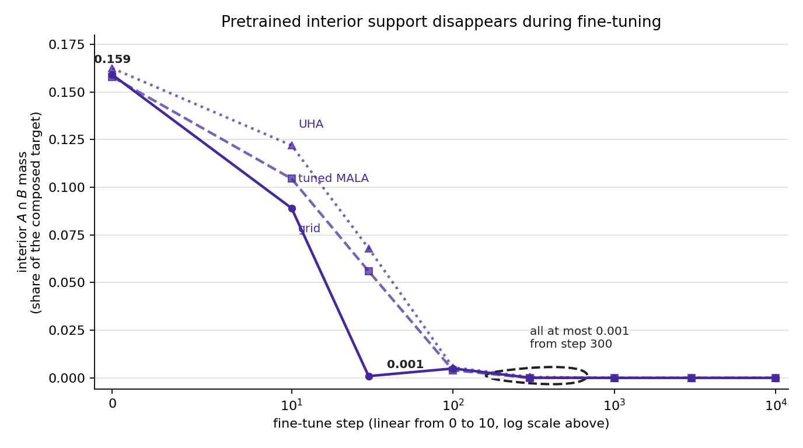
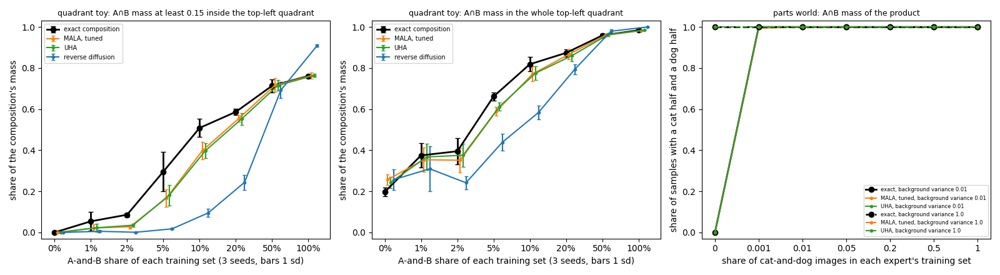

# ⭐ Layer 5: the overlap dial

⬅️ [Layer 4: the parts world](04-the-parts-world.md) · 🏠 [the guide](../PROMPTS.md) · [Reading stop: Bradley](05a-reading-stop-projective-composition.md) ➡️

**Why it is critical.** It answers the original question: how much A-and-B data a product needs, and whether pretraining supplies it. On [the axes](../PROMPTS.md#the-axes-one-new-variable-per-rung), this is rung c: how much of A-and-B each training set holds, turned as a dial, with the rule and the samplers held as on rung b.

**Depth.** Build: why the product weights shared places most, and measuring A∩B in the right region (the dial's deep square, the answer key's blobs) with the answer-key numbers. Gloss: what [fine-tuning](../../../../../../Obsidian/Artificial%20Intelligence/Large%20Language%20Models/Fine-Tuning.md#where-to-learn-this)<sub>[1](../../../../../../Obsidian/Mathematics/references/textbooks/natural-language-processing/hands-on-large-language-models.pdf#page=503 "Hands-on large language models, chapter 12, Instruction tuning with QLoRA, Works supervised fine-tuning end to end in code: TinyLlama, a base model that cann..."), [2](../../../../../../Obsidian/Mathematics/references/textbooks/ai-engineering/ai-engineering.pdf#page=173 "AI engineering, chapter 2, Supervised finetuning, Why a pre-trained model completes 'How to make pizza' instead of answering it, and the demonstration data (..."), [3](../../../../../../Obsidian/Mathematics/references/textbooks/ai-engineering/ai-engineering.pdf#page=596 "AI engineering, chapter 7, Finetuning overview, Fine-tuning as transfer learning, why it needs a few hundred examples where training from scratch needs milli..."), [▶1](https://www.youtube.com/watch?v=VlA_jt_3Qc4&t=3739s "CME295 lecture 4, 1:02:19 to 1:08:32, Starts from 'can I wash my teddy bear in the washing machine?', which a pretrained model only continues, and defines SF..."), [▶2](https://www.youtube.com/watch?v=hHC-SF3utxg&t=3857s "CS229 lecture 16, 1:04:17 to 1:08:20, Instruction tuning as supervised fine-tuning: minimise −Σₜ log p_θ(y_t ∣ x, y_<t) over instruction and response pairs, ..."), [◆](../../../../../../goal-setting/learning/ai-engineering/one-business-end-to-end/open-models/plans/03-opt-as-the-baseline.md "OPT as the baseline: a 2022 base model on structured output, and why it fails, ai-engineering/one-business-end-to-end/open-models, plan 03. Runs a base model...")</sub> does to inherited support. Own, optional: how Z moves with expert B's blob. You 2.4 to 4.8 h in all, plus 30 to 60 minutes if you take the optional Z.

**Study first.** The question itself: [When Neither Training Set Holds A And B](../../../../../../Obsidian/Artificial%20Intelligence/Generative%20Modeling/Diffusion%20Models/Composition/When%20Neither%20Training%20Set%20Holds%20A%20And%20B.md) and [What An Expert Learns From Its Training Set](../../../../../../Obsidian/Artificial%20Intelligence/Generative%20Modeling/Diffusion%20Models/Composition/What%20An%20Expert%20Learns%20From%20Its%20Training%20Set.md). Why a background matters: [Composing Models With A Background](../../../../../../Obsidian/Artificial%20Intelligence/Generative%20Modeling/Diffusion%20Models/Composition/Composing%20Models%20With%20A%20Background.md). Why samplers cannot reweight separated modes: [the MCMC correction](../../../../../../goal-setting/learning/deep-learning/diffusion-models/06-diffusion-speciation-dynamics/plans/05-composition-and-the-experiment/plans/03-mcmc-correction.md) and [a mixture needs heights](../../../../../../goal-setting/learning/deep-learning/diffusion-models/02-sampler-correctors-for-composition/plans/33-a-mixture-needs-heights.md). How sure a sampled share is: an A∩B share is k of n [samples](../../../../../../Obsidian/Mathematics/Statistics/Sampling%20From%20A%20Distribution.md#where-to-learn-this)<sub>[1](../../../../../../Obsidian/Mathematics/references/textbooks/machine-learning/pattern-recognition-and-machine-learning.pdf#page=539 "Pattern recognition and machine learning, chapter 11, Why expectations need samples, ancestral sampling of a directed graph (page 541), standard distribution..."), [2](../../../../../../Obsidian/Mathematics/references/textbooks/statistics/introduction-to-probability-for-data-science.pdf#page=245 "Introduction to probability for data science, section 4.8, Generates random numbers for any PDF by running a uniform through the inverse CDF, in Python, with..."), [3](../../../../../../Obsidian/Mathematics/references/textbooks/machine-learning/deep-learning-textbook.pdf#page=606 "Deep learning textbook, section 17.1, Why machine learning samples at all (Monte Carlo estimates of sums and integrals, and sampling as the goal of a generat..."), [▶1](https://www.youtube.com/watch?v=9ixzzPQWuAY&t=474s "ritvikmath, Inverse Transform Sampling, 7:54 to 10:04, Inverts the exponential CDF and turns a uniform draw into an exponential one. Chapter-timed, from the ..."), [▶2](https://www.youtube.com/watch?v=OXDqjdVVePY&t=232s "ritvikmath, Accept-Reject Sampling, 3:52 to 7:45, An easy proposal g scaled by M into an envelope above f, then each draw accepted with probability f/(M g). ..."), [◆](../../../../../../goal-setting/learning/deep-learning/diffusion-models/00-from-scratch-to-sdxl/textbook/l3-stochastic-processes/13-drawing-samples-by-hand.md "Drawing samples by hand: Monte Carlo, inverse transform and accept-reject, deep-learning/diffusion-models/00-from-scratch-to-sdxl, volume L3, section 13. Thr...")</sub>, so [the exact interval for a proportion](../../../../../../goal-setting/learning/mathematics/statistics/sampling/textbook/07-the-exact-interval.md) bounds it, and [the percentile bootstrap](../../../../../../goal-setting/learning/mathematics/statistics/sampling/plans/13-the-percentile-bootstrap-derived.md) says which units to draw again when the spread comes from data seeds.

**Achieve.** `walk05.py` printing deep A∩B mass per overlap, exact and sampled · on the whiteboard: two blobs overlapping by 5%, shading where the product's mass goes · worked: `0.30` deep mass at 5% overlap · problems: the ones quiz 5.2 banks · quizzes 5.1 and 5.2 passed.

## The flow

```text
 AI, in the background                         │  You, in order
───────────────────────────────────────────────┼───────────────────────────────────────────────
 quizzes 5.1 and 5.2, prepared ──────────────▶ │  1. quiz 5.1: mass in a region, normalisers
   (paste during layer 4's build)              │       ▼
                                               │  2. /drip --math: shared places, fine-tuning
                                               │       ▼
                                               │  3. quiz 5.2: needed-now right, 80% of the rest
                                               │       ▼
                                               │  4. build: walk05.py
 rebuild/ reference, built ──────────────────▶ │  5. compare: p5. numbers equal yours
                                               │       ▼
 results-scene, beside the read ◀───────────── │  6. scene
                                               │       ▼
 xref-cadence links the layer ◀─────────────── │  7. /drip-retro, then the next layer
```

## The steps

### 0. AI, in the background: quizzes 5.1 and 5.2

Claude prepares and publishes quizzes 5.1 and 5.2 while you build layer 4. Paste the prompt when you start layer 4's build.

**Prompt:** [build layer 5's two quizzes](prompts/05-0-build-layer-5-quizzes.md)

⏱ AI ~1.5 h (estimate), beside layer 4's build

### 1. You: quiz 5.1

Quiz 5.1 checks the college maths under this layer: integrating a density over a region, the mass share of a region, and ratios of normalising constants. Its link lands here when step 0 publishes it: (URL lands here)

⏱ you 20 to 40 min · stop: the bar, every *needed now* question right and at least 80% of the rest; below that, read the items your misses point at and retake.

### 2. You: the maths drip

You derive why the product weights the places both experts share most, so that 5% overlap puts 0.30 of its mass deep in A∩B, and what fine-tuning does to support inherited from pretraining. Your quiz 5.1 misses become the first rungs.

<a href="../figures/walk05-step7-finetune-decay.png"></a>

Pretrained support is gone within 30 to 100 fine-tune steps: the grid reads 0.001 at step 30, and the two samplers trail it down by step 100. This is the second of the two reasons the drip asks you to give.

**Prompt:** [the maths drip](prompts/05-2-the-maths-drip.md)

⏱ you 35 to 65 min · AI ~10 min · stop: you give both reasons in the Outcome below without notes

**Outcome:** you can say why 5% overlap puts `0.30` of the product's mass deep in A∩B, more than 5%, and why pretraining support is gone within 30 to 100 fine-tune steps.

### 3. You: quiz 5.2

Quiz 5.2 checks the layer itself, with banked problems: why 5% overlap puts 0.30 of the product's mass deep in A∩B, the three answer-key numbers, what fine-tuning does to inherited support, and how Z moves with expert B's blob. Its link lands here when step 0 publishes it: (URL lands here)

⏱ you 30 to 60 min, the banked problems included · stop: the bar, then the build. Below the bar, the misses become the first rungs of a second `/drip --math`, and you retake before building.

### 4. You: the build: walk05.py

You type the overlap dial into `walk05.py`, following [the step file](../05-the-overlap-dial.md) one step per message, steps 0 to 8, then rebuild the three answer-key numbers below inside the same walk. Each toy keeps its own A∩B region: the dial's deep square, and the answer key's blobs.

<a href="../../../../toy/rebuild/out/phase5/overlap-dial-curves.png"></a>

The left panel is the dial: exact deep mass 0.30 at 5%, with tuned MALA and UHA lagging near 0.17 and reverse diffusion near 0.02. The middle panel is why the whole quadrant is only a spill check: it reads 0.20 at 0%, all of it the sliver round the corner.

**Prompt:** [the build](prompts/05-4-the-build.md)

⏱ you 1 to 2 h (9 steps, plus the three answer-key numbers below) · AI ~25 min · stop: the prompt's bar and the three answer-key numbers

**Answer key for the four quadrants** (`artifacts/ideas/when-poe-reaches-a-and-b/runs/answer-key-quadrants/`). Rebuild these three numbers inside the same walk:

- construction (1) with "contains" labels keeps `0.989` in A∩B down to overlap r = 0.001;
- separately fine-tuned experts whose leftover sits only on the two quadrants next to their own put `0.5` in A∩B, fixed by that construction's symmetry;
- experts over separate parts reach `0.9999` with no A∩B data.

Layer 12's dial claim rests on these.

**Keep the two toys apart.** In the overlap dial, A is the left half and B the top half, so A∩B is the top-left region. In this answer key, A is the right half ($x_1>0$) and B the top half, so A∩B is the top-right blob.

**Why the three numbers differ.** Each one comes from a different construction, so they are not three scores of one thing.

With "contains" labels, dividing by the background leaves the A∩B blob at its original [standard deviation](../../../../../../Obsidian/Mathematics/Statistics/Variance.md#where-to-learn-this)<sub>[1](../../../../../../Obsidian/Mathematics/references/textbooks/statistics/introduction-to-probability-for-data-science.pdf#page=150 "Introduction to probability for data science, section 3.4.4, Defines variance as E[(X − µ)²] and the standard deviation as its root (Definition 3.7), proves ..."), [2](../../../../../../Obsidian/Mathematics/references/textbooks/machine-learning/mathematics-for-machine-learning.pdf#page=196 "Mathematics for machine learning, section 6.4.1, Variance as the covariance of a variable with itself (Definition 6.7), then the empirical mean and variance ..."), [3](../../../../../../Obsidian/Mathematics/references/textbooks/machine-learning/deep-learning-textbook.pdf#page=76 "Deep learning textbook, section 3.8, A short definition of variance and standard deviation beside expectation and covariance."), [▶1](https://www.youtube.com/watch?v=4-FysvtxQEU&t=1551s "Professor Leonard, Statistics 3.3, A standard deviation calculated by hand, 25:51 to 36:43, Works a standard deviation on a small data set by hand. Chapter-t..."), [▶2](https://www.youtube.com/watch?v=SzZ6GpcfoQY&t=236s "StatQuest, Calculating the Mean, Variance and Standard Deviation, Calculating population variance, 3:56 to 5:54, The population variance as the average squar..."), [◆](../../../../../../goal-setting/learning/deep-learning/transformers/textbook/06-show-that-variances-of-independent-terms-add.md "Show that variances of independent terms add, deep-learning/transformers, chapter 06. Predicts the spread of a dot product of random vectors by adding the va...")</sub> σ. For a two-dimensional isotropic [Gaussian](../../../../../../Obsidian/Mathematics/Statistics/Distributions/Multivariate%20Normal%20Distribution/Multivariate%20Normal%20Distribution.md#where-to-learn-this)<sub>[1](../../../../../../Obsidian/Mathematics/references/textbooks/statistics/introduction-to-probability-for-data-science.pdf#page=227 "Introduction to probability for data science, section 4.6, The one-dimensional Gaussian random variable: its density with plots of μ and σ moving and widenin..."), [2](../../../../../../Obsidian/Mathematics/references/textbooks/statistics/introduction-to-probability-for-data-science.pdf#page=306 "Introduction to probability for data science, section 5.6, The d-dimensional Gaussian density with Σ⁻¹, its mean vector and covariance, and the diagonal cova..."), [3](../../../../../../Obsidian/Mathematics/references/textbooks/machine-learning/mathematics-for-machine-learning.pdf#page=203 "Mathematics for machine learning, section 6.5, The univariate and multivariate densities (equations 6.62 and 6.63, page 204) drawn with 100 samples, then mar..."), [▶1](https://www.youtube.com/watch?v=rzFX5NWojp0&t=0s "StatQuest, The Normal Distribution, Clearly Explained, 0:00 to 3:27, The bell-shaped curve and what its mean and standard deviation set, in the video's openi..."), [▶2](https://www.youtube.com/watch?v=oI3hZJqXJuc&t=135s "StatQuest, The Main Ideas behind Probability Distributions, 2:15 to 5:14, A curve as a distribution, where probability is the area under it over an interval ..."), [◆](../../../../../../goal-setting/learning/deep-learning/diffusion-models/01-poe-derivation-foundations/textbook/02-densities-and-the-gaussian.md "Chapter 2: Read a density as area and draw a Gaussian from its covariance, deep-learning/diffusion-models/01-poe-derivation-foundations, chapter 02. The Gaus...")</sub> the mass inside radius $3\sigma$ is

$$
\begin{aligned}
P(R\leq3\sigma)
&=1-\exp\left(-\frac{(3\sigma)^2}{2\sigma^2}\right) \\
&=1-e^{-9/2} \\
&\approx0.9889.
\end{aligned}
$$

The rule used is the radial CDF of a two-dimensional isotropic Gaussian (`p5.mass_within_3sd_2d`). The grid gives `0.9886` at r = 0.001.

With leftover next door, expert A keeps $1-2\varepsilon$ on bottom-right and ε on top-right and on bottom-left, and expert B keeps $1-2\varepsilon$ on top-left and ε on the same two. The point reflection $(x_1,x_2)\mapsto(-x_1,-x_2)$ turns A into B and B into A, so it leaves the product unchanged while swapping its top-right and bottom-left modes. With the blobs far apart those two modes carry almost all the weight, so

$$
\begin{aligned}
w_{\mathrm{TR}} &= w_{\mathrm{BL}}, \\
\frac{w_{\mathrm{TR}}}{w_{\mathrm{TR}}+w_{\mathrm{BL}}} &= \frac12.
\end{aligned}
$$

The grid gives `0.4999` at ε = 0.1. The `0.5` belongs to this symmetric construction; it is not a ceiling for every pair of separately fine-tuned experts. Put each expert's leftover on the top-right alone, A keeping $1-\varepsilon$ on bottom-right and B $1-\varepsilon$ on top-left, and the same grid gives the top-right `0.9997` at ε = 0.1 (`p5.leftover_top_right_only_eps0.1_share`).

With separate parts, the plain product multiplies the desired Gaussian along each axis by an equal Gaussian from the other expert's background. Squaring a Gaussian halves its variance, so the local variance becomes $\sigma^2/2$ and the same radius holds

$$
\begin{aligned}
P(R\leq3\sigma)
&=1-\exp\left(-\frac{(3\sigma)^2}{2(\sigma^2/2)}\right) \\
&=1-e^{-9} \\
&\approx0.9999.
\end{aligned}
$$

The closed form is `p5.mass_within_3sd_2d_half_variance`, and the grid gives `0.99985`.

### 5. You: compare your numbers with the reference

**Compare.** `python -m rebuild.walk_numbers` prints the `p5.` keys, and `rebuild/out/phase5/` holds the curves; your `walk05.py` prints the same numbers.

```bash
cd /home-mscluster/mmolefe/Playground/PhD/poe_repair_min-dog-and-rain/toy
/home-mscluster/mmolefe/miniforge3/envs/co3/bin/python -m rebuild.walk_numbers | grep 'p5\.'
/home-mscluster/mmolefe/miniforge3/envs/co3/bin/python -m rebuild.phase5_tables
cd ~/Playground/PhD/simple-distributions-walk
export PYTHONPATH=/home-mscluster/mmolefe/Playground/PhD/poe_repair_min-dog-and-rain/toy
/home-mscluster/mmolefe/miniforge3/envs/co3/bin/python walk05.py
```

⏱ you ~10 min · stop: these 8 of the 24 `p5.` lines read `corner_profile_peak_at_0: 0.25`, `corner_profile_half_mass_within: 0.0302`, `overlap_points_of_800_at_1pct: 8`, `overlap_points_of_800_at_5pct: 40`, `ghost_mismatch_nats: 400.0`, `overlap_weight_cost_nats: -13.81`, `matching_pair_advantage_nats: 386.2` and `interior_area_share_margin0.15: 0.7225`. `walk05.py` prints the 0.25 directly and a count near 40; the other six are the hand derivations of steps 2, 3 and 6, checked against your whiteboard. The first table of `phase5_tables` holds the bar's 3-seed numbers, `0.30 ± 0.10` exact and `0.17 ± 0.04` tuned MALA at 5%; your one-seed exact curve should equal the step file's printed run, and your sampler lines should sit below your exact line at 5%. An exact number that differs is either a lesson or a bug in one of the files; find which before the reading stop.

### 5b. You, optional: how Z moves with expert B's blob

**One more number to rebuild, optional.** Moving expert B's blob while A stays in the bottom-right corner changes Z, the product's total mass: `7.9 × 10⁻¹⁰` with B in the opposite corner, `5.3 × 10⁻⁵` next door, and `3.54` on top of A (`artifacts/scenes/three-ways-a-product-reaches-a-and-b/scene_key.json`, under `support.TL.Z`, `support.TR.Z` and `support.BR.Z`, each key named for where B's blob sits). Predict it before you compute it. "Nowhere: the product is zero" is a tempting wrong answer, because the raw product is almost zero everywhere, yet a sampler still returns samples at the origin.

**By hand first.** Two normalised two-dimensional Gaussians with common [covariance](../../../../../../Obsidian/Mathematics/Statistics/Covariance.md#where-to-learn-this)<sub>[1](../../../../../../Obsidian/Mathematics/references/textbooks/statistics/introduction-to-probability-for-data-science.pdf#page=277 "Introduction to probability for data science, section 5.2.2, Defines Cov(X, Y) = E[(X − µ_X)(Y − µ_Y)] (Definition 5.12), proves Cov(X, Y) = E[XY] − E[X]E[Y]..."), [2](../../../../../../Obsidian/Mathematics/references/textbooks/statistics/introduction-to-probability-for-data-science.pdf#page=305 "Introduction to probability for data science, section 5.6.3, The covariance matrix of a random vector (Definition 5.20) and its properties (Theorem 5.13), le..."), [3](../../../../../../Obsidian/Mathematics/references/textbooks/machine-learning/mathematics-for-machine-learning.pdf#page=196 "Mathematics for machine learning, sections 6.4.1 to 6.4.2, Univariate and multivariate covariance (Definitions 6.5 and 6.6), the covariance matrix with the v..."), [▶1](https://www.youtube.com/watch?v=qtaqvPAeEJY&t=452s "StatQuest, Covariance, Clearly Explained, How to calculate covariance, 7:32 to 17:00, Works the covariance of two measured variables step by step. Chapter-ti..."), [▶2](https://www.youtube.com/watch?v=qtaqvPAeEJY&t=1020s "StatQuest, Covariance, Clearly Explained, Why covariance is hard to interpret, 17:00 to 20:31, Why the size of a covariance depends on the units, which motiv..."), [◆](../../../../../../goal-setting/learning/deep-learning/generative-models/03-sampling-from-a-graph/plans/27-two-d-gaussian.md "Read a covariance as an ellipse, deep-learning/generative-models/03-sampling-from-a-graph, plan 27. Reads a covariance matrix as the ellipse of a 2D Gaussian...")</sub> $\sigma^2I$ multiply to a total mass of

$$
Z=\frac{1}{4\pi\sigma^2}\exp\left(-\frac{\lVert\mu_A-\mu_B\rVert^2}{4\sigma^2}\right).
$$

The rule used is [the integral of a product of two Gaussians](../../../../../../goal-setting/learning/mathematics/textbooks/linear-algebra/matrix-cookbook.pdf#page=42). With σ = 0.15 the prefactor is

$$
\frac{1}{4\pi(0.15)^2}=3.5368.
$$

That is `p5.Z_prefactor_sd0.15`, which `walk_numbers` prints to five decimals as `3.53678`.

B on top of A puts the centres at squared distance 0, next door at 1 and opposite at 2, so

$$
\begin{aligned}
Z_{\text{on top}} &= 3.5368, \\
Z_{\text{next door}} &= 3.5368\,e^{-1/0.09}\approx5.29\times10^{-5}, \\
Z_{\text{opposite}} &= 3.5368\,e^{-2/0.09}\approx7.90\times10^{-10}.
\end{aligned}
$$

The two smaller values are `p5.Z_next_door_by_hand` and `p5.Z_opposite_by_hand`. Then compute it with the answer key's grid (one blob of std 0.15 for each expert, a 441 × 441 grid over [−1.1, 1.1]², Z the sum of the product times the cell area), then compare:

```bash
cd /home-mscluster/mmolefe/Playground/PhD/poe_repair_min-dog-and-rain/toy
/home-mscluster/mmolefe/miniforge3/envs/co3/bin/python -c "import json; s = json.load(open('../artifacts/scenes/three-ways-a-product-reaches-a-and-b/scene_key.json'))['support']; [print('B at', k, 'Z', f\"{s[k]['Z']:.3g}\", 'origin share', round(s[k]['at_origin'], 3)) for k in ('TL', 'TR', 'BR')]"
```

⏱ you 30 to 60 min · stop: it prints `B at TL Z 7.9e-10 origin share 0.989`, `B at TR Z 5.29e-05 origin share 0.032` and `B at BR Z 3.54 origin share 0.0`, and your three Z values match to the digits shown. The 0.989 at the origin with B opposite is where the normalised product's mass sits, so a sampler that reaches the product returns samples there.

### 5c. AI, then you: this layer's samplers on layer 4b's pictures

**Why this step exists.** Layer 4b and this layer disagree on whether reverse diffusion finds the pair once the pair is in training: 4b's guided-sum [DDIM](../../../../../../Obsidian/Artificial%20Intelligence/Generative%20Modeling/Diffusion%20Models/DDIM.md#where-to-learn-this)<sub>[1](../../../../../../Obsidian/Mathematics/references/textbooks/machine-learning/understanding-deep-learning.pdf#page=378 "Understanding deep learning, section 18.6, Shows on one-dimensional data that the same trained model serves a family of processes: five DDPM trajectories, fi..."), [2](../../../../../../Obsidian/Mathematics/references/textbooks/machine-learning/probabilistic-machine-learning-advanced-topics.pdf#page=905 "Probabilistic machine learning: advanced topics, section 25.5.1, The non-Markovian forward step q(x_{t−1} ∣ x_t, x_0) and its reverse with the predicted x̂_0..."), [3](../../../../../../goal-setting/learning/papers/deep-learning/diffusion-models/tutorial-on-diffusion-models-for-imaging-and-vision.pdf#page=39 "Chan 2024, Tutorial on diffusion models for imaging and vision, section 2.6, Why DDPM is slow, the noise in the x_{t−1} marginal replaced by an estimate, the..."), [▶1](https://www.youtube.com/watch?v=tr-CUpw--ck&t=5683s "CME296 lecture 1, 1:34:43 to 1:41:26, Builds DDIM as a family q_σ with the same marginals q(x_t ∣ x_0) as DDPM, where σ = 0 gives a deterministic sampler tha..."), [▶2](https://www.youtube.com/watch?v=tr-CUpw--ck&t=6086s "CME296 lecture 1, 1:41:26 to 1:46:02, Skips steps along a subsequence τ for a speed-up T/S of about 10 to 50 times, with FID plotted against the number of st..."), [◆](../../../../../../goal-setting/learning/deep-learning/diffusion-models/00-from-scratch-to-sdxl/textbook/l4-continuous-time/07-ddim-as-a-discretised-ode.md "DDIM as a discretised probability flow ODE, deep-learning/diffusion-models/00-from-scratch-to-sdxl, volume L4, section 7. Derives the DDIM update as one Eule..."), [◈](https://claude.ai/artifact/1GayZthQkRL4FmukdCV9WW#nb-infer "The SDXL notebook in ten parts, Inference: residual injection, DDIM, Sampling with the adapters' residual injected, one DDIM update at a time.")</sub> draws the two shapes apart 17 of 200 times at a caption share of 1 in 20, while the parts world's reverse diffusion reaches 0.969 of the exact mass at 5% ([the two walks reconciled](../../../notes/what-poe-loses-when-it-composes/two-walks-reconciled.md), disagreement 2). The two toys also tune MALA to different acceptances (about one half against 0.6, disagreement 6), and 4b reports counts where this layer reports total variation (disagreement 11). Running this layer's samplers on 4b's pictures leaves one difference standing, the size of the picture (1,536 numbers against 2), so the answer says whether the size is what drives the gap.

**Prompt:** [run this layer's samplers on layer 4b's pictures](prompts/05-5c-samplers-on-the-pictures.md)

**Result:** (lands here)

⏱ you ~20 min to read the rows · AI ~40 min, beside step 5b · stop: the six rows are filled in and one of the three outcomes is named

### 6. AI, in the background: the scene

✅ **Scene, already built:** [Three ways a product reaches A-and-B](https://claude.ai/artifact/9eFnG2rWEciPsceMwdem4u). It has 48 presses, one concept per press, and nothing appears before it is taught. Its numbers are checked against `scene_key.py` in the same folder (123 of 123 pass). For your own curves, Claude builds a second scene from `rebuild/out/phase5/` that you can scrub along the overlap share.

**Prompt:** [the curves scene](prompts/05-6-the-curves-scene.md)

Scene: (URL lands here)

⏱ you ~15 min · AI ~30 min, beside the reading stop · stop: the scene is published and its curves match `rebuild/out/phase5/`

**Outcome:** the overlap-dial curves as a scene you can scrub.

**Quiz, already built, for extra practice:** [the diffusion models quiz](https://claude.ai/artifact/MyTdAaVfZW3wiqhbLKg4wu), sections "When neither training set holds A and B" and "The four-quadrant answer key".

### 7. You: close the layer

Run the `/drip-retro` command the build printed at its close (about 25 minutes). Then paste [the linking prompt](prompts/05-7-link-the-layer.md), which links what this layer wrote to the vault notes, journey plans and idea maps that teach it.

⏱ you 2 min to paste · AI ~10 min (estimate)

**Skip:** the fine-tune variant's code (keep its result).

---

⬅️ [Layer 4: the parts world](04-the-parts-world.md) · 🏠 [the guide](../PROMPTS.md) · [Reading stop: Bradley](05a-reading-stop-projective-composition.md) ➡️
