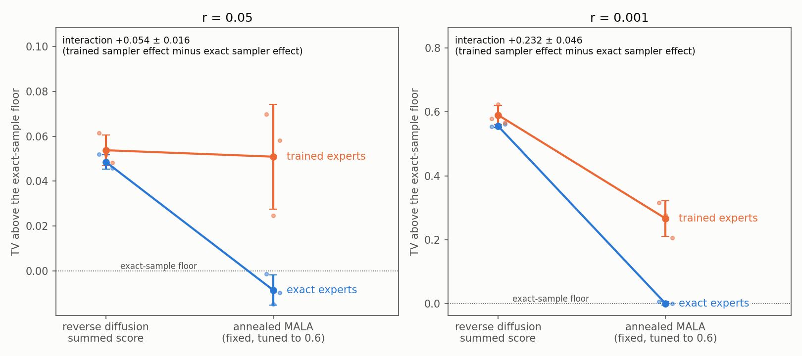
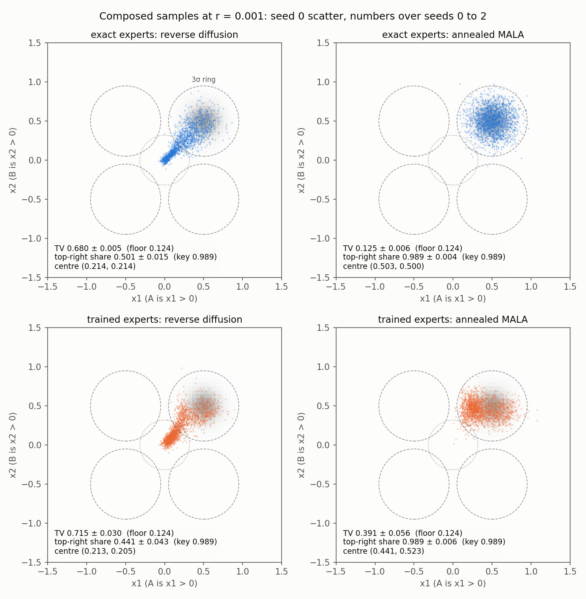

# Sampler by expert: do the two errors add up?

**What was asked**

> Do sampler error and score error add up, or does a better sampler change how much the trained experts' error hurts, on the four-quadrant toy?

**The answer**

They do not add up. Trained experts cost almost nothing under reverse diffusion and a lot under annealed MALA. Reverse diffusion's own error already covers the part of the density where the trained scores are wrong. MALA removes that sampler error, and then the trained experts' error is what remains. At r = 0.05 the trained experts add 0.005 to TV under reverse diffusion and 0.059 under MALA. At r = 0.001 they add 0.035 and 0.266. Read the other way round, MALA's gain over reverse diffusion shrinks once the experts are trained. At r = 0.05 it drops from 0.057 to 0.003, and at r = 0.001 from 0.555 to 0.324. The interaction (trained sampler effect minus exact sampler effect) is +0.054 ± 0.016 at r = 0.05 and +0.232 ± 0.046 at r = 0.001. Those are 6 and 8.6 standard errors from zero.

The trained experts' error sits at low noise. Measured at noised exact composed samples, the relative RMS error of the trained composed score is 0.34 at level 0 for r = 0.05 and 1.30 at r = 0.001. From level 30 upward it is below 0.04 at both r. MALA spends its last levels and its clean step exactly where that error is largest.

Reverse diffusion with exact experts also breaks badly at r = 0.001. Half its samples (0.544) end in the origin disc, the top-right share is 0.501 and TV is 0.680. At r = 0.05 the same sampler missed by only 0.049 above the floor. MALA with exact experts reaches the floor at both r.

## Per cell

TV is total variation to the exact clean grid density (60 × 60 cells over [−1.5, 1.5]², 0 is identical, 1 is disjoint). The floor is the TV of 2,000 exact samples drawn by rejection, which is as close as 2,000 samples can get. Each cell is mean ± sd over seeds 0, 1, 2 with 2,000 samples per seed.

**r = 0.05** (answer key top-right share 0.9889, floor TV 0.133)

| experts | sampler | TV | TV above floor | top-right share | origin share | sample centre |
|---|---|---|---|---|---|---|
| exact samples | none | 0.133 ± 0.006 | 0.000 | 0.987 ± 0.003 | 0.003 ± 0.001 | (0.499, 0.502) |
| exact | reverse diffusion | 0.182 ± 0.003 | +0.049 ± 0.003 | 0.983 ± 0.003 | 0.021 ± 0.001 | (0.465, 0.464) |
| exact | annealed MALA | 0.124 ± 0.007 | −0.009 ± 0.007 | 0.990 ± 0.003 | 0.003 ± 0.001 | (0.503, 0.500) |
| trained | reverse diffusion | 0.187 ± 0.007 | +0.054 ± 0.007 | 0.982 ± 0.002 | 0.022 ± 0.002 | (0.463, 0.466) |
| trained | annealed MALA | 0.184 ± 0.023 | +0.051 ± 0.023 | 0.987 ± 0.003 | 0.004 ± 0.004 | (0.493, 0.533) |

**r = 0.001** (answer key top-right share 0.9886, floor TV 0.124)

| experts | sampler | TV | TV above floor | top-right share | origin share | sample centre |
|---|---|---|---|---|---|---|
| exact samples | none | 0.124 ± 0.009 | 0.000 | 0.988 ± 0.002 | 0.003 ± 0.001 | (0.502, 0.502) |
| exact | reverse diffusion | 0.680 ± 0.005 | +0.556 ± 0.005 | 0.501 ± 0.015 | 0.544 ± 0.012 | (0.214, 0.214) |
| exact | annealed MALA | 0.125 ± 0.006 | +0.001 ± 0.006 | 0.989 ± 0.004 | 0.004 ± 0.001 | (0.503, 0.500) |
| trained | reverse diffusion | 0.715 ± 0.030 | +0.590 ± 0.030 | 0.441 ± 0.043 | 0.607 ± 0.043 | (0.213, 0.205) |
| trained | annealed MALA | 0.391 ± 0.056 | +0.267 ± 0.056 | 0.989 ± 0.006 | 0.008 ± 0.008 | (0.441, 0.523) |

At r = 0.001 the top-right share hides the trained-MALA miss. The share is 0.989, the answer key's value, but TV is 0.391. The samples sit inside the top-right 3σ ring at the wrong place within it. The seed-0 scatter is spread toward x1 ≈ 0.25, and the centre over seeds is (0.441, 0.523).

MALA acceptance averaged between 0.599 and 0.601 over levels in every MALA cell, trained ones included.

## Effects on TV above the floor

Sampler effect means TV(annealed MALA) minus TV(reverse diffusion), so a negative value means MALA is closer. Interaction means the sampler effect with trained experts minus the sampler effect with exact experts. Expert effect means TV(trained) minus TV(exact) under one sampler, and the interaction also equals the MALA expert effect minus the reverse-diffusion one. The floor is a constant at each r, so subtracting it changes no effect. Values are mean ± sd over the three seed indices, with the standard error (sd / √3) in brackets.

| r | sampler effect, exact experts | sampler effect, trained experts | interaction | expert effect, reverse diffusion | expert effect, MALA |
|---|---|---|---|---|---|
| 0.05 | −0.057 ± 0.005 (0.003) | −0.003 ± 0.021 (0.012) | +0.054 ± 0.016 (0.009) | +0.005 ± 0.004 (0.002) | +0.059 ± 0.017 (0.010) |
| 0.001 | −0.555 ± 0.006 (0.004) | −0.324 ± 0.052 (0.030) | +0.232 ± 0.046 (0.027) | +0.035 ± 0.034 (0.020) | +0.266 ± 0.054 (0.031) |

Per seed index, the interaction is +0.062, +0.035 and +0.065 at r = 0.05, and +0.285, +0.210 and +0.200 at r = 0.001. All six have the same sign.

## Top-right samples in the training sets

Each expert trained on 10,000 samples. These counts are samples drawn from the top-right component, read from the generator's component labels, so they are exact. The count within 3σ of the top-right centre is in brackets.

| r | density | seed 0 | seed 1 | seed 2 |
|---|---|---|---|---|
| 0.05 | p(x) | 506 (503) | 513 (507) | 522 (520) |
| 0.05 | p(x \| A), right blobs | 1,408 (1,388) | 1,373 (1,353) | 1,403 (1,395) |
| 0.05 | p(x \| B), top blobs | 1,363 (1,347) | 1,380 (1,368) | 1,381 (1,369) |
| 0.001 | p(x) | 11 (12) | 11 (11) | 11 (11) |
| 0.001 | p(x \| A), right blobs | 34 (33) | 23 (23) | 27 (28) |
| 0.001 | p(x \| B), top blobs | 30 (30) | 24 (28) | 30 (30) |

The expected counts at r = 0.001 are 10 for p(x) and 30 for each conditional (the conditional's top-right share is r / (r + (1 − r)/3) = 0.003). The composed target lives in the blob that every training set barely covers.

## Figures

**`interaction-tv-above-floor.png`**

<a href="interaction-tv-above-floor.png"></a>

TV above the exact-sample floor (y) against the sampler (x), with one line per expert kind (exact in blue, trained in orange) and one panel per r. Each point is the mean over three seeds with an sd bar, and the small dots are the seeds. Lines that ran parallel would mean the errors add. At both r the exact line drops to the floor while the trained line drops less (r = 0.001) or not at all (r = 0.05). The interaction value is written on each panel. Numbers come from `results.json`, field `effects`.

**`samples-2x2-r0.05.png`**, **`samples-2x2-r0.001.png`**

<a href="samples-2x2-r0.001.png"></a>

One grid per r, with expert kind in rows and sampler in columns. Each panel shows the seed-0 samples (2,000 points) over the exact composed density in grey, with dashed 3σ rings around the four blob centres and the dotted origin disc. Each panel carries its TV with the floor, its top-right share with the answer key, and its centre, all over three seeds. At r = 0.001 the reverse-diffusion panels show the streak from the origin to the top-right blob in both rows. The trained-MALA panel shows mass shifted left inside the top-right ring.

## How it was made

**The toy**

Construction (1) from the previous run, reused unchanged from `../samplers-on-exact-experts/exact_toy.py`. There are four blobs at (±0.5, ±0.5) with σ = 0.15. The top-right weight is r and each other blob gets (1 − r)/3. The composed target is p(x|A)·p(x|B)/p(x), with A the right blobs and B the top blobs. At each r the 300 × 300 grid's top-right share matches the answer key to within 0.0002, and the run asserts this before anything else.

**Exact experts**

These are the noised-mixture log-densities and scores from `exact_toy.py`. The exact cells at r = 0.05 reproduce the previous run: TV 0.182 for reverse diffusion and 0.124 for MALA, against 0.182 and 0.124 there.

**Trained experts**

Three models are trained per seed and per r, one each for p(x), p(x|A) and p(x|B), in `trained_experts.py`. The network copies `ResnetDiffusionModel` from `notebooks/simple_distributions.ipynb` cell 4 in PyTorch: 4 residual blocks, hidden 128, inner width 256, a learned time embedding of size 32, and zero-initialised output layers. It is wrapped as in cell 5, so the scalar energy is E(x, t) = ‖net(x, t) − x‖² and the noise prediction is ∇ₓE. Training uses the notebook's simple loss, mean ‖∇ₓE(x_t, t) − ε‖² with t uniform on 0 to 99, under the same cosine schedule with 100 levels. The optimiser is Adam at 1e-3 with batch 1,000 drawn from the fixed 10,000-sample set, for 15,000 steps with EMA 0.999, and the EMA weights are the ones used. Final training losses were 0.26 to 0.27 for p(x) and 0.16 for the conditionals at r = 0.05, and 0.25 and 0.12 at r = 0.001. The composed sampler reads log q_t = −E / √(1 − ā_t), so the score is −∇ₓE / √(1 − ā_t), the notebook's `p_energy` / `p_gradient` scaling. Seed k sets both the training data (generator seed 100k + density index) and the initialisation. Each model trained in its own process, nine per GPU on two RTX A6000s, in about 540 s.

**The samplers**

Both samplers run through `run_chain` from `../samplers-on-exact-experts/run_samplers.py`, unchanged, with only the target swapped. Reverse diffusion takes DDPM ancestral steps with the summed composed score from level 99 to clean. Annealed MALA is the fixed copy in `../samplers-on-exact-experts/mala_fixed.py`, with 20 steps at each of the 100 levels and the clean step. Its step is tuned per level by a pilot run (seed + 1000) toward 0.6 acceptance and capped at 2v, all as in the previous run. Sampling seed k is used for every cell at seed index k.

**The clean step for trained experts**

A trained model has no clean level, so its clean step uses the level-0 networks (ā₀ = 0.99937). A check row runs exact-expert MALA with the same substitution. Its TV is 0.126 ± 0.002 against 0.124 at r = 0.05, and 0.127 ± 0.002 against 0.125 at r = 0.001. The substitution moves TV by at most 0.002, so it does not explain trained MALA's excess.

**Score error**

`score_error` in `run_interaction.py` takes 2,000 exact composed samples, noises them to levels 0, 10, 30, 60 and 90, and compares the trained composed score with the exact one there. The figure reported is √mean‖s_trained − s_exact‖² / √mean‖s_exact‖².

**Checks**

`test_interaction.py` holds 10 checks, each with a case that makes it fail. They cover the training sets' top-right share, the trained-target wrapper reproducing the exact composition when given exact energies (and breaking when the energy scale is dropped), the clean-step substitution, the score-error measure, the effect arithmetic, non-finite samples counted as error, and short training learning the score where a fresh network does not. All pass (`test.log`).

**Run**

The run used `/home-mscluster/mmolefe/miniforge3/envs/co3/bin/python` on 2026-10-17. Training took about 9 minutes in parallel, and sampling took 168 s at r = 0.05 and 182 s at r = 0.001.

```
for r in 0.05 0.001; do for s in 0 1 2; do for d in all A B; do
  python run_interaction.py train --r $r --seed $s --density $d --device cuda:0 &
done; done; done; wait                                   # 18 experts into models/
python run_interaction.py sample --r 0.05  --device cuda:0
python run_interaction.py sample --r 0.001 --device cuda:1
python run_interaction.py combine                         # results.json, effects, figures
python -m pytest -q test_interaction.py                   # the checks can fail
```

## Files

| File | What it is |
|---|---|
| `run_interaction.py` | train, sample and combine steps; the effects and the score-error measure |
| `trained_experts.py` | the energy MLP, the training sets, training, the trained composed target, the level-0 check target |
| `interaction_figures.py` | the three figures |
| `test_interaction.py` | 10 checks, each shown able to fail |
| `results.json` | every row, with expert kind, sampler, r, seed and all settings (training settings, model files, MALA acceptance per level and tuned steps, training-set counts, score error), plus the floors, answer-key rows and per-seed effects |
| `results_r0.05.json`, `results_r0.001.json` | the per-r outputs `combine` reads |
| `run.log`, `test.log` | the printouts (`run.log` is the two sample logs followed by the combine log) |
| `logs/` | one training log per expert and the separate sample and combine logs |
| `models/` | the 18 trained experts (EMA weights, training-set counts, loss trace), 40 MB |
| `samples_r*_*_seed*.npy` | the 2,000 × 2 samples behind every row |

## What this does not cover

**Additivity was measured in TV**

TV is bounded by 1, and two errors that move mass in different directions do not add in TV even when each is real. A zero interaction in TV was never guaranteed, so the strong statement here is that the trained experts' cost depends on the sampler, from about nothing to large. That says nothing about what the errors would do on another scale.

**Seed pairing is by index only**

Trained seed k and exact sampling seed k share no randomness. The spread of the interaction across seeds mixes training variation with sampling variation, and three seeds give a rough standard error.

**One training recipe**

There was one network size, 15,000 steps, and one fixed set of 10,000 samples per expert. Longer training or more data in the top-right blob would shrink the level-0 score error, and this run does not say how fast the interaction would shrink with it. At r = 0.05, trained MALA varies a lot by seed (TV 0.203, 0.158 and 0.191), so one recipe's three models are a thin sample of what training produces.

**Score error was measured at noised exact composed samples**

It was not measured where the chains actually travel, and reverse diffusion at r = 0.001 spends much of its time near the origin.

**MALA settings came from the exact experts' rule**

The tuning rule and its cap (2v per level) are the same for trained experts and were not swept. Acceptance landed at 0.6 in every cell.
