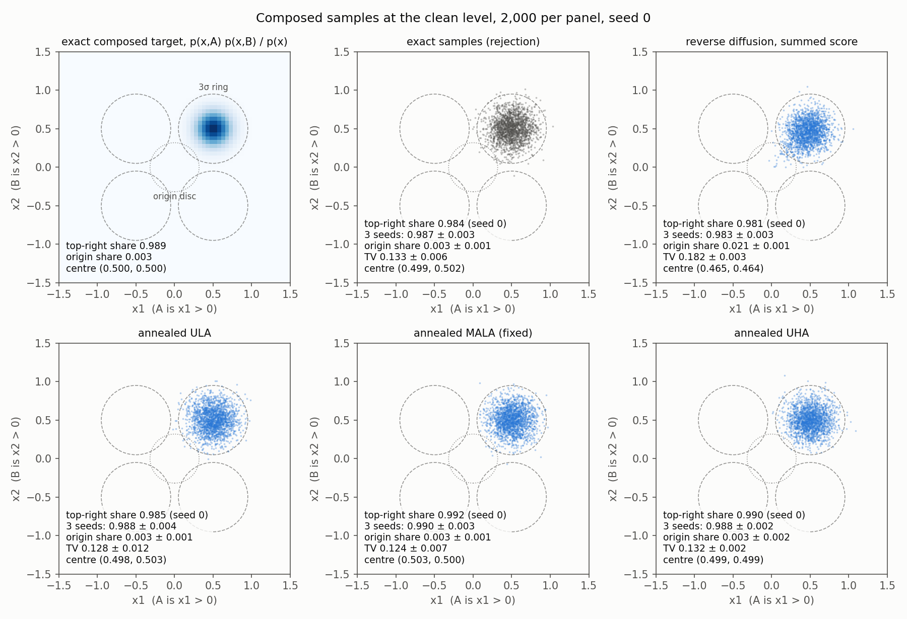
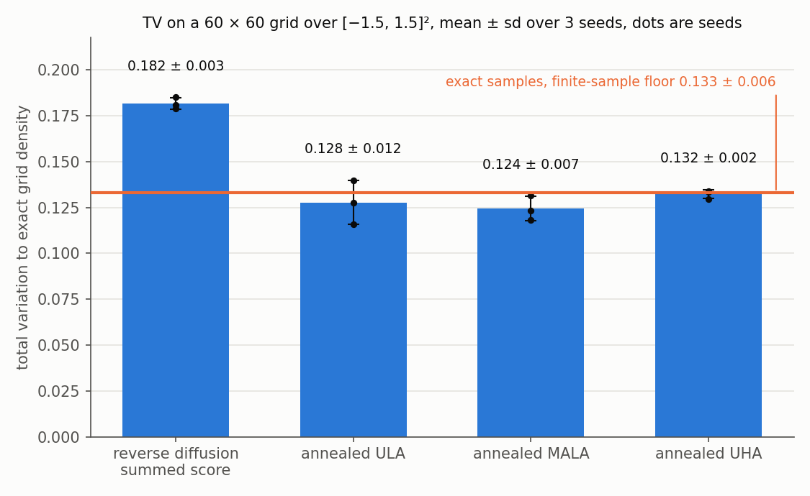
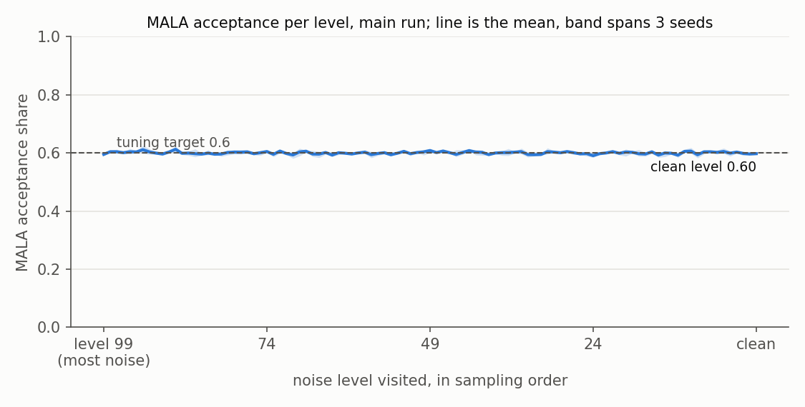

# Samplers on exact experts: which ones reach the composed density

**What was asked**

> On the four-quadrant toy with exact experts, which samplers reach the exact composed density, and how far does reverse diffusion with summed scores miss it?

**The answer**

All three annealed MCMC samplers (ULA, MALA, UHA) reach the exact composed density. Their total variation to the exact grid density is at the level that 2,000 exact samples get by chance. Reverse diffusion with the summed score misses it. The top-right share barely moves (0.983 against 0.989 exact). The blob centre shifts toward the origin, from (0.500, 0.500) to (0.465, 0.464), and about 7 times the target's share lands near the origin (0.021 against 0.003). Its TV sits 0.049 above the floor. Running 1000 levels instead of 100 leaves the shift in place, centre (0.470, 0.468). The plain-mixture control shows the reverse step itself is sound, so the miss comes from summing the scores.

| sampler | top-right share | TV to exact grid | composed-score evals per sample |
|---|---|---|---|
| exact target (grid) | 0.989 | | |
| exact samples (floor) | 0.987 ± 0.003 | 0.133 ± 0.006 | 0 |
| reverse diffusion, summed score | 0.983 ± 0.003 | 0.182 ± 0.003 | 100 |
| annealed ULA | 0.988 ± 0.004 | 0.128 ± 0.012 | 2,120 |
| annealed MALA (fixed) | 0.990 ± 0.003 | 0.124 ± 0.007 | 2,221 (+4,140 tuning) |
| annealed UHA | 0.988 ± 0.002 | 0.132 ± 0.002 | 2,120 |
| reverse diffusion, 1000 levels | 0.978 ± 0.000 | 0.167 ± 0.012 | 1,000 |

Mean ± sd over seeds 0, 1, 2. One composed-score evaluation is three expert scores (A, B, unconditional) on the whole batch. MALA acceptance averaged 0.600 in every seed and stayed between 0.591 and 0.613 at every level, 0.598 at the clean level.

## Figures

**`target-beside-samplers.png`**

<a href="target-beside-samplers.png"></a>

The exact composed density (top left, cell mass on the 60 × 60 grid) beside 2,000 seed-0 samples from exact rejection sampling, reverse diffusion and the three MCMC samplers. Dashed rings are 3σ around each blob centre, the dotted disc is the origin region (radius 3σ/√2). Each panel carries its top-right share for seed 0 and over three seeds, plus origin share, TV and sample centre. Reverse diffusion's tail toward the origin is visible at about (0.1, 0.1).

**`tv-per-sampler.png`**

<a href="tv-per-sampler.png"></a>

Total variation between each sampler's histogram and the exact grid density, mean ± sd over three seeds, with each seed as a dot. The orange line is the TV of 2,000 exact samples, the finite-sample floor. A sampler at the line is as close as 2,000 samples can get.

**`mala-acceptance-per-level.png`**

<a href="mala-acceptance-per-level.png"></a>

MALA acceptance share at each of the 101 levels in sampling order (level 99 to clean), main run, mean line with a band spanning the three seeds. The tuned step came out between 1.04 and 1.20 times the level's blob variance at every level and seed.

## How it was made

**The toy and its exact scores**

Construction (1) with r = 0.05: blobs at (±0.5, ±0.5), σ = 0.15, base weights 0.05 on top-right and 0.3167 on each other. p(x, A) keeps the two right blobs and p(x, B) the two top blobs. Under variance-preserving noising each mixture keeps its weights, with means √ᾱ·μ and variance ᾱσ² + 1 − ᾱ, so every log-density and score is exact (`exact_toy.py`). The cosine schedule is copied from `notebooks/simple_distributions.ipynb` cell 10, 100 levels, with ᾱ = 0.99937 at level 0 and 2.4e-7 at level 99. The composed log-density at a level is log q(x, A) + log q(x, B) − log q(x). The grid built here gives 0.9890 in the top-right blob against 0.9889 in the answer key, which the run asserts before anything else.

**The samplers**

Every chain starts at N(0, I) and takes the DDPM ancestral step with the composed score (posterior variance) from each level to the next, down to the clean level. Reverse diffusion does only that. The MCMC samplers also run at all 100 noised levels and once more at the clean level, where the target is exact, following the loop shape of `composable_diffusion/sampler_gd.py`. Settings, with v the level's blob variance ᾱσ² + 1 − ᾱ:

- ULA (`anneal_samplers.py`, unchanged): 20 steps per level, step 0.05·v.
- UHA (`anneal_samplers.py`, unchanged): 5 steps per level, 3 leapfrog steps, damping 0.7, mass 1, step 0.3·√v.
- MALA (`mala_fixed.py`): 20 steps per level. A pilot run on seed + 1000 tunes the step at each level, multiplying it by exp(acceptance − 0.6) after every step, capped at 2v. The main run then uses those steps fixed.

**The two MALA fixes**

`mala_fixed.py` is a copy of `AnnealedMALASampler` from `anneal_samplers.py`. Lines 34 and 35 divided the proposal's squared distance by 2·ss², and the proposal variance is 2·ss, so the copy divides by 4·ss. Line 39 accepted or rejected the whole batch with one `torch.rand(1)` against energies summed over the batch, and the copy accepts per sample. `anneal_samplers.py` is untouched. The tests show both fixes matter. Started from variance 4 on a unit Gaussian, the original class still had variance 4.02 after 200 steps, consistent with every batch proposal being rejected. The fixed copy reached 0.985. Started exactly at the target with step 1.5, restoring only the old denominator drifts the variance to 1.11 in 50 steps, while the fixed copy holds it at 1.015.

**Measures**

Shares are within 3σ of each blob centre and within 3σ/√2 of the origin, the same regions as `runs/answer-key-quadrants/answer_key.py`. The origin disc and the top-right disc overlap, so one sample can count in both. TV is half the summed absolute difference between the sample histogram and the exact cell masses on a 60 × 60 grid over [−1.5, 1.5]², with samples outside the box counted as error. The exact samples come from rejection: propose from p(x) and accept with P(A|x)·P(B|x), which is exact because the target equals p(x)·P(A|x)·P(B|x). Acceptance equals r = 0.05.

**The control**

Section 2c of `run.log` runs the same reverse step with the true noised score of the plain mixture p(x). Its TV to p(x)'s own grid is 0.237 ± 0.012, against 0.233 ± 0.004 for 2,000 exact p(x) samples. With a correct noised score the reverse step lands on its floor.

**Run**

`run_samplers.py --sweep` with `/home-mscluster/mmolefe/miniforge3/envs/co3/bin/python`, on CPU, 2026-10-17, 58 s in total. `test_samplers.py` holds 15 checks, each with a case that makes it fail. All pass (`test.log`).

```
python run_samplers.py --sweep > run.log      # all runs, results.json, figures
python -m pytest -q test_samplers.py           # the checks can fail
```

## Files

| File | What it is |
|---|---|
| `run_samplers.py` | the runner: samplers, seeds, summary, writes `results.json` and figures |
| `exact_toy.py` | exact noised mixtures, composed target, shares, TV, rejection sampler |
| `mala_fixed.py` | the MALA copy with the two fixes |
| `figures.py` | the three figures |
| `test_samplers.py` | 15 checks, each shown able to fail |
| `results.json` | one row per sampler and seed, with its settings, shares, TV, sample centre, evaluations, MALA acceptance per level and tuned steps |
| `run.log`, `test.log` | the printouts |
| `samples_*_seed*.npy` | the 2,000 × 2 samples behind every row except the control |

## What this does not cover

At r = 0.05 the composed target is one well-separated blob and the other quadrants hold under 1e-4 of it, so this run says nothing about mixing between separated modes at the clean level. The top-right share is a weak test here, since every sampler including reverse diffusion lands within 0.01 of it, and TV plus the sample centre carry the comparison. The MCMC step sizes were set once, by rule, and not swept. A smaller ULA or UHA step would cost more evaluations and could shrink their already small bias further. The MCMC samplers use about 21 times reverse diffusion's evaluations, so this compares accuracy and does not compare cost.
