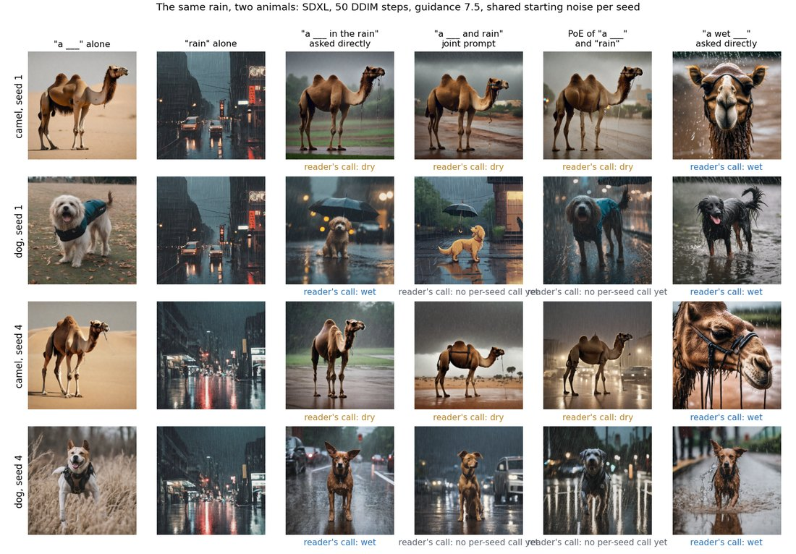

# 🎯 Today: wet camels and wet dogs in SDXL's training stand-in, seen with your own eyes
<!-- template: exempt. Reason: a one-afternoon walk built for a presentation, not a plan -->

> [!NOTE]
> **You will hold, for this afternoon's presentation:**
> - how big the caption set is and how long a search takes;
> - how many camel and dog captions mention wet, rain or water, and what they say;
> - your own count of wet, dry and missing animals in a few hundred training pictures, as a table and one figure;
> - what SDXL's [joint prompt](what-poe-loses-when-it-composes.md#21-the-objects) and [PoE](../../context/world/poe-composition.md#what-poe-composition-is) draw for a camel with rain.
>
> **Time:** ~3 h · **Stop point:** step 8's talking points written.

Walk it with:

```text
/drip-execute-plan plans/10-what-poe-loses-when-it-composes/today-camel-and-dog-in-the-training-data.md
```

## Contents

- [Why this exists](#why-this-exists)
- [Where things land](#where-things-land)
- [Steps](#steps)
- [What it cannot claim](#what-it-cannot-claim)
- [After today](#after-today)

## Why this exists

Navigation: 📋 [Contents](#contents) | [Next](#where-things-land) ➡️

**The claim under test.** PoE can only show rain wetting an animal if the animal's own training
pictures already show it wet. Dogs are photographed wet often, camels rarely. So PoE of "a dog" and
"rain" can draw a wet dog, and PoE of "a camel" and "rain" draws a dry camel. The reasoning is in
[§5.4 of the write-up](what-poe-loses-when-it-composes.md#54-why-the-dog-comes-out-wet-not-dry).

**What today adds.** The full caption search lives on the cluster, which is down. This walk downloads
4 of the 128 files from Hugging Face to the laptop, searches them, fetches the pictures behind the
hits, and has you call each one by eye. Every number says how much of the data it covers.

**What is already known, so you can say it without rerunning it.**

| Fact | Number | Source |
|---|---|---|
| captions in the stand-in (Re-LAION-2B-en research-safe) | 2,097,693,557 in 128 files, 467 GB | `caption-counts.md` |
| captions naming camel, camels or dromedary | 784,797 | full search on the cluster, 2026-10-21 |
| captions naming dog, dogs or puppy | 14,396,194 | the same search |
| one file searched for camel and dog on the cluster | 8.6 s at 4 threads | timed 2026-10-21 |
| wet-word dog and camel captions in 4 files that mention food | 1,078 of 2,574 | write-up §7.2 |

## Where things land

Navigation: ⬅️ [Previous](#why-this-exists) | 📋 [Contents](#contents) | [Next](#steps) ➡️

```
/home/molef/datasets/relaion2b-en-slice/       the 4 downloaded files (~14.5 GB), outside the repo
artifacts/results/what-the-training-captions-show/        gitignored, local only
  counts.json                                  slice counts, search time per file, full-mirror counts
  camel-captions-with-wet-words.md             every camel caption in the slice with a wet, rain or water word
  camel-any/  camel-wet-words/  dog-any/  dog-wet-words/
    images/      fetched pictures
    sheets/      sheet-NN.jpg (numbered tiles) and sheet-NN.md (tile number, caption, link)
    calls.json   your calls
  tally.md  tally.png                          the table and the figure for your slide
scripts/census/laptop_slice.py                 the five stages, committed
```

**The four buckets.**

| Bucket | What is in it | Why |
|---|---|---|
| `camel-any` | 120 random camel captions | how often a typical camel picture is wet |
| `camel-wet-words` | up to 400 camel captions that use a wet, rain or water word | the best place a wet camel could hide |
| `dog-any` | 120 random dog captions | the same base rate for dogs |
| `dog-wet-words` | 120 dog captions with a wet, rain or water word | the comparison bucket |

## Steps

Navigation: ⬅️ [Previous](#where-things-land) | 📋 [Contents](#contents) | [Next](#what-it-cannot-claim) ➡️

Every command runs from `/home/molef/PhD/poe_repair_min-dog-and-rain` with
`PY=/home/molef/miniconda3/bin/python3`.

### 0. 🖱️ Give the laptop your Hugging Face token (you)

- [x] **Make a Read token.** Browser: `huggingface.co/settings/tokens` → **+ Create new token** → the
  **Read** tab → name it `laptop-relaion` → **Create token**, and copy the `hf_...` string.
- [x] **Save it without pasting it into chat.** In your own terminal:
  ```bash
  mkdir -p ~/.cache/huggingface && read -s -p "token: " T && echo "$T" > ~/.cache/huggingface/token && chmod 600 ~/.cache/huggingface/token
  ```
- [x] **Check it opens the gated files:** ✓ confirmed by hand 2026-10-22: "200" (token file `-rw-------`, 38 bytes)
  ```bash
  curl -s -o /dev/null -w "%{http_code}\n" -H "Authorization: Bearer $(cat ~/.cache/huggingface/token)" https://huggingface.co/datasets/laion/relaion2B-en-research-safe/resolve/main/._SUCCESS.crc
  ```
  ✅ `200` means it works. `401` means the token is not saved; `403` means the account's access to the
  dataset needs accepting on its page.

### 1. 🔧 Download 4 files (AI, ~15 to 40 min depending on the connection)

- [x] **Run:** `$PY -I scripts/census/laptop_slice.py download --files 4` ✓ verified 2026-10-22: first file at 1.6 MB/s, so stopped at 2 files per the rule below (16,388,209 and 16,388,200 captions, 3.62 GB each)
  - Each file prints its size (about 3.6 GB) and the speed in MB/s.
  - If the first file runs under 5 MB/s, stop and use `--files 2`; every later number then covers 2 files.

### 2. 🔧 Search the captions and time it (AI, ~5 min)

- [x] **Run:** `$PY -I scripts/census/laptop_slice.py count` ✓ verified 2026-10-22: 2 files, 32,776,409 captions in 24 s (13.8 s and 9.8 s per file), peak memory 1.0 GB; camel 12,291, dog 225,544
  - It prints one line per file: captions searched and seconds taken (about 16.4 million captions per file).
  - Then the counts per animal: all, wet words, weather words, water words, and any of them.
  - **Read the time per file times 128:** that is how long the full search would take on this laptop.
  - **For the slide:** the slice's camel count against 784,797 in the full set, scaled by 4/128 (expect roughly 24,500).

### 3. 📖 Read the camel captions that mention wet, rain or water (you, ~15 min)

- [ ] **Open** `artifacts/results/what-the-training-captions-show/camel-captions-with-wet-words.md`.
- [ ] **Read every line** and count the ones that describe a wet camel (in rain, in water, soaked).
  Expect most to be products, the colour camel, or camels near water rather than wet.
- [ ] **Write down 3 example captions** of each kind: a wet camel if any, a camel near water but not
  said to be wet, and an unrelated product.

### 4. 🔧 Fetch the pictures and build the contact sheets (AI, ~10 min)

- [ ] **Run:** `$PY -I scripts/census/laptop_slice.py fetch` then `$PY -I scripts/census/laptop_slice.py sheets`
  - Each bucket prints how many pictures loaded. Expect about 60%; the rest are dead links.
  - Each bucket gets `sheets/sheet-NN.jpg`, 30 numbered tiles, and `sheet-NN.md` beside it with each tile's caption.

### 5. 👀 Call every picture, one sheet per message (you, ~45 min)

- [ ] **The walk shows you one sheet** and its caption table, starting with `camel-any`, then
  `camel-wet-words`, `dog-any`, `dog-wet-words`.
- [ ] **Reply with only the exceptions.** For example: `wet 4 17 · none 2 9 12 · unsure 21`.
  - **wet** means the animal itself is wet: wet fur, in rain, in water.
  - **none** means no real animal: a product, a drawing, a logo, the colour camel.
  - **unsure** means you can't tell.
  - Every other tile counts as a dry animal.
- [ ] **The walk writes your reply** into that bucket's `calls.json` as
  `{"sheet-01": {"wet": [4, 17], "none": [2, 9, 12], "unsure": [21]}}`, and reads back the running
  totals. It never proposes a call.
- [ ] **Watch for the pilot's trap.** A camel on a wet street is a dry camel. The call is about the animal.

### 6. 🔧 Turn the calls into numbers and a figure (AI, ~1 min)

- [ ] **Run:** `$PY -I scripts/census/laptop_slice.py tally`
  - It prints the table and writes `tally.md` and `tally.png`.
  - Each bucket shows pictures looked at, no animal, can't tell, dry, wet, and the wet share with its
    95% interval. With 0 wet camels in n, the bound to quote is "fewer than 3 in n" (the rule of three).

### 7. 👀 Look at what SDXL draws (you, ~20 min)

- [ ] **Open the renders**, all from the same 5 seeds:
  - [the direct prompts](../../artifacts/results/does-a-camel-in-the-rain-come-out-wet/asked-directly.png): "a wet camel", "a camel in the rain", "a wet dog", "a dog in the rain";
  - [the camel sheet](../../artifacts/results/does-a-camel-in-the-rain-come-out-wet/a-camel-and-rain.png): camel, rain, joint "a camel and rain", PoE, [SuperDiff](../../../../goal-setting/learning/deep-learning/diffusion-models/02-sampler-correctors-for-composition/plans/31-superdiff-derived-and-placed.md);
  - [the dog sheet](../../artifacts/results/does-a-dog-in-the-rain-come-out-wet/a-dog-and-rain.png): the same for the dog;
  - [the side-by-side figure](../../artifacts/notes/what-poe-loses-when-it-composes/figures/fig-causal-renders.png).

  <a href="../../artifacts/results/does-a-camel-in-the-rain-come-out-wet/asked-directly.png"></a> <a href="../../artifacts/results/does-a-camel-in-the-rain-come-out-wet/a-camel-and-rain.png"></a> <a href="../../artifacts/results/does-a-dog-in-the-rain-come-out-wet/a-dog-and-rain.png"></a> <a href="../../artifacts/notes/what-poe-loses-when-it-composes/figures/fig-causal-renders.png"></a>
- [ ] **Check your earlier calls still hold:**

  | Prompt | Camel | Dog |
  |---|---|---|
  | "a wet ___", asked directly | wet 4, half 1 | wet 5 |
  | "a ___ in the rain", asked directly | dry 4, half 1 | wet 4, half 1 |
  | joint "a ___ and rain" | dry 5 | wet 2, half 1 |
  | PoE of "a ___" and "rain" | dry 5 | wet 2 (seed 10 lost the dog) |

### 8. ✍️ Write the talking points (you with the AI, ~20 min)

- [ ] **One answer per question**, each with its number and its picture:
  1. **Does the joint prompt draw wet camels?** Only when the text ties wet to the camel: "a wet camel" on 4 of 5 seeds. "a camel and rain" and "a camel in the rain" stay dry.
  2. **Does PoE ever draw a wet camel?** Not for camel and rain: dry on 5 of 5. PoE with "wet" is not rendered yet (see [After today](#after-today)).
  3. **How big is the text, and how long does a search take?** 2.1 billion captions in 467 GB; the step 2 time per file times 128.
  4. **Are there wet camels in the captions?** The step 2 count and step 3 reading, with the 3 examples.
  5. **How many of the camel pictures you looked at were wet?** The step 6 table for `camel-any` and `camel-wet-words`, with the bound.
  6. **And the dogs?** The same for `dog-any` and `dog-wet-words`.
  7. **So what?** PoE showed rain wetting the dog and not the camel, and the dog's own training pictures hold wet dogs where the camel's hold few or none, as the support claim predicts.
- [ ] **Put `tally.png` and `fig-causal-renders.png` on the slide**, with the caveats below in the notes.

## What it cannot claim

Navigation: ⬅️ [Previous](#steps) | 📋 [Contents](#contents) | [Next](#after-today) ➡️

**It is a stand-in.** Re-LAION-2B-en is the public set OpenCLIP's text encoder was trained on. SDXL's
own training data is unpublished, so the counts describe the stand-in.

**It is a slice.** 4 of 128 files, about 3% of the captions. A zero is a bound, not "never".

**Dead links.** About 40% of pictures no longer load, and nothing says the lost ones look like the rest.

**Captions only.** A wet camel whose caption never says camel cannot be found this way.

**PoE misses could be the sampler.** On SDXL the sampler cannot be removed. The toy experiments
([write-up §8](what-poe-loses-when-it-composes.md#8-structural-experiments-on-the-toy)) are where that is settled.

## After today

Navigation: ⬅️ [Previous](#what-it-cannot-claim) | 📋 [Contents](#contents)

**The full census** of all 128 files and six subject-and-carrier pairs is the
[causal route](route-causal-does-an-effect-need-support.md), steps 2 to 5, once the cluster is back.

**PoE of "a camel" and "wet", and the third concept** (camel, rain and wet) run today on the laptop in
[the third-concept walk](today-the-third-concept.md), rendering on the GPU while this walk uses the
network. On the cluster they are steps 6 and 8 of the same route.
