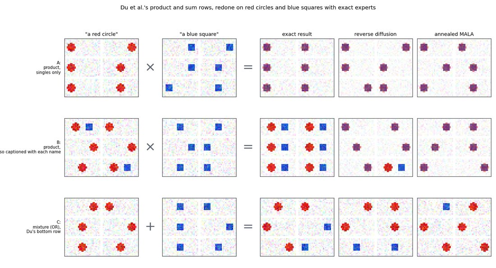
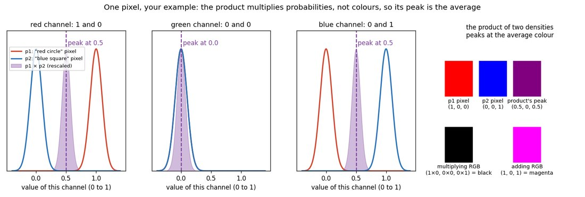
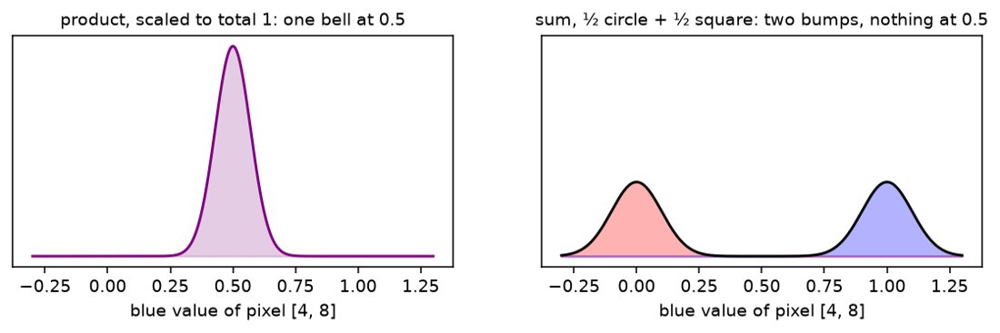
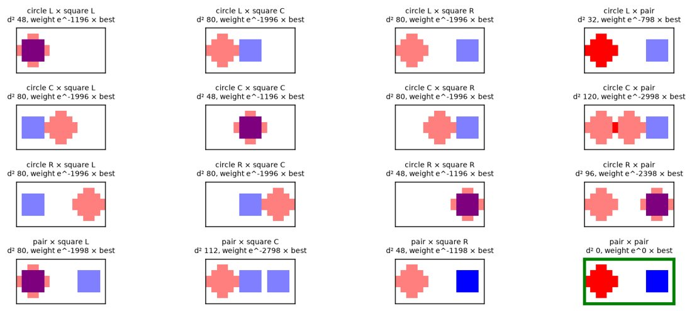
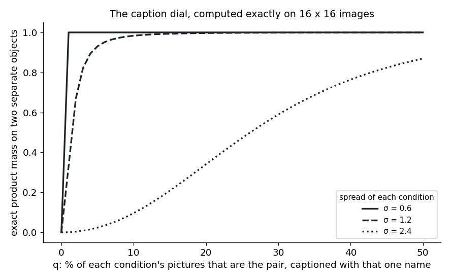
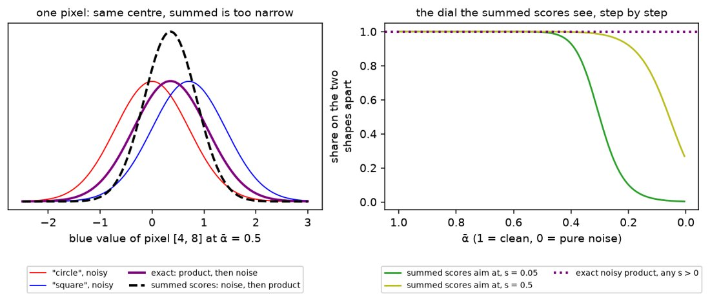
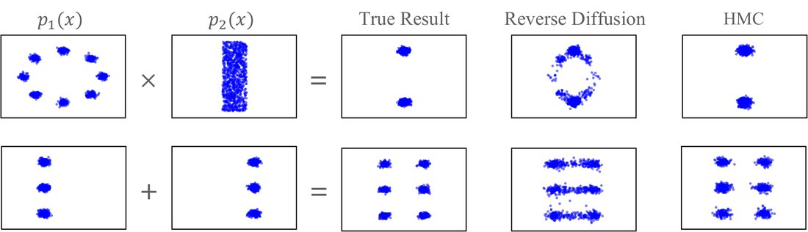
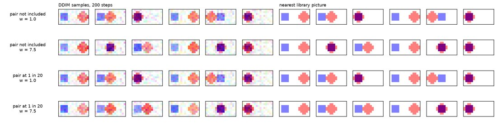

# 🎯 The toy failure in six checkpoints: a red circle, a blue square, and the overlay PoE makes of them
<!-- template: exempt. Reason: a step-by-step notebook walk, not a plan -->

> [!NOTE]
> **You will hold:** a notebook you built one cell at a time, showing the training pictures, samples
> from each word's model, the exact product (the overlay, the cat-dog hybrid in miniature), the exact sum
> (no overlay), what happens as each word's pictures start to include the pair, and what samplers draw
> against the exact answer, each as pictures and as a dot map in Du's layout. · **Time:** ~3 h ·
> **Stop point:** checkpoint 6's figure; checkpoints 7 and 8 if time allows
>
> **Pictures first, numbers second.** Every checkpoint ends on a figure. A number appears only where it
> says how many pictures look a certain way.

## Contents

- [Two ways to walk it](#two-ways-to-walk-it)
- [Why this exists](#why-this-exists)
- [The setup, fixed before any cell runs](#the-setup-fixed-before-any-cell-runs)
- [Where things land](#where-things-land)
- [Checkpoints](#checkpoints)
- [What it cannot claim](#what-it-cannot-claim)
- [After the six](#after-the-six)

## Two ways to walk it

Navigation: 📋 [Contents](#contents) | [Next](#why-this-exists) ➡️

**Guided, in the repo's notebook.** One cell per message, written with you:

```text
/drip-execute-plan plans/10-what-poe-loses-when-it-composes/today-the-toy-failure-in-six-checkpoints.md
```

**On your own, in your own notebook.** You write each cell from the checkpoint's description and the
write-up, and the drip answers questions and checks what you drew:

```text
/drip --code plans/10-what-poe-loses-when-it-composes/today-the-toy-failure-in-six-checkpoints.md
```

Your notebook lives in the playground, `/home/molef/playground/deep-learning/poe-structural-toy/`, which is
yours to break and throw away. What is worth keeping goes into the write-up or the vault, not the
playground.

**Keep two things open beside it.** [The write-up](what-poe-loses-when-it-composes.md) holds every formula this walk uses, written out
step by step, so the maths can be done on the iPad before any code. Your
[sampler-correctors journey](../../../../goal-setting/learning/deep-learning/diffusion-models/02-sampler-correctors-for-composition/plans/09-the-poe-rule-assembled.md) and the
[textbook shelf](../../../../goal-setting/learning/mathematics/textbooks/Textbooks.md) hold the background.

**Each checkpoint opens with three lines:**

- **📖 Read first:** the write-up section that explains it.
- **✏️ By hand:** what to work out on the iPad before writing the cell.
- **📚 Background:** the chapter that teaches the maths underneath.

## Why this exists

Navigation: ⬅️ [Previous](#two-ways-to-walk-it) | 📋 [Contents](#contents) | [Next](#the-setup-fixed-before-any-cell-runs) ➡️

**[PoE](../../context/world/poe-composition.md#what-poe-composition-is) of "a cat" and "a dog" on SDXL draws one fused animal.** This walk shows the same failure on
shapes, where every answer is a formula. The reasoning is in
[§8 of the write-up](what-poe-loses-when-it-composes.md#8-structural-experiments-on-the-toy). The key
idea is in [§8.2](what-poe-loses-when-it-composes.md#82-the-model-of-a-word-in-plain-terms): the model of
a word is the rule "pick one of its pictures, add a little noise".

**What the six checkpoints settle.** That the overlay comes from multiplying two such rules over the
same pixels (checkpoints 3 and 4); that it gives way when each word's pictures include the pair
(checkpoint 5); and how much a sampler adds on top (checkpoint 6). Phase 2, trying remedies, starts only
after these pass.

**A first rough run already exists** and shows what to expect:

<a href="../../artifacts/notes/what-poe-loses-when-it-composes/figures/fig-toy-du-layout.png"></a>

## The setup, fixed before any cell runs

Navigation: ⬅️ [Previous](#why-this-exists) | 📋 [Contents](#contents) | [Next](#where-things-land) ➡️

| | Fixed throughout | Varied, one at a time |
|---|---|---|
| **pictures** | 8 × 16 pixels, white; a red circle at left, centre or right; a blue square at left, centre or right; one pair: circle left, square right | — |
| **geometry** | a pixel `[row, col]` is measured at its centre, (row + 0.5, col + 0.5); every shape centred on row 4, at column 3 (left), 8 (centre) or 13 (right); circle: radius 2.6, 24 pixels; square: half-width 2, 16 pixels, lying wholly inside the same-place circle; pure red (1, 0, 0), pure blue (0, 0, 1) | — |
| **words** | "circle", "square", "circle and square" | which pictures each word covers (checkpoint 5) |
| **model of a word** | pick one of its pictures at random, add noise of size σ to every pixel | σ = 0.1, and 0.3 in checkpoint 6 |
| **combining** | product over pixels (PoE), or sum (OR) | which one (checkpoints 3 and 4) |
| **sampling** | exact draws from the formula | reverse diffusion and MCMC (checkpoint 6) |
| **seed** | one fixed seed for every random draw | — |
| **readout** | each output picture matched to its nearest picture among: each single shape, the pair, and every circle-square average; 16 in all, called "circle only", "square only", "apart" (the pair), "overlay" (a same-place average) and "pale, apart" (a different-place average, half-strength shapes in no training set) | — |

**Three views of every result.**

- **Noise-free beside noisy:** each sample is a training picture, or an average of two, plus a little noise on every pixel. The speckled background is that noise, not part of the picture. So every sample grid has a second row beside it showing the same samples with the noise taken off: the clean picture the sample came from. The speckle stays in the honest row; the clean row is for reading the shapes.
- **Pictures in Du's layout:** a row is circle samples, the operator (× or +), square samples, "=", then the result, with six pictures per box.
- **Dots in Du's layout:** each output picture becomes one dot, placed by where its red sits (left to right) and where its blue sits (bottom to top), and coloured by what it is: red for a circle only, blue for a square only, **purple for an overlay**, half red and half blue for the two shapes apart, grey for nothing.

## Where things land

Navigation: ⬅️ [Previous](#the-setup-fixed-before-any-cell-runs) | 📋 [Contents](#contents) | [Next](#checkpoints) ➡️

```
artifacts/notes/what-poe-loses-when-it-composes/
  the-toy-failure.ipynb            the notebook you build, one cell per step below
  figures/checkpoints/             cp1-training-pictures.png ... cp6-samplers.png, saved by the cells
```

**Kernel:** `/home/molef/miniconda3/bin/python3` (numpy and matplotlib) is enough for all six. The
GPU kernel, `sdxl-local`, is for phase 2.

## Checkpoints

Navigation: ⬅️ [Previous](#where-things-land) | 📋 [Contents](#contents) | [Next](#what-it-cannot-claim) ➡️

Each checkpoint is one or two notebook cells. The walk gives one cell per message. You type it and run
it, then say what you see before moving on.

### 0. 🖱️ Open the notebook (you, ~5 min)

- [ ] **Create** `artifacts/notes/what-poe-loses-when-it-composes/the-toy-failure.ipynb` in VS Code:
  **File → New File → Jupyter Notebook**, then save under that path.
- [ ] **Pick the kernel:** top right of the notebook → **Select Kernel → Python Environments →**
  `/home/molef/miniconda3/bin/python3`.
- [ ] **First cell:** import numpy and matplotlib, fix the seed, and set the picture size (8 × 16) and
  σ = 0.1. ✅ It runs with no output.

### 1. 🔧 Draw the training pictures

- **📖 Read first:** [§8.1, why a toy](what-poe-loses-when-it-composes.md#81-why-a-toy), and the first two paragraphs of [§8.2](what-poe-loses-when-it-composes.md#82-the-model-of-a-word-in-plain-terms).
- **✏️ By hand:** sketch the 7 pictures on an 8 × 16 grid, and colour the pixels each shape covers. Mark which pixels the centre circle and the centre square share.
- **📚 Background:** none needed; this is the data.

- [ ] **Build:** a function that draws a red circle or a blue square at a given column on a white
  8 × 16 picture; then the three circles, the three squares, and the pair.
- [ ] **📸 You should see** one row of 7 pictures: circle left, centre, right; square left, centre,
  right; the pair. Saved as `cp1-training-pictures.png`.
- [ ] **✅ Check:** each circle is red and round enough to tell from the square; the pair shows both
  apart. Coloured pixels per picture: 24, 24, 24 for the circles, 16, 16, 16 for the squares, 40 for
  the pair (its two shapes share no pixel).
- **What it means:** these 7 pictures are the whole training set. Nothing else is ever shown.

### 2. 🔧 The model of one word, sampled

- **📖 Read first:** [§8.2's formula and its name taken apart](what-poe-loses-when-it-composes.md#82-the-model-of-a-word-in-plain-terms).
- **✏️ By hand:** write $p(x \mid \text{circle})$ as three bells, one per picture. Then pick one pixel inside the centre circle: draw the three bells for its green channel (one near 0 where the centre circle is red, two near 1 where the other circles leave it white) and say what a sample of that pixel looks like. The red channel will not do: red and white both have red 1, so its three bells coincide.
- **📚 Background:** [density and log-density](../../../../goal-setting/learning/deep-learning/diffusion-models/02-sampler-correctors-for-composition/plans/01-density-and-log-density.md); [a mixture needs heights](../../../../goal-setting/learning/deep-learning/diffusion-models/02-sampler-correctors-for-composition/plans/33-a-mixture-needs-heights.md).

- [ ] **Build:** the rule for "circle": pick one of the 3 circle pictures at random, add noise of size
  σ to every pixel. Draw 200 samples.
- [ ] **Build the readout:** match each sample to its nearest picture in the library (each single, the
  pair, every circle-square average), then draw the dot map.
- [ ] **📸 You should see** 12 sample pictures, circles at the three places, lightly speckled; under
  them the same 12 with the noise taken off, clean circles on white; and a dot map with red dots only, in
  three clusters along the red axis. Saved as `cp2-one-word.png`.
- [ ] **✅ Check:** no blue anywhere, and roughly a third of the dots at each place.
- **What it means:** the model of "circle" draws circles, where circles were, and nothing else. This is
  $p_1(x)$ in Du's figure.

### 3. 🔧 The exact product: the failure, with no training and no sampler

- **📖 Read first:** [the one-pixel derivation](what-poe-loses-when-it-composes.md#why-the-overlay-is-purple-one-pixel-worked-by-hand), then [§5.1, the product is a precision-weighted average](what-poe-loses-when-it-composes.md#51-the-product-is-a-precision-weighted-average).
- **✏️ By hand:** complete the square for one channel, $(v-a)^2 + (v-b)^2$, and land on the bell at $\tfrac{a+b}{2}$. Then do it for two whole pictures: the leftover $\tfrac{(a-b)^2}{2}$, summed over pixels, becomes the weight $w_{jk}$. Say why a circle and a square **in the same place** get the largest weight. The numbers to land on: summed squared difference $d^2 = 48$ for a same-place pairing and 80 for any other, so at σ = 0.1 each of the three same-place pairings takes a share of ⅓ and every other pairing is smaller by $e^{-800}$.
- **📚 Background:** [the two-Gaussian toy](../../../../goal-setting/learning/deep-learning/diffusion-models/02-sampler-correctors-for-composition/plans/14-the-two-gaussian-toy.md); [the PoE rule assembled](../../../../goal-setting/learning/deep-learning/diffusion-models/02-sampler-correctors-for-composition/plans/09-the-poe-rule-assembled.md); completing the square in [jointly Gaussian vectors](../../../../goal-setting/learning/mathematics/statistics/conditional-expectation/textbook/07-jointly-gaussian-vectors.md).

- [ ] **Work one pixel by hand first.** Take a pixel that is pure red (1, 0, 0) in the circle's picture
  and pure blue (0, 0, 1) in the square's. For each colour channel, draw each expert's opinion as a bell
  curve of width σ, multiply the two bells value by value, and mark where the product peaks. This is the
  code block in [the write-up's one-pixel derivation](what-poe-loses-when-it-composes.md#why-the-overlay-is-purple-one-pixel-worked-by-hand).
  - **📸 You should see** three panels: in red and blue, two bells at 0 and 1 with a narrower purple bell
    at 0.5 between them; in green, all three on top of each other at 0. Then three swatches: the product's
    peak (0.5, 0, 0.5), half-bright purple; multiplying the colours, black; adding them, magenta.

    <a href="../../artifacts/notes/what-poe-loses-when-it-composes/figures/fig-one-pixel-product.png"></a>

  - **✅ Check:** the printed peak colour is `[0.5 0. 0.5]` and the multiplied colours are `[0. 0. 0.]`.
  - **What it means:** the product keeps a colour in proportion to how plausible **both** experts find
    it, and two equal bells agree most halfway between. So the overlay will be the average colour, not a
    multiplied or added one.
- [ ] **Build:** the exact product of the circle rule and the square rule. Each output picks one circle
  picture and one square picture, with odds that favour pairs that look alike, and is their pixel
  average plus noise of size σ/√2 ([§8.2's formula](what-poe-loses-when-it-composes.md#82-the-model-of-a-word-in-plain-terms)).
  Draw 200.
- [ ] **📸 You should see**, in Du's layout: circle samples × square samples = **purple overlays**,
  each a circle and a square on the same spot; beside them the noise-free overlays, a purple shape with
  pink fringes where the circle sticks out past the square (red averaged with white); the dot map's dots
  all purple, on the diagonal. Saved as `cp3-exact-product.png`.

  <a href="../../artifacts/notes/what-poe-loses-when-it-composes/figures/fig-toy-du-layout.png"></a>

- [ ] **✅ Check:** every one of the 200 is an overlay. Write the expectation down **before** running:
  "200 of 200 overlays". If any picture shows the two shapes apart, stop and find out why.
- **What it means:** multiplying two words over the same pixels averages their pictures, and the
  pictures that look most alike are a circle and a square in the same place. That is the hybrid, made by
  the formula alone.
- [ ] **🧵 Side question, in its own session: why the product never picks the two shapes apart.**
  The pairing "circle left + square right" is a real picture average, yet it gets no share. Paste this
  into a new session when the question bites; it changes no file outside its own folder, and its answer
  comes back to the walk through `integrate`.

  ```text
  Answer one question about a toy where product-of-experts composition draws a fused hybrid, with
  pictures and numbers, then stop.

  The question: the exact product of the words "circle" and "square" never draws the pairing
  "circle left + square right", even though that pairing's pixel average is a real picture (two pale
  shapes apart). Why does it get no probability, and what would have to change for it to win?

  Where things are:
  - Repo: /home/molef/PhD/poe_repair_min-dog-and-rain.
  - Plan: plans/10-what-poe-loses-when-it-composes/today-the-toy-failure-in-six-checkpoints.md
    (the setup table and its geometry row, checkpoints 3 and 5).
  - Write-up: plans/10-what-poe-loses-when-it-composes/what-poe-loses-when-it-composes.md, §8.2 (the
    formula with w_jk), the one-pixel section, §5.2, §9.2.
  - Walk memory, quote it rather than summarise it: artifacts/drips/toy-failure-six-checkpoints/dispatch.md
  - Rebuild the pictures from the geometry row in a fresh folder under
    /home/molef/playground/deep-learning/; do not assume an earlier playground folder still exists.

  Settled already (plan setup table, write-up §8.2, dispatch.md):
  - 8 x 16 RGB pictures, pixel centres at (row + 0.5, col + 0.5); shapes centred on row 4 at columns
    3, 8, 13; circle radius 2.6 (24 px, pure red), square half-width 2 (16 px, pure blue).
  - Each word's model: 1/3 sum_k N(x; picture_k, sigma^2 I), sigma = 0.1.
  - Product: pairing (j, k) gets weight (1/3)(1/3) exp(-d_jk^2 / (4 sigma^2)), output
    (C_j + S_k)/2 + noise sigma/sqrt 2. d^2 = 48 same place, 80 otherwise; shares 1/3 on the three
    same-place pairings, every other smaller by e^-800. Seed 0, 200 draws: 200 of 200 overlays.
  - With sigma = 0 the product does not exist (supports {0} and {1} do not overlap).

  Do:
  1. Using d^2 for circle left + square right (80) against circle left + square left (48), show pixel
     by pixel which pixels make up each number, as a labelled table of pixel counts and squared
     differences.
  2. Draw one figure: the two pairings' averages side by side, each pixel coloured by its contribution
     to d^2. Save it to artifacts/drips/toy-failure-six-checkpoints/thread-why-not-apart/ with a
     README card entry.
  3. Say what would make "apart" win, each with one computed number: the share of apart pairings at
     sigma 0.3 and at sigma 1.0; the pair picture's share when it is 1 in 100 of both words' pictures.
  4. One plain paragraph tying it to SDXL: why a cat and a dog side by side is the "apart" pairing.

  Done looks like: the table, the figure path, the three shares as numbers, the paragraph.
  Limits: change no file outside that thread folder. Plain prose, no em dashes.

  End with this line word for word: bring the table, the figure path and the three shares back to the
  toy-failure walk and type `integrate` there (session 7d7e9267-8dbd-410e-9119-a9cb72be2161, or
  `claude --resume 7d7e9267-8dbd-410e-9119-a9cb72be2161` if it is closed).
  ```

### 4. 🔧 The exact sum: the control

- **📖 Read first:** [§2.2, the two operators](what-poe-loses-when-it-composes.md#22-two-operators), and "what the sum does" in [§8.2](what-poe-loses-when-it-composes.md#82-the-model-of-a-word-in-plain-terms).
- **✏️ By hand:** write the sum of the two rules as six bells, each with weight 1/6. Point to the term that averaged two pictures in checkpoint 3, and show it is absent here. Then on one pixel, the blue value of `[4, 8]`, draw the circle's bell at 0 and the square's at 1, half weight each: the sum is two bumps with nothing at 0.5 (height 1.5 × 10⁻⁵ there, against 1.99 at 0), where the product was one bell at 0.5.

  <a href="../../artifacts/notes/what-poe-loses-when-it-composes/figures/fig-sum-vs-product.png"></a>
- **📚 Background:** [a mixture needs heights](../../../../goal-setting/learning/deep-learning/diffusion-models/02-sampler-correctors-for-composition/plans/33-a-mixture-needs-heights.md).

- [ ] **Build:** "circle" OR "square": pick one rule with even odds, then follow it. Draw 200.
- [ ] **📸 You should see**, in Du's layout with "+": circles or squares, never an overlay, with the
  noise-free row beside; red and blue dots on their own axes, no purple. Saved as `cp4-exact-sum.png`.
- [ ] **✅ Check:** no purple dot. With seed 0, 200 draws split 88 circles and 112 squares, and pixel
  `[4, 8]` comes out red 26 times, blue 34, white 140, purple 0.
- **Watch for:** "sum" adds the two probabilities, one picture at a time; it never adds the two images.
  Adding the centre circle's picture to the centre square's gives magenta (1, 0, 1) at `[4, 8]` and 2 on
  every white pixel, a picture neither word ever drew.
- **What it means:** the same pictures, combined by a different operator, give no overlay. The overlay
  comes from the product, not from the pictures.

### 5. 🔧 The caption dial: when each word's pictures include the pair

- **📖 Read first:** the weights $w_{jk}$ in [§8.2](what-poe-loses-when-it-composes.md#82-the-model-of-a-word-in-plain-terms), and [§9.2, caption fine-tuning](what-poe-loses-when-it-composes.md#92-caption-fine-tuning-done-so-it-can-fail) with its figure.
- **✏️ By hand:** the pair picture paired with itself has distance 0, so its weight is just its share squared. An overlay pair has a large distance, so its weight is shrunk by $e^{-d^2/4\sigma^2}$. Say why even a small share for the pair beats every overlay. The numbers to land on: with each word holding its three singles at $(1-s)/3$ and the pair at $s$, the 16 pairings have $d^2 = 0$ for pair × pair, 32 for circle left × pair, 48 for each overlay and for pair × square right, and 80 or more for the rest; so pair × pair beats the best overlay by $\tfrac{9s^2}{(1-s)^2} e^{1200}$ at σ = 0.1, which is overwhelming for any $s$ above 0.

  <a href="../../artifacts/notes/what-poe-loses-when-it-composes/figures/fig-caption-dial-pairings.png"></a>
- **📚 Background:** [the two-Gaussian toy](../../../../goal-setting/learning/deep-learning/diffusion-models/02-sampler-correctors-for-composition/plans/14-the-two-gaussian-toy.md).

- [ ] **Build:** let the word "circle" also cover the pair picture, and so does "square", at five
  settings: none of each word's pictures, 1 in 100, 1 in 20, 1 in 5, and half. Exact product at each,
  200 samples.
- [ ] **📸 You should see** five Du-style rows, one per setting, each with its noise-free row. At
  "none", purple overlays as in checkpoint 3. As soon as the pair is included, the outputs become the circle and square apart: dots
  turn half red, half blue. Saved as `cp5-caption-dial.png`.

  <a href="../../artifacts/notes/what-poe-loses-when-it-composes/figures/fig-caption-dial.png"></a>
- [ ] **✅ Check:** at "none", overlays only; at every other setting, the shapes apart. With seed 0:
  200 of 200 overlays at none, and 200 of 200 pair × pair at each of 1 in 100, 1 in 20, 1 in 5 and half.
  No row is mixed: at σ = 0.1 the dial is a switch.
- **Watch for:** the pair must be in both words. Captioned under "circle" only, the pair's best partner
  is square right ($d^2 = 48$, tied with the overlays), so the shapes-apart picture gets a share of just
  $s$: 15 of 200 at 1 in 20 and 112 of 200 at half, against 10 and 100 expected.
- **What it means:** the product can only find two shapes where both words already hold the picture
  of two shapes. On SDXL that is the question "do photos of a cat beside a dog ever get captioned just
  'cat'?". Phase 2's first remedy, caption fine-tuning, works by turning this dial.

### 6. 🔧 The samplers against the exact answer

- **📖 Read first:** [§2.5, two sources of error](what-poe-loses-when-it-composes.md#25-two-sources-of-error); [§3.3, Du's figure](what-poe-loses-when-it-composes.md#33-reduce-reuse-recycle-the-sampler-is-one-error); [§3.1, the guided sum](what-poe-loses-when-it-composes.md#31-product-of-experts-and-the-and-operator); and the "which sampler is SDXL's" note in [§8.4](what-poe-loses-when-it-composes.md#84-the-six-checkpoints).
- **✏️ By hand:** write one rule made noisy at step $t$: each bump moves to $\sqrt{\bar\alpha_t}\,\text{picture}$ and widens to $\bar\alpha_t\sigma^2 + 1 - \bar\alpha_t$. Write its score. Then write the sum of the two noisy scores, and say why it is not the score of the noisy product: that is error A. The numbers to land on: on one pixel (circle says 0, square says 1, σ = 0.1) at ᾱ = 0.5, both have centre 0.354, but the exact noisy product has variance 0.5025 and the summed scores' target 0.2525, a gap of $(1-\bar\alpha)/2$. On whole pictures the summed scores weigh the caption dial's 16 pairings at $\sigma_{\text{eff}}^2 = \sigma^2 + (1-\bar\alpha)/\bar\alpha$, so at caption share 1 in 20 their share on the shapes apart is 1.000 at ᾱ = 0.9, 0.997 at 0.5, 0.015 at 0.1 (0.49 on overlays) and 0.003 at 0.01, while the exact noisy product keeps 1.0 throughout.

  <a href="../../artifacts/notes/what-poe-loses-when-it-composes/figures/fig-error-a.png"></a>
- **Watch for:** each bump's centre is $\sqrt{\bar\alpha}\times$ the picture, not the picture. A correct score averages to 0 over draws from its own noisy rule (0.0065 at ᾱ = 0.9 over 400 draws); with the centres left unscaled it averages 0.42 at ᾱ = 0.9 and 0.67 at ᾱ = 0.1.
- **📚 Background:** [the forward process](../../../../goal-setting/learning/deep-learning/diffusion-models/02-sampler-correctors-for-composition/plans/06-the-forward-process.md); [noise prediction is the score](../../../../goal-setting/learning/deep-learning/diffusion-models/02-sampler-correctors-for-composition/plans/08-noise-prediction-is-the-score.md); [DDIM](../../../../goal-setting/learning/deep-learning/diffusion-models/02-sampler-correctors-for-composition/plans/32-ddim-non-markovian-and-deterministic-limit.md); [the two gaps](../../../../goal-setting/learning/deep-learning/diffusion-models/02-sampler-correctors-for-composition/plans/15-the-two-gaps.md) and [which gap a corrector removes](../../../../goal-setting/learning/deep-learning/diffusion-models/02-sampler-correctors-for-composition/plans/16-which-gap-a-corrector-removes.md); [Metropolis-Hastings](../../../../goal-setting/learning/deep-learning/diffusion-models/02-sampler-correctors-for-composition/plans/12-metropolis-hastings.md), [Langevin dynamics](../../../../goal-setting/learning/deep-learning/diffusion-models/02-sampler-correctors-for-composition/plans/21-langevin-dynamics.md) and [the accept step needs the height](../../../../goal-setting/learning/deep-learning/diffusion-models/02-sampler-correctors-for-composition/plans/36-the-accept-step-needs-the-height.md).

- [ ] **Build:** the same rules made noisy step by step (each bump just widens, so every noisy version
  is still a formula). Then three ways of sampling:
  - **as SDXL runs PoE:** an unconditional rule over all seven pictures, the guided sum
    ε∅ + w(ε_circle − ε∅) + w(ε_square − ε∅), and deterministic DDIM over 200 steps of the cosine
    schedule, at w = 1 and w = 7.5;
  - **Du's reverse diffusion:** ancestral steps on the plain product's summed scores;
  - **Du's MCMC (MALA):** its step tuned until it accepts about half its moves. MALA is not how SDXL runs
    PoE; it is the tool for reaching the exact product, so it tells whether a failure is the sampler's.
- [ ] **Run** at two settings: checkpoint 3's (pair not included) and checkpoint 5's "1 in 20"; each with
  σ = 0.1 and σ = 0.3.
- [ ] **📸 You should see** Du's full row: circle samples × square samples = exact | as SDXL runs it |
  reverse diffusion | MCMC, each with its noise-free row and its dot map, four times. The SDXL-style
  target has no exact sampler, so its pictures are read against the exact plain product. A sampler's noise-free picture is the
  library picture its sample is nearest to. Saved as `cp6-samplers.png`.

  <a href="../../artifacts/notes/what-poe-loses-when-it-composes/figures/du-2023-product-sampling.png"></a>
- [ ] **✅ Check:** where the exact answer is overlays, every sampler draws overlays too, and any other
  picture it draws is counted. Where the exact answer is the shapes apart, look at whether each sampler
  finds them. The first rough run says reverse diffusion mostly does not.
- **Measured, first column (as SDXL runs it):** 200 samples, seed 0, 200 DDIM steps, read as the nearest
  of 16 library pictures (3 circles, 3 squares, the pair as "apart", 3 same-place averages as "overlay",
  6 different-place averages as "pale, apart"). Counts are in `fig-ddim-guided.json`.

  | setting | w | overlay | pale, apart | apart | exact plain product |
  |---|---|---|---|---|---|
  | pair not included | 1 | 122 | 78 | 0 | 200 overlay |
  | pair not included | 7.5 | 120 | 80 | 0 | 200 overlay |
  | pair at 1 in 20 | 1 | 115 | 68 | 17 | 200 apart |
  | pair at 1 in 20 | 7.5 | 116 | 84 | 0 | 200 apart |

  <a href="../../artifacts/notes/what-poe-loses-when-it-composes/figures/fig-ddim-guided.png"></a>

  The guided sum at w = 1 is already $p_{\text{circle}}\,p_{\text{square}}/p_\varnothing$, not the plain
  product, and at w = 7.5 it divides by $p_\varnothing^{14}$; the pair is one of the unconditional rule's
  pictures. This column does not separate that division from error A.
- **Watch for:** at 50 DDIM steps, w = 7.5 overshoots on these sharp experts (σ = 0.1) and draws single
  shapes, 123 circles and 77 squares with the pair not included; at 200 and 1000 steps the counts settle
  as in the table, and w = 1 is the same at all three. Check the step count before reading any
  high-guidance result here.
- **What it means:** wherever a sampler's dots sit somewhere the exact dots do not, the sampler adds
  failure of its own. That is error A from
  [§2.5](what-poe-loses-when-it-composes.md#25-two-sources-of-error), measured against an exact answer.

### 7. 🔧 The shape range: plausible to both

- **📖 Read first:** "what the product does" in [§8.2](what-poe-loses-when-it-composes.md#82-the-model-of-a-word-in-plain-terms), and [§5.2](what-poe-loses-when-it-composes.md#52-structural-contention-gives-a-blend).
- **✏️ By hand:** draw the circle's range and the square's range as two rows of shapes, from round to square. Mark the pair, one from each row, with the smallest distance between them: that is where the product's peak goes.
- **📚 Background:** [the two-Gaussian toy](../../../../goal-setting/learning/deep-learning/diffusion-models/02-sampler-correctors-for-composition/plans/14-the-two-gaussian-toy.md).

- [ ] **Build:** give each word a range of pictures instead of one shape: circles with slightly
  squarish corners, squares with slightly rounded ones, and colours shading a little toward each other.
  Exact product as in checkpoint 3.
- [ ] **📸 You should see** the product's pictures move off the purple overlay onto a real shape both
  words accept: a purple rounded square, sitting between the two ranges, beside its noise-free row and
  its dot map. Saved as `cp7-shape-range.png`.
- [ ] **✅ Check:** with no range (checkpoint 3's pictures), the overlay; with a range, the in-between
  shape.
- **What it means:** the product picks the picture both words find most plausible. With a range of
  shapes that is a real in-between shape, the shape-level version of a cat's face on a dog's body.

### 8. 🔧 Guidance: surer words, firmer compromise

- **📖 Read first:** the guidance weight in [§3.1](what-poe-loses-when-it-composes.md#31-product-of-experts-and-the-and-operator), and "with unequal certainty, the average leans" in [the one-pixel derivation](what-poe-loses-when-it-composes.md#why-the-overlay-is-purple-one-pixel-worked-by-hand).
- **✏️ By hand:** show that raising a bell $\mathcal N(v; a, \sigma^2)$ to the power $w$ gives $\mathcal N(v; a, \sigma^2/w)$. Then put two bells with different widths into the precision-weighted average and watch it lean toward the narrower one.
- **📚 Background:** [the PoE rule assembled](../../../../goal-setting/learning/deep-learning/diffusion-models/02-sampler-correctors-for-composition/plans/09-the-poe-rule-assembled.md); Ho and Salimans, in the [write-up's references](what-poe-loses-when-it-composes.md#12-references).

- [ ] **Build:** raise each word's rule to a power w = 1, 3, 7.5 (each bump narrows by √w), and take the
  exact product; then repeat with the circle's rule narrower than the square's.
- [ ] **📸 You should see** overlays at every w, sharper as w rises; with the narrower circle, the
  overlay turning more circle-like and redder as w rises. Saved as `cp8-guidance.png`.
- [ ] **✅ Check:** equal spreads keep the overlay centred on the average colour; unequal spreads move it
  toward the surer word.
- **What it means:** guidance 7.5 on SDXL makes both words surer. It pins the compromise, or hands the
  shared region to whichever word is surer: one concept swallowing the other.

### 9. ✍️ One page for the record (you with the AI, ~10 min)

- [ ] **Put the figures in order**, checkpoints 1 to 6 and 7 and 8 if done, on one page, with one plain sentence under each, saying what
  you saw.
- [ ] **Read it once as a reviewer would:** does each checkpoint change only one thing, and is every
  "exact" box a formula?

## What it cannot claim

Navigation: ⬅️ [Previous](#checkpoints) | 📋 [Contents](#contents) | [Next](#after-the-six) ➡️

**The rule is not a trained network.** It is what a trained network approaches. Phase 2 checks that a
trained network draws the same pictures.

**Pixels, not a latent.** SDXL composes in its VAE's latent space. That is phase 2's latent stage.

**One pair layout.** The pair is always circle left, square right. A second layout is a later variation.

## After the six

Navigation: ⬅️ [Previous](#what-it-cannot-claim) | 📋 [Contents](#contents)

**[The VAE-averaging walk](today-averaging-in-the-sdxl-latent.md)** asks the same question on SDXL's own latent: does averaging a cat's and a dog's latent make a ghost or a
fused animal?

**Phase 2** replaces the rule with one small caption-conditioned network trained on the GPU (kernel
`sdxl-local`), checks it reproduces checkpoints 3 and 5, then tries remedies, caption fine-tuning
first. It is in the [structural route](route-structural-can-a-toy-reproduce-the-hybrid.md).

## Cross-references

- The mention of **the samplers against the exact answer** in [the structural route](route-structural-can-a-toy-reproduce-the-hybrid.md#1--phase-1-the-failure-in-six-checkpoints).
