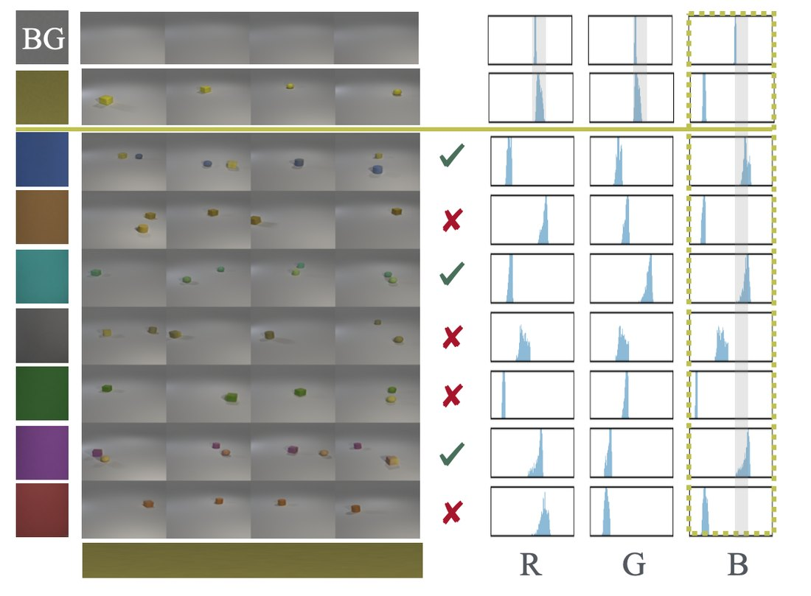
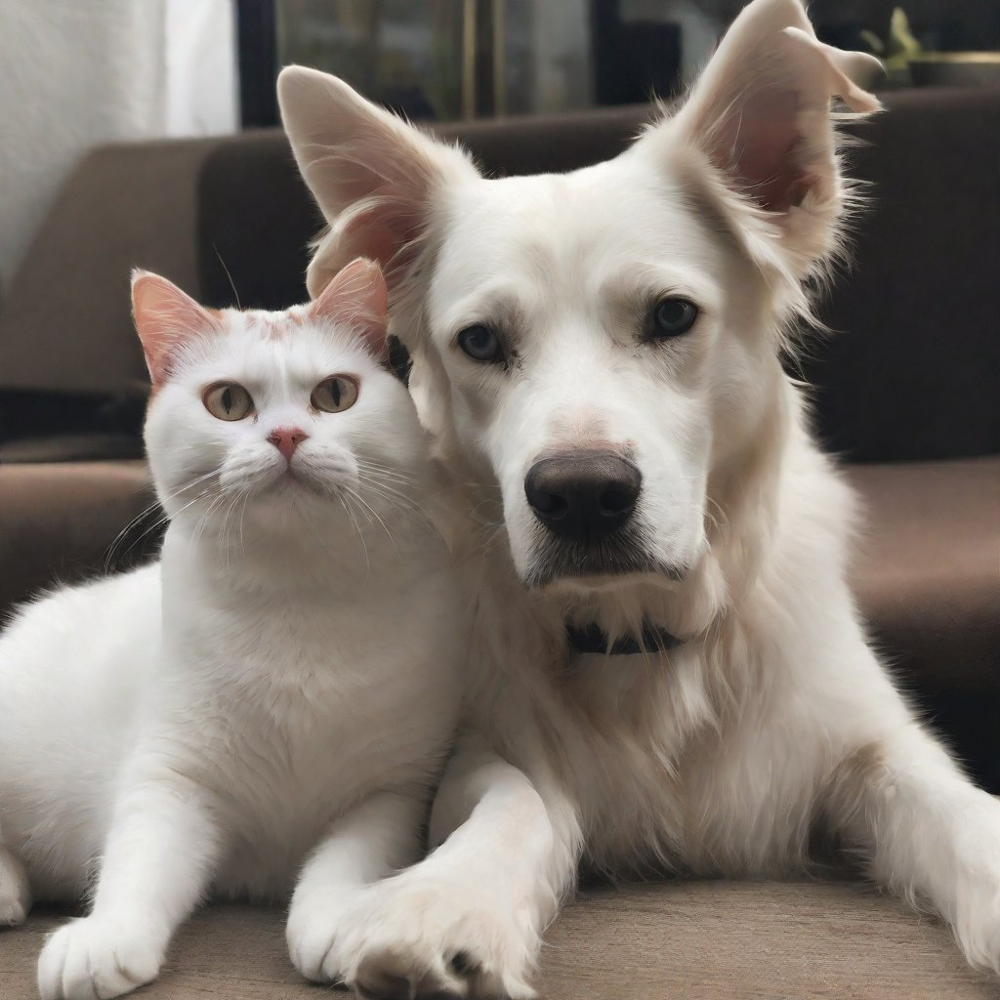
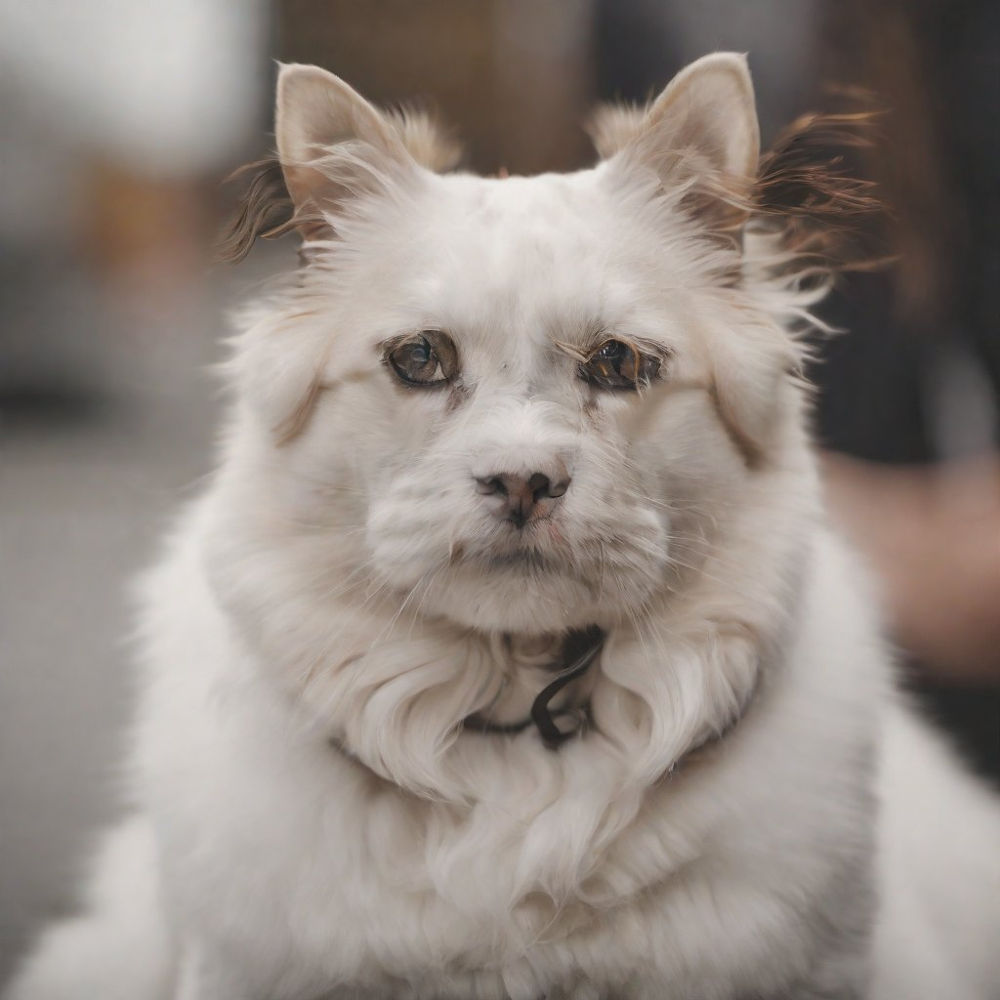
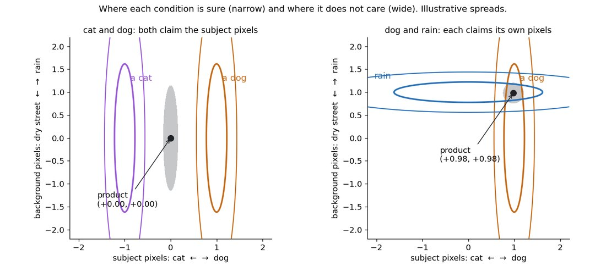
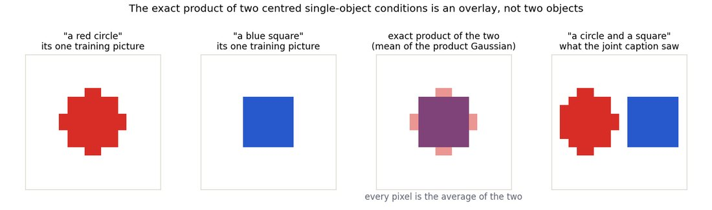
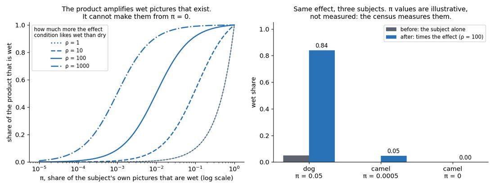
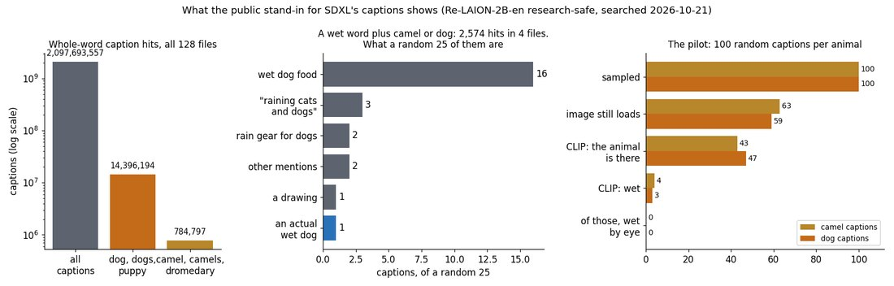
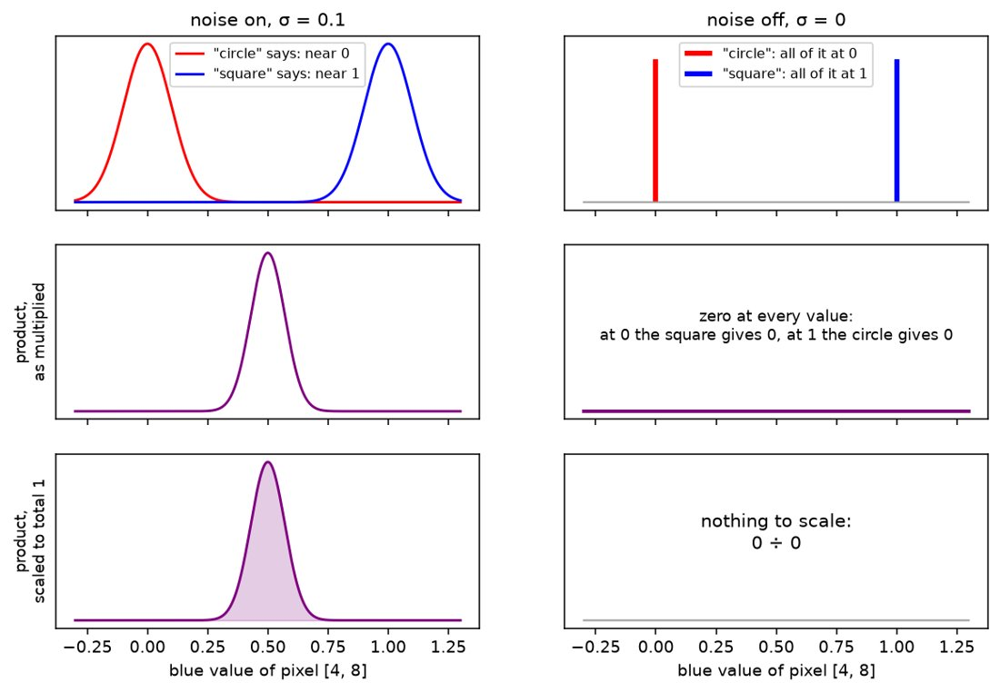

# What product-of-experts loses when it composes

*Structural and causal composition, one experiment at two scales: SDXL in this repository, an exact
toy in `reduce-reuse-recycle` on the cluster.*

> [!NOTE]
> **Read this first.** This document holds the definitions, the reasoning and the hypotheses. The
> two routes beside it hold the work: the [causal route](route-causal-does-an-effect-need-support.md)
> runs here on SDXL, and the [structural route](route-structural-can-a-toy-reproduce-the-hybrid.md)
> runs on the cluster's toy. Each route's prompts name the section of this document they test.

## Contents

1. [Introduction](#1-introduction)
2. [Definitions](#2-definitions)
3. [Background](#3-background)
4. [The two failures, as observed](#4-the-two-failures-as-observed)
5. [Why the two failures differ](#5-why-the-two-failures-differ)
6. [Hypotheses](#6-hypotheses)
7. [Causal experiments on SDXL](#7-causal-experiments-on-sdxl)
8. [Structural experiments on the toy](#8-structural-experiments-on-the-toy)
9. [Remedies, and what cannot work](#9-remedies-and-what-cannot-work)
10. [Where the PhD proposal's phases sit](#10-where-the-phd-proposals-phases-sit)
11. [Limits and open questions](#11-limits-and-open-questions)
12. [References](#12-references)
13. [Appendix: figure provenance](#13-appendix-figure-provenance)

---

## 1. Introduction

Navigation: 📋 [Contents](#contents) | [Next](#2-definitions) ➡️

### 1.1 The question

Product-of-experts (PoE) composes two concepts by running a diffusion model once per concept and
adding the two predictions. On SDXL it works for some pairs and fails for others.

**It fails in two different ways.** Ask for "a cat" and "a dog" and it draws one fused animal. Ask
for "a camel" and "rain" and it draws a camel in the rain, dry, with no fusion at all.

**This document says why those are different failures**, writes one hypothesis for each, and sets out
the experiments that can falsify them.

### 1.2 The claim in one paragraph

> PoE combines two conditions by multiplying what each finds plausible over **the same pixels**. It
> therefore reproduces only **the interactions already present inside each condition's own pictures**,
> and adds none of its own. When the composition is **structural**, the missing interaction is the
> **layout**, and the failure is **contention**. When the composition is **causal**, the missing
> interaction is the **effect**, and the failure is **missing support**.

### 1.3 One experiment at two scales

**The toy removes the sampler.** On a 2D toy and a 16-pixel "parts world", the product of two experts
can be computed exactly. A failure there cannot be blamed on sampling, so whatever fails is the
target itself.

**SDXL tests whether the same law holds at scale.** There the training data is unpublished, so
support can only be estimated from a public stand-in, and the sampler cannot be removed. SDXL gives
field evidence, and the toy gives the mechanism.

**The joint prompt is the reference.** One prompt naming both concepts ("a cat and a dog") runs one
forward pass. It shows what the model can do when it sees both words at once, which PoE never does.

### 1.4 What this document drives

| Line of work | Kind of composition | Where it runs | Route |
|---|---|---|---|
| Does an effect need the subject's own pictures? | causal | SDXL, this repository | [causal route](route-causal-does-an-effect-need-support.md) |
| Can a toy reproduce the cat-dog hybrid, and which fix removes it? | structural | the toy, `reduce-reuse-recycle` | [structural route](route-structural-can-a-toy-reproduce-the-hybrid.md) |

---

## 2. Definitions

Navigation: ⬅️ [Previous](#1-introduction) | 📋 [Contents](#contents) | [Next](#3-background) ➡️

### 2.1 The objects

| Term | Meaning |
|---|---|
| **condition A** | one text prompt given to the model, such as "a camel". In SDXL every condition comes from **one** shared network, so "expert A" means SDXL conditioned on A, not a separate model. |
| **A's pictures** | the training pictures that taught condition A. In practice, the pictures whose captions match A. |
| **joint prompt** | one prompt naming both concepts ("a cat and a dog"). One forward pass, where the text tokens share attention. |
| **PoE** | two passes, one per condition, combined as the sum of the two conditional scores minus the unconditional one ([§3.1](#31-product-of-experts-and-the-and-operator)). |

### 2.2 Two operators

A product of two conditions can be taken over the same pixels or over separate pixels. The
difference decides whether the result is one thing or two (cluster idea map, claim 7).

| Operator | Meaning | What it is right for |
|---|---|---|
| **same-variable product** | both conditions score **every** pixel: $p(x \mid A)\,p(x \mid B)$. This is what PoE computes on SDXL, since each pass sees the whole image. | one thing that is both: "a watercolour cat" |
| **partition product** | each condition scores only its own region: $p(x_S \mid A)\,p(x_{S'} \mid B)$ with $S$, $S'$ disjoint | two things side by side: "a cat beside a dog" |

### 2.3 Five kinds of composition

Taken from the cluster project's [composition terms](https://github.com/) (`artifacts/ideas/poe-overlap-dial/composition-terms.md` in `reduce-reuse-recycle`), which drew one SD3.5 row per kind.

| Kind | What it requires | Example |
|---|---|---|
| **structural** | each component keeps its identity, and the layout is negotiated between them | a cat beside a dog |
| **relational** | a stated relation holds between them | a fox chasing a rabbit |
| **causal** | one component changes how the other looks | rain wets a dog |
| **associative** | an object in or out of its usual context | a penguin on ice |
| **temporal** | a trace of something earlier | a wet dog under a clear sky |

This document works on the first and the third. They fail differently, and each has its own route.

### 2.4 Interaction, in two senses

| Term | Meaning |
|---|---|
| **interaction term** (probabilistic) | the gap between the joint score and PoE's summed score. In this repository it is measured as $r_t = \varepsilon_{\text{joint}} - \varepsilon_{\text{PoE}}$. It is nonzero whenever the joint does something the product cannot. Derived in [§3.5](#35-the-interaction-term). |
| **missing interaction** (what you see) | what the joint render has and the PoE render lacks: the **layout** in a structural composition, the **effect** in a causal one |
| **support share** $f_A(B)$ | the share of A's pictures that already show what the composition needs. For a structural pair, B **in its own region**. For a causal pair, A **in B's effect state** (a wet camel). This is the cluster's overlap dial, measured inside one condition's own pictures. |
| **contention** | both conditions want the same pixels, usually the centre, and the same-variable product settles it with one fused object |

🔤 **The name, "support share":** *support* is where a distribution puts any probability at all; on
the camel it is the set of camel pictures SDXL learned from. *Share* is the fraction of a whole; here,
the fraction of those camel pictures that are wet. If camels were never photographed wet, the support
would hold no wet camel and the share would be 0. Read back: $f_{\text{camel}}(\text{rain})$ is "of all
the camel pictures, the fraction that show a wet camel".

### 2.5 Two sources of error

Du et al. ([2023](#ref-du2023)) separate what goes wrong into the sampler and the target.

| Error | What it is | Does it vanish at the end of sampling? |
|---|---|---|
| **A: the sampler** | summing noisy scores is not the score of the noisy product, so plain PoE samples the product wrongly | yes |
| **B: the target** | the product itself is not what "A and B" means | no |

**This document is about error B.** The toy removes error A by computing the product exactly. On SDXL
error A cannot be removed, which is why the SDXL results are field evidence rather than proof
([§11](#11-limits-and-open-questions)).

---

## 3. Background

Navigation: ⬅️ [Previous](#2-definitions) | 📋 [Contents](#contents) | [Next](#4-the-two-failures-as-observed) ➡️

### 3.1 Product of experts and the AND operator

Hinton ([2002](#ref-hinton2002)) introduced the product of experts: multiply several densities so the
result is high only where every expert agrees. Liu et al. ([2022](#ref-liu2022)) brought it to diffusion
as an AND operator. The derivation is Bayes' rule plus one assumption.

**Start from the joint condition.** By Bayes' rule,

$$
p(x \mid c_1, c_2) \;=\; \frac{p(x)\; p(c_1, c_2 \mid x)}{p(c_1, c_2)}.
$$

**Assume the two captions are independent given the image.** This is the one assumption, stated once
in Liu et al.'s Section 4.2:

$$
p(c_1, c_2 \mid x) \;\approx\; p(c_1 \mid x)\; p(c_2 \mid x).
$$

**Rewrite each factor with Bayes again**, using $p(c_i \mid x) = p(x \mid c_i)\,p(c_i)/p(x)$:

$$
p(x \mid c_1, c_2) \;\propto\;
\underbrace{{\color{teal} p(x \mid c_1)}}_{\text{"a cat" alone}}\;
\underbrace{{\color{darkorange} p(x \mid c_2)}}_{\text{"a dog" alone}}\;
\Big/\;
\underbrace{{\color{gray} p(x)}}_{\text{counted twice, so divided once}}.
$$

**Take the gradient of the log.** The constant disappears and the product becomes a sum of scores:

$$
\nabla_x \log p(x \mid c_1, c_2)
\;=\; {\color{teal} s(x, c_1)} + {\color{darkorange} s(x, c_2)} - {\color{gray} s(x, \varnothing)}.
$$

**In noise-prediction form**, since a score is $-\varepsilon/\sigma_t$, PoE at guidance weight 1 is

$$
\varepsilon_{\text{PoE}} \;=\; {\color{teal}\varepsilon(x_t, c_1)} + {\color{darkorange}\varepsilon(x_t, c_2)} - {\color{gray}\varepsilon(x_t, \varnothing)}.
$$

At a guidance weight $w$, each difference $\varepsilon(x_t, c_i) - \varepsilon(x_t, \varnothing)$ is
scaled by $w$. Every SDXL render in this document uses $w = 7.5$.

🔤 **The name, "product of experts":** a *product* multiplies, so the result is small wherever any
factor is small. An *expert* is one model that knows one thing, here SDXL told "a cat" or "a dog". *Of*
says the product is taken over the experts' opinions of the same picture. If it were a sum instead of
a product, a picture good for only one expert would still score well. Read back: the formula above is
"keep a picture in proportion to how much the cat expert likes it times how much the dog expert likes
it".

### 3.2 What the null term does

**The divisor stops the background being counted twice.** Each condition already contains the
general look of photos, $p(x)$. Multiplying two conditions counts it twice, and dividing by $p(x)$
once puts it back to one.

**It is not a place to insert co-occurrence.** Replacing $\varnothing$ with a co-occurrence prompt
divides by that prompt's likelihood, which pushes the sample *away* from co-occurrence
([§9.3](#93-what-cannot-work-a-co-occurrence-null)).

### 3.3 Reduce, Reuse, Recycle: the sampler is one error

Du et al. ([2023](#ref-du2023)) show that adding diffused scores does not sample the product of the
diffused densities. Noising and multiplying do not commute.

<a href="../../artifacts/notes/what-poe-loses-when-it-composes/figures/du-2023-product-sampling.png"></a>

*Figure 1. Du et al. ([2023](#ref-du2023)). Top row: a ring of eight clusters times a vertical bar.
The exact product keeps the two clusters inside the bar. Reverse diffusion with summed scores
leaves mass all around the ring; [HMC](../../../../goal-setting/learning/deep-learning/diffusion-models/02-sampler-correctors-for-composition/plans/23-the-hamiltonian-corrector.md), an MCMC sampler, recovers the two clusters.*

**What this settles.** When a sampler fails, the product itself can still be right. Du's experiments
know the exact product, so they can tell the two apart.

**On the toy, error A has a closed form.** A bump at a picture $a$ with spread $\sigma$ becomes, at noise
level $\bar\alpha$, a bump at $\sqrt{\bar\alpha}\,a$ with variance $v = \bar\alpha\sigma^2 + 1 - \bar\alpha$.
Multiplying two such bumps leaves a weight $e^{-\bar\alpha d^2/(4v)}$, which is the clean product's weight
with $\sigma^2$ replaced by $\sigma_{\text{eff}}^2 = \sigma^2 + (1-\bar\alpha)/\bar\alpha$. So at each step the
summed noisy scores aim at the clean product computed with a much larger spread, and the caption dial
([§9.2](#92-caption-fine-tuning-done-so-it-can-fail)) is soft there. With the pair at 1 in 20 of each word's
pictures, the summed scores put 0.997 on the shapes apart at $\bar\alpha = 0.5$ but 0.015 at
$\bar\alpha = 0.1$, with 0.49 on overlays, while the exact noisy product keeps 1.0 at every step. The
decision about which pairing to follow is taken early, where the two disagree most.

<a href="../../artifacts/notes/what-poe-loses-when-it-composes/figures/fig-error-a.png"></a>

*Figure 15. Error A on the six-checkpoint toy. Left: on one pixel at $\bar\alpha = 0.5$, the summed scores'
target has the exact noisy product's centre (0.354) and half its variance (0.2525 against 0.5025). Right:
the share on the two shapes apart that each target holds, at caption share 0.05 and 0.5.*

**What it leaves open.** Whether the product itself contains what "a cat and a dog" means. That is
error B, the subject here.

### 3.4 Projective composition: when the product composes

Bradley et al. ([2025a](#ref-bradley2025a)) ask when a product of conditions gives the intended
composition.

**The simple product cannot leave its sources' support.** If $p_1(x) = 0$ or $p_2(x) = 0$, then
$p_1(x)\,p_2(x) = 0$. If each source holds one object, every picture with two objects has zero
probability under both, so the product assigns it zero too.

**Projective composition succeeds when the concepts sit on separate coordinates** ("factorized
conditionals"): each condition decides its own coordinates and leaves the rest to a shared background.
Then score addition is exact.

<a href="../../artifacts/notes/what-poe-loses-when-it-composes/figures/bradley-2025-projective-composition.png"></a>

*Figure 2. Bradley et al. ([2025a](#ref-bradley2025a)), Figure 5: "Composing yellow objects with
objects of other colors. Yellow objects successfully compose with blue, cyan and magenta objects but
not with brown, gray, green, or red objects." Yellow differs from the grey background only in the blue
channel, so it composes with colours whose blue channel looks like the background, and loses an object
with colours that share a channel with yellow.*

**The separation does not have to be in pixels.** If it exists in some invertible transformation of
the image, the same operator composes correctly there.

### 3.5 The interaction term

**Subtract PoE's score from the true joint score.** Using the Bayes steps of §3.1 without the
independence assumption:

$$
\nabla_x \log p(x \mid c_1, c_2)
\;=\;
\underbrace{s(x, c_1) + s(x, c_2) - s(x, \varnothing)}_{\text{what PoE computes}}
\;+\;
\underbrace{{\color{purple}\nabla_x \log \frac{p(c_1, c_2 \mid x)}{p(c_1 \mid x)\,p(c_2 \mid x)}}}_{{\color{purple} I_t(x)}\text{: what PoE drops}}.
$$

**The dropped piece is the gradient of how much the two captions depend on each other, given the
picture.** If knowing that a picture is captioned "cat" changes how likely it is to be captioned "dog"
as well, the term is nonzero.

**In this repository it is measured directly** as the difference of two noise predictions:

$$
r_t \;=\; \varepsilon_{\text{joint}} - \varepsilon_{\text{PoE}} \;=\; -\,\sigma_t\, I_t(x_t).
$$

Liu et al. assume the term away, Bradley et al. redefine the goal so it is not needed, and CoInD
([Gaudi et al. 2025](#ref-coind2025)) trains a model to make it zero. This repository's [adapter](../../context/world/lora-corrector.md#what-the-lora-corrector-is) learns it
back.

### 3.6 Local conditional scores

Bradley ([2025b](#ref-bradley2025b)) proves that projective composition is equivalent to **local
conditional scores**: the score for one condition depends only on its own pixels and its own condition.

**His fix changed the model, not the formula.** In CLEVR, where each condition is an object's
location, he split the image into independent patches, each conditioned only on the locations inside
it. The largest number of objects generated correctly:

| Trained on | Standard U-Net | Patch-local model |
|---|---|---|
| 1 object | 1 | 5 |
| 1 to 3 objects | 2 | 9 |

**On SDXL, locality is mostly absent in pixels.** In SDXL's internal features he finds within-category
cosines of 0.41 to 0.47 against 0.27 to 0.33 across categories, a ratio of 1.4 to 1.6, which he calls
"suggestive". The locality test in [§8.7](#87-the-locality-test) measures the same property on the toy.

---

## 4. The two failures, as observed

Navigation: ⬅️ [Previous](#3-background) | 📋 [Contents](#contents) | [Next](#5-why-the-two-failures-differ) ➡️

### 4.1 Structural failure: cat and dog fuse

<a href="../../context/images/world/02-mono-ceiling-example.png"></a> <a href="../../context/images/world/01-poe-chimera-example.png"></a>

*Figure 3. Seed 42. Left: the joint prompt "a cat and a dog", two animals. Right: PoE of "a cat" and
"a dog" from the same starting noise, one animal with a cat's face on a dog's body. From
[what PoE composition is](../../context/world/poe-composition.md).*

**It recurs.** The fused animal appears across 17 animal pairs at 8 seeds each, counted by the
validated GroundingDINO instance count ([report index](../../report/00-INDEX.md), rung 2).

**It is specific to PoE.** The joint prompt draws two animals from the same noise.

**The control composes.** A butterfly over a meadow composes on 8 of 8 held-out seeds under PoE, and
8 of 8 under the joint prompt (report index, rung 1). An object and a scene do not fuse.

### 4.2 Causal failure: the camel stays dry

<a href="../../artifacts/notes/what-poe-loses-when-it-composes/figures/fig-causal-renders.png"></a>

*Figure 4. The same rain, two animals, seeds 1 and 4. SDXL, 50 [DDIM](../../../../goal-setting/learning/deep-learning/diffusion-models/02-sampler-correctors-for-composition/plans/32-ddim-non-markovian-and-deterministic-limit.md) steps, guidance 7.5, the same
starting noise across a row. Calls under the tiles are the reader's own, from the two calls files.
The dog sheet's joint and PoE tiles have totals recorded but no call per seed. Made by
[`make_figures.py`](../../artifacts/notes/what-poe-loses-when-it-composes/make_figures.py).*

The reader's calls over all five seeds (1, 2, 4, 9, 10). A half call counts as dry.

| Prompt | Camel | Dog |
|---|---|---|
| "a wet …", asked directly | **wet 4, half 1** | wet 5 |
| "a … in the rain", asked directly | dry 4, half 1 | wet 4, half 1 |
| joint "a … and rain" | **dry 5** | wet 2, half 1 |
| PoE of "a …" and "rain" | **dry 5** | wet 2 (seed 10 lost the dog to a person with an umbrella) |

**Sources:** `asked-directly-calls.json` and `a-camel-and-rain-calls.json` in
`artifacts/results/does-a-camel-in-the-rain-come-out-wet/`; the dog totals from the
[dog-and-rain walk map](../../artifacts/drips/a-dog-and-rain/EXECUTE_WALK.md), piece 1.

**SDXL can draw a wet camel.** Asked "a wet camel", it does on 4 of 5 seeds.

**Nothing that keeps camel and rain apart gets there.** The joint prompt "a camel and rain" and PoE are
both dry on 5 of 5. Even "a camel in the rain", asked directly, is dry on 4.

**The camel is not fused with the rain.** No render shows a camel made of rain or rain shaped like a
camel. The structure succeeded and the effect is missing.

### 4.3 Side by side

| | Cat × dog | Camel + rain |
|---|---|---|
| kind of composition | structural (layout) | causal (effect on the camel's pixels) |
| joint prompt | works: two animals | fails ("and rain"), works when named ("a wet camel") |
| PoE | fails: one fused animal | fails: a dry camel |
| what is missing | the layout, each animal in its own place | the effect, wet fur |
| main cause, by the toy's results | contention: both conditions want the centre pixels | support: camels almost never shown wet |
| specific to PoE? | **yes** | **no** |

---

## 5. Why the two failures differ

Navigation: ⬅️ [Previous](#4-the-two-failures-as-observed) | 📋 [Contents](#contents) | [Next](#6-hypotheses) ➡️

One piece of arithmetic explains both: **the product of two Gaussians is a precision-weighted
average.** Where a condition is sure of a pixel it has high precision there; where it does not care,
its precision is near zero.

### 5.1 The product is a precision-weighted average

**For one pixel, take two Gaussian opinions** with means $a$ and $b$ and spreads $\sigma_a$ and
$\sigma_b$. Write precision as $\tau = 1/\sigma^2$.

$$
\mathcal{N}(x; a, \sigma_a^2)\;\mathcal{N}(x; b, \sigma_b^2)
\;\propto\;
\exp\!\Big(-\tfrac{\tau_a}{2}(x-a)^2 - \tfrac{\tau_b}{2}(x-b)^2\Big).
$$

**Complete the square.** The exponent is a quadratic in $x$ with curvature $\tau_a + \tau_b$, so the
product is again Gaussian, with

$$
\mu \;=\; \frac{{\color{teal}\tau_a}\, a + {\color{darkorange}\tau_b}\, b}{{\color{teal}\tau_a} + {\color{darkorange}\tau_b}},
\qquad
\tau \;=\; {\color{teal}\tau_a} + {\color{darkorange}\tau_b}.
$$

**Read it two ways.**

- **Both sure, different answers** ($\tau_a = \tau_b$, $a \ne b$): $\mu = (a+b)/2$. Halfway between. This is the blend.
- **One sure, one indifferent** ($\tau_b \to 0$): $\mu \to a$. The sure condition wins that pixel, and the other loses nothing it cared about.

<a href="../../artifacts/notes/what-poe-loses-when-it-composes/figures/fig-why-rain-and-dog-do-not-fuse.png"></a>

*Figure 5. Two coordinates stand for two parts of the image: the subject's pixels and the background's.
Each ellipse is where a condition puts its probability; narrow means sure. The grey patch is the exact
product. The spreads are chosen by hand to illustrate, not measured.*

### 5.2 Structural: contention gives a blend

**"A cat" and "a dog" are both sure about the same pixels.** Each was trained mostly on pictures of
one centred animal, so each has high precision on the centre, with different values there. By §5.1 the
product puts the average in the centre: half cat, half dog.

<a href="../../artifacts/notes/what-poe-loses-when-it-composes/figures/fig-exact-product-is-a-blend.png"></a>

*Figure 6. Each condition is a Gaussian around its one training picture. The exact product's mean is
the pixel-wise average, an overlay. No sampler is involved.*

In symbols, with equal spread $\sigma$:

$$
\mathcal{N}({\color{teal} c}, \sigma^2 I)\;\cdot\;\mathcal{N}({\color{darkorange} s}, \sigma^2 I)
\;\propto\;
\mathcal{N}\!\Big(\underbrace{\tfrac{{\color{teal} c} + {\color{darkorange} s}}{2}}_{\text{the overlay}},\; \tfrac{\sigma^2}{2} I\Big).
$$

**Real distributions are mixtures, and the conclusion survives.** The cluster's parts world reproduces
the cat-dog hybrid exactly with Gaussian mixtures (claim 9), and its run 1 measured chimera mass
**0.66 when both experts saw their object centred, 0.21 when positions varied**.

**Why the cat-and-dog photos in the training data do not save it.** SDXL is one model that saw cats
alone, dogs alone, and cats with dogs. But a photo with both animals is captioned with both words. So
the condition "a cat" learned *a picture of just a cat*, and actively disfavours a second animal. The
two-animal pictures sit under "a cat and a dog", which PoE never asks for.

**Is "the cat respects the dog's space" an interaction?** Yes, a structural one. In a real photo,
where the cat is constrains where the dog can be. PoE scores each condition on the whole image
separately, so neither factor knows "the cat is on the left, so the dog goes right".

### 5.3 Why rain and a dog do not fuse

**They are sure about different pixels.** "Rain" is sure about the background: streaks, wet streets,
reflections, a grey sky. It has little to say about the shape in the centre. "A dog" is sure about the
centre and indifferent to the weather. By §5.1, each wins where it is sure, and the product holds a dog
in the rain (Figure 5, right).

**So nothing is averaged.** Rain droplets never take a dog's shape, and the dog never turns into rain,
because no pixel has two sure conditions demanding different things. This is the same reason a
butterfly over a meadow composes: an object and a scene occupy different pixels, so the same-variable
product behaves like a partition product.

### 5.4 Why the dog comes out wet, not dry

The precision picture places the dog in the rain. It does not say whether the dog is wet. That
comes from the **mixture of states inside the dog's own pictures**.

**Split "a dog" into dry and wet pictures.** Let $\pi$ be the share of dog pictures that show a wet dog:

$$
p(x \mid \text{dog}) \;=\; (1-\pi)\, {\color{peru} p_{\text{dry}}(x)} \;+\; \pi\, {\color{steelblue} p_{\text{wet}}(x)}.
$$

**The rain condition reweights.** Write how much more likely a picture is under "rain" than in general
as $r(x) = p(x \mid \text{rain})/p(x)$. PoE samples in proportion to $p(x \mid \text{dog})\, r(x)$.
Integrating over each part gives the wet share of the product:

$$
W \;=\;
\frac{\pi\, \rho_{\text{wet}}}{\pi\, \rho_{\text{wet}} + (1-\pi)\, \rho_{\text{dry}}}
\;=\;
\frac{\pi\,\rho}{\pi\,\rho + 1 - \pi},
\qquad
\rho = \frac{\rho_{\text{wet}}}{\rho_{\text{dry}}},
\quad
\rho_s = \mathbb{E}_{p_s}\!\big[r(x)\big].
$$

**$\rho$ is how strongly rain prefers a wet dog to a dry one.** Rain photographs are full of wet
things, so $\rho$ is large: the product strongly favours the wet dog pictures that exist.

**At $\pi = 0$ the wet share is 0, whatever $\rho$ is.** The product can amplify a state the subject
is sometimes shown in. It cannot create one the subject is never shown in.

<a href="../../artifacts/notes/what-poe-loses-when-it-composes/figures/fig-mixture-reweighting.png"></a>

*Figure 7. Left: the product's wet share against $\pi$, for four values of $\rho$. Right: the same rain
($\rho = 100$) applied to three subjects. The $\pi$ values are chosen to illustrate; the census in
[§7.2](#72-the-census-what-the-training-captions-hold) measures them.*

### 5.5 Why the camel stays dry

**Camels are photographed in deserts.** If $\pi_{\text{camel}}$ is near zero, the product of "a camel"
and "rain" puts a dry camel under a grey sky, which is what Figure 4 shows on 5 of 5 seeds.

**The pilot found exactly this kind of picture.** One caption, "Brooklyn Had Camels Before They Were
Cool", showed camels walking down a wet street, called wet by CLIP. By eye, the street is wet and the
camels are dry ([§7.2](#72-the-census-what-the-training-captions-hold)). That is rain without the effect
on the subject.

### 5.6 The joint prompt can borrow, when the text names the effect

"A wet camel" comes out wet on 4 of 5 seeds. So SDXL can apply "wet" to a camel, even if wet camels
are rare in its data.

**The joint prompt has a channel PoE lacks.** In one forward pass, "wet" and "camel" meet inside one
text embedding and one cross-attention, and the model can apply a "wet" learned on dogs, horses and
people to the camel. PoE runs separate passes, so the two words never meet.

**But only when the text ties them.** "A camel and rain" names the cause, not the effect, and it stays
dry on 5 of 5. The text has to bind the effect to the subject before the model borrows it.

### 5.7 Captions or attention?

**Captions decide what each condition learned.** If "a cat" pictures rarely contain a dog, the cat
condition holds little co-occurrence. The census in §7 measures this.

**Attention is a candidate for how the joint prompt negotiates the layout.** Within one pass, each
pixel's cross-attention divides its weight among the tokens, so "cat" and "dog" compete for every
pixel. PoE's passes contain one subject each, so that competition never happens. This is unmeasured.
A single-seed probe in this repository found the learned correction changes what is painted about 2.7
times more than where tokens look, with attention footprints overlapping at about 0.99. That points
away from attention, but it is one seed and not a written finding.

**More text encoders change the joint prompt, not PoE.** SD3 ([Esser et al. 2024](#ref-sd3)) adds a
T5 encoder beside two CLIP encoders and replaces cross-attention with joint attention over text and
image tokens. That may help "a camel in the rain" come out wet. It does not change PoE's operator: one
pass per condition, multiplied.

| Predicted on SD3.5 | Joint prompt | PoE |
|---|---|---|
| cat × dog | two animals, as on SDXL | still fused: the operator is unchanged |
| camel + rain | wet more often, if language binding is the limit | still dry: support is unchanged |

---

## 6. Hypotheses

Navigation: ⬅️ [Previous](#5-why-the-two-failures-differ) | 📋 [Contents](#contents) | [Next](#7-causal-experiments-on-sdxl) ➡️

### 6.1 The overall claim

> **PoE recovers only interactions already present within each condition's own distribution, and adds
> none of its own.** It fails by contention when the composition is structural, and by missing support
> when it is causal.

Four testable parts follow, two per kind.

### 6.2 Causal hypotheses (tested on SDXL)

**H-C1, support.** The share of PoE renders that show B's effect on A is bounded by A's own support
share $f_A(\text{effect})$ and rises with it. At $f_A = 0$ it is zero for any sampler, the exact product
included ([§5.4](#54-why-the-dog-comes-out-wet-not-dry)).

**H-C2, borrowing.** A jointly conditioned model can show B's effect on A at $f_A \approx 0$ when the
effect is common on other subjects and the text names it on A ("a wet camel"). PoE cannot.

**H-C3, the third concept.** Adding the effect word as a third expert, PoE of "a camel", "rain" and
"wet", recovers the effect only where the subject has support. A third factor is one more reweighting
of the subject's own mixture of states (§5.4):

$$
p(x \mid \text{camel})\;\frac{p(x \mid \text{rain})}{p(x)}\;\frac{p(x \mid \text{wet})}{p(x)}
\;\;\Longrightarrow\;\;
W = \frac{\pi\,\rho_{\text{rain}}\,\rho_{\text{wet}}}{\pi\,\rho_{\text{rain}}\,\rho_{\text{wet}} + 1 - \pi}.
$$

A larger preference for wet raises $W$ for a subject with $\pi > 0$, and leaves $W = 0$ at $\pi = 0$.
So H-C3 is H-C1 with a stronger push: it should rescue the dog and not the camel.

### 6.3 Structural hypotheses (tested on the toy)

**H-S1, indifference.** The exact product of two single-object conditions puts mass on two-object
images only to the extent that each condition is indifferent to the other's region. That happens when
its training images show it beside other objects **captioned with its own name only**, and when its
positions vary. With SDXL-like data (singles centred, pairs captioned with both names) the exact product
is a blend ([§5.2](#52-structural-contention-gives-a-blend)).

**H-S2, contention.** The hybrid rate rises with how much the two conditions' positions overlap, and
falls with $f_A(B)$, the share of A's pictures that already show B in its own region.

**Note on strength.** "PoE will always give hybrids, however good the model" is stronger than the
theory allows: Bradley shows conditions under which the product composes. H-S1 says when.

### 6.4 What falsifies each

| Hypothesis | Toy falsifier | SDXL falsifier |
|---|---|---|
| H-C1 | any exact mass on "A in B's effect state" at $f_A = 0$ | a subject with $f_A$ below 1 in 10,000 whose PoE renders show the effect on 3 or more of 5 seeds |
| H-C2 | the joint model fails to borrow when the conditioning is shared and the effect is common on another subject | a named-effect joint prompt ("a wet …") failing for low-support subjects as often as PoE does |
| H-C3 | a third expert puts exact mass on the effect state at $\pi = 0$ | three-concept PoE shows the effect on 3 or more of the selected seeds for a subject with $f_A$ below 1 in 10,000 |
| H-S1 | with centred singles and no pair image captioned by one name, the exact product puts more than 10% of its mass on separate two-object images | (not tested on SDXL directly) |
| H-S2 | two objects at $f = 0$ with both experts centred, or a fused object when the experts' positions do not overlap | the PoE hybrid rate across pairs does not rise with how often the two subjects share the centre |

The 10% for H-S1 is set here, before any toy run.

---

## 7. Causal experiments on SDXL

Navigation: ⬅️ [Previous](#6-hypotheses) | 📋 [Contents](#contents) | [Next](#8-structural-experiments-on-the-toy) ➡️

Run through the [causal route](route-causal-does-an-effect-need-support.md).

### 7.1 What is done

| Piece | State | Evidence |
|---|---|---|
| dog sheet: dog, rain, joint, PoE, [SuperDiff](../../../../goal-setting/learning/deep-learning/diffusion-models/02-sampler-correctors-for-composition/plans/31-superdiff-derived-and-placed.md), 5 seeds | ✅ done; totals called, per-seed calls owed | `artifacts/results/does-a-dog-in-the-rain-come-out-wet/a-dog-and-rain.png` |
| asked directly: wet camel, camel in the rain, wet dog, dog in the rain | ✅ done and called | `asked-directly.png` and its calls file |
| camel sheet: camel, rain, joint, PoE, SuperDiff, 5 seeds | ✅ done and called | `a-camel-and-rain.png` and its calls file |
| a searchable stand-in for SDXL's captions | ✅ found: Re-LAION-2B-en research-safe, all 128 files mirrored on `/datasets` | `caption-counts.md`, "[Dataset searched](../../artifacts/results/does-a-camel-in-the-rain-come-out-wet/caption-counts.md#dataset-searched)" |
| CLIP pilot: 100 captions per animal | ✅ done; method failed its own check | §7.2 below |
| PoE of "a camel" and "wet", "a dog" and "wet" | ⬜ hypothesis test written in the walk map 2026-10-22, not rendered | walk map, second test |
| three-concept PoE: subject, carrier and effect word | ⬜ designed in §7.6, not rendered | §7.6 |
| 90 camel renders, SDXL on each sentence and PoE of "a camel" with each tail | ⬜ rendered (jobs 72616, 72617), not called | `/datasets/mmolefe/poe_repair_min/outputs/` |
| the census of training support | ⬜ designed below, not run | §7.2 |
| fire and snow pairs | ⬜ designed below, not run | §7.3 |

### 7.2 The census: what the training captions hold

**The stand-in.** SDXL's model card names its two text encoders, OpenCLIP ViT-bigG and CLIP ViT-L, and
no training dataset ([Podell et al. 2023](#ref-sdxl)). ViT-bigG was trained on LAION-2B-en
([Cherti et al. 2022](#ref-openclip)), whose cleaned re-release Re-LAION-2B-en research-safe
([LAION 2024](#ref-relaion)) holds **2,097,693,557** caption and image-link pairs. It is mirrored at
`/datasets/mmolefe/relaion2b-en/parquet/` and searched with DuckDB. Counts from it describe the
stand-in, and SDXL's own data stays unknown.

**Caption hits alone mislead.** In 4 of the 128 files, 2,574 captions pair a wet word with camel or
dog, and 1,078 of those mention food. Of a random 25, 16 are wet dog food and one shows an actual wet
dog.

<a href="../../artifacts/notes/what-poe-loses-when-it-composes/figures/fig-caption-evidence.png"></a>

*Figure 8. Left: whole-word caption hits over all 128 files: 14,396,194 for dog, dogs or puppy, and
784,797 for camel, camels or dromedary. Middle: what a random 25 of the wet-word hits are. Right: the
pilot, 100 random captions per animal, followed through fetching, CLIP's animal check, CLIP's wet call
and the eye check of CLIP's wet calls.*

**What the pilot taught.** CLIP ViT-bigG was asked two questions of each fetched picture: is the
animal there, and is it wet. Both failed the eye check. The eye calls here were Claude's, made before
any figure was built; the census in step 4 of the causal route puts every call in your hands.

- **The animal check leaks.** Of 10 pictures checked by eye, 7 showed no animal, and 4 of those 7 still passed CLIP's animal check: a suede boot, culottes, a book cover and a baseball player. Many "camel" captions are the colour camel.
- **The wet call is wrong.** CLIP called 7 of 122 fetched pictures wet. By eye, **0 of 7** show a wet animal. The pass mark set before scoring was 80%.
- **About 40% of links are dead.** 63 of 100 camel pictures and 59 of 100 dog pictures still loaded.

The pilot's pictures are in `artifacts/results/does-a-camel-in-the-rain-come-out-wet/`
(`pilot-ten-walk-pictures.jpg`, `pilot-clip-called-wet.jpg`), kept local because they are web photos.

**The census replaces CLIP's calls with eyes, and keeps CLIP for sorting.**

1. **Search.** For each subject and each effect family, take every whole-word caption hit over all 128 files.
2. **List.** Save the hit captions as text, so the first output is a list of real training captions that might show the subject in the effect state.
3. **Fetch.** Download the images behind a fixed random sample of the hits (a seeded draw, so it reruns the same).
4. **Keep real animals.** Drop pictures with no animal using the GroundingDINO instance count this repository already validated ([the compose-score validation set](../../report/00-INDEX.md), rung 2), not CLIP.
5. **Sort into piles.** Embed each picture with CLIP and cluster, so similar pictures sit together: zoo camels, desert caravans, street camels.
6. **Look.** Contact sheets per pile; call each picture wet, dry or can't tell by eye.
7. **Count.** $f_A$ per subject and family, with its 95% interval; a zero is reported as a bound, "below 3 in N" (the rule of three).

**The expected outcome** is a list of training captions whose pictures show the subject in the effect
state, with the picture beside each one, and $f_A$ per subject. A wet camel found this way is a direct
answer to "did the training data hold one".

### 7.3 More examples: fire and snow

Rain on a dog against rain on a camel is one comparison, and it confounds wetness with how common each
animal is (dog captions outnumber camel captions 18 to 1). More carriers, each with a subject expected
to be common in the effect state and one expected to be rare, turn it into a test across pairs.

| Carrier B | Effect on A | Subject often shown this way | Subject rarely shown this way | Effect words for the census |
|---|---|---|---|---|
| rain | wet fur, droplets | dog | camel | wet, soaked, drenched, dripping; rain, rainy, storm, puddle; swimming, river, lake, splash |
| fire | burning, charred, melting | a log (burning logs) | a snowman (melting snowman) | burning, burnt, charred, on fire, flames, ablaze; melting, melted |
| snow | snow on the body | a husky | a camel (the Bactrian camel is a middle case) | snowy, snow-covered, in the snow, snowing, frost, frosted |

**What each predicts.** For every subject, H-C1 says the PoE effect rate tracks the census share
$f_A$. The log and the husky should behave like the dog. The snowman should behave like the camel: a
snowman beside a fire, unmelted.

### 7.4 Renders for each pair

For each subject A and carrier B, on seeds 1, 2, 4, 9 and 10, 50 DDIM steps, guidance 7.5, the cached
starting noise, plain PoE with no adapter:

| Column | Prompt | What it measures |
|---|---|---|
| 1 | "a …" alone | A's own look |
| 2 | B alone ("rain", "fire", "snow") | B's own look |
| 3 | joint "a … and B" | co-occurrence through one prompt |
| 4 | PoE of "a …" and B | the operator under test |
| 5 | the named effect, asked directly ("a wet camel", "a melting snowman", "a burning log", "a snow-covered husky") | whether SDXL can draw the effect on A at all |
| 6 | PoE of "a …" and the effect word ("wet", "melting", "burning", "snowy") | the walk map's second test |
| 7 | PoE of "a …", B and the effect word | whether a third concept recovers the effect ([§7.6](#76-the-third-concept-can-poe-get-the-effect-back)) |

Every tile is called by eye: effect, no effect, or half. A half counts as no effect.

### 7.5 Pass marks, set before the renders

**H-C1 supported** when, across the subjects, the PoE effect count rises with $f_A$: the two lowest-$f_A$
subjects show the effect on at most 1 of 5 PoE seeds each, and the two highest on at least 3 of 5.

**H-C1 not supported** when a subject with $f_A$ below 1 in 10,000 shows the effect on 3 or more PoE
seeds.

**H-C2 supported** when the named-effect prompt (column 5) shows the effect on at least 3 of 5 seeds for
the low-$f_A$ subjects, while their PoE count stays at 1 or fewer.

**Inconclusive** otherwise, including when a high-$f_A$ subject stays dry under PoE: then something other
than support blocks the effect, and a dry low-$f_A$ result cannot be read as a support effect.

The camel and dog pass marks already written in the walk map stay as written. These extend them to the
new pairs.

### 7.6 The third concept: can PoE get the effect back?

**The question.** Where the joint prompt shows an effect and two-concept PoE loses it, does adding the
effect word as a third expert bring it back? If it does, the lost causality is cheap to recover: one
more condition, no training.

**The three-concept product.** With guidance weight $w$ on each condition,

$$
\varepsilon_{3} \;=\; \varepsilon_\varnothing
+ w\,\big({\color{teal}\varepsilon_{\text{camel}}} - \varepsilon_\varnothing\big)
+ w\,\big({\color{steelblue}\varepsilon_{\text{rain}}} - \varepsilon_\varnothing\big)
+ w\,\big({\color{purple}\varepsilon_{\text{wet}}} - \varepsilon_\varnothing\big),
$$

which is Liu et al.'s AND with three conditions instead of two.

**A test only counts on seeds that meet two conditions**, fixed here before any render:

1. **The effect is reachable through language on that seed:** the joint prompt "a … and B" or the named effect "a wet …" shows it.
2. **Two-concept PoE loses it on the same seed:** PoE of "a …" and B does not show it.

Seeds that fail either condition test nothing, because there is no lost effect to recover. The
selection uses the calls already made, so it cannot be tuned after the three-concept tiles land.

**Which pairs can meet the conditions.**

| Pair | Condition 1 met by | Two-concept PoE | Prediction (H-C3) |
|---|---|---|---|
| dog + rain | joint: wet on 2 seeds plus 1 half | wet on 2 | recovered on the selected seeds |
| camel + rain | named effect "a wet camel": wet on 4 | dry on 5 | **not** recovered |
| log + fire | likely the joint prompt; step 6 checks | to be rendered | recovered |
| snowman + fire | likely only "a melting snowman"; step 6 checks | to be rendered | not recovered |
| husky + snow | likely the joint prompt; step 6 checks | to be rendered | recovered |
| camel + snow | likely only "a snow-covered camel"; step 6 checks | to be rendered | not recovered, or weakly for a Bactrian camel |

**What would falsify it.** The camel or the snowman coming back on 3 or more of its selected seeds
falsifies H-C3, and with it the support claim. The dog, the log or the husky failing to come back on
most of their selected seeds says the third concept is not a remedy even where support exists. Either
result is worth having, which is why the pairs span both sides.

**Why the seeds come from rain and dog first.** The dog sheet is the only one where the joint prompt
already showed the effect on some seeds and PoE did not on others, so it is the first place both
conditions can hold. Its per-seed calls are owed (route step 7), and they decide which dog seeds
qualify.

---

## 8. Structural experiments on the toy

Navigation: ⬅️ [Previous](#7-causal-experiments-on-sdxl) | 📋 [Contents](#contents) | [Next](#9-remedies-and-what-cannot-work) ➡️

The failure is set up on the laptop in [the six-checkpoint walk](today-the-toy-failure-in-six-checkpoints.md),
then carried to the cluster by the [structural route](route-structural-can-a-toy-reproduce-the-hybrid.md).

### 8.1 Why a toy

**PoE is two things: a target, and a sampler that tries to reach it.** Du et al. replace the sampler.
The question here is the target: even if the product were sampled exactly, would two objects be in it?

**On a toy the target is a formula.** Nothing about the answer depends on training or sampling, so a
failure there belongs to the target alone.

**The toy mirrors how SDXL was taught.** A red circle stands for the dog and a blue square for the
cat. There are pictures of the circle alone, the square alone, and the two side by side, captioned
"circle", "square" and "circle and square", the way a photo of a cat and a dog is captioned with both
words.

### 8.2 The model of a word, in plain terms

**The pictures are drawn, not generated.** Each is 8 × 16 pixels on white: a red circle at the left,
centre or right; a blue square at the left, centre or right; and one pair, the circle on the left and
the square on the right.

**The model of the word "circle" is a rule for making pictures:**

> pick one of the circle pictures at random, then add a little random noise to every pixel.

**Written as a formula**, that rule is one bell-shaped bump of noise around each training picture:

$$
p(x \mid \text{circle}) \;=\;
\underbrace{\tfrac{1}{3}\sum_{k=1}^{3}}_{\text{pick one of 3 pictures}}\;
\underbrace{\mathcal{N}\big(x;\; {\color{crimson}\text{circle}_k},\; \sigma^2 I\big)}_{\text{add noise of size } \sigma \text{ to every pixel}}.
$$

🔤 **The name, "a mixture of Gaussians around the training images":** a *mixture* picks one of several
options at random; here, one of the three circle pictures. A *Gaussian* is bell-shaped noise; here,
added to every pixel of the picture picked. *Around the training images* says where each bell sits: on
one real picture. If the bells sat anywhere else, the rule would draw shapes it was never shown. Read
back: the formula is "pick a circle picture, blur it slightly".

**Why use the rule instead of a trained network.** It is what a diffusion model trained on those
pictures learns, made exact: the cluster's run 2 found small trained models match it closely. And
because it is a formula, its product, its sum and its noisy version at every step of sampling can all be
written down. "The exact answer" is computed, never estimated.

**What the product does to two rules.** Multiplying the circle rule by the square rule gives a new rule
over pairs of pictures, one from each:

$$
p(x \mid \text{circle})\; p(x \mid \text{square}) \;\propto\;
\sum_{j,k} \underbrace{w_{jk}}_{\text{how alike the two pictures are}}\;
\mathcal{N}\Big(x;\; \underbrace{\tfrac{{\color{crimson}\text{circle}_j} + {\color{royalblue}\text{square}_k}}{2}}_{\text{the pixel average: an overlay}},\; \tfrac{\sigma^2}{2} I\Big).
$$

**Every output is an average of one circle picture and one square picture**, weighted toward the pairs
that look most alike. The most alike are a circle and a square in the same place, so the product draws a
purple overlay there. This is the cat-dog hybrid, from the formula alone ([§5.2](#52-structural-contention-gives-a-blend)).

**What the sum does.** "Circle" OR "square" picks one of the two rules, then follows it. Nothing is
averaged, so no overlay can appear. Written out, the sum is six bells of weight ⅙, each sitting on one
training picture:

$$
\tfrac12\, p(x \mid \text{circle}) + \tfrac12\, p(x \mid \text{square}) \;=\;
\sum_{k=1}^{3} \underbrace{\tfrac16}_{\tfrac12 \cdot \tfrac13}\,
\mathcal{N}\big(x;\; {\color{crimson}\text{circle}_k},\; \sigma^2 I\big)
\;+\;
\sum_{k=1}^{3} \tfrac16\,
\mathcal{N}\big(x;\; {\color{royalblue}\text{square}_k},\; \sigma^2 I\big).
$$

The term $\mathcal N(x; {\color{crimson}\text{circle}_j})\,\mathcal N(x; {\color{royalblue}\text{square}_k})$
that averaged two pictures in the product is absent: every bell sits on one picture, at full width
$\sigma$. On one pixel the product is one bell at the average, and the sum is two bumps with nothing
between them:

<a href="../../artifacts/notes/what-poe-loses-when-it-composes/figures/fig-sum-vs-product.png"></a>

*Figure 12. One pixel's blue value, where the centre circle's picture says 0 and the centre square's says 1, σ = 0.1.
The product is one bell at 0.5; the half-and-half sum is two bumps, with height 1.5 × 10⁻⁵ at 0.5 against
1.99 at 0.*

#### Why the overlay is purple: one pixel, worked by hand

**The question a reviewer will ask.** Is the purple real, or drawn in? It is real: it is where the
product of the two rules is most likely. But the product multiplies **probabilities**, not colours, and
that is why the answer is purple and not black or magenta.

<a href="../../artifacts/notes/what-poe-loses-when-it-composes/figures/fig-one-pixel-product.png"></a>

*Figure 11. One pixel where the circle picture is pure red (1, 0, 0) and the square picture is pure
blue (0, 0, 1). Each model's opinion of each channel is a bell curve; their product is a narrower bell
halfway between, so the product's most likely colour is (0.5, 0, 0.5).*

🔤 **The name, "product of experts", on one pixel.** *Expert*: one model with an opinion about every
pixel. Here the circle's expert says "this pixel is red, give or take a little" and the square's says
"this pixel is blue, give or take a little". *Product*: a value is kept in proportion to how likely the
first expert finds it **times** how likely the second finds it, so it must be acceptable to both.
*Of*: the multiplying happens on the experts' **opinions about one shared picture**, not on the two
pictures themselves. If the two pictures were multiplied instead, the answer would be the colours
multiplied, which is black. Read back: the formula below is "keep a colour in proportion to how
plausible both experts find it".

**The derivation, one channel at a time.** Take the red channel of this pixel, with value $v$. The
circle's expert puts a bell of width $\sigma$ at its picture's value $a$, the square's at $b$:

$$
\underbrace{{\color{crimson} e^{-\frac{(v-a)^2}{2\sigma^2}}}}_{\text{circle's opinion}}
\;\times\;
\underbrace{{\color{royalblue} e^{-\frac{(v-b)^2}{2\sigma^2}}}}_{\text{square's opinion}}
\;=\;
e^{-\frac{(v-a)^2 + (v-b)^2}{2\sigma^2}}.
$$

**Open the two squares and collect them.** The two quadratics add to one quadratic in $v$:

$$
(v-a)^2 + (v-b)^2
\;=\; 2v^2 - 2v(a+b) + a^2 + b^2
\;=\; 2\Big(v - \underbrace{{\color{purple}\tfrac{a+b}{2}}}_{\text{the average}}\Big)^2 + \underbrace{\tfrac{(a-b)^2}{2}}_{\text{does not depend on } v}.
$$

**So the product is again a bell**, centred on the average, and narrower by a factor $\sqrt 2$:

$$
{\color{crimson}\mathcal N(v;\, a,\, \sigma^2)}\;{\color{royalblue}\mathcal N(v;\, b,\, \sigma^2)}
\;\propto\;
{\color{purple}\mathcal N\Big(v;\; \tfrac{a+b}{2},\; \tfrac{\sigma^2}{2}\Big)}.
$$

**On the three channels:** red is halfway between 1 and 0, so 0.5. Green is halfway between 0 and 0,
so 0. Blue is halfway between 0 and 1, so 0.5. The most likely colour is **(0.5, 0, 0.5), a half-bright
purple**: on the 0 to 255 scale, (128, 0, 128).

| What is combined | Red | Green | Blue | Colour |
|---|---|---|---|---|
| the circle's picture | 1 | 0 | 0 | red |
| the square's picture | 0 | 0 | 1 | blue |
| **the product of the two experts' opinions** | **0.5** | **0** | **0.5** | **half-bright purple** |
| multiplying the colours, 1×0, 0×0, 0×1 | 0 | 0 | 0 | black |
| adding the colours, clipped | 1 | 0 | 1 | magenta |

**With unequal certainty, the average leans.** If one expert is surer (narrower, width $\sigma_a$
against $\sigma_b$), completing the square the same way gives the precision-weighted average:

$$
v^\ast \;=\; \frac{{\color{crimson}\sigma_a^{-2}}\, a + {\color{royalblue}\sigma_b^{-2}}\, b}{{\color{crimson}\sigma_a^{-2}} + {\color{royalblue}\sigma_b^{-2}}}.
$$

**The consequences, each visible on the toy:**

- **The overlay is the product's most likely picture, not an accident of sampling.** No sampler error is involved; it is the peak of the formula.
- **Sharper experts do not fix it.** Shrinking $\sigma$ narrows the purple bell, so the product sits on the average *more* firmly.
- **Where one expert does not care, nothing is averaged.** A background pixel the circle leaves white and the square also leaves white stays white. A pixel only the circle colours is averaged with the square picture's white, which gives the pink fringe around the overlay.
- **Where one expert is much surer, it wins the pixel.** That is one concept swallowing the other, the dominance failure.

**With no noise at all, there is no product.** At σ = 0 each expert puts all its probability on one
value, 0 for the circle and 1 for the square, so their product is zero at every value and cannot be
scaled to total 1. For any σ above 0 the two bells overlap, and the product is the bell at the average
scaled by $e^{-(a-b)^2/(4\sigma^2)}$, which is $e^{-25}$ here: tiny, but a real distribution. The noise
does not make the overlay. It makes the two experts' [support](#24-interaction-in-two-senses) overlap,
and the product then sits at the average.

<a href="../../artifacts/notes/what-poe-loses-when-it-composes/figures/fig-noise-on-off.png"></a>

*Figure 13. The same pixel with the noise on (σ = 0.1) and off (σ = 0). With noise, the product as multiplied
peaks at 2.2 × 10⁻¹⁰ and scales to a clean bell at 0.5; without it, the product is zero at every value and
cannot be scaled.*

**The same example in numpy and matplotlib:**

```python
import numpy as np
import matplotlib.pyplot as plt

sigma = 0.1
v = np.linspace(-0.4, 1.4, 1000)                       # possible values of one channel
bell = lambda centre: np.exp(-0.5 * ((v - centre) / sigma) ** 2)

circle = np.array([1.0, 0.0, 0.0])                     # this pixel in the circle's picture: red
square = np.array([0.0, 0.0, 1.0])                     # the same pixel in the square's picture: blue

fig, axes = plt.subplots(1, 3, figsize=(10, 3))
for c, name in enumerate(["red", "green", "blue"]):
    product = bell(circle[c]) * bell(square[c])        # multiply the two opinions, value by value
    axes[c].plot(v, bell(circle[c]), color="crimson", label="circle's opinion")
    axes[c].plot(v, bell(square[c]), color="royalblue", label="square's opinion")
    axes[c].fill_between(v, product / product.max(), color="purple", alpha=0.3, label="product")
    axes[c].set_title(f"{name}: peak at {v[product.argmax()]:.2f}")
axes[0].legend(fontsize=8)
plt.show()

print("product's peak colour:", (circle + square) / 2)   # [0.5 0.  0.5]
print("multiplying colours:  ", circle * square)         # [0. 0. 0.]  black
```

**From one pixel to the whole picture.** Every pixel does the same thing at once, so the product's
most likely picture is the pixel-by-pixel average of a circle picture and a square picture: a purple
overlay with pink fringes. Which circle and which square get paired is set by the weights $w_{jk}$
above, and the pair that disagrees least, the two shapes in the same place, wins.

#### What this means at SDXL's scale

**Yes, the same mechanism, in a different space.** If PoE sampled SDXL's product exactly, it would still
land where both conditions are sure about the same region and disagree, and settle on their
compromise. Three things change the look, not the logic:

- **The compromise is pulled onto plausible pictures by the denoiser, not by the VAE.** SDXL's VAE latent is close to a shrunken picture (4 channels at an eighth of the resolution), so simply averaging a cat's latent and a dog's latent should decode as a ghosted double exposure, much like the purple overlay. The fused animal appears because the denoiser's learned density gives almost no probability to ghosted, implausible pictures, so the product's peak must be a plausible picture both words accept. The [VAE-averaging walk](today-averaging-in-the-sdxl-latent.md) tests this: averaged latents decoded, against PoE samples.
- **SDXL's experts are not single bells.** Each is a learned density over millions of images, so the product's peak is the image both conditions find most plausible together. A cat's face on a dog's body is moderately plausible to both; a plain cat is very implausible to "dog". The compromise wins for the same reason the purple pixel does.
- **Guidance sharpens both experts.** At guidance 7.5 each condition's preference is raised to a power, which makes both sides surer. By the consequences above, that pins the compromise more firmly, or hands the region to whichever is surer.

**What is shown and what is not.** The toy shows the mechanism exactly. On SDXL, the exact product cannot
be computed, and PoE as run there is not exact sampling, so an observed hybrid mixes the target's
compromise with the sampler's error ([§2.5](#25-two-sources-of-error)). Bradley et al.'s own Figure 7
composes "photo of a dog" with "photo of a horse" on SDXL and reports "unexpected results", which fits
the account but does not separate the two errors either.

### 8.3 Two ways to look at every result

**Pictures, in Du's layout.** One row per way of combining; across the row, samples from the circle
rule, the operator (× for the product, + for the sum), samples from the square rule, "=", then the
exact result, reverse diffusion, and an MCMC sampler. Each box holds six sample pictures where Du's
holds a cloud of points.

**Dots, in Du's layout.** Each output picture becomes one dot. Its place says where the red sits (left
to right) and where the blue sits (bottom to top), and its colour says what the picture is:

| Dot | The picture shows |
|---|---|
| red | a circle only |
| blue | a square only |
| purple | one overlaid shape, the hybrid |
| half red, half blue | the circle and the square apart |
| grey | no shape |

The dots make the comparison Du's figure makes: where the exact result's dots sit, and whether a
sampler's dots sit in the same places.

### 8.4 The six checkpoints

Each checkpoint draws its pictures and its dots, and says what you should see before it runs.

| # | What is built | What you should see | What it shows |
|---|---|---|---|
| 1 | the training pictures | 3 circles, 3 squares, 1 pair, on white | the data, nothing else |
| 2 | samples from the circle rule alone | circles at the three places, slightly speckled; red dots only | the model of one word |
| 3 | the **exact product** of circle and square, each trained on its singles | purple overlays only; purple dots | **the failure, with no training and no sampler** |
| 4 | the **exact sum**, as a control | circles or squares, never an overlay; red and blue dots | the operator causes the overlay, not the pictures |
| 5 | the exact product as each word's pictures start to include the pair (none, then a few, then many) | the overlays give way to the circle and square apart | the caption dial: what phase 2's first remedy relies on |
| 6 | samplers at checkpoints 3 and 5, with small and larger noise: **PoE as SDXL runs it** (DDIM on the guided sum $\varepsilon_\varnothing + w(\varepsilon_{\text{circle}} - \varepsilon_\varnothing) + w(\varepsilon_{\text{square}} - \varepsilon_\varnothing)$, with an unconditional rule over all seven pictures, at $w = 1$ and $7.5$), and Du's rows (reverse diffusion on the plain product, then MALA) | where a sampler's pictures differ from the exact ones, the sampler adds failure of its own | the sampler's share, measured against an exact answer, and how SDXL's own way of running PoE compares |
| 7 | **the shape range**: each word's pictures span a range (circles with slightly squarish corners, squares with slightly rounded ones, colours shading toward each other) | the product's peak moves off the overlay onto a real picture both words accept: a purple rounded square | "plausible to both": the shape-level version of a cat's face on a dog's body |
| 8 | **guidance**: each word's rule raised to a power $w$ = 1, 3, 7.5, then one word given a narrower spread | overlays at every $w$, sharper as $w$ rises; with unequal spreads, the surer word takes over the overlap more as $w$ rises | why guidance 7.5 on SDXL pins the compromise or hands it to one concept |

**What a reviewer can check at each step.** One thing changes per checkpoint, and every "exact" panel is
a formula with no randomness beyond drawing samples from it.

**Which sampler is SDXL's.** SDXL runs PoE as deterministic DDIM on the guided sum, which divides by the
unconditional model and sharpens both words. MALA, HMC and ULA are not how SDXL runs PoE; they are Du's
tools for reaching the exact product, used here to ask whether a failure belongs to the sampler. With the
division and a guidance power the SDXL-style target has no exact sampler, so its row is read against the
exact plain product, by its pictures and its dots.

### 8.5 The first laptop run

A first version of checkpoints 3, 4 and 6 already ran on 16 × 32 pictures, with three positions per
shape ([`toy_sampler_hybrids.py`](../../artifacts/notes/what-poe-loses-when-it-composes/toy_sampler_hybrids.py)).

<a href="../../artifacts/notes/what-poe-loses-when-it-composes/figures/fig-toy-du-layout.png"></a>

*Figure 9. Du's product and sum rows, redone on our shapes with exact experts. Six samples per box.*

**Row A, product, each shape trained alone:** the exact result is the purple overlay. The failure is in
the target.

**Row B, product, with the pair also captioned with each single name:** the exact result is the circle
and square apart, yet both samplers still draw overlays almost every time. Here the failure is in the
sampler.

**Row C, sum:** circles or squares, as exact, with no overlays.

**What it does not settle.** The MCMC sampler here was weak and untuned, and these pictures are larger
than the checkpoints'. Checkpoint 6 repeats it with smaller pictures, larger noise and a tuned sampler.

### 8.6 Phase 2: one trained network, then remedies

Once the six checkpoints pass, the rule is replaced by a trained network, one piece at a time.

| Stage | What it is | Checkpoint |
|---|---|---|
| **one trained conditional network** | a single small caption-conditioned denoiser on the GPU, trained on the same captioned pictures, like SDXL | its pictures for "circle and square" show both shapes; PoE of "circle" and "square" shows the overlay; both match checkpoints 3 and 5 |
| **its five switches** | the routes by which one word reaches the other's pixels (§8.8) | which switch moves the locality test (§8.7) |
| **remedies** | caption fine-tuning first ([§9.2](#92-caption-fine-tuning-done-so-it-can-fail)), then the rest of §9.1 | the overlays give way to the shapes apart, on pairings never shown |
| **latent space** | a VAE with a diffusion model on top | does the product change; the cluster's layer 10 says an invertible warp already changes a plain product |
| **architecture** | cross-attention against joint attention, one text encoder against several | which moves the locality test |

**What is reused from Du, and where it diverges.** The cluster's PyTorch rebuild of Du's notebook
already holds the pieces that do not care about the data's shape.

| Piece | In the rebuild | For the toy |
|---|---|---|
| cosine noise schedule, training loop (Adam, EMA) | `rebuild/model.py`, `rebuild/train.py` | **copy** |
| samplers: annealed ULA, MALA, UHA, MUHA, with the MALA fix and 6 tests | `rebuild/samplers.py`, `anneal_samplers.py` | **copy**: they work in any number of dimensions |
| composition: product, mixture, negation | `rebuild/compose.py` | **copy**, and add the guided SDXL-style sum |
| energy parameterisation, so a score is a true gradient and MALA or HMC can accept or reject | `rebuild/model.py` | **keep**, or MALA and HMC are not valid |
| the network: a ResNet on 2D points | `rebuild/model.py` | **diverge**: a small convolutional U-Net on 8 × 16 pictures |
| one unconditional model per distribution | Du's 2D notebook | **diverge**: one model with a caption input and condition dropout, as SDXL and Du's own image experiments use |
| reading results as a 2D scatter | Du's figures | **diverge**: the dot map of §8.3 |

**Why diverge there.** Pictures instead of points, and one caption-conditioned model instead of separate
models, are exactly what make the toy the cat-dog question. Everything else stays Du's.

**A latent stage, and why its organisation matters.** The same compromise looks different depending on
the space it is averaged in:

| Space | Averaging a circle and a square gives |
|---|---|
| pixels, or a pixel-like latent such as SDXL's VAE | a ghost overlay |
| a disentangled latent (shape, colour and position as separate directions) | one object halfway: a purple rounded square |
| one slot per object | placing side by side: two objects |

### 8.7 The locality test

**What it asks.** Does the "circle" condition mind its own business?

**Take one noisy image** $x_t$ with a circle on the left and a square on the right. Compare the
"circle" prediction with the unconditional one:

$$
\Delta_{\text{circle}}(x_t) \;=\; \varepsilon(x_t, \text{"circle"}) - \varepsilon(x_t, \varnothing).
$$

**Check 1: look at the square's region.** There, $\Delta_{\text{circle}}$ should be near zero, because
the word "circle" has nothing to say about pixels where no circle is. If it is large, the circle
condition is reshaping the square's region, typically erasing it toward empty background.

**Check 2: edit the square's region** (remove it, or move it) and ask again. The circle prediction
inside the circle's region should not change. If it does, the circle's denoising depends on what is
beside it.

**What each result means.** A local score passes both. Bradley ([2025b](#ref-bradley2025b)) proves that
local conditional scores are equivalent to products that compose. A model trained on "exactly a
circle" captions should fail check 1, and that erasing is the mechanism behind the hybrid.

**Where it is read.** For the rule, the gaps have closed forms. For the trained network, they are read
off its predictions and drawn as a heat map over the picture.

### 8.8 Stage 2's switches

The trained network is built with switches, so each route by which one condition reaches the other's
pixels can be turned on or off on its own. These follow SDXL's architecture.

| # | Switch | What it models in SDXL |
|---|---|---|
| 1 | **global conditioning** on or off | SDXL adds the pooled OpenCLIP-bigG text embedding to the timestep embedding, which scales and shifts every feature map: a condition reaches every pixel with no spatial attention at all |
| 2 | **cross-attention** unmasked, or masked to the object's box | every latent position attends to every text token, so a pixel in the dog's region can read "cat" |
| 3 | **self-attention** on or off | every position attends to every other, so the circle's pixels depend on the square's |
| 4 | **Bradley's patch-local version** | the fully local reference |
| 5 | **a caption dial**: position words in the caption ("circle on the left") or none | tests the missing "where" directly |
| 6 | **merge point** (proposed): output ε, a mid-network layer summed, a mid-network layer translated and placed, or pixel-masked ε | where the two conditions are combined ([§9.5](#95-composing-in-feature-space)) |

**Switch 5 asks whether the failure is about layout.** If PoE composes once each caption carries its
own position, the failure is the missing "where". If it still fuses, the model's routing is at fault.

**Text has no "where".** Bradley's patch model could send each condition to its patch because the
condition *was* a location. "A cat and a dog" has no coordinates, so a model cannot send "cat" to the
cat's patch without first deciding where the cat goes. Co-occurrence needs a layout decision somewhere:
given by a user, made by a separate stage, or learned. That is the joint prompt's job, which PoE skips.

---

## 9. Remedies, and what cannot work

Navigation: ⬅️ [Previous](#8-structural-experiments-on-the-toy) | 📋 [Contents](#contents) | [Next](#10-where-the-phd-proposals-phases-sit) ➡️

### 9.1 The remedies, by where they act

| Remedy | What it changes | Can it give co-occurrence? | Cost | Toy stage |
|---|---|---|---|---|
| **better samplers** (MALA, HMC, UHA; SuperDiff; CO3) | how the target is reached | **no**, if the exact product is a blend | none extra | 1 |
| **masked composition** (regional prompting; MultiDiffusion; projective composition with a known partition) | the operator: each condition applied only inside its own region | **yes, by construction** | a layout must be supplied | 0 |
| **layout-trained models** (GLIGEN) | the model learns where things go | yes, as joint conditioning, not as PoE | training, plus boxes | 2 and 4 |
| **attention steering** (Attend-and-Excite, Bounded Attention) | the joint prompt's cross-attention in one pass | helps the joint prompt; **not PoE** as it stands | optimisation at inference | 4 |
| **learned correction** (this repository's adapter on $r_t$; CoInD's penalty) | adds the missing interaction back | yes: 7 of 8 seeds here; held-out pairs depend on the pair | training | 2 |
| **caption fine-tuning** ("contains" captions) | what each condition means | yes, in theory: the cluster's claim 1.2 gave 1.00 against 0.08 | fine-tuning; may cost single-concept fidelity | 0 and 2 |

**The first remedy the structural route tries is caption fine-tuning**, because it changes neither the
operator nor the architecture, only what each word was taught to mean.

### 9.2 Caption fine-tuning, done so it can fail

**The idea.** If "a circle" means "an image containing a circle", then $p(x \mid \text{circle})$ puts mass
on circle-and-square images, so does $p(x \mid \text{square})$, and their product sits there. The cluster's
2D result: "contains" labels gave **1.00** of the composed mass in A∩B, "exactly" labels gave **0.08**.

<a href="../../artifacts/notes/what-poe-loses-when-it-composes/figures/fig-caption-dial.png"></a>

*Figure 10. The caption dial, computed exactly: the share of the product's output that is the two shapes
apart, against how many of each word's pictures are the pair captioned with that word alone. At none it
is nothing.*

**It is not cheating, but it can win in a way that teaches nothing.** If fine-tuning shows the circle
and square pair captioned "circle", and the same pair captioned "square", both conditions gain mass on
that exact pair. The product finds it because it was put there. That is support for one pair (H-C1's
mechanism), not composition, and it will not reach other pairs.

**Why the dial is a switch on the toy, and why both names are needed.** With the pair in both words'
pictures, the product's 16 pairings include the pair with itself, the only pairing with $d^2 = 0$, so it
pays no cost while every overlay pays $e^{-48/(4\sigma^2)}$. At σ = 0.1 any share above 0 wins outright;
the curves in Figure 10 soften only as σ grows. Captioned under one name only, the pair's best partner
ties with the overlays at $d^2 = 48$, and the two shapes apart get a share equal to the caption share and
no more.

<a href="../../artifacts/notes/what-poe-loses-when-it-composes/figures/fig-caption-dial-pairings.png"></a>

*Figure 14. The 16 pairings of the caption dial on the six-checkpoint toy at caption share 0.05 and
σ = 0.1: each panel is the pixel average, its $d^2$, and its weight against the best. The pair with
itself is the only pairing that costs nothing.*

**The version that tests something:**

- Caption each object with only its own name, and show it beside **many different other objects at varied positions** (circle beside a triangle, a star, a square).
- **Hold out** some pairings completely: circle with square never appears in fine-tuning.
- Test PoE on the held-out pairs.
- Measure locality (§8.7) before and after.

**What each result means.** If PoE composes the held-out pairs and the locality gap shrinks, the
fine-tuning taught each condition to ignore its surroundings, and that generalises. If only the trained
pairs compose, it taught support for those pairs and nothing more.

**The likely cost.** "A circle" alone will sometimes come with extra objects, because the condition no
longer forbids them. Measure single-concept fidelity beside the compose rate.

**The link back to SDXL.** The census can measure SDXL's own version of $q$: of LAION pictures showing a
cat *and* a dog, how many are captioned with only one of the two names.

### 9.3 What cannot work: a co-occurrence null

Could the subtracted term carry co-occurrence, $s_1 + s_2 - s_{c_0}$ with $c_0$ = "two objects side by
side"? Three properties stand in the way.

**Property 1: subtracting a co-occurrence prompt pushes away from co-occurrence.** By Bayes,

$$
\frac{p(x \mid c_1)\, p(x \mid c_2)}{p(x \mid c_0)} \;\propto\;
p(x)\; p(c_1 \mid x)\; p(c_2 \mid x)\;
\Big/\;
\underbrace{{\color{crimson} p(c_0 \mid x)}}_{\text{high on two-object pictures}}.
$$

Dividing by the probability that a picture looks like two objects penalises exactly the pictures wanted.

**Property 2: no extra factor creates support the product lacks.** Adding the right sign,

$$
s_1 + s_2 - s_\varnothing + w\,(s_{c_0} - s_\varnothing)
\;\longrightarrow\;
p(x)\; {\color{crimson} p(c_1 \mid x)}\; p(c_2 \mid x)\; p(c_0 \mid x)^{w}.
$$

On a two-object picture $x^\ast$ under "exactly" captions, $p(c_1 = \text{"a circle"} \mid x^\ast) \approx 0$,
because that picture was captioned "a circle and a square". A product is zero wherever any factor is
zero, so $p(c_0 \mid x^\ast)^w$ cannot revive it. In a trained model the zero is soft, so a large $w$ can
push samples there, but only into regions the circle condition finds implausible: small, degraded or
half-formed objects.

**Property 3: a masked sum may not be a score at all.** A score is a gradient, and a gradient has a
symmetric Jacobian. Masking a score, $M \cdot \nabla \log p$, stays a gradient only if the masked part
depends on the pixels inside the mask alone, which is exactly locality. If the conditions are local, the
masked sum is the score of a defined distribution. If not, reverse diffusion still runs, but no
distribution is being sampled, and MCMC correctors that need an energy cannot be used.

### 9.4 The version that works: a pair-aware null

Solve for the subtracted term that would make PoE equal the joint:

$$
s_1 + s_2 - s_b \;=\; \nabla_x \log p(x \mid c_1, c_2)
\quad\Longrightarrow\quad
s_b \;=\; s_\varnothing - {\color{purple} I_t}.
$$

**A "null" that encodes co-occurrence exists, and it is the interaction term with its sign flipped.** It
must know which pair it composes. A model that predicts it from the two captions is what this
repository's adapter learns. Nothing is violated, and nothing comes free: it is learned from data where
the pair occurs, and whether it transfers to unseen pairs is this repository's open held-out result.

### 9.5 Composing in feature space

**Three places to combine two conditions:**

| Where | What is combined | Example |
|---|---|---|
| the output | the two ε predictions, after each full forward pass | PoE, Liu et al.'s AND |
| inside the denoiser | the U-Net's activations at a layer $L$; then **one** pass finishes from the merged activations | composing in feature space |
| the state space itself | still the ε predictions, but the diffusion runs on a latent built to be factorised | the PhD proposal's Phase 2 and Phase 3 |

"Feature space" here means the U-Net's internal activations, where Bradley measured SDXL, not the VAE
latent. SDXL's VAE latent is close to a downsampled image (4 channels at 1/8 resolution), so combining
there is nearly the same as combining in pixels.

**The merge.** Run the circle pass, the square pass and the empty pass up to layer $L$, then

$$
h_L \;=\; h_\varnothing + (h_{\text{circle}} - h_\varnothing) + (h_{\text{square}} - h_\varnothing),
$$

and let layers $L+1$ onward produce a single ε. The later layers then render both objects at once, so
lighting, edges and shading can agree, which summing two finished ε outputs cannot do.

**What it gives up.** The merged field is not the score of any defined distribution, so there is no
exact target. It is judged by outcomes.

| Variant at layer $L$ | Prediction |
|---|---|
| **plain feature sum** | still fused: both differences sit in the centre, so contention moves inside the network |
| **translate and place**: shift the circle's centre features left and the square's right, then merge (mid-resolution U-Net features roughly move with the image) | two objects, if the later layers render them coherently; positions are chosen, but at a coarse layer |
| **masked merge** without shifting | crops each object in half unless the single passes already draw off-centre |

**Timing.** In this repository the correction matters only early, over roughly steps 0 to 10 of 50
(the compose-rate cliff named in the repository's `CLAUDE.md`), so a merge should happen in those steps,
where the layout is decided.

---

## 10. Where the PhD proposal's phases sit

Navigation: ⬅️ [Previous](#9-remedies-and-what-cannot-work) | 📋 [Contents](#contents) | [Next](#11-limits-and-open-questions) ➡️

The proposal ("A Study on the Composability Gap in Diffusion Models for Clinical Out-of-Distribution
Generation", 8 May 2026) has three phases. Two points of contact with this document, and three things
to check.

**Phase 1's hypothesis 1 is this document's support claim.** "Bayes-style score composition succeeds only
when the model already contains a usable approximation to the desired joint configuration" is H-C1 and
H-S1 in general form. This document splits it by kind of composition.

**Phase 2 and composing in feature space share a theory, not an intervention.** Both rest on Bradley's
result that composition can work in a space other than pixels. Phase 2 changes the space the diffusion
runs in; §9.5 changes where inside the denoiser the conditions merge.

**Three things to check in Phase 2:**

1. **dSprites has one sprite per image.** Orientation by scale is two attributes of one object, a same-variable product. Phase 2 says nothing about co-occurrence of two objects. A co-occurrence version would partition the latent by object, $z = (\text{background}, \text{object}_1, \text{object}_2)$.
2. **A VAE is not invertible.** Bradley's latent-space result is stated for invertible maps, and an encoder and decoder are lossy. The theory does not guarantee what Phase 2 finds.
3. **Is Phase 2's generation a product or a joint condition?** Section 5.2 does not say whether the held-out pair is produced by adding $p(x \mid \text{orientation})$ and $p(x \mid \text{scale})$, or by one model conditioned on both. The first tests the operator; the second tests whether the model generalises.

**Phase 3 is closer to co-occurrence than Phase 2.** Cardiomegaly and pleural thickening sit in different
regions, and the region-weighted reconstruction is a locality constraint in all but name.

---

## 11. Limits and open questions

Navigation: ⬅️ [Previous](#10-where-the-phd-proposals-phases-sit) | 📋 [Contents](#contents) | [Next](#12-references) ➡️

**SDXL results are field evidence.** No corrector has been shown to fix plain PoE on SDXL: this
repository's [Langevin corrector](../../report/is-the-gap-the-samplers-or-the-models/does-a-langevin-corrector-remove-part-of-the-correction.md) was inconclusive at every step size, and with more steps the sample
drifts from a photograph toward an illustration. So every SDXL miss could still be error A. The causal
claim rests on the toy.

**The stand-in is not SDXL's data.** A count in Re-LAION-2B-en says what that public set holds. It bounds
nothing about SDXL directly.

**Five seeds is thin.** The existing sheets use seeds 1, 2, 4, 9 and 10; the repository standard is 8.
New pairs keep 5 to stay comparable, and a borderline verdict reruns at 8.

**The dog sheet lacks per-seed calls.** Its joint and PoE totals are recorded, its tiles are not called
one by one. Calling them is a task in the causal route.

**Open:** whether attention or captions carry the joint prompt's layout (§5.7); whether a merge in
feature space composes without a supplied layout (§9.5); whether caption fine-tuning generalises to
held-out pairs (§9.2).

---

## 12. References

Navigation: ⬅️ [Previous](#11-limits-and-open-questions) | 📋 [Contents](#contents) | [Next](#13-appendix-figure-provenance) ➡️

All 24 references below were checked against their arXiv or publisher pages on 2026-10-22; the check
and its corrections are in [the reference check](../../artifacts/notes/what-poe-loses-when-it-composes/references-verified.md).
A venue is given only where it was confirmed.

<a id="ref-hinton2002"></a>Hinton, G. E. (2002). *Training Products of Experts by Minimizing Contrastive Divergence*. Neural Computation 14(8):1771–1800. [doi:10.1162/089976602760128018](https://doi.org/10.1162/089976602760128018)

<a id="ref-liu2022"></a>Liu, N., Li, S., Du, Y., Torralba, A., Tenenbaum, J. B. (2022). *Compositional Visual Generation with Composable Diffusion Models*. ECCV 2022. [arXiv:2206.01714](https://arxiv.org/abs/2206.01714)

<a id="ref-du2023"></a>Du, Y. et al. (2023). *Reduce, Reuse, Recycle: Compositional Generation with Energy-Based Diffusion Models and MCMC*. ICML 2023. [arXiv:2302.11552](https://arxiv.org/abs/2302.11552)

<a id="ref-bradley2025a"></a>Bradley, A., Nakkiran, P., Berthelot, D., Thornton, J., Susskind, J. M. (2025a). *Mechanisms of Projective Composition of Diffusion Models*. ICML 2025, PMLR 267:5319–5354. [arXiv:2502.04549](https://arxiv.org/abs/2502.04549)

<a id="ref-bradley2025b"></a>Bradley, A. (2025b). *Local Mechanisms of Compositional Generalization in Conditional Diffusion*. arXiv preprint. [arXiv:2509.16447](https://arxiv.org/abs/2509.16447)

<a id="ref-coind2025"></a>Gaudi, S., Sreekumar, G., Boddeti, V. (2025). *[CoInD: Enabling Logical Compositions in Diffusion Models](../../artifacts/notes/coind-conditional-independence-loss/coind-conditional-independence-loss.md)*. ICLR 2025. [arXiv:2503.01145](https://arxiv.org/abs/2503.01145)

<a id="ref-soiffer2026"></a>Soiffer, D., Squires, C., Guan, Y., Hartford, J., Ravikumar, P. (2026). *Catastrophic Compositional Generation: Why Vanilla Diffusion Models Fail to Extrapolate*. arXiv preprint. [arXiv:2606.23920](https://arxiv.org/abs/2606.23920)

<a id="ref-superdiff"></a>Skreta, M. et al. (2024). *The Superposition of Diffusion Models Using the Itô Density Estimator*. ICLR 2025 (spotlight). [arXiv:2412.17762](https://arxiv.org/abs/2412.17762)

<a id="ref-gligen"></a>Li, Y. et al. (2023). *GLIGEN: Open-Set Grounded Text-to-Image Generation*. arXiv preprint. [arXiv:2301.07093](https://arxiv.org/abs/2301.07093)

<a id="ref-multidiffusion"></a>Bar-Tal, O. et al. (2023). *MultiDiffusion: Fusing Diffusion Paths for Controlled Image Generation*. arXiv preprint. [arXiv:2302.08113](https://arxiv.org/abs/2302.08113)

<a id="ref-aae"></a>Chefer, H. et al. (2023). *Attend-and-Excite: Attention-Based Semantic Guidance for Text-to-Image Diffusion Models*. SIGGRAPH 2023. [arXiv:2301.13826](https://arxiv.org/abs/2301.13826)

<a id="ref-bounded"></a>Dahary, O. et al. (2024). *Be Yourself: Bounded Attention for Multi-Subject Text-to-Image Generation*. arXiv preprint. [arXiv:2403.16990](https://arxiv.org/abs/2403.16990)

<a id="ref-lmd"></a>Lian, L. et al. (2023). *LLM-grounded Diffusion: Enhancing Prompt Understanding of Text-to-Image Diffusion Models with Large Language Models*. TMLR 2024. [arXiv:2305.13655](https://arxiv.org/abs/2305.13655)

<a id="ref-sdxl"></a>Podell, D. et al. (2023). *SDXL: Improving Latent Diffusion Models for High-Resolution Image Synthesis*. arXiv preprint. [arXiv:2307.01952](https://arxiv.org/abs/2307.01952)

<a id="ref-sd3"></a>Esser, P. et al. (2024). *Scaling Rectified Flow Transformers for High-Resolution Image Synthesis*. arXiv preprint. [arXiv:2403.03206](https://arxiv.org/abs/2403.03206)

<a id="ref-ldm"></a>Rombach, R. et al. (2021). *High-Resolution Image Synthesis with Latent Diffusion Models*. CVPR 2022. [arXiv:2112.10752](https://arxiv.org/abs/2112.10752)

<a id="ref-cfg"></a>Ho, J., Salimans, T. (2022). *Classifier-Free Diffusion Guidance*. arXiv preprint. [arXiv:2207.12598](https://arxiv.org/abs/2207.12598)

<a id="ref-laion5b"></a>Schuhmann, C. et al. (2022). *LAION-5B: An open large-scale dataset for training next generation image-text models*. NeurIPS 2022, Datasets and Benchmarks. [arXiv:2210.08402](https://arxiv.org/abs/2210.08402)

<a id="ref-relaion"></a>LAION e.V. (2024, 30 August). *Releasing Re-LAION-5B: transparent iteration on LAION-5B with additional safety fixes*. [The release post](https://laion.ai/blog/relaion-5b/); [the dataset page](https://huggingface.co/datasets/laion/relaion2B-en-research-safe) (gated).

<a id="ref-openclip"></a>Cherti, M. et al. (2022). *Reproducible scaling laws for contrastive language-image learning*. CVPR 2023. [arXiv:2212.07143](https://arxiv.org/abs/2212.07143)

<a id="ref-clip"></a>Radford, A. et al. (2021). *Learning Transferable Visual Models From Natural Language Supervision*. arXiv preprint. [arXiv:2103.00020](https://arxiv.org/abs/2103.00020)

<a id="ref-gdino"></a>Liu, S. et al. (2023). *Grounding DINO: Marrying DINO with Grounded Pre-Training for Open-Set Object Detection*. arXiv preprint. [arXiv:2303.05499](https://arxiv.org/abs/2303.05499)

<a id="ref-hspace"></a>Kwon, M., Jeong, J., Uh, Y. (2022). *Diffusion Models already have a Semantic Latent Space*. ICLR 2023. [arXiv:2210.10960](https://arxiv.org/abs/2210.10960)

---

## 13. Appendix: figure provenance

Navigation: ⬅️ [Previous](#12-references) | 📋 [Contents](#contents)

| Figure | File | Made from |
|---|---|---|
| 1 | `du-2023-product-sampling.png` | fetched from Du et al. 2023; caption and URL in [the reference check](../../artifacts/notes/what-poe-loses-when-it-composes/references-verified.md) |
| 2 | `bradley-2025-projective-composition.png` | fetched from Bradley et al. 2025a; caption and URL in the same file |
| 3 | `context/images/world/0{1,2}-*.png` | this repository's seed 42 renders, from [what PoE composition is](../../context/world/poe-composition.md) |
| 4 | `fig-causal-renders.png` | SDXL tiles in `artifacts/results/does-a-camel-in-the-rain-come-out-wet/tiles/` and the dog sheet; calls from the two calls files |
| 5 | `fig-why-rain-and-dog-do-not-fuse.png` | exact Gaussian products, spreads chosen by hand |
| 6 | `fig-exact-product-is-a-blend.png` | exact product of two Gaussians on 16 × 16 images |
| 7 | `fig-mixture-reweighting.png` | the formula of §5.4; $\pi$ and $\rho$ chosen to illustrate |
| 8 | `fig-caption-evidence.png` | counts measured on Re-LAION-2B-en, 2026-10-21, and the pilot (jobs 72598, 72599) |
| 9 | `fig-toy-du-layout.png` | `toy_sampler_hybrids.py`: exact experts on 16 × 32 pictures, 300 samples per row, six shown |
| 10 | `fig-caption-dial.png` | exact mixture-product weights on 16 × 16 images |
| 11 | `fig-one-pixel-product.png` | the one-pixel product of two Gaussians, drawn by the code block in §8.2 |
| 12 | `fig-sum-vs-product.png` | exact one-dimensional Gaussian arithmetic, σ = 0.1, by [`fig_sum_vs_product.py`](../../artifacts/notes/what-poe-loses-when-it-composes/fig_sum_vs_product.py) |
| 13 | `fig-noise-on-off.png` | exact one-dimensional Gaussian arithmetic at σ = 0.1 and σ = 0, by [`fig_noise_on_off.py`](../../artifacts/notes/what-poe-loses-when-it-composes/fig_noise_on_off.py) |
| 14 | `fig-caption-dial-pairings.png` | exact mixture-product weights on the six-checkpoint toy's 8 × 16 pictures, caption share 0.05, σ = 0.1, by [`fig_caption_dial_pairings.py`](../../artifacts/notes/what-poe-loses-when-it-composes/fig_caption_dial_pairings.py) |
| 15 | `fig-error-a.png` | the forward process applied exactly to the six-checkpoint toy's mixtures, σ = 0.1, by [`fig_error_a.py`](../../artifacts/notes/what-poe-loses-when-it-composes/fig_error_a.py) |

All figure files are in
[the figures folder](../../artifacts/notes/what-poe-loses-when-it-composes/figures/), and every
computed figure is redrawn by
[`make_figures.py`](../../artifacts/notes/what-poe-loses-when-it-composes/make_figures.py) or by the
script its row names.

## Cross-references

- The mention of **the locality test** in [the structural route](route-structural-can-a-toy-reproduce-the-hybrid.md#what-you-will-achieve).
- The mention of **joint prompt** in [the caption walk on wet camels and wet dogs](today-camel-and-dog-in-the-training-data.md).
- The mention of **joint prompt** in [the learned-token run](today-a-learned-and-token.md).
- The mention of **caption fine-tuning** in [the structural route](route-structural-can-a-toy-reproduce-the-hybrid.md).
